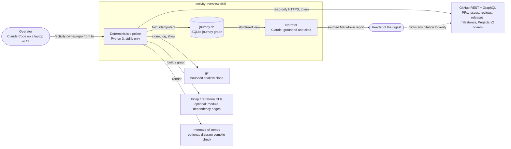
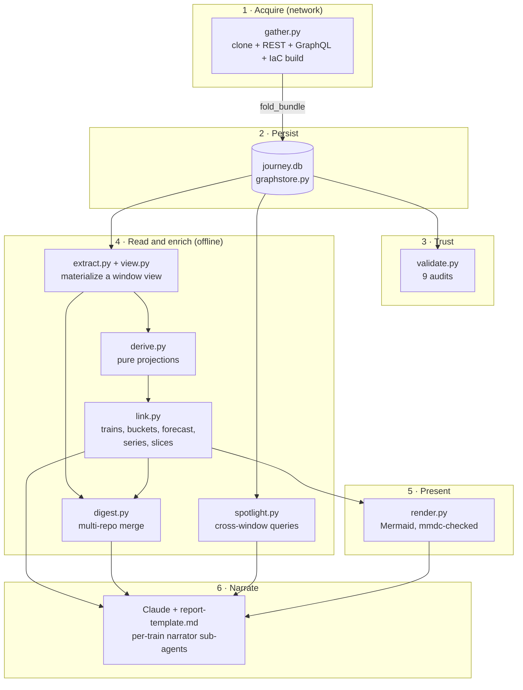
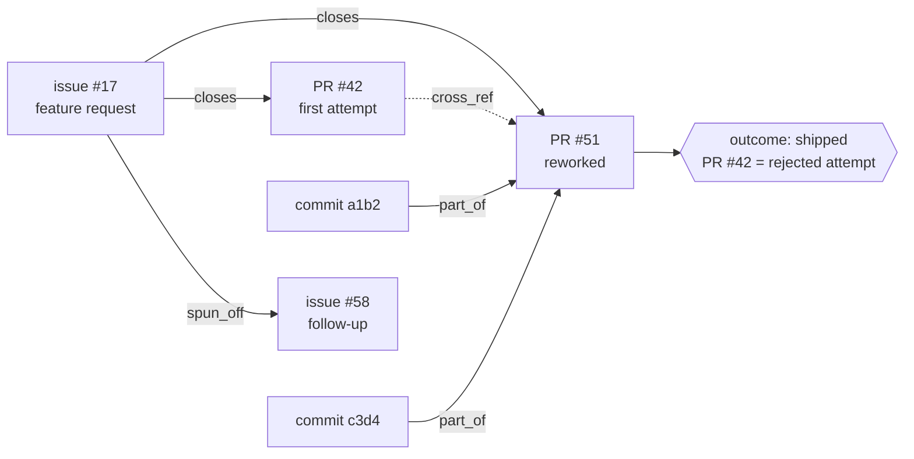
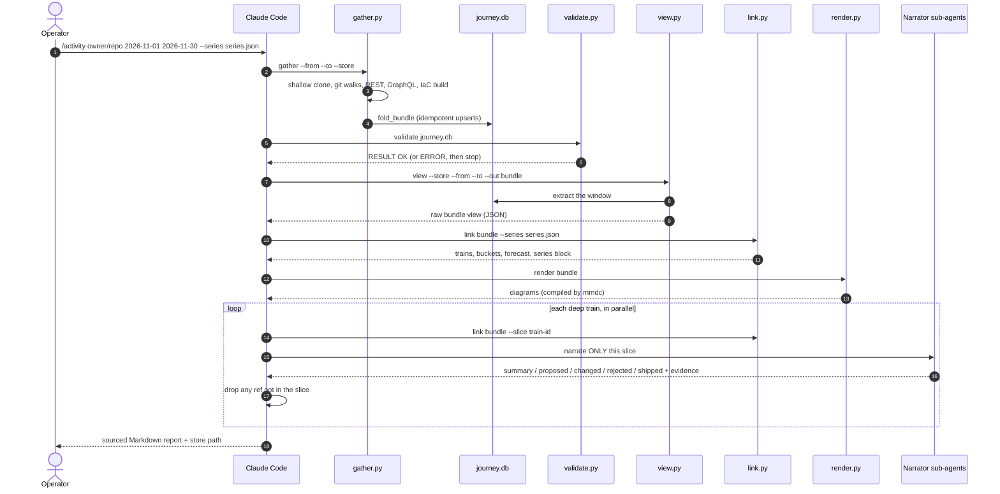
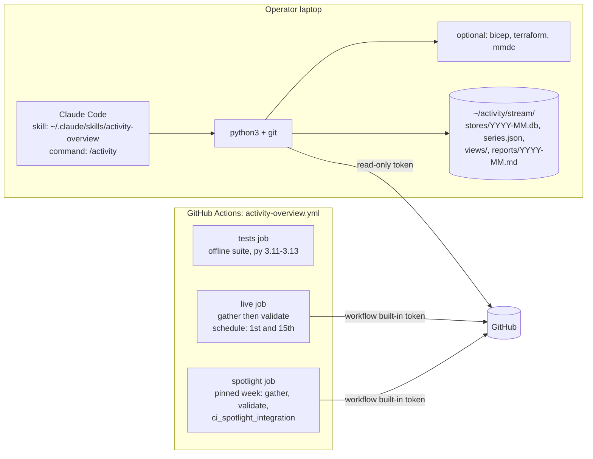
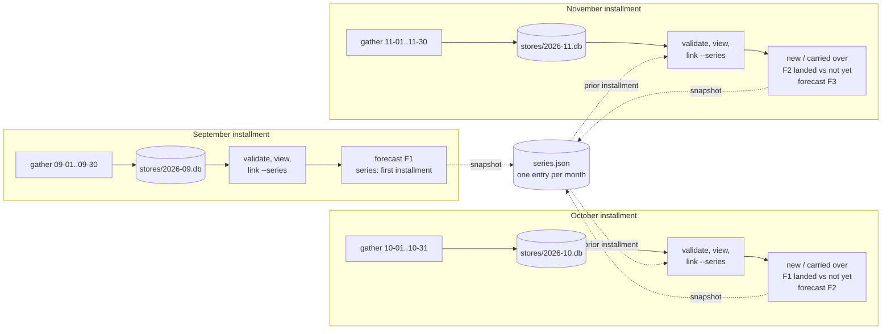
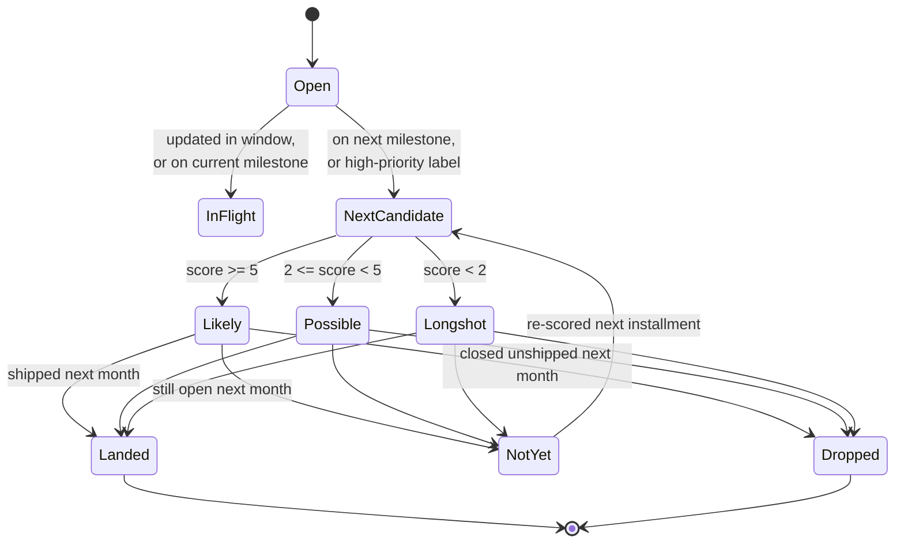
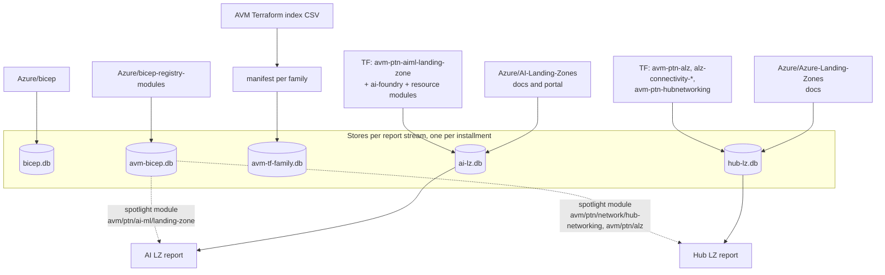

# activity-overview — High-Level Design

> **Audience:** architects, maintainers, and the operator who will run monthly digests
> across the Bicep, AVM-Bicep, AVM-Terraform and enterprise landing-zone (AI, hub/ALZ)
> estates. **Companions:** [`LLD.md`](LLD.md) (L400 low-level design),
> [`USAGE.md`](USAGE.md) (operator runbook), [`../ARCHITECTURE.md`](../ARCHITECTURE.md)
> (narrative tour), [`../STORE.md`](../STORE.md) / [`../BUNDLE.md`](../BUNDLE.md) (contracts).
>
> Every capability described here exists on `master`. Where a capability has a limit, the
> limit is stated in [§10](#10-constraints-and-known-limitations) — nothing here is aspirational
> unless it sits under [§11](#11-extension-points-and-roadmap).

---

## 1. Purpose

Maintainers of busy repositories are repeatedly asked *"what happened this month, what's
coming next, and why should I believe you?"*. Answering by hand is slow; answering with an
LLM from memory produces confident fiction.

**activity-overview** is a Claude Code *skill* that answers those questions with a report in
which **every claim links to the GitHub record that proves it**. It does that by splitting
the work in two:

> ⭐ **Core principle — gather is deterministic and decoupled; analysis is the model's judgment.**
> Python programs collect and structure the facts (same input → same output, every time).
> The model only writes prose, only from those facts, and must cite them.

The deliverable is not the Markdown report. It is a **persistent, auditable fact base** — a
SQLite *journey graph* — plus a **versioned structured view** of it. The report is one
renderer over that view; changelogs, dashboards or slide decks are others.

## 2. Capabilities at a glance

| Capability | Question it answers | Primary tool(s) |
|---|---|---|
| Window digest | What shipped / was rejected / is in flight in `[from, to]`? | `gather` → `validate` → `view` → `link` → `render` → report |
| Decision trains | How did an idea become a change? (issue → PR → commits → follow-ups) | `link.build_trains`, `link --slice` |
| Next-release forecast | What is likely to land next, and on what evidence? | `link.build_forecast` |
| Progressive series | What's new vs carried over since last month? Did last month's forecast land? | `link --series` (`series.py`) |
| Flow health | What is blocked, hung, upvoted-but-ignored? Who/what blocks the most? | `derive.build_flow` / `build_blockers` |
| Recognition | Who moved the project (no blame board, by design)? | `derive.annotate_people_profile` / `build_halls` |
| Feature ledger | Which params/outputs/resources/docs were added, changed, removed? | `code_events` + `feature_deltas` |
| Module biography | How has one module's surface evolved across all history? | `spotlight module` |
| Blast radius | If this module changes, which modules/repos consume it? | `spotlight dependents`, `digest.module_edges` |
| Multi-repo project | One view across a constellation of repos | `gather --manifest`, `digest` |
| Trust gate | Is the fact base complete, sourced and drift-free? | `validate` |
| Community call | What did the team discuss/decide (grounded in a transcript)? | `transcript` |

## 3. System context

**External dependencies.** `git` and a GitHub token are required. `bicep`/`terraform`
(module dependency edges), `mmdc` (diagram validation) and `graphify` (symbol-level code areas
for general-purpose languages) are optional and degrade cleanly when absent.

**Trust boundary.** The pipeline only *reads* GitHub; nothing is ever written back. The
token needs read scopes only (`repo` or `public_repo`, plus `read:project` for boards).

## 4. Logical architecture

Six layers, each with a single responsibility. Only the **Acquire** layer touches the
network; everything downstream is offline and reproducible.

| Layer | Owns | Never does |
|---|---|---|
| Acquire | All network + git I/O; normalization; the only writer of the store | Interpretation, scoring, prose |
| Persist | Identity-keyed nodes/edges, code-event ledger, FTS index, provenance meta | Business logic |
| Trust | Proving the store is complete, sourced, conformant, drift-free, idempotent | Mutating the store |
| Read & enrich | Deterministic projections over a window or across all history | Network (except opt-in backfill via `gather`) |
| Present | Diagrams that are proven to compile | Facts not in the view |
| Narrate | Judgment: what matters, how to say it — **cited** | Inventing facts, refs or URLs |

## 5. Key concepts

### 5.1 Journey graph

Every PR, issue, commit, review, person, code area, milestone, release and sprint is a
**node**; relationships (`authored`, `closes`, `part_of`, `touches`, `depends_on`, `blocks`,
`in_milestone`, …) are typed **edges**. Ids are qualified (`project/repo#pr-123`), so writes
are **idempotent**: re-gathering an overlapping window changes nothing that is already
correct. The storage layer can therefore hold many windows, and since issue #85 the readers
scope every view to its window: one store can grow month after month and each month's view
holds only that month's records (with continuity carried by the series file, §5.5). What a
store holding several windows still cannot give a past month is listed in
[§10](#10-constraints-and-known-limitations) items 7–9.

### 5.2 Decision train

A *decision train* is the connected chain of work joined by the **spine** edges
(`closes`, `part_of`, `cross_ref`, `spun_off`, `duplicate_of`). It is computed on demand
(never stored), so it always matches the facts.

Each train gets an **outcome** (shipped / in_flight / rejected / abandoned), a
**significance** score and a **tier** (`deep` → full narrative, `mention` → one line).
A single-repo `link` train holds every attempt — rejected, shipped and still-open PRs — with
each PR's own outcome, and every issue its PRs close; PRs and issues are joined only by
`closes`, so a `cross_ref` (a mention) is traversal context, never membership (#93, §10
item 11).

### 5.3 Buckets

Every PR/issue in scope lands in exactly one bucket, with precedence
**shipped > rejected > next_candidates > in_flight**:

| Bucket | Membership rule (summarized; exact rules in LLD §6.5) |
|---|---|
| `shipped` | PR merged to the mainline in-window, or issue closed *completed* in-window |
| `rejected` | PR closed unmerged in-window, or issue closed *not planned* in-window |
| `next_candidates` | Open, and on the **next** milestone or carrying a high-priority label |
| `in_flight` | Open, and on the **current** milestone or updated in-window |

### 5.4 Forecast

A transparent, rule-based score over `next_candidates` (not machine learning). Signals and
weights: on next milestone **5.0**, high-priority **3.0**, in motion (an open PR, or an
in-flight train; a rejected or shipped train does not count) **2.0**, active in window
**1.5**, long-open ≥ 200 days **1.0**. Tiers: **likely ≥ 5**, **possible ≥ 2**, else
**longshot**. Every candidate lists the signals that produced its score, plus non-scoring
notes such as "previous attempt rejected".

### 5.5 Series (progressive installments)

A tiny `series.json` records each installment's bucket and forecast refs, one entry per
window (re-running a month replaces its entry). Each installment is compared against the one
for the window just before it: **new**, **carried over** (with its prior status and where it
is now — shipped, still in flight, re-planned or rejected) and the **forecast loop** (last
month's predictions → *landed*, *not yet* or *dropped*). This is what turns isolated monthly
reports into a *progressive* story.

### 5.6 Slice

A bounded, self-contained bundle of one train's evidence (issue, PRs, commits, reviews,
capped diffs). Narrator sub-agents see **only** the slice, and the lead drops any citation
not present in it — the last line of defence against invented facts.

### 5.7 Project / constellation and blast radius

A **manifest** folds N repos under one logical project. Cross-repo spine edges come from
qualified refs (`owner/repo#N`, full URLs, repo-aware timeline cross-refs). For Terraform,
a registry `source` resolves to the member repo that publishes it, giving a project-wide
**module dependency graph**; `spotlight dependents` reads it backwards as the
**blast radius**.

## 6. End-to-end flow

For a multi-repo project the same steps run per member (`view.py --project P --repo
owner/repo`), and `digest.py` adds the merged project view (cross-repo trains, merged
shipped/people/halls/modules, `module_edges`).

## 7. Deployment views

- **Laptop (primary).** Claude Code runs the pipeline and writes the narrative. Stores are
  ordinary files; keep one workspace per *report stream*.
- **CI (assurance).** The bundled workflow runs the offline test suite on every change and a
  scheduled **live** trust-gate run (gather → validate, default target
  `Azure/bicep-registry-modules`, trailing 14 days) and a **spotlight** gate over a pinned
  historical week. Both use the workflow's built-in token (public targets; dispatch input
  `token_source: secret` switches to the `ACTIVITY_TEST_TOKEN` secret for private ones). CI
  stops at the trust gate; it does not author narrative.

## 8. Usage scenarios

### 8.1 Scenario A — progressive monthly update (the core loop)

**Goal:** a monthly installment per stream that builds on the previous one: what shipped,
what's new vs carried over, whether last month's forecast landed, and the next forecast.

**What each installment contains:** executive summary; *Since last installment* (new,
carried-over with prior board status and current bucket, forecast loop); shipped by code area; deep decision
trains with grounded narratives; next-release forecast (likely / possible / longshot with
signals); feature changes; flow health; contributors; releases and CI health.

**Why it compounds:** continuity comes from `series.json`, which chains each installment to
the month before it — new vs carried over, and whether each forecast landed or was dropped
— so the monthly reports read as one progressing story. Re-running a month replaces its entry
instead of adding a second one. Each monthly store stays small and independently auditable. Two
rules keep the chain honest: capture each installment **at month-end** (open work, milestones
and board status are read as they are at gather time, so a past month cannot be re-created
later), and for a roll-up either gather the quarter or year as **its own window** or view it
over a store that holds all its months (its CI statistics are then their sum, its structure
the last month's — §10 item 8). The diagram shows one store per installment; one store
that grows month by month works too, with the limits in §10 items 7–9 (USAGE §2.1).

### 8.2 Scenario B — forecasting from in-flight work

**Goal:** a defensible "what's likely next" built from open issues and PRs, then *checked*
the following month.

**Operating notes.** The forecast is only as good as the repo's planning signals. It is
strongest where maintainers use **milestones** and **priority labels**; where they don't,
candidates come only from high-priority labels and may be few. The forecast loop makes
accuracy *measurable* month over month (landed ÷ forecast per tier). See USAGE §6 for
making forecasts meaningful on each target.

### 8.3 Scenario C — the portfolio

| Target | Shape | How it is gathered | What you get |
|---|---|---|---|
| **Bicep** (`Azure/bicep`) | One product repo (the Bicep compiler and tooling, .NET) | Single repo | Shipped/trains/forecast/flow/people. Code areas by directory (`src/<project>`); no IaC edges (not an IaC repo). |
| **AVM Bicep** (`Azure/bicep-registry-modules`) | One monorepo, 500+ resource and ~50 pattern modules | Single repo (`--structural-iac` for the whole module graph) | Areas per module (`avm/res/<svc>/<mod>`, `avm/ptn/<group>/<mod>`); `br/public:` references resolve to in-repo module areas; per-module biographies; per-module blast radius (`spotlight dependents owner/repo::<area>`). |
| **Bicep landing zone** (an enterprise repo consuming AVM Bicep) | One or more repos referencing `br/public:avm/...` | Manifest with BRM as a member declaring `bicep_registry_prefix: "avm/"` | Cross-repo `depends_on` from the landing zone's modules to the BRM modules they pin, with versions. |
| **AVM Terraform** | One repo per module | Manifest (generated from the AVM Terraform index) | Cross-repo trains; structural cross-repo `depends_on`; blast radius per module. |
| **AI landing zone** | TF pattern constellation + Bicep pattern module in BRM + docs/portal hub repo | TF: manifest. Bicep: the BRM store, scoped to `avm/ptn/ai-ml/landing-zone`. Hub repo: manifest member (social layer) | End-to-end view of the AI LZ: code, dependencies and community discussion. |
| **Hub / platform LZ (ALZ)** | TF ALZ + connectivity pattern repos; Bicep `avm/ptn/alz`, `avm/ptn/network/hub-networking`; docs hub; ALZ-Bicep classic (archival scheduled) | TF: manifest. Bicep: BRM store scoped to those areas | Platform-LZ change tracking, blast radius of networking modules, deprecation tracking. |

### 8.4 Scenario D — blast radius before a breaking change (Terraform)

Before bumping a major version of, say, `avm-res-network-virtualnetwork`, run
`spotlight dependents Azure/terraform-azurerm-avm-res-network-virtualnetwork` against the
constellation store: it lists every member module that depends on it (with pinned versions
in `digest.module_edges`). On a fresh store, the structural scan means this reflects the
module structure of the checkout gathered for that window, not just that month's churn. In
a store folded from several gathers, each fold retracts the `depends_on` edges its scan or
build shows are gone (#95), so the result is the structure of the latest gathered window that
speaks for each module (manifest members always carry the whole-tree scan).

### 8.5 Scenario E — module biography for release notes

`spotlight module avm/res/network/virtual-network` (Bicep) or a TF module area returns the
full-history lifecycle of every parameter/output/resource symbol (added → changed → removed,
with before/after snippets and the driving PR). The narrator turns it into a cited
"how this module evolved" section.

### 8.6 Scenario F — community call fold-in

Pass a `.vtt`/`.srt`/`.txt` transcript; `transcript.py` normalizes it and the report gains
*Community call highlights* grounded in verbatim quotes, clearly separated from code facts.

### 8.7 Scenario G — flow and contributor health

The deterministic `flow` classifier (blocked / upvoted-but-ignored / traction-then-abandoned
/ hung) and `blockers` ranking show where work is stuck; `halls.fame` recognizes
contributors. Attribution of stalls to people exists only in an **opt-in internal appendix**
— the public digest never blames individuals.

## 9. Quality attributes

| Attribute | How the design delivers it |
|---|---|
| **Verifiability** | Every fact carries a `{type, id, url}` ref; narrator citations are filtered to the slice. |
| **Determinism** | Sorted JSON, ordered range queries, pure projections; same store → byte-identical view. |
| **Idempotency** | Identity-keyed upserts and set-semantics ledger; re-folds are no-ops. Proven by `validate.idempotency`. |
| **Trust** | `validate.py` gates every report (read-only; a check that cannot run fails, never disappears). Nine checks per repo, in this order: target, referential integrity, participant completeness, provenance, no fabrication, schema conformance, edge set, no drift, idempotency; plus the project-wide people and member-status checks for a multi-repo project. |
| **Graceful degradation** | Missing CLIs, scopes, boards or FTS5 produce empty or clearly-flagged sections, not failures; IaC gaps are counted (`edge_extraction`). |
| **Offline readers** | Only `gather` (and opt-in `--complete` backfill) touch the network; everything else replays from the store. |
| **Security** | Read-only token; no write-back; secrets only in the environment; recognition-not-blame by default. |
| **Portability** | Python 3 stdlib only; the store is one SQLite file. |

## 10. Constraints and known limitations

These are real, current limits — plan around them. Stores gathered before some fixes need
a re-gather to benefit from them (person ids, base branch, per-window facts, commit times,
nested Terraform areas, PR head repo); [`USAGE.md`](USAGE.md) §2.2 lists them once.

1. **Cross-repo Bicep `depends_on` needs a declared publisher and the public registry.**
   A manifest member that declares `bicep_registry_prefix` (e.g. `"avm/"` on
   `Azure/bicep-registry-modules`) receives cross-repo `depends_on` edges from other members'
   `br/public:<path>:<tag>` (or `br:mcr.microsoft.com/bicep/<path>:<tag>`) references, to its
   module area `<path>` (#92). The registry path must equal the module's directory in that
   repo (true for BRM). Private registries (`br:<acr>/…`), template specs, user aliases
   (including a `bicepconfig.json` alias that points at the public registry) and public
   modules no member declares stay unresolved. A single-repo gather never resolves across
   repos.
2. **The Bicep whole-tree graph reads `main.bicep` entrypoints only.** The structural scan
   (#92) runs for every manifest member and for a single-repo gather given
   `--structural-iac`; it adds every module's **direct** edges statically. Without it, Bicep
   edges are built only for areas changed in the window, and only with the `bicep` CLI.
   Transitive Bicep edges come only from `bicep build`. A module area is a directory with a
   tracked `<area>/main.bicep`: a module whose entry file has another name (common in
   landing-zone repos), and `import … from 'br/public:…'` type imports, are not in the graph.
3. **Terraform transitive edges come from the build.** Every `module {}` block an area
   declares is a direct `depends_on` (#80), with or without `terraform`. Nested calls
   (`module.a.module.b`) are added as transitive only by a successful `terraform init` +
   `graph`: calls whose module tree holds no resources are not in the graph, and without
   init's `modules.json` a nested call's target is unknown and is not folded. Single-repo
   gathers emit no Terraform edges without `terraform` unless given `--structural-iac`;
   manifest gathers always get the static direct edges for every module dir.
4. **One branch walked: the mainline.** The *mainline* that "shipped" counts merges into
   (`meta.base_branch`) is the repo's real default branch (or `--branches` / a manifest member
   `branch`), stored per window and carried by every view (issue #84), and since #107 it is
   also the branch the commit walk and the structure reads cover (a non-default mainline is
   fetched and checked out; one that does not exist on the remote stops the gather). Extra
   `--branches` entries are recorded as provenance only.
   The structure (code graph, IaC, CODEOWNERS) is read at the window's last mainline commit,
   so a past month re-gathered later reads its own tree — unless the bounded clone does not
   reach it (`meta.structure_as_of: "head"`, LLD §14.5).
5. **Open items are fetched every run.** All open PRs/issues are pulled regardless of window
   (they feed in-flight/forecast), each with per-item review/timeline/comment calls. On very
   busy repos (e.g. BRM) a gather is API-heavy. On a rate limit, gather waits for the reset
   (announced on stderr, at most `ACTIVITY_RATE_LIMIT_MAX_WAIT`, default one hour) and
   continues; any other 403 (SSO, scope) still fails fast with GitHub's headers.
6. **No historical in-flight state.** `gather` reads open PRs/issues, milestones, board
   status and the checkout as they are *now*; re-gathering a past month reproduces its
   delivery history, not what was open or forecastable at the time.
7. **A store holding several windows shows past months with today's record state.** Views
   are window-scoped (#75, #85; BUNDLE.md "Window scope"), but PR/issue records are stored
   latest-wins, so a past month's view shows each PR/issue as the latest gather saw it
   (state, labels, milestone, `updated_at`, comments; `meta.state_as_of` says from when).
   An item that was open at the end of that month but has closed since is not in its view;
   an item updated in that month and again later is in the later month's view only; its
   in-flight, next-candidate and forecast sets reflect today's open items.
8. **Per-repo facts are per gathered window, not per day.** Each fold records its window's
   `workflow_stats`, `code_graph`, `code_owners`, `label_taxonomy` and clone sha (#94), and a
   view of exactly a gathered window shows that window's. Other views are assembled from
   whole windows: CI statistics are the sum of the gathered windows lying inside the view
   (absent for a view inside one window or straddling two; `workflow_stats_complete: false`
   when days are missing), and the structure is the latest overlapping window's, so in a
   quarter view files changed only in an earlier month have no code area.
   `meta.facts_windows` says which windows.
9. **Current-state edges are retracted only on evidence.** Each fold keeps `depends_on`,
   `owns`, `in_milestone`, `in_iteration` and `blocks` equal to what the store's inputs imply
   (#95; STORE.md "Current-state edges"). What is left: a `depends_on` edge goes only when a
   resolved build of its area or the whole-tree scan shows it gone (a single-repo store
   without `--structural-iac` and without `bicep`/`terraform` keeps the edges of areas no
   later window rebuilt), a transitive edge only on a new build, and an area's owners only
   when a later window lists the area. The item relations follow the last-folded record, so
   folding an older window after a newer one brings its older relations back — fold oldest
   first.
10. **Forecast depends on planning hygiene.** Candidates require a next milestone (one with a
    due date) or one of the recognized priority labels (`priority/high`, `priority/critical`,
    `p0`, `p1`, `high-priority`, `critical`); repos with other label names need
    `link.HIGH_PRIORITY_LABELS` extended. "In motion" counts any open PR that closes or
    references an item, however old or draft.
11. **Trains follow closing references.** A `link` train holds every PR that targets the
    mainline — shipped, open or rejected — joined with the other PRs that close the same
    issues, and lists every issue they close (#93). Only a closing reference joins a PR to an
    issue: a closing keyword (`Fixes #N`, `Closes #N`, … in the PR title or body) or a link
    made in the PR's Development sidebar, which gather reads from GitHub's GraphQL
    `closingIssuesReferences` (#105). A mention or a timeline cross-reference does not, so
    such a PR is its own train (`train-pr-<n>`). When GraphQL is unavailable (gather says so
    on stderr; `meta.closing_refs_source: keywords`) only the keywords count. Stores gathered
    before #105 keep keyword-only `closes` until re-gathered. A PR closing several issues
    joins every PR that closes any of them. An unmerged PR into another branch is in no train.
12. **Series continuity is per bundle and by bucket.** `series.json` keeps one entry per
    window and compares each installment with the window before it (#86), but it is kept
    per single-repo bundle (no project-view series), it only sees items in one of this
    window's buckets (in-flight work that went quiet drops out of *carried over*), and
    refreshing an earlier month does not recompute the later months' already-written series
    blocks (`link` names them on stderr). A month recorded after a later one is marked
    `captured: "backfill"`; leave its forecast loop out of hit-rate statistics.
13. **People are GitHub logins; some commit authors cannot be resolved.** gather maps each
    commit's git author to the login PR/issue/review records use (GitHub's commits listing
    per SHA, then a `users.noreply.github.com` email), so a PR author and their commits are
    one person (#78). A commit whose email GitHub links to no account and that has no
    noreply email stays a separate person keyed by its git name and flagged
    `login_resolved: false` — never merged with a login on a guess. Commits fetched by
    `spotlight --complete` backfill keep the git name and have no `committed_at`.
14. **Spotlight trains are spine groups, not `link` trains.** `spotlight` groups by the
    causal spine and judges the outcome from the nodes it reached (same vocabulary as
    `link`, plus `direct_push` for commits that landed with no PR). A closed issue without a
    close reason counts as completed, and a file renamed away keeps its old path `alive`
    (the ledger records the rename under the new path). An area shared by several members
    is unioned unless the query names one (`owner/repo::area` or `--repo`).
15. **A partial manifest gather is flagged, not completed.** One failing member does not
    stop a manifest gather (#77): the others are folded, gather exits 1, and each member's
    outcome per window is kept in the store (`member_status`), so `validate` fails the
    project and `digest`/`view` warn until `gather --resume` completes it. The digest and
    view JSON do not carry the incomplete members; a formatter must rely on the gate.
16. **The trust check proves consistency, not truth.** See *What the trust gate proves*
    below: a store-only audit cannot detect a record deleted together with its edges, a
    consistently rewritten record or a wrong change ledger. A repo gathered under a name it
    no longer has (renamed or transferred) fails `provenance`, because GitHub returns its
    links under the new name.
17. **What a view says about its own completeness.** Since #107 a view carries the clone
    facts of its window (`meta.clone_mode`, `meta.boundary_dropped_commits` when commits were
    dropped at the shallow boundary), one contract version (`meta.schema_version` = 3 on
    every view; the store's own schema version stays in the store), and the digest's
    `module_edges` keep `ref` / `address` / `via`. The report template and the sample
    builder state `meta.facts_windows` (a wider view's CI total may be partial) and
    `meta.state_as_of` (a past month viewed from a later gather). A view of exactly
    one gathered window also says which tree its structure was read at
    (`meta.structure_as_of`: `window_end` or `head`). Not carried:
    `meta.closing_refs_source` is in gather's bundle only, and a view narrower than a gathered
    window does not repeat that window's dropped commits.
18. **Narrative is not in CI.** The live CI jobs stop at the trust gate.

Item 7 is what USAGE §2.1 weighs when choosing between one accumulated store and one store
per installment. Artifact folding is cumulative (#76): each fold rebuilds the artifacts it
touches from the whole change ledger, so a store holding several windows passes
`validate.no_drift` whatever the fold order, and a view shows each artifact's status as of
its window's end. Symbol moves are matched per window; on such a store `validate` checks
each recorded move against the ledger instead of re-matching across windows, and its
idempotency probe reports a whole-store re-match as INFO (LLD §8).

**What the trust gate proves (#79, #89).** `validate` proves the store is *consistent*:
every edge is exactly what the stored records imply (`edge_set`, both directions), people
are re-derived from the records alone, every PR/issue/review/event cites its own GitHub
link and every commit id is a real sha, and ids follow the grammar. It does not prove the
records are what GitHub holds: a record deleted with all its edges, a blob rewritten
consistently, or a wrong change ledger (artifacts are compared with the store's own ledger)
leave a consistent store. A `--bundle` saved at gather time (a `view.py` JSON of the fresh
store) catches changed or deleted records; the store keeps no per-fold content digest. On a
store holding several windows the current-state edges (ownership, dependencies,
milestones, sprints, blockers) and area touches are checked exactly once a fold since #95
has maintained them and every window has its per-window facts; otherwise, and always for
people's areas (a union over the windows), a difference is a WARN naming the reason (LLD
§8, §14.5).

## 11. Extension points and roadmap

| Extension | Where |
|---|---|
| New report formats (changelog, dashboard, deck) | Consume the versioned view (`BUNDLE.md`); see `examples/formatters/` |
| New code-area layouts | Add a pattern to `gather.DEFAULT_AREA_PATTERNS` |
| Organization-specific priority labels | `link.HIGH_PRIORITY_LABELS` |
| Historical record state on multi-window stores (limitation 7) | Per-window snapshots of PR/issue records at fold (not implemented; views are window-scoped since #85) |
| Forecast weights / tiers, train significance, flow thresholds | Named constants in `link.py` / `derive.py` (LLD §13) |
| Cross-repo Bicep dependencies from private registries / template specs | `gather.resolve_bicep_registry_member` (public registry only, #92); a private-registry prefix field would extend it |
| New spotlight lens | Add a query + renderer in `spotlight.py` |
