# activity-overview — Low-Level Design (L400)

> **Audience:** engineers who maintain, extend or debug the skill. **Prerequisite:**
> [`HLD.md`](HLD.md). **Contracts referenced:** [`../STORE.md`](../STORE.md) (store schema),
> [`../BUNDLE.md`](../BUNDLE.md) (view schema). **Operator guide:** [`USAGE.md`](USAGE.md).
>
> Every function name, flag, constant and threshold in this document is taken from the code
> on `master`. Line-level detail lives in the source; this document explains *how the parts
> work and why*, at the level needed to change them safely.

## Contents

1. [Conventions](#1-conventions)
2. [Code map and dependency graph](#2-code-map-and-dependency-graph)
3. [Runtime model](#3-runtime-model)
4. [Acquire — `gather.py`](#4-acquire--gatherpy)
5. [Persist — `graphstore.py`](#5-persist--graphstorepy)
6. [Read and enrich — `extract`, `complete`, `link`, `derive`, `series`](#6-read-and-enrich)
7. [Present — `render.py`](#7-present--renderpy)
8. [Trust — `validate.py`](#8-trust--validatepy)
9. [Cross-window reader — `spotlight.py`](#9-cross-window-reader--spotlightpy)
10. [Multi-repo aggregation — `digest.py`](#10-multi-repo-aggregation--digestpy)
11. [Supporting tools](#11-supporting-tools)
12. [Data contracts](#12-data-contracts)
13. [Configuration and tunables](#13-configuration-and-tunables)
14. [Cross-cutting concerns](#14-cross-cutting-concerns)
15. [Testing and CI](#15-testing-and-ci)
16. [Extension guide](#16-extension-guide)

---

## 1. Conventions

- **Python 3, standard library only.** No third-party packages; `sqlite3`, `urllib`,
  `subprocess`, `concurrent.futures`, `json`, `re`, `csv`.
- **Pure vs effectful.** Functions documented as *pure* take inputs and return outputs with
  no I/O. All network and git I/O is in `gather.py`; the store write path is
  `gather.fold_bundle` (and `gather.backfill`).
- **Window.** `[from, to]` are inclusive `YYYY-MM-DD` dates. Windowing of commits is done in
  Python on the committer date (`window_records`), not with git `--since/--until`.
- **Ref convention.** `{type: "pr"|"issue"|"commit", id, url}` on every narrative-bearing fact.
- **Determinism.** JSON is written with `sort_keys=True`; collections are sorted before
  emission; ties are broken by id.

## 2. Code map and dependency graph

| Module | LOC | Role | Network | Writes store |
|---|---:|---|:---:|:---:|
| `gather.py` | 3,547 | CLI; clone, git walks, REST/GraphQL, IaC build, normalization, `fold_bundle`, `backfill` | ✅ | ✅ |
| `graphstore.py` | 594 | SQLite property-graph schema + read/write API | — | (API) |
| `extract.py` | 544 | Materialize a raw bundle *view* for one repo + window | (via injected backfill) | — |
| `complete.py` | 138 | Train-completion policy over the spine (honest gaps) | (via injected backfill) | — |
| `derive.py` | 738 | Pure projections shared by write and read paths (artifacts, people, flow, halls) | — | — |
| `link.py` | 1,116 | `enrich`: trains, buckets, timeline, deltas, areas, significance, effort, forecast; `--slice`, `--series` | — | — |
| `series.py` | 132 | Pure installment snapshot + comparison | — | — |
| `render.py` | 1,010 | Mermaid emitters (size-capped) + `mmdc` validation | — | — |
| `validate.py` | 907 | Trust gate (audits) | — | — |
| `spotlight.py` | 1,685 | Cross-window queries (person, symbol, subsystem, grep, module, dependents) | (opt-in `--complete`) | — |
| `digest.py` | 414 | Multi-repo project view | — | — |
| `manifest.py` / `manifest_from_index.py` | 195 / 278 | Manifest validation / generation from the AVM Terraform index | (index fetch) | — |
| `transcript.py` | 116 | VTT/SRT/TXT normalization | — | — |

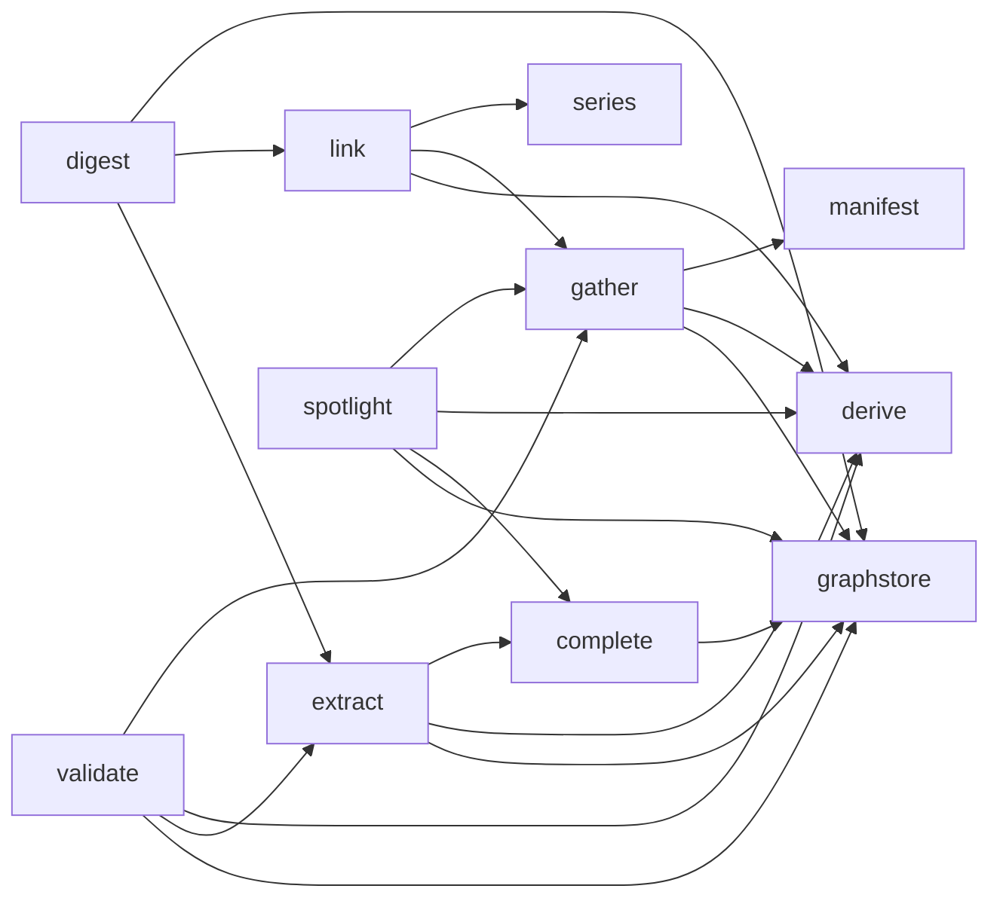

`derive.py` is a deliberate **leaf** (imports none of the others): both the write path
(`fold_bundle`) and the read path (`extract` + `link.enrich`) call the same functions, which is
what makes the `no_drift` audit meaningful. `link` imports `gather` only for pure helpers
(e.g. `classify_pr_kind`); `validate`/`spotlight` import it for `fold_bundle` (re-fold in a
scratch store) and `backfill` respectively.

## 3. Runtime model

- Every tool is a short-lived CLI process. There are no daemons, servers or caches beyond the
  SQLite file, the git clone directory and (optionally) terraform's plugin cache.
- **Files on disk:** `--store` (SQLite), `--clone-dir` (default `workspace/<repo>-clone`),
  the bundle view JSON you materialize, `series.json`, `workspace/diagrams/*.mmd`.
- **Concurrency:** only IaC edge extraction runs in parallel (thread pool,
  `ACTIVITY_IAC_MAX_WORKERS`). Everything else is single-threaded and ordered.
- **Failure model:** network/auth failures in `gather` abort with GitHub's message and
  headers printed; optional tools missing → the dependent layer is empty; readers never
  mutate the store.

## 4. Acquire — `gather.py`

### 4.1 CLI contract

`main()` → `parse_args()`. Single-repo and manifest modes are mutually exclusive.

| Flag | Default | Effect |
|---|---|---|
| `--owner`, `--repo` | — | Single-repo target |
| `--manifest PATH` | — | Multi-repo project (validated by `manifest.load_manifest` **before** the store is touched) |
| `--from`, `--to` | — | Window (`YYYY-MM-DD`, `from ≤ to`; owner/repo/dates checked in `parse_args` with the shared `manifest.py` validators) |
| `--ref-date` | `--to` | Reference date for milestone/sprint/forecast/flow framing |
| `--branches` | `main` | Recorded in `meta`; first is `base_branch` (walk uses the checked-out default branch) |
| `--clone-dir` | `workspace/<repo>-clone` | Clone location |
| `--no-clone` | off | Reuse an existing clone |
| `--include-workflows` / `--no-workflows` | on | CI run stats |
| `--include-releases` / `--no-releases` | on | Releases in window |
| `--project-board` / `--no-project-board` | on | Projects v2 ingest |
| `--store PATH` | **required** | SQLite store |

Single-repo folds use `project = owner`, `repo = <name>`. Manifest folds use
`project = manifest.project`, `repo = "owner/repo"`, and pass `members` +
`registry_by_slug` to `fold_bundle` for cross-repo resolution.

### 4.2 `acquire(args, env)` sequence

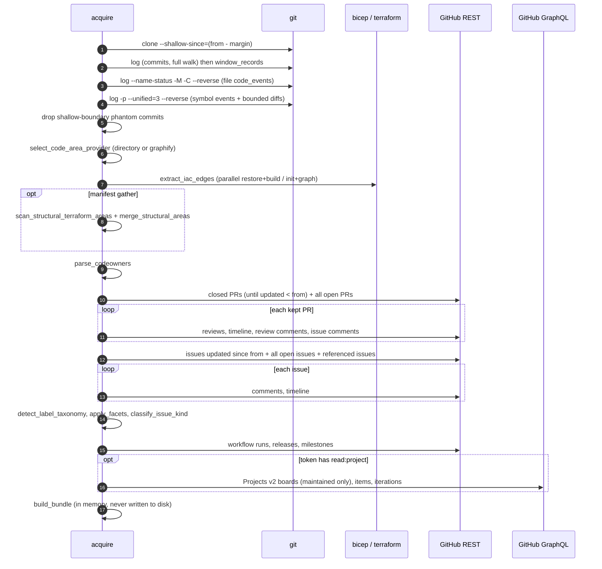

### 4.3 Clone and windowing

- `acquire` calls `prepare_clone` on `--clone-dir` (default `workspace/<repo>-clone`; for
  manifests `--clone-dir` is the parent of per-member `<owner>-<repo>-clone` dirs) and records
  the outcome in `meta.clone_mode`:
  - `fresh` — no (or an empty) dir: `git clone` (`build_clone_cmd`).
  - `fetched` — the dir is already a clone of the same remote (`remote.origin.url`, GitHub
    https/ssh forms compared equal): `git fetch --prune --shallow-since=…` (`build_fetch_cmd`;
    deepens or shortens to this window's bound) then `checkout -B <default branch>` at the
    fetched `origin/<default branch>`. Applies with and without `--no-clone`.
  - `depth1-fallback` — `--shallow-since` selected no commits (git: "no commits selected for
    shallow requests", a quiet repo): the clone/fetch is retried with `--depth=1` so HEAD exists
    for IaC edges / CODEOWNERS / the structural scan; the three git walks are skipped (empty).
    Any other clone/fetch error still raises.
  - `none` — `--no-clone` and no clone on disk: nothing is created; the walks are empty.
  A non-empty dir that is not a git clone, or is a clone of another remote, raises and is left
  untouched.
- The clone/fetch uses `--shallow-since = from − ACTIVITY_CLONE_MARGIN_DAYS` (default 14). The
  margin keeps each in-window commit's real parent in the clone.
- `shallow_boundary_shas` + `drop_boundary_events` remove events from a commit whose parent
  was grafted away (its diff would be a whole-tree phantom). Any **in-window** commit dropped
  this way is recorded in `meta.boundary_dropped_commits` and a warning is printed — widen the
  margin and re-gather to recover it.
- Commit dates use the committer date; filtering is `window_records` in Python to avoid git's
  timezone-sensitive pruning.

### 4.4 Code-event and symbol extraction

- **File level** (`parse_code_events`): `add|modify|delete|rename|copy` per path per commit,
  oldest → newest.
- **Symbol level** (`parse_patch_events` → `parse_symbol_events`): a single `git log -p` walk;
  `detect_symbol_decl` recognizes Bicep (`param|var|output|resource|module`) and Terraform
  (`variable|output|resource|module`) declarations plus comments. Comments are identified by
  their text (so a rewritten decision comment is drop + add); `TODO|FIXME|HACK|XXX|BUG`
  comments get subkind `todo`; banner comments are ignored. `before`/`after` snippets are
  capped at 200 chars (`_cap_snippet`).
- **Bounded file diffs** (`bounded_file_diff`, `FILE_DIFF_CAP`/`FILE_DIFF_LINE_CAP`) ride the
  file-level code event so narrators read real changes without a clone.

### 4.5 Code areas

`select_code_area_provider(paths, clone_dir)` is directory-first: it uses **graphify** only when
`graphify` is on PATH **and** `graphify update <clone>` yields a `graph.json` with nodes and
non-empty communities; any absence or failure falls back to the **directory provider**
(`build_directory_areas`), which maps each path with `classify_code_area`, trying patterns in
order (graphify does not parse Bicep/HCL, so IaC repos always land here):

| Order | Pattern | Maps | Example |
|---:|---|---|---|
| 1 | `avm` (`_avm_area`) | `avm/{res,ptn,utl}/<a>/<b>/…` → 4-segment module subtree | `avm/ptn/ai-ml/landing-zone` |
| 2 | `main_bicep` | any dir containing `main.bicep` → that dir | `infra/hub/main.bicep` → `infra/hub` |
| 3 | `terraform_modules` | `modules/<name>/…` | `modules/subnet` |
| 4 | `tf_dir` | any `*.tf` dir; **repo-root `*.tf` collapse to one `main.tf` area** | `main.networking.tf` → `main.tf` |
| 5 | `topn` | fallback: top 2 path segments | `src/Bicep.Core` |

`_is_scaffold_area` marks Terraform `examples/` and `tests/` subtrees as scaffolding: their
edges are **skipped at extraction and excluded at fold**, because those trees reference the
module under test through CI-manipulated relative paths and test-only registry modules.
`_is_scaffold_path` applies the same test to a *file*, so a nested scaffold file that
classifies into its module's area (`modules/sub/examples/x/main.tf` → `modules/sub`) is never
read or built as that module.

Area `paths` are the in-window **changed** files (including deleted ones), so they are not
used to pick what to build; the entrypoint is resolved on disk (§4.6).

### 4.6 IaC dependency edges (`extract_iac_edges`)

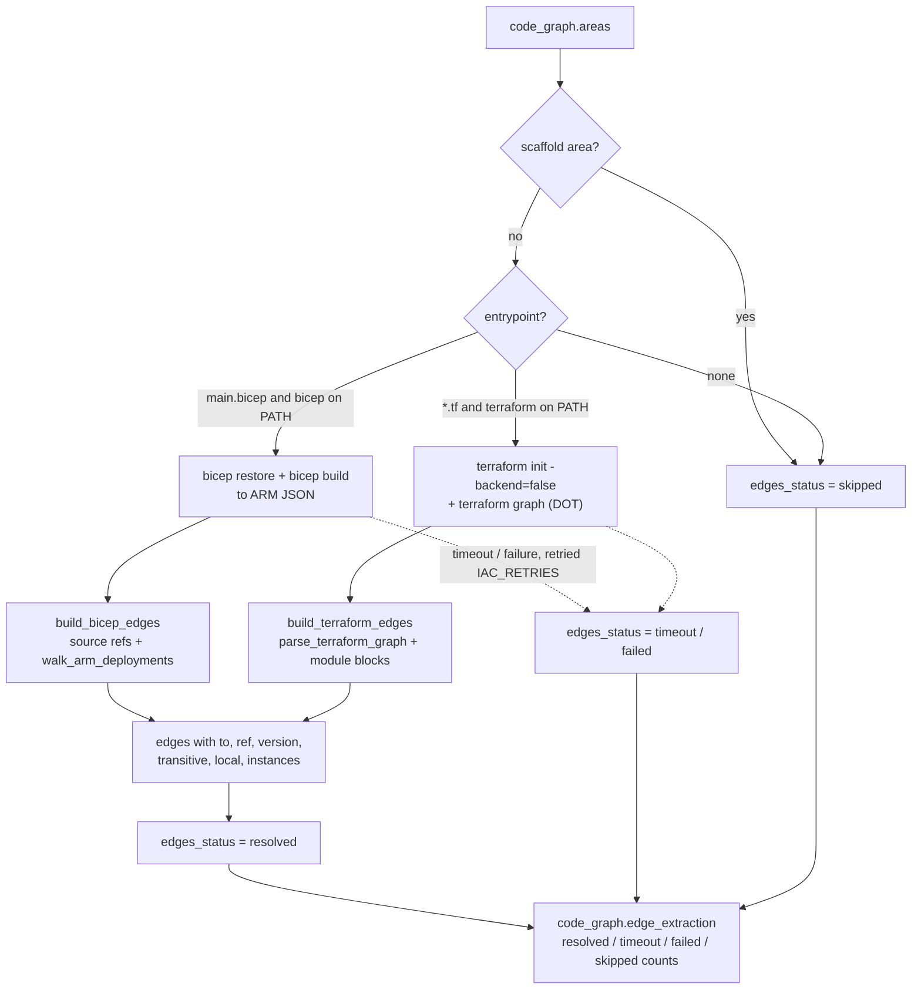

- **Entrypoint (`_bicep_entrypoint` / `_tf_entrypoint`, resolved on disk in the clone):**
  when the area id is a directory in the checkout, Bicep builds `<area id>/main.bicep` and
  Terraform uses that directory's `*.tf` set (`main.tf` preferred as the representative
  path), whichever files changed in the window; if that file/set is absent, the area is
  `skipped`. Only when the area id is not a directory (graphify `community:<n>`, a deleted
  dir) does it fall back to the shallowest of the area's `paths` that exists on disk. Root
  sentinels `main.bicep` / `main.tf` name the repo root. Paths missing from the checkout and
  files under nested `examples/`/`tests/` are never chosen, so an AVM child module
  (`avm/res/key-vault/vault/access-policy/main.bicep`) is never built in place of its parent.
  With no clone directory on disk (offline callers) the same rule runs over `paths` alone.
- **Build-only:** edges come only from a successful build; static guessing is never emitted.
  A `resolved` area with no edges genuinely has no inter-area dependencies; `timeout`/`failed`
  are **counted gaps**.
- **Bicep:** `parse_bicep_module_refs` splits `br/public:<path>:<ver>` / `br:<host>/bicep/<path>:<ver>`
  into `registry_path` + `version`; `resolve_module_ref` classifies `<path>/main.bicep`, so in
  the BRM monorepo `br/public:avm/res/network/virtual-network:0.x` resolves to the **in-repo**
  area `avm/res/network/virtual-network`. Transitive edges come from walking nested
  deployments in the compiled ARM (`walk_arm_deployments`).
- **Terraform:** extraction reads **every `*.tf` in the entrypoint's module dir**; `parse_terraform_graph`
  accepts DOT edges with or without the legacy `[root] ` node prefix (`_TF_EDGE_RE`); a node's
  first `module.<name>` token gives its owning module. Local sources resolve to repo areas
  (`../..` from a submodule → the root `main.tf` area); registry sources keep `to=None,
  ref=<source>, version`. Module blocks are parsed on an HCL mask (`_hcl_mask`: `#`, `//`,
  `/* */` comments, string contents incl. `${…}` interpolation, and heredocs blanked), so a
  commented-out or heredoc'd `module "x" {` is never a block; only file-top-level blocks
  count, and `source`/`version` are the block's own **top-level** arguments
  (`_tf_top_level_attr`: line-anchored, bracket depth 0), so `kubernetes_version`,
  `custom_source` or a `version` key inside a nested map/list is ignored.
- **Concurrency:** a thread pool of `ACTIVITY_IAC_MAX_WORKERS` (8), per-subprocess timeout
  `ACTIVITY_IAC_BUILD_TIMEOUT` (300 s), `ACTIVITY_IAC_RETRIES` (1). With `TF_PLUGIN_CACHE_DIR`
  set, `_terraform_prewarm` runs one serial init first because terraform's plugin cache is not
  safe under concurrent writes.
- **Structural scan (manifest gathers only):** `scan_structural_terraform_areas` statically parses
  every tracked module's `source` references (`git ls-files`, no `terraform init`; per area
  only the area dir's own `*.tf`, nested `examples/`/`tests/` files excluded) and
  `merge_structural_areas` unions them, so the dependency graph reflects structure rather than
  in-window churn. Single-repo gathers skip this to keep golden bundles byte-stable.

### 4.7 GitHub REST acquisition

| Data | Endpoint(s) | Bounding |
|---|---|---|
| Closed PRs | `pulls?state=closed&sort=updated` | `fetch_until` stops when a page's last `updated_at` < `from` |
| Open PRs | `pulls?state=open` | all |
| Per kept PR | `pulls/N/reviews`, `issues/N/timeline`, `pulls/N/comments`, `issues/N/comments` | paginated |
| Issues | `issues?state=all&sort=updated` (until `< from`) + `issues?state=open` (all) + `issues/N` for referenced issues | referenced 404s tolerated (`allow_404`) |
| Per issue | `issues/N/comments`, `issues/N/timeline` | paginated |
| Workflows, releases, milestones | `actions/runs` (window), releases, milestones | window / state; runs split by day past GitHub's 1,000-result cap |

Kept PRs = merged in-window, closed-unmerged in-window, or open. Every REST and GraphQL call
goes through `_github_open` (injectable `opener`/`sleep`/`clock`, so tests never sleep or touch
the network):

- **Timeouts and retries.** Each request carries `timeout=ACTIVITY_HTTP_TIMEOUT` (60 s).
  Timeouts, connection errors and 500/502/503/504 are retried up to `ACTIVITY_HTTP_RETRIES` (3)
  extra times with back-off 1, 2, 4 … s (cap 60 s), then fail with a message naming the URL and
  the attempt count.
- **Rate limits** (GitHub's documented rules). A 403/429 with `Retry-After` waits that long; with
  `x-ratelimit-remaining: 0` (primary) waits until `x-ratelimit-reset`; a secondary-limit
  message with neither header waits 60 s, doubling on repeats. A GraphQL 200 carrying a
  `RATE_LIMITED` error waits for the reset too. Each wait is announced on stderr (seconds and
  the UTC time it ends), is refused when longer than `ACTIVITY_RATE_LIMIT_MAX_WAIT` (3600 s;
  `0` = never wait), and at most `RATE_LIMIT_MAX_WAITS` (5) are made per request. Any other 403
  (SAML SSO, token scope) fails fast with the diagnostic: GitHub's message plus the deciding
  headers (`x-ratelimit-*`, `retry-after`, `x-github-sso`, `x-accepted-oauth-scopes`).
- **Auth on redirects.** The token is attached only to `https://api.github.com` URLs, and the
  redirect handler drops `Authorization` when a 3xx leaves that host (urllib's default handler
  re-sends it).
- **Errors.** `http_get_json` raises `SystemExit` (fail fast). `graphql_post` raises
  `GitHubAPIError` (a normal `Exception`); when GraphQL returns `errors` alongside non-empty
  `data` it keeps the data and warns. The board layer catches both, so a failed page degrades
  to the items already fetched.
- **Workflow runs.** `actions/runs?created=` returns at most 1,000 results per search (GitHub
  docs). `fetch_workflow_runs` reads the first page's `total_count`; at or over the cap the
  range is split by day and re-queried. A single day still at the cap is left truncated: a
  stderr warning, and `workflow_stats._truncated = {truncated, cap, fetched, total_count,
  ranges}` (a reserved key, present only then).

### 4.8 Projects v2 boards

`fetch_project_board` (GraphQL) auto-discovers the boards a repo links, keeps those
`board_is_maintained` (open, touched within `ACTIVITY_BOARD_STALE_DAYS` = 365 of the ref date),
paginates items up to `ACTIVITY_BOARD_MAX_ITEMS` = 5000 (warns when truncated) and
`parse_project_board` yields per-item `status` and `iteration`. Items are keyed per repo
`(slug, number)` so a foreign repo's status never leaks. Gathered PRs/issues are stamped with
`board_status` / `iteration`; iterations become `sprint-<id>` structure nodes with
`in_iteration` edges. Without `read:project` (or with `--no-project-board`) the layer is empty.

### 4.9 Classification

- `detect_label_taxonomy` auto-detects structured label namespaces → facets
  `area|priority|status|lifecycle|kind|class` (`type`/`kind` → `kind`; AVM `Class:` → `class`, a
  scope facet that is never a kind source); `apply_facets` stamps the first match per facet
  (`area|priority|status|lifecycle` only).
- `classify_issue_kind` → `feature|module-request|bug|idea|question|docs|other`, in precedence:
  native issue type → label kind (`kind` facet labels, then a bare label that is exactly a kind
  word such as `bug`/`enhancement`) → issue-template filename → title heuristic → other. All
  steps match whole words via `_KIND_PHRASES` (module phrases first; a bare "module" maps to
  nothing); the body is never read, so "the module breaks" or "not supported" in a body does not
  change kind (#58).
- `classify_pr_kind` reads conventional-commit prefixes (`feat→feature`, `fix→bug`, `docs→docs`).
- `normalize_pr` sets `closes = parse_closing_refs(title+body, repo=<base repo slug>)` with
  GitHub's semantics (#62): keywords `close[sd]`/`fix(e[sd])`/`resolve[sd]`, optional `:`, then
  `#N`, `owner/repo#N` or a full issue URL; each closed issue needs its own keyword
  (`Fixes #1, #2` → `[1]`; `Fixes #1, fixes #2` → `[1, 2]`). A same-repo qualified ref/URL is a
  same-repo close (`repo` is optional; without it only bare `#N` closes). The unkeyworded list
  tail (`#2`) comes from `parse_listed_refs` and seeds `crossref_issues` (note: `acquire()`
  currently overwrites that field with the timeline cross-refs). `parse_qualified_refs` returns
  keyword-closed cross-repo issues as `closes` (incl. keyword + issue URL) and everything else
  (other URLs, keyword + `/pull/` URL, list tails) as `cross_ref`. No Markdown parsing:
  keywords in code blocks match too.
- `resolve_commit_pr` (commit → PR, `part_of`): trailing `(#N)` on the subject line, else
  `Merge pull request #N`, else the last `(#N)` on the subject, then in the message.
- `normalize_issue` parses `parse_blocks_refs` ("blocks/blocking #N" outbound, "blocked by /
  depends on #N" inbound); `derive_open_high_activity` flags open issues with ≥ 5 comments or
  ≥ 5 👍.

### 4.10 `fold_bundle(conn, bundle, project=None, repo=None, members=None, registry_by_slug=None)`

Writes in this order (all idempotent upserts keyed by qualified id; edges by `(src,dst,type)`;
code events by `(artifact, commit, event)`):

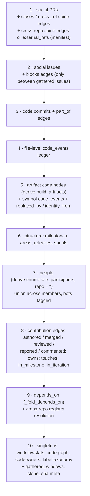

(The exact statement order inside the function differs slightly; the grouping above is the
logical sequence. FTS text is indexed as PR/issue/commit nodes are written (FTS5-gated).)

### 4.11 Cross-repo `depends_on` resolution (Terraform)

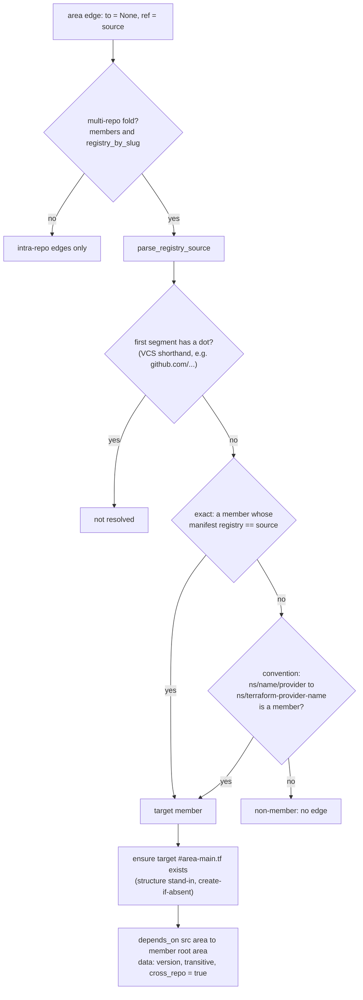

### 4.12 Backfill seam

`gather.backfill(conn, id, fetch)` fetches one missing spine node plus its immediate spine
edges. `fetch(kind, local, qid)` returns a payload, `ABSENT` (definitive 404 → recorded in
`dead_refs`, pruned forever) or `None` (transient → reported as an `unreachable` gap).
Production wiring: `make_backfill_fetcher(token, clone_dir)`. Only `gather` writes, so readers
receive backfill as an **injected callable**.

## 5. Persist — `graphstore.py`

### 5.1 Schema

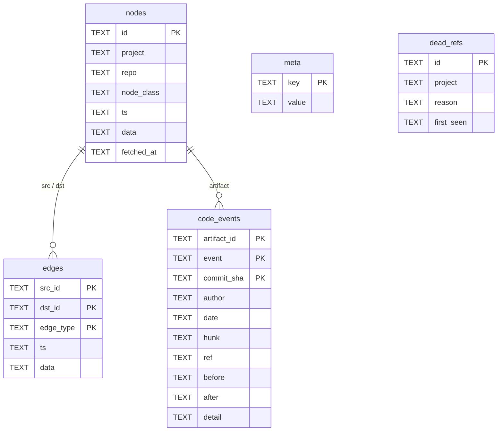

Plus `fts_text` (FTS5 virtual table) and its `fts_map(node_id PK, fts_rowid)` side table
when `fts5_available(conn)`. Indexes beyond the primary keys: `nodes (project, repo,
node_class, ts)`, `nodes (ts)`, `edges (src_id, edge_type)`, `edges (dst_id, edge_type)`,
`edges (edge_type, src_id, dst_id)`, `code_events (artifact_id, date)`. Store
`schema_version` is 2; `init_schema` migrates a v1 store in place (adds the edges index,
creates and back-fills `fts_map`) — see STORE.md "Schema version and migration".

### 5.2 Identity grammar

| Form | Example | Helper |
|---|---|---|
| Repo-scoped | `{project}/{repo}#{local}` | `qualify_id` |
| Person (project-scoped, `repo = "*"`) | `{project}#person-{login}` | `qualify_person` |
| Locals | `pr-N`, `issue-N`, `<sha>`, `art:<path>`, `<path>#<lang>:<subkind>:<name>`, `area-<id>`, `milestone-N`, `release-<tag>`, `sprint-<id>`, singletons `codegraph` … | — |

`parse_id` splits scope from local on the FIRST `#` (a local id may contain `#`;
see STORE.md "Parsing grammar"), and callers split the scope on its first `/`, so
`repo = "owner/repo"` (manifest mode) is safe. `local_id` returns the full local id;
`split_symbol_local` tells a symbol id from a file path containing `#` by its
`<lang>:<subkind>:<name>` tail.

### 5.3 API

| Group | Functions |
|---|---|
| Lifecycle | `open_store`, `init_schema`, `set_meta`, `get_meta`, `now_iso` |
| Nodes | `upsert_node`, `upsert_nodes`, `get_node`, `repo_nodes`, `range_query(conn, project, repos, ts_from, ts_to, node_class=None)`, `project_repos` |
| Edges | `upsert_edge`, `upsert_edges`, `get_edges(direction, edge_types)`, `edges_by_type(conn, edge_type, project)` |
| Ledger | `add_code_event(s)`, `get_code_events`, `repo_code_events` |
| Spine | `traverse_spine(conn, seed_ids, max_depth=6, edge_types=SPINE_EDGE_TYPES, skip_dead=…)` → `{reached:{id:depth}, missing:[id]}` |
| Text | `index_text` / `index_texts` (replace by node id via `fts_map`, no table scan), `fts_search` (raw FTS5 `MATCH`; callers must escape) |
| Provenance | `record_window`/`get_windows`, `set_clone_sha`/`get_clone_sha` |
| Tombstones | `record_dead_ref`, `is_dead_ref`, `get_dead_refs` |

**Semantics.** Identity columns are immutable; `ts`/`data`/`fetched_at` refresh on re-upsert.
Edges union. `range_query` orders by `(ts, id)` and excludes NULL-`ts` structure nodes.
Window bounds are granularity-safe: node `ts` mixes date-only (commits, artifacts) and ISO
datetimes (PRs, issues, reviews, events), and bounds may be either. `range_query` and the
shared predicate `ts_in_window(ts, ts_from, ts_to)` compare each bound at the coarser
granularity of the pair (a date-only value covers its whole day; datetime-vs-datetime is
exact), inclusive, either bound optional. `complete._in_window`, `spotlight` window checks,
`gather.in_window` and `link._in_window` delegate to `ts_in_window`; no caller pads bounds.
`traverse_spine` walks spine edges **undirected**, depth-capped; `missing` lists referenced but
unstored spine ids (minus known-dead when `skip_dead`).
`edges_by_type` / `repo_code_events` filter on the literal `{project}/` / `{project}/{repo}#`
id prefix **case-sensitively** as an index range (`>= prefix AND < prefix-successor`), not
`LIKE`. Batch writers and the meta setters take `commit=False`; `gather.fold_bundle` uses it
to write a whole fold (nodes, edges, code events, FTS, `gathered_windows`, `clone_sha`) in
**one transaction** — an exception mid-fold leaves the store unchanged.

## 6. Read and enrich

### 6.1 `extract.extract(conn, project, repo, ts_from, ts_to, max_depth=6, warn=None, backfill=None, backfill_budget=50)`

1. `range_query` the window for in-window nodes.
2. Seed trains from in-window **anchors** (PR/issue; reviews/events never seed), then
   `traverse_spine` to pull out-of-window context (`in_window: false`).
3. `complete.complete_train` (see 6.2) — with `backfill=None` this is warn-only.
4. Materialize the raw arrays (`commits`, `prs`, `issues`, `milestones`, `releases`, `sprints`,
   `code_events`, `symbol_events`) from the repo's nodes + ledger; re-attach reviews/lifecycle
   onto parents; surface `blocks` as `blocking`/`blocked_by`.
5. Read back `artifacts` and `people` (the write path already derived them) and the singleton
   facts (`code_graph`, `code_owners`, `label_taxonomy`, `workflow_stats`). `code_owners` is an
   ordered rule list so CODEOWNERS last-match-wins order survives the sorted-key JSON store;
   `fold_bundle` (`owns`) and `annotate_people_profile` (`stale_owned`) share one matcher,
   `derive.compile_codeowners`/`area_owners` (area = last rule matching `<area>/`).

The result is **raw** (no trains/buckets); `link.enrich` derives the rest.

> **Single-window assumption.** `_materialize_meta` emits `owner, repo, from, to` (+
> `clone_sha`) — no `period` or `ref_date` — and steps 4–5 read the repo's *whole* stored node
> set, not just the window. On a store gathered for one window this is exact (and is what the
> golden-equivalence tests pin). On a store holding several windows, the view includes every
> stored PR/issue/commit/train, and `compute_buckets` (which treats a missing `period` as
> "in window") counts every stored merge as shipped. See HLD §10 items 8–9 and §14.4.

### 6.2 Completion and honest gaps (`complete.py`)

Level-0 anchors are always filled; transitive expansion follows the causal spine and stops at
the query window. Every train carries `complete: bool` and `gaps: [{id, reason}]`:

| Reason | Meaning |
|---|---|
| `not_gathered` | Offline; no fetch attempted |
| `outside_window` | Beyond the query window; intentionally not chased |
| `unreachable` | Fetch attempted and failed (transient) |
| `budget` | Per-query fetch ceiling reached |

A definitive 404 (e.g. a `Fixes #123` template placeholder) is **pruned** and tombstoned in
`dead_refs`, never reported as a gap.

### 6.3 `link.enrich(bundle)` pipeline

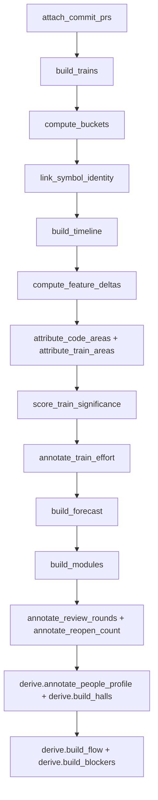

Order matters: significance needs code areas; forecast needs buckets and milestones; people
profiles need trains and artifacts. `artifacts`/`people` are **consumed**, not recomputed.

### 6.4 Decision trains — `build_trains`

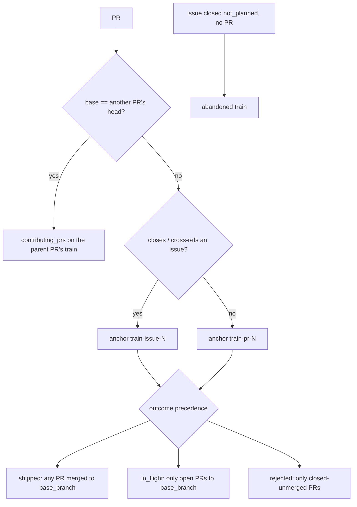

`kind` comes from the root issue's `kind`; when absent/`other`, from the lowest-numbered PR's
conventional-commit prefix. Each train records `prs`, `commits`, `code_areas`,
`contributing_prs`, `evidence` refs.

### 6.5 Buckets — `compute_buckets`

Evaluated per PR then per issue; first matching rule wins. "In window" uses `meta.period`;
when `period` is absent (as in an `extract` view) `_in_window` returns true for every
timestamp:

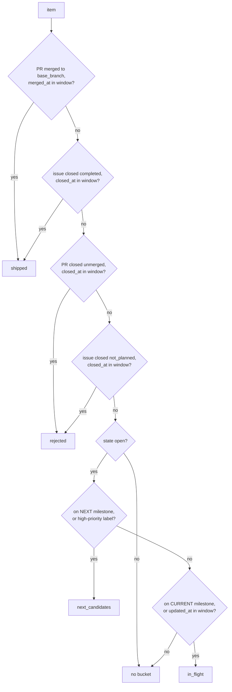

`select_milestones(milestones, ref_date)`: only **open, dated** milestones are eligible
(an undated one such as "Backlog" is never current or next; none dated → `(None, None)`),
sorted by `(due day, number)` and compared to `ref_date[:10]` (date or ISO timestamp).
**current** = earliest due on/after the ref day, **next** = the one after it; if every dated
milestone is overdue, **current** = the most recently due (lowest number on a tie) and
**next** = `None`. `HIGH_PRIORITY_LABELS` = `priority/high`, `priority/critical`, `p0`, `p1`,
`high-priority`, `critical` (case-insensitive exact match).

### 6.6 Significance and effort

```
footprint    = |prs| + |commits| + |code_areas| + |contributing_prs|
significance = footprint × TRAIN_KIND_WEIGHTS[kind] + |code_areas|
tier         = "deep" if rank ≤ TRAIN_SIGNIFICANCE_TOP_N (8) or significance ≥ TRAIN_SIGNIFICANCE_FLOOR (20.0)
               else "mention"
```

Kind weights: feature 3.0, module-request 3.0, bug 2.0, idea 1.5, docs/chore/other 1.0.
Outcome is deliberately ignored (a rejected train's story still matters).

`effort`: `opened_at`, `merged_at`, `elapsed_days`, `reviewers` (distinct), `review_comments`
(sum), `commits`, `participants` (distinct authors + reviewers + commenters), `stalled`
(merged and `elapsed_days > TRAIN_STALL_DAYS` = 21). Review rounds and reopen counts are added
by `annotate_review_rounds` / `annotate_reopen_count`.

### 6.7 Forecast — `build_forecast`

For each `next_candidates` ref:

| Signal | Weight | Fires when |
|---|---:|---|
| `on_next_milestone` | 5.0 | item milestone == next milestone title |
| `high_priority` | 3.0 | label in `HIGH_PRIORITY_LABELS` |
| `in_motion` | 2.0 | it is an open PR; or an open PR `closes`/cross-refs it; or it belongs to a train |
| `recent_activity` | 1.5 | `updated_at` in window |
| `overdue` | 1.0 | `ref_date − created_at ≥ FORECAST_OVERDUE_DAYS` (200) |

`tier` = likely (≥ 5.0) / possible (≥ 2.0) / longshot. Candidates sorted by `(−score, id)`.
Output: `{next_milestone, candidates:[{ref, train, score, tier, signals}]}`. Forward-only —
verification happens in the next installment's series block.

### 6.8 Slice — `slice_train(bundle, train_id)`

Pure, read-only, raises `KeyError` on an unknown id. Returns `{train, issue, prs, commits,
feature_deltas, symbol_moves}` plus review rounds, capped reviews/lifecycle and reopen counts.
Caps: text `SLICE_TEXT_CAP` = 1500 chars (with `…[+N chars]`), `SLICE_COMMENTS_KEPT` = 6 per list
(overflow counted), per-train diff budget `SLICE_DIFF_CAP` = 6000 chars
(`feature_deltas_diff_overflow` counts dropped diffs).

### 6.9 Series — `series.py` via `link.py BUNDLE --series series.json`

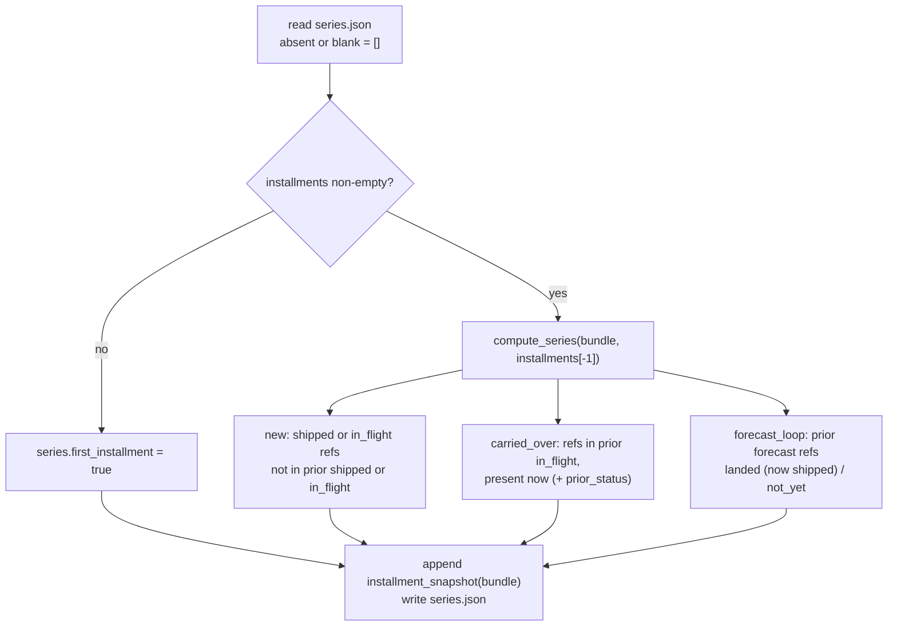

Identity is `(type, id)`; URLs are excluded. `installment_snapshot` =
`{from, to, ref_date, shipped:[{type,id}], in_flight:[{type,id,board_status?}],
forecast:[{type,id,tier}]}`. A malformed non-empty index raises rather than being discarded.
**Every invocation appends** — run it exactly once per installment. Recovery from a double
run: remove *every* snapshot whose `from`/`to` is the duplicated month (removing only the last
leaves the month compared with itself), plus any later snapshots, then replay the saved
bundles in chronological order.

### 6.10 `derive.py` projections

| Function | Output | Rule highlights |
|---|---|---|
| `build_artifacts` | `artifacts{}` | lifecycle per file/symbol; status from newest event |
| `match_symbol_moves` / `link_symbol_identity` | `symbol_moves` | same `(lang, subkind, name)` dropped in one file, added in one other; `high` when git also flags a rename |
| `enumerate_participants` | all logins | the single source of truth for "who" (write path and auditor) |
| `attribute_people_areas` | `people[].modules/areas` | commit files + reviewed PRs' areas |
| `is_bot_login` | `is_bot` | `*[bot]`, `github-actions`, `microsoft-github-policy-service`, `*-organizer`, `copilot-*` |
| `annotate_people_profile` | per-login metrics | prs authored/merged/reviewed, merge rate, review latency (median), first/last active, examples/docs/symbols authored |
| `build_halls` | `halls.fame` | non-bots, `score = 2·prs_merged + prs_reviewed + commits_authored`, top 10; **no shame/blame** |
| `build_flow` | `flow[]` | open issues: `blocked` (≥ 1 **open** blocker; closed blockers ignored, blockers absent from the bundle listed in `blocked_by_unknown` but not blocking) → `upvoted_but_ignored` (👍 ≥ 5, stale ≥ 30 d, no open PR) → `traction_then_abandoned` (≥ 5 comments, stale, no open PR) → `hung` (age ≥ 60 d **and** stale, no open PR) |
| `build_blockers` | `blockers[]` | open blockers only, out-degree counting open blocked issues only, sorted desc; the raw `blocking`/`blocked_by` from extract stay unfiltered (and feed `blocker_graph`) |

## 7. Present — `render.py`

`render.py BUNDLE [--diagrams-dir workspace/diagrams] [--export svg|png] [--skip-validate] [--train ID]`.
The bundle is always required (`render.py BUNDLE --train ID` for a spotlight). An unknown
`--train` id is a clean usage error (exit 2, nothing written), like `link.py --slice`.
`--export` runs `mmdc` and therefore always validates; combining it with `--skip-validate`
is rejected (exit 2).

| Diagram key | Emitter | Mermaid type | Cap (top-N key) and "+K more" marker |
|---|---|---|---|
| `buckets_pie` | `emit_buckets_pie` | pie | fixed size (≤ 4 slices) |
| `timeline_gantt` | `emit_timeline_gantt` | gantt | `GANTT_MAX_PRS` (200) most recently created PRs (created_at desc, number desc), drawn chronologically, plus a `+K more PRs not shown` row; `GANTT_MAX_RELEASES` (30) latest releases |
| `content_timeline` | `emit_content_timeline` | timeline | latest `TIMELINE_MAX_DAYS` (40) dates (an `earlier : +K more events on M earlier dates` period replaces the rest); first `TIMELINE_MAX_EVENTS_PER_DAY` (8) events per date in bundle order, then `+K more events` |
| `deltas_bar` | `emit_deltas_bar` | xychart-beta | fixed size (3 bars) |
| `contributor_graph` | `emit_contributor_graph` | flowchart | `GRAPH_MAX_EDGES` (120) edges, breadth-first: key = (area's position in the person's list, login, area), so every contributor keeps an edge first; `+K more edges not shown` node |
| `kind_breakdown` | `emit_kind_breakdown` | pie | `PIE_MAX_SLICES` (10): largest kinds (count desc, name), the last slice `+K more kinds` sums the rest |
| `module_graph` | `emit_module_graph` | flowchart | `GRAPH_MAX_EDGES` (120) edges by target in-degree desc (blast-radius hubs first), then src, dst, label; `+K more edges not shown` node |
| `blocker_graph` | `emit_blocker_graph` | flowchart | `BLOCKER_MAX_EDGES` (40) edges in (blocker, blocked) order; `+K more blocked` node |
| `train_flowcharts{id}` | `emit_train_flowchart` (deep trains) | flowchart; mode C with area nodes when ≤ `TRAIN_FLOW_MAX_PRS` (4) PRs and ≤ `TRAIN_FLOW_MAX_AREAS` (5) areas, else mode A chain | `TRAIN_FLOW_MAX_PR_NODES` (60) PRs in the train's `prs` order; the rest collapse into one `+K more PRs not shown` node in the chain |
| project module graph | `emit_project_module_graph(module_edges, notes=None)` | flowchart (used by digest reports) | as `module_graph` |

**Size limits.** Mermaid (mmdc 12.2.0, default config) has two hard limits, recorded as
`MERMAID_MAX_TEXT` = 50,000 characters (JS string length) and `MERMAID_MAX_EDGES` = 500. Above
the text limit mmdc exits **0** and writes an error SVG ("Maximum text size in diagram
exceeded"); above the edge limit it exits 1 ("Edge limit exceeded"). The caps above keep every
diagram below both (≤ 122 edges; estimated worst case ≈ 35k characters with 40-char labels;
a 700-PR / 800-edge / 1,500-event test bundle renders at ≤ 20k); in addition each capped
emitter re-renders with all its caps scaled by 0.75 until the text fits `DIAGRAM_TEXT_BUDGET`
(40,000), which only matters for pathological labels (e.g. many emoji, which count double).
Caps are deterministic: the same bundle always yields the same diagram. What was cut is
recorded in `bundle.diagrams.truncated` (`{name|train-id: {shown, total, unit}}`, `{}` when
nothing was cut) and printed as `note: … capped` lines, so the report can say so.

**Node ids** come from `_stable_node_id(prefix, text)`: `<prefix>_<text>` when the text is
1–32 ASCII letters/digits (`p_alice`, `pr_42`), else `<prefix>_<sanitised head ≤ 24>_<sha1[:8]>`,
so `a-b` / `a/b` / `a_b` and long paths sharing a prefix stay distinct; a per-diagram
`_NodeIds` allocator also resolves any hash clash with a `_2`, `_3` suffix. The old
`_node_id` (sanitise + 60-char cut, which merged such nodes) is gone.

**Validation.** Every emitted file is compiled with `mmdc` unless `--skip-validate`; a
non-compiling diagram fails the run (exit 1). A diagram fails when mmdc exits non-zero, when it
writes no output, or when the SVG it writes with exit 0 is Mermaid's error diagram ("Syntax
error in text", "Maximum text size in diagram exceeded", `aria-roledescription="error"`); a
source longer than `MERMAID_MAX_TEXT` is rejected before mmdc runs. Each diagram is compiled to
a temporary SVG first; `--export svg` copies that checked SVG beside the `.mmd`, `--export png`
then runs mmdc again for the PNG. `ACTIVITY_MMDC_PUPPETEER_CONFIG` names a puppeteer config
passed as `mmdc -p`; without it, a run as root gets a generated `--no-sandbox` config (Chrome
will not start sandboxed as root). Paths are recorded in `bundle.diagrams`.

## 8. Trust — `validate.py`

`validate.py STORE [--project P] [--repo R] [--bundle FILE] [--json]` → exit 0 when no ERROR, 1
otherwise. When the store (or `--project`) spans several repos and no `--repo` is given, it runs
`validate_project` over every member plus the project-wide checks.

| Check | Asserts |
|---|---|
| `referential_integrity` | every edge endpoint resolves to a node; dangling **spine** edges (out-of-window threads) and CODEOWNER-only `owns` endpoints are INFO, any other dangling edge is ERROR |
| `participant_completeness` | every login in any raw record has a person node |
| `provenance` | every social/code node carries a source identifier (url and/or sha) |
| `no_fabrication` | no invented entities, no historyless artifacts, no malformed ids |
| `schema_conformance` | each edge type's endpoint classes match STORE.md |
| `no_drift` | stored people/artifacts == freshly re-derived from the self-sourced bundle |
| `idempotency` | re-folding into a scratch copy changes no counts |
| `no_drift_people` (project) | project-scoped people == union re-derived across all members |

The auditor never mutates the store; a check that raises is reported as a failed ERROR, not a
crash. `no_drift`/`idempotency` self-source their bundle via `extract` over the store's
gathered windows; `--bundle` is an optional cross-check.

## 9. Cross-window reader — `spotlight.py`

`spotlight.py QUERY ARG --store S [--project P] [--from F] [--to T] [--json|--md] [--complete [--complete-budget N]]`

| Query | Function | Answers |
|---|---|---|
| `person <login>` | `person_impact` | one contributor's footprint across trains/areas |
| `symbol <artifact-id>` | `pattern_evolution` | one symbol's lifecycle |
| `subsystem <area>` | `subsystem_split` | activity split within an area |
| `grep <phrase>` | `text_mining` | FTS5 search over PR/issue/commit text (needs FTS5) |
| `module <area>` | `slice_module` | full-history module biography envelope |
| `dependents <owner/repo>` | `member_dependents` | reverse `depends_on` BFS — blast radius |

Results share an envelope `{query, focus, focus_kind, project, status, scope, …}`.
`status` may be `needs_gather` or `fts_unavailable` — valid answers, exit 0. `--complete`
wires `gather.backfill` with a token (the only network path in a reader).

## 10. Multi-repo aggregation — `digest.py`

`digest.py --store S --project P [--repo R …] --from F --to T [--ticket-pattern RE]`
(repos default to `project_repos`). Works for single-repo stores too
(`--project <owner> --repo <name>`).

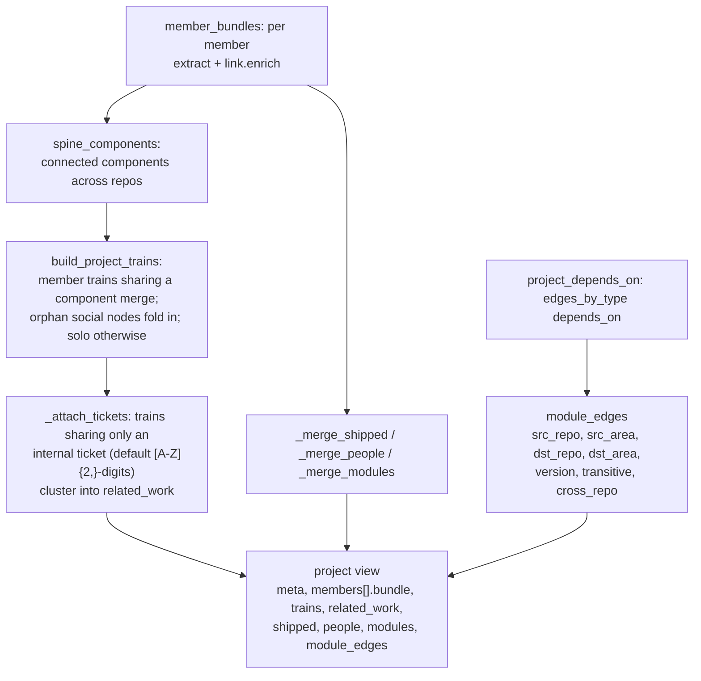

Caveat (documented in code): a train spanning more than `max_depth` spine hops can split
into two components; and restricting `--repo` cannot hide a real spine edge into another
member, so emitted `repos` may exceed the requested set.

## 11. Supporting tools

- **`manifest.py`** — `load_manifest` validates `{project (str, no "/" or "#"), window{from ≤ to, YYYY-MM-DD},
  repos[≥1]{owner, repo (GitHub name rules), registry? (non-empty str)}}`, rejecting duplicate
  members and duplicate `registry` values case-insensitively; every failure is a `ValueError`
  (rules in `STORE.md` § Multi-repo project). `member_slugs`. The field checks
  (`check_owner/check_repo/check_date/check_window/check_project`) are shared with
  `gather.parse_args` (single-repo flags), `view.parse_args` and `manifest_from_index`.
- **`manifest_from_index.py`** — reads the AVM **Terraform** index CSVs
  (`Terraform{Resource,Pattern,Utility}Modules.csv` in `Azure/Azure-Verified-Modules`) via
  `--avm res|ptn|utl` or `--index FILE|URL|-`; filters `--kind/--status/--name-contains/
  --include/--exclude/--limit`; writes the manifest (`--out` or stdout), deriving `registry`
  from `PublicRegistryReference`. `RepoURL` loses `.git`, query and fragment; a row whose
  owner/repo GitHub could not host is dropped; members, `--include` and `--exclude` compare
  case-insensitively (first index row of a case variant wins). Exit 2 on invalid/inverted
  dates, `--limit < 1` or a duplicate `registry` in the selection; an `--include` not in the
  index is a stderr warning; index fetches time out after 30 s. Its output always passes
  `load_manifest`.
- **`transcript.py PATH`** — strips WebVTT/SRT headers, NOTE/STYLE blocks, cue timings,
  indices and inline tags; collapses rolling-caption duplicates; `.txt`/`.md` pass through;
  missing file → exit 2.

## 12. Data contracts

| Artifact | Contract | Producer → consumer |
|---|---|---|
| `journey.db` | `STORE.md` (`meta.schema_version`) | gather → everything |
| Bundle view | `BUNDLE.md` (`meta.schema_version` = 1) | extract/link/digest → render, narrator, formatters |
| Project view | `BUNDLE.md` § output contract | digest → narrator, formatters |
| `series.json` | list of `installment_snapshot` (6.9) | link `--series` → link `--series` |
| Slice | `slice_train` shape (6.8) | link `--slice` → narrator sub-agent |
| Spotlight envelope | §9 | spotlight → narrator |
| Manifest | §11 | manifest_from_index / hand-authored → gather |

Top-level view keys are append-only within a schema version; omit-when-empty keeps shapes
diff-stable.

## 13. Configuration and tunables

**Environment variables**

| Variable | Default | Effect |
|---|---|---|
| `GITHUB_TOKEN` / `GH_TOKEN` | — | Auth (read scopes) |
| `ACTIVITY_CLONE_MARGIN_DAYS` | 14 | Clone reaches this far before `from` |
| `ACTIVITY_IAC_BUILD_TIMEOUT` | 300 | Seconds per IaC subprocess |
| `ACTIVITY_IAC_MAX_WORKERS` | 8 | Parallel IaC builds |
| `ACTIVITY_IAC_RETRIES` | 1 | Extra attempts on timeout/failure |
| `ACTIVITY_HTTP_TIMEOUT` | 60 | Seconds per GitHub API request |
| `ACTIVITY_HTTP_RETRIES` | 3 | Extra attempts on timeout / connection error / 5xx |
| `ACTIVITY_RATE_LIMIT_MAX_WAIT` | 3600 | Longest single rate-limit wait in seconds (`0` = fail instead of waiting) |
| `TF_PLUGIN_CACHE_DIR` | unset | Shared terraform provider cache (enables serial pre-warm) |
| `ACTIVITY_BOARD_STALE_DAYS` | 365 | Board treated as deprecated beyond this |
| `ACTIVITY_BOARD_MAX_ITEMS` | 5000 | Per-board item cap |
| `ACTIVITY_MMDC_PUPPETEER_CONFIG` | unset | Puppeteer config file passed to `mmdc -p` (as root without it: generated `--no-sandbox` config) |

Integer knobs `ACTIVITY_HTTP_*`, `ACTIVITY_RATE_LIMIT_MAX_WAIT` and `ACTIVITY_IAC_*` are read
at call time (not at import) and checked by `validate_env_knobs()` at the start of `main`: a
non-integer value exits with an error naming the variable; a value below its minimum (1 for
timeouts and workers, 0 for retries and max wait) is clamped with a warning.

**Code constants** (change deliberately; tests pin many of them)

| Constant | Value | Module |
|---|---|---|
| `TRAIN_KIND_WEIGHTS` | feature 3, module-request 3, bug 2, idea 1.5, else 1 | link |
| `TRAIN_SIGNIFICANCE_TOP_N` / `_FLOOR` | 8 / 20.0 | link |
| `TRAIN_STALL_DAYS` | 21 | link |
| `FORECAST_WEIGHTS` | 5.0 / 3.0 / 2.0 / 1.5 / 1.0 | link |
| `FORECAST_TIER_LIKELY_THRESHOLD` / `_POSSIBLE_` | 5.0 / 2.0 | link |
| `FORECAST_OVERDUE_DAYS` | 200 | link |
| `HIGH_PRIORITY_LABELS` | see §6.5 | link |
| `SLICE_TEXT_CAP` / `SLICE_COMMENTS_KEPT` / `SLICE_DIFF_CAP` | 1500 / 6 / 6000 | link |
| Flow thresholds | stale 30 d, upvotes 5, comments 5, hung 60 d | derive |
| `TRAIN_FLOW_MAX_PRS` / `_AREAS` | 4 / 5 | render |
| `MERMAID_MAX_TEXT` / `MERMAID_MAX_EDGES` | 50,000 / 500 (Mermaid's defaults, verified with mmdc 12.2.0) | render |
| `DIAGRAM_TEXT_BUDGET` | 40,000 | render |
| `GRAPH_MAX_EDGES` / `BLOCKER_MAX_EDGES` | 120 / 40 | render |
| `GANTT_MAX_PRS` / `GANTT_MAX_RELEASES` | 200 / 30 | render |
| `TIMELINE_MAX_DAYS` / `TIMELINE_MAX_EVENTS_PER_DAY` | 40 / 8 | render |
| `TRAIN_FLOW_MAX_PR_NODES` / `PIE_MAX_SLICES` | 60 / 10 | render |
| `DEFAULT_AREA_PATTERNS` | §4.5 | gather |

## 14. Cross-cutting concerns

### 14.1 Determinism and idempotency

- Identity-keyed upserts + set-semantics ledger + deduped `gathered_windows` → re-folding is a
  no-op (`validate.idempotency` proves it on every audit).
- `range_query` orders by `(ts, id)`; JSON `sort_keys`; collections sorted; tie-breaks by id.
- The only non-deterministic fields are `fetched_at` and `dead_refs.first_seen`, both excluded
  from determinism assertions.
- Idempotency is per window: re-folding the **same** window is a no-op. Folding **different**
  overlapping windows is not fully cumulative — see §14.4.

### 14.2 Degradation matrix

| Missing | Effect | Signal |
|---|---|---|
| `bicep` / `terraform` | no IaC edges | `edge_extraction` counts `skipped` |
| registry unreachable / slow init | some areas unresolved | `timeout` / `failed` counts |
| `read:project` scope | no board status / sprints | empty board layer |
| `mmdc` | render fails (or use `--skip-validate`) | error |
| `graphify` | directory provider used | `code_graph.provider = directory` |
| FTS5 | `spotlight grep` unavailable | `status: fts_unavailable` |
| out-of-window spine node | context gap | train `gaps[]` |

### 14.3 Performance and API budget

Approximate REST cost per gather ≈ `pages(closed PRs since from) + pages(open PRs) + 4 × kept PRs
+ pages(issues since from) + pages(open issues) + 2 × issues + referenced issues + workflow/
release/milestone pages`. Because **all open PRs and issues** are included every run, busy
repos dominate the budget (GitHub's authenticated limit is 5,000 requests/hour). Wall time is
dominated by the per-item calls and, on IaC repos, by `terraform init`. Mitigations:
`--no-workflows`, `--no-releases`, `TF_PLUGIN_CACHE_DIR`, and running heavy gathers
off-hours. When the limit is hit, gather waits for the reset (announced on stderr, bounded by
`ACTIVITY_RATE_LIMIT_MAX_WAIT`) and continues, so a long gather is slowed rather than lost (§4.7).
A window with more than 1,000 workflow runs costs a few extra requests for the day-splits.
(A reused `--clone-dir` is fetched rather than re-cloned.)

### 14.4 Security

- Read-only token; nothing is written to GitHub; the token is read from the environment only.
- Clones and stores contain repository content — treat workspaces as you would a clone.
- `mmdc` as root requires `--no-sandbox`; restrict that to throwaway environments.
- Recognition-not-blame: `halls` has no shame list; people attribution of stalls is an opt-in
  report appendix.

### 14.5 Known issues (verified, not yet fixed)

| Issue | Mechanism | Effect | Candidate fix |
|---|---|---|---|
| View not window-scoped on multi-window stores | `extract._materialize_meta` omits `period`; arrays come from `repo_nodes` | prior windows' merges counted as shipped; trains/commits span all stored history (member and project views) | emit `meta.period`/`ref_date` from `ts_from/ts_to`; window the materialized arrays to in-window + spine context |
| Trust gate fails after a second overlapping fold | `fold_bundle` upserts artifact nodes with the incoming window's lifecycle; `code_events` keeps all windows | `validate.no_drift` "lifecycle length drift" | rebuild artifact lifecycle from the full ledger on fold (or merge with the stored one) |
| Singletons latest-wins | `workflowstats`/`codegraph`/`codeowners`/`labeltaxonomy` upserted per gather | wider digest windows don't widen CI stats etc. | store per-window singletons or aggregate |
| Area ownership is directory-level | `derive.area_owners` matches `<area>/` only | files inside an area owned by a file rule (e.g. `*.tf` after the directory rule) do not make that owner an area owner; a pre-#65 store keeps `code_owners` as a key-sorted dict, so its rule order is lost until re-gathered | per-file ownership facts if needed; re-gather old stores |
| No edge retraction | edges are unioned | removed `source` refs persist as `depends_on` | per-gather edge sets keyed by `clone_sha` |
| `spotlight` prefix filter still `LIKE` | `spotlight._like_prefix` (person-impact `code_events` query) uses case-insensitive `LIKE` | projects differing only in case can mix there; unindexed scan | reuse `graphstore._prefix_range` (issue #55 fixed `edges_by_type`/`repo_code_events` only) |
| Digest view stamps the store version | `digest.py` sets view `meta.schema_version = graphstore.SCHEMA_VERSION` | the digest view reports `2` (store v2, issue #55) while BUNDLE.md views are `1` | stamp the view schema version instead |

The operating guidance in USAGE (one single-window store per installment, series file for
continuity, wide single gathers for history stores) avoids the first two in practice.

## 15. Testing and CI

- 18 `test_*.py` modules (stdlib `unittest`), fixture-driven and fully offline (fake fetch
  seams; no network). Notable: `test_characterization.py` (store-derived == link-derived golden
  equivalence), `test_validate.py` (each audit), `test_gather.py` (parsers, fold, IaC parsing
  incl. modern/legacy DOT), `test_digest.py` (cross-repo trains, module edges), `test_series.py`.
- Run: `python3 -m unittest discover -s .claude/skills/activity-overview -p 'test_*.py' -v`.
- CI (`.github/workflows/activity-overview.yml`): `tests` on every relevant push/PR (Python 3.11,
  3.12, 3.13, byte-compile + suite); `live` on dispatch, schedule (07:00 UTC on the 1st and
  15th) or default-branch push — real gather into a store (pinned bicep CLI) then
  `validate.py`, using the `ACTIVITY_TEST_TOKEN` secret.

## 16. Extension guide

| Change | Where | Watch out for |
|---|---|---|
| New repo layout → areas | add `(name, fn)` to `DEFAULT_AREA_PATTERNS` (order matters) | area ids appear in stored nodes; re-gather after changing |
| Org priority labels | `link.HIGH_PRIORITY_LABELS` | lower-case exact match |
| Forecast / significance tuning | constants in `link.py` | tests pin thresholds; update tests + BUNDLE.md |
| New view field | compute in `link.enrich` or `derive` (pure) | append-only; document in BUNDLE.md; omit when empty |
| New stored fact | `fold_bundle` + `extract` reader + `validate` conformance | must keep `no_drift` and characterization green |
| New spotlight query | function + `_RENDERERS` entry + dispatch in `main` | envelope shape; exit 0 for "no data" statuses |
| New formatter | consume the view (see `examples/formatters/`) | read `meta.schema_version` |
| Cross-repo Bicep deps | mirror `resolve_registry_member` for `br/public:` paths in `_fold_depends_on` | gate on manifest folds to keep single-repo goldens stable |
