# activity-overview — Low-Level Design (L400)

> **Audience:** engineers who maintain, extend or debug the skill. **Prerequisite:**
> [`HLD.md`](HLD.md). **Contracts referenced:** [`../STORE.md`](../STORE.md) (store schema),
> [`../BUNDLE.md`](../BUNDLE.md) (view schema). **Operator guide:** [`USAGE.md`](USAGE.md).
>
> Every function name, flag, constant and threshold in this document is taken from the code
> on `master`. Line-level detail lives in the source; this document explains *how the parts
> work and why*, at the level needed to change them safely.

## Contents

1. [Conventions](#1-conventions)
2. [Code map and dependency graph](#2-code-map-and-dependency-graph)
3. [Runtime model](#3-runtime-model)
4. [Acquire — `gather.py`](#4-acquire--gatherpy)
5. [Persist — `graphstore.py`](#5-persist--graphstorepy)
6. [Read and enrich — `extract`, `complete`, `link`, `derive`, `series`](#6-read-and-enrich)
7. [Present — `render.py`](#7-present--renderpy)
8. [Trust — `validate.py`](#8-trust--validatepy)
9. [Cross-window reader — `spotlight.py`](#9-cross-window-reader--spotlightpy)
10. [Multi-repo aggregation — `digest.py`](#10-multi-repo-aggregation--digestpy)
11. [Supporting tools](#11-supporting-tools)
12. [Data contracts](#12-data-contracts)
13. [Configuration and tunables](#13-configuration-and-tunables)
14. [Cross-cutting concerns](#14-cross-cutting-concerns)
15. [Testing and CI](#15-testing-and-ci)
16. [Extension guide](#16-extension-guide)

---

## 1. Conventions

- **Python 3, standard library only.** No third-party packages; `sqlite3`, `urllib`,
  `subprocess`, `concurrent.futures`, `json`, `re`, `csv`.
- **Pure vs effectful.** Functions documented as *pure* take inputs and return outputs with
  no I/O. All network and git I/O is in `gather.py`; the store write path is
  `gather.fold_bundle` (and `gather.backfill`).
- **Window.** `[from, to]` are inclusive `YYYY-MM-DD` dates. Windowing of commits is done in
  Python on the UTC day of the committer timestamp (`window_records`, #109), the same UTC
  calendar that windows PRs and issues, not with git `--since/--until`.
- **Ref convention.** `{type: "pr"|"issue"|"commit", id, url}` on every narrative-bearing fact.
- **Determinism.** `view.py`, `digest.py` and `spotlight.py --json` write JSON with
  `sort_keys=True`; `link.py` and `render.py` rewrite the bundle with `indent=2` only, which
  is still deterministic because object key order carries no meaning (§6.3, #100).
  Collections are sorted before emission; ties are broken by id.

## 2. Code map and dependency graph

| Module | LOC | Role | Network | Writes store |
|---|---:|---|:---:|:---:|
| `gather.py` | 5,933 | CLI; clone, git walks, REST/GraphQL, IaC build + structural scan, normalization, `fold_bundle` (incl. per-window facts and current-state retraction), `backfill` | ✅ | ✅ |
| `graphstore.py` | 1,418 | SQLite property-graph schema + read/write API, provenance meta | — | (API) |
| `extract.py` | 1,122 | Materialize a window-scoped raw bundle *view* for one repo + window | (via injected backfill) | — |
| `view.py` | 180 | CLI over `extract`: writes one repo's raw bundle view (`sort_keys` JSON) | — | — |
| `complete.py` | 132 | Train-completion policy over the spine (honest gaps) | (via injected backfill) | — |
| `derive.py` | 1,249 | Pure projections shared by write and read paths (artifacts, people, flow, halls, CI-stat sums) | — | — |
| `link.py` | 1,427 | `enrich`: trains, buckets, timeline, deltas, areas, significance, effort, forecast; `--slice`, `--series` | — | — |
| `series.py` | 236 | Pure installment snapshot, comparison and window-ordered index | — | — |
| `render.py` | 1,058 | Mermaid emitters (size-capped) + `mmdc` validation | — | — |
| `validate.py` | 2,157 | Trust gate (nine per-repo checks + two project-wide checks) | — | — |
| `spotlight.py` | 1,976 | Cross-window queries (person, symbol, subsystem, grep, module, dependents) | (opt-in `--complete`) | — |
| `digest.py` | 692 | Multi-repo project view | — | — |
| `manifest.py` / `manifest_from_index.py` | 389 / 278 | Manifest validation / generation from the AVM Terraform index | (index fetch) | — |
| `transcript.py` | 116 | VTT/SRT/TXT normalization | — | — |
| `ci_spotlight_integration.py` | 436 | CI gate: four spotlight answers checked against a real store | — | — |

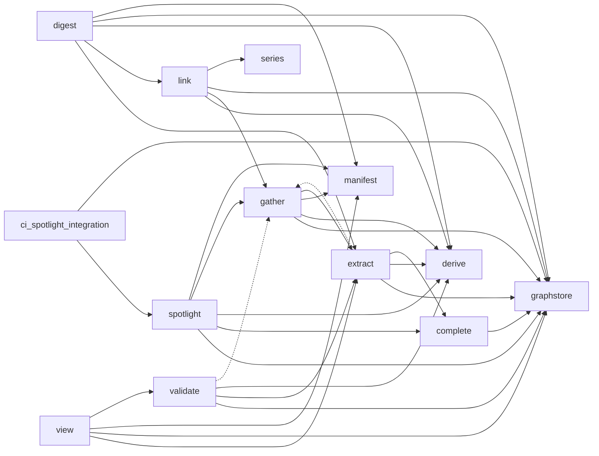

Dotted arrows are imports deferred into a function (`extract` imports `gather` lazily
because `gather` imports `extract`; `validate` imports `gather` only to re-fold).
`derive.py` is a deliberate **leaf** (imports none of the others): both the write path
(`fold_bundle`) and the read path (`extract` + `link.enrich`) call the same functions, which is
what makes the `no_drift` audit meaningful. `link` imports `gather` only for pure helpers
(e.g. `classify_pr_kind`); `validate`/`spotlight` import it for `fold_bundle` (re-fold in a
scratch store) and `backfill` respectively.

## 3. Runtime model

- Every tool is a short-lived CLI process. There are no daemons, servers or caches beyond the
  SQLite file, the git clone directory and (optionally) terraform's plugin cache.
- **Files on disk:** `--store` (SQLite), `--clone-dir` (default `workspace/<repo>-clone`),
  the bundle view JSON you materialize, `series.json`, `workspace/diagrams/*.mmd`.
- **Concurrency:** only IaC edge extraction runs in parallel (thread pool,
  `ACTIVITY_IAC_MAX_WORKERS`). Everything else is single-threaded and ordered.
- **Failure model:** network/auth failures in `gather` abort with GitHub's message and
  headers printed; optional tools missing → the dependent layer is empty; readers never
  mutate the store.

## 4. Acquire — `gather.py`

### 4.1 CLI contract

`main()` → `parse_args()`. Single-repo and manifest modes are mutually exclusive.

| Flag | Default | Effect |
|---|---|---|
| `--owner`, `--repo` | — | Single-repo target |
| `--manifest PATH` | — | Multi-repo project (validated by `manifest.load_manifest` **before** the store is touched) |
| `--resume` | off | Manifest only: gather just the members not `ok` for the manifest window (meta `member_status`, #77) |
| `--from`, `--to` | — | Window (`YYYY-MM-DD`, `from ≤ to`; owner/repo/dates checked in `parse_args` with the shared `manifest.py` validators) |
| `--ref-date` | `--to` | Reference date for milestone/sprint/forecast/flow framing (`YYYY-MM-DD` or full ISO timestamp, `manifest.check_ref_date`). Stored per window at fold (`ref_date:` meta key) and read back into the view's `meta.ref_date` (§6.1) |
| `--branches` | repo default | Comma list; first is `meta.base_branch`. Unset: a manifest member's `branch`, else the clone's `origin/HEAD`, else the API `default_branch` (`resolve_branches`); unresolved → `null` + stderr warning. Stored per window at fold (`branches:` meta key). The walk uses the checked-out default branch |
| `--clone-dir` | `workspace/<repo>-clone` | Clone location (manifest: the parent of per-member `<owner>/<repo>` dirs; an existing clone of the same remote in the former `<owner>-<repo>-clone` layout is reused) |
| `--no-clone` | off | Never create a clone: fetch an existing one, or gather API data only (`clone_mode: none`) |
| `--include-workflows` / `--no-workflows` | on | CI run stats |
| `--include-releases` / `--no-releases` | on | Releases in window |
| `--project-board` / `--no-project-board` | on | Projects v2 ingest |
| `--structural-iac` | off (always on for manifest members) | Whole-tree static Terraform + Bicep dependency scan (§4.6) |
| `--no-iac-build` | off (builds run) | Do not run `bicep restore/build` / `terraform init/graph` (they download and run third-party code, §14.4); every area `edges_status: skipped`, `edge_extraction.disabled: true`. The structural scan still runs |
| `--store PATH` | **required** | SQLite store |

Single-repo folds use `project = owner`, `repo = <name>`. Manifest folds use
`project = manifest.project`, `repo = "owner/repo"`, and pass `members` +
`registry_by_slug` to `fold_bundle` for cross-repo resolution.

Manifest runs gather members one at a time (`_gather_manifest`, issue #77). Each member
to attempt is first recorded `not_attempted` in meta `member_status` for the manifest
window; a member whose `acquire` or fold raises (any `Exception`, or the `SystemExit` the
HTTP layer uses) is recorded `failed` with a one-line reason and the run continues with the
next member (its fold, one transaction, rolled back); a member that folded is recorded `ok`.
At the end gather prints `member -> reason` for each failure and exits 1. The store
connection is closed in a `finally`. `--resume` (manifest only) skips the members already
`ok` for the window. A `KeyboardInterrupt` is not caught: the remaining members stay
`not_attempted`.

### 4.2 `acquire(args, env)` sequence

```mermaid
sequenceDiagram
  autonumber
  participant A as acquire
  participant Git as git
  participant IaC as bicep / terraform
  participant REST as GitHub REST
  participant GQL as GitHub GraphQL
  A->>Git: clone --shallow-since=(from - margin)
  opt base branch is not the remote default
    A->>Git: fetch --shallow-since origin/<base>, checkout -B <base>
  end
  A->>Git: fetch --deepen=n while an in-window commit is on the boundary (bounded)
  A->>Git: log (commits, full walk) then window_records
  A->>Git: log --name-status -M -C --reverse (file code_events)
  A->>Git: log -p --unified=3 --reverse (symbol events + bounded diffs)
  A->>A: fallback: drop unresolved boundary commits' diffs and files
  A->>Git: log --first-parent (window_end_commit)
  opt window end is not the head
    A->>Git: worktree add --detach (structure_tree; removed afterwards)
  end
  A->>Git: ls-files (module dirs; shared with the structural scan)
  A->>A: select_code_area_provider (directory or graphify)
  A->>IaC: extract_iac_edges (parallel restore+build / init+graph)
  opt manifest gather, or --structural-iac
    A->>A: apply_structural_scan (Terraform + Bicep scans, merge_structural_areas)
  end
  A->>A: parse_codeowners
  A->>REST: closed PRs (until updated < from) + all open PRs
  loop each kept PR
    A->>REST: reviews, timeline, review comments, issue comments
  end
  A->>GQL: closingIssuesReferences, 50 PRs per request (else keywords only)
  A->>REST: issues updated since from + all open issues + referenced issues
  loop each issue
    A->>REST: comments, timeline
  end
  A->>A: detect_label_taxonomy, apply_facets, classify_issue_kind
  opt window has commits
    A->>REST: commits?sha=<walked branch head>&since&until (author.login per SHA)
    A->>A: resolve_commit_authors (API login, noreply email, else flagged git name)
  end
  A->>REST: workflow runs, releases, milestones
  opt token has read:project
    A->>GQL: Projects v2 boards (maintained only), items, iterations
  end
  A->>A: build_bundle (in memory, never written to disk)
```

### 4.3 Clone and windowing

- `acquire` calls `prepare_clone` on `--clone-dir` (default `workspace/<repo>-clone`; for
  manifests `--clone-dir` is the parent of per-member `<owner>/<repo>` dirs, issue #109 — the
  former `<owner>-<repo>-clone` collided for `a-b`/`c` vs `a`/`b-c`; such a dir that is a clone
  of the member's own remote is still used while `<owner>/<repo>` does not exist) and records
  the outcome in `meta.clone_mode`:
  - `fresh` — no (or an empty) dir: `git clone` (`build_clone_cmd`).
  - `fetched` — the dir is already a clone of the same remote (`remote.origin.url`, GitHub
    https/ssh forms compared equal): `git fetch --prune --shallow-since=…` (`build_fetch_cmd`;
    deepens or shortens to this window's bound) then `checkout -B <default branch>` at the
    fetched `origin/<default branch>`. Applies with and without `--no-clone`. Before that
    checkout (and `checkout_base_branch`'s) `reset_build_byproducts` removes what an earlier
    current-month run's in-place IaC build left (issue #109): untracked `.terraform/` dirs and
    `.terraform.lock.hcl` files (`git clean` limited to those pathspecs) and a tracked
    `.terraform.lock.hcl` that `terraform init` rewrote (restored). Nothing else is touched: a
    user's own untracked file in the way still stops the checkout.
  - `depth1-fallback` — `--shallow-since` selected no commits (git: "no commits selected for
    shallow requests", a quiet repo): the clone/fetch is retried with `--depth=1` so HEAD exists
    for IaC edges / CODEOWNERS / the structural scan; the three git walks are skipped (empty).
    Any other clone/fetch error still raises.
  - `none` — `--no-clone` and no clone on disk: nothing is created; the walks are empty.
  A non-empty dir that is not a git clone, or is a clone of another remote, raises and is left
  untouched.
- `resolve_branches` (issue #84) then fixes `meta.branches` / `meta.base_branch`: `--branches`
  (or the manifest member's `branch`), else the clone's `origin/HEAD` (else its checked-out
  branch), else one `GET /repos/{o}/{r}` for `default_branch` (only when there is no clone),
  else `null` with a stderr warning. Never a hard-wired `main`.
- The walked branch is the base branch (issue #107). `prepare_clone` checks out the remote
  default (it needs no branch name, so the same clone answers `resolve_branches`); when
  `base_branch` differs, `checkout_base_branch` fetches `+refs/heads/<base>:refs/remotes/origin/<base>`
  under the same `--shallow-since` bound (`--depth=1` when that branch is quiet: `clone_mode`
  `depth1-fallback`) and runs `checkout -q -B <base>`, before deepening, the walks and every
  structure read; one stderr note names both branches. A base branch the remote lacks raises
  `MissingBranchError`, which `acquire` turns into `SystemExit` naming it (a manifest member is
  recorded `failed`). A reused clone is put back on the default by the next `prepare_clone`.
- Structure is read as of the window's end (issue #107). `window_end_commit` takes the newest
  commit of the walked branch's first-parent chain whose committer day (UTC) is on or before `to`;
  when it is the head (the current month) the clone is read in place, otherwise
  `structure_tree` adds a temporary detached `git worktree` of it, reads the code graph, IaC
  entrypoints/builds, structural scan and CODEOWNERS there, and removes it (also on error), so
  the clone never leaves its branch. `meta.clone_sha` is that commit and
  `meta.structure_as_of` is `window_end`; when the clone does not hold such a commit (no
  commit in the window or its margin, only later ones) the head is read and it is `head`.
  The commits-API listing starts at the branch head either way.
- The clone/fetch uses `--shallow-since = from − ACTIVITY_CLONE_MARGIN_DAYS` (default 14). The
  margin keeps each in-window commit's real parent in the clone.
- If the margin holds no earlier commit, the first in-window commit is a shallow-boundary
  commit: its parent is grafted away, so git diffs it against the empty tree (a whole-tree
  phantom). After the clone/fetch, `deepen_window_boundary` runs `git fetch --deepen=n origin`
  (n from `BOUNDARY_DEEPEN_STEPS` = 1, 2, 4, 8; stops at the first fetch error) until no
  in-window commit of the checked-out branch is in `.git/shallow`, so its diff and file list
  are real. A root commit is never in `.git/shallow`; its full file list is genuine.
- Fallback when deepening could not resolve it: `shallow_boundary_shas` + `drop_boundary_events`
  remove the commit's code/symbol events **and** its `commits[].files` is cleared, so
  `area_paths`, module counts, `touches` edges and train `code_areas` are not inflated. Any
  **in-window** commit handled this way is recorded in `meta.boundary_dropped_commits` and a
  warning is printed — widen the margin and re-gather to recover it.
- Commit dates are the UTC calendar day of the committer timestamp (#109): all three walks use
  one format, `LOG_FORMAT` = sha, parents, author name, author email, `%cI`, subject (the
  free-text subject LAST, so nothing can follow it), and every record of one commit (the
  commit, its code events, its symbol events) gets the same `date`, so a commit at
  `2026-10-31T20:00-08:00` is in November with the PR merged at that instant. Filtering is
  `window_records` in Python to avoid git's timezone-sensitive pruning. The parsers split
  records on a `RECORD_SEP` at the start of a line and lines on `\n` only (`str.splitlines()`
  would also split on U+2028/U+2029, U+0085, form feed, vertical tab and the separator control
  characters, which can appear in a subject or a non-ASCII path).

### 4.4 Code-event and symbol extraction

- **File level** (`parse_code_events`): `add|modify|delete|rename|copy` per path per commit,
  oldest → newest.
- **Symbol level** (`parse_patch_events` → `parse_symbol_events`): a single `git log -p` walk;
  `detect_symbol_decl` recognizes Bicep (`param|var|output|resource|module`) and Terraform
  (`variable|output|resource|module`) declarations plus comments. Comments are identified by
  their text (so a rewritten decision comment is drop + add); `TODO|FIXME|HACK|XXX|BUG`
  comments get subkind `todo`; banner comments are ignored. `before`/`after` snippets are
  capped at 200 chars (`_cap_snippet`).
- **Bounded file diffs** (`bounded_file_diff`, `FILE_DIFF_CAP`/`FILE_DIFF_LINE_CAP`) ride the
  file-level code event so narrators read real changes without a clone.

### 4.5 Code areas

`select_code_area_provider(paths, clone_dir)` is directory-first: it uses **graphify** only when
`graphify` is on PATH **and** `graphify update <clone>` yields a `graph.json` with nodes and
non-empty communities; any absence or failure falls back to the **directory provider**
(`build_directory_areas`), which maps each path with `classify_code_area`, trying patterns in
order (graphify does not parse Bicep/HCL, so IaC repos always land here):

| Order | Pattern | Maps | Example |
|---:|---|---|---|
| 1 | `avm` (`_avm_area`) | `avm/{res,ptn,utl}/<a>/<b>/…` → 4-segment module subtree; a file directly under the group (`avm/res/<a>/README.md`) → group area `avm/res/<a>` (not a module) | `avm/ptn/ai-ml/landing-zone` |
| 1a | `bicep_module_dir` (only with module dirs, #107) | a non-`*.tf` file at or below a Bicep module dir (`bicep_module_dirs`: a tracked or changed non-scaffold `main.bicep` outside `avm/` and the root) → the deepest such dir; a file under an `examples/`/`tests/` subtree of it falls through | `infra/modules/net.bicep` → `infra` |
| 2 | `main_bicep` | a `main.bicep` file → its dir (other files in that dir are claimed by rule 1a when module dirs are known, else fall through) | `infra/hub/main.bicep` → `infra/hub` |
| 3 | `terraform_modules` | `modules/<name>/…` (`<name>` a dir; `modules/README.md` falls through) | `modules/subnet` |
| 4 | `tf_dir` | any `*.tf` dir; **repo-root `*.tf` collapse to one `main.tf` area** | `main.networking.tf` → `main.tf` |
| 5 | `topn` | fallback: top 2 segments of the file's **directory** (`docs/README.md` → `docs`); a repo-root file keeps its own name | `src/Bicep.Core` |

`_is_scaffold_area` marks Terraform `examples/` and `tests/` subtrees as scaffolding: their
edges are **skipped at extraction and excluded at fold**, because those trees reference the
module under test through CI-manipulated relative paths and test-only registry modules.
`_is_scaffold_path` applies the same test to a *file*, so a nested scaffold file that
classifies into its module's area (`modules/sub/examples/x/main.tf` → `modules/sub`) is never
read or built as that module.

Area `paths` are the in-window **changed** files (including deleted ones), so they are not
used to pick what to build; the entrypoint is resolved on disk (§4.6).

Rule 1a needs the set of module directories, which a single path cannot show: `acquire`
derives it with `bicep_module_dirs` from the changed paths plus one `git ls-files` of the
structure tree (passed to the structural scan as its listing), or from the changed paths alone
without a clone, and passes `module_area_patterns(module_dirs)` as `patterns` to the provider,
`extract_iac_edges` and `apply_structural_scan`. With no module dir the calls are unchanged.
`classify_code_area(path, patterns, module_dirs=None)` keeps today's per-path result without
the set. A local Bicep ref to a file inside the module (`./modules/net.bicep` from
`infra/main.bicep`) now resolves to the module itself, so `build_bicep_edges` records it as a
private child (`to: infra/modules`, `local: true`).

### 4.6 IaC dependency edges (`extract_iac_edges`)

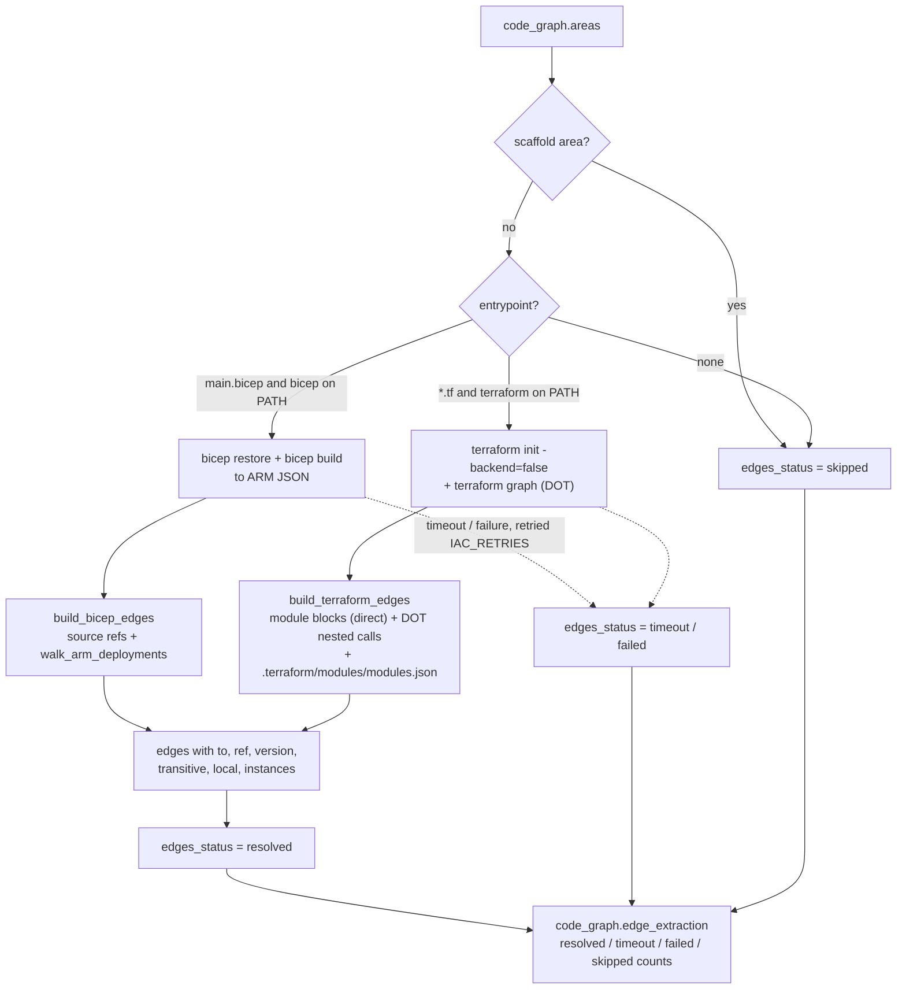

- **Entrypoint (`_bicep_entrypoint` / `_tf_entrypoint`, resolved on disk in the clone):**
  when the area id is a directory in the checkout, Bicep builds `<area id>/main.bicep` and
  Terraform uses that directory's `*.tf` set (`main.tf` preferred as the representative
  path), whichever files changed in the window; if that file/set is absent, the area is
  `skipped`. Only when the area id is not a directory (graphify `community:<n>`, a deleted
  dir) does it fall back to the shallowest of the area's `paths` that exists on disk. Root
  sentinels `main.bicep` / `main.tf` name the repo root. Paths missing from the checkout and
  files under nested `examples/`/`tests/` are never chosen, so an AVM child module
  (`avm/res/key-vault/vault/access-policy/main.bicep`) is never built in place of its parent.
  With no clone directory on disk (offline callers) the same rule runs over `paths` alone.
- **Build-only:** this path emits an area's edges only after a successful build. A `resolved`
  area with no edges genuinely has no inter-area dependencies; `timeout`/`failed` are
  **counted gaps**. (For Terraform the direct edges themselves are source-parsed, and manifest
  gathers — and single-repo gathers given `--structural-iac` — add static Terraform and Bicep
  edges for every module through the structural scan below. A single-repo gather without the
  flag keeps the build gate: no `terraform`/`bicep` means no edges. Decided in #80 and #92.)
- **Bicep:** `parse_bicep_module_refs` splits a **public**-registry ref (`br/public:<path>:<ver>` /
  `br:mcr.microsoft.com/bicep/<path>:<ver>`) into `registry_path` + `version`; private-registry
  (`br:<other-host>/…`), template-spec (`ts:…`, `ts/<alias>:…`) and user-alias (`br/<alias>:…`)
  refs keep only the raw `ref` + `version`. `resolve_module_ref` classifies `<path>/main.bicep`
  and returns that area **only when it is a module of this repo** (and not an AVM group area):
  either in the window's area set (in-window-changed paths) or, for an untouched module, present
  in the clone as `<area>/main.bicep`. So in the BRM monorepo
  `br/public:avm/res/network/virtual-network:0.x` resolves to the **in-repo** area
  `avm/res/network/virtual-network` whether or not it changed in the window; anything else is
  `to=None, resolved=False` (#73). Transitive edges come from walking nested
  deployments in the compiled ARM (`walk_arm_deployments`).
- **Terraform (#80):** extraction reads **every `*.tf` in the entrypoint's module dir**. The
  **direct** set is that dir's own `module {}` blocks (`_tf_direct_edges`): every block with a
  `source` is an edge with `transitive=false`, whether or not anything consumes its outputs.
  This is the same function the structural scan uses. The DOT is used only for **nested** calls:
  `parse_terraform_module_chains` reads every quoted node address, with or without the legacy
  `[root] ` prefix and with instance keys dropped, and takes its leading `module.<name>` segments
  as a call chain (`module.a.module.b.res` → `(a, b)`). Each chain of length ≥ 2 is a
  `transitive=true` edge carrying `address` (`module.a.module.b`) and `via` (`module.a`). Its
  target comes from the `.terraform/modules/modules.json` that the same `terraform init` wrote
  (`_resolve_tf_nested`). A `Dir` in the working tree is a repo area, with `ref` set to the
  recorded `Source`. A `Dir` under `.terraform/modules/` belongs to a downloaded package and is
  attributed to the nearest call in its chain with a remote source, with that call's `Source`
  and `Version`. With no manifest, the target is unknown (`to=ref=null`). Direct wins: a nested
  target that is already an edge is not repeated (`_tf_target_identity`: the area, else the
  registry identity without `//submodule`, else the raw ref). The DOT shows only calls that
  contain resources, either directly or deeper down. Local sources resolve to repo areas
  (`../..` from a submodule → the root `main.tf` area); registry sources keep `to=None,
  ref=<source>, version`. Module blocks are parsed on an HCL mask (`_hcl_mask`: `#`, `//`,
  `/* */` comments, string contents incl. `${…}` interpolation, and heredocs blanked), so a
  commented-out or heredoc'd `module "x" {` is never a block; only file-top-level blocks
  count, and `source`/`version` are the block's own **top-level** arguments
  (`_tf_top_level_attr`: line-anchored, bracket depth 0), so `kubernetes_version`,
  `custom_source` or a `version` key inside a nested map/list is ignored.
- **Concurrency:** a thread pool of `ACTIVITY_IAC_MAX_WORKERS` (8), per-subprocess timeout
  `ACTIVITY_IAC_BUILD_TIMEOUT` (300 s), `ACTIVITY_IAC_RETRIES` (1). With `TF_PLUGIN_CACHE_DIR`
  set, `_terraform_prewarm` runs one serial init first because terraform's plugin cache is not
  safe under concurrent writes.
- **Structural scan (manifest gathers, or `--structural-iac`):** `apply_structural_scan` takes
  one `git ls-files` listing and runs two static scans over it, merging each with
  `merge_structural_areas` (an existing area keeps its build-derived edges and gains missing
  ones, deduped on `(to, ref)`; untouched module areas are appended, sorted by id), so the
  dependency graph reflects structure rather than in-window churn.
  `scan_structural_terraform_areas` parses every tracked module's `source` references (no
  `terraform init`; per area only the area dir's own `*.tf`, nested `examples/`/`tests/` files
  excluded); its direct edges match a built area's (`_tf_direct_edges`).
  `scan_structural_bicep_areas` (#92) finds every Bicep **module area** — an area whose own
  `<area>/main.bicep` (root: `main.bicep`) is tracked, not an AVM group area, not scaffolding —
  reads that one file and runs `build_bicep_edges(source, None, …)`: exactly the build path's
  immediate edges (local refs, private children as `<area>/<child>` with `local`/`instances`,
  public refs resolved in-repo when the module area is tracked, everything else `to=None`).
  Child `main.bicep` files are listed in the area's `paths` but never read. Cost is linear in
  the tracked files and one read per module (about 0.2 s for 1,000 module dirs, measured on a
  synthetic tree with 3,000 `.bicep` files). The flag is off by default for single repos so
  golden bundles stay byte-stable; `_member_args` turns it on for every manifest member.

### 4.7 GitHub REST acquisition

| Data | Endpoint(s) | Bounding |
|---|---|---|
| Closed PRs | `pulls?state=closed&sort=updated` | `fetch_until` stops when a page's last `updated_at` < `from` |
| Open PRs | `pulls?state=open` | all |
| Per kept PR | `pulls/N/reviews`, `issues/N/timeline`, `pulls/N/comments`, `issues/N/comments` | paginated |
| Issues | `issues?state=all&sort=updated` (until `< from`) + `issues?state=open` (all) + `issues/N` for referenced issues | a referenced issue answered 404 or 410 (deleted) is skipped with a stderr note (`allow_statuses=GONE_STATUSES`); an answer that is not #N of this repo (number, `repository_url` / `html_url`, case-insensitive; a transferred issue reached through a redirect) is skipped with a note, never stored (#109) |
| Per issue | `issues/N/comments`, `issues/N/timeline` | paginated |
| Commit author logins (#78) | `commits?sha=<clone HEAD>&since=<from−1d>&until=<to+1d>&per_page=100` | one listing, only when the window has commits; joined on SHA |
| Workflows, releases, milestones | `actions/runs` (window), releases, milestones | window / state; runs split by day past GitHub's 1,000-result cap |
| Closing issues (#105), GraphQL | `repository { pr<N>: pullRequest(number: N) { closingIssuesReferences(first: 25) { nodes { number repository { nameWithOwner } } pageInfo { hasNextPage endCursor } } } }` | 50 kept PRs aliased per request; a PR with more than 25 closing issues is paged on its own (`first: 100, after:`) |
| Projects v2 boards, GraphQL | §4.8 | maintained boards only, items capped |

**Closing issues (#105).** `resolve_closing_issues` reads GitHub's own list of the issues each
kept PR will close / closed — closing keywords AND manual Development-sidebar links, which
leave no keyword in the text — through the same injectable `graphql` callable as the board
layer (`_graphql_client`). Same-repo ones join `closes` after the keyword refs (ascending) and
leave `crossref_issues`; when GitHub reports anything the keywords miss the PR stores the whole
list as `closing_issues`, whose other-repo entries `_cross_repo_pr_edges` turns into `closes`
refs (a mention of the same issue is then not a `cross_ref`). Any failure — an error, a null
repository, a PR object without the field, no client — leaves every PR as the keywords made it
(never half an answer) and never fails the gather. One stderr line per repo says which:
`closing issues: <A> PR(s) checked via GraphQL, <B> gained <C> closing issue(s) not in their
text (source: graphql)` or `closing issues: GraphQL unavailable (<reason>), using closing
keywords only`; `meta.closing_refs_source` records `graphql` | `keywords` (bundle only, not
views). The timeline `connected` event is still filed under `crossref_issues` when it names
an issue number (an event without a usable number is ignored); whether the REST payload
carries one is unverified. Since #109 `parse_timeline_crossrefs(timeline, slug)` reads the
events in order: a `connected` link later undone by `disconnected` (same number) is dropped,
and a `cross-referenced` / `connected` event whose source / subject issue names another repo
(`repository.full_name`, case-insensitive) is not an issue of this repo — the cross-repo side
is `parse_timeline_xrefs`, so each event is counted by exactly one of the two (an event with no
repository name counts as this repo's). GitHub's closing list agrees: a disconnected sidebar
link is no longer in `closingIssuesReferences`, and other-repo closing issues never enter
`crossref_issues`.

Kept PRs = merged in-window, closed-unmerged in-window, or open. Every REST and GraphQL call
goes through `_github_open` (injectable `opener`/`sleep`/`clock`, so tests never sleep or touch
the network):

- **Timeouts and retries.** Each request carries `timeout=ACTIVITY_HTTP_TIMEOUT` (60 s).
  Timeouts, connection errors and 500/502/503/504 are retried up to `ACTIVITY_HTTP_RETRIES` (3)
  extra times with back-off 1, 2, 4 … s (cap 60 s), then fail with a message naming the URL and
  the attempt count.
- **Rate limits** (GitHub's documented rules). A 403/429 with `Retry-After` waits that long; with
  `x-ratelimit-remaining: 0` (primary) waits until `x-ratelimit-reset`; a secondary-limit
  message with neither header waits 60 s, doubling on repeats. A GraphQL 200 carrying a
  `RATE_LIMITED` error waits for the reset too. Each wait is announced on stderr (seconds and
  the UTC time it ends), is refused when longer than `ACTIVITY_RATE_LIMIT_MAX_WAIT` (3600 s;
  `0` = never wait), and at most `RATE_LIMIT_MAX_WAITS` (5) are made per request. Any other 403
  (SAML SSO, token scope) fails fast with the diagnostic: GitHub's message plus the deciding
  headers (`x-ratelimit-*`, `retry-after`, `x-github-sso`, `x-accepted-oauth-scopes`).
- **Auth on redirects.** The token is attached only to `https://api.github.com` URLs, and the
  redirect handler drops `Authorization` when a 3xx leaves that host (urllib's default handler
  re-sends it).
- **Errors.** `http_get_json` raises `SystemExit` (fail fast). `graphql_post` raises
  `GitHubAPIError` (a normal `Exception`); when GraphQL returns `errors` alongside non-empty
  `data` it keeps the data and warns. The board layer catches both, so a failed page degrades
  to the items already fetched.
- **Workflow runs.** `actions/runs?created=` returns at most 1,000 results per search (GitHub
  docs). `fetch_workflow_runs` reads the first page's `total_count`; at or over the cap the
  range is split by day and re-queried. A single day still at the cap is left truncated: a
  stderr warning, and `workflow_stats._truncated = {truncated, cap, fetched, total_count,
  ranges}` (a reserved key, present only then).

### 4.8 Projects v2 boards

`fetch_project_board` (GraphQL) auto-discovers the boards a repo links, keeps those
`board_is_maintained` (open, touched within `ACTIVITY_BOARD_STALE_DAYS` = 365 of the ref date),
paginates items up to `ACTIVITY_BOARD_MAX_ITEMS` = 5000 and `BOARD_MAX_PAGES` = 200 pages per
board (a board cut short by either, by a failed or empty page or with no id to page by is
warned on stderr and listed in `meta.project_board_truncated`, #109) and
`parse_project_board` yields per-item `status` and `iteration`. Items are keyed per repo
`(slug, number)` so a foreign repo's status never leaks. Gathered PRs/issues are stamped with
`board_status` / `iteration`; iterations become `sprint-<id>` structure nodes with
`in_iteration` edges. Without `read:project` (or with `--no-project-board`) the layer is empty.

### 4.9 Classification

- `detect_label_taxonomy` auto-detects structured label namespaces → facets
  `area|priority|status|lifecycle|kind|class` (`type`/`kind` → `kind`; AVM `Class:` → `class`, a
  scope facet that is never a kind source); `apply_facets` stamps the first match per facet
  (`area|priority|status|lifecycle` only).
- `classify_issue_kind` → `feature|module-request|bug|idea|question|docs|other`, in precedence:
  native issue type → label kind (`kind` facet labels, then a bare label that is exactly a kind
  word such as `bug`/`enhancement`) → issue-template filename → title heuristic → other. All
  steps match whole words via `_KIND_PHRASES` (module phrases first; a bare "module" maps to
  nothing); the body is never read, so "the module breaks" or "not supported" in a body does not
  change kind (#58). Title rules (#101): `_TITLE_KIND_PHRASES` drops the bare "support"
  (only "support request" is a question); an interrogative first word plus a `?` is a question,
  then a title kind phrase decides, then a title ending in `?` right after a word is a question.
- `classify_pr_kind` reads conventional-commit prefixes (`feat→feature`, `fix→bug`, `docs→docs`).
- `normalize_pr` sets `closes = parse_closing_refs(title+body, repo=<base repo slug>)` with
  GitHub's semantics (#62): keywords `close[sd]`/`fix(e[sd])`/`resolve[sd]`, optional `:`, then
  `#N`, `owner/repo#N` or a full issue URL; each closed issue needs its own keyword
  (`Fixes #1, #2` → `[1]`; `Fixes #1, fixes #2` → `[1, 2]`). A same-repo qualified ref/URL is a
  same-repo close (`repo` is optional; without it only bare `#N` closes). The unkeyworded list
  tail (`#2`) comes from `parse_listed_refs` and seeds `crossref_issues` (note: `acquire()`
  currently overwrites that field with the timeline cross-refs). `parse_qualified_refs` returns
  keyword-closed cross-repo issues as `closes` (incl. keyword + issue URL) and everything else
  (other URLs, keyword + `/pull/` URL, list tails) as `cross_ref`. No Markdown parsing:
  keywords in code blocks match too.
- `resolve_commit_pr` (commit → PR, `part_of`): trailing `(#N)` on the subject line, else
  `Merge pull request #N`, else the last `(#N)` on the subject, then in the message.
- `normalize_issue` parses `parse_blocks_refs` ("blocks/blocking #N" outbound, "blocked by /
  depends on #N" inbound); `derive_open_high_activity` flags open issues with ≥ 5 comments or
  ≥ 5 👍.

### 4.10 `fold_bundle(conn, bundle, project=None, repo=None, members=None, registry_by_slug=None)`

Writes in this order (all idempotent upserts keyed by qualified id; edges by `(src,dst,type)`;
code events by `(artifact, commit, event)`):

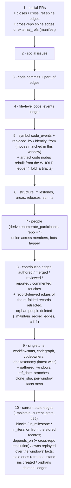

(The exact statement order inside the function differs slightly; the grouping above is the
logical sequence. FTS text is indexed as PR/issue/commit nodes are written (FTS5-gated); when
meta `fts_coverage` is not `complete` (a fold without FTS5 set it `partial`, or the store
predates the key) the fold first indexes every stored node `fts_map` lacks
(`gather._backfill_fts`, one pass, #111).)

**Artifact nodes are cumulative (#76).** Inside the fold's transaction, after the ledger rows
and move edges are written, `_fold_artifacts` reads the repo's whole ledger back
(`extract.ledger_events`) and the recorded moves (`extract.recorded_moves`), runs
`derive.artifact_projection` (= `build_artifacts`, lifecycle in date order via
`derive.chronological`, then `derive.apply_recorded_moves`) and upserts the artifacts the
bundle names plus the other end of any recorded move touching one. `validate.no_drift` runs
the same readers and projection, so store == re-derived by construction and the fold is
order-independent. Symbol moves stay matched per window (whole-ledger matching would turn a
creation `add` plus a later move `add` into an ambiguous pair); the nodes apply every recorded
move, a source only while its last event is a remove. Cost: one read of the repo's ledger per
fold that carries code/symbol events (linear in ledger size; ~0.5 s at 60k rows).

**Per-window facts (#94).** The singleton nodes are latest-wins. In the same transaction the
fold also calls `graphstore.set_window_facts(project, repo, from, to, bundle, clone_sha)`:
meta `facts:{p}/{r}:{from}:{to}` = `{clone_sha, facts: {key: sha256}}` for each non-empty
`workflow_stats` / `code_graph` / `code_owners` / `label_taxonomy`, each value stored once per
repo under `fact:{p}/{r}:{sha256}` (shared by windows with identical values; a re-fold of the
window replaces its entry and unreferenced values are deleted). Keyed by window, not clone
sha: the directory code graph is built from the window's changed paths, so two windows of one
checkout differ. Written whenever `meta.from` and `meta.to` are set; no schema change.

**Record-derived edges (#111).** `closes` / `cross_ref` (src: the PR), commit `part_of` (src:
the commit) and the contribution edges (dst: the PR / issue / commit) are a function of one
stored record, which the fold upserts latest-wins. Right after its nodes and edges are written,
`_maintain_record_edges` reads the stored edges of the bundle's records (`stored_record_edges`:
chunked `IN` lists on `idx_edges_src` / `idx_edges_dst`, linear in the bundle; cross-repo
`closes` / `cross_ref` only with `members`) and deletes those the fold did not just write;
a commit's `touches` join in only when its stored `files` (read before the upsert,
`_stored_commit_files`) changed. `delete_orphan_people` then deletes each person whose
contribution edge was retracted and who is the source of no contribution edge any more (any
member). A repo with data whose `current_state` lacks `records` (last folded before #111) is
healed once: `_stored_records` + `record_edge_keys` (the same `_pr_spine_edges` /
`_commit_part_of` / `_contribution_edges` helpers the fold writes with) re-derive every stored
record's edges and the rest are retracted. A remaining person's `modules` / `areas` union with
the stored node as before, unless `_is_sole_window` (the bundle re-folds the project's only
gathered window): then its derivation replaces it. The code-event ledger upserts
(`graphstore.add_code_events`: `ON CONFLICT DO UPDATE` of `author`, `date`, `hunk`, `ref`,
`before`, `after`, `detail`; first row of a key within a batch wins), so `_fold_artifacts`
re-credits a commit whose author resolution changed. Retractions go into the same summary,
ledger entry and stderr line as the current-state ones (below).

**Current-state edges (#95).** History edges (`touches`, review / event `part_of`, symbol moves)
are only added. The current-state types
(`gather.CURRENT_STATE_EDGE_TYPES`: `blocks`, `in_milestone`, `in_iteration`, `depends_on`,
`owns`) are written last in the transaction by `_maintain_current_state`, which makes the
repo's edges of those types equal to what its stored inputs imply and deletes the rest:

- `item_relation_edges` re-derives `blocks` / `in_milestone` / `in_iteration` from the repo's
  stored PR/issue records (read back after this fold's upserts; `graphstore.item_relation_rows`
  prefilters the JSON text in SQL so only records naming a milestone, an iteration or a
  `blocks` ref are decoded), the stored milestone and sprint nodes, and the stored issue ids
  (a `blocks` edge needs both ends stored). On an empty store this is exactly the bundle's
  derivation (the fold's milestones keep their bundle-order precedence).
- `StructureReplay` re-derives `depends_on` (`_fold_depends_on`, with the fold's members and
  registries) and `owns` (`_owns_pairs`) for every gathered window from its `facts:` entry,
  in `_window_order` (end day, then start day). Authority: a direct `depends_on` of area A —
  a window whose build of A resolved, or whose code graph has `structural_scan: true` (set by
  `apply_structural_scan`; whole tree, so every area except those in its
  `structural_scan_unread`, issue #109); a transitive one — a resolved build only; `owns` of
  A — a window listing A that read CODEOWNERS or a checkout (not one whose code graph has
  `codeowners_unread`). A source's edges
  are the union over its in-effect windows (its latest authoritative window and every later
  one; all when none), data from the latest. A stored edge not in that set is retracted only
  when its source has an authoritative window (`retractable`). With members None, cross-repo
  `depends_on` is outside the replay and never retracted. When any gathered window of the
  repo lacks a `facts:` entry (`repo_fact_windows` → None) the replay is skipped and this
  bundle's `depends_on` / `owns` are added as before.
- `depends_on` targets that are not stored get stand-ins (`_standin_rows`, create-if-absent);
  `graphstore.delete_orphan_standins` deletes a stand-in left with no edge after a retraction.
- `graphstore.record_retractions` appends `{from, to, counts, edges, standins_removed,
  people_removed}` to meta `retractions:{p}/{r}` when anything was retracted (record-derived
  edges and orphan people included, #111); `set_current_state` writes
  `current_state:{p}/{r}` = `{items: true, structure, records: true, from, to}`. `fold_bundle`
  returns the summary and `gather` prints `describe_retractions` on stderr.

Properties: idempotent (a re-fold of an unchanged window retracts nothing and logs nothing);
deterministic; `depends_on` / `owns` are a function of the SET of windows' facts (any fold
order converges); the item relations follow the stored record, which is upserted
last-fold-wins, so re-folding an older bundle after a newer one restores the older record
and its edges; record-derived edges and people likewise follow the last-folded copy of each
record. A failed fold rolls back with its retractions. Cost: one prefiltered pass over
the repo's PR/issue nodes plus one read of every window's code graph and CODEOWNERS per fold
(about 0.4 s for 20,000 stored issues of 3 KB); the record-derived step adds indexed lookups
linear in the bundle (synthetic 12-month store, 89k nodes / 165k edges / 274k ledger rows:
the 12th monthly fold took 4.4 s before and 4.5–5.0 s after, within run-to-run noise) and,
once per repo, the heal pass (the 13th fold into the store built before: 4.9 s → 7.0 s).

### 4.11 Cross-repo `depends_on` resolution (Terraform, Bicep)

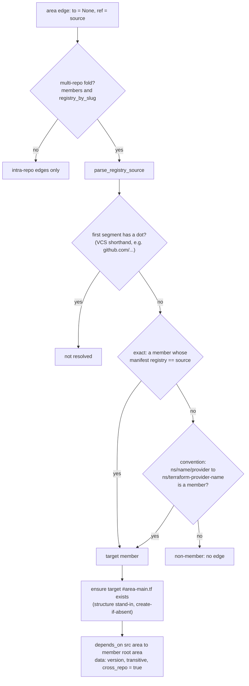

**Bicep (#92).** An unresolved edge with `provider: "bicep"` takes
`resolve_bicep_registry_member(ref, project, members, bicep_prefix_by_slug, exclude=repo)`
instead (Terraform edges never do, and Bicep edges never reach the Terraform resolver):

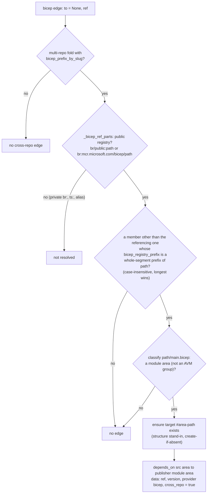

### 4.12 Backfill seam

`gather.backfill(conn, id, fetch)` fetches one missing PR or issue (`pr-<n>` / `issue-<n>`;
any other id is not fetched, commits included) and writes it through `record_rows` — the
function `fold_bundle` uses for each PR/issue (record node, closes/cross_ref and cross-repo
spine edges, contribution edges, review/lifecycle leaves) — plus its logins' person nodes
(`enumerate_participants`, the fold's union), its FTS text and the item-relation edges that
touch it, so the trust check accepts the store afterwards (#113). `fetch(kind, local, qid)`
returns a payload (`edges` in it are ignored), `ABSENT` (definitive 404, or 410 for a
deleted item → recorded in `dead_refs`, pruned forever) or `None` (transient, or an answer
that is not the requested item of this repo — a transferred issue, #109 → reported as an
`unreachable` gap).
Production wiring: `make_backfill_fetcher(token)` (REST only). Only `gather` writes, so
readers receive backfill as an **injected callable**.

## 5. Persist — `graphstore.py`

### 5.1 Schema

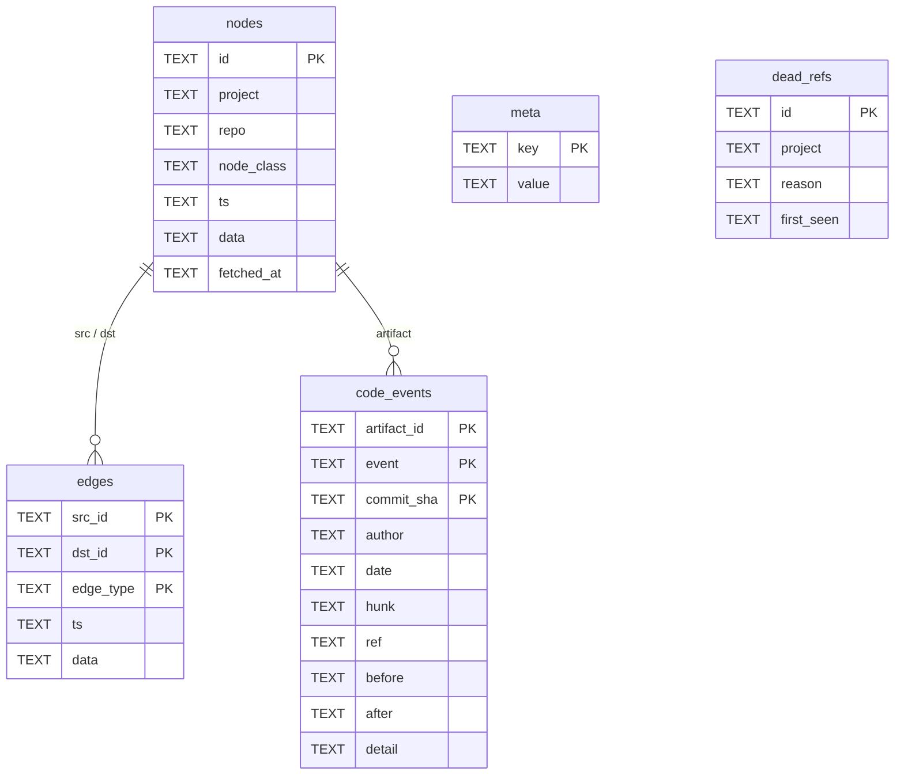

Plus `fts_text` (FTS5 virtual table) and its `fts_map(node_id PK, fts_rowid)` side table
when `fts5_available(conn)`. Indexes beyond the primary keys: `nodes (project, repo,
node_class, ts)`, `nodes (ts)`, `edges (src_id, edge_type)`, `edges (dst_id, edge_type)`,
`edges (edge_type, src_id, dst_id)`, `code_events (artifact_id, date)`. Store
`schema_version` is 2; `init_schema` migrates a v1 store in place (adds the edges index,
creates and back-fills `fts_map`) — see STORE.md "Schema version and migration".

### 5.2 Identity grammar

| Form | Example | Helper |
|---|---|---|
| Repo-scoped | `{project}/{repo}#{local}` | `qualify_id` |
| Person (project-scoped, `repo = "*"`) | `{project}#person-{login}` | `qualify_person` |
| Locals | `pr-N`, `issue-N`, `<sha>`, `art:<path>`, `<path>#<lang>:<subkind>:<name>`, `area-<id>`, `milestone-N`, `release-<tag>`, `sprint-<id>`, singletons `codegraph` … | — |

`parse_id` splits scope from local on the FIRST `#` (a local id may contain `#`;
see STORE.md "Parsing grammar"), and callers split the scope on its first `/`, so
`repo = "owner/repo"` (manifest mode) is safe. `local_id` returns the full local id;
`split_symbol_local` tells a symbol id from a file path containing `#` by its
`<lang>:<subkind>:<name>` tail.

### 5.3 API

| Group | Functions |
|---|---|
| Lifecycle | `open_store`, `open_store_readonly` (existing file, `mode=ro`), `init_schema`, `set_meta`, `get_meta`, `now_iso` |
| Nodes | `upsert_node`, `upsert_nodes`, `get_node`, `repo_nodes`, `range_query(conn, project, repos, ts_from, ts_to, node_class=None)`, `project_repos` (repos with nodes, minus stand-in-only repos with no gathered window, #77) |
| Edges | `upsert_edge`, `upsert_edges`, `get_edges(direction, edge_types)`, `edges_by_type(conn, edge_type, project)`, `edges_from_prefix` / `edges_into_prefix(conn, prefix, edge_type)`, `delete_edges` (#95) |
| Current state (#95) | `item_relation_rows(conn, prefix)` (SQL-prefiltered PR/issue records), `node_ids_with_prefix`, `nodes_with_prefix`, `delete_orphan_standins`, `set_current_state`/`get_current_state`, `record_retractions`/`get_retractions` |
| Window keys (#111) | `split_window_key(key, prefix)` → `(scope, window)`: the project ends at the first `/`, the repo at the next `:` (a project may contain `:`, a bound may be a timestamp) |
| FTS coverage (#111) | meta `fts_coverage` (`FTS_COMPLETE` / `FTS_PARTIAL`), `fts_unindexed_nodes(conn)` |
| Ledger | `add_code_event(s)`, `get_code_events`, `repo_code_events` |
| Spine | `traverse_spine(conn, seed_ids, max_depth=6, edge_types=SPINE_EDGE_TYPES, skip_dead=…)` → `{reached:{id:depth}, missing:[id]}` |
| Text | `index_text` / `index_texts` (replace by node id via `fts_map`, no table scan), `fts_search` (raw FTS5 `MATCH`; callers must escape) |
| Provenance | `record_window`/`get_windows`, `set_clone_sha`/`get_clone_sha`, `set_ref_date`/`get_ref_date` (#75), `set_branches`/`get_branches` (#84), `set_window_facts`/`get_window_facts`/`window_facts_problems` (#94) |
| Member run status | `set_member_status`/`get_member_status`, `incomplete_members(conn, project, ts_from, ts_to)`, `incomplete_warning`, `describe_member_status` (#77) |
| Tombstones | `record_dead_ref`, `is_dead_ref`, `get_dead_refs` |

**Semantics.** Identity columns are immutable; `ts`/`data`/`fetched_at` refresh on re-upsert.
Edges union; only `gather._maintain_record_edges` (record-derived edges a re-folded record no
longer implies, and orphan people, #111) and `gather._maintain_current_state` delete edges (stale current-state ones,
#95). `range_query` orders by `(ts, id)` and excludes NULL-`ts` structure nodes.
Window bounds are granularity-safe: node `ts` mixes date-only (commits, artifacts) and ISO
datetimes (PRs, issues, reviews, events), and bounds may be either. `range_query` and the
shared predicate `ts_in_window(ts, ts_from, ts_to)` compare each bound at the coarser
granularity of the pair (a date-only value covers its whole day; datetime-vs-datetime is
exact), inclusive, either bound optional. `complete._in_window`, `spotlight` window checks,
`gather.in_window` and `link._in_window` delegate to `ts_in_window`; no caller pads bounds.
`traverse_spine` walks spine edges **undirected**, depth-capped; `missing` lists referenced but
unstored spine ids (minus known-dead when `skip_dead`).
`edges_by_type` / `repo_code_events` (and `spotlight`'s person scan) filter on the literal `{project}/` / `{project}/{repo}#`
id prefix **case-sensitively** as an index range (`>= prefix AND < prefix-successor`), not
`LIKE`. Batch writers and the meta setters take `commit=False`; `gather.fold_bundle` uses it
to write a whole fold (nodes, edges, code events, FTS, `gathered_windows`, `clone_sha`) in
**one transaction** — an exception mid-fold leaves the store unchanged.

## 6. Read and enrich

### 6.1 `extract.extract(conn, project, repo, ts_from, ts_to, max_depth=6, warn=None, backfill=None, backfill_budget=50, ref_date=None)`

1. `range_query` the window for in-window nodes.
2. Seed trains from in-window **anchors** (PR/issue; reviews/events never seed), then
   `traverse_spine` to find out-of-window spine nodes (for completion / backfill).
3. `complete.complete_train` (see 6.2) — with `backfill=None` this is warn-only.
4. Materialize the raw arrays from the repo's nodes + ledger, **window-scoped** (issue #85;
   the rule mirrors what `gather` collects for a window, applied to each record's latest
   stored state; every test is `ts_in_window`):
   - `prs`: merged in the window, closed unmerged in it, or open with `created_at` by its end;
   - `issues`: `closed_at` or `updated_at` in the window, open with `created_at` by its end,
     or the target of a `closes`/`cross_ref` edge from a view PR (**train context** — what
     gather fetches for a window's PRs). PRs are never pulled in as context: `link` counts
     every PR in the arrays;
   - `commits`: `date` in the window; `code_events`/`symbol_events`: the ledger rows of those
     commits (a row whose commit is not stored: its own date decides);
   - any pr/issue/commit node whose own `ts` is in the window (`range_query`), and any undated
     node (it cannot be placed in a window);
   - `releases`: `published_at` in the window (or undated); `milestones`, `sprints`: not
     windowed (current structure).
   Re-attach reviews/lifecycle onto the view's parents (a review/event follows its parent,
   whatever its own timestamp); surface `blocks` as `blocking`/`blocked_by`.
5. Read back `artifacts` and `people` (the write path already derived them) and the per-repo
   facts (`code_graph`, `code_owners`, `label_taxonomy`, `workflow_stats`) — `_window_facts`
   (#94): exactly a gathered window → its `facts:` entry; any other window → `workflow_stats`
   = `derive.sum_workflow_stats` of the gathered windows wholly inside the view and not
   overlapping one another (by start day, longest first; absent when none; a window only
   partly overlapping the view is not summed), structure = the latest gathered
   window overlapping the view (by `to`), else the latest ending before it, else the earliest;
   no `facts:` entry for the repo (pre-#94 store) → the latest-wins singleton nodes. Window scope:
   each artifact's `lifecycle` keeps the view's events (same predicate as the ledger rows) and
   an artifact with none is left out; `status`/`replaced_by`/move fields are as of the
   window's end — the stored node when the ledger holds nothing dated after `ts_to`, else
   `derive.artifact_projection` over the ledger up to `ts_to` with the recorded moves, laid
   over the stored record (`_artifacts_as_of`). `people` (`_view_people`, #85/#88) keeps only
   the stored people with a contribution in the view's records — `derive.enumerate_participants`
   over them, the enumerator fold uses (commit `pr` resolved from the message on a copy, null
   lists read as empty) — so another member's people and people of another window are left
   out; each kept record's `modules`/`areas` are what that enumerator derives from the view's
   records with the view's `code_graph` (above), its flags (`is_bot`, `login_resolved`) are
   the stored node's. The person node is not changed. `code_owners` is an
   ordered rule list so CODEOWNERS last-match-wins order survives the sorted-key JSON store;
   `fold_bundle` (`owns`) and `annotate_people_profile` (`stale_owned`) share one matcher,
   `derive.compile_codeowners`/`area_owners` (area = last rule matching `<area>/`).

6. `_materialize_meta` (issue #75): `owner, repo, from, to` (+ `clone_sha`), `period =
   {from: ts_from, to: ts_to}` (the requested bounds, unchanged — the same ones step 1 uses)
   and `ref_date` = the `ref_date` argument (view/digest `--ref-date`), else
   `graphstore.get_ref_date(project, repo, ts_from, ts_to)` (stored by fold for exactly that
   gathered window), else `ts_to`. Issue #84 adds `base_branch` / `branches`
   (`_resolve_branches`): `graphstore.get_branches` for exactly that window, else the
   non-null values of the overlapping gathered windows of the repo when they agree, else
   `null` / `[]` — and, when a merged PR is in the view, a `warn` saying why (windows
   disagree, gather could not determine it, or a pre-#84 store). Never a guessed `main`.
   Issue #85 adds `state_as_of` = the latest `to` of the repo's gathered windows, only when
   that is after `ts_to` (the view's records are stored latest-wins). Issue #94: `clone_sha`
   is the one recorded with the window whose structure the view carries (absent when that
   gather had none; the repo's latest on a pre-#94 store), and `facts_windows` =
   `{structure, workflow_stats: [windows summed], workflow_stats_complete,
   workflow_stats_excluded?}` when the view is not exactly a gathered window (BUNDLE.md).

The result is **raw** (no trains/buckets); `link.enrich` derives the rest.

> **Window scope (issue #85).** On a store holding only the viewed window, steps 4–5 select
> every stored record, so single-window views are byte-identical to before (the golden and
> characterization tests pin this). On a store holding several windows, a view of one
> gathered window equals the view of a store holding only that window, up to records a later
> gather refreshed; a view spanning several windows is their union. `digest` applies the same
> decision to its spine components (`window_components`), so a project train does not fold in
> another window's PR/issue as an orphan ref. People's `modules`/`areas` are re-derived from the
> view's records (#88), so they are the window's too — computed with the window's own code
> graph (#94). A view of one gathered window carries that window's CI statistics, structure
> and clone sha, so it equals a store holding only that window there too. On a single-window
> store a view of exactly its window is unchanged; any other view of it now carries
> `meta.facts_windows`, and a sub-window view omits `workflow_stats` (the month's runs cannot
> be split by day). See HLD §10 items 7 and 8.

### 6.2 Completion and honest gaps (`complete.py`)

Level-0 anchors are always filled; transitive expansion follows the causal spine and stops at
the query window. Every train carries `complete: bool` and `gaps: [{id, reason}]`:

| Reason | Meaning |
|---|---|
| `not_gathered` | Offline; no fetch attempted |
| `outside_window` | Beyond the query window; intentionally not chased |
| `unreachable` | Fetch attempted and failed (transient) |
| `budget` | Per-query fetch ceiling reached |

A definitive 404 (e.g. a `Fixes #123` template placeholder) is **pruned** and tombstoned in
`dead_refs`, never reported as a gap.

### 6.3 `link.enrich(bundle)` pipeline

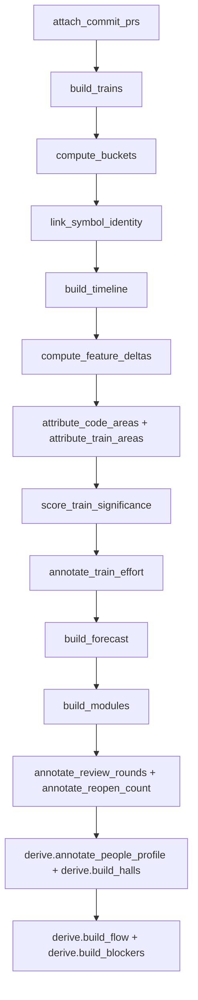

Order matters: significance needs code areas; forecast needs buckets and milestones; people
profiles need trains and artifacts. `artifacts`/`people` are **consumed**, not recomputed.
Before the first step, `_null_collections_to_empty` makes enrich total over JSON nulls (#82): a
null list field on a PR/issue/commit (`labels`, `reviewers`, `comments_list`, `files`, …) becomes
`[]`, a null `facets`/`reactions` becomes `{}` and a null reaction count `0`. Only present-and-null
keys change, so well-formed bundles (and the goldens) are untouched. The REST normalisers used by
backfill (`normalize_pr`/`normalize_issue`) likewise read a null `labels`/`assignees` as empty.

Enrich never reads the key order of a bundle object (#100). `build_timeline` sorts by
`(ts, ref.url, layer)` and then, for code events, `(artifact id, lifecycle position)`;
`compute_feature_deltas` by `(event time, artifact id, lifecycle position)`; render's content
timeline walks artifacts in id order. Everything else that iterates `people` / `modules` /
`artifacts` either writes per-key results or sorts its output. So `view.py` writes `sort_keys`
JSON like `digest.py`, and `test_key_order.py` enriches key-reversed bundles to prove it.

### 6.4 Decision trains — `build_trains`

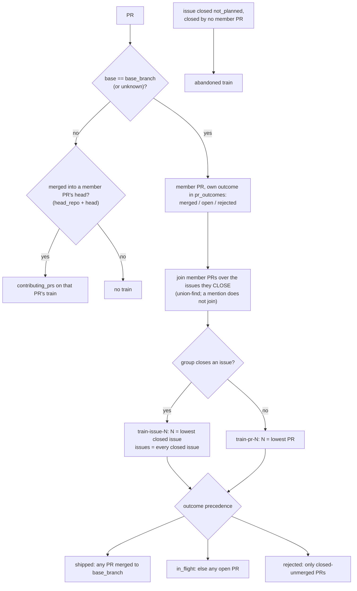

Membership (#93): every PR targeting the mainline is in exactly one train whatever its own
outcome, so a rejected first attempt, the PR that shipped and an open follow-up for the same
issue are one train (`prs`), each with its own outcome in `pr_outcomes` (`{"<pr#>":
"merged"|"open"|"rejected"}`). Member PRs and the issues they `close` are joined into connected
groups; each group is one train, every issue it closes is in `issues` and is indexed to it by
`train_index` (so its bucket ref carries the train id), and `root_issue` is the lowest of them.
`crossref_issues` (mentions, timeline cross-references, list tails such as the `#2` of
`Fixes #1, #2`) never join or anchor: they stay spine `cross_ref` edges for `extract`'s train
context and `spotlight` only (`digest` does not follow them, §10). A `closes` number that is a
PR of the bundle (GitHub numbers issues and PRs from one sequence and closes no PR by keyword)
is ignored: it neither anchors a `train-issue-<n>` nor joins the two PRs' trains (#110); a PR
that "fixes" another PR is a separate train. A stacked PR's parent is the member PR whose `head` is the stacked PR's `base`
**and** whose `head_repo` is the stacked PR's repo (from its url), so a fork's same-named
`patch-1` is never the parent; a candidate without `head_repo` (pre-#93 stores, deleted forks) is
used only when it is the sole candidate.

`kind` comes from the first typed issue of the train (lowest number first); when none is
typed, from the lowest-numbered PR's conventional-commit prefix. Each train records `issues`,
`prs`, `pr_outcomes`, `commits` (of every member PR), `code_areas`, `contributing_prs`,
`evidence` refs (every gathered closed issue, then every PR). Effort, participants and
significance (§6.6) read all of them. `digest.build_project_trains` qualifies every issue of a
member train (not only its root), and `render.emit_train_flowchart` draws every PR, labelling an
attempt whose own outcome did not decide the train's (`rejected: …` in a shipped train) and
leaving it without an edge to the outcome node.

### 6.5 Buckets — `compute_buckets`

Evaluated per PR then per issue; first matching rule wins. "In window" uses
`link.window_period(meta)` — `meta.period`, else `{from: meta.from, to: meta.to}` — the same
helper `build_forecast` uses (issue #75). Every `extract` view carries `period`, so an issue
closed in an earlier window but commented on in this one, or an open issue last touched long
ago, falls in no bucket. Only a bundle with neither `period` nor `from`/`to` (dateless
fixtures) is unbounded; an item with no timestamp counts as in window:

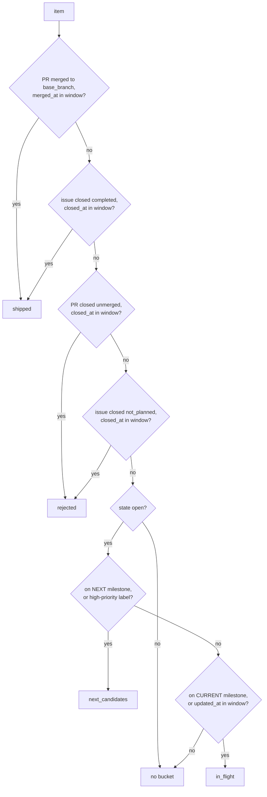

`select_milestones(milestones, ref_date)`: only **open, dated** milestones are eligible
(an undated one such as "Backlog" is never current or next; none dated → `(None, None)`),
sorted by `(due day, number)` and compared to `ref_date[:10]` (date or ISO timestamp).
**current** = earliest due on/after the ref day, **next** = the one after it; if every dated
milestone is overdue, **current** = the most recently due (lowest number on a tie) and
**next** = `None`. `HIGH_PRIORITY_LABELS` = `priority/high`, `priority/critical`, `p0`, `p1`,
`high-priority`, `critical` (case-insensitive exact match).

### 6.6 Significance and effort

```
footprint    = |prs| + |commits| + |code_areas| + |contributing_prs|
significance = footprint × TRAIN_KIND_WEIGHTS[kind] + |code_areas|
tier         = "deep" if rank ≤ TRAIN_SIGNIFICANCE_TOP_N (8) or significance ≥ TRAIN_SIGNIFICANCE_FLOOR (20.0)
               else "mention"
```

Kind weights: feature 3.0, module-request 3.0, bug 2.0, idea 1.5, docs/chore/other 1.0.
Outcome is deliberately ignored (a rejected train's story still matters).

`effort`, over every PR and issue of the train (#93): `opened_at` (earliest `created_at`),
`merged_at`, `elapsed_days`, `reviewers` (distinct), `review_comments`
(sum), `commits`, `participants` (distinct authors + reviewers + commenters), and the stall
flags (#112, threshold `TRAIN_STALL_DAYS` = 21, strict `>`): for an `in_flight` train,
`last_activity_at` = the latest of its members' `created_at` / `updated_at` / `closed_at` /
`merged_at`, comment and review-comment `created_at`, review `submitted_at`, lifecycle
`created_at` and its commits' `committed_at` (else `date`); `idle_days` = calendar days from it
to `meta.ref_date` (else `meta.to`), floored at 0; `stalled` = `idle_days > 21`. For a
`shipped` train `slow_to_land` = `elapsed_days > 21` and `stalled` is false; `rejected` /
`abandoned` trains have neither (BUNDLE.md `trains`). Review rounds and reopen counts are added
by `annotate_review_rounds` / `annotate_reopen_count`. Review rounds ignore `PENDING` reviews
and the PR author's own reviews; the exact round and `review_decision` rules are in
`BUNDLE.md` → *Review decision & rounds*.

### 6.7 Forecast — `build_forecast`

For each `next_candidates` ref:

| Signal | Weight | Fires when |
|---|---:|---|
| `on_next_milestone` | 5.0 | item milestone == next milestone title |
| `high_priority` | 3.0 | label in `HIGH_PRIORITY_LABELS` |
| `in_motion` | 2.0 | live work only (#87): it is an open PR; or an open PR `closes`/cross-refs it; or its train's `outcome` is `in_flight` |
| `recent_activity` | 1.5 | `updated_at` in window |
| `overdue` | 1.0 | `ref_date − created_at ≥ FORECAST_OVERDUE_DAYS` (200) |

The train is looked up in `bundle["trains"]` by the ref's `train` id. A train that is
`rejected`, `shipped` or `abandoned` is not work in progress (an open issue whose only PR was
closed unmerged is not in motion), and neither is a `train` id that names no train in the
bundle — nor an issue with no train (since #93 one that a merged PR merely cross-references:
a mention does not make it a train member). Signal text: `open PR` for the first two
cases, `work in progress` for an `in_flight` train. `notes` carries non-scoring context: a
`rejected` train adds `previous attempt rejected`, a `shipped` one `linked PR already merged`.
Since a train now holds every attempt (#93), an open follow-up PR in a train that already
shipped carries that train id and so the `linked PR already merged` note (its own `open PR`
signal is unchanged).

`tier` = likely (≥ 5.0) / possible (≥ 2.0) / longshot. Candidates sorted by `(−score, id)`.
Output: `{next_milestone, candidates:[{ref, train, score, tier, signals, notes}]}`. Forward-only —
verification happens in the next installment's series block.

### 6.8 Slice — `slice_train(bundle, train_id)`

Pure, read-only, raises `KeyError` on an unknown id. Returns `{train, issue, prs, commits,
feature_deltas, symbol_moves}` plus review rounds, capped reviews/lifecycle and reopen counts.
`issue` is the root issue; `train.issues` lists every closed issue and `prs` every attempt,
whose own outcome is in `train.pr_outcomes` (#93). Each `commits` row carries its commit `url`
(`derive._commit_url`, as on `feature_deltas`, #112).
Caps: text `SLICE_TEXT_CAP` = 1500 chars (with `…[+N chars]`), `SLICE_COMMENTS_KEPT` = 6 per list
(overflow counted), per-train diff budget `SLICE_DIFF_CAP` = 6000 chars: walking the train's
deltas in order, a `diff` is kept only if `used + len(diff) <= SLICE_DIFF_CAP` (#82), so the kept
total never exceeds the cap; a diff that does not fit is omitted (the delta stays listed) and
counted in `feature_deltas_diff_overflow`. BUNDLE.md documents every slice key; a docs-contract
test (`test_link_small_fixes.py`) compares it with `slice_train`'s output.

### 6.9 Series — `series.py` via `link.py BUNDLE --series series.json`

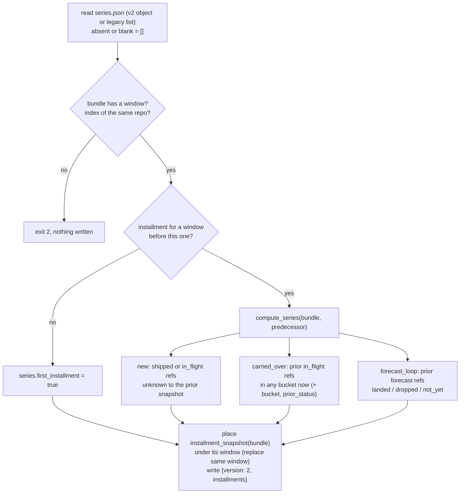

**Idempotent by window (#86).** An installment is identified by its window `(from, to)`
(`series.bundle_window`: `meta.period`, else `meta.from`/`meta.to`), normalised to calendar
days: `series.window_key` = `(from[:10], to[:10])` after `series.window_problem` has checked
each bound is a date or an ISO timestamp (`manifest.check_reader_window`) (#110). The key is
used for identity, ordering, replacing and the predecessor lookup; the recorded `from`/`to`
keep the spelling they were given. `link.main`:

- refuses (exit 2, nothing written) a window that `series.overlapping` finds sharing a day
  with a recorded window of other days — a quarter beside its months, a month inside a
  recorded quarter — naming both: "the installment before" is not defined in such an index
  (keep roll-ups in a separate index, USAGE §5.2);
- compares against `series.predecessor` — the installment whose window key sorts immediately
  before this one;
- records the new snapshot with `series.place_installment`: an entry for the same window is
  **replaced**, and the index is kept in window order. Running the same window twice
  therefore leaves one entry and produces the same `series` block; re-running an earlier
  window replaces that entry and compares it with *its* predecessor; running windows out of
  order inserts each in window order;
- stamps the snapshot `captured: "backfill"` when the index already holds a later window
  (open work and forecast are then as of the run, not the window's end), else
  `"in_order"`, and warns on stderr naming the later installments, whose `series` blocks were
  computed without this record (re-run them oldest first to refresh them; nothing
  recomputes them automatically).

`series.normalize_installments` collapses a window recorded more than once (a pre-#86 double
run) to the entry recorded last; entries without `from`/`to` keep their order ahead of every
window. Identity of items is `(type, id)`; URLs are excluded. `installment_snapshot` =
`{owner, repo, from, to, ref_date, captured, shipped:[{type,id}],
in_flight:[{type,id,board_status?}], next_candidates:[{type,id}], rejected:[{type,id}],
forecast:[{type,id,tier}]}`. `compute_series`: `new` = this window's shipped/in_flight refs in
none of the prior's lists (pre-#86 snapshots have no `next_candidates`/`rejected`, which
then count as empty); `carried_over` = prior in_flight refs found in any of the four current
buckets, each with `bucket` and `prior_status`; `forecast_loop` = prior forecast refs now in
`shipped` (`landed`), in `rejected` (`dropped`) or neither (`not_yet`); `prior` =
`{from, to, captured}` of the predecessor.

The index file is `{"version": 2, "installments": [...]}`; the older bare list is still read
and is rewritten as version 2 on the next run (an older `link.py` cannot read version 2). It
is read and shape-checked before enrich: invalid JSON, an object without `version`, another
version, an entry that is not an object, a reference list that is not a list of objects, or a
non-string `from`/`to` or one that is not a date / ISO timestamp exits 2 with
`link.py --series: series index <path> …`, as do a bundle with no (or an unusable) window, an
index whose entries name another `owner`/`repo`, and an overlapping window; nothing is
written (the index is never silently discarded). The bundle is written first and the index
second, each atomically (`<path>.tmp` + `os.replace`, #82): an interrupted write leaves the
previous file intact, and a run that cannot write its bundle records no installment.

### 6.10 `derive.py` projections

| Function | Output | Rule highlights |
|---|---|---|
| `build_artifacts` | `artifacts{}` | lifecycle per file/symbol in date order (`chronological`); status from newest event |
| `artifact_projection` / `apply_recorded_moves` | stored artifact nodes | `build_artifacts` over the whole ledger + the store's per-window symbol moves (#76) |
| `match_symbol_moves` / `link_symbol_identity` | `symbol_moves` | same `(lang, subkind, name)` dropped in one file, added in one other; `high` when git also flags a rename |
| `enumerate_participants` | all logins | the single source of truth for "who" (write path and auditor); a person keyed by an unresolved commit author gets `login_resolved: false` |
| `attribute_people_areas` | `people[].modules/areas` | commit files + reviewed PRs' areas |
| `unresolved_person_key` | person key | the git name of a commit author gather could not resolve to a login, `+ " (git)"` when login-shaped, so it never equals a login (#78) |
| `is_bot_login` | `is_bot` | `*[bot]`, `github-actions`, `microsoft-github-policy-service`, `*-organizer`, `copilot-*`; git-name forms `GitHub Actions`, `Dependabot`, `Dependabot Preview`, `Renovate`, `Renovate Bot` (case/space-insensitive), each also with the `" (git)"` suffix |
| `annotate_people_profile` | per-login metrics | prs authored/merged/reviewed, merge rate, review latency (median), first/last active, examples/docs/symbols authored |
| `build_halls` | `halls.fame` | non-bots, `score = 2·prs_merged + prs_reviewed + commits_authored`, top 10; **no shame/blame** |
| `build_flow` | `flow[]` | open issues: `blocked` (≥ 1 **open** blocker; closed blockers ignored, blockers absent from the bundle listed in `blocked_by_unknown` but not blocking) → `upvoted_but_ignored` (👍 ≥ 5, stale ≥ 30 d, no open PR) → `traction_then_abandoned` (≥ 5 comments, stale, no open PR) → `hung` (age ≥ 60 d **and** stale, no open PR) |
| `build_blockers` | `blockers[]` | open blockers only, out-degree counting open blocked issues only, sorted desc; the raw `blocking`/`blocked_by` from extract stay unfiltered (`blocker_graph` applies the same open-only filter, #101) |

## 7. Present — `render.py`

`render.py BUNDLE [--diagrams-dir workspace/diagrams] [--export svg|png] [--skip-validate] [--train ID]`.
The bundle is always required (`render.py BUNDLE --train ID` for a spotlight). An unknown
`--train` id is a clean usage error (exit 2, nothing written), like `link.py --slice`.
`--export` runs `mmdc` and therefore always validates; combining it with `--skip-validate`
is rejected (exit 2).

| Diagram key | Emitter | Mermaid type | Cap (top-N key) and "+K more" marker |
|---|---|---|---|
| `buckets_pie` | `emit_buckets_pie` | pie | fixed size (≤ 4 slices) |
| `timeline_gantt` | `emit_timeline_gantt` | gantt | `GANTT_MAX_PRS` (200) most recently created PRs (created_at desc, number desc), drawn chronologically, plus a `+K more PRs not shown` row; `GANTT_MAX_RELEASES` (30) latest releases |
| `content_timeline` | `emit_content_timeline` | timeline | latest `TIMELINE_MAX_DAYS` (40) dates (an `earlier : +K more events on M earlier dates` period replaces the rest); first `TIMELINE_MAX_EVENTS_PER_DAY` (8) events per date in bundle order, then `+K more events` |
| `deltas_bar` | `emit_deltas_bar` | xychart-beta | fixed size (3 bars) |
| `contributor_graph` | `emit_contributor_graph` | flowchart | `GRAPH_MAX_EDGES` (120) edges, breadth-first: key = (area's position in the person's list, login, area), so every contributor keeps an edge first; `+K more edges not shown` node |
| `kind_breakdown` | `emit_kind_breakdown` | pie | `PIE_MAX_SLICES` (10): largest kinds (count desc, name), the last slice `+K more kinds` sums the rest |
| `module_graph` | `emit_module_graph` | flowchart | `GRAPH_MAX_EDGES` (120) edges by target in-degree desc (blast-radius hubs first), then src, dst, label; `+K more edges not shown` node |
| `blocker_graph` | `emit_blocker_graph` | flowchart | open blocker → open blocked only (closed blockers omitted, #101); `BLOCKER_MAX_EDGES` (40) edges in (blocker, blocked) order; `+K more blocked` node |
| `train_flowcharts{id}` | `emit_train_flowchart` (deep trains) | flowchart; mode C with area nodes when ≤ `TRAIN_FLOW_MAX_PRS` (4) PRs and ≤ `TRAIN_FLOW_MAX_AREAS` (5) areas, else mode A chain | `TRAIN_FLOW_MAX_PR_NODES` (60) PRs in the train's `prs` order; the rest collapse into one `+K more PRs not shown` node in the chain |
| project module graph | `emit_project_module_graph(module_edges, notes=None)` | flowchart (used by digest reports) | as `module_graph` |

**Size limits.** Mermaid (mmdc 12.2.0, default config) has two hard limits, recorded as
`MERMAID_MAX_TEXT` = 50,000 characters (JS string length) and `MERMAID_MAX_EDGES` = 500. Above
the text limit mmdc exits **0** and writes an error SVG ("Maximum text size in diagram
exceeded"); above the edge limit it exits 1 ("Edge limit exceeded"). The caps above keep every
diagram below both (≤ 122 edges; estimated worst case ≈ 35k characters with 40-char labels;
a 700-PR / 800-edge / 1,500-event test bundle renders at ≤ 20k); in addition each capped
emitter re-renders with all its caps scaled by 0.75 until the text fits `DIAGRAM_TEXT_BUDGET`
(40,000), which only matters for pathological labels (e.g. many emoji, which count double).
Caps are deterministic: the same bundle always yields the same diagram. What was cut is
recorded in `bundle.diagrams.truncated` (`{name|train-id: {shown, total, unit}}`, `{}` when
nothing was cut) and printed as `note: … capped` lines, so the report can say so.

**Labels (#110).** Every untrusted text (PR / issue titles, release names, milestones, area
ids and paths, logins and unresolved git names, kind / label names, repo slugs, versions,
outcomes) goes through ONE sanitiser, `_mermaid_text`, before it reaches any diagram: one line
(CR, LF, TAB, control characters and U+0085/2028/2029 become spaces); every run of `%`
collapses to one, so no `%%{…}%%` directive (which Mermaid extracts from anywhere in the source
and which changes the diagram's configuration, or fails the run) and no `%%` comment can be
formed; `"` and backticks become `'`; `<` / `>` become `‹` / `›`; an entity code `#name;` gets
a fullwidth `＃`. The per-kind helpers add only what their type needs: `_flow_label` (node and
edge labels, 40 chars), `_subgraph_label` (uncapped), `_pie_label` (60), `_gantt_label` and
`_timeline_text` (also `:` → ` -`, 60). A gantt row never starts with free text — the gantt
lexer reads a line starting with `section`, `title`, `dateFormat`, `excludes`, `todayMarker`,
`click`, `accTitle`, … (any case) as that statement and one starting with `%` / `x%` as a
comment — so PR rows start `#<n> `, release rows `Release ` and marker rows with fixed text; a
PR whose state is not merged / closed / open gets no status tag. A timeline period is the
event's `YYYY-MM-DD` day or `undated`, never free text. `emit_train_flowchart` labels the
outcome node `Shipped [→ <milestone>]`, `In flight`, `Rejected` or `Abandoned (not planned)`;
any other value is drawn as itself (`Unknown outcome` when empty), and when no PR leads to the
outcome (an abandoned train) the issue node does.

**Node ids** come from `_stable_node_id(prefix, text)`: `<prefix>_<text>` when the text is
1–32 ASCII letters/digits (`p_alice`, `pr_42`), else `<prefix>_<sanitised head ≤ 24>_<sha1[:8]>`,
so `a-b` / `a/b` / `a_b` and long paths sharing a prefix stay distinct; a per-diagram
`_NodeIds` allocator also resolves any hash clash with a `_2`, `_3` suffix. The old
`_node_id` (sanitise + 60-char cut, which merged such nodes) is gone.

**Validation.** Every emitted file is compiled with `mmdc` unless `--skip-validate`; a
non-compiling diagram fails the run (exit 1). A diagram fails when mmdc exits non-zero, when it
writes no output, or when the SVG it writes with exit 0 is Mermaid's error diagram ("Syntax
error in text", "Maximum text size in diagram exceeded", `aria-roledescription="error"`); a
source longer than `MERMAID_MAX_TEXT` is rejected before mmdc runs. Each diagram is compiled to
a temporary SVG first; `--export svg` copies that checked SVG beside the `.mmd`, `--export png`
then runs mmdc again for the PNG. `ACTIVITY_MMDC_PUPPETEER_CONFIG` names a puppeteer config
passed as `mmdc -p`; without it, a run as root gets a generated `--no-sandbox` config (Chrome
will not start sandboxed as root). Paths are recorded in `bundle.diagrams`.

## 8. Trust — `validate.py`

`validate.py STORE [--project P] [--repo R] [--bundle FILE] [--json]` → exit 0 when no ERROR, 1
otherwise; exit 2 (usage error, no report) when the path does not exist or is not a store,
when several projects (or repos) are stored and none is named, or when `--bundle` cannot be
read. When the store (or `--project`) spans several repos, or a manifest gather recorded
member run status for the project, and no `--repo` is given, it runs `validate_project`
over every member holding data (`project_repos`) plus the project-wide checks; `--bundle` is
then ignored with a stderr warning (it is single-repo by nature).

| Check | Asserts |
|---|---|
| `target` | the store has nodes, the project has nodes and the repo is a stored member (case-insensitive, resolved to the stored spelling); and the member's last gather of every recorded window is `ok` (meta `member_status`, #77) |
| `referential_integrity` | every edge endpoint resolves to a node; dangling **spine** edges (out-of-window threads) and CODEOWNER-only `owns` endpoints are INFO, any other dangling edge is ERROR; a per-window `facts:` meta entry that is unreadable or names a `fact:` value that is not stored is ERROR (#94, `graphstore.window_facts_problems`) |
| `participant_completeness` | every login in any raw record has a person node and its contribution edge |
| `provenance` | every social/code node cites its own source: a PR/issue `url` is `https://github.com/{owner}/{repo}/pull\|issues/N` for the node's repo (case-insensitive) and `data.number == N`; a review/event cites its parent (or fold's synthesized fallback, or a timeline event's `api.github.com/repos/{owner}/{repo}/` url); a commit id is a 40/64-hex sha equal to `data.sha`; an artifact cites a lifecycle commit (#89) |
| `no_fabrication` | no orphan person, no historyless artifact; no PR/issue that is the dst of no contribution edge (ERROR when another record of that kind in the repo carries an author, else WARN; #113); every id follows the grammar (no `comment-N`, #113), its scope equals the row's `project`/`repo` (people: `{project}` + repo `*`) and its local form fits the node class; no scope is stored under two case spellings (owner/repo case-folded, a manifest project name exact, #89, #113) |
| `schema_conformance` | every edge type has an explicit endpoint rule (an unknown type is an ERROR); endpoint kinds match it; both ends are in one project; same-repo types stay in one repo (#89) |
| `meta_integrity` | the repo's markers and per-window meta are what folds write (#113): `gathered_windows` readable, each window a `from <= to` date pair with fold evidence of its own once the repo has any; `current_state:` readable and well formed, its `structure` equal to "every window has facts"; a repo with facts / clone provenance and no marker fails; per-window keys name a gathered window and have the writer's shape; `fact:` values re-hash to their key and fit the keys that reference them; `clone_sha:` / `fold_context:` well formed |
| `edge_set` | the repo's stored edges == the edges `gather.fold_bundle` writes for its self-sourced bundle in an empty scratch store, in both directions and with equal `data`; cross-repo edges are derived with the member set and registries the fold recorded (`fold_context:`, #113) and compared both ways, else a missing one is a WARN and a stored one is checked against the manifest derivation (#89); on a multi-window store `depends_on` / `owns` / `touches` compare with their replay over the per-window facts and each current-state type is exact when `_multi_window_plan` can prove it, else WARN (#95) |
| `no_drift` | stored people/artifacts == freshly re-derived from the self-sourced bundle (people from the records alone, with `login_resolved`; artifacts: the whole ledger plus any not-yet-folded events of a passed bundle, with the recorded moves; lifecycle entries compared, #113); with `--bundle`, the stored PR/issue/commit records == the bundle's, every stored record of the bundle's window is in it, and the window's per-window meta == the bundle's (#113) |
| `idempotency` | re-folding into a scratch copy changes no counts (on a multi-window store, cross-window move re-matches and current-state edges it adds are INFO, not counted; current-state edges it retracts are a WARN, not counted, on a repo last folded before #95; record-derived edges it retracts and people it deletes are a WARN, not counted, on a repo last folded before #111) |
| `no_drift_people` (project) | project-scoped people == union re-derived across all members (areas derived ⊆ stored when a member holds several windows) |
| `referential_integrity`, `provenance`, `no_fabrication`, `schema_conformance` (project) | the same checks over the rows no member owns (people, non-member rows) and the store-wide parts (the `facts:` index, case-variant scopes), once for the project (#107) |
| `member_status` (project) | every manifest member's last gather of every recorded window is `ok`; a `failed` / `not_attempted` member is an ERROR naming the repo, window and reason, also when it holds no node and so is not an audited member (#77). Passes (INFO) on a store with no recorded status |

Every report lists every check in this order (issue #79); none is ever dropped.

**Audit scope (#107).** `referential_integrity`, `provenance`, `no_fabrication` and
`schema_conformance` audit the rows the audited repo owns (`validate._Scope`): a node by its
`project`/`repo` columns, an edge by the repo of its src, a person's edge by the repo of its dst
(as `edge_set` assigns them). The rows no member repo owns and the store-wide parts go into a
single-repo report too (on a one-repo store the report covers every row, as before); in project
mode each member's report holds its own rows only and the shared part runs once as project checks,
so one member's error is never repeated in every member's report.
`edge_set`/`no_drift`/`idempotency` self-source their bundle via `extract` over the span of the
repo's timestamped nodes; a repo with only structure nodes (a quiet member) uses its recorded
gathered windows instead; `--bundle` is an optional cross-check (`edge_set` always uses the
self-sourced bundle). When no bundle can be sourced (no nodes for the target, an undecodable node
row, or social/code nodes with no `ts` at all) the three checks FAIL with
`could not self-source: <reason>`, and project-mode `no_drift_people` fails likewise.

**Strictness rules (#89).**

- *Edge set.* `_expected_edges` folds the self-sourced bundle into an empty in-memory store
  (`_scratch_fold`) and reads its edges back; `_owned_by_repo` assigns an edge to the repo of its
  src (a person's edge to the repo of its dst). `derived but not stored`, `stored but not
  derivable` and `edge data drift` are ERRORs. Edges into another member repo follow
  `_CrossRepoContext` (#113): when the repo's manifest folds recorded `fold_context:` and its
  member set never changed, the scratch fold (and `StructureReplay` on a multi-window store) runs
  with exactly that member set and those registries, so cross-repo `closes` / `cross_ref` /
  `depends_on` are compared both ways like any other edge (an edge re-pointed to another
  member's root or to a non-publisher, or a missing one, is an ERROR). Otherwise (no context, a
  pre-#113 manifest store, or `members_changed`) the scratch fold uses the store's member set
  (stored repos plus `member_status` repos) without registries: a missing cross-repo edge is a
  WARN, and a stored one passes when `gather._cross_repo_pr_edges` derives it from the stored PR,
  or, for `depends_on`, when an unresolved registry edge of the source area in the self-sourced
  bundle's `code_graph` (on a multi-window store whose structure is exact: in the code graphs of
  the windows in effect for the source, `StructureReplay.dep_in_effect`) carries the edge's
  `data` and the dst's local id is a member's root area (Bicep: the module area of the ref's
  path) — which member is not checked without the registries.
- *Edge classes.* Record-derived (`authored`, `merged`, `reviewed`, `reported`, `commented`,
  `closes`, `cross_ref`, `part_of`): exact (ERROR both ways) on every store, single- or
  multi-window, because a fold keeps each re-folded record's edges equal to its new content and
  the first fold since #111 of a repo heals every stored record (§4.10, #111). On a repo whose
  `current_state` lacks `records` (last folded before #111) a stored edge its record does not
  imply stays an ERROR (a view follows it) and carries `_PRE111_HINT` ("fold any window of it
  once more"); `idempotency` reports the edges such a re-fold retracts, and the people it
  deletes, as a WARN left out of the count. Current-state (`owns`, `touches`,
  `depends_on`, `in_milestone`, `in_iteration`, `blocks`): exact on a one-window store. On a
  multi-window one `_multi_window_plan` decides per type (#95): `blocks` / `in_milestone` /
  `in_iteration` are exact when the repo's last fold was since #95 (meta `current_state.items`:
  the fold rebuilt them from the stored records, so the whole-store re-fold must match);
  `depends_on` / `owns` are exact when that fold replayed them (`current_state.structure`) and
  every gathered window still has its `facts:` entry, against `gather.StructureReplay` over
  those facts (no registries: intra-repo edges compared both ways, cross-repo ones as above);
  `touches` (history, never retracted) is exact when every window has a stored code graph, none
  is graphify and no path maps to two areas across windows, against the stored commits' files
  over the union of the windows' path indexes (`_touches_expected`). Any type not proven that
  way is a WARN whose problem names the reason (fold once more; re-gather a window without
  facts; graphify / re-mapped paths). Moves
  (`replaced_by`, `identity_from`): exact on a one-window store; on a multi-window one each stored
  move must pass `_move_problem` (twin edge with equal data, same non-comment symbol in two files,
  a ledger drop of the source — by `move_commit` — and an add of the destination, basis/confidence
  consistent with the renames; checked against a `_MoveIndex` of the ledger built once per check,
  #113 — it used to scan every symbol event per move) and whole-store re-matches are not
  required. A repo is multi-window when `gathered_windows` records more than one `(from, to)` for
  it — counting, once the repo has any fold evidence, only the windows with their own
  (`meta_integrity`, #113).
- *People.* `_derive_people` seeds `enumerate_participants` with `people: {}`: a self-sourced
  bundle's `people` is read from the stored person nodes, and the enumerator only adds to its
  seed, so seeding with it made the areas check tautological. Modes (`_people_mode`): exact
  (one-window single-repo store; project mode), window (multi-window: logins and flags exact,
  areas derived ⊆ stored, extra → WARN), member (`--repo` of a multi-member project, or an external
  `--bundle` on a multi-window store: derived ⊆ stored for logins and areas). A stored person that
  is not derivable gets a `hint` from `_pre78_hint` when it has no `login_resolved` flag and all its
  contribution edges are `authored` → commits that now name another author.
- *Records (`--bundle`).* `_record_drift_details`: every PR/issue/commit of the bundle is stored
  with equal content (`external_refs` added by a manifest fold is ignored; `reviews`/`lifecycle`
  compare as sorted entries without `url`; `blocking`/`blocked_by` added by a view are ignored), so
  a saved `view.py` JSON of the freshly gathered store works as the bundle.
  `_bundle_span_details` (#113): every stored PR / issue / commit / release that gather would
  collect for the bundle's window (`meta.period`, else `meta.from`/`to`; extract's
  `_pr_in_window` / `_issue_in_window` on the stored state, or its `ts` in the window) and every
  review / lifecycle event of one of the bundle's records must be among the rows `fold_bundle`
  writes for the bundle; on a store holding only that window, so must every milestone, sprint
  and non-stand-in area. Train-context issues are not required. `_window_meta_drift_details`
  (#113): for a bundle window that is exactly a gathered window, the stored `ref_date`,
  base branch / branches, `clone_sha`, clone info and each fact value the bundle carries equal
  the bundle's.
- *Meta (`meta_integrity`, #113).* `_meta_details`: the repo's `gathered_windows` entries,
  their fold evidence (`_window_evidence`: a per-window meta key, a `member_status` entry or the
  marker naming the window), the `current_state:` marker (`_marker_problem`, and `structure ==
  (gather.repo_fact_windows(...) is not None)`, both directions), the per-window keys
  (`_branches_problem`, `_clone_problem`, `_facts_entry_problem`, a date for `ref_date:`;
  orphans), the `fact:` values (sha256 of the stored text == the key suffix;
  `_fact_shape_problem` for each referencing key), `clone_sha:` and `fold_context:`
  (`_fold_context_problem`).
- *Project mode cost (#113 m6).* A member-only `_Scope` reads its rows by index
  (`nodes` by `project, repo`; edges by the src / dst id range), endpoint and contribution
  lookups are by primary key / index, and each member is self-sourced once (`sourced` cache
  shared by `validate_repo` and `check_no_drift_people`). The `idempotency` re-fold still copies
  the whole store once per member.

**What it proves.** Self-sourced: the store is consistent with its own records and ledger,
every citation is the node's own GitHub object, and the markers and per-window meta are what
folds write. Not provable from the store alone: a record deleted with all its edges, a blob
rewritten consistently, an inserted record that is internally consistent (a PR or commit with
its contribution edge, a review with its `part_of`, a dated release, a milestone, an area), a
fact value rewritten with its key and ref, a plausible `branches:` / `ref_date:` / `clone:`
value, or a wrong ledger (the artifact part of `no_drift` compares nodes with the store's own
ledger since #76, so a ledger with missing or invented rows yields matching nodes). `--bundle`
covers all but the last for its window; nothing in the store covers the ledger (no per-fold
content digest is recorded).
Every check runs under `_guarded`: an exception — e.g. `CorruptRow` for data that is not valid
JSON or a social/code/person blob that is not an object — becomes a failed ERROR check carrying
the error and the row id, so text and `--json` reports are always produced.

**Read-only.** The CLI opens the store with `graphstore.open_store_readonly(path)` (SQLite
`file:…?mode=ro` URI; raises `FileNotFoundError` for a missing path and never creates it; no
WAL pragma, no schema step). The idempotency re-fold runs in an in-memory `backup` copy and the
`edge_set` re-derivation in an empty in-memory store. The
tombstone readers (`traverse_spine(skip_dead=True)`, `is_dead_ref`, `get_dead_refs`) treat a
missing `dead_refs` table as empty instead of creating it; only `record_dead_ref` creates it.

## 9. Cross-window reader — `spotlight.py`

`spotlight.py QUERY ARG --store S [--project P] [--repo R] [--from F] [--to T] [--json|--md] [--complete [--complete-budget N]]`

| Query | Function | Answers |
|---|---|---|
| `person <login>` | `person_impact` | one contributor's footprint across trains/areas |
| `symbol <artifact-id>` | `pattern_evolution` | one symbol's or file's lifecycle |
| `subsystem [owner/repo::]<area>` | `subsystem_split` | activity split within an area |
| `grep <phrase>` | `text_mining` | FTS5 search over PR/issue/commit text (needs FTS5) |
| `module [owner/repo::]<area>` | `slice_module` | full-history module biography envelope |
| `dependents <owner/repo>` | `member_dependents` | reverse `depends_on` BFS — blast radius |
| `dependents <owner/repo>::<area>` | `area_dependents` (#92) | reverse `depends_on` BFS from one area node: `direct` and all (`dependents`) consumer areas as `owner/repo::area`, in-repo and cross-repo; a single-repo store accepts `owner/repo` for its (project=owner, repo=name) |

Results share an envelope `{query, focus, focus_kind, project, status, scope, …}`.
`status` may be `needs_gather` or `fts_unavailable` — valid answers, exit 0. `--complete`
wires `gather.backfill` with a token (the only network path in a reader).

Rules (issue #81):

- **Project scope.** `fts_text` is store-wide, so `grep` keeps only ids starting
  `{project}/` or `{project}#`; `summary.matches` counts the matches inside the trains
  that survive `--from/--to` (not every raw hit). `person`'s authored-symbol scan uses the
  case-sensitive `{project}/{repo}#` index range (`graphstore._prefix_range`), not `LIKE`.
  A NUL byte in a phrase is read as a space.
- **Areas across repos.** `subsystem`/`module` look the area up in **every** project repo
  and union the results (the same area id — `main.tf`, `docs` — is common across members);
  `owner/repo::area` or `--repo` narrows to one member.
- **Naming a repo** (#113). `dependents`, `subsystem`, `module`, the `<repo>::<area>`
  qualifier and `--repo` resolve a repo by one rule (`resolve_repo_arg`): the stored
  spelling in any case; `owner/repo` on a single-repo store (project = owner, repo = name);
  `repo` alone when exactly one stored `owner/repo` has that name. No match or several:
  `needs_gather` from the library, exit 2 listing the store's repos from the CLI.
- **Module areas across windows** (#113). `module` unions the area index of every gathered
  window's #94 code graph (plus the `codegraph` singleton on a store folded before #94), so
  the answer does not depend on fold order. No other spotlight query reads a per-repo
  singleton (`code_owners` / `workflow_stats` are not read).
- **`--md` escaping** (#113). Every stored or typed value goes through `_md`: control
  characters collapse to a space; in text, markdown/HTML syntax is backslash-escaped or
  written as an entity and a leading block marker is escaped; a code span's fence is longer
  than any backtick run inside it. `--json` stays raw. Every row names its repo: envelope `repos` (members whose area answered),
  contributor `repos`, depends_on `repo` (the member whose area node the edge hangs off),
  module symbol/file `repo` (files sort by `(path, repo)`), and every train's `repos`.
- **Symbol query and file artifacts.** The file-level ledger is keyed by the bare path;
  `art:<path>` (the node id) and `<path>` both read it (`_ledger_key`, shared with
  `slice_module`). A lifecycle ending in `remove` (symbol) or `delete` (file, git's verb)
  is `removed`. A local id is qualified only against known `{project}/{repo}#` prefixes,
  so a path that starts with the project name (`avm/res/…`) still resolves.
- **Train outcome** (`_outcome`, the `link.build_trains` vocabulary), over the train's
  stored members, in this order: (1) any release → `shipped`; (2) with PRs (a `pr-<n>`
  record, or an `issue-<n>` record carrying a /pull/ url): any merged → `shipped`, else any
  not closed → `in_flight`, else `rejected`; (3) no PR: any issue not closed → `in_flight`,
  else any closed issue whose `state_reason` is not `not_planned`/`duplicate` (none counts as
  completed) → `shipped`; (4) else commits → `direct_push`, else issues (all dropped) →
  `abandoned`, else `in_flight`. So a no-PR train with an open and a completed issue is
  `in_flight`. Rendered badges: `[direct-push]`, `[abandoned]`. Trains group over the causal
  spine (every spine type but `cross_ref`), depth-capped as `traverse_spine`.
- **CLI.** Exactly one query argument; `--complete` only for the train queries
  (`person`, `subsystem`, `grep`, `module`); `--repo` only for `subsystem`/`module`;
  `--from/--to` not for `dependents` and validated and normalised by `manifest.check_reader_window`
(UTC `…Z`, #111). A
  missing (never created) or unreadable store, an empty store, an unknown `--project` or,
  with several projects, no `--project` (the message lists the store's projects), and an
  unknown `--repo`/qualifier (lists the project's repos) all exit 2 with usage.

## 10. Multi-repo aggregation — `digest.py`

`digest.py --store S [--project P] [--manifest M] [--repo R …] --from F --to T [--ticket-pattern RE] [--ref-date D]`
(repos default to `project_repos`; `--project` defaults to the manifest's). Works
for single-repo stores too (`--project <owner> --repo <name>`). Each member bundle is an
`extract` view, so it carries `meta.period`/`meta.ref_date` and its buckets (and so the
merged `shipped`) are limited to the window; `--ref-date` overrides every member's
`ref_date` (§6.1). Exit 2 for a bad
window (`manifest.check_reader_window`), a bad `--ref-date`, a missing store, an unknown project (lists
the store's projects) or `--repo` (lists the project's repos). Ticket clustering is
opt-in: the manifest's `ticket_prefixes` → `\b(?:ABC|PLAT)-\d+\b`, or
`--ticket-pattern` (wins); otherwise `tickets`/`related_work` are `[]`. Each
`members[].bundle.meta` gains `project`, `slug`, `repo_owner`, `repo_name`
(`meta.owner` stays the project scope). A project train's `code_areas` (#112) is the sorted
union of its member trains' `code_areas`, each as `"<repo>::<area>"` (BUNDLE.md "Project
view: `trains`").

People and totals (issue #88). A member bundle's `people` are that member's contributors in
the window (§6.1 step 5) and their profile counts only its records, so `_merge_people`
combines disjoint parts: counts (`derive.PROFILE_COUNT_FIELDS`) are summed; `merge_rate` is
recomputed from the sums; `review_latency_days` is the median of every member's samples
(`derive.review_latency_samples` over each member's PRs, the samples
`annotate_people_profile` takes the median of); `first_seen`/`last_active` are the min/max;
`modules`/`areas` become `"<repo>::<area>"`; `is_bot` is OR'd, `login_resolved: false` wins.
`halls` is `derive.build_halls` over the merged people. Nothing is stored: the person nodes
stay the fold's union, which `validate`'s `no_drift_people` checks.

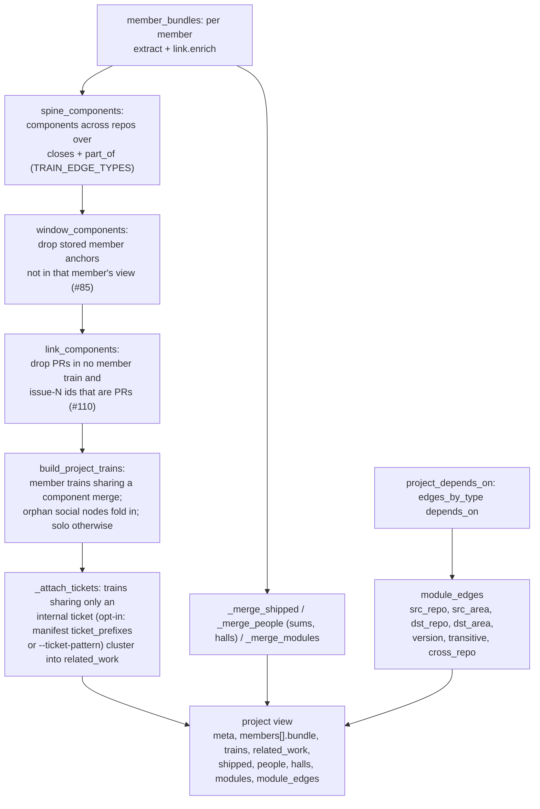

Project trains are built over the edges that make `link` trains (#110):
`digest.TRAIN_EDGE_TYPES` = `closes` (same-repo and cross-repo) and `part_of`, passed to
`graphstore.traverse_spine` and to the re-split. A `cross_ref` (a mention) never joins two
trains, and neither do `spun_off` / `duplicate_of` (link has no such join);
`graphstore.SPINE_EDGE_TYPES` keeps all five for `extract`'s train context and `spotlight`.
`link_components` then removes, and re-splits around, the anchors that join no link train: a
member's in-view PR that is in none of its trains (a stacked PR, a `contributing_prs` entry)
and `issue-N` where the store holds `pr-N` (a `Fixes #N` naming a PR, §6.4). So the project
trains of a single-member project are exactly that member's link trains (same grouping, same
outcomes) — up to the `max_depth` caveat below.

`window_components` (issue #85) removes from each component the stored PR/issue anchors of a
member repo that its window-scoped view left out, so on a store holding several windows a
component reaching another window cannot fold that window's PRs/issues into this window's
project trains (on a single-window store it removes nothing).

Caveat (documented in code): a train spanning more than `max_depth` spine hops can split
into two components; and restricting `--repo` cannot hide a real spine edge into another
member, so emitted `repos` may exceed the requested set.

## 11. Supporting tools

- **`manifest.py`** — `load_manifest` validates `{project (str, no "/" or "#"), window{from ≤ to, YYYY-MM-DD},
  repos[≥1]{owner, repo (GitHub name rules), registry? (non-empty str)}}`, rejecting duplicate
  members and duplicate `registry` values case-insensitively; every failure is a `ValueError`
  (rules in `STORE.md` § Multi-repo project). `member_slugs`. The field checks
  (`check_owner/check_repo/check_date/check_window/check_project`) are shared with
  `gather.parse_args` (single-repo flags), `view.parse_args` and `manifest_from_index`.
- **`manifest_from_index.py`** — reads the AVM **Terraform** index CSVs
  (`Terraform{Resource,Pattern,Utility}Modules.csv` in `Azure/Azure-Verified-Modules`) via
  `--avm res|ptn|utl` or `--index FILE|URL|-`; filters `--kind/--status/--name-contains/
  --include/--exclude/--limit`; writes the manifest (`--out` or stdout), deriving `registry`
  from `PublicRegistryReference`. `RepoURL` loses `.git`, query and fragment; a row whose
  owner/repo GitHub could not host is dropped; members, `--include` and `--exclude` compare
  case-insensitively (first index row of a case variant wins). Exit 2 on invalid/inverted
  dates, `--limit < 1` or a duplicate `registry` in the selection; an `--include` not in the
  index is a stderr warning; index fetches time out after 30 s. Its output always passes
  `load_manifest`.
- **`transcript.py PATH`** — strips WebVTT/SRT headers, NOTE/STYLE blocks, cue timings,
  indices and inline tags; collapses rolling-caption duplicates; `.txt`/`.md` pass through;
  missing file → exit 2.

## 12. Data contracts

| Artifact | Contract | Producer → consumer |
|---|---|---|
| `journey.db` | `STORE.md` (`meta.schema_version`) | gather → everything |
| Bundle view | `BUNDLE.md` (`meta.schema_version` = 3, `extract.VIEW_CONTRACT_VERSION`) | extract/view/link/digest → render, narrator, formatters |
| Project view | `BUNDLE.md` § output contract | digest → narrator, formatters |
| `series.json` | `{"version": 2, "installments": [installment_snapshot]}`, one per window, in window order; legacy bare list read (6.9) | link `--series` → link `--series` |
| Slice | `slice_train` shape (6.8) | link `--slice` → narrator sub-agent |
| Spotlight envelope | §9 | spotlight → narrator |
| Manifest | §11 | manifest_from_index / hand-authored → gather |

Top-level view keys are append-only within a schema version; omit-when-empty keeps shapes
diff-stable.

## 13. Configuration and tunables

**Environment variables**

| Variable | Default | Effect |
|---|---|---|
| `GITHUB_TOKEN` / `GH_TOKEN` | — | Auth (read scopes) |
| `ACTIVITY_CLONE_MARGIN_DAYS` | 14 | Clone reaches this far before `from` |
| `ACTIVITY_IAC_BUILD_TIMEOUT` | 300 | Seconds per IaC subprocess |
| `ACTIVITY_IAC_MAX_WORKERS` | 8 | Parallel IaC builds |
| `ACTIVITY_IAC_RETRIES` | 1 | Extra attempts on timeout/failure |
| `ACTIVITY_HTTP_TIMEOUT` | 60 | Seconds per GitHub API request |
| `ACTIVITY_HTTP_RETRIES` | 3 | Extra attempts on timeout / connection error / 5xx |
| `ACTIVITY_RATE_LIMIT_MAX_WAIT` | 3600 | Longest single rate-limit wait in seconds (`0` = fail instead of waiting) |
| `TF_PLUGIN_CACHE_DIR` | unset | Shared terraform provider cache (enables serial pre-warm) |
| `ACTIVITY_BOARD_STALE_DAYS` | 365 | Board treated as deprecated beyond this |
| `ACTIVITY_BOARD_MAX_ITEMS` | 5000 | Per-board item cap |
| `ACTIVITY_MMDC_PUPPETEER_CONFIG` | unset | Puppeteer config file passed to `mmdc -p` (as root without it: generated `--no-sandbox` config) |

Integer knobs `ACTIVITY_HTTP_*`, `ACTIVITY_RATE_LIMIT_MAX_WAIT` and `ACTIVITY_IAC_*` are read
at call time (not at import) and checked by `validate_env_knobs()` at the start of `main`: a
non-integer value exits with an error naming the variable; a value below its minimum (1 for
timeouts and workers, 0 for retries and max wait) is clamped with a warning.

**Code constants** (change deliberately; tests pin many of them)

| Constant | Value | Module |
|---|---|---|
| `TRAIN_KIND_WEIGHTS` | feature 3, module-request 3, bug 2, idea 1.5, else 1 | link |
| `TRAIN_SIGNIFICANCE_TOP_N` / `_FLOOR` | 8 / 20.0 | link |
| `TRAIN_STALL_DAYS` | 21 | link |
| `FORECAST_WEIGHTS` | 5.0 / 3.0 / 2.0 / 1.5 / 1.0 | link |
| `FORECAST_TIER_LIKELY_THRESHOLD` / `_POSSIBLE_` | 5.0 / 2.0 | link |
| `FORECAST_OVERDUE_DAYS` | 200 | link |
| `HIGH_PRIORITY_LABELS` | see §6.5 | link |
| `SLICE_TEXT_CAP` / `SLICE_COMMENTS_KEPT` / `SLICE_DIFF_CAP` | 1500 / 6 / 6000 | link |
| Flow thresholds | stale 30 d, upvotes 5, comments 5, hung 60 d | derive |
| `TRAIN_FLOW_MAX_PRS` / `_AREAS` | 4 / 5 | render |
| `MERMAID_MAX_TEXT` / `MERMAID_MAX_EDGES` | 50,000 / 500 (Mermaid's defaults, verified with mmdc 12.2.0) | render |
| `DIAGRAM_TEXT_BUDGET` | 40,000 | render |
| `GRAPH_MAX_EDGES` / `BLOCKER_MAX_EDGES` | 120 / 40 | render |
| `GANTT_MAX_PRS` / `GANTT_MAX_RELEASES` | 200 / 30 | render |
| `TIMELINE_MAX_DAYS` / `TIMELINE_MAX_EVENTS_PER_DAY` | 40 / 8 | render |
| `TRAIN_FLOW_MAX_PR_NODES` / `PIE_MAX_SLICES` | 60 / 10 | render |
| `DEFAULT_AREA_PATTERNS` | §4.5 | gather |

## 14. Cross-cutting concerns

### 14.1 Determinism and idempotency

- Identity-keyed upserts + set-semantics ledger + deduped `gathered_windows` → re-folding is a
  no-op (`validate.idempotency` proves it on every audit).
- `range_query` orders by `(ts, id)`; JSON `sort_keys`; collections sorted; tie-breaks by id.
- The only non-deterministic fields are `fetched_at` and `dead_refs.first_seen`, both excluded
  from determinism assertions.
- Idempotency is per window: re-folding the **same** window is a no-op. Artifact nodes are
  cumulative across **different** (even overlapping) windows and independent of fold order
  (§4.10); views are window-scoped (#85) and read their window's CI statistics and structure
  (#94); current-state edges follow their stored inputs and stale ones are retracted (#95,
  §4.10: `depends_on` / `owns` independent of fold order, item relations follow the
  last-folded record); record-derived edges and people follow the last-folded copy of their
  record (#111); what is still latest-wins is listed in §14.5.

### 14.2 Degradation matrix

| Missing | Effect | Signal |
|---|---|---|
| `bicep` / `terraform` | no build-derived IaC edges; manifest gathers and `--structural-iac` keep the static direct Terraform and Bicep edges (no Bicep transitive edges) | `edge_extraction` counts `skipped` |
| a member's `bicep_registry_prefix` (manifest) | other members' `br/public:` refs into it stay `to: null`, no cross-repo `depends_on` | edge `resolved: false` in the member bundle |
| non-public Bicep registry (private ACR, template spec, alias) | never resolved across repos | edge `resolved: false`, raw `ref` kept |
| `.terraform/modules/modules.json` | nested Terraform edges have no target (`to=ref=null`) | edge has `address`/`via` but no `ref` |
| registry unreachable / slow init | some areas unresolved | `timeout` / `failed` counts |
| `read:project` scope | no board status / sprints | empty board layer |
| `mmdc` | render fails (or use `--skip-validate`) | error |
| `graphify` | directory provider used | `code_graph.provider = directory` |
| FTS5 | `spotlight grep` unavailable | `status: fts_unavailable` |
| out-of-window spine node | context gap | train `gaps[]` |
| one manifest member's gather fails | that member has no data for the window; the others are folded | gather exit 1 + summary; meta `member_status`; `validate` ERROR (`target`, `member_status`); `digest`/`view` stderr warning |

### 14.3 Performance and API budget

Approximate REST cost per gather ≈ `pages(closed PRs since from) + pages(open PRs) + 4 × kept PRs
+ pages(issues since from) + pages(open issues) + 2 × issues + referenced issues + workflow/
release/milestone pages + ⌈commits on the branch in [from−1d, to+1d] / 100⌉` (the last term is
the commit-author login listing, #78; zero for a window with no commits). Because **all open PRs and issues** are included every run, busy
repos dominate the budget (a personal token's authenticated limit is 5,000 requests/hour; the
workflow's built-in `GITHUB_TOKEN`, which the CI live jobs use by default, has a lower limit
that its runs in one repository share, so a live gather in CI is likelier to wait for the
reset). Wall time is
dominated by the per-item calls and, on IaC repos, by `terraform init`. Mitigations:
`--no-workflows`, `--no-releases`, `TF_PLUGIN_CACHE_DIR`, and running heavy gathers
off-hours. When the limit is hit, gather waits for the reset (announced on stderr, bounded by
`ACTIVITY_RATE_LIMIT_MAX_WAIT`) and continues, so a long gather is slowed rather than lost (§4.7);
in CI that wait can push a job past an hour, so the live jobs run one at a time (chained, one
concurrency group) with a 120-minute timeout (§15).
A window with more than 1,000 workflow runs costs a few extra requests for the day-splits.
GraphQL (a separate 5,000-point/hour budget): the closing-issue read costs ⌈kept PRs / 50⌉
requests — 2 per 100 PRs — of 1 point each (50 connections of 25 nodes), plus one per extra
page of a PR with more than 25 closing issues (#105); the board read is §4.8.
(A reused `--clone-dir` is fetched rather than re-cloned.)

### 14.4 Security

- Read-only token; nothing is written to GitHub; the token is read from the environment only.
- Clones and stores contain repository content — treat workspaces as you would a clone.
- `mmdc` as root requires `--no-sandbox`; restrict that to throwaway environments.
- **The IaC builds download and run third-party code** (issue #109). `bicep restore` and
  `terraform init` fetch the modules and providers the gathered repo names, and
  `terraform init` / `graph` execute those providers on the gathering host. Use the builds only
  on repos you trust; `--no-iac-build` skips them (every area `edges_status: skipped`,
  `code_graph.edge_extraction.disabled: true`; the structural scan, which only parses source,
  still runs). The default is unchanged (CI relies on the builds). terraform always runs with a
  generated `TF_CLI_CONFIG_FILE` holding an explicit `provider_installation { direct {} }`
  block (plus the user's own config and `~/.terraform.d/plugins` when present), which disables
  terraform's implied local mirrors — in particular a `terraform.d/plugins` shipped inside the
  repo; a user config that already has its own `provider_installation` block is used as is.
  `TF_PLUGIN_CACHE_DIR` and `TF_TOKEN_<host>` are honoured. Residual: a repo can still pin
  providers in its own `.terraform.lock.hcl` and commit a `.terraform/` directory; the builds
  are not sandboxed. Gather only repositories you would build yourself, on a disposable host
  or runner. The CI workflow checks out with `persist-credentials: false` (#112), so no
  repository credential is left in the runner's git config.
- **No build process sees the token** (issue #109). gather sends the token only in HTTPS
  headers to `https://api.github.com`. One exception: when the user's git config has a
  credential helper, git (alone) keeps `GH_TOKEN` / `GITHUB_TOKEN` and the two Enterprise
  names, because a helper such as `gh auth git-credential` reads them to clone a private repo.
  Otherwise every subprocess (git, bicep, terraform, graphify) runs
  with `GITHUB_TOKEN`, `GH_TOKEN`, `GITHUB_PAT`, `GH_ENTERPRISE_TOKEN`,
  `GITHUB_ENTERPRISE_TOKEN`, `ACTIVITY_TEST_TOKEN` and every variable ending in `_TOKEN` or
  `_PAT` removed (`_child_env`); the rest of the environment (PATH, HOME, TMPDIR, proxy/TLS
  variables, `TF_PLUGIN_CACHE_DIR`, `TF_TOKEN_<host>`, locale, Azure credentials) is kept.
- **git is isolated from the user's config** (issue #109). gather's git processes run with
  `GIT_CONFIG_GLOBAL=/dev/null`, `GIT_CONFIG_NOSYSTEM=1`, `GIT_TERMINAL_PROMPT=0`,
  `GIT_PAGER=cat` and `LC_ALL=C`, so `color.ui`, `diff.noprefix`, `diff.mnemonicPrefix`,
  `log.showSignature`, `diff.renames`, `clone.defaultRemoteName`, LFS filters, … cannot change
  the walks; the walks also pass `--no-color --no-ext-diff --no-textconv --no-show-signature`
  (`-M` on the commit walk, `--src-prefix=a/ --dst-prefix=b/` on the patch walk). From the
  user's system and global config only network/auth routing is carried over, through
  `GIT_CONFIG_COUNT` (never argv): `http.*` / `http.<url>.*` `proxy`, `proxyAuthMethod`,
  `proxySSLCAInfo`, `sslCAInfo`, `sslCAPath`, `sslVerify`, `sslBackend`, `sslVersion`,
  `sslCipherList`, `schannelCheckRevoke`, `schannelUseSSLCAInfo`, `version`, `postBuffer`,
  `lowSpeedLimit`, `lowSpeedTime`, `followRedirects`, `curloptResolve`, `maxRequests`,
  `minSessions`, `noEPSV`, `emptyAuth`; `url.<base>.insteadOf`; `credential.helper` /
  `.username` / `.useHttpPath`; `safe.directory`; `protocol.*.allow`; `core.sshCommand`.
  Dropped: everything else, including `http.extraHeader`, `http.sslCert` / `sslKey`,
  `http.cookieFile`. Proxy and TLS environment variables (`HTTPS_PROXY`, `GIT_SSL_CAINFO`,
  `SSL_CERT_FILE`, …) pass unchanged. Needs git ≥ 2.32 for `GIT_CONFIG_GLOBAL`; older git
  reads the global config as before (the walk flags still pin the output).
- **Repo files are never read through a symlink that leaves the checkout** (issue #109):
  CODEOWNERS, `.tf` / `.bicep` sources, `modules.json` and graphify's `graph.json` are read only
  when their real path is inside the clone / structure worktree (`_read_text_file(path,
  root)`); otherwise skipped with one warning. Text is decoded with a BOM-selected codec, else
  UTF-8 with replacement, so an undecodable byte never fails the member; an unread module file
  puts its area in `code_graph.structural_scan_unread` and an unread CODEOWNERS sets
  `code_graph.codeowners_unread`, so neither is taken as evidence for retraction (#95).
- CI supply chain: actions are pinned to commit SHAs; the bicep binary and the Terraform zip
  are checked against sha256 values pinned in the workflow (Terraform's was taken from the
  release's SHA256SUMS after verifying its signature with the HashiCorp release key, #112).
  **Residual risk:** `@mermaid-js/mermaid-cli` is pinned at the top level only — its
  dependency tree (puppeteer and its Chrome download, run by an install script) is resolved at
  install time; `--ignore-scripts` would skip the Chrome download mmdc needs, and a lockfile
  for it is not kept. The mmdc install runs only in the offline `tests` job, which holds no
  secret.
- Diagram text is untrusted (anyone can title a PR or name a release): `render._mermaid_text`
  keeps a label from forming a Mermaid directive, comment, statement or HTML (§7, #110).
- Recognition-not-blame: `halls` has no shame list; people attribution of stalls is an opt-in
  report appendix, and only open trains are ever "stalled" (#112).

### 14.5 Known issues (verified, not yet fixed)

| Issue | Mechanism | Effect | Candidate fix |
|---|---|---|---|
| Past-month views show the latest record state | PR/issue nodes are upserted latest-wins; a view is window-scoped (#85) but reads the stored record | on a store holding later windows, a past month's view shows today's state/labels/milestone/comments (`meta.state_as_of`); an item open at that month's end but closed since is not in it; an item updated in that month and again later is in the later month only | per-window snapshots of the record at fold |
| `enrich` re-matches moves over a view spanning windows | `link.enrich` runs `link_symbol_identity` over the view's `symbol_events`; a view of one gathered window holds only that window's events (fold's own matching set), but a view spanning several windows holds them all | only a multi-window view (e.g. a quarter over monthly folds) can carry a cross-window move the store does not | read the moves from the stored nodes/edges instead |
| Wide views use one code graph | a view spanning several gathered windows takes its `code_graph` / owners / taxonomy from the latest of them (#94); the directory code graph only holds the areas of files its window changed | in a quarter view, files changed only in an earlier month have no area: their code-area attribution, people `areas` and the dependency diagram miss them (each month's own view is exact) | merge the covered windows' directory graphs (area by id, latest wins); a whole-tree area scan |
| Sub-window CI statistics are not available | `workflow_stats` are counted per gathered window, not per run day | a view inside a gathered window (a week of a gathered month) or straddling two has no `workflow_stats` (`meta.facts_windows.workflow_stats_excluded` says why); a view over ungathered days sums only what was gathered (`workflow_stats_complete: false`) | store per-day run counts |
| Area ownership is directory-level | `derive.area_owners` matches the area directory: `<area>/` and `<area>/**` own it (#110), `<area>/*` (direct files only) and file rules do not | files inside an area owned by a file rule (e.g. `*.tf` after the directory rule) or by `<area>/*` do not make that owner an area owner | per-file ownership facts if needed |
| Item relations and record-derived edges follow the last-folded record | `blocks` / `in_milestone` / `in_iteration` are rebuilt from the stored PR/issue records (#95), and each re-folded record's `closes` / `cross_ref` / `part_of` / contribution edges and people follow its new content (#111); records are upserted last-fold-wins | re-folding an OLDER bundle after a newer one restores the older record with its milestone / iteration / blockers, closing references, commenters and reviewers (consistent with the store, but older); a record not re-gathered since a change keeps its old edges | fold windows oldest first; per-window record snapshots |
| A reviewer added on a re-gather gets no areas from earlier windows' commits | person areas are derived per fold from that bundle's commits (`attribute_people_areas`) and unioned; `validate` re-derives them from every stored commit | a reviewer first named on a later gather of a PR whose commits were folded in an earlier window lacks those commits' areas: `no_drift` ERROR "person drift" (missing areas) on a multi-window store (seen on a synthetic store; independent of #111) | derive a person's areas from the stored commits of the PRs they review |
| Review / event nodes and dropped ledger rows outlive their record | review and lifecycle-event nodes (and their `part_of`) are their own records, and the ledger keys rows by `(artifact, commit, event)` (#111 updates their columns, never deletes) | a review GitHub no longer lists on a re-gathered PR, or a file event a re-gather of a commit no longer reports, stays in the store and its views (`validate` cannot see it: the self-sourced bundle reads them back) | re-gather into a fresh store; a per-record replace of review/event nodes if it proves common |
| A window's structure is the head when its end is not in the clone | since #107 the code graph / IaC / CODEOWNERS of a window are read at its last mainline commit on or before `to`; when the bounded clone does not hold that commit (no commit in the window or its 14-day margin, only later ones) the head is read (`meta.structure_as_of: "head"`, stored per window in the `clone:` meta entry and stamped on a view of exactly that window); windows gathered before #107 carry the tree of their gather day | such a window's structure is newer than the window; the `depends_on` / `owns` replay (#95) still orders windows by their dates | widen `ACTIVITY_CLONE_MARGIN_DAYS` to reach the window end; re-gather pre-#107 windows |
| Pre-#107 stores and Bicep module areas | since #107 every file below a non-AVM `main.bicep` dir is in that module's area; `touches` are only ever added | re-gathering, into a store folded before #107, a window that changed such a file (one area id changes: e.g. `infra/modules/x.bicep` `infra/modules` → `infra`, `a/b/c/README.md` `a/b` → `a/b/c`) leaves the old `touches` and people areas beside the new ones: `validate` fails a one-window store with them; on a multi-window store whose windows map the path differently they are WARNs | re-gather into a fresh store |
| Some stale structure edges are not provable | `depends_on` is retracted only where a resolved build or the whole-tree scan speaks for the source area, transitive edges only by a resolved build; `owns` only for areas a window's code graph lists (#95) | on a single-repo store without `--structural-iac` and without a working `bicep`/`terraform`, edges of areas no later window rebuilt stay; a transitive edge stays until the area is built again; owners of an area no later window lists stay | `--structural-iac`; the IaC toolchain on the gathering host |
| Terraform nested calls need init's module manifest | nested (`module.a.module.b`) targets come from `.terraform/modules/modules.json`; the DOT only names the call | if the manifest is missing or unreadable, nested edges have `to=ref=null` (kept in the bundle, never folded); calls whose module tree has no resources are not in the DOT, so they are not seen | read nested sources from the installed module dirs when the manifest is absent |
| IaC edges are build-gated on single-repo gathers by default | the structural scan is opt-in for single repos (`--structural-iac`, #92) to keep golden bundles byte-stable | without the flag and without `terraform`/`bicep` (or with a failed build), a single-repo bundle has no IaC edges; scan edges do not change an area's `edges_status` | pass `--structural-iac`; a scan-specific `edges_status` if needed |
| A Bicep module is a directory with a `main.bicep` | a module area is one with a tracked `<area>/main.bicep` (#66 entrypoint rule); its references are those of the entry file and of every file of the same area it reaches through local `module` references (#97: a root `main.bicep` that only calls `./resources.bicep` used to show one self-edge); only `module` statements are parsed | a deployment whose entry file has another name and that no `main.bicep` references is not a module area; files of an area that nothing references are not read; `import … from 'br/public:…'` type imports are not edges; Bicep has no transitive edges at all (#97: the name-matched ones were wrong), follow the direct edges instead | a configurable entrypoint pattern; parse `import` |
| Cross-repo Bicep resolution is public-registry only | `resolve_bicep_registry_member` (#92) honours `br/public:` / `br:mcr.microsoft.com/bicep/` only and assumes the registry path is the publisher's module directory | refs through a private ACR, a template spec or a `bicepconfig.json` alias never become cross-repo edges; a publisher whose published path differs from its directory gets a stand-in at the registry path | a private-registry prefix + path mapping in the manifest |
| One mainline per view | `link` compares a PR's `base` with one `meta.base_branch` | a roll-up spanning a default-branch rename (`master` → `main`) gets `null` (warned), so its merges are not told apart; view each gathered window on its own | carry a set of mainline names if needed |
| Stores gathered before a fix | the fold writes `ref_date:` (#75), `branches:` (#84), `facts:` (#94) meta, login-keyed commit authors (#78), `committed_at` (#82), PR `head_repo` (#93), nested Terraform areas (#101), same-repo-only timeline cross-references and UTC commit days (#109) only since those issues | an older store's views warn about an unknown base branch and count every merged PR as shipped, show the last folded window's CI stats/structure for every month, keep a person per git name beside the login (and fail `validate` people/`authored` with a "pre-#78 identity" hint), sort commit events before same-day comments, cannot attach a stacked PR whose base names two heads, keep nested `.tf` files under `modules/<name>`, can link a PR to a local issue whose number another repo's issue mentioned it from, and put a commit made near midnight UTC in the committer's local month | re-gather into a fresh store (USAGE §2.2) |
| Trust gate cannot see record content changes | self-sourced checks compare the store with its own records, ledger and meta; no per-fold content digest is recorded (it would need a `fold_bundle` change) | a record deleted with all its edges, a consistently rewritten blob, an inserted internally consistent record (PR / commit with its contribution edge, review, dated release, milestone, area), a fact value rewritten with its key and ref, a plausible `branches:` / `ref_date:` / `clone:` value, or a wrong ledger pass a store-only `validate` (#113 flags what can be: a PR / issue nobody contributed to, a `comment-N` node, a forged marker, a re-keyed or swapped fact) | `--bundle` with a view saved at gather time catches all but the ledger for its window; a fold digest in `meta` would cover the rest |
| Multi-window stores: some checks stay WARN | `_multi_window_plan` makes the current-state edge types exact on a multi-window store when it can prove them (§8, #95); it cannot for a repo last folded before #95, a window without `facts:` (pre-#94; `meta_integrity` makes sure such a window is real: the marker's `structure` must say so), `touches` with a graphify window or a path re-mapped between windows, or people's areas (a union over every window's activity) | on such a store a stale or tampered edge of those types, or an extra stored area, is a WARN naming the reason, not an ERROR | fold once more (pre-#95); re-gather pre-#94 windows; people areas: re-derive each window's view and union |
| Cross-repo edges of manifest stores folded before #113 | the member set and registries a fold used are recorded (`fold_context:`) only since #113, and `members_changed` once a member set changed | until each member is folded again, and on a member whose member set changed, a missing cross-repo edge is a WARN and a stored `depends_on` is matched on its target's local id only (which member is not checked) | fold each member once more (a re-gather of any window); a stable manifest member set |
| Mixed-era stores fail `meta_integrity` | per-window meta exists since #75, the marker since #95 | a store that holds a window folded before #75 beside later ones (that window has no fold evidence), or per-window facts without a `current_state:` marker (a #94-era fold not followed by any later one), fails `meta_integrity` | re-gather the evidence-less window; fold any window of the repo once more |
| A renamed or transferred repo fails `provenance` | PR/issue urls must name the node's repo; the API returns the current name after a rename | gathering a repo under its old name (manifest or `--repo`) stores `html_url`s of the new name and fails `provenance` | gather under the current name |
| Unresolved commit authors stay separate | a commit whose SHA has no `author.login` (email linked to no account) and no noreply email keeps its git name, `login_resolved: false` | that person is counted apart from their login (by design: never merged on a guess) | none needed; the flag makes it visible |
| Backfilled commits are thin | `make_backfill_fetcher` (`spotlight --complete`) logs one commit with the walks' format (it carries `committed_at` since #109) but does not resolve the author | a backfilled commit node's `author` is the git name; no person node or edge is written for it | resolve via the commits API there too |
| Incomplete members are not in the digest JSON | #77 surfaces a failed / not-attempted member through gather's exit code, `validate` and a `digest.py`/`view.py` stderr warning only | a formatter reading only the digest/view JSON cannot tell the project is partial | add the incomplete members to the view `meta` (BUNDLE.md change) |
| Member status is the latest attempt | `member_status` keeps one entry per (member, window), overwritten by each attempt | a member that once folded `ok` and then failed a re-gather of the same window fails `validate` although its earlier fold is still stored | by design (the latest data is missing); `gather --resume` clears it |
| Any open PR counts as in motion | `in_motion` needs an open PR or an `in_flight` train (#87), but it does not look at the PR's age, draft state or base branch | an open PR untouched for a year, or a draft, still scores `open PR` (+2.0) for the issue it references | weigh PR recency (e.g. `updated_at` in window) if stale open PRs prove common |
| Spotlight CI gate covers four queries | `ci_spotlight_integration.py` runs `person` / `subsystem` / `symbol` / `grep` only | `module` and `dependents` are exercised by the unit suite but not against the live store | add discovered-argument checks for both (a single-repo store has no cross-repo `depends_on`, so `dependents` belongs on the constellation store) |
| Series compares bucket membership only | `series.compute_series` (#86) matches the prior snapshot against this window's four buckets | an item in flight last time that is still open but neither updated in the window nor on the current milestone (no bucket) leaves `carried_over` silently; a forecast item that shipped or was closed in a month missing from the index is `not_yet`; refreshing an earlier window does not recompute the later bundles' `series` blocks (stderr names them) | report "went quiet" items from the open item records; recompute later installments on request |
| No series for a project view | `link.py --series` keys installments per bundle and items by `(type, id)` | a multi-repo constellation keeps one series per member bundle (USAGE §5.4) | key items by `repo` + type + id and accept the digest view |
| Trains join through shared closed issues | member PRs are grouped transitively over the issues they close (#93) | a PR that closes several issues pulls every other PR closing any of them into one train, so an umbrella "closes #1 … #9" PR yields one large train | none needed while closing references are deliberate; split by a cap if it proves noisy |
| Unmerged PRs into other branches have no train | trains hold mainline-targeting PRs; stacked PRs count only once merged (as `contributing_prs`) | an open or closed-unmerged PR into a feature / release branch is in no train and its bucket ref has no train id | attach it to its parent as a pending contribution if needed |
| Nested Terraform module dirs split files by extension | a `*.tf` in a non-scaffold dir below `modules/<name>/` maps to its own dir (#101); `classify_code_area` is per path, so a non-`.tf` file there (README, `.tftpl`) still maps to `modules/<name>` | that module dir's docs/templates count towards the enclosing module's area | a set-aware classifier (needs the tree listing) |
| `main.bicep` siblings are not in its area | the `main_bicep` pattern maps the `main.bicep` file itself to its directory; other files there fall through to `topn` (unless an AVM path) | outside `avm/`, a module's README or child `.bicep` files count towards a two-segment area, not the module's | a set-aware classifier, as above |
| Ledger rows of a commit with no file list | `graphstore.ledger_row_is_symbol` (#101) reads the row's commit's stored `files`; a shallow-boundary commit (#68) has an empty list and a merge commit lists none | a file row of such a commit whose path has the `#<token>:<token>:` symbol tail is still read as a symbol row | a row-kind column in `code_events` (schema change) |

The operating guidance in USAGE §2.1 (one single-window store per installment, or one
accumulated store viewed month by month as it grows; series file for continuity) says which of
these affect an accumulated store.

## 15. Testing and CI

- 55 `test_*.py` modules (stdlib `unittest`, about 2,200 tests), fixture-driven and fully
  offline (fake fetch seams; no network). Notable: `test_characterization.py` (store-derived ==
  link-derived golden equivalence), `test_validate.py` / `test_validate_strict.py` (each
  check), `test_gather.py` (parsers, fold, IaC parsing incl. modern/legacy DOT),
  `test_digest.py` (cross-repo trains, module edges), `test_series.py`,
  `test_window_scoped_views.py` / `test_window_facts.py` / `test_retraction.py` (multi-window
  stores), `test_view.py` (the `SKILL.md` / `commands/activity.md` docs contract: every
  documented command names a real script and accepted flags), `test_report_template.py`
  (template placeholders against real view output), `test_suite_hygiene.py` (every test is
  collectable by `unittest`; no conflict markers in skill files).
- Run: `python3 -m unittest discover -s .claude/skills/activity-overview -p 'test_*.py' -v`.
  Six tests skip on a normal machine (four real-store smoke tests without a local real
  store, two FTS5-absent degrade paths when FTS5 is present); the mmdc diagram tests skip
  without `mmdc`, and fail instead under `CI=true`.
- CI (`.github/workflows/activity-overview.yml`): `tests` on every relevant push/PR (Python 3.11,
  3.12, 3.13, byte-compile of the skill, `samples/` and `examples/formatters/`, pinned mmdc, then
  the suite; 20-minute timeout); `live` on dispatch, schedule (07:00 UTC on the 1st and
  15th) or default-branch push — real gather into a store (pinned bicep CLI), minimum counts
  (PR, issue and commit nodes, `closes` and `touches` edges each > 0), `validate.py`, then
  `view.py` → `link.py` → `render.py --skip-validate` on the store with non-empty
  `buckets.shipped`, `trains` and `timeline` asserted; the store and the enriched bundle are
  uploaded (#112). It uses the workflow's built-in token (`token_source: secret` on a dispatch
  uses the `ACTIVITY_TEST_TOKEN` secret instead, for private targets). The three live jobs
  (`live` → `spotlight` → `constellation`, chained with `needs`, each running whatever the
  previous one's result) share the concurrency group `activity-overview-live-gathers` with
  `cancel-in-progress: false` and a 120-minute timeout, so gathers queue instead of starving
  each other's API budget. GitHub keeps at most one pending job per group: when two runs
  overlap, a newer pending job replaces an older pending one, which is cancelled before it
  starts. Every checkout uses `persist-credentials: false`.
- CI `spotlight` job (same triggers): gathers a pinned historical week of
  `Azure/bicep-registry-modules`, runs `validate.py`, then
  `ci_spotlight_integration.py --store … --require-all`. The gate discovers its query
  arguments from the store, scoped to the project by a case-sensitive id-prefix range (no
  `LIKE`, so `_`/`%` in a project name are literal): the most-active person, the most-touched
  area (with its repo), the code_events key with the most ledger rows, and a term with hits in
  the project. It then checks each answer against the store, never against spotlight's own
  output (#113). Every train of every query: member `repos`, a chronological project-only
  timeline whose rows and touchpoints cite exactly what their stored nodes hold
  (number/sha/url/title; a comment's excerpt is its body), and an outcome equal to the one the
  gate computes from the stored member records (`_store_outcome`, the §9 rule written out
  in the gate, not imported). `person` — the (target, role) touchpoints equal the person's
  contribution edges (role from the edge type), each target in exactly one train (at least
  one when its causal train is deeper than the traversal cap, where spotlight may list it
  twice), no train without a touchpoint, a commenter excerpt from the person's own comment,
  summary counts consistent; determinism; `subsystem` (narrowed with `repo=`) — `repos`,
  contributor and `depends_on` rows name that member, and every commit/PR that `touches` the
  area is a touchpoint; `symbol` — each lifecycle row's event, date, commit and author equal
  its ledger row in (date, commit) order, outcome `removed` exactly when the last ledger row
  is `remove`/`delete`, and the artifact somewhere in its identity chain (a move destination
  is not the chain head); `grep` — the delivered mentions are exactly the project's FTS
  matches, each with the stored title and an excerpt found in the stored text. A check whose input the
  store lacks is reported as skipped; it fails the run only under `--require-all`. Exit 0 / 1
  (a check failed, or a skip under `--require-all`) / 2 (usage: missing store, unknown or
  unnamed `--project`). `test_ci_spotlight_integration.py` runs the gate offline on stores
  folded from the fixture bundles, a move-destination store and a three-project store.

## 16. Extension guide

| Change | Where | Watch out for |
|---|---|---|
| New repo layout → areas | add `(name, fn)` to `DEFAULT_AREA_PATTERNS` (order matters) | area ids appear in stored nodes; re-gather after changing |
| Org priority labels | `link.HIGH_PRIORITY_LABELS` | lower-case exact match |
| Forecast / significance tuning | constants in `link.py` | tests pin thresholds; update tests + BUNDLE.md |
| New view field | compute in `link.enrich` or `derive` (pure) | append-only; document in BUNDLE.md; omit when empty |
| New stored fact | `fold_bundle` + `extract` reader + `validate` conformance | must keep `no_drift` and characterization green |
| New spotlight query | function + `_RENDERERS` entry + dispatch in `main` | envelope shape; exit 0 for "no data" statuses |
| New formatter | consume the view (see `examples/formatters/`) | read `meta.schema_version` (3; refuse a newer one) and check the keys you need |
| Cross-repo Bicep deps from other registries | `resolve_bicep_registry_member` + `manifest.check_bicep_registry_prefix` (#92) | keep it manifest-gated; never route Bicep edges through the Terraform resolver |
