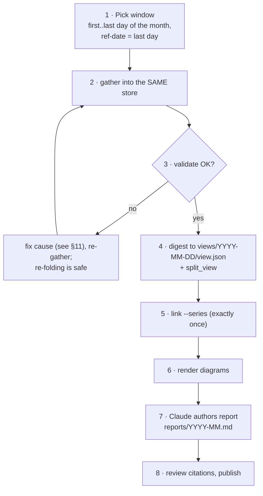
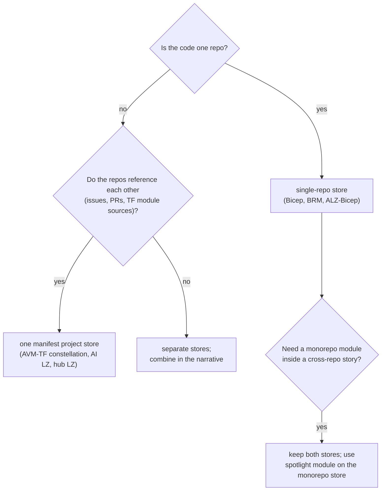

# activity-overview — Usage Guide

> **Audience:** the operator running digests from a laptop. **Design background:**
> [`HLD.md`](HLD.md) / [`LLD.md`](LLD.md). **Flag reference:** [`../REFERENCE.md`](../REFERENCE.md),
> [`../ARCHITECTURE.md`](../ARCHITECTURE.md) appendix A.
>
> This guide covers: install (§1–2), the two ways to run it (§3–4), the **monthly progressive
> update runbook** (§5), **forecasting** (§6), **playbooks for each target estate** —
> Bicep, AVM Bicep, AVM Terraform, AI landing zone, hub/platform landing zone (§7) — store
> management (§8), readers (§9), automation (§10), troubleshooting (§11) and security (§12).

---

## 1. Prerequisites

| Requirement | Why | Check |
|---|---|---|
| Python 3.11+ (stdlib only) | runs every tool | `python3 --version` |
| git 2.x | bounded clone + history walks | `git --version` |
| Claude Code | runs the skill and authors the narrative | `claude --version` |
| GitHub token | read API access | see §1.1 |
| `mmdc` (mermaid-cli) — recommended | compiles/validates diagrams | `mmdc --version` |
| `bicep` CLI — for Bicep repos | module dependency edges | `bicep --version` |
| `terraform` — for Terraform repos | module dependency edges | `terraform version` |

Install the optional tools (pick your platform):

```bash
# macOS (Homebrew)
brew install node git python
npm install -g @mermaid-js/mermaid-cli
brew tap azure/bicep && brew install bicep
brew tap hashicorp/tap && brew install hashicorp/tap/terraform

# Linux / WSL (Ubuntu)
sudo apt-get install -y git python3 nodejs npm
sudo npm install -g @mermaid-js/mermaid-cli
curl -Lo bicep https://github.com/Azure/bicep/releases/latest/download/bicep-linux-x64 \
  && chmod +x bicep && sudo mv bicep /usr/local/bin/bicep
# terraform: follow https://developer.hashicorp.com/terraform/install for your distro
```

### 1.1 GitHub token

- **Classic PAT** with `public_repo` (public targets) or `repo` (private), plus
  **`read:project`** if you want Projects v2 board status and sprints.
- **Azure org policy:** Microsoft Open Source rejects classic PATs with a lifetime **over 90
  days** — set an expiry ≤ 90 days and rotate. If an org enforces SAML SSO, authorize the token
  for it (*token settings → Configure SSO*).
- Keep it out of files and shell history. On macOS, store it in the Keychain and export it
  per session:

```bash
security add-generic-password -a "$USER" -s activity-gh-token -w   # paste when prompted
export GITHUB_TOKEN="$(security find-generic-password -a "$USER" -s activity-gh-token -w)"
```

## 2. Install the skill

```bash
git clone https://github.com/DamianFlynn/experiments.git ~/src/experiments
mkdir -p ~/.claude/skills ~/.claude/commands
ln -s ~/src/experiments/.claude/skills/activity-overview ~/.claude/skills/activity-overview
ln -s ~/.claude/skills/activity-overview/commands/activity.md ~/.claude/commands/activity.md

# verify (offline, ~10 s)
python3 -m unittest discover -s ~/.claude/skills/activity-overview -p 'test_*.py'
```

Symlinks mean `git -C ~/src/experiments pull` updates the skill. Set a convenience variable
for the manual commands below:

```bash
export AO=~/.claude/skills/activity-overview
```

### 2.1 Recommended workspace layout

Keep **one directory per report stream**. The store accretes month after month, so never
delete it casually.

```
~/activity/
  bicep/            journey.db  series.json  reports/2026-11.md  views/
  avm-bicep/        journey.db  series.json  reports/  views/
  avm-tf-network/   journey.db  manifest.json  series/  reports/  views/
  ai-lz/            journey.db  manifest.json  series/  reports/  views/
  hub-lz/           journey.db  manifest.json  series/  reports/  views/
  .tfcache/         (shared TF_PLUGIN_CACHE_DIR)
```

## 3. Running it through Claude Code (the normal way)

```text
/activity Azure/bicep-registry-modules 2026-11-01 2026-11-30 --series ~/activity/avm-bicep/series.json --store ~/activity/avm-bicep/journey.db
```

or in plain language:

> *"Produce the November 2026 activity digest for Azure/bicep-registry-modules using the store
> ~/activity/avm-bicep/journey.db and the series file ~/activity/avm-bicep/series.json; focus
> the narrative on avm/ptn/ai-ml/landing-zone and avm/ptn/network/hub-networking."*

Claude follows `SKILL.md`: gather → validate → materialize + link (with series) → render →
per-train narrator sub-agents → fills `report-template.md`, citing every fact. Ask for an
**internal** report explicitly if you want the gated stall/blocker attribution appendix.

## 4. Running the pipeline manually (reproducible, scriptable)

Use this when you want to inspect each stage, automate the deterministic part, or feed the
structured view to your own formatter. All commands run from anywhere; paths are explicit.

```bash
S=~/activity/avm-bicep           # stream directory
FROM=2026-11-01; TO=2026-11-30

# 1 · Acquire → store (network; the only step that needs the token)
python3 $AO/gather.py --owner Azure --repo bicep-registry-modules \
  --from $FROM --to $TO --store $S/journey.db --clone-dir $S/clone

# 2 · Trust gate — stop if this is not "RESULT: OK"
python3 $AO/validate.py $S/journey.db --project Azure --repo bicep-registry-modules

# 3 · Materialize the view (single repo: project = owner, repo = name)
mkdir -p $S/views/$TO
python3 $AO/digest.py --store $S/journey.db --project Azure --repo bicep-registry-modules \
  --from $FROM --to $TO > $S/views/$TO/view.json
```

There is no standalone `extract` command; `digest.py` runs extract + enrich for each member and
emits the view. Split it into per-member bundle files (and the project module graph) with this
helper — save it once as `~/activity/split_view.py` (outside the skill folder):

```python
# split_view.py  —  usage: python3 split_view.py <skill-dir> <view.json> <out-dir>
import json, os, sys
skill, view_path, out_dir = sys.argv[1:4]
sys.path.insert(0, skill)
import render
view = json.load(open(view_path))
os.makedirs(out_dir, exist_ok=True)
for m in view["members"]:
    p = os.path.join(out_dir, m["repo"].replace("/", "__") + ".bundle.json")
    json.dump(m["bundle"], open(p, "w"), indent=2, sort_keys=True)
    print("member bundle:", p)
mmd = render.emit_project_module_graph(view.get("module_edges", []))
open(os.path.join(out_dir, "project_module_graph.mmd"), "w").write(mmd)
print("project module graph:", os.path.join(out_dir, "project_module_graph.mmd"))
```

```bash
python3 ~/activity/split_view.py $AO $S/views/$TO/view.json $S/views/$TO
B=$S/views/$TO/bicep-registry-modules.bundle.json      # single-repo member file name

# 4 · Link with series continuity (ONCE per installment — it appends to series.json)
python3 $AO/link.py $B --series $S/series.json

# 5 · Diagrams (mmdc validates each; add --skip-validate if mmdc is unavailable)
python3 $AO/render.py $B --diagrams-dir $S/views/$TO/diagrams

# 6 · One train's bounded evidence (what a narrator sub-agent reads)
python3 $AO/link.py $B --slice train-issue-1234 > $S/views/$TO/train-issue-1234.slice.json
```

Then ask Claude to write the report from `$B` (+ slices + diagrams) following
`reference/report-sections.md`, and save it as `$S/reports/2026-11.md`.

> **Note on file names.** A single-repo member is keyed by the bare repo name
> (`bicep-registry-modules.bundle.json`); manifest members are `owner__repo.bundle.json`.

## 5. Runbook — progressive monthly updates

### 5.1 The monthly cycle



### 5.2 Step detail

1. **Window.** Use calendar months: `--from 2026-11-01 --to 2026-11-30`. `--ref-date` defaults
   to `--to`, which frames milestones, sprints, forecast age and flow staleness — keep the
   default for month-end reports.
2. **Gather into the same store as last month.** History accumulates; overlapping re-runs are
   harmless (idempotent). Add `--clone-dir $S/clone` so the clone is reused/placed predictably.
3. **Validate.** Never publish from a store that is not `RESULT: OK`.
4. **Materialize** the view for *this* month only (`digest --from/--to` = the month).
5. **Series.** `link --series series.json` compares with the *last appended* installment and
   appends this one. Running it twice for the same month appends a duplicate — if that
   happens, delete the last entry in `series.json` (it is a plain JSON list) and re-run.
6. **Render**, then **author**: the report's *Since last installment* section uses
   `bundle.series` — new items, carried-over items (with prior board status) and the forecast
   loop (last month's predictions landed / not yet).

### 5.3 First installment, catching up, and roll-ups

| Situation | What to do |
|---|---|
| First month of a stream | Run normally; `series.first_installment = true` and the report omits *Since last installment*. |
| Starting with history | Gather earlier months first (oldest → newest) and run `link --series` for each, **in chronological order**, so the chain is correct. |
| Missed a month | Gather it (safe), but series comparisons follow the order you append. If you appended out of order, rebuild `series.json` by replaying installments oldest → newest. |
| Quarter / year view | No re-gather: run `digest.py` with the wider window (e.g. `--from 2026-10-01 --to 2026-12-31`) over the same store. Don't add roll-ups to the monthly `series.json` — keep a separate series file for quarterly installments. |
| Refresh a month after late merges | Re-gather the same window, then re-materialize. Avoid re-running `--series` unless you first remove that month's entry. |

### 5.4 Multi-repo streams and series

`--series` works on a single bundle. For a constellation, either keep a series per key member
(`series/<owner__repo>.json`, e.g. the pattern module) or track continuity at project level
in the narrative from the merged `shipped`/`trains`. The project view itself has no series
block.

## 6. Forecasting — reading it and making it useful

### 6.1 What it is

The forecast scores **open items that are on the next milestone or carry a high-priority
label** (`next_candidates`). Score = sum of signals:

| Signal | Points | Shown as |
|---|---:|---|
| On the next milestone | 5.0 | `on milestone <title>` |
| High-priority label | 3.0 | `high-priority` |
| In motion (open PR, PR references it, or part of a train) | 2.0 | `open PR` / `work in progress` |
| Updated in the window | 1.5 | `active in window` |
| Open ≥ 200 days | 1.0 | `long-open` |

Tiers: **likely ≥ 5**, **possible ≥ 2**, **longshot < 2**. Open items that are merely active
(not on the next milestone, not high-priority) appear under **In flight**, not in the forecast.

### 6.2 Verifying it next month

The following installment's `series.forecast_loop` lists each previous candidate as **landed**
(it is now in `shipped`) or **not yet**. Track a simple hit-rate per tier over time
(landed ÷ forecast) to calibrate how much weight readers should put on each tier.

### 6.3 Making it meaningful on your repos

- **Milestones drive the strongest signal.** If a repo uses milestones for releases, the
  forecast will track them automatically (`select_milestones`: current = earliest open due
  on/after the ref date; next = the following one).
- **Priority labels must match.** Recognized labels (case-insensitive, exact):
  `priority/high`, `priority/critical`, `p0`, `p1`, `high-priority`, `critical`. Check a repo
  with `gh label list -R <owner/repo> --limit 200`. If it uses other names (for example a
  `Priority: High` style), the high-priority signal will not fire; extend
  `HIGH_PRIORITY_LABELS` in `link.py` (lower-case) and keep the change in your fork.
- **No milestones and no matching labels** → the forecast is legitimately empty. The report
  should then say "no forecast signals" and lean on *In flight*, *Stalled/blocked* and board
  status instead of inventing predictions.
- **Projects v2 boards** add `board_status` to in-flight items and sprint framing; they do not
  change forecast scores.

## 7. Playbooks per target estate

### 7.1 Bicep — `Azure/bicep`

- **Shape:** one product repo (the Bicep compiler and tooling, .NET). Single-repo gather.
- **Areas:** the directory provider uses the top two path segments (e.g. `src/Bicep.Core`,
  `src/Bicep.Cli`); install `graphify` if you want symbol-community areas instead.
- **IaC edges:** not applicable (no `main.bicep` module tree to build) — expect
  `edge_extraction` to be skipped.
- **Command:**

```bash
python3 $AO/gather.py --owner Azure --repo bicep --from $FROM --to $TO \
  --store ~/activity/bicep/journey.db --clone-dir ~/activity/bicep/clone
```

- **Report focus:** shipped features/fixes by area, deep trains (language features), the
  forecast (if milestones are used for releases), releases section, contributors.

### 7.2 AVM Bicep — `Azure/bicep-registry-modules` (BRM)

- **Shape:** a monorepo with 500+ resource modules (`avm/res/<service>/<module>`) and ~50
  pattern modules (`avm/ptn/<group>/<module>`), e.g. `avm/ptn/ai-ml/landing-zone`,
  `avm/ptn/network/hub-networking`, `avm/ptn/alz`. Single-repo gather.
- **Areas:** one area per module (the `avm` pattern), so shipped-by-area, module ownership and
  feature deltas are per module.
- **Dependencies:** with the `bicep` CLI installed, `br/public:avm/res/...` references resolve
  to the in-repo module areas (ptn → res). Edges are built for modules **changed in the
  window**; untouched modules have no edges that month.
- **Cost:** BRM is very busy and every run fetches *all* open PRs and issues with per-item
  calls. Expect a long, API-heavy gather; run it once per month, reuse the clone, consider
  `--no-workflows` if you don't need the CI-health section, and watch for 403 rate-limit
  messages (wait for the reset and re-run — the fold is idempotent).
- **Commands:**

```bash
S=~/activity/avm-bicep
python3 $AO/gather.py --owner Azure --repo bicep-registry-modules --from $FROM --to $TO \
  --store $S/journey.db --clone-dir $S/clone
python3 $AO/validate.py $S/journey.db --project Azure --repo bicep-registry-modules

# module biographies (all gathered history) for the modules you care about
python3 $AO/spotlight.py module avm/ptn/ai-ml/landing-zone      --store $S/journey.db --project Azure --md
python3 $AO/spotlight.py module avm/ptn/network/hub-networking --store $S/journey.db --project Azure --md
python3 $AO/spotlight.py module avm/res/network/virtual-network --store $S/journey.db --project Azure --md
```

- **Scoping a report to a family:** the gather covers the whole repo; scope in the narrative
  ("focus on `avm/ptn/ai-ml/*`") and with `spotlight module` / `subsystem` queries.

### 7.3 AVM Terraform — one repo per module

- **Shape:** each module is its own repo (`Azure/terraform-azurerm-avm-{res,ptn,utl}-*`), so
  group them into **constellations** with a manifest.
- **Generate the manifest from the official AVM Terraform index** (keeps up with new/renamed
  modules):

```bash
S=~/activity/avm-tf-network
python3 $AO/manifest_from_index.py --avm res --avm ptn \
  --project avm-tf-network --from $FROM --to $TO \
  --name-contains network --status Available > $S/manifest.json
```

- **Gather the constellation:**

```bash
export TF_PLUGIN_CACHE_DIR=~/activity/.tfcache && mkdir -p "$TF_PLUGIN_CACHE_DIR"
export ACTIVITY_CLONE_MARGIN_DAYS=120        # what the bundled sample used to keep every in-window commit's parent
python3 $AO/gather.py --manifest $S/manifest.json --store $S/journey.db
python3 $AO/validate.py $S/journey.db --project avm-tf-network
python3 $AO/digest.py --store $S/journey.db --project avm-tf-network --from $FROM --to $TO > $S/views/$TO.json
```

- **What you get:** cross-repo decision trains (qualified refs between members), the
  **structural** cross-repo module graph (`module_edges`, built from every module's `source`
  references, independent of churn) and per-member blast radius:

```bash
python3 $AO/spotlight.py dependents Azure/terraform-azurerm-avm-res-network-virtualnetwork \
  --store $S/journey.db --project avm-tf-network --md
```

- **Notes:** a registry source resolves to a member by the manifest `registry` field (exact)
  or the HashiCorp convention `ns/name/provider → ns/terraform-provider-name`; references to
  modules outside the manifest are not edges (add the module to the manifest to include it).
  `examples/` and `tests/` are treated as scaffolding, not dependencies. Large patterns pull
  many registry modules during `terraform init` — keep the plugin cache and raise
  `ACTIVITY_IAC_BUILD_TIMEOUT` if `edge_extraction` reports timeouts.

### 7.4 AI landing zone

The AI LZ spans three places; track them as two streams and combine in the report:

| Part | Repo / path | Stream |
|---|---|---|
| Terraform implementation | `Azure/terraform-azurerm-avm-ptn-aiml-landing-zone` + the modules it composes | `ai-lz` (manifest) |
| Bicep implementation | `avm/ptn/ai-ml/landing-zone` (and `avm/ptn/ai-ml/ai-foundry`) in BRM | the `avm-bicep` store (§7.2) |
| Reference architecture, docs, portal | `Azure/AI-Landing-Zones` (no IaC — social layer only) | `ai-lz` (manifest member) |

Example hand-authored manifest (all repos verified to exist; `registry` omitted so the
naming convention resolves Terraform members):

```json
{
  "project": "ai-lz",
  "window": { "from": "2026-11-01", "to": "2026-11-30" },
  "repos": [
    { "owner": "Azure", "repo": "AI-Landing-Zones" },
    { "owner": "Azure", "repo": "terraform-azurerm-avm-ptn-aiml-landing-zone" },
    { "owner": "Azure", "repo": "terraform-azurerm-avm-ptn-aiml-ai-foundry" },
    { "owner": "Azure", "repo": "terraform-azurerm-avm-res-network-virtualnetwork" },
    { "owner": "Azure", "repo": "terraform-azurerm-avm-res-operationalinsights-workspace" },
    { "owner": "Azure", "repo": "terraform-azurerm-avm-res-keyvault-vault" },
    { "owner": "Azure", "repo": "terraform-azurerm-avm-res-cognitiveservices-account" }
  ]
}
```

```bash
S=~/activity/ai-lz
python3 $AO/gather.py --manifest $S/manifest.json --store $S/journey.db
python3 $AO/validate.py $S/journey.db --project ai-lz
python3 $AO/digest.py --store $S/journey.db --project ai-lz --from $FROM --to $TO > $S/views/$TO.json
python3 $AO/spotlight.py module avm/ptn/ai-ml/landing-zone --store ~/activity/avm-bicep/journey.db --project Azure --md
```

Ask Claude for one *AI landing zone* report from both: the `ai-lz` project view (Terraform +
docs/portal community activity, cross-repo trains, blast radius of the composed modules) and
the BRM module slice (Bicep pattern changes). Remember that **cross-repo Bicep dependencies
are not resolved** — the Bicep side's dependencies are the in-BRM ones.

To refresh the Terraform member list from the index instead of hand-authoring:
`manifest_from_index.py --avm ptn --avm res --project ai-lz --from … --to … --name-contains aiml`
(then add `Azure/AI-Landing-Zones` and any resource modules you want in scope).

### 7.5 Hub / platform landing zone (ALZ)

| Part | Repo / path | Stream |
|---|---|---|
| Terraform ALZ + connectivity | `terraform-azurerm-avm-ptn-alz`, `…-avm-ptn-alz-connectivity-hub-and-spoke-vnet`, `…-avm-ptn-alz-connectivity-virtual-wan`, `…-avm-ptn-hubnetworking` (+ `…-avm-res-network-virtualnetwork`, `…-avm-res-network-azurefirewall`) | `hub-lz` (manifest) |
| Accelerator | `Azure/alz-terraform-accelerator` | `hub-lz` (manifest member) |
| Docs hub | `Azure/Azure-Landing-Zones` (documentation; minimal IaC) | `hub-lz` (manifest member) |
| Bicep ALZ / hub | `avm/ptn/alz`, `avm/ptn/network/hub-networking`, `avm/ptn/network/virtual-wan` in BRM | `avm-bicep` store |
| Bicep classic | `Azure/ALZ-Bicep` — its README schedules archival for **2027-02-16** | optional single-repo stream to track wind-down |

```json
{
  "project": "hub-lz",
  "window": { "from": "2026-11-01", "to": "2026-11-30" },
  "repos": [
    { "owner": "Azure", "repo": "Azure-Landing-Zones" },
    { "owner": "Azure", "repo": "alz-terraform-accelerator" },
    { "owner": "Azure", "repo": "terraform-azurerm-avm-ptn-alz" },
    { "owner": "Azure", "repo": "terraform-azurerm-avm-ptn-alz-connectivity-hub-and-spoke-vnet" },
    { "owner": "Azure", "repo": "terraform-azurerm-avm-ptn-alz-connectivity-virtual-wan" },
    { "owner": "Azure", "repo": "terraform-azurerm-avm-ptn-hubnetworking" },
    { "owner": "Azure", "repo": "terraform-azurerm-avm-res-network-virtualnetwork" },
    { "owner": "Azure", "repo": "terraform-azurerm-avm-res-network-azurefirewall" }
  ]
}
```

Blast radius before a networking change:

```bash
python3 $AO/spotlight.py dependents Azure/terraform-azurerm-avm-res-network-azurefirewall \
  --store ~/activity/hub-lz/journey.db --project hub-lz --md
```

### 7.6 Choosing store boundaries



A store *can* hold several projects, but every reader then needs `--project` (and `--repo`).
One store per stream keeps commands simple and failures isolated.

## 8. Store management

- **Back up** `journey.db` (and `series.json`) monthly — they hold your accumulated history.
- **Inspect:** `sqlite3 journey.db "select project, repo, count(*) from nodes group by 1,2"`.
- **Windows already folded:** stored under `meta.gathered_windows`.
- **Start over:** delete the store and series file; re-gather the months you need (oldest first).
- **Size:** grows with history; clones are separate (`--clone-dir`) and can be deleted
  between runs (the next gather re-clones).

## 9. Readers cookbook

| Need | Command |
|---|---|
| Contributor across all history | `spotlight.py person <login> --store S --project P --md` |
| Module biography | `spotlight.py module <area> --store S --project P --md` (or `--json` for the narrator) |
| One symbol's lifecycle | `spotlight.py symbol <artifact-id> --store S --project P` |
| Activity inside an area | `spotlight.py subsystem <area> --store S --project P --from F --to T` |
| Full-text search | `spotlight.py grep '"breaking change"' --store S --project P` (FTS5 syntax — quote phrases) |
| Blast radius (TF constellations) | `spotlight.py dependents <owner/repo> --store S --project P` |
| Project view for a formatter | `digest.py --store S --project P --from F --to T` (schema: `BUNDLE.md`) |
| Ticket-linked related work | `digest.py … --ticket-pattern '\b(AB#\d+)\b'` (default matches `ABC-123`) |
| Complete out-of-window threads | add `--complete` to `person/subsystem/grep` (uses the token; bounded) |

Reference formatters that consume the view: `samples/build_report.py` (structural Markdown
skeleton for the bundled sample) and `examples/formatters/shipped_changelog.py`.

## 10. Automation

- **Deterministic part on a schedule.** A cron/launchd job can run `gather` + `validate` +
  `digest` on the 1st of each month for the previous month, so data is ready when you sit
  down. Example (Linux cron, 06:30 on the 1st):

```bash
30 6 1 * * cd ~/activity && ./monthly.sh >> ~/activity/monthly.log 2>&1
```

  where `monthly.sh` computes last month's `FROM`/`TO`, exports the token from your secret
  store, and runs §4 steps 1–3 for each stream (stop the stream on a non-zero exit).
- **Narrative.** Run `/activity` (or the manual §4 steps 4–6 + "write the report") in Claude
  Code once the data is ready, review the citations, then publish.
- **CI assurance.** The repo's GitHub Actions workflow runs the offline tests on every change
  and a scheduled live gather → validate (1st and 15th, 07:00 UTC). Point its
  `workflow_dispatch` inputs at one of your targets to smoke-test a window.

## 11. Troubleshooting

| Symptom | Cause | Fix |
|---|---|---|
| `error: set GITHUB_TOKEN` | no token in env | export it (§1.1) |
| 403 on first call with `x-github-sso` | SAML SSO not authorized | authorize the token for the org |
| 403 with `x-ratelimit-remaining: 0` | rate limited (busy repo) | wait until `x-ratelimit-reset`, re-run (idempotent) |
| 403 mentioning token lifetime | PAT lifetime > 90 days (Azure org) | new PAT with ≤ 90-day expiry |
| `validate` → multiple projects | store holds several projects/repos | pass `--project` (and `--repo`) |
| `validate` ERROR (drift/conformance) | producer defect | report it; don't publish; never hand-edit the store |
| Warning: boundary-dropped commits | shallow clone too shallow | raise `ACTIVITY_CLONE_MARGIN_DAYS` (e.g. 60–120), re-gather |
| `edge_extraction` timeouts | slow `terraform init` / registry | set `TF_PLUGIN_CACHE_DIR`; raise `ACTIVITY_IAC_BUILD_TIMEOUT` |
| No module graph on a Bicep repo | `bicep` not installed, or no modules changed in window | install bicep; graph is window-scoped |
| Empty forecast | no next milestone and no recognized priority labels | expected; see §6.3 |
| Empty board/sprint sections | token lacks `read:project`, or no maintained board | add scope or accept |
| `render.py` fails | `mmdc` missing, or Chromium sandbox as root | install mmdc; as root use a puppeteer `--no-sandbox` config (throwaway environments only) or `--skip-validate` |
| `link.py --series` appended twice | ran twice for one month | delete the last entry in `series.json`, re-run |
| `spotlight grep` → `fts_unavailable` | SQLite built without FTS5 | use a Python with FTS5 (most do) |
| `spotlight` → `needs_gather` | nothing stored for that focus yet | gather more windows |

## 12. Security and hygiene

- The token is **read-only** in effect — the skill never writes to GitHub — but treat it as a
  secret: environment/keychain only, never in manifests, scripts or reports; rotate within
  the 90-day policy.
- Stores and clones contain repository content and contributor logins; keep them in your
  workspace, not in shared folders.
- Public reports never attribute stalls to individuals; the internal attribution appendix is
  opt-in — only request it for internal audiences.
- Always publish from a store that passed `validate.py`, and spot-check citations: every
  claim in the report must link to a GitHub record.
