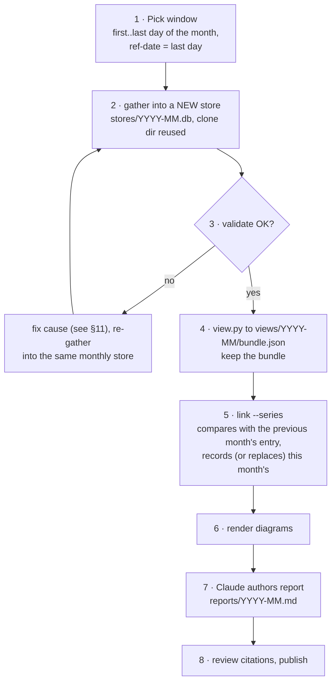
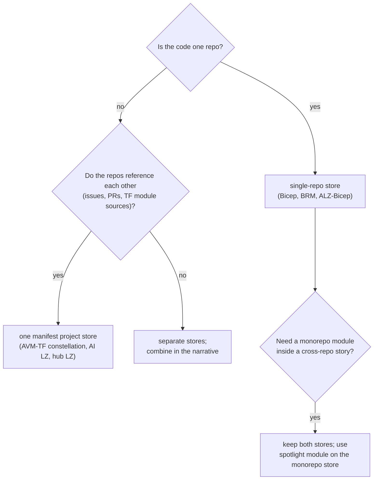

# activity-overview — Usage Guide

> **Audience:** the operator running digests from a laptop. **Design background:**
> [`HLD.md`](HLD.md) / [`LLD.md`](LLD.md). **Flag reference:** [`../REFERENCE.md`](../REFERENCE.md),
> [`../ARCHITECTURE.md`](../ARCHITECTURE.md) appendix A.
>
> This guide covers: install (§1–2; one store per installment vs one growing store §2.1;
> upgrading §2.2), the two ways to run it (§3–4), the **monthly progressive update runbook**
> (§5, incl. the series file §5.2 and reading the trust check §5.5), **forecasting** (§6),
> **playbooks for each target estate** — Bicep, AVM Bicep, AVM Terraform, AI landing zone,
> hub/platform landing zone, an enterprise Bicep landing zone on AVM (§7) — store management
> (§8), readers and spotlight queries (§9), automation (§10; the nightly gather job is
> [`SCHEDULING.md`](SCHEDULING.md)), troubleshooting (§11) and security (§12).

---

## 1. Prerequisites

| Requirement | Why | Check |
|---|---|---|
| Python 3.11+ (stdlib only) | runs every tool | `python3 --version` |
| git 2.x | bounded, partial clone + history walks (fetches file contents from GitHub while it walks: the gather needs the network for its whole run) | `git --version` |
| Claude Code | runs the skill and authors the narrative | `claude --version` |
| GitHub token | read API access | see §1.1 |
| `mmdc` (mermaid-cli) — recommended | compiles/validates diagrams | `python3 $AO/render.py --preflight` (below) |
| `bicep` CLI — for Bicep repos | module dependency edges | `bicep --version` |
| `terraform` — for Terraform repos | module dependency edges | `terraform version` |

Install the optional tools (pick your platform):

```bash
# macOS (Homebrew)
brew install node git python
npm install -g @mermaid-js/mermaid-cli
brew tap azure/bicep && brew install bicep
brew tap hashicorp/tap && brew install hashicorp/tap/terraform

# Linux / WSL (Ubuntu)
sudo apt-get install -y git python3 nodejs npm
sudo npm install -g @mermaid-js/mermaid-cli
curl -Lo bicep https://github.com/Azure/bicep/releases/latest/download/bicep-linux-x64 \
  && chmod +x bicep && sudo mv bicep /usr/local/bin/bicep
# terraform: follow https://developer.hashicorp.com/terraform/install for your distro
```

**Check that mmdc can render, not just that it is installed.** `mmdc --version` succeeds
even when mmdc cannot draw anything because the headless browser it renders with is not
installed; `render.py` then fails on its first diagram. After the install (§2), run the
preflight: it compiles one tiny diagram with exactly the options `render.py` uses and exits 0
(`mmdc preflight OK: …`) or non-zero with one line naming the reason and the fix (exit 3: no
`mmdc` on PATH; exit 1: it cannot render, e.g. "Could not find …" for the browser):

```bash
python3 $AO/render.py --preflight
```

Fix a failure by installing the browser for mermaid-cli (mmdc's message names its install
command), or render with `--skip-validate` and say in the report that the diagrams are
unvalidated.

### 1.1 GitHub token

- **Classic PAT** with `public_repo` (public targets) or `repo` (private), plus
  **`read:project`** if you want Projects v2 board status and sprints. The skill only reads
  (REST GETs, GraphQL queries, a git clone/fetch); it never writes to GitHub, so no write
  scope is needed.
- **Azure org policy:** the Microsoft Open Source enterprise (which owns `Azure/*`) refuses
  any personal access token — classic or fine-grained — with a lifetime **over 8 days**
  (observed 2026-11; the 403 message states the current limit). Create a token with an
  expiry of 7 days or less each time you sit down to run; a longer-lived token fails on the
  first API call. If an org enforces SAML SSO, authorize the token for it (*token settings →
  Configure SSO*).
- **CI needs no personal token.** The repo's workflow runs its live jobs with the workflow's
  built-in token (`token_source: builtin`, the default), which the policy above does not
  apply to and which reads public repos. Only a dispatch with `token_source: secret` uses
  the `ACTIVITY_TEST_TOKEN` secret (for private targets).
- gather reads `GITHUB_TOKEN`, else `GH_TOKEN`.
- Keep it out of files and shell history. On macOS, store it in the Keychain and export it
  per session:

```bash
security add-generic-password -a "$USER" -s activity-gh-token -w   # paste when prompted
export GITHUB_TOKEN="$(security find-generic-password -a "$USER" -s activity-gh-token -w)"
```

## 2. Install the skill

```bash
git clone https://github.com/DamianFlynn/experiments.git ~/src/experiments
mkdir -p ~/.claude/skills ~/.claude/commands
ln -s ~/src/experiments/.claude/skills/activity-overview ~/.claude/skills/activity-overview
ln -s ~/.claude/skills/activity-overview/commands/activity.md ~/.claude/commands/activity.md

# verify (offline, about a minute): the result must be OK, i.e. the last line is
# "OK" or "OK (skipped=N)"; the one-line check below prints just that line
python3 -m unittest discover -s ~/.claude/skills/activity-overview -p 'test_*.py' 2>&1 | tail -1
```

A passing run prints nothing on stdout (a suite test fails any test that does), so the last
line is unittest's verdict. `FAILED (...)` means a real failure: re-run without `| tail -1` to
read it. How many tests skip depends on the machine, so no number is promised; a test skips
when it needs something that is not there:

- **a working mermaid-cli** — `mmdc` on PATH *and* able to render (its headless browser
  installed; `render.py --preflight` tells you, §1). Without it the diagram-compile
  tests skip (about a dozen). Under `CI=true` they fail instead of skipping.
- **SQLite FTS5** — present in most builds. With it, the two tests of the no-FTS5 fallback
  skip; without it, the full-text search tests skip instead.
- **a local real store** at `workspace/journey.db` inside the skill — absent on a fresh
  install, so its four smoke tests skip.
- **`git` on PATH** — required by §1 anyway; without it the clone tests skip.

Symlinks mean `git -C ~/src/experiments pull` updates the skill. Set a convenience variable
for the manual commands below:

```bash
export AO=~/.claude/skills/activity-overview
```

### 2.1 Recommended workspace layout

> **Scheduled gathering.** With the nightly runner (`schedule.py`, [`SCHEDULING.md`](SCHEDULING.md))
> this layout is created for you from a streams file (`<workspace>/<stream>/stores/YYYY-MM.db`,
> one shared `people.json`, `status.json` per stream); keep that workspace on a local,
> non-synced disk and write only the reports into a notes vault.

Keep **one directory per report stream**, and inside it **one store per monthly installment**
(`stores/YYYY-MM.db`). Month-to-month continuity lives in `series.json`, not in the store.

```
~/activity/
  people.json           the people registry: identity, roles, your edits   (one for ALL streams)
  people-activity.json  generated beside it: activity per repository per gathered window
  bicep/            stores/2026-11.db  series.json  reports/2026-11.md  views/
  avm-bicep/        stores/  series.json  reports/  views/  [history.db]
  avm-tf-network/   stores/  manifest.json  series/  reports/  views/
  ai-lz/            stores/  manifest.json  series/  reports/  views/
  hub-lz/           stores/  manifest.json  series/  reports/  views/
  .tfcache/         (shared TF_PLUGIN_CACHE_DIR)
```

`people.json` is the **people registry** (§5.7): one entry per GitHub login. Keep **one
registry for all your streams** at the workspace root and point every gather at it
(`--people ~/activity/people.json`, or `"people": "../people.json"` in a manifest — the
path is relative to the manifest). The same people show up across the Bicep monorepo, the
Terraform module repositories and the landing-zone repositories, and the point of the
registry is to say so: a person is looked up once for every stream, their maintainer role
is kept per repository, and the cross-project context ("also maintains …") only exists
when the repositories share one registry. A registry per stream still works (each is
self-contained), but a person then has one entry per stream, looked up once per stream,
and no stream knows about the others.

`people-activity.json` is generated beside it (`<stem>-activity.json` for any other
name) and you never edit it: one small contribution record per person per repository per
gathered window, from which the activity profile is derived (§5.7). Both files live
outside the stores, because stores are per month and the registry must outlive them; both
are plain, sorted JSON for you to keep in version control. Gathers of different streams
that run at the same time update them one after the other (an advisory lock).

#### One store per installment, or one store that grows?

Both work, because every view is scoped to its window (#85, BUNDLE.md "Window scope"). The
commands in this guide create **one store per installment**: that is what CI and the golden
tests use, and none of the caveats below apply to it. You may instead keep **one store per
stream** (`stores/<stream>.db`) and gather each new month into it, which also makes
cross-month `spotlight` queries possible.

**Exact on an accumulated store** (the same result as that month's own single-window store):

- the view or digest of the month you have **just gathered** (the latest window): its PRs,
  issues, commits, code and symbol events, releases, trains, timeline, feature deltas,
  modules, people, halls and buckets; artifact lifecycles limited to the month, with their
  status as of its end (#76);
- for **any** gathered month, latest or earlier: that month's `workflow_stats` (CI health),
  `code_graph`, `code_owners`, label taxonomy and clone sha, and its people's
  `modules`/`areas` computed with that month's code graph (#94);
- `validate` on the whole store: dependency, ownership, area-touch, milestone, sprint and
  blocker edges are proven exactly (ERROR on a stale or missing one) once a fold since #95
  has run and every month has its per-month facts; closing-reference, commit → PR and
  contribution edges (and the people they name) always, because each fold makes them what
  the re-gathered PR / issue / commit now says (#111): a PR open in one month and merged the
  next with an edited body, a deleted comment or a removed reviewer, or a commit whose
  author resolves to a login on a later gather, leaves no stale edge or person.

**Not exact, or different:**

1. **Re-viewing an earlier month later** shows each PR/issue as it was at that month's end
   for everything the record dates (#97: open / closed / merged state, comments, reviews,
   reviewers, timeline events, `updated_at`; each such record carries `as_of`, the view
   `meta.records_as_of`), but with today's title, labels, milestone, assignees, closing
   references and board status (`meta.state_as_of` names the later gather; a month
   gathered late into its own store has no later gather, and `meta.gathered_at` says when
   its records were gathered). So its
   in-flight set and train outcomes are that month's, while its next-candidates and
   forecast (milestone-driven) reflect today's milestones. Keep each month's view and
   report from the time you made them (`views/`, `reports/`) when those matter
   (HLD §10 item 7).
2. **A view that is not exactly one gathered month** is assembled from whole months: a
   quarter sums its gathered months' CI statistics (`meta.facts_windows` lists them;
   `workflow_stats_complete: false` when one is missing — the report template states this
   caveat under the CI section) and takes its code graph, owners and taxonomy from its
   **last** month, so files changed only in an earlier month have no code area (and add no
   person area) in it. A view inside one month or straddling two has **no**
   `workflow_stats` (runs are counted per gathered window, not per day).
3. **Stale edges go only on evidence** (#95). A dependency is retracted when a resolved
   `bicep`/`terraform` build of that module or the whole-tree scan (manifest members;
   `--structural-iac` for a single repo) shows it gone — so **pass `--structural-iac` on a
   single-repo accumulated store** — a transitive dependency only on a new build, an owner
   only when a later month's code graph lists the area (HLD §10 item 9).
4. **Fold months oldest first.** Milestone / sprint / blocker edges, closing references,
   contribution edges and people follow the last-folded copy of each PR/issue/commit, so
   re-folding an older month after a newer one brings its older relations back. A month's structure is read at that month's last
   mainline commit, so a past month gathered late still reads its own tree (unless the
   bounded clone does not reach it: `meta.structure_as_of: "head"`).
5. **Some `validate` results stay WARN:** person areas (a union over the months by design),
   and any current-state edge type while the store was last folded before #95 (fold one
   month again) or holds a month gathered before #94 (re-gather it; §2.2). A store last
   folded before #111 that holds stale closing / contribution edges FAILS `edge_set` with
   the hint "fold any window of it once more": the next fold of any month heals every
   record (gather prints `retracted N edge(s) of P/R that the re-folded records no longer
   imply`).

### 2.2 Upgrading the skill: which stores to re-gather

Pulling a newer skill never rewrites a store. Stores (or windows inside an accumulated
store) gathered before these fixes keep the old behaviour until the window is re-gathered —
into a **fresh** store for the first item, into the same store for the others:

| Gathered before | What the old store does | Symptom |
|---|---|---|
| #78 (commit authors as logins) | keys commit authors by git name, so a person can appear twice | `validate` ERROR person "stored but not derivable" with a "pre-#78 identity" hint. Re-gather into a fresh store; don't fold new windows on top |
| #84 (base branch stored) | no stored mainline: every merged PR counts as shipped (stacked / release-branch merges too) | view/digest warn `extract: base branch unknown for …` |
| #94 (per-window facts) | every month shows the last folded month's CI statistics and structure; dependency/ownership edges are only added | `validate` WARNs naming a window without facts; wider views list it in `meta.facts_windows.workflow_stats_excluded` |
| #82 (commit times) | commits have only a day, so their timeline events sort before that day's comments | timeline order only |
| #93 (PR head repo) | a stacked PR whose base branch is the head of two PRs (forks' `patch-1`) is attached to neither | `contributing_prs` missing |
| #101 (nested Terraform areas) | `.tf` files in `modules/<name>/<sub>/` stay in `modules/<name>` | module counts / areas |
| the module change notes (`module_notes` / `module_changes`, BUNDLE.md "Module changes") | no `module_notes` per-window fact, so `link.py` builds no `module_changes` (new / changed / breaking / deprecated modules, product vs plumbing) | the view has no `module_changes` key. Re-gather the window (same store is fine: a re-fold replaces that window's facts) |
| the story layer (`pr_history`, release notes text; BUNDLE.md "The story layer") | no `pr_history` per-window fact and no `releases[].notes` | the slice `conversation` has no PR commits (`pr_history: not_gathered`), `change_requests_reworked` is absent, `module_changes.releases` carry no notes. `discussion`, `stories` and the timeline still work from the stored comments and reviews. Re-gather the window (same store is fine) |
| the narrative evidence of PR commits (code comments, docs, interface deltas, review responses; BUNDLE.md "`pr_history`") | walked `pr_history` rows without `narrative_collected` | commit items have no `evidence`, review threads get only time-based `response`s, the slice's `gaps` says so. Re-gather the window (same store is fine) |
| check results, review-thread resolved flags, PR lifecycle events (`pr_activity`; BUNDLE.md) | no `pr_activity` per-window fact | the slice's `gaps` names the PRs without it, `outcome.items[].checks` is `"not gathered"`, threads keep their derived status, `not_gathered` keeps the full list. Re-gather the window (same store is fine) |
| the story substance (review-comment context, PR commit paths / bodies / patch excerpts; BUNDLE.md "Slice `conversation`") | review comments without `path` / `diff_hunk` / `in_reply_to`; `pr_history` commits without `paths` / `body`, no `patches` | the slice's `conversation.gaps` names what is missing; commit items have no `change` summary, the open-threads ledger falls back to `reply_on_item` (no thread links), `outcome.net_change` is absent. The outcome block, the ball rule and linked items still work. Re-gather the window (same store is fine) |
| #109 (collection review) | an issue of ANOTHER repo that mentions a PR made the same-numbered local issue a `cross_ref` of it; commits (and their code/symbol events) are windowed on the committer's local day, not the UTC day PRs and issues use | an unrelated issue in a PR's train context / forecast; a commit made near midnight UTC in the neighbouring month. Re-gather into a fresh store (a mention edge the new records no longer imply fails `validate`) |

A store last folded before #95 heals its current-state edges on the next fold of any window
(gather prints `retracted N stale current-state edge(s) …`). A store last folded before #111
heals its record-derived edges (closing references, commit → PR links, contribution edges)
and drops the people only they named on the next fold of any window, and a store folded
on a host without SQLite FTS5 gets its whole text index on the next fold on a host with it;
nothing to re-gather.

## 3. Running it through Claude Code (the normal way)

```text
/activity Azure/bicep-registry-modules 2026-11-01 2026-11-30 --series ~/activity/avm-bicep/series.json --store ~/activity/avm-bicep/stores/2026-11.db --structural-iac
```

or in plain language:

> *"Produce the November 2026 activity digest for Azure/bicep-registry-modules using a new store
> ~/activity/avm-bicep/stores/2026-11.db and the series file ~/activity/avm-bicep/series.json; focus
> the narrative on avm/ptn/ai-ml/landing-zone and avm/ptn/network/hub-networking."*

Claude follows `SKILL.md`: gather → validate → materialize + link (with series) → render →
per-train narrator sub-agents → fills `report-template.md`, citing every fact. Ask for an
**internal** report explicitly if you want the gated stall/blocker attribution appendix.

## 4. Running the pipeline manually (reproducible, scriptable)

Use this when you want to inspect each stage, automate the deterministic part, or feed the
structured view to your own formatter. All commands run from anywhere; paths are explicit.

The example is the plain single-repo monthly digest of `Azure/bicep` (§7.1); §7 adds what
each other estate needs.

```bash
S=~/activity/bicep               # stream directory
PEOPLE=~/activity/people.json    # the people registry shared by every stream (§2.1)
FROM=2026-11-01; TO=2026-11-30; M=2026-11
DB=$S/stores/$M.db               # a NEW store for this installment
mkdir -p $S/stores $S/views/$M $S/reports

# 1 · Acquire → store (network; the only step that needs the token).
#     gather clones into --clone-dir, or fetches it if it already holds a clone of this repo.
#     The clone is partial (file contents are fetched while the history is walked), so keep
#     the network up for the whole run; a dropped git connection is retried three times.
#     It also checks each author of a PR / issue created in the window for an earlier one
#     (first-time contributors: one or two search calls each; --no-newcomers skips it),
#     and labels each person maintainer_org / community / unknown (§5.7; --no-affiliation),
#     looking people up once through the shared registry ($PEOPLE).
python3 $AO/gather.py --owner Azure --repo bicep \
  --from $FROM --to $TO --store $DB --clone-dir $S/clone --people $PEOPLE \
  --home-org microsoft --home-name Microsoft --home-email-domain microsoft.com

# 2 · Trust gate — stop if this is not "RESULT: OK" (exit 0); see §5.5 to read a failure
python3 $AO/validate.py $DB --project Azure --repo bicep

# 3 · Materialize the bundle view (single repo: project = owner, repo = name;
#     both are auto-detected when the store holds only this repo)
B=$S/views/$M/bundle.json
python3 $AO/view.py --store $DB --project Azure --repo bicep \
  --from $FROM --to $TO --out $B

# 4 · Link with series continuity (records this month in series.json; a re-run replaces it)
python3 $AO/link.py $B --series $S/series.json

# 5 · Diagrams (mmdc validates each; add --skip-validate if mmdc is unavailable).
#     bundle.diagrams paths are relative to the PARENT of --diagrams-dir ($S/views/$M).
python3 $AO/render.py $B --diagrams-dir $S/views/$M/diagrams

# 6 · One train's bounded evidence (what a narrator sub-agent reads): list the trains,
#     then slice each deep one (unknown id → exit 2)
python3 -c 'import json,sys; [print(t["id"], t["tier"], t["outcome"]) for t in json.load(open(sys.argv[1]))["trains"]]' $B
T=train-issue-1234               # an id from the list above
python3 $AO/link.py $B --slice $T > $S/views/$M/$T.slice.json
```

`view.py` writes the **raw** bundle view (`extract`); `link.py` enriches it in place and
`render.py` adds `diagrams`, so keep `$B` — it is what you re-link if a month's series entry
needs refreshing. `view.py` exits 2 with a message when `--project`/`--repo` are ambiguous or
unknown, or the store is missing or empty; a quiet window gives a valid, mostly empty view.

Then ask Claude to write the report from `$B` (+ slices + diagrams) following
`reference/report-sections.md`, and save it as `$S/reports/$M.md`.

> **Multi-repo (manifest) stores.** Members are stored as `--project <manifest project>
> --repo <owner/repo>`: run `view.py` → `link.py` → `render.py` once per member you report on
> (e.g. `--out $S/views/$M/Azure__terraform-azurerm-avm-ptn-foo.json`), with a separate
> series file (`$S/series/<owner>__<repo>.json`; `link.py` creates the directory) and diagrams dir
> (`$S/views/$M/diagrams/<owner>__<repo>`) per member so members never overwrite each other
> or share a series index. The merged project
> view (cross-repo trains, merged shipped/people/halls/modules, `related_work`, `module_edges`)
> comes from `digest.py --store $DB --project <name> --from $FROM --to $TO`; its embedded
> `members[i].bundle` has no `series` or `diagrams` — use the member's bundle view file for
> those. The cross-repo module graph is `render.emit_project_module_graph(view["module_edges"])`.
> Contributors: a member bundle's `people` / `halls` cover only that member (its own
> contributors, its areas); the project view's `people` / `halls` are the project totals —
> each person's counts summed across members, areas as `<repo>::<area>` (#88). Use the
> project view for the project-wide Contributors section.

## 5. Runbook — progressive monthly updates

### 5.1 The monthly cycle



### 5.2 Step detail

1. **Window.** Use calendar months: `--from 2026-11-01 --to 2026-11-30`. `--ref-date` defaults
   to `--to`, which frames milestones, sprints, forecast age and flow staleness — keep the
   default for month-end reports. gather stores it with the window, and `view.py`/`digest.py`
   read it back when their `--from/--to` are that exact window (else they use their `--to`);
   both also take `--ref-date` to override it.
2. **Gather into this month's own store** (`stores/YYYY-MM.db`). Re-running the same window
   into the same store is safe (idempotent). `gather` clones into `--clone-dir`, or, when that
   directory already holds a clone of the same repo, fetches it to the window's history bound
   and checks out the head of the mainline it walks (`meta.base_branch`, below) — so last
   month's clone dir can be reused. A
   directory that is not a clone of this repo is refused, never deleted. The clone is bounded
   (shallow, from `--from` minus the clone margin) and **partial** (`--filter=blob:none`): file
   contents are fetched from GitHub while the history walks run, so the gather needs the network
   for its whole run, not only at the start. A git command that loses its connection is retried
   three times (after 2 s, 8 s and 30 s, one `note: git lost its connection …` line each); when
   it still fails, the gather stops with git's error and folds nothing (a new store is left
   empty) — re-run the same window into the same store once the network is back (safe:
   idempotent). Build output an earlier
   current-month run left in the clone (untracked `.terraform/`, `.terraform.lock.hcl`) is
   removed before the checkout; nothing else of yours is. `--no-clone` never
   creates a clone: it fetches an existing one, and with no clone on disk it gathers API data
   only (empty commit/code walks). A repo with no commits since `--from` minus the clone margin
   is cloned at depth 1 and has no commits in the window. `meta.clone_mode` records which
   (`fresh`, `fetched`, `depth1-fallback`, `none`). "Shipped" means merged into the analyzed
   **mainline**, stored with the window as `meta.base_branch`: the repo's default branch, which
   gather detects (clone `origin/HEAD`, else the API), unless `--branches B` or a manifest
   member `branch` names another; a PR merged into any other branch (feature, release) is
   not shipped (a stacked PR shows as `contributing_prs` on its parent's train). Pass
   `--branches B` (or a manifest member `branch`) when the mainline is not the default: gather
   then fetches and walks `B` (commits, code areas, CODEOWNERS all come from it; a stderr note
   says so), and a `B` the remote does not have stops the gather (a manifest member is recorded
   failed). A past month re-gathered later reads its structure as of that month's last
   mainline commit (`meta.structure_as_of: "window_end"`), or the head when the clone does not
   reach it (`"head"`).
   Stores gathered before issue #84 have no stored base branch: their views warn and count
   every merged PR as shipped — re-gather them.

   **What a window keeps.** The open-PR and open/updated-issue listings run to today, so a
   month gathered late would also see items opened after it ended. gather keeps an open PR,
   or a listed issue, only when it was created on or before `--to` (and a closed listed issue
   only when it was touched on or after `--from`: the updated-since listing is read a page at a
   time and its last page reaches older ones); an issue a kept PR closes or cross-references
   is kept whatever its dates, as train context. No view of the window shows a record created
   after its end (projected or `--as-stored`), so its people are not the window's either. For
   a window ending today nothing changes.

   **First-time contributors.** gather also checks each author of a PR, and each reporter of
   an issue, created in the window (bots excluded) for any earlier PR / issue in the repo:
   one search API call per candidate, two when they have no earlier item of the kind they
   started with. The search API allows 30 requests a minute; gather waits out the limit like
   any other. More than `ACTIVITY_NEWCOMERS_MAX` (default 200) candidates: the earliest are
   checked and the rest listed as not checked; a check that fails is recorded as unknown,
   never guessed. The result is the window's `newcomers` fact (BUNDLE.md); `--no-newcomers`
   skips the calls and records that it was not looked up.
3. **Validate.** Never publish from a store that is not `RESULT: OK`.
4. **Materialize** the view for the month and **keep the bundle files** (`views/YYYY-MM/`) —
   they are what you re-link if a month's series entry needs refreshing.
5. **Series.** `link --series series.json` keeps **one entry per window** (`from`/`to`) in
   window order. A window is identified by its calendar days, so `2026-01-01`..`2026-01-31`
   and `2026-01-01T00:00:00Z`..`2026-01-31T23:59:59Z` are the same month (the entry keeps the
   spelling it was recorded with). It compares this month with the entry for the window just
   *before* it, then records this month, replacing any entry already there for the same
   window:
   - **Same month twice** — safe: the second run replaces the first entry and produces the
     same `series` block (nothing to clean up).
   - **An earlier month re-run** (e.g. October again after November is recorded) — October's
     entry is replaced and compared with September; the entry is marked
     `captured: "backfill"`, and `link` warns that November's bundle was linked against the
     old October entry. Re-link the later months' saved bundles, oldest first, if their
     *Since last installment* should reflect the refresh.
   - **Months out of order** (e.g. September added after October) — September is inserted
     before October and compared with August (or is the first installment), with the same
     `backfill` mark and warning.

   `link` writes the bundle and then the series file, each atomically, so an interrupted run
   leaves both as they were (or only the bundle updated — just re-run it). The file is
   `{"version": 2, "installments": [...]}`; an older bare-list file is read and rewritten in
   that form (a month it holds twice collapses to the entry recorded last). A series file
   `link` cannot use (invalid JSON, an unknown version, a malformed entry, a `from`/`to` that
   is not a date or ISO timestamp, entries for another repo), or a bundle without a window,
   stops `link` with exit code 2 and a message naming the file; nothing is written until you
   fix or remove it.
   - **One index, windows that do not overlap.** A window that shares a day with a recorded
     window of other days (a quarter in an index of months, or a month inside a recorded
     quarter) is refused with exit 2, naming both windows: "the installment before" a month
     is not defined when a quarter covering it is in the same index. Keep roll-ups (quarters,
     years) in their own index file, e.g. `series-quarterly.json`.
6. **Render**, then **author**: the report's *Since last installment* section uses
   `bundle.series` — items new to the series (`series.new`; `series.new_opened` are the ones
   actually created this month), carried-over items (with prior board status and where each is
   now: shipped, in flight, re-planned or rejected) and the forecast loop (last month's
   predictions landed / not yet / dropped).
   **Empty forecast?** Check `forecast.candidates` the first time you link a repo. When it is
   empty, `forecast.notes` says which signal source is missing (no dated next milestone, no
   priority label, no approved open PR), and the forecast loop will stay empty every month
   until that changes: read §6.3 now — usually a `--priority-label` pattern for the repo's own
   wording, passed on every month's `link.py` run, is enough.

### 5.3 First installment, catching up, and roll-ups

| Situation | What to do |
|---|---|
| First month of a stream | Run normally; `series.first_installment = true` and the report omits *Since last installment*. |
| Starting with history / catching up closed months | A month gathered late is **shown as of its end** (#97): `view.py` / `digest.py` wind every PR / issue back to the window's last second from the timestamps in its record, so what was open, merged, closed, in flight, stalled, reviewed and commented on at that month's end is that month's — an item merged since is in flight in it, an item opened since is not in it. Still **today's**: title, body, labels (and the kind / facets read from them), milestone, assignees, closing references, reactions and board status / sprint — so next-candidates and the forecast follow today's milestones; an issue closed in that month and reopened since is closed with no reason (in no shipped / rejected bucket); and an item that was open then but has since been deleted or transferred is absent. The view says what it projected (`meta.records_as_of`, each record's `as_of`) and when the records were gathered (`meta.gathered_at`; the report's caveat line under its title states both). A gather of a past month also keeps the PRs open at its end that were merged or closed before the gather (`gather.keep_pr_for_window`), so each month gathered late on its own holds them, shown as they were at its end; it does not keep the PRs and issues opened after the month (§5.2 "What a window keeps"). A review approved in the month and dismissed later reads `dismissed` (GitHub records no dismissal date): that PR's `review_decision` is today's, named in its `as_of.not_projected`. Chaining caught-up months into `series.json` is fine for delivery and in-flight; don't use them to calibrate the forecast (a first month captured late is not marked `backfill`). |
| Missed a month | Gather it late (above): its delivery history and in-flight set are as of its end; its milestones / board status / forecast are "as of now". Note that in the report if its series comparison matters. |
| Quarter / year view | A **roll-up**: see *Roll-ups* below. |
| Refresh a month after late merges | Re-gather the same window into that month's store, re-materialize, and re-run `link --series`: the month's entry is replaced. If later months are recorded, it is marked `backfill` and `link` names them; re-link their saved bundles oldest first to refresh their comparison. |

#### Roll-ups (quarter, half-year, year)

A roll-up is a view whose window spans several gathered months, e.g. Q3 =
`2026-07-01`..`2026-09-30`. Every reader is window-scoped, so it is a **wider window over a
store that holds the whole period**; a wider window over a single-month store adds nothing
(it holds one month). What that costs depends on the layout you chose in §2.1:

| Layout | What a roll-up needs | Cost |
|---|---|---|
| **One store per month** (`stores/YYYY-MM.db`, the default) | no store holds the quarter, and stores cannot be merged: gather the **whole period once more** into its own store (`stores/2026-Q3.db`) | one more full gather of the period: every PR, issue and commit of it is fetched again, and the clone is walked back to the period's start |
| **One accumulating store** (`stores/<stream>.db`, every month folded into it, oldest first) | nothing to gather: view the period over the store you already have | none beyond the view; its CI statistics are the sum of the gathered months (`meta.facts_windows`; `workflow_stats_complete: false` when one is missing) and its code graph / owners are the **last** month's (§2.1 item 2). A period gathered as one window has its own |

**Single repo.** The roll-up view is `view.py` over the wider window (not `digest.py`, which
is the multi-repo project view):

```bash
S=~/activity/avm-bicep; FROM=2026-07-01; TO=2026-09-30; R=2026-Q3
mkdir -p $S/views/$R
# per-month layout only: the extra gather (accumulating layout: skip it, use DB=$S/stores/avm-bicep.db)
DB=$S/stores/$R.db
python3 $AO/gather.py --owner Azure --repo bicep-registry-modules --from $FROM --to $TO \
  --store $DB --clone-dir $S/clone --structural-iac
python3 $AO/validate.py $DB --project Azure --repo bicep-registry-modules
# the roll-up view, linked WITHOUT the monthly series
python3 $AO/view.py --store $DB --project Azure --repo bicep-registry-modules \
  --from $FROM --to $TO --out $S/views/$R/bundle.json
python3 $AO/link.py $S/views/$R/bundle.json
python3 $AO/render.py $S/views/$R/bundle.json --diagrams-dir $S/views/$R/diagrams
python3 $AO/link.py $S/views/$R/bundle.json --slice <train-id> > $S/views/$R/<train-id>.slice.json
```

**Manifest (multi-repo).** A manifest carries its own window, so the per-month layout needs
a copy whose `window` is the period; then gather, validate, and build the project view and
each member's view as in §4 "Multi-repo" and §7.3, again without `--series`:

```bash
S=~/activity/avm-tf-network; P=avm-tf-network; FROM=2026-07-01; TO=2026-09-30; R=2026-Q3
mkdir -p $S/views/$R
python3 -c 'import json,sys; m=json.load(open(sys.argv[1])); m["window"]={"from":sys.argv[2],"to":sys.argv[3]}; json.dump(m,open(sys.argv[4],"w"),indent=2)' \
  $S/manifest.json $FROM $TO $S/manifest-$R.json
# per-month layout only (accumulating layout: skip it, use DB=$S/stores/$P.db)
DB=$S/stores/$R.db
python3 $AO/gather.py --manifest $S/manifest-$R.json --store $DB --clone-dir $S/clones
python3 $AO/validate.py $DB --project $P
python3 $AO/digest.py --store $DB --project $P --from $FROM --to $TO > $S/views/$R/project.json
for slug in $(python3 -c 'import json,sys; print(" ".join(r["owner"]+"/"+r["repo"] for r in json.load(open(sys.argv[1]))["repos"]))' $S/manifest-$R.json); do
  key=${slug/\//__}
  python3 $AO/view.py --store $DB --project $P --repo $slug --from $FROM --to $TO --out $S/views/$R/$key.json
  python3 $AO/link.py $S/views/$R/$key.json
  python3 $AO/render.py $S/views/$R/$key.json --diagrams-dir $S/views/$R/diagrams/$key
done
```

**Keep it out of the monthly series.** Link a roll-up **without** `--series`: it is not the
installment after the last month, and `link --series` refuses (exit 2) to record a quarter in
an index that holds its months, or a month in one that holds its quarter (§5.2 item 5). With
no `series` block the report has no *Since last installment* section. Only if you publish
roll-ups as their own recurring series, give them their own index
(`--series $S/series-quarterly.json`), never the monthly one.

**Same report template.** A roll-up report is written from `report-template.md` and
`reference/report-sections.md` exactly like a month: the window in `meta.period` is the
period, every section reads the roll-up view, and the CI section states the
`workflow_stats_complete` caveat when it applies. Narrate its deep trains from the roll-up's
own slices: a train can span months, so a monthly narrative is reusable only when every
evidence URL it cites is also in the roll-up slice.

### 5.4 Multi-repo streams and series

`--series` works on a single bundle. For a constellation, either keep a series per key member
(`series/<owner__repo>.json`, e.g. the pattern module) or track continuity at project level
in the narrative from the merged `shipped`/`trains`. The project view itself has no series
block. A series file belongs to one repo: `link` refuses (exit 2) a file whose entries name
another `owner`/`repo`, since entries are keyed by window alone.

### 5.5 Reading the trust check (`validate.py`)

```bash
python3 $AO/validate.py $DB                       # single-repo store (auto-detected)
python3 $AO/validate.py $DB --project avm-tf-network   # manifest store: every member + project checks
python3 $AO/validate.py $DB --json > validate.json      # machine-readable report
```

Exit codes: **0** every check passed (`RESULT: OK`), **1** at least one ERROR (`RESULT:
FAIL`), **2** usage error (no report): the path does not exist or is not a store, the store
holds several projects (or repos) and none is named, or `--bundle` cannot be read.
`validate` opens the store read-only and never creates it.

The report always lists every check, in this order, as `[ok  ]` or `[FAIL]` with its
details; a check that cannot run fails, it is never dropped:

| Check | Fails when |
|---|---|
| `target` | the store, `--project` or `--repo` has no nodes (a typo fails here: the details list `stored_projects` / `stored_repos`), or a manifest member's last gather of a window did not complete |
| `referential_integrity` | an edge points at a node that does not exist (out-of-window spine links are INFO), or a per-window `facts:` entry is unreadable |
| `participant_completeness` | a login in a record has no person node or contribution edge |
| `provenance` | a PR/issue url is not its own repo's `…/pull/N` or `…/issues/N`, a review/event does not cite its parent, a commit id is not a real sha, an artifact cites no lifecycle commit |
| `no_fabrication` | an orphan person, a PR/issue nobody authored, merged, reviewed or commented on (WARN only where no record of that kind in the repo has an author), a historyless artifact, or an id outside the grammar (e.g. a `comment-N` node) / in the wrong scope |
| `schema_conformance` | an edge type or endpoint kind that is not allowed |
| `meta_integrity` | the store's own markers or per-window meta are not what a fold writes: an unreadable or missing `current_state:` marker (or one contradicting the facts), a deleted `facts:` entry, a `gathered_windows` entry no fold wrote, a `fact:` value that no longer hashes to its key or sits under the wrong key, a malformed or orphan `ref_date:` / `branches:` / `clone:` / `clone_sha:` / `fold_context:` entry |
| `edge_set` | a stored edge the stored records do not imply, a missing one, or different edge data (cross-repo edges included, once the members' folds recorded their member set and registries) |
| `no_drift` | stored people/artifacts (lifecycle entries included) differ from what the records re-derive (with `--bundle`: a stored record differs from the bundle's, a stored record of the bundle's window is not in it, or the window's stored branches / reference date / clone provenance / facts differ from the bundle's) |
| `idempotency` | re-folding into a scratch copy would change counts |
| `no_drift_people` (project) | the project's people differ from the union re-derived across members |
| `member_status` (project) | a manifest member's last gather of a window `failed` or was `not_attempted` |

How to read a failure: each `[ERROR]` detail is a JSON object naming the node, edge or
window and a `problem`. A failure in a fresh, single-window store is a producer defect or a
hand-edited store — don't publish; report it (§11 lists the known causes: a renamed repo,
an incomplete manifest gather, a pre-#78 store). `WARN` details on a store holding several
windows are not failures: they name the edge type that cannot be proven exactly and why
(§2.1 point 5).

**What a green gate means.** The store is consistent with its own records: every edge is
one the records imply, people re-derive from the records, every citation is the record's
own GitHub link, and the store's markers and per-window meta are what folds write. It does
**not** prove the records match GitHub: a record deleted together with its edges, a
consistently rewritten record, an inserted record that is internally consistent (a PR with
its author edge, a dated release, a milestone, an area), a fact value rewritten together
with its key, a plausible changed base branch / reference date, or a wrong change ledger
pass. To catch all but the last for a window, save the raw view right after the gather
and pass it later:

```bash
python3 $AO/view.py --store $DB --from $FROM --to $TO --as-stored --out $S/views/$M/at-gather.json
python3 $AO/validate.py $DB --bundle $S/views/$M/at-gather.json
```

`--as-stored` writes the records as stored: a report view projects them to the window's end
(#97), which is not what the store holds, so a projected view is not a `--bundle` input.

A month gathered late passes this check too. Like the report view, the `--as-stored` view
leaves out records created after the window's end; a store gathered before that rule may still
hold some (open PRs and issues opened after the month, issues closed before it from the
listing's last page), and `--bundle` does not expect their people to be derivable from the
window: they are listed in one INFO line under `no_drift` ("seen only on stored records outside
the --bundle's window"), not as errors. Such a store needs no re-gather.

`--bundle` is a single-repo cross-check (a project-mode run ignores it with a warning; pass
`--project P --repo owner/repo` to cross-check one member). A run with `--repo` on a
multi-repo project checks only the people that member derives; run without `--repo` for
the full people check.

### 5.6 Stories: the PR history it gathers and what it costs

`link.py` ranks the trains with the most to tell (`stories`, `train.story_rank`: the
conversation, the change requests, reopens, silences, and product relevance — not the touched
area count that `tier` uses), and every slice carries the whole conversation as one timeline
(BUNDLE.md "The story layer"). Narrate them with the story brief and check each story with
`python3 link.py <slice.json> --check-story <story.md>` (reference/report-sections.md).

The timeline's PR commits come from gather: a squash-merging repository keeps one commit per
PR on its mainline, so gather fetches every window PR's `refs/pull/<N>/head` into
`refs/remotes/pr/<N>` of the clone (one `git ls-remote`, then `git fetch --filter=blob:none`
in batches of 100) and walks the `.bicep` / `.tf` diffs between the commits of the 40 most
discussed PRs. Measured on `Azure/bicep-registry-modules` (a blobless clone shallow since
2026-07-25): September 2026, 142 PRs — 42 s, the clone's `.git` from 13.5 MB to 23.1 MB (the
commit and tree history the PR heads reach, plus the blobs the diff walk read), 1,092 PR
commits, notes for 40 PRs, a 1.1 MB fact; October 2026 into the same clone, 160 PRs — 11 s,
+1.2 MB. Nearly all the time is the diff walk fetching blobs; the ref fetch itself took about
2 s. A missing ref (a PR deleted by GitHub) is recorded as `missing`, a failed batch as
`fetch_failed`; neither stops the gather. `--no-pr-history` skips all of it and records
`{"collected": false}`. The refs stay in the clone (`refs/remotes/pr/*`); a refresh fetches
only what moved.

For the same 40 PRs gather reads the commits as narrative (git only, no API call): one
more diff walk over the module, script, workflow and Markdown files (and the files review
comments are on) and the before / after module files and READMEs, giving each commit its
code comments added / removed / reworded, the hand-written documentation lines it changed
(generated README sections skipped), its interface delta (parameters, outputs, resources,
module references: added, removed, renamed, default / allowed values / descriptions /
API versions changed), and each review comment the later commits that changed the lines
it is on. Measured on September 2026 of `Azure/bicep-registry-modules` (the same clone,
PR heads already fetched): the PR-history step went from 3 s to 10 s (28 s the first time,
while the walk fetched the README / workflow blobs), and the stored `pr_history` from
1.66 MB to 1.94 MB of JSON (+17 %). `ACTIVITY_ADR_DIRS` (comma-separated folders) names
the folders whose Markdown files are decision records.

Check results, review-thread state and PR lifecycle events (the per-window fact
`pr_activity`, BUNDLE.md): the lifecycle events (renames, draft / ready, review requests
and dismissals, force-pushes) come from the issue timeline gather already reads for every
PR — no extra call. The check runs and commit statuses of each PR's latest 10 commits, the
resolved flag of each review thread and the force-pushes' before / after commits come from
one GraphQL request per 10 PRs (about 6 rate-limit points each): a month of 160 PRs costs
16 requests. `ACTIVITY_PR_CHECKS_MAX` (default 200, min 0) caps the PRs asked about — open
PRs first, then the most discussed, then the newest; the rest are recorded as `capped`, a
failed request as `failed` with its reason (after three failed requests in a row the rest
are not asked). `--no-pr-checks` asks nothing and records `not_requested`. A story slice
then shows one `checks` item per commit, the head's roll-up in the outcome block and
GitHub's resolved flag on the threads it holds.

### 5.7 People: affiliation, the people registry, maintainers and newcomers

gather labels each human person of the window `maintainer_org` (the organisation that owns
the repository, or one you name as home), `community`, or `unknown`, and records which signal
decided and how strongly (BUNDLE.md "The people layer"). It never defaults to community: a
person with no signal is `unknown`, and the view reports unknown as its own bucket. With the
**people registry** it also records each person's display name and whether they are a
**maintainer** of the repository.

**Settings.** The repo's owner is always a home organisation. For Azure/* repositories the
home organisations are `Azure` and `microsoft`, and a Microsoft email domain counts (§7):

```bash
python3 $AO/gather.py --owner Azure --repo bicep-registry-modules --from $FROM --to $TO \
  --store $DB --people $PEOPLE \
  --home-org microsoft --home-name Microsoft --home-email-domain microsoft.com \
  --affiliation some-login=community --affiliation @Azure/some-team=maintainer_org
```

or, for a manifest, an `affiliation` object and the registry path (relative to the manifest;
every key optional; CLI flags add to it, a CLI override beats the manifest's for the same
key, `--people` beats `people`):

```json
"affiliation": {"home_orgs": ["Azure", "microsoft"], "home_names": ["Microsoft"],
                "home_email_domains": ["microsoft.com"],
                "overrides": {"some-login": "community", "@Azure/some-team": "maintainer_org"}},
"people": "../people.json"
```

The override list is the highest-priority signal: use it to correct a label you know is
wrong (a vendor, a contractor, someone whose profile is stale) and to name team members
whose membership is private. An `@org/team` entry is expanded through the team's member
listing, which the token must be able to see (otherwise it is listed in
`affiliations.groups_unresolved` and a warning names it). The weakest signal — a profile
company that is not a home organisation → `community` — is kept and always shown with its
strength (`weak`): check it before you print it.

#### The people registry (`people.json` and `people-activity.json`)

One registry for the whole workspace (§2.1), one entry per GitHub login, in two files
(BUNDLE.md "The people registry"). `people.json` holds who a person is and what roles they
hold, and is yours to edit:

```json
{"format": "activity-overview/people", "version": 1,
 "people": {
  "octo": {"login": "octo", "name": "Octo Cat",
           "affiliation": "community", "signal": "profile_company", "strength": "weak",
           "maintainer_of": {"Azure/bicep-registry-modules": {"maintainer": true,
                             "signal": "merged_others_pr", "strength": "strong",
                             "first_evidence": "2026-08-07", "last_evidence": "2026-10-29"},
                             "Azure/bicep": "former"},
           "first_seen": {"date": "2026-08-04", "repo": "Azure/bicep-registry-modules"},
           "last_seen": {"date": "2026-10-29", "repo": "Azure/bicep-registry-modules"},
           "looked_up_at": "2026-11-02", "source": "lookup", "tags": ["known", "mvp"]}}}
```

`people-activity.json` (generated beside it; never edit it) holds what the person did in
each repository, as one small contribution record per **gathered window**:

```json
{"format": "activity-overview/people-activity", "version": 1, "months_kept": 36,
 "repos": {"Azure/bicep-registry-modules": {"windows": {
     "2026-09-01..2026-09-30": {"people": 81, "source": "gather", "unresolved_commit_authors": 0}}}},
 "people": {"octo": {"Azure/bicep-registry-modules": {"2026-09-01..2026-09-30": {
     "first": {"merge": ["2026-09-01", 7306], "pr_opened": ["2026-09-01", 7319], "comment": "2026-09-02"},
     "last":  {"merge": ["2026-09-30", 7428], "pr_opened": ["2026-09-30", 7428], "comment": "2026-09-24"},
     "months": {"2026-09": {"prs_opened": 43, "prs_merged": 38, "merges": 40, "merges_others": 2,
                            "reviews": 6, "approvals": 6, "approvals_merged": 6, "comments": 10}}}}}}}
```

**What it accumulates, per person and repository:** the first and last commit on the
mainline the store walked, PR opened, PR merged, review, approval, merge performed (as the
merger) and issue reported, each with its date and reference (PR / issue number or commit
sha; `show` prints the URL), and the first / last comment (date only); counts per month of
commits, PRs opened, PRs merged, reviews given, approvals, approvals of PRs that were merged,
merges performed (`merges_others`: of somebody else's PR), issues and comments. From those
the skill derives, whenever it is asked (`people.py show`, `summary`, `link.py --people`):
totals, the monthly series, **rates** (per-month averages over the repository's last 3, 6
and 12 gathered months; a month nobody gathered is not a zero, a gathered month without
activity is), a **trend** (activity = commits + PRs opened + reviews + merges + issues per
month; the last k gathered months against the k before them, k = 3, or half of what was
gathered when that is less: `rising` at 1.25 times or more, `falling` at 0.75 times or
less, `steady` between, `inactive` with no activity recently, `insufficient` with fewer than
two gathered months), the **lifecycle** below and the **cross-project** summary.

**Coverage honesty.** The registry only knows what was gathered. Each repository's coverage
(the windows gathered: earliest from, latest to, the gaps between) is kept beside the
records, and every first and total is **as observed since the coverage start**
(`observed_since`) — never "ever". The one exception is the gather-time newcomer search
(the `newcomers` fact): a person it found with no earlier PR or issue gets
`first_pr_ever: true` / `first_issue_ever: true` when their first observed PR / issue is in
that window; nothing else sets them. A store also keeps older records (an open issue's
early comments): a person seen there before any gathered window gets `seen_before` (the
earliest such day), which is shown as "seen before the coverage (not counted)" and never
enters a total. Commits whose author git could not resolve to a login (no API, no
`users.noreply.github.com` address) are counted per window as `unresolved_commit_authors`
and are not anybody's activity: logins are never guessed from names.

**Never counted twice.** Re-gathering or re-seeding a window **replaces** that window's
records (by its `FROM..TO` key), so running gather or seed again, in any order, over any
number of stores, gives the same file. Two windows that overlap inside a month (a quarter
store beside monthly stores) are never summed: per month the window covering most of it
counts, plus any other that does not overlap it. The monthly detail is kept for
**36 months** per repository (`months_kept`); older windows fold into one `before` record
per person (totals, firsts and lasts kept; the folded range is recorded, and a window
inside it gathered again is skipped rather than counted twice).

**Lifecycle — maintainers move on.** Per repository, from the latest maintainer-type action
(merges performed, approvals, or the stored evidence's `last_evidence`) against the
repository's latest gathered day:

| Status | Rule |
|---|---|
| `active` | last action within **183 days** (`--active-days N`, `ACTIVITY_PEOPLE_ACTIVE_DAYS`) |
| `lapsed` | longer ago, and at least 90 days of the repository were gathered since |
| `former` | longer ago than **548 days** (`--former-days N`, `ACTIVITY_PEOPLE_FORMER_DAYS`), or your own `"former"` |
| `unknown` | longer ago, but fewer than 90 days were gathered since (a coverage gap: absence is not known) |

Evidence never disappears from the record; the status says how recent it is, and a `former`
maintainer is not counted as a maintainer. Your own `true` / `false` / `"former"` wins and
is never overwritten. Plain contributors get the same lifecycle by the same thresholds,
from their latest activity of any kind: `active`, `lapsed`, `unknown`, and `returned`
(active again after at least six gathered months without activity), which sits beside the
newcomer search's "returning after 3 / 6 / 9 months".

**Lookup once, refresh rarely.** A person whose entry was looked up recently costs no call:
a decided label (`maintainer_org` / `community`) is reused for **120 days**
(`--people-refresh-days N`, `ACTIVITY_PEOPLE_REFRESH_DAYS`), an `unknown` one for **30 days**
(`ACTIVITY_PEOPLE_UNKNOWN_RETRY_DAYS`) — retried sooner because a profile that gets filled in
or a membership made public shows up by the next installment, while a decided label rarely
changes. At most **50** stale entries are refreshed per run, oldest lookup first
(`ACTIVITY_PEOPLE_REFRESH_MAX`); the rest keep their label until a later run. People never
seen before are looked up as before (capped by `ACTIVITY_AFFILIATION_MAX`). Each run prints
`people registry: <repo>: N looked up, N refreshed, N reused from the registry, N decided
without a lookup, N still unknown, N name(s) fetched, N maintainer(s)`.

**Labels belong to the home settings.** `maintainer_org` / `community` mean "of these home
organisations", so a label is stored with the settings it was decided against (`home`:
the home organisations and names, e.g. `"azure,microsoft|azure,microsoft"`) and is
reused only by a repository with the same settings; under other settings the person is
looked up again within the refresh budget, or is `unknown` / `not_checked` beyond it. An
entry without `home` (written before it was kept) is due for a refresh, your own pinned
labels are used as they are, and names are shared by every repository.

**Names.** The display name comes from the same `users/{login}` response as the company
signal (no extra call). A person decided without a profile call (override list,
`author_association`, a public membership, the registry) gets one profile call for the name,
at most **30** per run (`ACTIVITY_PEOPLE_NAME_MAX`): the window's newcomers and returning
contributors first, then the most active people (the hall and the stories' participants are
drawn from them). The long tail fills in over later runs; an empty profile name is stored as
none and every output falls back to the login. The login stays the key everywhere.

**The maintainer property** (a role; affiliation is the employer — kept apart, neither
implies the other, and a community maintainer is possible) comes from stored records only,
no API call, and is kept **per repository** (`maintainer_of`), because write access to one
repository says nothing about another. Strongest first:

| Signal | Rule | Strength |
|---|---|---|
| `operator` | your own `true` / `false` / `"former"` in `maintainer_of` | operator |
| `merged_others_pr` | merged a PR somebody else authored (needs write access) | strong |
| `OWNER` | `author_association` OWNER on their records | strong |
| `merged_own_pr` | merged their own PR (needs write access; often a release-branch hand-off) | medium |
| `COLLABORATOR` | `author_association` COLLABORATOR | medium |
| `approving_reviewer` | approved at least 3 PRs of others that were merged (one window, or one seeding pass) | medium |

`MEMBER` is not a maintainer signal: it means a member of the organisation that owns the
repository (for `Azure`, thousands of people), which is an affiliation. Evidence is kept
(with `first_evidence` and `last_evidence`; evidence dated after the gathered window is left
out) until you set `false`; its status follows the lifecycle above.

**How it joins the store.** At gather time the registry is consulted first, the API fills
the gaps, the registry is updated (the window's contribution records too), and the window's
`affiliations` fact records the labels used for that window — with `name`, `maintainer`,
`maintainer_signal` and `maintainer_status` (the lifecycle at gather time). Views read only
the fact, so last month's report is reproduced exactly even after you edit the registry; the
next gather uses your edits.

**Cross-project context in a report.** `link.py VIEW --people $PEOPLE` adds
`people_context` to the view: for the people the report names (newcomers, hall entries,
story participants, authors of new modules) what the registry knows beyond the window —
"also maintains …", "also contributes to …", "active in this repo since <date, as
observed>", "N merged PRs here in the last 6 gathered months", the maintainer status, the
person's streams. It is **registry context, not a fact of the window**: it is read only
when you ask for it, only from windows that **end by the view's end** (so re-linking an old
view later gives the same context, whatever was gathered since), stamped with the two
files' sha256 and the latest gathered day, and absent for a `do_not_name` person. Story
slices (`--slice`) carry it per participant as `registry_context`. Without `--people`
nothing changes.

**Editing it.** Open the file and edit; no tool is needed. The rules:

- `"source": "operator"` (or `"locked": true`) on an entry: every decided field — `name`,
  `affiliation`, `maintainer_of` — is yours and is never overwritten.
- `"locked": ["name"]` (any of `name`, `affiliation`, `maintainer_of`): only those fields.
- `"maintainer_of": {"Azure/bicep-registry-modules": true}` — a plain `true` / `false` /
  `"former"` for a repository is yours for that repository.
- `tags`, `note` and `do_not_name` are yours alone; the skill never writes them.
  `do_not_name` also withholds the activity profile from every output.
  `first_seen` / `last_seen` (the first / last activity anywhere, as gathered) and the
  activity file are always updated (they are observations).
- A registry written before the activity profile is read as it is (still version 1: the
  profile only added optional fields such as `first_evidence` and your `"former"`); the next
  gather or seed adds the new fields. Nothing of yours changes.
- A key the registry does not know, a bad value, or two entries for the same login (logins
  ignore case) stops the gather with a message naming the entry — the file is never reset.
- The file is rewritten only when something changed, with keys sorted, atomically and
  merged with the file as it is on disk at that moment (an edit you make during a gather is
  kept).

**The commands** (no API call; `--json` prints JSON):

```bash
# seed (or update: the same) the registry and the activity profile from stores you have,
# any number of stores and repositories; running it again changes nothing
python3 $AO/people.py seed --people $PEOPLE $S/stores/2026-08.db $S/stores/2026-09.db $S/stores/2026-10.db
python3 $AO/people.py update --people $PEOPLE ~/activity/avm-tf-network/stores/*.db --stream avm-tf-network
# who maintains what (by status), coverage, newcomers by month, the busiest people, people in several repos
python3 $AO/people.py summary --people $PEOPLE
# one person across repositories: role and status, firsts / lasts, totals, months, rates, trend
python3 $AO/people.py show some-login --people $PEOPLE
# check both files and explain any problem (exit 1 on an error)
python3 $AO/people.py check --people $PEOPLE
```

Seeding takes, per gathered window of each store, the window's contribution records (only
events dated inside the window; a store read later than its window does not leak later
activity into it), the maintainer evidence, an `author_association` OWNER / MEMBER /
COLLABORATOR label and the label of a stored `affiliations` fact, without a lookup date (the
next gather looks those people up once for their name). A manifest store's project becomes
the repositories' **stream** (the roll-up per stream in `show` and `link.py --people`);
`--stream NAME` names it for single-repo stores. `--active-days` / `--former-days` change
the lifecycle thresholds for `summary` and `show`.

**Size.** For Azure/bicep-registry-modules, three months (298 people, of whom about 90 act
inside the windows; the rest are seen only in older stored records) make a 93 KB
`people.json` and a 75 KB `people-activity.json`, which grows by about 20 KB a month (about
0.5 KB per person per window they act in). A year of that repository is roughly 0.3 MB of
activity; forty small Terraform module repositories with a handful of active people each
add roughly 1.5 to 4 KB per repository per month, 1 to 2 MB a year. Both files stay plain,
sorted text: one line per changed month in a diff.

**Cost.** People decided by the override list, by `author_association` or by a fresh registry
entry cost nothing. Everyone else costs one `orgs/{org}/public_members/{login}` call per home
organisation (until one says member) and one `users/{login}` call: with two home orgs, up to
three core-API calls per person, **once per refresh period**. A September of
Azure/bicep-registry-modules has about 230 people: the first gather with an empty registry
costs up to about 690 calls (of the 5,000 an hour a personal token has); later months only
the new people, the names budget and at most 50 refreshes. `ACTIVITY_AFFILIATION_MAX`
(default 300) caps the people looked up per window, most active first; three people in a row
whose lookups fail stop the lookups for the window (a failed lookup is not written to the
registry, so the next run retries it). `--no-affiliation` skips the whole check (no call,
nothing labelled, the registry untouched) and records `{"collected": false}`.
**`--people-offline`** runs with the registry only — no API call at all for people: the
registry and the free signals decide, everyone else is `unknown` (`not_checked`), and the
maintainer property and names still come from the registry. Use it when you cannot or will
not call the API.

**Returning contributors.** The first-time-contributor search now reads the date of each
candidate's most recent earlier PR / issue from the same call (sorted newest first) and tells
first-ever, returning (after more than 3, 6 or 9 months) and regular contributors apart. A
possible returning contributor costs one more search call (the other kind is checked so the
gap is to the most recent earlier PR or issue). A view also says what the store holds of each
newcomer before the window (reviews, comments: a long-time reviewer's first PR is not a true
first-timer), within the limits of what the store gathered.

**Privacy.** Every signal is public data, but the result names people in a public newsletter.
What is kept about a person, exhaustively:

- in the **store** (the window's `affiliations` fact): the login, the label, the signal's name
  and strength, a `home_email_domain: true` boolean for a commit email in a home domain, and —
  with the registry — the display name and the maintainer property with its signal;
- in the **registry**: the login, the display name (by the owner's choice: a public profile
  field), the label with its signal and strength, the maintainer evidence per repository
  (signal, strength, date of the latest evidence), the dates and repository of the first and
  last activity gathered, the date of the last lookup, and your own `tags`, `note`,
  `locked`, `source` and `do_not_name`.

Never the profile company, bio, location, blog or any other profile text, never an email
address or the domain of a non-home address; the trust check refuses a stored entry that
holds anything else, and the registry refuses unknown keys. Before publishing, prefer counts
and shares over per-person labels, and check every person you name.

- **Do not name someone:** set `"do_not_name": true` on their entry. Every output then uses
  the login only, with no name and no label (affiliation `unknown`, signal `do_not_name`, no
  maintainer property), and they are never looked up.
- **Remove someone:** delete their entry. The next gather that sees them adds them back from
  public data; to stop that, keep the entry with `do_not_name` instead.
- **Turn lookups off:** `--people-offline` (registry only) or `--no-affiliation` (nothing).

### 5.8 The newsletter (release-notes style issue)

The digest is the maintainers' fact base; the newsletter is the post for the people who use
the modules, one per stream per week or month. After step 5 (link, with `--people` for
registry context):

```bash
python3 $AO/newsletter.py $S/views/$M/bundle.json --outline > $S/views/$M/newsletter.outline.json
# one slice per story the outline names (stories.full: every story, grouped by state),
# each story checked as usual
python3 $AO/link.py $S/views/$M/bundle.json --slice <train-id> > $S/views/$M/slices/<train-id>.slice.json
# write $S/reports/$M.newsletter.md to reference/newsletter.md, then:
python3 $AO/newsletter.py $S/views/$M/bundle.json --check-newsletter $S/reports/$M.newsletter.md \
  --slices $S/views/$M/slices --people $PEOPLE
```

Sections: new modules, what changed, breaking changes, stories (Landed / In flight /
Stalled), module ownership, people (with automation accounts), coming up, plumbing: what was
engineered, numbers. There is no length target; `--weekly` uses the same layout over a
shorter window. A multi-repo stream passes every member's linked view; `--automation LOGIN`
marks an automation account the view does not. The check exits 0 when every module, version,
person, number, quote and URL in the issue is in the view, module mentions are links and
published versions link their tags, landed work states its release status, every story is
written (or marked pending) under its state's heading with its state in its first line,
ownership rows exist in the view, automation accounts are not presented as people, breaking
candidates are not worded as declared, `unknown` people are not called community,
do_not_name people are not named, every section is present or omitted with its reason and
dates carry the year; `reference/newsletter.md` lists what it cannot check.

## 6. Forecasting — reading it and making it useful

### 6.1 What it is

The forecast scores **open items that are on the next milestone, carry a high-priority
label, or are open PRs approved with no later change request** (`next_candidates`). Score =
sum of signals:

| Signal | Points | Shown as |
|---|---:|---|
| On the next milestone | 5.0 | `on milestone <title>` |
| High-priority label | 3.0 | `high-priority` |
| Approved open PR: not a draft, an approving review by someone other than its author and no change request after it | 3.0 | `approved, no later change request` |
| In motion: it is an open PR, an open PR closes/references it, or its train is in flight | 2.0 | `open PR` / `work in progress` |
| Updated in the window | 1.5 | `active in window` |
| Open ≥ 200 days | 1.0 | `long-open` |

Tiers: **likely ≥ 5**, **possible ≥ 2**, **longshot < 2**. An approved open PR is also an
open PR (in motion), so it is at least **likely**: the signal needs no milestone discipline.
Open items that are merely active (not on the next milestone, not high-priority, not an
approved PR) appear under **In flight**, not in the forecast. When there is no candidate
although items are open, `forecast.notes` lists why, one line per missing signal source
(§6.3).

"In motion" means live work only. An open issue whose only PR was closed unmerged, or that a
merged PR merely references, is **not** in motion: its train is `rejected` / `shipped` (or,
for a mere reference, it has no train — a mention does not make an issue part of a train), and
that scores nothing. Each candidate's `notes` says so instead (`previous attempt rejected`,
`linked PR already merged`) without changing the score, so the report can mention it. Any
open PR still counts, however old or draft it is.

### 6.2 Verifying it next month

The following installment's `series.forecast_loop` lists each previous candidate as **landed**
(it is now in `shipped`), **dropped** (now in `rejected`: PR closed unmerged, issue closed not
planned) or **not yet**. Track a simple hit-rate per tier over time (landed ÷ forecast) to
calibrate how much weight readers should put on each tier; skip installments whose
`series.prior.captured` is `"backfill"` (that forecast was recorded after the fact).

### 6.3 Making it meaningful on your repos

- **Milestones drive the strongest signal.** If a repo uses milestones for releases, the
  forecast will track them automatically (`select_milestones`: current = earliest open due
  on/after the ref date; next = the following one). Only milestones **with a due date**
  count: an undated "Backlog"-style milestone is never current or next, so give release
  milestones a due date. If every dated milestone is overdue, the most recently due one is
  current and there is no next (so no `on milestone` signal).
- **Priority labels are matched by pattern.** A label counts as high priority when it is one
  of `priority/high`, `priority/critical`, `p0`, `p1`, `high-priority`, `critical`, or
  contains (case-insensitive) one of the default patterns: priority high / critical / urgent /
  P0 / P1 (`Priority: High`, `priority/p1`), high priority, a bare P0 / P1, urgent, critical
  (not "non-critical"), blocker. Triage labels that automation applies to
  overdue items (for example `Needs: Immediate Attention :bangbang:` on
  Azure/bicep-registry-modules, on about 60 open issues) are deliberately not defaults:
  they would fill the forecast with old issues. Check a repo's labels with `gh label list -R <owner/repo> --limit 200`. For
  other wording, add patterns on each run:
  `python3 $AO/link.py $B --series $S/series.json --priority-label 'response overdue' --priority-label 'sev ?1'`
  — each a case-insensitive regular expression, searched in each label; repeat the flag for
  more. The patterns used are recorded in `forecast.priority_patterns`; pass the same ones
  every month so the loop compares like with like. An invalid pattern stops `link.py` with
  exit 2.
- **Approved PRs work without any process.** An open, non-draft PR with an approving review
  and no later change request is a candidate (`approved, no later change request`), so a repo
  with no milestones and no priority labels still gets a forecast whenever reviewers approve
  work, and next month's loop checks whether it shipped. A dismissed approval does not count.
  (Gather does not record draft status yet; a `draft` field is honoured when present.)
- **None of the three** → the forecast is legitimately empty and `forecast.notes` says why. The
  report then says "no forecast this installment" with those reasons and a pointer to this
  section, and leans on *In flight*, *Stalled/blocked* and board status instead of inventing
  predictions.
- **Projects v2 boards** add `board_status` to in-flight items and sprint framing; they do not
  change forecast scores.

## 7. Playbooks per target estate

The commands below reuse `AO`, `PEOPLE`, `FROM`, `TO` and `M` (e.g. `2026-11`) from §4 and write each
installment to its own store, `$S/stores/$M.db`. The clone directory is reused: `gather`
fetches an existing clone instead of cloning again.

**People defaults for Azure/\* repositories** (§5.7): the home organisations are `Azure`
(the owner, always home) and `microsoft`, the home company name `Microsoft`, and a
`microsoft.com` commit email counts; every stream shares the one registry at `$PEOPLE`
(`~/activity/people.json`, §2.1).
These are the playbooks' settings, not built in: other owners name their own.

```bash
AZ_PEOPLE="--home-org Azure --home-org microsoft --home-name Microsoft --home-email-domain microsoft.com"
```

A manifest carries the same as `"affiliation": {"home_orgs": ["Azure", "microsoft"],
"home_names": ["Microsoft"], "home_email_domains": ["microsoft.com"]}` and
`"people": "../people.json"` (`examples/manifest.json`).

### 7.1 Bicep — `Azure/bicep`

- **Shape:** one product repo (the Bicep compiler and tooling, .NET). Single-repo gather.
- **Areas:** the directory provider uses the top two path segments (e.g. `src/Bicep.Core`,
  `src/Bicep.Cli`); install `graphify` if you want symbol-community areas instead.
- **IaC edges:** not meaningful here (it is not an IaC repo). A `main.bicep` changed in the
  window (the compiler's test inputs) becomes its own area and, with the `bicep` CLI on
  PATH, is built; ignore those edges, and don't pass `--structural-iac`.
- **Commands:** exactly §4 steps 1–6 (that example is this repo).

```bash
S=~/activity/bicep; DB=$S/stores/$M.db; mkdir -p $S/stores $S/views/$M
python3 $AO/gather.py --owner Azure --repo bicep --from $FROM --to $TO \
  --store $DB --clone-dir $S/clone --people $PEOPLE $AZ_PEOPLE
python3 $AO/validate.py $DB
python3 $AO/view.py --store $DB --from $FROM --to $TO --out $S/views/$M/bundle.json
python3 $AO/link.py $S/views/$M/bundle.json --series $S/series.json
python3 $AO/render.py $S/views/$M/bundle.json --diagrams-dir $S/views/$M/diagrams
```

- **Report focus:** shipped features/fixes by area, deep trains (language features), the
  forecast (if milestones are used for releases), releases section, contributors.

### 7.2 AVM Bicep — `Azure/bicep-registry-modules` (BRM)

- **Shape:** a monorepo of resource modules (`avm/res/<service>/<module>`), pattern modules
  (`avm/ptn/<group>/<module>`) and utility modules (`avm/utl/<group>/<module>`) — about 220
  top-level modules as of late 2026, several hundred `main.bicep` files including their child
  modules — e.g. `avm/ptn/ai-ml/landing-zone`,
  `avm/ptn/network/hub-networking`, `avm/ptn/alz`. Single-repo gather.
- **Areas:** one area per module (the `avm` pattern), so shipped-by-area, module ownership and
  feature deltas are per module.
- **Dependencies:** `br/public:avm/res/...` references resolve to the in-repo module areas
  (ptn → res). Gather with **`--structural-iac`** to get the whole module graph: every
  module's direct references are read statically from its `main.bicep` (no `bicep` CLI
  needed, about 0.2 s per 1,000 modules), so modules nobody touched that month still have
  their edges and their consumers. With the `bicep` CLI the in-window modules also get
  transitive edges from the build. Without the flag, edges exist only for modules **changed
  in the window**, and only when `bicep` is installed.
- **Cost:** BRM is very busy and every run fetches *all* open PRs and issues with per-item
  calls. Expect a long, API-heavy gather; run it once per month, consider
  `--no-workflows` if you don't need the CI-health section, and watch for 403 rate-limit
  messages (wait for the reset and re-run — the fold is idempotent).
- **Commands:**

```bash
S=~/activity/avm-bicep; mkdir -p $S/stores $S/views/$M
python3 $AO/gather.py --owner Azure --repo bicep-registry-modules --from $FROM --to $TO \
  --store $S/stores/$M.db --clone-dir $S/clone --structural-iac --people $PEOPLE $AZ_PEOPLE
python3 $AO/validate.py $S/stores/$M.db --project Azure --repo bicep-registry-modules
python3 $AO/view.py --store $S/stores/$M.db --from $FROM --to $TO --out $S/views/$M/bundle.json
python3 $AO/link.py $S/views/$M/bundle.json --series $S/series.json
python3 $AO/render.py $S/views/$M/bundle.json --diagrams-dir $S/views/$M/diagrams

# blast radius of one module inside the monorepo: which modules consume it (direct, then
# transitive). Needs the --structural-iac gather above.
python3 $AO/spotlight.py dependents Azure/bicep-registry-modules::avm/res/network/virtual-network \
  --store $S/stores/$M.db --project Azure --md

# module biographies: this month's store covers this month; for longer history use a
# history store built from ONE wide-window gather (see §8)
python3 $AO/spotlight.py module avm/ptn/ai-ml/landing-zone      --store $S/stores/$M.db --project Azure --md
python3 $AO/spotlight.py module avm/ptn/network/hub-networking --store $S/stores/$M.db --project Azure --md
python3 $AO/spotlight.py module avm/res/network/virtual-network --store $S/history.db  --project Azure --md
```

- **Scoping a report to a family:** the gather covers the whole repo; scope in the narrative
  ("focus on `avm/ptn/ai-ml/*`") and with `spotlight module` / `subsystem` queries.
- **Release-notes view (`module_changes`):** every module has a `CHANGELOG.md` (`## <version>`
  / `### Changes` / `### Breaking Changes`) and a `version.json`, and published versions are
  tags `avm/<kind>/<group>/<module>/<version>`. gather reads the changelogs and version files
  the month's commits touched and the month's tags (no API call; about a second), and
  `link.py` builds `module_changes`: new modules (with their first version and introducing
  PR), declared breaking changes (the changelog's own words) next to rule-derived breaking
  candidates, deprecations (`DEPRECATED.md`, changelog), orphaned modules (`ORPHANED.md`, not
  deprecated), child module moves, interface changes, and each merged PR's class (module /
  ci / docs-only / tests-only / release / mixed) with README / CI sweeps flagged as plumbing
  while their real module changes stay listed per module. A writer reads
  `module_changes.summary` first, then `modules[]`; every item cites its commit / PR.

### 7.3 AVM Terraform — one repo per module

- **Shape:** each module is its own repo (`Azure/terraform-azurerm-avm-{res,ptn,utl}-*`), so
  group them into **constellations** with a manifest.
- **Generate the manifest from the official AVM Terraform index** (keeps up with new/renamed
  modules):

```bash
S=~/activity/avm-tf-network
python3 $AO/manifest_from_index.py --avm res --avm ptn \
  --project avm-tf-network --from $FROM --to $TO \
  --name-contains network --status Available > $S/manifest.json
```

- **Gather the constellation:**

```bash
export TF_PLUGIN_CACHE_DIR=~/activity/.tfcache && mkdir -p "$TF_PLUGIN_CACHE_DIR"
mkdir -p $S/stores $S/views/$M                       # manifest: --clone-dir is the PARENT dir (clones in $S/clones/<owner>/<repo>)
python3 $AO/gather.py --manifest $S/manifest.json --store $S/stores/$M.db --clone-dir $S/clones \
  --people $PEOPLE $AZ_PEOPLE         # a generated manifest has no people / affiliation keys
python3 $AO/validate.py $S/stores/$M.db --project avm-tf-network
python3 $AO/digest.py --store $S/stores/$M.db --project avm-tf-network --from $FROM --to $TO > $S/views/$M/project.json

# per member: its own bundle view, series file and diagrams dir (§4 "Multi-repo")
for slug in $(python3 -c 'import json,sys; print(" ".join(r["owner"]+"/"+r["repo"] for r in json.load(open(sys.argv[1]))["repos"]))' $S/manifest.json); do
  key=${slug/\//__}
  python3 $AO/view.py --store $S/stores/$M.db --project avm-tf-network --repo $slug \
    --from $FROM --to $TO --out $S/views/$M/$key.json
  python3 $AO/link.py $S/views/$M/$key.json --series $S/series/$key.json
  python3 $AO/render.py $S/views/$M/$key.json --diagrams-dir $S/views/$M/diagrams/$key
done
```

The manifest carries the window: regenerate it (or edit `window`) each month before the
gather. Members are gathered one at a time; every manifest member gets the whole-tree
structural scan. gather deepens a shallow clone itself when an in-window commit sits on
the boundary; raise `ACTIVITY_CLONE_MARGIN_DAYS` (default 14; the bundled sample used 120)
only if it warns about boundary-dropped commits.

- **What you get:** cross-repo decision trains (qualified refs between members), the
  **structural** cross-repo module graph (`module_edges`, built from every module's `source`
  references, independent of churn) and per-member blast radius:

```bash
python3 $AO/spotlight.py dependents Azure/terraform-azurerm-avm-res-network-virtualnetwork \
  --store $S/stores/$M.db --project avm-tf-network --md
```

- **Notes:** a registry source resolves to a member by the manifest `registry` field (exact)
  or the HashiCorp convention `ns/name/provider → ns/terraform-provider-name`; references to
  modules outside the manifest are not edges (add the module to the manifest to include it).
  `examples/` and `tests/` are treated as scaffolding, not dependencies. Large patterns pull
  many registry modules during `terraform init` — keep the plugin cache and raise
  `ACTIVITY_IAC_BUILD_TIMEOUT` if `edge_extraction` reports timeouts.
- **A member fails:** gather folds the other members, prints `gather: N of M member(s)
  failed for project …` with each failed member and its reason, and exits 1; `validate.py`
  fails the project (`member_status`, and `target` for that member) and `view.py` /
  `digest.py` warn `project … is incomplete` until it is fixed. Fix the cause (token, SSO,
  clone dir), then gather only what is missing (the members already `ok` for the window are
  not re-fetched):

```bash
python3 $AO/gather.py --manifest $S/manifest.json --store $S/stores/$M.db --clone-dir $S/clones --resume
python3 $AO/validate.py $S/stores/$M.db --project avm-tf-network
```

- **Release-notes view per member:** each member bundle carries `module_changes` with the
  repo root as the `module` (`main.tf` area) and `modules/<name>` as `submodule`s: variables
  and outputs added / removed from the root `*.tf` files (a variable's default is not in the
  stored declaration, so `required` is null), breaking candidates, the changelog when the repo
  keeps one (Keep-a-Changelog style `## [1.2.0] - date` / `### Added` / `### Removed` parses
  too), the version tags of the window (`v1.2.0`, module `""`) and the repo's GitHub
  releases of the window under `versions.releases` (release notes text is not gathered).

  A plain re-run (without `--resume`) gathers every member again, which is also safe.

### 7.4 AI landing zone

The AI LZ spans three places; track them as two streams and combine in the report:

| Part | Repo / path | Stream |
|---|---|---|
| Terraform implementation | `Azure/terraform-azurerm-avm-ptn-aiml-landing-zone` + the modules it composes | `ai-lz` (manifest) |
| Bicep implementation | `avm/ptn/ai-ml/landing-zone` (and `avm/ptn/ai-ml/ai-foundry`) in BRM | the `avm-bicep` store (§7.2) |
| Reference architecture, docs, portal | `Azure/AI-Landing-Zones` (no IaC — social layer only) | `ai-lz` (manifest member) |

Example hand-authored manifest (all repos verified to exist; `registry` omitted so the
naming convention resolves Terraform members):

```json
{
  "project": "ai-lz",
  "window": { "from": "2026-11-01", "to": "2026-11-30" },
  "repos": [
    { "owner": "Azure", "repo": "AI-Landing-Zones" },
    { "owner": "Azure", "repo": "terraform-azurerm-avm-ptn-aiml-landing-zone" },
    { "owner": "Azure", "repo": "terraform-azurerm-avm-ptn-aiml-ai-foundry" },
    { "owner": "Azure", "repo": "terraform-azurerm-avm-res-network-virtualnetwork" },
    { "owner": "Azure", "repo": "terraform-azurerm-avm-res-operationalinsights-workspace" },
    { "owner": "Azure", "repo": "terraform-azurerm-avm-res-keyvault-vault" },
    { "owner": "Azure", "repo": "terraform-azurerm-avm-res-cognitiveservices-account" }
  ]
}
```

```bash
S=~/activity/ai-lz; mkdir -p $S/stores $S/views
python3 $AO/gather.py --manifest $S/manifest.json --store $S/stores/$M.db --clone-dir $S/clones
python3 $AO/validate.py $S/stores/$M.db --project ai-lz
python3 $AO/digest.py --store $S/stores/$M.db --project ai-lz --from $FROM --to $TO > $S/views/$M.json
python3 $AO/spotlight.py module avm/ptn/ai-ml/landing-zone --store ~/activity/avm-bicep/stores/$M.db --project Azure --md
```

Ask Claude for one *AI landing zone* report from both: the `ai-lz` project view (Terraform +
docs/portal community activity, cross-repo trains, blast radius of the composed modules) and
the BRM module slice (Bicep pattern changes). The Bicep side's dependencies are the in-BRM
ones (both the pattern and the modules it composes live in BRM). Cross-repo Bicep
dependencies are resolved only inside one manifest, from a member that references
`br/public:` modules to a BRM member declared with `bicep_registry_prefix` (see §7.6).

**Landing-zone / reference-architecture repos** (for example a Bicep solution accelerator
with `bicep/infra/<deployment>/main.bicep`): each directory with its own `main.bicep` is a
`deployment` in `module_changes`. With no changelog discipline the entries come from
structure and interface: deployments added (status `new`), parameters / outputs / module
calls changed per deployment, new required parameters, and which PR or direct commit did
it. When the folder layout differs (a `validation/` tree that is product, docs under
another name), adjust the classes with `link.py BUNDLE --path-class CLASS=GLOB`.

To refresh the Terraform member list from the index instead of hand-authoring:
`manifest_from_index.py --avm ptn --avm res --project ai-lz --from … --to … --name-contains aiml`
(then add `Azure/AI-Landing-Zones` and any resource modules you want in scope).

### 7.5 Hub / platform landing zone (ALZ)

| Part | Repo / path | Stream |
|---|---|---|
| Terraform ALZ + connectivity | `terraform-azurerm-avm-ptn-alz`, `…-avm-ptn-alz-connectivity-hub-and-spoke-vnet`, `…-avm-ptn-alz-connectivity-virtual-wan`, `…-avm-ptn-hubnetworking` (+ `…-avm-res-network-virtualnetwork`, `…-avm-res-network-azurefirewall`) | `hub-lz` (manifest) |
| Accelerator | `Azure/alz-terraform-accelerator` | `hub-lz` (manifest member) |
| Docs hub | `Azure/Azure-Landing-Zones` (documentation; minimal IaC) | `hub-lz` (manifest member) |
| Bicep ALZ / hub | `avm/ptn/alz`, `avm/ptn/network/hub-networking`, `avm/ptn/network/virtual-wan` in BRM | `avm-bicep` store |
| Bicep classic | `Azure/ALZ-Bicep` — its README schedules archival for **2027-02-16** | optional single-repo stream to track wind-down |

```json
{
  "project": "hub-lz",
  "window": { "from": "2026-11-01", "to": "2026-11-30" },
  "repos": [
    { "owner": "Azure", "repo": "Azure-Landing-Zones" },
    { "owner": "Azure", "repo": "alz-terraform-accelerator" },
    { "owner": "Azure", "repo": "terraform-azurerm-avm-ptn-alz" },
    { "owner": "Azure", "repo": "terraform-azurerm-avm-ptn-alz-connectivity-hub-and-spoke-vnet" },
    { "owner": "Azure", "repo": "terraform-azurerm-avm-ptn-alz-connectivity-virtual-wan" },
    { "owner": "Azure", "repo": "terraform-azurerm-avm-ptn-hubnetworking" },
    { "owner": "Azure", "repo": "terraform-azurerm-avm-res-network-virtualnetwork" },
    { "owner": "Azure", "repo": "terraform-azurerm-avm-res-network-azurefirewall" }
  ]
}
```

Blast radius before a networking change:

```bash
python3 $AO/spotlight.py dependents Azure/terraform-azurerm-avm-res-network-azurefirewall \
  --store ~/activity/hub-lz/stores/$M.db --project hub-lz --md
```

### 7.6 Enterprise Bicep landing zone consuming AVM

Put your landing-zone repo(s) and BRM in
one manifest and declare on BRM the path prefix it publishes under in the public registry.
Every `br/public:avm/...:<version>` (or `br:mcr.microsoft.com/bicep/avm/...`) reference in your
repos then becomes a cross-repo `depends_on` to the BRM module area, with the pinned version:

```json
{
  "project": "contoso-lz",
  "window": { "from": "2026-11-01", "to": "2026-11-30" },
  "repos": [
    { "owner": "Contoso", "repo": "platform-landing-zone" },
    { "owner": "Azure", "repo": "bicep-registry-modules", "bicep_registry_prefix": "avm/" }
  ]
}
```

```bash
S=~/activity/contoso-lz; mkdir -p $S/stores $S/views
python3 $AO/gather.py --manifest $S/manifest.json --store $S/stores/$M.db --clone-dir $S/clones
python3 $AO/validate.py $S/stores/$M.db --project contoso-lz
python3 $AO/digest.py --store $S/stores/$M.db --project contoso-lz --from $FROM --to $TO > $S/views/$M.json
# which of our modules pin this AVM module (and BRM's own consumers of it)
python3 $AO/spotlight.py dependents Azure/bicep-registry-modules::avm/res/key-vault/vault \
  --store $S/stores/$M.db --project contoso-lz --md
```

The project view's `module_edges` list each landing-zone module → BRM module edge with its
pinned `version` and `cross_repo: true`. Per-member bundle views, series and diagrams are
made with the §7.3 loop (project `contoso-lz`); report on your own repos there and treat
BRM as context.

Manifest members always get the whole-tree scan, so modules that did not change in the
window are included. Limits: only the **public** registry resolves — references through a
private ACR (`br:<acr>.azurecr.io/...`), a template spec (`ts:`) or a `bicepconfig.json`
alias stay unresolved (`to: null`); the scan reads each module's `main.bicep` only, so
landing-zone modules whose entry file has another name are not scanned; and including BRM
makes the gather as API-heavy as the §7.2 one (all its open PRs and issues are fetched).
If BRM's gather fails, the edges still resolve (the targets become stand-in anchor nodes)
but `validate` fails the project until `gather --resume` completes it.

### 7.7 Choosing store boundaries



A store *can* hold several projects, but every reader then needs `--project` (and `--repo`).
One store per stream keeps commands simple and failures isolated.

## 8. Store management

- **Monthly stores** (`stores/YYYY-MM.db`) are small, single-window and independently
  auditable. Keep them with the month's `views/` and report — together they are the evidence
  behind a published installment.
- **`series.json`** is the continuity record; back it up with the stores. It is a JSON
  object `{"version": 2, "installments": [...]}` holding one snapshot per window (each with
  `from`/`to`), in window order.
- **History store (optional).** For cross-window `spotlight` questions (module biography,
  person, grep across many months), build `history.db` from **one wide-window gather**
  (e.g. `--from 2026-01-01 --to 2026-11-30`) into a fresh file, and rebuild it — rather than
  folding month after month into it — when you need it refreshed. A single wide fold passes
  `validate.py`. Folding month after month (oldest first) passes too: the dependency,
  ownership, touch, milestone, sprint and blocker edges are checked exactly, person areas
  with a WARN for areas only earlier months attributed (LLD §8).
  Wide gathers of busy repos are API-heavy (§11).
- **Inspect:** `sqlite3 stores/2026-11.db "select project, repo, count(*) from nodes group by 1,2"`;
  folded windows are in `meta.gathered_windows`.
- **Stale edges are retracted on evidence (#95).** Each fold drops the `depends_on`, `owns`,
  `in_milestone`, `in_iteration` and `blocks` edges its inputs show are gone; what it dropped
  is printed (`retracted N stale current-state edge(s) …`) and kept in
  `meta.retractions:<project>/<repo>`
  (`sqlite3 S "select value from meta where key like 'retractions:%'"`). A dependency is
  dropped only where a resolved build or the whole-tree scan speaks for the module (STORE.md
  "Current-state edges").
- **Clones** are separate (`--clone-dir`); the next gather into the same path fetches the
  existing clone (it must be a clone of the same repo).

## 9. Readers cookbook

| Need | Command |
|---|---|
| Contributor across all history | `spotlight.py person <login> --store S --project P --md` |
| Module biography | `spotlight.py module <area> --store S --project P --md` (or `--json` for the narrator) |
| One member's copy of an area | `spotlight.py module owner/repo::<area> …` or `… module <area> --repo owner/repo` (same for `subsystem`); without it an area present in several members (e.g. `main.tf`) is unioned and every row names its repo |
| One symbol's or file's lifecycle | `spotlight.py symbol <artifact-id> --store S --project P` (a file as `art:<path>` or `<path>`; a deleted file reads `removed`) |
| Activity inside an area | `spotlight.py subsystem <area> --store S --project P --from F --to T` |
| Full-text search | `spotlight.py grep 'breaking change' --store S --project P` (one argument: quote a multi-word phrase; it is matched literally, within `P` only) |
| Blast radius (members) | `spotlight.py dependents <owner/repo> --store S --project P` |
| Blast radius (one module area, in-repo and cross-repo) | `spotlight.py dependents <owner/repo>::<area> --store S --project P` (gather single repos with `--structural-iac`) |
| Project view for a formatter | `digest.py --store S --project P --from F --to T` (schema: `BUNDLE.md`) |
| Ticket-linked related work | `digest.py … --manifest M` with `"ticket_prefixes": ["ABC"]` in the manifest, or `digest.py … --ticket-pattern '\b(AB#\d+)\b'` (off by default: `related_work` is `[]`) |
| Complete out-of-window threads | add `--complete` to `person/subsystem/grep/module` (uses the token; bounded; refused for `symbol`/`dependents`). It fetches missing PRs/issues only (never commits) and writes each exactly as a gather would — person nodes, contribution edges, reviews/events, search text — so `validate.py` still passes afterwards |

A repo is named the same way in every query (`dependents`, `subsystem`, `module`, the
`<repo>::<area>` qualifier and `--repo`), on a single-repo store (project = owner) or a
project store: `owner/repo` in any case, or `repo` alone when exactly one stored member has
that name (`dependents Azure/bicep-registry-modules`, `module bicep-registry-modules::avm/res/network/virtual-network`).
`module` reads the area index of every gathered window's code graph, so an area an earlier
window listed is found whatever order the windows were folded in. `--md` escapes every
stored or typed value (titles, excerpts, logins, paths, area ids, the focus, the phrase) so
none can add markdown structure or HTML; `--json` is raw.

`spotlight.py` exits 2 with usage for a wrong argument count, a flag the query does not take,
a bad `--from/--to`, a missing or empty store, a store with several projects and no
`--project` (the error lists them) and a repo argument (member, `<repo>::` qualifier or
`--repo`) that names no single stored repo (the error lists them). Train outcomes are `shipped`,
`in_flight`, `rejected`, `abandoned` (an issue closed not-planned/duplicate) and
`direct_push` (commits with no PR) — see LLD §9.

Reference formatters that consume the view: `samples/build_report.py` (structural Markdown
skeleton for the bundled sample) and `examples/formatters/shipped_changelog.py`.

## 10. Automation

- **Nightly gather (recommended).** `schedule.py run` keeps every stream's current month
  store up to date (copy → gather → validate → atomic swap; the previous month re-gathered
  for its first days; a lock, a run log and `status.json`), and `schedule.py latest` tells
  the report step which store to read and refuses stale data. Setup, launchd / cron
  templates and failure handling: [`SCHEDULING.md`](SCHEDULING.md).
- **Deterministic part on a schedule (by hand).** A cron/launchd job can run `gather` + `validate` +
  `digest` on the 1st of each month for the previous month, so data is ready when you sit
  down. Example (Linux cron, 06:30 on the 1st):

```bash
30 6 1 * * cd ~/activity && ./monthly.sh >> ~/activity/monthly.log 2>&1
```

  where `monthly.sh` computes last month's `FROM`/`TO`/`M`, exports the token from your secret
  store, and runs §4 steps 1–3 for each stream into a new
  `stores/$M.db` (stop the stream on a non-zero exit). Running it at month-end (or the 1st)
  matters: in-flight work, milestones and board status are captured as they are at gather time.
- **Narrative.** Run `/activity` (or the manual §4 steps 4–6 + "write the report") in Claude
  Code once the data is ready, review the citations, then publish.
- **CI assurance.** The repo's GitHub Actions workflow runs the offline tests on every change
  and a scheduled live gather → validate → view → link → render (1st and 15th, 07:00 UTC),
  failing on an empty store or an enriched bundle with no shipped items, trains or timeline;
  its three live jobs run one at a time, each with a 120-minute timeout, because a gather that
  waits for the API limit can take over an hour (LLD §15). Point its
  `workflow_dispatch` inputs at one of your targets to smoke-test a window. Its `spotlight`
  job also runs `ci_spotlight_integration.py --store S --require-all`, which checks the
  person / subsystem / symbol / grep answers against what the store holds (contribution
  edges, stored records and outcomes, ledger rows, indexed text — not spotlight's own
  answer). You can run it on
  your own store (`--project P` when the store holds several); without `--require-all` a
  check whose input the store lacks is reported as skipped instead of failing.

## 11. Troubleshooting

| Symptom | Cause | Fix |
|---|---|---|
| `error: set GITHUB_TOKEN` | no token in env | export it (§1.1) |
| 403 on first call with `x-github-sso` | SAML SSO not authorized | authorize the token for the org |
| 403 with `x-ratelimit-remaining: 0` | rate limited (busy repo) | wait until `x-ratelimit-reset`, re-run (idempotent) |
| 403 mentioning token lifetime | token lifetime over the org's limit (8 days for `Azure/*`, classic and fine-grained) | new token with an expiry inside the limit the message states |
| `extract: base branch unknown for …` on view/digest | store gathered before #84, gather could not determine it, or a roll-up spans windows with different base branches | re-gather (with `--branches` if needed), or view each gathered window on its own |
| `validate` → multiple projects (exit 2) | store holds several projects/repos | pass `--project` (and `--repo`) |
| `validate: error: store … does not exist` / `is not a journey-graph store` (exit 2) | wrong path (validate never creates a file) | point it at the store `gather --store` wrote |
| `validate` ERROR `target` | `--project`/`--repo` mistyped, or the store is empty | check the names the error lists under `stored_projects` / `stored_repos` |
| `validate` ERROR `no_drift`/`idempotency` "could not self-source" | the target has no nodes, a row is corrupt (named), or no activity node has a timestamp | fix the target name; otherwise the store is damaged: re-gather it |
| `validate` ERROR `no_drift` "lifecycle drift" on a store folded window by window | the store was written before artifact folding became cumulative (#76) | re-fold each of its windows, or rebuild it from one wide gather |
| `validate` ERROR `edge_set` "stored but not derivable" / "derived from the stored records but not stored" / "edge data drift" | an edge the stored records do not imply (or a missing one): a producer defect or a hand-edited store | report it; don't publish; re-gather into a fresh store |
| `validate` WARN in `edge_set` / `no_drift` on a store holding several windows | the WARN names why the edge type cannot be proven: the repo was last folded before #95, a window has no per-window facts (pre-#94), `touches` across a graphify / re-mapped code graph; person areas are always a union over the windows | not a failure. Fold one window again (pre-#95) or re-gather pre-#94 windows to make the edge checks exact |
| `validate` ERROR `edge_set` on a `depends_on`/`owns`/`touches`/`in_milestone`/`in_iteration`/`blocks` edge of a store holding several windows | since #95 these are exact on a store a current fold maintained: the edge is not what the stored records / per-window facts imply | a producer defect or a hand-edited store: report it; don't publish |
| `gather` stderr `retracted N stale current-state edge(s) of P/R (…)` | the fold found edges its inputs no longer imply (a removed module reference, a CODEOWNERS change, an item moved off a milestone/sprint, a blocker edited away), or healed an older store | expected; the edges are listed in `meta.retractions:P/R` |
| `gather` stderr `retracted N edge(s) of P/R that the re-folded records no longer imply (…)`, `removed K person node(s) no contribution references any more` | a re-gathered PR / issue / commit no longer states a closing reference, commit → PR link, author, merger, reviewer or commenter it stated before (#111), or the first fold since #111 healed an older store | expected; listed in `meta.retractions:P/R` |
| `validate` ERROR `provenance` "url names repo X, the node is in Y" | the repo was renamed or transferred and gathered under its old name (GitHub returns links with the new name), or the node was edited | gather under the repo's current name |
| `validate` ERROR `provenance` "commit id … is not a 40/64-hex git sha" / ERROR `no_fabrication` id problems | a hand-made or corrupted node; gather writes only real shas and grammar ids | re-gather; never hand-edit the store |
| `validate --repo R` of a multi-repo project passes but the project run fails `no_drift_people` | a single-member audit checks only the people that member derives (people are project-wide) | run `validate.py STORE --project P` without `--repo` for the full people check |
| `validate --bundle FILE` ERROR `no_drift` "stored pr differs from --bundle" / "… in --bundle but not stored" | a record changed or was deleted since FILE was saved (or FILE is an older window's bundle on a store that re-fetched the record) | cross-check with a view saved right after the gather that wrote the record |
| `validate --bundle FILE` ERROR `no_drift` "stored … of the bundle's window … not in --bundle" / "stored per-window … differs from --bundle" | the store holds a record of FILE's window that FILE lacks (an inserted record), or the window's branches / reference date / clone provenance / facts changed since FILE was saved | don't publish: the store was edited after the gather; re-gather into a fresh store |
| `validate` ERROR `meta_integrity` | the store's markers or per-window meta were edited or damaged (each detail names the meta key); or the store mixes a window folded before #75 with later ones ("no fold evidence"), or holds per-window facts without a `current_state:` marker (a #94-era fold) | re-gather the named window, or fold any window of the repo once more; a damaged store: re-gather into a fresh store |
| `validate` WARN `edge_set` "an edge into another member repo: no fold of this repo recorded its member set" | a manifest store folded before #113 (or whose member set changed between folds): a missing cross-repo edge cannot be proven missing | fold each member once more (any window) to make cross-repo edges exact |
| `validate` WARN `no_fabrication` "PR/issue with no contribution edge at all … hand-built records" | a record with no author, merger, reviewer or commenter in a repo where no record of its kind has an author (hand-made data) | not a failure; a real gather always records the author |
| `gather` stops with `RuntimeError: command failed (exit 128): git … log …` and `could not fetch … from promisor remote` / `SSL_ERROR_SYSCALL` / `RPC failed` after `note: git lost its connection …; retry 3 of 3` | the clone is partial: the history walks fetch file contents from GitHub as they go, and the connection dropped four times in a row; nothing was folded (a new store is empty, `validate` fails `target`) | re-run the same window into the same store when the network is stable (idempotent; the clone dir is reused) |
| `gather` warning `could not tell whether N author(s) are new (search failed)` | the first-time-contributor search failed or was rate limited for those authors; they are `newcomers.unknown` (never counted as new or returning) | re-gather the window later, or report them as unknown |
| `gather` warning `… candidate first-time contributors, more than ACTIVITY_NEWCOMERS_MAX=…` | a window with more authors than the cap; the rest are `newcomers.not_checked` | raise `ACTIVITY_NEWCOMERS_MAX` (each candidate costs one or two search calls at 30 a minute), or accept |
| `validate --bundle FILE` INFO `no_drift` "people: N stored person(s) are seen only on stored records outside the --bundle's window" | the store holds records no view of FILE's window shows (created after its end, or closed and last updated before its start) — typical of a month gathered late before gather stopped keeping them | not a failure; nothing to do |
| `gather: N of M member(s) failed for project …` (exit 1) | those members' gather failed (reason listed per member); the others are folded | fix the cause (token, SSO, clone), then `gather.py --manifest … --resume` |
| `validate` ERROR `member_status` (and `target` for that repo): "member gather did not complete" | a manifest member's last gather of that window `failed` or was `not_attempted` (an interrupted run) | `gather.py --manifest … --resume`; the error names the member, window and reason |
| `digest.py`/`view.py` warning: project … is incomplete | same as above, for a window overlapping the one read | the view lacks those members: don't publish it; resume the gather |
| `validate` ERROR (other drift/conformance) | producer defect | report it; don't publish; never hand-edit the store |
| `--clone-dir ... is not a git clone` / `... is a clone of a different remote` | `--clone-dir` (or the default `workspace/<repo>-clone`) holds something other than a clone of this repo | point `--clone-dir` elsewhere (gather never deletes it) |
| Last month's PRs/commits/trains appear in this month's view (not as shipped: buckets are window-bounded) | the view was made before issue #85 from a store holding several months | re-run `view`/`digest` with the current skill (views are window-scoped); a PR/issue of another month is in the view only as train context (an issue a view PR closes or cross-references) |
| A PR and the issue it fixes are in different trains (or the issue's bucket ref has no train) | trains are joined by closing references only (#93): the PR only mentions the issue, without `Fixes #N` / `Closes #N` in its title or body and without a Development-sidebar link; or the sidebar link was not read because GraphQL was unavailable (gather's stderr line `closing issues: GraphQL unavailable (…)`, `meta.closing_refs_source: keywords`), or the store was gathered before #105 | a mention is context, not membership; for a sidebar link, fix the token/GraphQL access and re-gather (LLD §4.7) |
| A train lists a rejected or open PR next to the one that shipped | a train holds every attempt for its issues (#93); each PR's own outcome is in `train.pr_outcomes` | expected; the narrative tells the attempts apart |
| A past month's view differs from the report made at the time | since #97 a view projects records to the window's end (`meta.records_as_of`), so in-flight and outcomes should match; what still differs is what has no history — labels, milestone, title, board status are today's (`meta.state_as_of` names the later gather) — and items deleted or transferred since, which are absent; a view made before #97 showed today's state (fewer in-flight items) | re-run `view` / `digest` with the current skill; for the milestone / board framing use the view saved at the time |
| Warning: boundary-dropped commits | an in-window commit sat on the shallow boundary and `git fetch --deepen` failed (a "could not deepen" warning precedes it when the fetch errored) | raise `ACTIVITY_CLONE_MARGIN_DAYS` (e.g. 60–120), re-gather |
| A contributor appears twice (login and git name), or `validate` ERROR person "stored but not derivable" (and `edge_set` `authored` edges) with a `hint` naming "pre-#78 identity" | the store was folded before commit authors were resolved to logins (#78); the hint names the commits' current author | re-gather the window into a fresh store; don't fold new windows into a pre-#78 store |
| A person shows `login_resolved: false` | that commit's email is linked to no GitHub account and is not a noreply address, so gather kept the git name (suffixed ` (git)` when it looks like a login) rather than guess | expected; the person's PR/review activity is under their login |
| `edge_extraction` timeouts | slow `terraform init` / registry | set `TF_PLUGIN_CACHE_DIR`; raise `ACTIVITY_IAC_BUILD_TIMEOUT` |
| No module graph on a Bicep repo | gathered without `--structural-iac`, and `bicep` not installed or no modules changed in window | re-gather with `--structural-iac` (static, no CLI) |
| A landing-zone `br/public:avm/...` ref has no cross-repo edge | BRM is not a manifest member, or has no `bicep_registry_prefix`, or the ref goes through a private registry / alias | add BRM with `"bicep_registry_prefix": "avm/"`; private-registry refs are not resolved |
| Empty forecast | no next milestone and no recognized priority labels | expected; see §6.3 |
| Empty board/sprint sections | token lacks `read:project`, or no maintained board | add scope or accept |
| `render.py` fails | `mmdc` missing, cannot render (`error: mmdc cannot render diagrams here: …`, the same line `render.py --preflight` prints; §1), or a diagram does not compile | install mmdc (`npm install -g @mermaid-js/mermaid-cli`), or add `--skip-validate` and say the diagrams are unvalidated. As root, render passes mmdc a generated `--no-sandbox` puppeteer config itself (set `ACTIVITY_MMDC_PUPPETEER_CONFIG` to use your own); keep that to throwaway environments |
| `link.py --series` exits 2: "overlaps the recorded window(s)" | the index already holds a window sharing days with this one (a quarter beside its months) | record the roll-up in its own series file |
| `link.py: error: … is not valid JSON` / `not a JSON object` / `cannot read` (exit 2) | the bundle path is wrong, or the file is not a bundle/view | point `link.py` at a `view.py` / `gather.py` JSON; nothing was written |
| `link.py --series` warns about later installments | a month was (re-)recorded after a later one | expected; re-link the named later months' saved bundles oldest first if their comparison should reflect the change |
| `spotlight grep` → `fts_unavailable` | SQLite built without FTS5 | use a Python with FTS5 (most do) |
| `spotlight` → `needs_gather` | nothing stored for that focus yet | gather more windows |

## 12. Security and hygiene

- The token is **read-only** in effect — the skill never writes to GitHub — but treat it as a
  secret: environment/keychain only, never in manifests, scripts or reports; create short-lived
  tokens (the Azure org accepts 8 days at most).
- **IaC builds run code the gathered repository chooses.** With `bicep` / `terraform` on PATH,
  gather runs `bicep restore`/`build` and `terraform init`/`graph` in the clone; they download
  and run third-party modules and provider plugins that the repository names. Gather only
  repositories you would build yourself, preferably on a disposable machine, and keep other
  credentials out of that environment (LLD §14.4). Without the CLIs on PATH no build runs.
- Stores and clones contain repository content and contributor logins (and commit author
  names; author emails are read to resolve logins but never stored); keep them in your
  workspace, not in shared folders.
- Public reports never attribute stalls to individuals; the internal attribution appendix is
  opt-in — only request it for internal audiences.
- Always publish from a store that passed `validate.py`, and spot-check citations: every
  claim in the report must link to a GitHub record.
- **The IaC builds download and run third-party code.** With `bicep` / `terraform` on PATH,
  `gather` runs `bicep restore/build` and `terraform init/graph` in the clone: they fetch the
  modules and providers the gathered repo names and execute the providers on your machine.
  Gather with the builds only repos you trust; for any other repo pass **`--no-iac-build`**
  (builds skipped, every area `edges_status: skipped`; the static `--structural-iac` scan still
  works). terraform never uses a `terraform.d/plugins` mirror shipped in the repo (gather gives
  it a CLI config with an explicit `provider_installation` block; your `~/.terraformrc`,
  `TF_PLUGIN_CACHE_DIR` and `TF_TOKEN_<host>` still apply). LLD §14.4 has the details.
- The builds never see the token: bicep, terraform and graphify run without
  `GITHUB_TOKEN` / `GH_TOKEN` / `GITHUB_PAT` or any other `*_TOKEN` / `*_PAT` variable, and so
  does git unless you have a git credential helper configured (it may need `GH_TOKEN` /
  `GITHUB_TOKEN` to clone a private repo).
- gather's git ignores your global and system git config (colour, diff prefixes, signatures,
  pager, … cannot corrupt the walks). Only proxy/TLS (`http.proxy`, `http.sslCAInfo`, …),
  `url.<base>.insteadOf`, credential helpers and `safe.directory` are carried over; proxy and
  TLS environment variables (`HTTPS_PROXY`, `GIT_SSL_CAINFO`, …) work as before.
- Repo files reached through a symlink that leaves the clone (CODEOWNERS, `.tf`, `.bicep`)
  are never read: gather warns and skips them.
