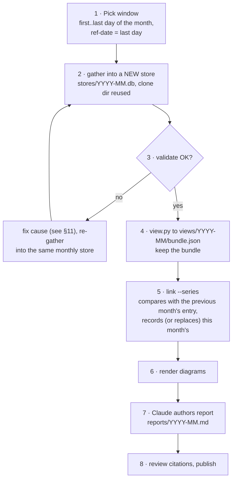
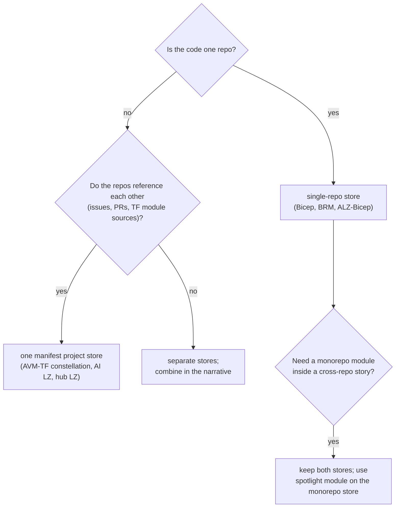

# activity-overview — Usage Guide

> **Audience:** the operator running digests from a laptop. **Design background:**
> [`HLD.md`](HLD.md) / [`LLD.md`](LLD.md). **Flag reference:** [`../REFERENCE.md`](../REFERENCE.md),
> [`../ARCHITECTURE.md`](../ARCHITECTURE.md) appendix A.
>
> This guide covers: install (§1–2), the two ways to run it (§3–4), the **monthly progressive
> update runbook** (§5), **forecasting** (§6), **playbooks for each target estate** —
> Bicep, AVM Bicep, AVM Terraform, AI landing zone, hub/platform landing zone (§7) — store
> management (§8), readers (§9), automation (§10), troubleshooting (§11) and security (§12).

---

## 1. Prerequisites

| Requirement | Why | Check |
|---|---|---|
| Python 3.11+ (stdlib only) | runs every tool | `python3 --version` |
| git 2.x | bounded clone + history walks | `git --version` |
| Claude Code | runs the skill and authors the narrative | `claude --version` |
| GitHub token | read API access | see §1.1 |
| `mmdc` (mermaid-cli) — recommended | compiles/validates diagrams | `mmdc --version` |
| `bicep` CLI — for Bicep repos | module dependency edges | `bicep --version` |
| `terraform` — for Terraform repos | module dependency edges | `terraform version` |

Install the optional tools (pick your platform):

```bash
# macOS (Homebrew)
brew install node git python
npm install -g @mermaid-js/mermaid-cli
brew tap azure/bicep && brew install bicep
brew tap hashicorp/tap && brew install hashicorp/tap/terraform

# Linux / WSL (Ubuntu)
sudo apt-get install -y git python3 nodejs npm
sudo npm install -g @mermaid-js/mermaid-cli
curl -Lo bicep https://github.com/Azure/bicep/releases/latest/download/bicep-linux-x64 \
  && chmod +x bicep && sudo mv bicep /usr/local/bin/bicep
# terraform: follow https://developer.hashicorp.com/terraform/install for your distro
```

### 1.1 GitHub token

- **Classic PAT** with `public_repo` (public targets) or `repo` (private), plus
  **`read:project`** if you want Projects v2 board status and sprints.
- **Azure org policy:** Microsoft Open Source refuses any personal access token — classic or
  fine-grained — with a lifetime **over 8 days** (observed 2026-11; the 403 message states the
  current limit). Create a token with an expiry of 7 days or less when you sit down to run. If an org enforces SAML SSO, authorize the token
  for it (*token settings → Configure SSO*).
- Keep it out of files and shell history. On macOS, store it in the Keychain and export it
  per session:

```bash
security add-generic-password -a "$USER" -s activity-gh-token -w   # paste when prompted
export GITHUB_TOKEN="$(security find-generic-password -a "$USER" -s activity-gh-token -w)"
```

## 2. Install the skill

```bash
git clone https://github.com/DamianFlynn/experiments.git ~/src/experiments
mkdir -p ~/.claude/skills ~/.claude/commands
ln -s ~/src/experiments/.claude/skills/activity-overview ~/.claude/skills/activity-overview
ln -s ~/.claude/skills/activity-overview/commands/activity.md ~/.claude/commands/activity.md

# verify (offline, ~10 s)
python3 -m unittest discover -s ~/.claude/skills/activity-overview -p 'test_*.py'
```

Symlinks mean `git -C ~/src/experiments pull` updates the skill. Set a convenience variable
for the manual commands below:

```bash
export AO=~/.claude/skills/activity-overview
```

### 2.1 Recommended workspace layout

Keep **one directory per report stream**, and inside it **one store per monthly installment**
(`stores/YYYY-MM.db`). Month-to-month continuity lives in `series.json`, not in the store.

```
~/activity/
  bicep/            stores/2026-11.db  series.json  reports/2026-11.md  views/
  avm-bicep/        stores/  series.json  reports/  views/  [history.db]
  avm-tf-network/   stores/  manifest.json  series/  reports/  views/
  ai-lz/            stores/  manifest.json  series/  reports/  views/
  hub-lz/           stores/  manifest.json  series/  reports/  views/
  .tfcache/         (shared TF_PLUGIN_CACHE_DIR)
```

> **One store per installment, or one store that grows?** Both work. Since issue #85 every
> view is scoped to its window (BUNDLE.md "Window scope"), so you may instead keep **one
> store per stream** (`stores/<stream>.db`) and gather each new month into it.
>
> *Safe on an accumulated store:* viewing or digesting the month you have just gathered (the
> latest window) gives exactly what that month's own single-window store gives: its PRs,
> issues, commits, code and symbol events, releases, trains, timeline, feature deltas,
> modules, people, halls and buckets, with artifact lifecycles limited to the month and their
> status as of its end. A view over several gathered months (a quarter) is their union.
> The per-repo facts are per month too (issue #94): **any** gathered month's view — latest or
> earlier — carries that month's `workflow_stats` (CI health), `code_graph`, `code_owners`,
> label taxonomy and clone sha, and its people's `modules`/`areas` use that month's code graph.
> A quarter view over gathered months sums their CI statistics (`meta.facts_windows` lists
> them; `workflow_stats_complete: false` when a month of the quarter was not gathered).
>
> *Not safe, or different:* (1) **re-viewing an earlier month later** shows each PR/issue as
> the latest gather saw it (state, labels, milestone, comments; the view says so in
> `meta.state_as_of`): an item open at that month's end but closed since is missing from it,
> and its in-flight / next / forecast reflect today's open set — keep each month's view and
> report from the time you made them (`views/`, `reports/`) and don't re-link an old month
> into `series.json` from a grown store; (2) a view that is not exactly a gathered month is
> assembled from whole months: a quarter takes its code graph, owners and taxonomy from its
> **last** gathered month, so files changed only in an earlier month have no code area (and
> add no person area) in it; a view inside one month or straddling two has **no**
> `workflow_stats` (runs are counted per gathered window, not per day); (3) months gathered
> into the store before issue #94 have no per-month facts: re-gather them, or their views
> show the last folded month's CI statistics and structure, and while any such month is in
> the store, dependency and ownership edges are only added, never retracted; (4) each fold
> retracts the current-state edges its inputs show are gone (issue #95: a removed module
> `source`, a CODEOWNERS change, an item moved off a milestone or sprint, an edited-away
> blocker), but only on evidence: a dependency goes when a resolved `bicep`/`terraform` build
> of that module or the whole-tree scan (manifest members; `--structural-iac` for a single
> repo) shows it gone — so pass `--structural-iac` on a single-repo accumulated store — a
> transitive dependency only on a new build, an owner only when a later month's code graph
> lists the area; milestone / sprint / blocker edges follow the last-folded copy of each
> PR/issue, so gather months **oldest first** (re-folding an older month after a newer one
> brings its older relations back); (5) on such a store `validate` proves dependency,
> ownership, area-touch, milestone, sprint and blocker edges exactly (ERROR on a stale or
> missing one) once a fold since #95 has run and every month has its per-month facts, but
> person areas stay a WARN (they are a union over the months by design), and so does any of
> those edge types while the store was last folded before #95 (fold one month again) or holds
> a pre-#94 month (re-gather it) — HLD §10 item 10. A single-window store per installment —
> the way CI and the golden tests use it — has none of these, which is why the commands below
> still create one;
> an accumulated `history.db` is useful for cross-window `spotlight` queries either way (§8).

## 3. Running it through Claude Code (the normal way)

```text
/activity Azure/bicep-registry-modules 2026-11-01 2026-11-30 --series ~/activity/avm-bicep/series.json --store ~/activity/avm-bicep/stores/2026-11.db
```

or in plain language:

> *"Produce the November 2026 activity digest for Azure/bicep-registry-modules using a new store
> ~/activity/avm-bicep/stores/2026-11.db and the series file ~/activity/avm-bicep/series.json; focus
> the narrative on avm/ptn/ai-ml/landing-zone and avm/ptn/network/hub-networking."*

Claude follows `SKILL.md`: gather → validate → materialize + link (with series) → render →
per-train narrator sub-agents → fills `report-template.md`, citing every fact. Ask for an
**internal** report explicitly if you want the gated stall/blocker attribution appendix.

## 4. Running the pipeline manually (reproducible, scriptable)

Use this when you want to inspect each stage, automate the deterministic part, or feed the
structured view to your own formatter. All commands run from anywhere; paths are explicit.

```bash
S=~/activity/avm-bicep           # stream directory
FROM=2026-11-01; TO=2026-11-30; M=2026-11
DB=$S/stores/$M.db               # a NEW store for this installment
mkdir -p $S/stores $S/views/$M

# 1 · Acquire → store (network; the only step that needs the token).
#     gather clones into --clone-dir, or fetches it if it already holds a clone of this repo.
python3 $AO/gather.py --owner Azure --repo bicep-registry-modules \
  --from $FROM --to $TO --store $DB --clone-dir $S/clone

# 2 · Trust gate — stop if this is not "RESULT: OK"
python3 $AO/validate.py $DB --project Azure --repo bicep-registry-modules

# 3 · Materialize the bundle view (single repo: project = owner, repo = name;
#     both are auto-detected when the store holds only this repo)
B=$S/views/$M/bundle.json
python3 $AO/view.py --store $DB --project Azure --repo bicep-registry-modules \
  --from $FROM --to $TO --out $B

# 4 · Link with series continuity (records this month in series.json; a re-run replaces it)
python3 $AO/link.py $B --series $S/series.json

# 5 · Diagrams (mmdc validates each; add --skip-validate if mmdc is unavailable).
#     bundle.diagrams paths are relative to the PARENT of --diagrams-dir ($S/views/$M).
python3 $AO/render.py $B --diagrams-dir $S/views/$M/diagrams

# 6 · One train's bounded evidence (what a narrator sub-agent reads)
python3 $AO/link.py $B --slice train-issue-1234 > $S/views/$M/train-issue-1234.slice.json
```

`view.py` writes the **raw** bundle view (`extract`); `link.py` enriches it in place and
`render.py` adds `diagrams`, so keep `$B` — it is what you re-link if a month's series entry
needs refreshing. `view.py` exits 2 with a message when `--project`/`--repo` are ambiguous, unknown, or
have no data in the store.

Then ask Claude to write the report from `$B` (+ slices + diagrams) following
`reference/report-sections.md`, and save it as `$S/reports/2026-11.md`.

> **Multi-repo (manifest) stores.** Members are stored as `--project <manifest project>
> --repo <owner/repo>`: run `view.py` → `link.py` → `render.py` once per member you report on
> (e.g. `--out $S/views/$M/Azure__terraform-azurerm-avm-ptn-foo.json`), with a separate
> series file (`$S/series/<owner>__<repo>.json`; `link.py` creates the directory) and diagrams dir
> (`$S/views/$M/diagrams/<owner>__<repo>`) per member so members never overwrite each other
> or share a series index. The merged project
> view (cross-repo trains, merged shipped/people/halls/modules, `related_work`, `module_edges`)
> comes from `digest.py --store $DB --project <name> --from $FROM --to $TO`; its embedded
> `members[i].bundle` has no `series` or `diagrams` — use the member's bundle view file for
> those. The cross-repo module graph is `render.emit_project_module_graph(view["module_edges"])`.
> Contributors: a member bundle's `people` / `halls` cover only that member (its own
> contributors, its areas); the project view's `people` / `halls` are the project totals —
> each person's counts summed across members, areas as `<repo>::<area>` (#88). Use the
> project view for the project-wide Contributors section.

## 5. Runbook — progressive monthly updates

### 5.1 The monthly cycle



### 5.2 Step detail

1. **Window.** Use calendar months: `--from 2026-11-01 --to 2026-11-30`. `--ref-date` defaults
   to `--to`, which frames milestones, sprints, forecast age and flow staleness — keep the
   default for month-end reports. gather stores it with the window, and `view.py`/`digest.py`
   read it back when their `--from/--to` are that exact window (else they use their `--to`);
   both also take `--ref-date` to override it.
2. **Gather into this month's own store** (`stores/YYYY-MM.db`). Re-running the same window
   into the same store is safe (idempotent). `gather` clones into `--clone-dir`, or, when that
   directory already holds a clone of the same repo, fetches it to the window's history bound
   and checks out the default branch head — so last month's clone dir can be reused. A
   directory that is not a clone of this repo is refused, never deleted. `--no-clone` never
   creates a clone: it fetches an existing one, and with no clone on disk it gathers API data
   only (empty commit/code walks). A repo with no commits since `--from` minus the clone margin
   is cloned at depth 1 and has no commits in the window. `meta.clone_mode` records which
   (`fresh`, `fetched`, `depth1-fallback`, `none`). "Shipped" means merged into the repo's
   **default branch**, which gather detects (clone `origin/HEAD`, else the API) and stores
   with the window as `meta.base_branch`; a PR merged into a feature or release branch is
   not shipped (a stacked PR shows as `contributing_prs` on its parent's train). Pass
   `--branches B` (or a manifest member `branch`) when the mainline is not the default.
   Stores gathered before issue #84 have no stored base branch: their views warn and count
   every merged PR as shipped — re-gather them.
3. **Validate.** Never publish from a store that is not `RESULT: OK`.
4. **Materialize** the view for the month and **keep the bundle files** (`views/YYYY-MM/`) —
   they are what you re-link if a month's series entry needs refreshing.
5. **Series.** `link --series series.json` keeps **one entry per window** (`from`/`to`) in
   window order. It compares this month with the entry for the window just *before* it, then
   records this month, replacing any entry already there for the same window:
   - **Same month twice** — safe: the second run replaces the first entry and produces the
     same `series` block (nothing to clean up).
   - **An earlier month re-run** (e.g. October again after November is recorded) — October's
     entry is replaced and compared with September; the entry is marked
     `captured: "backfill"`, and `link` warns that November's bundle was linked against the
     old October entry. Re-link the later months' saved bundles, oldest first, if their
     *Since last installment* should reflect the refresh.
   - **Months out of order** (e.g. September added after October) — September is inserted
     before October and compared with August (or is the first installment), with the same
     `backfill` mark and warning.

   `link` writes the bundle and then the series file, each atomically, so an interrupted run
   leaves both as they were (or only the bundle updated — just re-run it). The file is
   `{"version": 2, "installments": [...]}`; an older bare-list file is read and rewritten in
   that form (a month it holds twice collapses to the entry recorded last). A series file
   `link` cannot use (invalid JSON, an unknown version, a malformed entry, entries for another
   repo), or a bundle without a window, stops `link` with exit code 2 and a message naming the
   file; nothing is written until you fix or remove it.
6. **Render**, then **author**: the report's *Since last installment* section uses
   `bundle.series` — new items, carried-over items (with prior board status and where each is
   now: shipped, in flight, re-planned or rejected) and the forecast loop (last month's
   predictions landed / not yet / dropped).

### 5.3 First installment, catching up, and roll-ups

| Situation | What to do |
|---|---|
| First month of a stream | Run normally; `series.first_installment = true` and the report omits *Since last installment*. |
| Starting with history | You can gather past months for **delivery history** (what shipped / was rejected then), but you cannot recreate what was *in flight* or *forecast* at the time: `gather` reads open PRs/issues, milestones and board status as they are **now** (an item merged since is no longer open, so it is missing from that month's in-flight set). Don't chain backfilled months into `series.json` or use them to calibrate the forecast — start the series with the first month you capture at month-end (a month recorded after a later one is marked `captured: "backfill"`, but a first month captured late cannot be detected). |
| Missed a month | Gather it for delivery history; its in-flight/forecast are "as of now" (above). Keep it out of the series chain, or note in the report that the comparison spans two months. |
| Quarter / year view | Gather the whole quarter window into its own store (`stores/2026-Q4.db`) and digest that, or digest the quarter window over an accumulated store that holds its months (the view is their union). A wider window over a single-month store adds nothing. Over an accumulated store the quarter's `workflow_stats` (CI health) are the sum of its gathered months (`meta.facts_windows`; `workflow_stats_complete: false` if one is missing) and its code graph / owners are its last month's (§2.1); a quarter gathered as one window has its own. Keep quarterly installments in a separate series file. |
| Refresh a month after late merges | Re-gather the same window into that month's store, re-materialize, and re-run `link --series`: the month's entry is replaced. If later months are recorded, it is marked `backfill` and `link` names them; re-link their saved bundles oldest first to refresh their comparison. |

### 5.4 Multi-repo streams and series

`--series` works on a single bundle. For a constellation, either keep a series per key member
(`series/<owner__repo>.json`, e.g. the pattern module) or track continuity at project level
in the narrative from the merged `shipped`/`trains`. The project view itself has no series
block. A series file belongs to one repo: `link` refuses (exit 2) a file whose entries name
another `owner`/`repo`, since entries are keyed by window alone.

## 6. Forecasting — reading it and making it useful

### 6.1 What it is

The forecast scores **open items that are on the next milestone or carry a high-priority
label** (`next_candidates`). Score = sum of signals:

| Signal | Points | Shown as |
|---|---:|---|
| On the next milestone | 5.0 | `on milestone <title>` |
| High-priority label | 3.0 | `high-priority` |
| In motion: it is an open PR, an open PR closes/references it, or its train is in flight | 2.0 | `open PR` / `work in progress` |
| Updated in the window | 1.5 | `active in window` |
| Open ≥ 200 days | 1.0 | `long-open` |

Tiers: **likely ≥ 5**, **possible ≥ 2**, **longshot < 2**. Open items that are merely active
(not on the next milestone, not high-priority) appear under **In flight**, not in the forecast.

"In motion" means live work only. An open issue whose only PR was closed unmerged, or that a
merged PR merely references, is **not** in motion: its train is `rejected` / `shipped` (or,
for a mere reference, it has no train — a mention does not make an issue part of a train), and
that scores nothing. Each candidate's `notes` says so instead (`previous attempt rejected`,
`linked PR already merged`) without changing the score, so the report can mention it. Any
open PR still counts, however old or draft it is.

### 6.2 Verifying it next month

The following installment's `series.forecast_loop` lists each previous candidate as **landed**
(it is now in `shipped`), **dropped** (now in `rejected`: PR closed unmerged, issue closed not
planned) or **not yet**. Track a simple hit-rate per tier over time (landed ÷ forecast) to
calibrate how much weight readers should put on each tier; skip installments whose
`series.prior.captured` is `"backfill"` (that forecast was recorded after the fact).

### 6.3 Making it meaningful on your repos

- **Milestones drive the strongest signal.** If a repo uses milestones for releases, the
  forecast will track them automatically (`select_milestones`: current = earliest open due
  on/after the ref date; next = the following one). Only milestones **with a due date**
  count: an undated "Backlog"-style milestone is never current or next, so give release
  milestones a due date. If every dated milestone is overdue, the most recently due one is
  current and there is no next (so no `on milestone` signal).
- **Priority labels must match.** Recognized labels (case-insensitive, exact):
  `priority/high`, `priority/critical`, `p0`, `p1`, `high-priority`, `critical`. Check a repo
  with `gh label list -R <owner/repo> --limit 200`. If it uses other names (for example a
  `Priority: High` style), the high-priority signal will not fire; extend
  `HIGH_PRIORITY_LABELS` in `link.py` (lower-case) and keep the change in your fork.
- **No milestones and no matching labels** → the forecast is legitimately empty. The report
  should then say "no forecast signals" and lean on *In flight*, *Stalled/blocked* and board
  status instead of inventing predictions.
- **Projects v2 boards** add `board_status` to in-flight items and sprint framing; they do not
  change forecast scores.

## 7. Playbooks per target estate

The commands below reuse `AO`, `FROM`, `TO` and `M` (e.g. `2026-11`) from §4 and write each
installment to its own store, `$S/stores/$M.db`. The clone directory is reused: `gather`
fetches an existing clone instead of cloning again.

### 7.1 Bicep — `Azure/bicep`

- **Shape:** one product repo (the Bicep compiler and tooling, .NET). Single-repo gather.
- **Areas:** the directory provider uses the top two path segments (e.g. `src/Bicep.Core`,
  `src/Bicep.Cli`); install `graphify` if you want symbol-community areas instead.
- **IaC edges:** not applicable (no `main.bicep` module tree to build) — expect
  `edge_extraction` to be skipped.
- **Command:**

```bash
S=~/activity/bicep; mkdir -p $S/stores
python3 $AO/gather.py --owner Azure --repo bicep --from $FROM --to $TO \
  --store $S/stores/$M.db --clone-dir $S/clone
```

- **Report focus:** shipped features/fixes by area, deep trains (language features), the
  forecast (if milestones are used for releases), releases section, contributors.

### 7.2 AVM Bicep — `Azure/bicep-registry-modules` (BRM)

- **Shape:** a monorepo with 500+ resource modules (`avm/res/<service>/<module>`) and ~50
  pattern modules (`avm/ptn/<group>/<module>`), e.g. `avm/ptn/ai-ml/landing-zone`,
  `avm/ptn/network/hub-networking`, `avm/ptn/alz`. Single-repo gather.
- **Areas:** one area per module (the `avm` pattern), so shipped-by-area, module ownership and
  feature deltas are per module.
- **Dependencies:** `br/public:avm/res/...` references resolve to the in-repo module areas
  (ptn → res). Gather with **`--structural-iac`** to get the whole module graph: every
  module's direct references are read statically from its `main.bicep` (no `bicep` CLI
  needed, about 0.2 s per 1,000 modules), so modules nobody touched that month still have
  their edges and their consumers. With the `bicep` CLI the in-window modules also get
  transitive edges from the build. Without the flag, edges exist only for modules **changed
  in the window**, and only when `bicep` is installed.
- **Cost:** BRM is very busy and every run fetches *all* open PRs and issues with per-item
  calls. Expect a long, API-heavy gather; run it once per month, consider
  `--no-workflows` if you don't need the CI-health section, and watch for 403 rate-limit
  messages (wait for the reset and re-run — the fold is idempotent).
- **Commands:**

```bash
S=~/activity/avm-bicep; mkdir -p $S/stores
python3 $AO/gather.py --owner Azure --repo bicep-registry-modules --from $FROM --to $TO \
  --store $S/stores/$M.db --clone-dir $S/clone --structural-iac
python3 $AO/validate.py $S/stores/$M.db --project Azure --repo bicep-registry-modules

# blast radius of one module inside the monorepo: which modules consume it (direct, then
# transitive). Needs the --structural-iac gather above.
python3 $AO/spotlight.py dependents Azure/bicep-registry-modules::avm/res/network/virtual-network \
  --store $S/stores/$M.db --project Azure --md

# module biographies: this month's store covers this month; for longer history use a
# history store built from ONE wide-window gather (see §8)
python3 $AO/spotlight.py module avm/ptn/ai-ml/landing-zone      --store $S/stores/$M.db --project Azure --md
python3 $AO/spotlight.py module avm/ptn/network/hub-networking --store $S/stores/$M.db --project Azure --md
python3 $AO/spotlight.py module avm/res/network/virtual-network --store $S/history.db  --project Azure --md
```

- **Scoping a report to a family:** the gather covers the whole repo; scope in the narrative
  ("focus on `avm/ptn/ai-ml/*`") and with `spotlight module` / `subsystem` queries.

### 7.3 AVM Terraform — one repo per module

- **Shape:** each module is its own repo (`Azure/terraform-azurerm-avm-{res,ptn,utl}-*`), so
  group them into **constellations** with a manifest.
- **Generate the manifest from the official AVM Terraform index** (keeps up with new/renamed
  modules):

```bash
S=~/activity/avm-tf-network
python3 $AO/manifest_from_index.py --avm res --avm ptn \
  --project avm-tf-network --from $FROM --to $TO \
  --name-contains network --status Available > $S/manifest.json
```

- **Gather the constellation:**

```bash
export TF_PLUGIN_CACHE_DIR=~/activity/.tfcache && mkdir -p "$TF_PLUGIN_CACHE_DIR"
export ACTIVITY_CLONE_MARGIN_DAYS=120        # what the bundled sample used to keep every in-window commit's parent
mkdir -p $S/stores $S/views                          # manifest: --clone-dir is the PARENT dir
python3 $AO/gather.py --manifest $S/manifest.json --store $S/stores/$M.db --clone-dir $S/clones
python3 $AO/validate.py $S/stores/$M.db --project avm-tf-network
python3 $AO/digest.py --store $S/stores/$M.db --project avm-tf-network --from $FROM --to $TO > $S/views/$M.json
```

- **What you get:** cross-repo decision trains (qualified refs between members), the
  **structural** cross-repo module graph (`module_edges`, built from every module's `source`
  references, independent of churn) and per-member blast radius:

```bash
python3 $AO/spotlight.py dependents Azure/terraform-azurerm-avm-res-network-virtualnetwork \
  --store $S/stores/$M.db --project avm-tf-network --md
```

- **Notes:** a registry source resolves to a member by the manifest `registry` field (exact)
  or the HashiCorp convention `ns/name/provider → ns/terraform-provider-name`; references to
  modules outside the manifest are not edges (add the module to the manifest to include it).
  `examples/` and `tests/` are treated as scaffolding, not dependencies. Large patterns pull
  many registry modules during `terraform init` — keep the plugin cache and raise
  `ACTIVITY_IAC_BUILD_TIMEOUT` if `edge_extraction` reports timeouts.
- **A member fails:** gather folds the other members, prints each failed member with its
  reason and exits 1; `validate.py` fails the project until it is fixed. Fix the cause, then
  gather only what is missing (the members already `ok` for the window are not re-fetched):

```bash
python3 $AO/gather.py --manifest $S/manifest.json --store $S/stores/$M.db --clone-dir $S/clones --resume
```

### 7.4 AI landing zone

The AI LZ spans three places; track them as two streams and combine in the report:

| Part | Repo / path | Stream |
|---|---|---|
| Terraform implementation | `Azure/terraform-azurerm-avm-ptn-aiml-landing-zone` + the modules it composes | `ai-lz` (manifest) |
| Bicep implementation | `avm/ptn/ai-ml/landing-zone` (and `avm/ptn/ai-ml/ai-foundry`) in BRM | the `avm-bicep` store (§7.2) |
| Reference architecture, docs, portal | `Azure/AI-Landing-Zones` (no IaC — social layer only) | `ai-lz` (manifest member) |

Example hand-authored manifest (all repos verified to exist; `registry` omitted so the
naming convention resolves Terraform members):

```json
{
  "project": "ai-lz",
  "window": { "from": "2026-11-01", "to": "2026-11-30" },
  "repos": [
    { "owner": "Azure", "repo": "AI-Landing-Zones" },
    { "owner": "Azure", "repo": "terraform-azurerm-avm-ptn-aiml-landing-zone" },
    { "owner": "Azure", "repo": "terraform-azurerm-avm-ptn-aiml-ai-foundry" },
    { "owner": "Azure", "repo": "terraform-azurerm-avm-res-network-virtualnetwork" },
    { "owner": "Azure", "repo": "terraform-azurerm-avm-res-operationalinsights-workspace" },
    { "owner": "Azure", "repo": "terraform-azurerm-avm-res-keyvault-vault" },
    { "owner": "Azure", "repo": "terraform-azurerm-avm-res-cognitiveservices-account" }
  ]
}
```

```bash
S=~/activity/ai-lz; mkdir -p $S/stores $S/views
python3 $AO/gather.py --manifest $S/manifest.json --store $S/stores/$M.db --clone-dir $S/clones
python3 $AO/validate.py $S/stores/$M.db --project ai-lz
python3 $AO/digest.py --store $S/stores/$M.db --project ai-lz --from $FROM --to $TO > $S/views/$M.json
python3 $AO/spotlight.py module avm/ptn/ai-ml/landing-zone --store ~/activity/avm-bicep/stores/$M.db --project Azure --md
```

Ask Claude for one *AI landing zone* report from both: the `ai-lz` project view (Terraform +
docs/portal community activity, cross-repo trains, blast radius of the composed modules) and
the BRM module slice (Bicep pattern changes). The Bicep side's dependencies are the in-BRM
ones (both the pattern and the modules it composes live in BRM). Cross-repo Bicep
dependencies are resolved only inside one manifest, from a member that references
`br/public:` modules to a BRM member declared with `bicep_registry_prefix` (see §7.5).

To refresh the Terraform member list from the index instead of hand-authoring:
`manifest_from_index.py --avm ptn --avm res --project ai-lz --from … --to … --name-contains aiml`
(then add `Azure/AI-Landing-Zones` and any resource modules you want in scope).

### 7.5 Hub / platform landing zone (ALZ)

| Part | Repo / path | Stream |
|---|---|---|
| Terraform ALZ + connectivity | `terraform-azurerm-avm-ptn-alz`, `…-avm-ptn-alz-connectivity-hub-and-spoke-vnet`, `…-avm-ptn-alz-connectivity-virtual-wan`, `…-avm-ptn-hubnetworking` (+ `…-avm-res-network-virtualnetwork`, `…-avm-res-network-azurefirewall`) | `hub-lz` (manifest) |
| Accelerator | `Azure/alz-terraform-accelerator` | `hub-lz` (manifest member) |
| Docs hub | `Azure/Azure-Landing-Zones` (documentation; minimal IaC) | `hub-lz` (manifest member) |
| Bicep ALZ / hub | `avm/ptn/alz`, `avm/ptn/network/hub-networking`, `avm/ptn/network/virtual-wan` in BRM | `avm-bicep` store |
| Bicep classic | `Azure/ALZ-Bicep` — its README schedules archival for **2027-02-16** | optional single-repo stream to track wind-down |

```json
{
  "project": "hub-lz",
  "window": { "from": "2026-11-01", "to": "2026-11-30" },
  "repos": [
    { "owner": "Azure", "repo": "Azure-Landing-Zones" },
    { "owner": "Azure", "repo": "alz-terraform-accelerator" },
    { "owner": "Azure", "repo": "terraform-azurerm-avm-ptn-alz" },
    { "owner": "Azure", "repo": "terraform-azurerm-avm-ptn-alz-connectivity-hub-and-spoke-vnet" },
    { "owner": "Azure", "repo": "terraform-azurerm-avm-ptn-alz-connectivity-virtual-wan" },
    { "owner": "Azure", "repo": "terraform-azurerm-avm-ptn-hubnetworking" },
    { "owner": "Azure", "repo": "terraform-azurerm-avm-res-network-virtualnetwork" },
    { "owner": "Azure", "repo": "terraform-azurerm-avm-res-network-azurefirewall" }
  ]
}
```

Blast radius before a networking change:

```bash
python3 $AO/spotlight.py dependents Azure/terraform-azurerm-avm-res-network-azurefirewall \
  --store ~/activity/hub-lz/stores/$M.db --project hub-lz --md
```

**An enterprise Bicep landing zone consuming AVM.** Put your landing-zone repo(s) and BRM in
one manifest and declare on BRM the path prefix it publishes under in the public registry.
Every `br/public:avm/...:<version>` (or `br:mcr.microsoft.com/bicep/avm/...`) reference in your
repos then becomes a cross-repo `depends_on` to the BRM module area, with the pinned version:

```json
{
  "project": "contoso-lz",
  "window": { "from": "2026-11-01", "to": "2026-11-30" },
  "repos": [
    { "owner": "Contoso", "repo": "platform-landing-zone" },
    { "owner": "Azure", "repo": "bicep-registry-modules", "bicep_registry_prefix": "avm/" }
  ]
}
```

```bash
S=~/activity/contoso-lz; mkdir -p $S/stores $S/views
python3 $AO/gather.py --manifest $S/manifest.json --store $S/stores/$M.db --clone-dir $S/clones
python3 $AO/validate.py $S/stores/$M.db --project contoso-lz
# which of our modules pin this AVM module (and BRM's own consumers of it)
python3 $AO/spotlight.py dependents Azure/bicep-registry-modules::avm/res/key-vault/vault \
  --store $S/stores/$M.db --project contoso-lz --md
```

Manifest members always get the whole-tree scan, so modules that did not change in the
window are included. Limits: only the **public** registry resolves — references through a
private ACR (`br:<acr>.azurecr.io/...`), a template spec (`ts:`) or a `bicepconfig.json`
alias stay unresolved (`to: null`); the scan reads each module's `main.bicep` only, so
landing-zone modules whose entry file has another name are not scanned; and including BRM
makes the gather as API-heavy as the §7.2 one (all its open PRs and issues are fetched).
If BRM's gather fails, the edges still resolve (the targets become stand-in anchor nodes)
but `validate` fails the project until `gather --resume` completes it.

### 7.6 Choosing store boundaries



A store *can* hold several projects, but every reader then needs `--project` (and `--repo`).
One store per stream keeps commands simple and failures isolated.

## 8. Store management

- **Monthly stores** (`stores/YYYY-MM.db`) are small, single-window and independently
  auditable. Keep them with the month's `views/` and report — together they are the evidence
  behind a published installment.
- **`series.json`** is the continuity record; back it up with the stores. It is a JSON
  object `{"version": 2, "installments": [...]}` holding one snapshot per window (each with
  `from`/`to`), in window order.
- **History store (optional).** For cross-window `spotlight` questions (module biography,
  person, grep across many months), build `history.db` from **one wide-window gather**
  (e.g. `--from 2026-01-01 --to 2026-11-30`) into a fresh file, and rebuild it — rather than
  folding month after month into it — when you need it refreshed. A single wide fold passes
  `validate.py`. Folding month after month (oldest first) passes too: the dependency,
  ownership, touch, milestone, sprint and blocker edges are checked exactly, person areas
  with a WARN for areas only earlier months attributed (LLD §8).
  Wide gathers of busy repos are API-heavy (§11).
- **Inspect:** `sqlite3 stores/2026-11.db "select project, repo, count(*) from nodes group by 1,2"`;
  folded windows are in `meta.gathered_windows`.
- **Stale edges are retracted on evidence (#95).** Each fold drops the `depends_on`, `owns`,
  `in_milestone`, `in_iteration` and `blocks` edges its inputs show are gone; what it dropped
  is printed (`retracted N stale current-state edge(s) …`) and kept in
  `meta.retractions:<project>/<repo>`
  (`sqlite3 S "select value from meta where key like 'retractions:%'"`). A dependency is
  dropped only where a resolved build or the whole-tree scan speaks for the module (STORE.md
  "Current-state edges").
- **Clones** are separate (`--clone-dir`); the next gather into the same path fetches the
  existing clone (it must be a clone of the same repo).

## 9. Readers cookbook

| Need | Command |
|---|---|
| Contributor across all history | `spotlight.py person <login> --store S --project P --md` |
| Module biography | `spotlight.py module <area> --store S --project P --md` (or `--json` for the narrator) |
| One member's copy of an area | `spotlight.py module owner/repo::<area> …` or `… module <area> --repo owner/repo` (same for `subsystem`); without it an area present in several members (e.g. `main.tf`) is unioned and every row names its repo |
| One symbol's or file's lifecycle | `spotlight.py symbol <artifact-id> --store S --project P` (a file as `art:<path>` or `<path>`; a deleted file reads `removed`) |
| Activity inside an area | `spotlight.py subsystem <area> --store S --project P --from F --to T` |
| Full-text search | `spotlight.py grep 'breaking change' --store S --project P` (one argument: quote a multi-word phrase; it is matched literally, within `P` only) |
| Blast radius (members) | `spotlight.py dependents <owner/repo> --store S --project P` |
| Blast radius (one module area, in-repo and cross-repo) | `spotlight.py dependents <owner/repo>::<area> --store S --project P` (gather single repos with `--structural-iac`) |
| Project view for a formatter | `digest.py --store S --project P --from F --to T` (schema: `BUNDLE.md`) |
| Ticket-linked related work | `digest.py … --manifest M` with `"ticket_prefixes": ["ABC"]` in the manifest, or `digest.py … --ticket-pattern '\b(AB#\d+)\b'` (off by default: `related_work` is `[]`) |
| Complete out-of-window threads | add `--complete` to `person/subsystem/grep/module` (uses the token; bounded; refused for `symbol`/`dependents`) |

`spotlight.py` exits 2 with usage for a wrong argument count, a flag the query does not take,
a bad `--from/--to`, a missing or empty store, a store with several projects and no
`--project` (the error lists them) and an unknown `--repo`. Train outcomes are `shipped`,
`in_flight`, `rejected`, `abandoned` (an issue closed not-planned/duplicate) and
`direct_push` (commits with no PR) — see LLD §9.

Reference formatters that consume the view: `samples/build_report.py` (structural Markdown
skeleton for the bundled sample) and `examples/formatters/shipped_changelog.py`.

## 10. Automation

- **Deterministic part on a schedule.** A cron/launchd job can run `gather` + `validate` +
  `digest` on the 1st of each month for the previous month, so data is ready when you sit
  down. Example (Linux cron, 06:30 on the 1st):

```bash
30 6 1 * * cd ~/activity && ./monthly.sh >> ~/activity/monthly.log 2>&1
```

  where `monthly.sh` computes last month's `FROM`/`TO`/`M`, exports the token from your secret
  store, and runs §4 steps 1–3 for each stream into a new
  `stores/$M.db` (stop the stream on a non-zero exit). Running it at month-end (or the 1st)
  matters: in-flight work, milestones and board status are captured as they are at gather time.
- **Narrative.** Run `/activity` (or the manual §4 steps 4–6 + "write the report") in Claude
  Code once the data is ready, review the citations, then publish.
- **CI assurance.** The repo's GitHub Actions workflow runs the offline tests on every change
  and a scheduled live gather → validate (1st and 15th, 07:00 UTC). Point its
  `workflow_dispatch` inputs at one of your targets to smoke-test a window. Its `spotlight`
  job also runs `ci_spotlight_integration.py --store S --require-all`, which checks the
  person / subsystem / symbol / grep answers against what the store holds. You can run it on
  your own store (`--project P` when the store holds several); without `--require-all` a
  check whose input the store lacks is reported as skipped instead of failing.

## 11. Troubleshooting

| Symptom | Cause | Fix |
|---|---|---|
| `error: set GITHUB_TOKEN` | no token in env | export it (§1.1) |
| 403 on first call with `x-github-sso` | SAML SSO not authorized | authorize the token for the org |
| 403 with `x-ratelimit-remaining: 0` | rate limited (busy repo) | wait until `x-ratelimit-reset`, re-run (idempotent) |
| 403 mentioning token lifetime | token lifetime over the org's limit (8 days for `Azure/*`, classic and fine-grained) | new token with an expiry inside the limit the message states |
| `extract: base branch unknown for …` on view/digest | store gathered before #84, gather could not determine it, or a roll-up spans windows with different base branches | re-gather (with `--branches` if needed), or view each gathered window on its own |
| `validate` → multiple projects (exit 2) | store holds several projects/repos | pass `--project` (and `--repo`) |
| `validate: error: store … does not exist` / `is not a journey-graph store` (exit 2) | wrong path (validate never creates a file) | point it at the store `gather --store` wrote |
| `validate` ERROR `target` | `--project`/`--repo` mistyped, or the store is empty | check the names the error lists under `stored_projects` / `stored_repos` |
| `validate` ERROR `no_drift`/`idempotency` "could not self-source" | the target has no nodes, a row is corrupt (named), or no activity node has a timestamp | fix the target name; otherwise the store is damaged: re-gather it |
| `validate` ERROR `no_drift` "lifecycle length drift" on a store folded window by window | the store was written before artifact folding became cumulative (#76) | re-fold each of its windows, or rebuild it from one wide gather |
| `validate` ERROR `edge_set` "stored but not derivable" / "derived from the stored records but not stored" / "edge data drift" | an edge the stored records do not imply (or a missing one): a producer defect or a hand-edited store | report it; don't publish; re-gather into a fresh store |
| `validate` WARN in `edge_set` / `no_drift` on a store holding several windows | the WARN names why the edge type cannot be proven: the repo was last folded before #95, a window has no per-window facts (pre-#94), `touches` across a graphify / re-mapped code graph; person areas are always a union over the windows | not a failure. Fold one window again (pre-#95) or re-gather pre-#94 windows to make the edge checks exact |
| `validate` ERROR `edge_set` on a `depends_on`/`owns`/`touches`/`in_milestone`/`in_iteration`/`blocks` edge of a store holding several windows | since #95 these are exact on a store a current fold maintained: the edge is not what the stored records / per-window facts imply | a producer defect or a hand-edited store: report it; don't publish |
| `gather` stderr `retracted N stale current-state edge(s) of P/R (…)` | the fold found edges its inputs no longer imply (a removed module reference, a CODEOWNERS change, an item moved off a milestone/sprint, a blocker edited away), or healed an older store | expected; the edges are listed in `meta.retractions:P/R` |
| `validate` ERROR `provenance` "url names repo X, the node is in Y" | the repo was renamed or transferred and gathered under its old name (GitHub returns links with the new name), or the node was edited | gather under the repo's current name |
| `validate` ERROR `provenance` "commit id … is not a 40/64-hex git sha" / ERROR `no_fabrication` id problems | a hand-made or corrupted node; gather writes only real shas and grammar ids | re-gather; never hand-edit the store |
| `validate --repo R` of a multi-repo project passes but the project run fails `no_drift_people` | a single-member audit checks only the people that member derives (people are project-wide) | run `validate.py STORE --project P` without `--repo` for the full people check |
| `validate --bundle FILE` ERROR `no_drift` "stored pr differs from --bundle" / "… in --bundle but not stored" | a record changed or was deleted since FILE was saved (or FILE is an older window's bundle on a store that re-fetched the record) | cross-check with a view saved right after the gather that wrote the record |
| `gather: N of M member(s) failed for project …` (exit 1) | those members' gather failed (reason listed per member); the others are folded | fix the cause (token, SSO, clone), then `gather.py --manifest … --resume` |
| `validate` ERROR `member_status` (and `target` for that repo): "member gather did not complete" | a manifest member's last gather of that window `failed` or was `not_attempted` (an interrupted run) | `gather.py --manifest … --resume`; the error names the member, window and reason |
| `digest.py`/`view.py` warning: project … is incomplete | same as above, for a window overlapping the one read | the view lacks those members: don't publish it; resume the gather |
| `validate` ERROR (other drift/conformance) | producer defect | report it; don't publish; never hand-edit the store |
| `--clone-dir ... is not a git clone` / `... is a clone of a different remote` | `--clone-dir` (or the default `workspace/<repo>-clone`) holds something other than a clone of this repo | point `--clone-dir` elsewhere (gather never deletes it) |
| Last month's PRs/commits/trains appear in this month's view (not as shipped: buckets are window-bounded) | the view was made before issue #85 from a store holding several months | re-run `view`/`digest` with the current skill (views are window-scoped); a PR/issue of another month is in the view only as train context (an issue a view PR closes or cross-references) |
| A PR and the issue it fixes are in different trains (or the issue's bucket ref has no train) | trains are joined by closing references only (#93): the PR mentions the issue, or was linked to it only in the Development sidebar, without `Fixes #N` / `Closes #N` in its title or body | expected; a mention is context, not membership (LLD §14.5) |
| A train lists a rejected or open PR next to the one that shipped | a train holds every attempt for its issues (#93); each PR's own outcome is in `train.pr_outcomes` | expected; the narrative tells the attempts apart |
| A past month's view has `meta.state_as_of` and fewer in-flight items than its report had | the store has grown since: records are stored latest-wins, so items closed after that month are not open in it (HLD §10 item 8) | use the view saved at the time; don't rebuild past months' in-flight from a grown store |
| Warning: boundary-dropped commits | an in-window commit sat on the shallow boundary and `git fetch --deepen` failed (a "could not deepen" warning precedes it when the fetch errored) | raise `ACTIVITY_CLONE_MARGIN_DAYS` (e.g. 60–120), re-gather |
| A contributor appears twice (login and git name), or `validate` ERROR person "stored but not derivable" (and `edge_set` `authored` edges) with a `hint` naming "pre-#78 identity" | the store was folded before commit authors were resolved to logins (#78); the hint names the commits' current author | re-gather the window into a fresh store; don't fold new windows into a pre-#78 store |
| A person shows `login_resolved: false` | that commit's email is linked to no GitHub account and is not a noreply address, so gather kept the git name (suffixed ` (git)` when it looks like a login) rather than guess | expected; the person's PR/review activity is under their login |
| `edge_extraction` timeouts | slow `terraform init` / registry | set `TF_PLUGIN_CACHE_DIR`; raise `ACTIVITY_IAC_BUILD_TIMEOUT` |
| No module graph on a Bicep repo | gathered without `--structural-iac`, and `bicep` not installed or no modules changed in window | re-gather with `--structural-iac` (static, no CLI) |
| A landing-zone `br/public:avm/...` ref has no cross-repo edge | BRM is not a manifest member, or has no `bicep_registry_prefix`, or the ref goes through a private registry / alias | add BRM with `"bicep_registry_prefix": "avm/"`; private-registry refs are not resolved |
| Empty forecast | no next milestone and no recognized priority labels | expected; see §6.3 |
| Empty board/sprint sections | token lacks `read:project`, or no maintained board | add scope or accept |
| `render.py` fails | `mmdc` missing, or Chromium sandbox as root | install mmdc; as root use a puppeteer `--no-sandbox` config (throwaway environments only) or `--skip-validate` |
| `link.py --series` warns about later installments | a month was (re-)recorded after a later one | expected; re-link the named later months' saved bundles oldest first if their comparison should reflect the change |
| `spotlight grep` → `fts_unavailable` | SQLite built without FTS5 | use a Python with FTS5 (most do) |
| `spotlight` → `needs_gather` | nothing stored for that focus yet | gather more windows |

## 12. Security and hygiene

- The token is **read-only** in effect — the skill never writes to GitHub — but treat it as a
  secret: environment/keychain only, never in manifests, scripts or reports; create short-lived
  tokens (the Azure org accepts 8 days at most).
- Stores and clones contain repository content and contributor logins (and commit author
  names; author emails are read to resolve logins but never stored); keep them in your
  workspace, not in shared folders.
- Public reports never attribute stalls to individuals; the internal attribution appendix is
  opt-in — only request it for internal audiences.
- Always publish from a store that passed `validate.py`, and spot-check citations: every
  claim in the report must link to a GitHub record.
