# Azure/bicep-registry-modules — Activity Digest (2026-08-01 → 2026-10-31) — three-month roll-up

> **Gathered late (validation note, not a template line):** this closed month was gathered on 2026-11-26T16:49:07Z. Open/closed/merged state, comments and reviews are projected to 2026-10-31T23:59:59Z (51 PR and 41 issue records projected, `meta.records_as_of`); titles, labels, milestones, assignees and board status are as of 2026-11-26T16:49:07Z (USAGE §5.3). The view carries no `meta.state_as_of`, so the template's own caveat line does not fire.
> "Shipped" = merged into `main`. Structure (code graph, owners) read at `82950838e7ce` (`structure_as_of: window_end`). Reference date 2026-10-31.
> Diagrams were rendered with `render.py --skip-validate`: mmdc is installed but its headless Chrome is not, so they are **unvalidated**.

## Executive summary

- 157 merged PRs and 54 completed issues shipped; 153 decision trains landed (276 trains in the window: 75 in flight, 43 rejected, 5 abandoned).
- **Monthly split** (from the monthly reports, which reconcile with this view: 23 + 69 + 65 = 157 merged PRs, 36 + 83 + 92 = 211 shipped items, 20 + 11 + 21 = 52 rejected): August was quiet ([report](2026-08.md)); September was the metadata-driven platform migration ([report](2026-09.md)); October was a CI/test reliability campaign ([report](2026-10.md)).
- **Largest bodies of work:** per-module `metadata.json` across the repo ([#7349](https://github.com/Azure/bicep-registry-modules/pull/7349), [#7379](https://github.com/Azure/bicep-registry-modules/pull/7379), [#7399](https://github.com/Azure/bicep-registry-modules/pull/7399)); the Bicep test pipeline's retries, cleanup and Azure Local fixtures ([#7464](https://github.com/Azure/bicep-registry-modules/pull/7464), [#7517](https://github.com/Azure/bicep-registry-modules/pull/7517), [#7525](https://github.com/Azure/bicep-registry-modules/pull/7525)); two new modules, `avm/ptn/app/function-app` ([#7299](https://github.com/Azure/bicep-registry-modules/pull/7299)) and `avm/res/code-signing/code-signing-account` ([#7363](https://github.com/Azure/bicep-registry-modules/pull/7363)).
- **CI health over the period:** 5,215 of 6,499 workflow runs succeeded (995 failed, 45 cancelled), gathered as one window.
- **Risk:** 55 open trains stalled at 2026-10-31 and 160 open issues flagged by flow; no forecast candidates in any month.

## Shipped this period

| Title | Ref | Train |
|---|---|---|
| [feat(`avm/res/cognitive-services/account`): extract deployments child module](https://github.com/Azure/bicep-registry-modules/pull/7235) | pr #7235 | `train-pr-7235` |
| [fix: bump github/codeql-action/upload-sarif from 4.37.3 to 4.37.4](https://github.com/Azure/bicep-registry-modules/pull/7246) | pr #7246 | `train-pr-7246` |
| [fix: Deployment name creation for child modules of `avm/res/operational-insights/workspace`](https://github.com/Azure/bicep-registry-modules/pull/7249) | pr #7249 | `train-issue-7194` |
| [fix: Prevent child module deployment name conflicts across multiple modules](https://github.com/Azure/bicep-registry-modules/pull/7250) | pr #7250 | `train-pr-7250` |
| [feat: Feature/Add Dynamic Data Masking Capability](https://github.com/Azure/bicep-registry-modules/pull/7252) | pr #7252 | `train-pr-7252` |
| [feat: avm/res/cognitive-services/account support `modelProviderData`](https://github.com/Azure/bicep-registry-modules/pull/7254) | pr #7254 | `train-issue-7197` |
| [feat: CosmosDB - "Rebased Add SecuredByPerimeter support for Cosmos DB publicNetworkAccess- #6710"](https://github.com/Azure/bicep-registry-modules/pull/7257) | pr #7257 | `train-pr-7257` |
| [fix: bump github/codeql-action/upload-sarif from 4.37.4 to 4.37.6](https://github.com/Azure/bicep-registry-modules/pull/7258) | pr #7258 | `train-pr-7258` |
| [feat: CI - Expanded diff check to include also non-committed changes](https://github.com/Azure/bicep-registry-modules/pull/7260) | pr #7260 | `train-pr-7260` |
| [fix: Correct DDM policy condition when determining if the Data Masking capability is enabled](https://github.com/Azure/bicep-registry-modules/pull/7262) | pr #7262 | `train-pr-7262` |
| [fix: VM - Refreshing files](https://github.com/Azure/bicep-registry-modules/pull/7264) | pr #7264 | `train-issue-2422` |
| [feat: Add VNET-level IPAM Pool Prefix Allocations support to `avm/res/network/virtual-network`](https://github.com/Azure/bicep-registry-modules/pull/7271) | pr #7271 | `train-issue-6695` |
| [feat: Add CMK user-assigned identity to managed identities across modules - batch 1](https://github.com/Azure/bicep-registry-modules/pull/7279) | pr #7279 | `train-pr-7279` |
| [feat: ACR - Added support to bypass network rules for ACR tasks.](https://github.com/Azure/bicep-registry-modules/pull/7280) | pr #7280 | `train-issue-6990` |
| [fix: bump github/codeql-action/upload-sarif from 4.37.6 to 4.37.7](https://github.com/Azure/bicep-registry-modules/pull/7282) | pr #7282 | `train-pr-7282` |
| [fix: NAT Gateway - Correct `name` parameter description](https://github.com/Azure/bicep-registry-modules/pull/7283) | pr #7283 | `train-issue-6927` |
| [docs: replace unedited SUPPORT.md template with AVM support content](https://github.com/Azure/bicep-registry-modules/pull/7287) | pr #7287 | `train-issue-6736` |
| [docs: Remove stale model pin and dead `/AVM-Boostrap` reference from pre-flight check](https://github.com/Azure/bicep-registry-modules/pull/7288) | pr #7288 | `train-pr-7288` |
| [fix: Recovery Services Vault - Omit soft delete properties from `backupConfig` when `softDeleteSettings` is used](https://github.com/Azure/bicep-registry-modules/pull/7292) | pr #7292 | `train-issue-7289` |
| [feat: ManagedEnvironment update and test fixes](https://github.com/Azure/bicep-registry-modules/pull/7293) | pr #7293 | `train-pr-7293` |
| [fix: bump github/codeql-action/upload-sarif from 4.37.7 to 4.37.8](https://github.com/Azure/bicep-registry-modules/pull/7294) | pr #7294 | `train-pr-7294` |
| [feat: Create AVM Pattern Module for Function Apps](https://github.com/Azure/bicep-registry-modules/pull/7299) | pr #7299 | `train-pr-7299` |
| [feat: AVM Module upgrade for Content Processing](https://github.com/Azure/bicep-registry-modules/pull/7301) | pr #7301 | `train-pr-7301` |
| [feat: Updated AVM content gen v2 modules](https://github.com/Azure/bicep-registry-modules/pull/7302) | pr #7302 | `train-pr-7302` |
| [feat: AVM Module Upgrade for Multi Agent](https://github.com/Azure/bicep-registry-modules/pull/7303) | pr #7303 | `train-pr-7303` |
| [feat: DKM avm modules updated](https://github.com/Azure/bicep-registry-modules/pull/7305) | pr #7305 | `train-pr-7305` |
| [chore: Pin GitHub Actions to full-length commit SHAs](https://github.com/Azure/bicep-registry-modules/pull/7306) | pr #7306 | `train-pr-7306` |
| [feat: AVM conversation knowledge mining update](https://github.com/Azure/bicep-registry-modules/pull/7307) | pr #7307 | `train-pr-7307` |
| [fix: bump github/codeql-action/upload-sarif from 4.37.8 to 4.37.9](https://github.com/Azure/bicep-registry-modules/pull/7308) | pr #7308 | `train-pr-7308` |
| [feat: expose disableLocalAuth and publicNetworkAccess on communication-service module](https://github.com/Azure/bicep-registry-modules/pull/7318) | pr #7318 | `train-pr-7318` |
| [chore: remove legacy teams from codeowners](https://github.com/Azure/bicep-registry-modules/pull/7319) | pr #7319 | `train-pr-7319` |
| [fix: pin composite action dependencies](https://github.com/Azure/bicep-registry-modules/pull/7320) | pr #7320 | `train-pr-7320` |
| [fix: correct PSRule action SHA](https://github.com/Azure/bicep-registry-modules/pull/7321) | pr #7321 | `train-pr-7321` |
| [feat: add generic module workflow](https://github.com/Azure/bicep-registry-modules/pull/7322) | pr #7322 | `train-pr-7322` |
| [feat: managed environment parameter doc](https://github.com/Azure/bicep-registry-modules/pull/7323) | pr #7323 | `train-pr-7323` |
| [fix: optional deployment privateDnsZone failure](https://github.com/Azure/bicep-registry-modules/pull/7327) | pr #7327 | `train-issue-7328` |
| [fix: Update key-vault/vault API version](https://github.com/Azure/bicep-registry-modules/pull/7334) | pr #7334 | `train-issue-7295` |
| [ci: distribute Bicep tests across configured subscriptions](https://github.com/Azure/bicep-registry-modules/pull/7336) | pr #7336 | `train-pr-7336` |
| [fix: migrate Bicep module ownership routing](https://github.com/Azure/bicep-registry-modules/pull/7337) | pr #7337 | `train-pr-7337` |
| [feat: support GitHub secrets and variables for CI test parameters](https://github.com/Azure/bicep-registry-modules/pull/7339) | pr #7339 | `train-pr-7339` |
| [fix: select first GitHub CLI executable for CI migration](https://github.com/Azure/bicep-registry-modules/pull/7340) | pr #7340 | `train-pr-7340` |
| [feat: Sql-Server - Add support for time-based immutability settings at long term backup policy module](https://github.com/Azure/bicep-registry-modules/pull/7341) | pr #7341 | `train-issue-7284` |
| [chore: generate per-module CODEOWNERS from module owners](https://github.com/Azure/bicep-registry-modules/pull/7343) | pr #7343 | `train-pr-7343` |
| [fix: add kind simplelogalert](https://github.com/Azure/bicep-registry-modules/pull/7346) | pr #7346 | `train-issue-7345` |
| [feat: Key-Vault - Updated child-module api versions](https://github.com/Azure/bicep-registry-modules/pull/7347) | pr #7347 | `train-issue-7295` |
| [fix: avm/res/db for postgre sql/flexible server ](https://github.com/Azure/bicep-registry-modules/pull/7348) | pr #7348 | `train-issue-7270` |
| [feat(metadata): backfill Bicep metadata and guard releases](https://github.com/Azure/bicep-registry-modules/pull/7349) | pr #7349 | `train-pr-7349` |
| [ci: temporarily select BAMI test variables by module path](https://github.com/Azure/bicep-registry-modules/pull/7351) | pr #7351 | `train-pr-7351` |
| [fix: PostgreSQL - Fixing failing test](https://github.com/Azure/bicep-registry-modules/pull/7355) | pr #7355 | `train-pr-7355` |
| [fix: bump github/codeql-action/upload-sarif from 4.37.9 to 4.38.0](https://github.com/Azure/bicep-registry-modules/pull/7356) | pr #7356 | `train-pr-7356` |
| [fix: avm/res/data-factory/factory - fixing Git repository configuration](https://github.com/Azure/bicep-registry-modules/pull/7360) | pr #7360 | `train-issue-7342` |
| [chore: mark consolidated module workflow as experimental](https://github.com/Azure/bicep-registry-modules/pull/7362) | pr #7362 | `train-pr-7362` |
| [feat: initial version code-signing-account module](https://github.com/Azure/bicep-registry-modules/pull/7363) | pr #7363 | `train-pr-7363` |
| [feat: scaffold AVM module folders](https://github.com/Azure/bicep-registry-modules/pull/7366) | pr #7366 | `train-pr-7366` |
| [fix(avm): backfill owners and shorten telemetry prefixes on scaffolded metadata](https://github.com/Azure/bicep-registry-modules/pull/7367) | pr #7367 | `train-pr-7367` |
| [feat(scaffold): bootstrap valid metadata.json for new AVM modules](https://github.com/Azure/bicep-registry-modules/pull/7368) | pr #7368 | `train-pr-7368` |
| [fix(metadata): correct moduleDisplayName drift across 576 modules](https://github.com/Azure/bicep-registry-modules/pull/7371) | pr #7371 | `train-pr-7371` |
| [fix(avm/res/azure-stack-hci/cluster): add phase-derived forceUpdateTag to deployment script](https://github.com/Azure/bicep-registry-modules/pull/7372) | pr #7372 | `train-pr-7372` |
| [fix(metadata): reconcile catalog description drift across 606 modules](https://github.com/Azure/bicep-registry-modules/pull/7373) | pr #7373 | `train-pr-7373` |
| [fix(metadata): restore abbreviated telemetryIdPrefix on scaffolded modules](https://github.com/Azure/bicep-registry-modules/pull/7375) | pr #7375 | `train-pr-7375` |
| [fix(consumption/budget): resolve duplicate telemetry ID between rg-scope and sub-scope](https://github.com/Azure/bicep-registry-modules/pull/7376) | pr #7376 | `train-pr-7376` |
| [feat: Replace generated CODEOWNERS with metadata-driven reviewer routing](https://github.com/Azure/bicep-registry-modules/pull/7378) | pr #7378 | `train-pr-7378` |
| [feat(metadata): require valid metadata.json for all AVM Bicep modules](https://github.com/Azure/bicep-registry-modules/pull/7379) | pr #7379 | `train-pr-7379` |
| [feat: index updates 22092026](https://github.com/Azure/bicep-registry-modules/pull/7380) | pr #7380 | `train-pr-7380` |
| [fix: isolate metadata validation from Bicep compilation](https://github.com/Azure/bicep-registry-modules/pull/7382) | pr #7382 | `train-pr-7382` |
| [fix: retire ORPHANED.md markers in favor of metadata ownership](https://github.com/Azure/bicep-registry-modules/pull/7383) | pr #7383 | `train-pr-7383` |
| [feat(avm/res/azure-stack-hci/cluster): update API versions to latest …](https://github.com/Azure/bicep-registry-modules/pull/7384) | pr #7384 | `train-pr-7384` |
| [chore(module-list): sync AVM module dropdown [skip ci]](https://github.com/Azure/bicep-registry-modules/pull/7388) | pr #7388 | `train-pr-7388` |
| [chore: remove remaining CSV module index references](https://github.com/Azure/bicep-registry-modules/pull/7389) | pr #7389 | `train-pr-7389` |
| [chore(avm/res/azure-stack-hci/cluster): Add abhisheksharma-ops as module owner](https://github.com/Azure/bicep-registry-modules/pull/7396) | pr #7396 | `train-pr-7396` |
| [chore: remove redundant module-dropdown compliance check](https://github.com/Azure/bicep-registry-modules/pull/7398) | pr #7398 | `train-pr-7398` |
| [refactor(avm): source telemetry prefixes from module metadata](https://github.com/Azure/bicep-registry-modules/pull/7399) | pr #7399 | `train-pr-7399` |
| [chore(module-list): sync AVM module dropdown [skip ci]](https://github.com/Azure/bicep-registry-modules/pull/7400) | pr #7400 | `train-pr-7400` |
| [fix(ci): skip metadata-only experimental module workflow runs](https://github.com/Azure/bicep-registry-modules/pull/7401) | pr #7401 | `train-pr-7401` |
| [feat(ci): add opt-in consolidated checks for pull requests](https://github.com/Azure/bicep-registry-modules/pull/7402) | pr #7402 | `train-pr-7402` |
| [fix(telemetry): backfill unique Bicep module prefixes](https://github.com/Azure/bicep-registry-modules/pull/7403) | pr #7403 | `train-pr-7403` |
| [chore: deprecate legacy modules directory](https://github.com/Azure/bicep-registry-modules/pull/7406) | pr #7406 | `train-pr-7406` |
| [fix: compile container job toolkit secure workspace output](https://github.com/Azure/bicep-registry-modules/pull/7407) | pr #7407 | `train-pr-7407` |
| [chore: avd owner updates](https://github.com/Azure/bicep-registry-modules/pull/7409) | pr #7409 | `train-pr-7409` |
| [docs(avm): reconcile module README content with sources](https://github.com/Azure/bicep-registry-modules/pull/7410) | pr #7410 | `train-pr-7410` |
| [fix: retry regional template validation in eligible regions](https://github.com/Azure/bicep-registry-modules/pull/7411) | pr #7411 | `train-pr-7411` |
| [fix: isolate Lab fixture names and track rejected deployment attempts](https://github.com/Azure/bicep-registry-modules/pull/7413) | pr #7413 | `train-pr-7413` |
| [fix: align conversation knowledge mining test parameters](https://github.com/Azure/bicep-registry-modules/pull/7415) | pr #7415 | `train-pr-7415` |
| [docs(avm): pin registry README template and preserve authored Notes](https://github.com/Azure/bicep-registry-modules/pull/7416) | pr #7416 | `train-pr-7416` |
| [fix: SQL-MI - Upgraded `storageSizeInGB` limit to 32768](https://github.com/Azure/bicep-registry-modules/pull/7418) | pr #7418 | `train-issue-7344` |
| [chore(module-list): sync AVM module dropdown [skip ci]](https://github.com/Azure/bicep-registry-modules/pull/7419) | pr #7419 | `train-pr-7419` |
| [chore(module-list): sync AVM module dropdown [skip ci]](https://github.com/Azure/bicep-registry-modules/pull/7420) | pr #7420 | `train-pr-7420` |
| [feat(avm/res/azure-stack-hci/cluster): update Azure Stack HCI API versions to GA 2026-10-01](https://github.com/Azure/bicep-registry-modules/pull/7421) | pr #7421 | `train-pr-7421` |
| [fix(avm/res/azure-stack-hci/logical-network): update telemetry deployment API version to 2025-04-01](https://github.com/Azure/bicep-registry-modules/pull/7423) | pr #7423 | `train-pr-7423` |
| [fix(avm/res/azure-stack-hci/virtual-hard-disk): update telemetry deployment API version to 2025-04-01](https://github.com/Azure/bicep-registry-modules/pull/7424) | pr #7424 | `train-pr-7424` |
| [fix: preserve deployment cleanup after HTTP timeouts](https://github.com/Azure/bicep-registry-modules/pull/7425) | pr #7425 | `train-pr-7425` |
| [fix(avm/res/azure-stack-hci/network-interface): update telemetry deployment API version to 2025-04-01](https://github.com/Azure/bicep-registry-modules/pull/7426) | pr #7426 | `train-pr-7426` |
| [feat(avm/res/hybrid-compute/machine): update HybridCompute API versions to 2026-07-15](https://github.com/Azure/bicep-registry-modules/pull/7427) | pr #7427 | `train-pr-7427` |
| [ci: remove per-repo AVM label synchronization workflow](https://github.com/Azure/bicep-registry-modules/pull/7428) | pr #7428 | `train-pr-7428` |
| [feat(avm/res/azure-stack-hci/virtual-machine-instance): update Arc machine API version to 2026-07-15](https://github.com/Azure/bicep-registry-modules/pull/7429) | pr #7429 | `train-pr-7429` |
| [fix(avm/res/azure-stack-hci/virtual-machine-instance): regenerate README cross-references for machine 0.6.0](https://github.com/Azure/bicep-registry-modules/pull/7430) | pr #7430 | `train-pr-7430` |
| [feat(avm/res/kubernetes/connected-cluster): update connectedClusters API version to GA 2026-05-01](https://github.com/Azure/bicep-registry-modules/pull/7431) | pr #7431 | `train-pr-7431` |
| [feat(avm/res/hybrid-compute/gateway): update gateways API version to 2026-07-15](https://github.com/Azure/bicep-registry-modules/pull/7434) | pr #7434 | `train-pr-7434` |
| [feat(avm/res/hybrid-compute/license): update licenses API version to 2026-07-15](https://github.com/Azure/bicep-registry-modules/pull/7435) | pr #7435 | `train-pr-7435` |
| [fix(test): isolate diagnostic dependency names by resource group](https://github.com/Azure/bicep-registry-modules/pull/7436) | pr #7436 | `train-pr-7436` |
| [ci(bicep): use generic validation settings](https://github.com/Azure/bicep-registry-modules/pull/7438) | pr #7438 | `train-pr-7438` |
| [feat(avm/res/hybrid-container-service/provisioned-cluster-instance): update referenced module and API versions](https://github.com/Azure/bicep-registry-modules/pull/7439) | pr #7439 | `train-pr-7439` |
| [fix: CI - Fixed issue of ReadME gen script when module has 'Keys' property](https://github.com/Azure/bicep-registry-modules/pull/7442) | pr #7442 | `train-issue-7344` |
| [fix: CI - Restore Azure validation error details](https://github.com/Azure/bicep-registry-modules/pull/7443) | pr #7443 | `train-pr-7443` |
| [fix: SQL MI - Prepare patch release and improve deployment validation](https://github.com/Azure/bicep-registry-modules/pull/7444) | pr #7444 | `train-issue-7344` |
| [fix: exclude generic module workflow from failed-run retries](https://github.com/Azure/bicep-registry-modules/pull/7445) | pr #7445 | `train-pr-7445` |
| [fix: handle expression-valued deployment templates](https://github.com/Azure/bicep-registry-modules/pull/7446) | pr #7446 | `train-pr-7446` |
| [fix(ci): require a second label for experimental e2e tests](https://github.com/Azure/bicep-registry-modules/pull/7447) | pr #7447 | `train-pr-7447` |
| [fix: SQL MI - Prevent test storage name collisions](https://github.com/Azure/bicep-registry-modules/pull/7451) | pr #7451 | `train-pr-7451` |
| [fix(ci): short-circuit ignored deployment jobs](https://github.com/Azure/bicep-registry-modules/pull/7453) | pr #7453 | `train-pr-7453` |
| [fix: CI - Readme generation updates to help parallization & regex issues](https://github.com/Azure/bicep-registry-modules/pull/7454) | pr #7454 | `train-pr-7454` |
| [fix: retry regional deployments after cleanup](https://github.com/Azure/bicep-registry-modules/pull/7455) | pr #7455 | `train-pr-7455` |
| [feat(ci): register required subscription features before Bicep deployment tests](https://github.com/Azure/bicep-registry-modules/pull/7456) | pr #7456 | `train-pr-7456` |
| [fix(ci): read structured ARM deployment operation errors](https://github.com/Azure/bicep-registry-modules/pull/7457) | pr #7457 | `train-pr-7457` |
| [fix(ci): look up built-in provider principals in test fixtures](https://github.com/Azure/bicep-registry-modules/pull/7458) | pr #7458 | `train-pr-7458` |
| [feat(avm/res/azure-stack-hci/virtual-machine-instance): release unpublished 0.2.0 changes as 0.3.0](https://github.com/Azure/bicep-registry-modules/pull/7463) | pr #7463 | `train-pr-7463` |
| [fix(ci): consolidate retry, cleanup and shared tooling fixes](https://github.com/Azure/bicep-registry-modules/pull/7464) | pr #7464 | `train-pr-7464` |
| [feat(avm/res/kubernetes-runtime/load-balancer): update connectedClusters reference and telemetry API versions](https://github.com/Azure/bicep-registry-modules/pull/7466) | pr #7466 | `train-pr-7466` |
| [fix: avm/res/devices/iot-hub - fixing Private Endpoint deployment issue](https://github.com/Azure/bicep-registry-modules/pull/7469) | pr #7469 | `train-issue-7459` |
| [fix(ci): retry region metadata request timeouts](https://github.com/Azure/bicep-registry-modules/pull/7470) | pr #7470 | `train-pr-7470` |
| [chore: Added "arjenhuitema" as the owner for the Network Security Group and …](https://github.com/Azure/bicep-registry-modules/pull/7471) | pr #7471 | `train-pr-7471` |
| [chore(module-list): sync AVM module dropdown [skip ci]](https://github.com/Azure/bicep-registry-modules/pull/7473) | pr #7473 | `train-pr-7473` |
| [fix: reconcile successful management-group deployments after HTTP 403](https://github.com/Azure/bicep-registry-modules/pull/7478) | pr #7478 | `train-pr-7478` |
| [fix: remove temporary OIDC exception flow](https://github.com/Azure/bicep-registry-modules/pull/7482) | pr #7482 | `train-pr-7482` |
| [fix(ci): initialize Pester from Avm.Authoring configuration](https://github.com/Azure/bicep-registry-modules/pull/7484) | pr #7484 | `train-pr-7484` |
| [fix(ci): consolidate regional retry, cleanup and test setup repairs](https://github.com/Azure/bicep-registry-modules/pull/7486) | pr #7486 | `train-pr-7486` |
| [fix(ci): classify bounded service retries and reuse installed modules](https://github.com/Azure/bicep-registry-modules/pull/7487) | pr #7487 | `train-pr-7487` |
| [fix(ci): restore HCI host image fallback](https://github.com/Azure/bicep-registry-modules/pull/7488) | pr #7488 | `train-pr-7488` |
| [feat(ci): add reusable HCI image builder](https://github.com/Azure/bicep-registry-modules/pull/7491) | pr #7491 | `train-pr-7491` |
| [fix(ci): consolidate deployment read, dependency and Bicep recovery](https://github.com/Azure/bicep-registry-modules/pull/7492) | pr #7492 | `train-pr-7492` |
| [fix: correct named-value canonicalType typo](https://github.com/Azure/bicep-registry-modules/pull/7493) | pr #7493 | `train-pr-7493` |
| [fix: Update Network Security Group module](https://github.com/Azure/bicep-registry-modules/pull/7496) | pr #7496 | `train-pr-7496` |
| [fix: avm/res/event-hub/namespace - preserve disabled capture configuration](https://github.com/Azure/bicep-registry-modules/pull/7499) | pr #7499 | `train-pr-7499` |
| [fix(ci): handle module initializer metadata and authorization denials](https://github.com/Azure/bicep-registry-modules/pull/7500) | pr #7500 | `train-pr-7500` |
| [fix: avm/res/data-factory/factory - fixing test resources](https://github.com/Azure/bicep-registry-modules/pull/7501) | pr #7501 | `train-issue-7342` |
| [feat(avm/res/desktop-virtualization/host-pool): add MultiplePersisten…](https://github.com/Azure/bicep-registry-modules/pull/7502) | pr #7502 | `train-issue-7489` |
| [feat(ci): support separate HCI build and replication regions](https://github.com/Azure/bicep-registry-modules/pull/7505) | pr #7505 | `train-pr-7505` |
| [fix(ci): tolerate missing HCI replica diagnostics](https://github.com/Azure/bicep-registry-modules/pull/7506) | pr #7506 | `train-pr-7506` |
| [fix(ci): isolate module selection to the tested PR merge](https://github.com/Azure/bicep-registry-modules/pull/7507) | pr #7507 | `train-pr-7507` |
| [chore(ci): prepare Bicep workflow migration and module identities](https://github.com/Azure/bicep-registry-modules/pull/7512) | pr #7512 | `train-pr-7512` |
| [fix(ci): consolidate deployment and package recovery](https://github.com/Azure/bicep-registry-modules/pull/7517) | pr #7517 | `train-pr-7517` |
| [feat(ci): register required resource providers before e2e tests](https://github.com/Azure/bicep-registry-modules/pull/7518) | pr #7518 | `train-pr-7518` |
| [feat(ci): reserve Azure Local test subscriptions and prepare shared fixtures](https://github.com/Azure/bicep-registry-modules/pull/7525) | pr #7525 | `train-pr-7525` |
| [fix(ci): accept registered HCI provider resource-type rows](https://github.com/Azure/bicep-registry-modules/pull/7531) | pr #7531 | `train-pr-7531` |
| [fix(ci): handle native HCI image response headers](https://github.com/Azure/bicep-registry-modules/pull/7532) | pr #7532 | `train-pr-7532` |
| [fix(ci): pin and verify Azure Local 2601 payload](https://github.com/Azure/bicep-registry-modules/pull/7544) | pr #7544 | `train-pr-7544` |
| [fix: isolate HCI deployment from generic module workflows](https://github.com/Azure/bicep-registry-modules/pull/7545) | pr #7545 | `train-pr-7545` |
| [fix: persist HCI image operation receipts privately](https://github.com/Azure/bicep-registry-modules/pull/7547) | pr #7547 | `train-pr-7547` |
| [fix: preserve HCI receipt JSON on PowerShell 7.4](https://github.com/Azure/bicep-registry-modules/pull/7548) | pr #7548 | `train-pr-7548` |
| [fix(tools): extract shared Key Vault tooling](https://github.com/Azure/bicep-registry-modules/pull/7553) | pr #7553 | `train-pr-7553` |
| [feat: add privatelink.redis.azure.net](https://github.com/Azure/bicep-registry-modules/pull/7558) | pr #7558 | `train-pr-7558` |
| [feat: split experimental Bicep registry workflows](https://github.com/Azure/bicep-registry-modules/pull/7559) | pr #7559 | `train-pr-7559` |
| [test: update subscription vending validation wiring](https://github.com/Azure/bicep-registry-modules/pull/7561) | pr #7561 | `train-pr-7561` |
| [ci: pin experimental Bicep workflows to verified tools release](https://github.com/Azure/bicep-registry-modules/pull/7563) | pr #7563 | `train-pr-7563` |
| [ci: update experimental Bicep workflow pins](https://github.com/Azure/bicep-registry-modules/pull/7564) | pr #7564 | `train-pr-7564` |
| [ci: adopt verified Bicep lint and bootstrap fixes](https://github.com/Azure/bicep-registry-modules/pull/7568) | pr #7568 | `train-pr-7568` |
| [ci: pin Bicep registry callers to verified tools commit](https://github.com/Azure/bicep-registry-modules/pull/7569) | pr #7569 | `train-pr-7569` |
| [[AVM Module Issue]: Add support to configure diskControllerType for avm/res/compute/virtual-machine](https://github.com/Azure/bicep-registry-modules/issues/3813) | issue #3813 | `train-issue-2422` |
| [[AVM Module Issue]: `avm/ptn/lz/sub-vending` Custom RBAC Configuration](https://github.com/Azure/bicep-registry-modules/issues/4965) | issue #4965 | `train-issue-4965` |
| [[AVM Module Issue]: Automation account missing source control code](https://github.com/Azure/bicep-registry-modules/issues/5264) | issue #5264 | `—` |
| [[AVM Module Issue]: `managed-identity/user-assigned-identity` missing `claimsMatchingExpression`](https://github.com/Azure/bicep-registry-modules/issues/5424) | issue #5424 | `—` |
| [[AVM Module Issue]:  Missing the option to add publicIPAddressObject in Bastion configuration](https://github.com/Azure/bicep-registry-modules/issues/5555) | issue #5555 | `—` |
| [[AVM Module Issue]: API Management Service Products creates subscriptions automatically](https://github.com/Azure/bicep-registry-modules/issues/6516) | issue #6516 | `—` |
| [[AVM Module Issue]: Add suppport for existing vnet linking to ipam pool](https://github.com/Azure/bicep-registry-modules/issues/6695) | issue #6695 | `train-issue-6695` |
| [Remove the `TODO` section from t he SUPPORT.md file](https://github.com/Azure/bicep-registry-modules/issues/6736) | issue #6736 | `train-issue-6736` |
| [[AVM Module Issue]: Feature request - Budgets as part of subscription vending](https://github.com/Azure/bicep-registry-modules/issues/6802) | issue #6802 | `—` |
| [[AVM Module Issue]: network/natGateways resource name is documented as 'Bastion'](https://github.com/Azure/bicep-registry-modules/issues/6927) | issue #6927 | `train-issue-6927` |
| [[AVM Module Issue]: Unable to bypass network rules for ACR Tasks](https://github.com/Azure/bicep-registry-modules/issues/6990) | issue #6990 | `train-issue-6990` |
| [[AVM Module Issue]: dns-zone: dnssecConfig is not allowed on object of type "params"](https://github.com/Azure/bicep-registry-modules/issues/7029) | issue #7029 | `—` |
| [[AVM Module Issue]: identical deployment name for multiple log analytics data export rules](https://github.com/Azure/bicep-registry-modules/issues/7194) | issue #7194 | `train-issue-7194` |
| [[AVM Module Issue]: [avm/res/cognitive-services/account] Support modelProviderData for GA partner models (Anthropic Claude)](https://github.com/Azure/bicep-registry-modules/issues/7197) | issue #7197 | `train-issue-7197` |
| [[Failed pipeline] avm.res.compute.virtual-machine](https://github.com/Azure/bicep-registry-modules/issues/7203) | issue #7203 | `—` |
| [[AVM Module Issue]: Implement `Microsoft.CognitiveServices/accounts/deployments` as a child resource via a `deployment` child module](https://github.com/Azure/bicep-registry-modules/issues/7206) | issue #7206 | `—` |
| [[AVM Module Issue]: Deployment Blocker: AVM Module API Version Compatibility Issue](https://github.com/Azure/bicep-registry-modules/issues/7242) | issue #7242 | `—` |
| [[AVM Module Issue]: Automation Account - Hybrid Worker Group deployment name](https://github.com/Azure/bicep-registry-modules/issues/7253) | issue #7253 | `—` |
| [[Failed pipeline] avm.ptn.virtual-machine-images.azure-image-builder](https://github.com/Azure/bicep-registry-modules/issues/7267) | issue #7267 | `—` |
| [[Failed pipeline] .Platform - Rerun failed workflows](https://github.com/Azure/bicep-registry-modules/issues/7268) | issue #7268 | `—` |
| [[AVM Module Issue]: Static PostgreSQL configurations are not persisted by flexible-server 0.16.0](https://github.com/Azure/bicep-registry-modules/issues/7270) | issue #7270 | `train-issue-7270` |
| [[AVM Module Issue]: timeBasedImmutability parameters missing for database backup-long-term-retention-policy](https://github.com/Azure/bicep-registry-modules/issues/7284) | issue #7284 | `train-issue-7284` |
| [[AVM Module Issue]: Recovery-Services/vault softDeleteSettings vs backupConfig](https://github.com/Azure/bicep-registry-modules/issues/7289) | issue #7289 | `train-issue-7289` |
| [[AVM Module Issue]: Key Vault module should be updated to API version 2026-02-01 or later](https://github.com/Azure/bicep-registry-modules/issues/7295) | issue #7295 | `train-issue-7295` |
| [[AVM Module Issue]: Automation Account should support creating user-generated runtime environments](https://github.com/Azure/bicep-registry-modules/issues/7300) | issue #7300 | `—` |
| [[AVM Module Issue]: web.static-sites fails when deploying private endpoint with custom private dns zone](https://github.com/Azure/bicep-registry-modules/issues/7328) | issue #7328 | `train-issue-7328` |
| [[AVM Module Issue]:](https://github.com/Azure/bicep-registry-modules/issues/7342) | issue #7342 | `train-issue-7342` |
| [[AVM Module Issue]: Managed Instance AVM incorrectly restricts storageSizeInGB maximum value to 8192](https://github.com/Azure/bicep-registry-modules/issues/7344) | issue #7344 | `train-issue-7344` |
| [[AVM Module Issue]: avm.res.insights.scheduled-query-rule missing kind SimpleLogAlert](https://github.com/Azure/bicep-registry-modules/issues/7345) | issue #7345 | `train-issue-7345` |
| [[Failed pipeline] .Platform - Run CI tests](https://github.com/Azure/bicep-registry-modules/issues/7350) | issue #7350 | `—` |
| [[Failed pipeline] .Module - Check and Publish](https://github.com/Azure/bicep-registry-modules/issues/7352) | issue #7352 | `—` |
| [[Failed pipeline] avm.res.db-for-postgre-sql.flexible-server](https://github.com/Azure/bicep-registry-modules/issues/7353) | issue #7353 | `—` |
| [[Failed pipeline] avm.res.cache.redis-enterprise](https://github.com/Azure/bicep-registry-modules/issues/7358) | issue #7358 | `—` |
| [[Failed pipeline] avm.res.machine-learning-services.workspace](https://github.com/Azure/bicep-registry-modules/issues/7359) | issue #7359 | `—` |
| [[AVM Module Issue]:  Test for Automation](https://github.com/Azure/bicep-registry-modules/issues/7369) | issue #7369 | `—` |
| [[Failed pipeline] avm.res.azure-stack-hci.cluster](https://github.com/Azure/bicep-registry-modules/issues/7392) | issue #7392 | `—` |
| [[Failed pipeline] .Module - Check and Publish [EXPERIMENTAL]](https://github.com/Azure/bicep-registry-modules/issues/7393) | issue #7393 | `—` |
| [[Failed pipeline] avm.res.sql.managed-instance](https://github.com/Azure/bicep-registry-modules/issues/7433) | issue #7433 | `—` |
| [[Failed pipeline] .Module - Check and Publish [EXPERIMENTAL]](https://github.com/Azure/bicep-registry-modules/issues/7441) | issue #7441 | `—` |
| [[Failed pipeline] avm.res.devices.iot-hub](https://github.com/Azure/bicep-registry-modules/issues/7459) | issue #7459 | `train-issue-7459` |
| [[Failed pipeline] .Module - Check and Publish [EXPERIMENTAL]](https://github.com/Azure/bicep-registry-modules/issues/7460) | issue #7460 | `—` |
| [[AVM Module Issue]: avm/ptn/authorization/role-assignment only works at management group scope](https://github.com/Azure/bicep-registry-modules/issues/7462) | issue #7462 | `—` |
| [[Failed pipeline] avm.res.data-factory.factory](https://github.com/Azure/bicep-registry-modules/issues/7474) | issue #7474 | `train-issue-7342` |
| [[Failed pipeline] .Module - Check and Publish [EXPERIMENTAL]](https://github.com/Azure/bicep-registry-modules/issues/7477) | issue #7477 | `—` |
| [[AVM Module Issue]: Add MultiplePersistent to allowed values for the loadBalancerType parameter](https://github.com/Azure/bicep-registry-modules/issues/7489) | issue #7489 | `train-issue-7489` |
| [[AVM Module Issue]: avm/ptn/authorization/pim-role-assignment - requests need unique names per deployment, not deterministic idempotent names](https://github.com/Azure/bicep-registry-modules/issues/7515) | issue #7515 | `—` |
| [[AVM Module Issue]: Sub-vending PIM role assignment updates fail due to duplicate request names (depends on #7515)](https://github.com/Azure/bicep-registry-modules/issues/7516) | issue #7516 | `—` |
| [[Failed pipeline] .Module - Check and Publish [EXPERIMENTAL]](https://github.com/Azure/bicep-registry-modules/issues/7520) | issue #7520 | `—` |
| [[Failed pipeline] avm.res.azure-stack-hci.cluster](https://github.com/Azure/bicep-registry-modules/issues/7533) | issue #7533 | `—` |
| [[Failed pipeline] avm.res.azure-stack-hci.logical-network](https://github.com/Azure/bicep-registry-modules/issues/7534) | issue #7534 | `—` |
| [[Failed pipeline] avm.res.azure-stack-hci.marketplace-gallery-image](https://github.com/Azure/bicep-registry-modules/issues/7535) | issue #7535 | `—` |
| [[Failed pipeline] avm.res.azure-stack-hci.network-interface](https://github.com/Azure/bicep-registry-modules/issues/7536) | issue #7536 | `—` |
| [[Failed pipeline] avm.res.azure-stack-hci.virtual-hard-disk](https://github.com/Azure/bicep-registry-modules/issues/7537) | issue #7537 | `—` |
| [[Failed pipeline] avm.res.azure-stack-hci.virtual-machine-instance](https://github.com/Azure/bicep-registry-modules/issues/7538) | issue #7538 | `—` |

## Decision trains

### Deep train `train-issue-7344` — [AVM Module Issue]: Managed Instance AVM incorrectly restricts storageSizeInGB maximum value to 8192

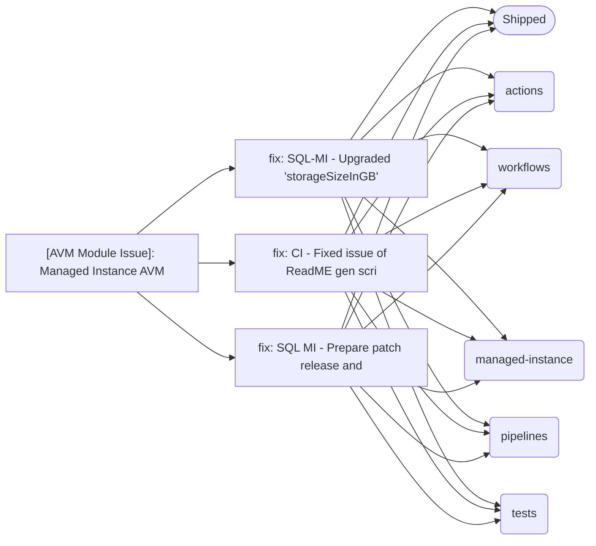

*landed in 18 days · 4 reviewers · 6 contributors · 3 review rounds · reopened 2×*

Outcome **shipped**; PRs: [#7418](https://github.com/Azure/bicep-registry-modules/pull/7418) (merged), [#7442](https://github.com/Azure/bicep-registry-modules/pull/7442) (merged), [#7444](https://github.com/Azure/bicep-registry-modules/pull/7444) (merged); issues: [#7344](https://github.com/Azure/bicep-registry-modules/issues/7344); code areas: 5 (`.github/actions`, `.github/workflows`, `avm/res/sql/managed-instance`, `utilities/pipelines`, `utilities/tests`)

Issue 7344 reported that the SQL Managed Instance module capped storageSizeInGB too low. The train shipped two PRs on 2026-10-02: a README-generation fix and a SQL MI patch-release preparation with clarified storage bounds. — [1](https://github.com/Azure/bicep-registry-modules/pull/7442)

- **Proposed:** The issue said the module's schema allowed a maximum storageSizeInGB of 8192 GB, so larger values failed validation even though the issue states Azure SQL Managed Instance supports up to 16384 GB. PR 7442 separately fixed Set-ModuleReadme, which referenced the wrong property when a module's tests used a 'keys' property. — [1](https://github.com/Azure/bicep-registry-modules/issues/7344), [2](https://github.com/Azure/bicep-registry-modules/pull/7444)
- **Changed:** PR 7442 corrected the README generation script and added a SQL MI change to re-trigger publishing; its feature deltas show common-types imports moving from 0.6.1 to 0.7.0 and test dependency API versions being bumped. PR 7444 clarified the storageSizeInGB description to 'from 32 to 32768 in increments of 32 GB', regenerated main.json and README, left version.json at 0.5, moved the max test's enforcedLocation from eastus to eastasia, and made the instance name in the four e2e scenarios use uniqueString(resourceGroup.id). In review, a reviewer questioned changelog entries that were duplicated or of no value to consumers, and one review comment contained a suggestion removing lines. — [1](https://github.com/Azure/bicep-registry-modules/pull/7442), [2](https://github.com/Azure/bicep-registry-modules/pull/7444)
- **Shipped:** Both PRs merged on 2026-10-02 (7442 and 7444, commits 0636922 and 4113a2a). The shipped SQL MI change is a non-behavioural source and description change plus test updates; the PR body states it does not itself publish a release. — [1](https://github.com/Azure/bicep-registry-modules/commit/063692211eca4c12b932178c16fb306c4cdd7ab7), [2](https://github.com/Azure/bicep-registry-modules/commit/4113a2a528ce0bb3dd86732ca271333bf18e087f)

### Deep train `train-pr-7250` — fix: Prevent child module deployment name conflicts across multiple modules

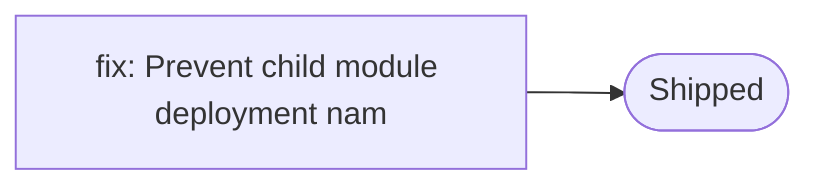

*landed in 1 days · 1 reviewers · 2 contributors · 1 review rounds*

Outcome **shipped**; PRs: [#7250](https://github.com/Azure/bicep-registry-modules/pull/7250) (merged); code areas: 7 (`avm/res/automation/automation-account`, `avm/res/network/azure-firewall`, `avm/res/network/dns-resolver`, `avm/res/network/firewall-policy`, `avm/res/network/virtual-hub`, `avm/res/network/virtual-network` …)

PR 7250 fixed child module deployment name collisions when several instances of the same resource type are deployed into one resource group at once. It was merged across seven modules. — [1](https://github.com/Azure/bicep-registry-modules/pull/7250)

- **Proposed:** The PR body says the uniqueString(subscription().id, resourceGroup().id, location) names introduced in #6316 are not unique enough for simultaneous deployments of the same type. It applies the fix already merged for operational-insights/workspace in #7249. — [1](https://github.com/Azure/bicep-registry-modules/pull/7250)
- **Changed:** The parent resource name was added to the uniqueString() inputs of child deployment names. This was done in automation-account, azure-firewall, dns-resolver, firewall-policy, virtual-hub and virtual-network, plus resource-group. For resource-group, name was added to the lock and role-assignment deployment names. The PR also bumped cross-module references (private-endpoint 0.12.1, public-ip-address 0.13.0, operations-management/solution 0.3.1) and moved the telemetry Microsoft.Resources/deployments API from 2024-03-01 to 2025-04-01 in several modules. — [1](https://github.com/Azure/bicep-registry-modules/pull/7250)
- **Shipped:** Commit 512156e merged the change. CHANGELOG entries are automation-account 0.19.2, azure-firewall 0.11.1, dns-resolver 0.5.8, firewall-policy 0.3.6, virtual-hub 0.5.1, virtual-network 0.10.1 and resource-group 0.4.4, each listing no breaking changes. — [1](https://github.com/Azure/bicep-registry-modules/commit/512156ec1495ce967fd0d9b054426016bca22425)

### Deep train `train-pr-7279` — feat: Add CMK user-assigned identity to managed identities across modules - batch 1

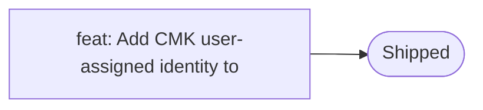

*slow to land (32 days) · 1 reviewers · 2 contributors · 1 review rounds*

Outcome **shipped**; PRs: [#7279](https://github.com/Azure/bicep-registry-modules/pull/7279) (merged); code areas: 17 (`avm/res/app-configuration/configuration-store`, `avm/res/automation/automation-account`, `avm/res/cache/redis-enterprise`, `avm/res/cognitive-services/account`, `avm/res/container-instance/container-group`, `avm/res/container-registry/registry` …)

PR 7279 (batch 1) added the customer-managed-key user-assigned identity to managed identities across 17 AVM resource modules. It was opened as ready for review in August and merged on 2026-09-16 after about five commented review rounds and an approval. — [1](https://github.com/Azure/bicep-registry-modules/pull/7279)

- **Proposed:** Make CMK handling simpler and backwards compatible by adding the CMK's user-assigned identity to each resource's managed identities and updating the Key Vault API version used for CMK references. — [1](https://github.com/Azure/bicep-registry-modules/pull/7279)
- **Changed:** In modules such as app-configuration/configuration-store the identity variable changed from !empty(managedIdentities) to also consider formattedUserAssignedIdentities, with updates to cMKKey, cMKKeyVault and cMKUserAssignedIdentity. In review, AlexanderSehr suggested updating the encr tests to drop their managedIdentities blocks and questioned removing the !isHSMManagedCMK condition because HSM tests are disabled. The author said managedIdentities was removed from only one of two CMK tests per module and added to max where otherwise untested. — [1](https://github.com/Azure/bicep-registry-modules/pull/7279)
- **Shipped:** CMK identity handling, README and CHANGELOG changes merged for 17 modules including storage-account, services such as service-bus/namespace and event-hub/namespace, and recovery-services/vault. — [1](https://github.com/Azure/bicep-registry-modules/pull/7279), [2](https://github.com/Azure/bicep-registry-modules/commit/f1f4ba28698437d9a683d68bf181341ad3547e48)

### Deep train `train-pr-7299` — feat: Create AVM Pattern Module for Function Apps

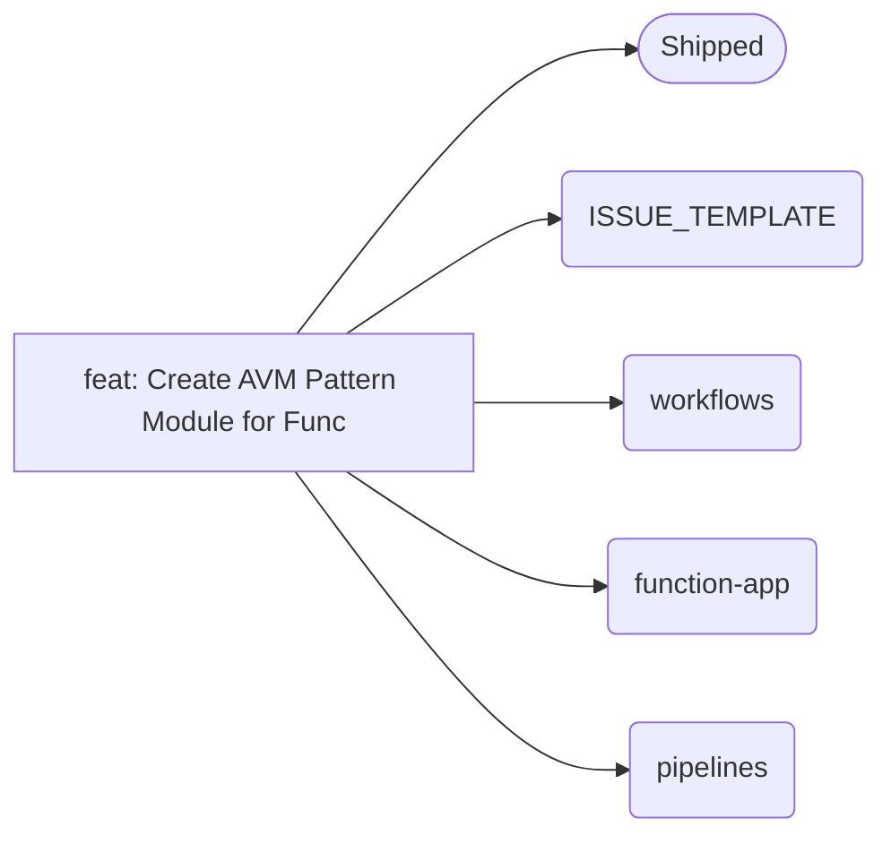

*slow to land (33 days) · 1 reviewers · 2 contributors · 1 review rounds*

Outcome **shipped**; PRs: [#7299](https://github.com/Azure/bicep-registry-modules/pull/7299) (merged); code areas: 4 (`.github/ISSUE_TEMPLATE`, `.github/workflows`, `avm/ptn/app/function-app`, `utilities/pipelines`)

PR 7299 created a new AVM pattern module for Function Apps at avm/ptn/app/function-app. It merged after a long review by AlexanderSehr with about twelve commented rounds. — [1](https://github.com/Azure/bicep-registry-modules/pull/7299)

- **Proposed:** The PR body says it fixes Azure-Verified-Modules issue 2721 and adds a pattern module for Function Apps, flagged as a backwards-compatible feature with a MINOR version bump. — [1](https://github.com/Azure/bicep-registry-modules/pull/7299)
- **Changed:** Reviewers asked for simplified tests (the defaults test should cover defaults, and non-consumer-relevant items removed) and questioned having both logAnalyticsWorkspaceName and logAnalyticsWorkspaceResourceId, recommending the resource ID and a simplified existing user-assigned identity block. The author simplified the changelog because much of it described mid-session changes rather than versions that exist. — [1](https://github.com/Azure/bicep-registry-modules/pull/7299)
- **Shipped:** The new avm/ptn/app/function-app module (README, CHANGELOG, Bicep source and e2e tests) merged in one commit; symbol moves show test dependency parameters carried over from avm/res/app/managed-environment. — [1](https://github.com/Azure/bicep-registry-modules/pull/7299), [2](https://github.com/Azure/bicep-registry-modules/commit/e598d45191e282374fa271597318b733f23c7c0e)

### Deep train `train-pr-7322` — feat: add generic module workflow

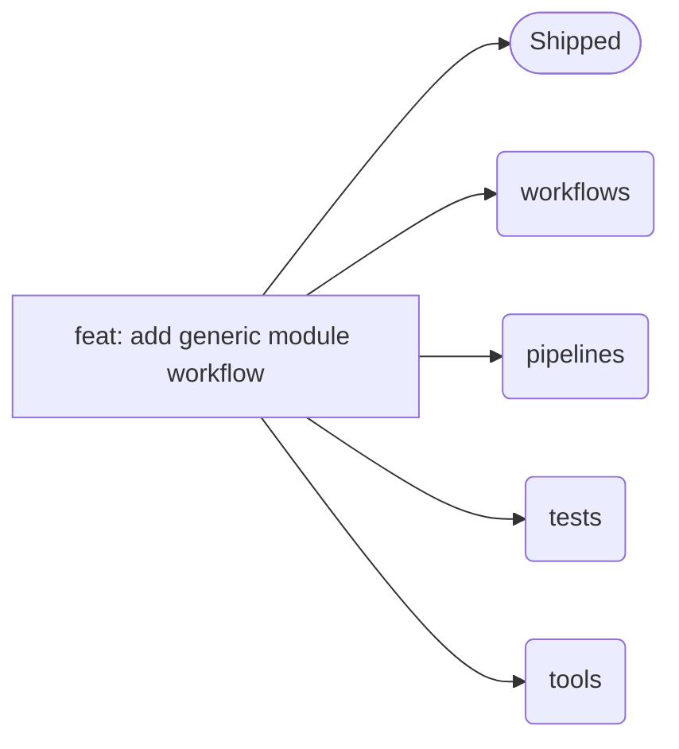

*landed in 0 days · 3 reviewers · 4 contributors · 1 review rounds*

Outcome **shipped**; PRs: [#7322](https://github.com/Azure/bicep-registry-modules/pull/7322) (merged); code areas: 4 (`.github/workflows`, `utilities/pipelines`, `utilities/tests`, `utilities/tools`)

PR 7322 added a generic module workflow, '.Module - Check and Publish', to run alongside the 217 legacy module-specific workflows during a canary period. It merged after Copilot and CodeQL review comments. — [1](https://github.com/Azure/bicep-registry-modules/pull/7322)

- **Proposed:** Provide one generic workflow that handles one or several module paths with validation, release-tag preview and gated publishing, without changing the legacy workflows. — [1](https://github.com/Azure/bicep-registry-modules/pull/7322)
- **Changed:** The workflow discovers all affected modules across a push range, uses a stable 'gci' prefix and namespaced 'queue: max' concurrency, previews release tags read-only with WhatIf, and gates real publishing behind createReleaseTag and the publish-approval environment. Review comments flagged overlap with legacy push workflows, concurrency that could drop pushed changes, a multi-commit range mismatch in release preview, and an unneeded id-token: write on publish-only. The author replied that the overlap is intentional for the canary period and that legacy workflows have zero final diff. — [1](https://github.com/Azure/bicep-registry-modules/pull/7322)
- **Shipped:** The generic workflow, its separate validated-publish and publish-only workflows, tag logic and AVM toggle/rerun/issue tooling merged under .github/workflows, utilities/pipelines, utilities/tests and utilities/tools, with a new .github/workflows/README.md. — [1](https://github.com/Azure/bicep-registry-modules/pull/7322), [2](https://github.com/Azure/bicep-registry-modules/commit/96a1dcb69b9bbb9c56638c4f5c457914d3e8bd21)

### Deep train `train-pr-7339` — feat: support GitHub secrets and variables for CI test parameters

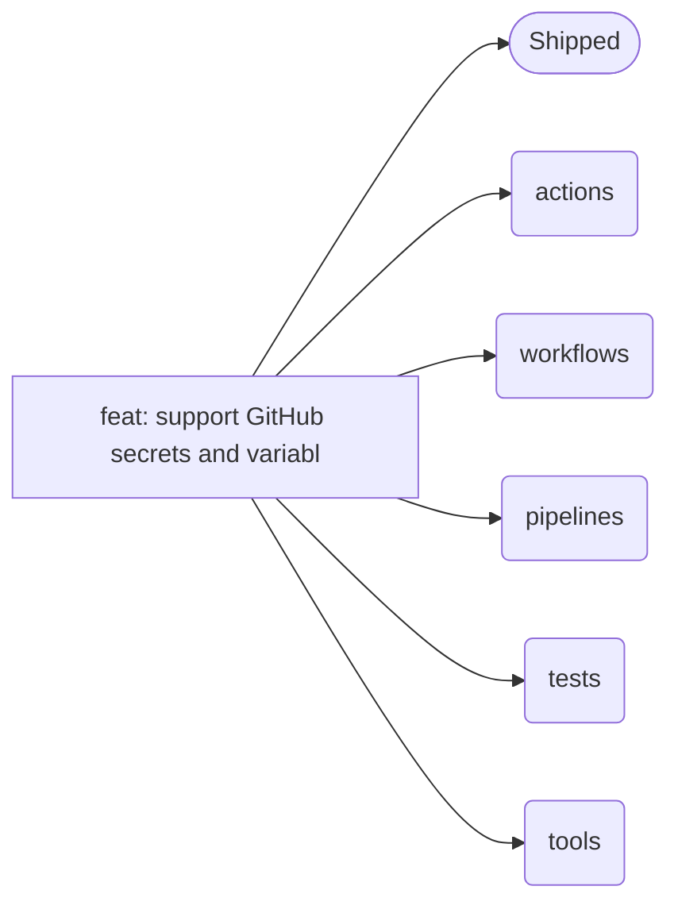

*landed in 0 days · 2 reviewers · 3 contributors · 1 review rounds*

Outcome **shipped**; PRs: [#7339](https://github.com/Azure/bicep-registry-modules/pull/7339) (merged); code areas: 5 (`.github/actions`, `.github/workflows`, `utilities/pipelines`, `utilities/tests`, `utilities/tools`)

PR 7339 added GitHub Actions secrets and variables as the preferred source of extra Bicep end-to-end test parameters, keeping the CI Key Vault as a fallback. It merged after approval from jtracey93. — [1](https://github.com/Azure/bicep-registry-modules/pull/7339)

- **Proposed:** Let CI supply extra e2e test parameters from GitHub secrets and variables rather than only from the CI Key Vault. — [1](https://github.com/Azure/bicep-registry-modules/pull/7339)
- **Changed:** Names with a CI_ or CI__ prefix are matched case-insensitively to declared Bicep parameters, with precedence CI_ secret > CI__ secret > CI_ variable > CI__ variable > legacy Key Vault secret. Multiple aliases within the same winning prefix are rejected as ambiguous, and CI_KEY_VAULT_NAME is reserved for legacy vault config. The github-advanced-security bot raised CodeQL 'Excessive Secrets Exposure' alerts on toJSON(secrets) before approval. — [1](https://github.com/Azure/bicep-registry-modules/pull/7339)
- **Shipped:** The change merged touching .github/actions, .github/workflows, utilities/pipelines, utilities/tests and utilities/tools. — [1](https://github.com/Azure/bicep-registry-modules/pull/7339), [2](https://github.com/Azure/bicep-registry-modules/commit/ff91fabe4014cd2dd5b67b5ae15f8db968d92ef9)

### Deep train `train-pr-7349` — feat(metadata): backfill Bicep metadata and guard releases

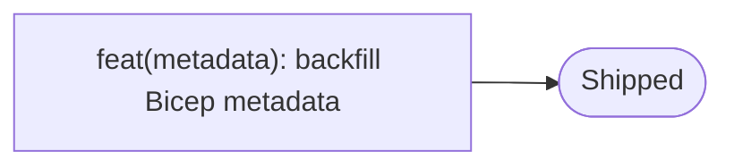

*landed in 1 days · 1 reviewers · 2 contributors · 1 review rounds*

Outcome **shipped**; PRs: [#7349](https://github.com/Azure/bicep-registry-modules/pull/7349) (merged); code areas: 226 (`.github`, `.github/workflows`, `avm/ptn/aca-lza/hosting-environment`, `avm/ptn/ai-ml/ai-foundry`, `avm/ptn/ai-platform/baseline`, `avm/ptn/alz/ama` …)

PR 7349 backfilled module-owned metadata.json files across the repository and guarded publishing workflows against metadata-only changes. It merged after one approval from jtracey93. — [1](https://github.com/Azure/bicep-registry-modules/pull/7349)

- **Proposed:** Add initial module-owned metadata directly to this repository, allow metadata review by either engineering or module owners, and keep metadata-only changes out of automatic publishing. — [1](https://github.com/Azure/bicep-registry-modules/pull/7349)
- **Changed:** The PR adds 572 metadata.json files (222 roots, 350 children) with a flat owners array and no schemaVersion or tier authored. It ends .github/CODEOWNERS with a metadata.json rule naming the engineering-owners and module-owners teams, either of which can approve, and appends !avm/**/metadata.json to all 217 per-module publishing workflows. The unpublished internal avm/ptn/ai-ml/ai-foundry/modules/project helper was excluded. — [1](https://github.com/Azure/bicep-registry-modules/pull/7349)
- **Shipped:** The metadata files, the CODEOWNERS rule and the workflow path exclusions merged in one commit. — [1](https://github.com/Azure/bicep-registry-modules/pull/7349), [2](https://github.com/Azure/bicep-registry-modules/commit/d654b23520d7ed224201c9b74b0322df269dfefc)

### Deep train `train-pr-7366` — feat: scaffold AVM module folders

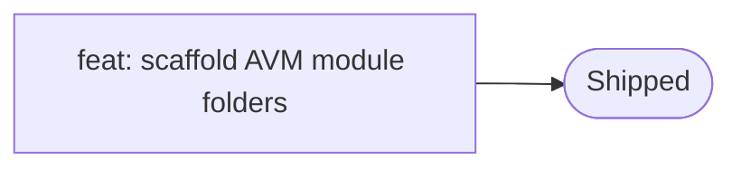

*landed in 0 days · 1 reviewers · 2 contributors · 1 review rounds*

Outcome **shipped**; PRs: [#7366](https://github.com/Azure/bicep-registry-modules/pull/7366) (merged); code areas: 49 (`avm/ptn/ai-ml/landing-zone`, `avm/ptn/app/cosmos-db-account-container-app`, `avm/ptn/app/function-app`, `avm/ptn/app/mongodb-cluster-container-app`, `avm/ptn/avd-lza/insights`, `avm/ptn/avd-lza/management-plane` …)

PR 7366 scaffolded metadata-only folders for 49 modules listed in module-list.md and merged after one approval. — [1](https://github.com/Azure/bicep-registry-modules/pull/7366)

- **Proposed:** Create folders for the 49 new modules so each has a repository-compatible metadata.json. — [1](https://github.com/Azure/bicep-registry-modules/pull/7366)
- **Changed:** Each folder contains a metadata.json with module display name, description, telemetry prefix and canonical type. The slice shows a single approved review and no revisions. — [1](https://github.com/Azure/bicep-registry-modules/pull/7366)
- **Shipped:** The scaffold folders for the 49 modules (avm/ptn, avm/res and avm/utl paths) merged in one commit. — [1](https://github.com/Azure/bicep-registry-modules/pull/7366), [2](https://github.com/Azure/bicep-registry-modules/commit/0baa81fcac8ed2840b41770e754be0aefc6daf6b)

### Deep train `train-pr-7367` — fix(avm): backfill owners and shorten telemetry prefixes on scaffolded metadata

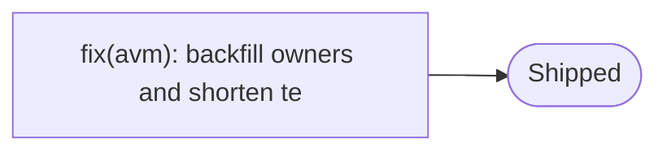

*landed in 0 days · 1 reviewers · 2 contributors · 1 review rounds*

Outcome **shipped**; PRs: [#7367](https://github.com/Azure/bicep-registry-modules/pull/7367) (merged); code areas: 47 (`avm/ptn/ai-ml/landing-zone`, `avm/ptn/app/cosmos-db-account-container-app`, `avm/ptn/app/function-app`, `avm/ptn/app/mongodb-cluster-container-app`, `avm/ptn/avd-lza/insights`, `avm/ptn/avd-lza/management-plane` …)

PR 7367 fixed scaffolded metadata by backfilling owners on 45 root modules and shortening telemetry prefixes. It merged after one approval. — [1](https://github.com/Azure/bicep-registry-modules/pull/7367)

- **Proposed:** The metadata-only folders omitted the owners field, which avm-module-metadata.schema.json requires on root modules, so the metadata catalog failed validation on the first affected module and could not complete a run. — [1](https://github.com/Azure/bicep-registry-modules/pull/7367)
- **Changed:** Owners were taken from the Primary and Secondary Module Owner columns of the Bicep module CSVs in Azure/Azure-Verified-Modules, storing only individual GitHub handles, primary first, as the existing 222 metadata files do. The PR body states every handle was verified to resolve on GitHub. — [1](https://github.com/Azure/bicep-registry-modules/pull/7367)
- **Rejected:** No team handles were added, because the PR body says no metadata file in the repo stores one. — [1](https://github.com/Azure/bicep-registry-modules/pull/7367)
- **Shipped:** Owners backfill and telemetry-prefix changes on the scaffolded metadata files merged in one commit. — [1](https://github.com/Azure/bicep-registry-modules/pull/7367), [2](https://github.com/Azure/bicep-registry-modules/commit/141f70db13b5bb86cc193d0e18bb5cb866e07da2)

### Deep train `train-pr-7371` — fix(metadata): correct moduleDisplayName drift across 576 modules

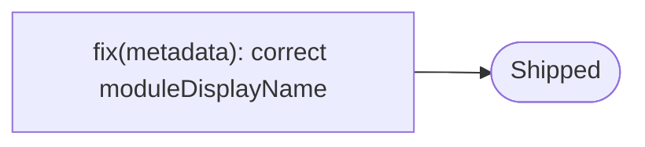

*landed in 0 days · 0 reviewers · 1 contributors*

Outcome **shipped**; PRs: [#7371](https://github.com/Azure/bicep-registry-modules/pull/7371) (merged); code areas: 242 (`avm/ptn/aca-lza/hosting-environment`, `avm/ptn/ai-ml/ai-foundry`, `avm/ptn/ai-ml/landing-zone`, `avm/ptn/ai-platform/baseline`, `avm/ptn/alz/ama`, `avm/ptn/alz/empty` …)

PR 7371 reset moduleDisplayName in metadata.json for 576 AVM modules to their canonical values. It merged without recorded reviews. — [1](https://github.com/Azure/bicep-registry-modules/pull/7371)

- **Proposed:** The display names had drifted from the canonical names in BicepResourceModules.csv and BicepPatternModules.csv. — [1](https://github.com/Azure/bicep-registry-modules/pull/7371)
- **Changed:** Each of 576 files had exactly one line changed to the canonical value from an inventory of 579 drifted rows; three modules already had the canonical value and were left alone. The PR body reports all files parse as JSON and each new value was checked against the inventory. — [1](https://github.com/Azure/bicep-registry-modules/pull/7371)
- **Shipped:** The moduleDisplayName corrections merged in one commit; only that field was touched. — [1](https://github.com/Azure/bicep-registry-modules/pull/7371), [2](https://github.com/Azure/bicep-registry-modules/commit/0fde2cff4f9d07898b5e2ba6569d08d9bbf120d7)

### Deep train `train-pr-7373` — fix(metadata): reconcile catalog description drift across 606 modules


*landed in 0 days · 0 reviewers · 1 contributors*

Outcome **shipped**; PRs: [#7373](https://github.com/Azure/bicep-registry-modules/pull/7373) (merged); code areas: 267 (`avm/ptn/aca-lza/hosting-environment`, `avm/ptn/ai-ml/ai-foundry`, `avm/ptn/ai-ml/landing-zone`, `avm/ptn/ai-platform/baseline`, `avm/ptn/alz/ama`, `avm/ptn/alz/empty` …)

PR 7373 reconciled moduleDescription in metadata.json across 606 modules to match the AVM catalog CSV descriptions. It merged without recorded reviews. — [1](https://github.com/Azure/bicep-registry-modules/pull/7373)

- **Proposed:** Generated catalog-description drift needed removing so the tools workflow report surfaces only genuine CSV errors. — [1](https://github.com/Azure/bicep-registry-modules/pull/7373)
- **Changed:** Before-values came from the tools workflow artifact CSVs (resource, pattern and utility), matched by ModuleName. The PR body says every changed file was diffed to confirm only moduleDescription differs, and no CSV files were modified. — [1](https://github.com/Azure/bicep-registry-modules/pull/7373)
- **Shipped:** Description updates for 537 resource, 67 pattern and 2 utility modules (606 files) merged in one commit. — [1](https://github.com/Azure/bicep-registry-modules/pull/7373), [2](https://github.com/Azure/bicep-registry-modules/commit/2f7a0d23e0b2ec91df9d54c097fa1bc9ee2db2ab)

### Deep train `train-pr-7375` — fix(metadata): restore abbreviated telemetryIdPrefix on scaffolded modules

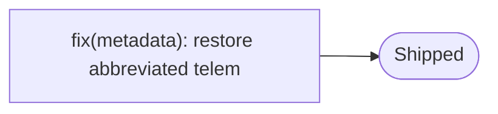

*landed in 0 days · 0 reviewers · 1 contributors*

Outcome **shipped**; PRs: [#7375](https://github.com/Azure/bicep-registry-modules/pull/7375) (merged); code areas: 40 (`avm/ptn/ai-ml/landing-zone`, `avm/ptn/app/cosmos-db-account-container-app`, `avm/ptn/app/function-app`, `avm/ptn/app/mongodb-cluster-container-app`, `avm/ptn/avd-lza/insights`, `avm/ptn/avd-lza/management-plane` …)

PR 7375 restored abbreviated telemetryIdPrefix values on 40 scaffolded metadata-only modules. It merged without recorded reviews. — [1](https://github.com/Azure/bicep-registry-modules/pull/7375)

- **Proposed:** The scaffolding in #7366 had derived fully hyphenated prefixes from module paths instead of the existing abbreviated convention, which would cause a telemetryIdPrefix diff in the next Module Metadata Catalog Sync run in the tools repo. — [1](https://github.com/Azure/bicep-registry-modules/pull/7375)
- **Changed:** Prefixes were reset to the historic abbreviated values from the AVM catalog CSVs, for example 46d3xbcp.ptn.ai-ml-landing-zone became 46d3xbcp.ptn.aiml-lz. The PR body says none of the modules has published Bicep code, so shipped telemetry is unchanged. — [1](https://github.com/Azure/bicep-registry-modules/pull/7375)
- **Shipped:** Updated telemetryIdPrefix values in the metadata of the 40 scaffold modules merged in one commit. — [1](https://github.com/Azure/bicep-registry-modules/pull/7375), [2](https://github.com/Azure/bicep-registry-modules/commit/0195cf769ed5b97e112037a6cf95bbd0df0cc02b)

### Deep train `train-pr-7378` — feat: Replace generated CODEOWNERS with metadata-driven reviewer routing

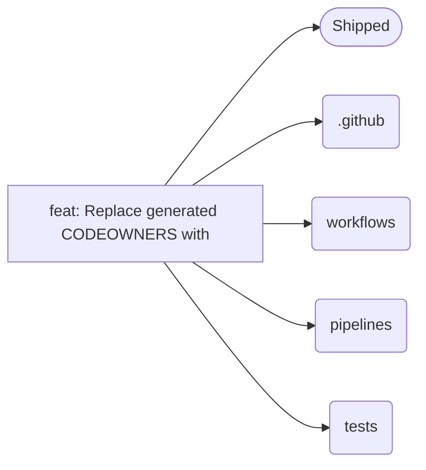

*landed in 1 days · 0 reviewers · 1 contributors*

Outcome **shipped**; PRs: [#7378](https://github.com/Azure/bicep-registry-modules/pull/7378) (merged); code areas: 4 (`.github`, `.github/workflows`, `utilities/pipelines`, `utilities/tests`)

PR 7378 replaced the generated per-module CODEOWNERS model with metadata-driven reviewer routing, with the routing automation re-homed in Azure/azure-verified-modules-tools. It merged on 2026-09-23 as a pure removal. — [1](https://github.com/Azure/bicep-registry-modules/pull/7378)

- **Proposed:** Approval rights should come from repository permissions alone, with only the people and teams listed in each module's metadata.json notified through a review request. The PR body says the original routing workflow ran in this repository and needed AVM GitHub App credentials. — [1](https://github.com/Azure/bicep-registry-modules/pull/7378)
- **Changed:** The PR body says the routing workflow was first triggered by pull_request_target, then reworked to a scheduled sweep, and finally moved to the tools repo so no AVM GitHub App credentials remain here. All four workflows that needed AVM_APP_CLIENT_ID / AVM_APP_PRIVATE_KEY were removed. The slice shows no review rounds. — [1](https://github.com/Azure/bicep-registry-modules/pull/7378)
- **Shipped:** A single commit merged the removal (+61 / -2,782 per the PR body) touching .github, .github/workflows, utilities/pipelines and utilities/tests; the routing implementation lives in the tools repo. — [1](https://github.com/Azure/bicep-registry-modules/pull/7378), [2](https://github.com/Azure/bicep-registry-modules/commit/072801be50977affd8debc25c6dd40b7ca2a2211)

### Deep train `train-pr-7380` — feat: index updates 22092026

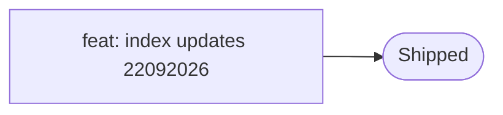

*landed in 0 days · 1 reviewers · 2 contributors · 1 review rounds*

Outcome **shipped**; PRs: [#7380](https://github.com/Azure/bicep-registry-modules/pull/7380) (merged); code areas: 28 (`.github/ISSUE_TEMPLATE`, `.github/workflows`, `avm/ptn/ai-ml/ai-foundry`, `avm/ptn/sa/chat-with-your-data`, `avm/ptn/sa/content-processing`, `avm/ptn/sa/conversation-knowledge-mining` …)

PR 7380 was an index update dated 22 September 2026 that merged after approval from jaredfholgate ('LGTM'). — [1](https://github.com/Azure/bicep-registry-modules/pull/7380)

- **Proposed:** The PR title and body say only 'index updates 22092026'; the slice states no further problem statement. — [1](https://github.com/Azure/bicep-registry-modules/pull/7380)
- **Changed:** The feature deltas show DEPRECATED.md and CHANGELOG.md/README.md changes added to six avm/ptn/sa modules and ORPHANED.md files added with README changes to modules such as avm/res/compute/availability-set, proximity-placement-group, dev-center/network-connection and dev-center/project. The commit also touched .github/ISSUE_TEMPLATE and .github/workflows. — [1](https://github.com/Azure/bicep-registry-modules/pull/7380)
- **Shipped:** Deprecation and orphan markers plus README and CHANGELOG updates for the listed modules merged in one commit. — [1](https://github.com/Azure/bicep-registry-modules/pull/7380), [2](https://github.com/Azure/bicep-registry-modules/commit/a2e20b1981c31420c957834fafb97c81806c63f3)

### Deep train `train-pr-7383` — fix: retire ORPHANED.md markers in favor of metadata ownership

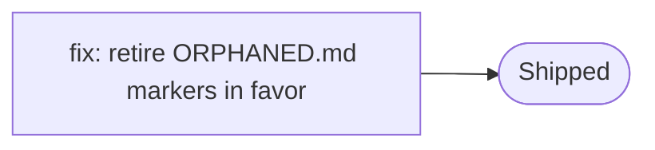

*landed in 1 days · 1 reviewers · 2 contributors · 1 review rounds*

Outcome **shipped**; PRs: [#7383](https://github.com/Azure/bicep-registry-modules/pull/7383) (merged); code areas: 27 (`avm/ptn/network/hub-networking`, `avm/res/analysis-services/server`, `avm/res/compute/availability-set`, `avm/res/compute/proximity-placement-group`, `avm/res/desktop-virtualization/application-group`, `avm/res/desktop-virtualization/host-pool` …)

PR 7383 retired ORPHANED.md markers so orphaning and adoption only require changing the owners array in a family's root metadata.json. It merged after approval from jtracey93. — [1](https://github.com/Azure/bicep-registry-modules/pull/7383)

- **Proposed:** The old compliance assertion compared marker files with owner handles from the public module index, which can lag an approved metadata change, as a network-connection validation failure showed. — [1](https://github.com/Azure/bicep-registry-modules/pull/7383)
- **Changed:** Get-ModuleList.ps1 now resolves ownership from validated root metadata, including inherited child ownership and team handles. The PR was rebased on 2026-09-23 after #7389 removed the obsolete assertion, and the retired assertion is not reintroduced since the metadata gate enforces ownership validity. A reviewer asked whether to later add badges that look up status from the index, and the author said it could go on the backlog. — [1](https://github.com/Azure/bicep-registry-modules/pull/7383)
- **Rejected:** The old marker-versus-index compliance assertion was removed and explicitly not reintroduced or duplicated. — [1](https://github.com/Azure/bicep-registry-modules/pull/7383)
- **Shipped:** ORPHANED.md files were dropped and README files updated across about two dozen modules, with changes in utilities/pipelines and utilities/tests. — [1](https://github.com/Azure/bicep-registry-modules/pull/7383), [2](https://github.com/Azure/bicep-registry-modules/commit/0a2689ec06ca1d908bc722f2d9080d8ec07cfb3e)

### Deep train `train-pr-7399` — refactor(avm): source telemetry prefixes from module metadata

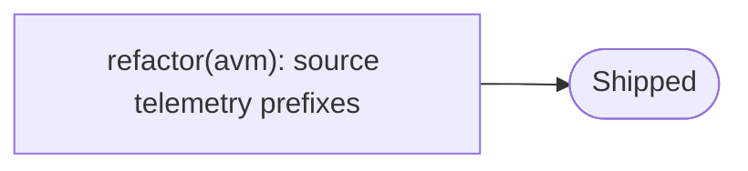

*landed in 0 days · 0 reviewers · 1 contributors*

Outcome **shipped**; PRs: [#7399](https://github.com/Azure/bicep-registry-modules/pull/7399) (merged); code areas: 223 (`avm/ptn/aca-lza/hosting-environment`, `avm/ptn/ai-ml/ai-foundry`, `avm/ptn/ai-platform/baseline`, `avm/ptn/alz/ama`, `avm/ptn/alz/empty`, `avm/ptn/app-service-lza/hosting-environment` …)

PR 7399 refactored AVM modules to source telemetry prefixes from their adjacent metadata.json. It merged without recorded reviews. — [1](https://github.com/Azure/bicep-registry-modules/pull/7399)

- **Proposed:** Telemetry prefixes should come from module metadata rather than being hard-coded in each main.bicep. — [1](https://github.com/Azure/bicep-registry-modules/pull/7399)
- **Changed:** 542 telemetry-implementing modules now use var telemetryIdPrefix = loadJsonContent('metadata.json', 'telemetryIdPrefix') and name their avmTelemetry deployment from it, with 546 main.json files regenerated. The scaffold and compliance checks were updated, and four source/metadata discrepancies (document-knowledge-mining, devcenter, network-connection, project) were reconciled to the published index identifiers, changing those four deployment names. — [1](https://github.com/Azure/bicep-registry-modules/pull/7399)
- **Rejected:** Module versions and per-module changelogs were deliberately left unchanged for this mechanical backfill. — [1](https://github.com/Azure/bicep-registry-modules/pull/7399)
- **Shipped:** The metadata-driven telemetry prefix change merged in one commit, with 543 changed avmTelemetry resources and 543 added telemetryIdPrefix variables in the deltas. — [1](https://github.com/Azure/bicep-registry-modules/pull/7399), [2](https://github.com/Azure/bicep-registry-modules/commit/65c433240fa4b6cd25f2d03286884139436dfea8)

### Deep train `train-pr-7403` — fix(telemetry): backfill unique Bicep module prefixes

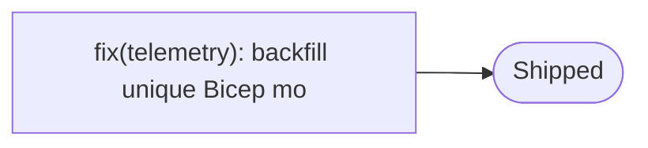

*landed in 0 days · 1 reviewers · 2 contributors · 1 review rounds*

Outcome **shipped**; PRs: [#7403](https://github.com/Azure/bicep-registry-modules/pull/7403) (merged); code areas: 269 (`avm/ptn/aca-lza/hosting-environment`, `avm/ptn/ai-ml/ai-foundry`, `avm/ptn/ai-ml/landing-zone`, `avm/ptn/ai-platform/baseline`, `avm/ptn/alz/ama`, `avm/ptn/alz/empty` …)

PR 7403 backfilled unique Bicep module telemetry prefixes by rotating all 608 existing current IDs with the merged authoring generator. It merged after approval from jtracey93. — [1](https://github.com/Azure/bicep-registry-modules/pull/7403)

- **Proposed:** Telemetry prefixes needed to be unique per module and generated in the form 46d3xbcp.<res|ptn|utl>.<seven lowercase hex>. — [1](https://github.com/Azure/bicep-registry-modules/pull/7403)
- **Changed:** The scaffolding requests prefixes from Avm.Authoring New-AvmTelemetryIdPrefix and fails with install guidance when it is unavailable, and each previous ID is preserved under alternativeTelemetryIdPrefixes. 543 telemetry-bearing main.json templates were regenerated, and take(..., 64) wrappers were removed from 32 telemetry deployment names because their maximum length is now 34 characters. — [1](https://github.com/Azure/bicep-registry-modules/pull/7403)
- **Shipped:** The new prefixes, regenerated templates and the 32 deployment-name simplifications merged in one commit across 269 code areas. — [1](https://github.com/Azure/bicep-registry-modules/pull/7403), [2](https://github.com/Azure/bicep-registry-modules/commit/063eb890ad676ffb7202490b39b2500d0e12645e)

### Deep train `train-pr-7406` — chore: deprecate legacy modules directory

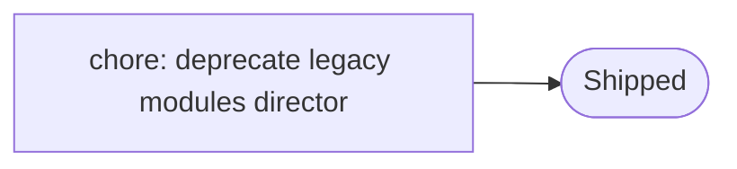

*landed in 0 days · 1 reviewers · 2 contributors · 1 review rounds*

Outcome **shipped**; PRs: [#7406](https://github.com/Azure/bicep-registry-modules/pull/7406) (merged); code areas: 15 (`modules/ai`, `modules/app`, `modules/authorization`, `modules/azure-gaming`, `modules/compute`, `modules/cost` …)

PR 7406 deprecated the legacy modules directory by removing its retirement and archival notice files. It merged after approval from jtracey93. — [1](https://github.com/Azure/bicep-registry-modules/pull/7406)

- **Proposed:** The PR body says the goal is to clean up documentation by removing status banners and references to past releases or replacement modules. — [1](https://github.com/Azure/bicep-registry-modules/pull/7406)
- **Changed:** The feature deltas show 129 drops under modules/, including 43 ARCHIVED.md, 43 README.md, 22 REPLACED.md and 21 RETIRED.md files. The body names ai/bing-resource, ai/cognitiveservices and app/app-configuration. — [1](https://github.com/Azure/bicep-registry-modules/pull/7406)
- **Shipped:** The notice and README files under the legacy modules directory were removed in one commit. — [1](https://github.com/Azure/bicep-registry-modules/pull/7406), [2](https://github.com/Azure/bicep-registry-modules/commit/c83bfa2063a7fe892188010b1b6aa21407f94d34)

### Deep train `train-pr-7410` — docs(avm): reconcile module README content with sources

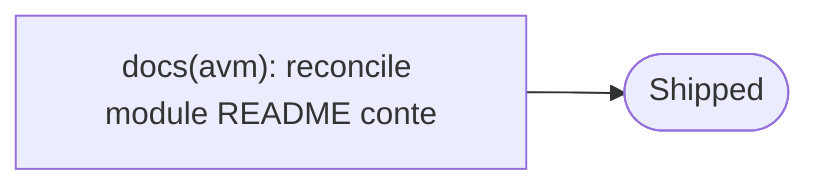

*landed in 1 days · 1 reviewers · 2 contributors · 1 review rounds*

Outcome **shipped**; PRs: [#7410](https://github.com/Azure/bicep-registry-modules/pull/7410) (merged); code areas: 13 (`avm/ptn/app/iaas-vm-cosmosdb-tier4`, `avm/ptn/dev-ops/cicd-agents-and-runners`, `avm/ptn/network/virtual-wan`, `avm/res/compute/virtual-machine`, `avm/res/container-registry/registry`, `avm/res/db-for-my-sql/flexible-server` …)

PR 7410 reconciled checked-in AVM README content with the source modules and examples. It merged after approval from jtracey93. — [1](https://github.com/Azure/bicep-registry-modules/pull/7410)

- **Proposed:** Some READMEs had wrong H1 resource types, placeholder example values and stale tables compared with the module sources. — [1](https://github.com/Azure/bicep-registry-modules/pull/7410)
- **Changed:** Four child-module H1 types were corrected to the canonicalType, placeholders such as VM imageReference.sku and Container Registry trustPolicyStatus were replaced with source literals, and the Virtual WAN README now lists all ten actual avm-common-types references. The PR body says no Bicep, templates, metadata, tests, generator or CI changed. — [1](https://github.com/Azure/bicep-registry-modules/pull/7410)
- **Shipped:** README.md changes across 12 module areas, such as virtual-wan, compute/virtual-machine, container-registry/registry and operational-insights/workspace, merged in one commit. — [1](https://github.com/Azure/bicep-registry-modules/pull/7410), [2](https://github.com/Azure/bicep-registry-modules/commit/01b1d3a9a2e38c2447a6d13554e06b95279dd84b)

### Deep train `train-pr-7416` — docs(avm): pin registry README template and preserve authored Notes

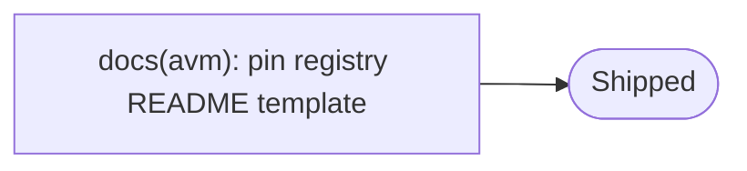

*landed in 0 days · 1 reviewers · 2 contributors · 1 review rounds*

Outcome **shipped**; PRs: [#7416](https://github.com/Azure/bicep-registry-modules/pull/7416) (merged); code areas: 38 (`avm/ptn/alz/empty`, `avm/ptn/app/container-job-toolkit`, `avm/ptn/app/iaas-vm-cosmosdb-tier4`, `avm/ptn/data/private-analytical-workspace`, `avm/ptn/deployment-script/import-image-to-acr`, `avm/ptn/lz/sub-vending` …)

PR 7416 pinned the registry README template and added preserved Notes sidecars without regenerating any READMEs. It merged after approval from jtracey93. — [1](https://github.com/Azure/bicep-registry-modules/pull/7416)

- **Proposed:** Registry-owned README assets needed preparing for review without switching the existing generator, regenerating module READMEs, changing CI or deploying resources. — [1](https://github.com/Azure/bicep-registry-modules/pull/7416)
- **Changed:** The root bicepconfig.json selects docs/templates/avm-readme-v1.scriban, copied byte-for-byte from tools commit 4962cd61 with a recorded SHA-256. 53 README.notes.md sidecars were added from the comparator's Notes export, each hash-checked, and one focused render with -CheckDrift wrote no module README. — [1](https://github.com/Azure/bicep-registry-modules/pull/7416)
- **Shipped:** The avm-readme-v1.scriban template and 53 README.notes.md files merged in one commit (54 added files). — [1](https://github.com/Azure/bicep-registry-modules/pull/7416), [2](https://github.com/Azure/bicep-registry-modules/commit/5da64c520c600e3347b649e6ffda311373c25a68)

### Deep train `train-pr-7454` — fix: CI - Readme generation updates to help parallization & regex issues

```mermaid
flowchart LR
    pr_7454["fix: CI - Readme generation updates to h"]
    out_train_pr_7454_a295c862(["Shipped"])
    pr_7454 --> out_train_pr_7454_a295c862
```

*landed in 0 days · 1 reviewers · 2 contributors · 1 review rounds*

Outcome **shipped**; PRs: [#7454](https://github.com/Azure/bicep-registry-modules/pull/7454) (merged); code areas: 10 (`avm/ptn/app/iaas-vm-cosmosdb-tier4`, `avm/ptn/dev-ops/cicd-agents-and-runners`, `avm/res/db-for-my-sql/flexible-server`, `avm/res/dev-test-lab/lab`, `avm/res/devices/iot-hub`, `avm/res/key-vault/vault` …)

PR 7454 fixed several CI README-generation problems and applied related module fixes. It merged on 2026-10-03 after one approval. — [1](https://github.com/Azure/bicep-registry-modules/pull/7454)

- **Proposed:** The PR body lists a regex bug where `a: 'a.b'` was detected as an object reference (affecting operational-insights/workspace and its quota parameter), an issue with RPC batches, missing handling of renamed files in the Git-Diff function, and cross-reference logic that broke when ptn modules shared a name with res modules. — [1](https://github.com/Azure/bicep-registry-modules/pull/7454)
- **Changed:** The body describes fixing the regex, RPC-batch handling and cross-reference logic, adding support for `R` (moved/renamed) files in the Git-Diff function, correcting diverse folder paths, and deprecating dev-test-labs/lab/secret because the API no longer supports it. The author ran Set-AVMModule recursively over all modules with no further suggested changes. — [1](https://github.com/Azure/bicep-registry-modules/pull/7454)
- **Shipped:** Merged 2026-10-03 as commit 574f7d7. Feature deltas show README and CHANGELOG changes in modules including db-for-my-sql/flexible-server (advanced-threat-protection renamed to advanced-threat-protection-setting), dev-test-lab/lab, devices/iot-hub, and two ptn modules. — [1](https://github.com/Azure/bicep-registry-modules/commit/574f7d7184a2541e5eb6e7ea3c3e5b80ab19488a)

### Deep train `train-pr-7458` — fix(ci): look up built-in provider principals in test fixtures

```mermaid
flowchart LR
    pr_7458["fix(ci): look up built-in provider princ"]
    out_train_pr_7458_df3fa2f3(["Shipped"])
    pr_7458 --> out_train_pr_7458_df3fa2f3
```

*landed in 8 days · 0 reviewers · 1 contributors*

Outcome **shipped**; PRs: [#7458](https://github.com/Azure/bicep-registry-modules/pull/7458) (merged); code areas: 9 (`avm/res/azure-stack-hci/cluster`, `avm/res/azure-stack-hci/logical-network`, `avm/res/azure-stack-hci/marketplace-gallery-image`, `avm/res/azure-stack-hci/network-interface`, `avm/res/azure-stack-hci/virtual-hard-disk`, `avm/res/azure-stack-hci/virtual-machine-instance` …)

PR 7458 replaced tenant-specific service-principal object IDs in CI test fixtures with Microsoft Graph lookups. It merged on 2026-10-11 with no recorded review. — [1](https://github.com/Azure/bicep-registry-modules/pull/7458)

- **Proposed:** The PR body says nine modules outside the live diff of PR 7374 relied on three tenant-specific built-in service-principal object-ID CI inputs, and asks to look them up by stable application ID instead. — [1](https://github.com/Azure/bicep-registry-modules/pull/7458)
- **Changed:** Per the body, 20 test entrypoints now use Graph `existing` lookups via the root microsoftGraphV1 extension and pass the resolved `.id` to the unchanged dependency or module parameter. Feature deltas show, for example in azure-stack-hci/cluster, a new optional builtInServicePrincipalObjectId parameter and an `existing` hciResourceProvider Microsoft.Graph/servicePrincipals resource replacing the required hciResourceProviderObjectId parameter. — [1](https://github.com/Azure/bicep-registry-modules/pull/7458)
- **Shipped:** Merged 2026-10-11 as commit 063ef55, touching test fixtures for dev-ops-infrastructure/pool, the azure-stack-hci modules, hybrid-container-service/provisioned-cluster-instance and kubernetes-runtime/load-balancer. The body states public module interfaces, versions, roles and locations are unchanged. — [1](https://github.com/Azure/bicep-registry-modules/commit/063ef550c5b61b46eab222f05b30693dacaf8bc9)

### Deep train `train-pr-7464` — fix(ci): consolidate retry, cleanup and shared tooling fixes

```mermaid
flowchart LR
    pr_7464["fix(ci): consolidate retry, cleanup and "]
    out_train_pr_7464_ef675f6a(["Shipped"])
    pr_7464 --> out_train_pr_7464_ef675f6a
```

*landed in 1 days · 1 reviewers · 2 contributors · 1 review rounds*

Outcome **shipped**; PRs: [#7464](https://github.com/Azure/bicep-registry-modules/pull/7464) (merged); code areas: 6 (`.github/actions`, `.github/workflows`, `.required-features.json`, `utilities/e2e-template-assets`, `utilities/pipelines`, `utilities/tests`)

PR 7464 consolidated shared CI retry, cleanup and tooling fixes into one reviewed change. It merged on 2026-10-06 after one approval. — [1](https://github.com/Azure/bicep-registry-modules/pull/7464)

- **Proposed:** The body says it repairs shared cleanup and retry failures seen in a specific CI run, and is a consolidated tooling review combining the Cosmos classifier (PR 7465), the AKS classifier (PR 7467) and the twelve-file non-avm slice of PR 7374. — [1](https://github.com/Azure/bicep-registry-modules/pull/7464)
- **Changed:** The body describes a missing-preflight-child rule that omits cleanup only for a failed parent's unique failed Create with matching preflight evidence and an exact 404 DeploymentNotFound, and an existing-Graph-lookup rule for ID-less successful Creates. It states the twelve transferred blobs match source commit 3eb4712 and that there are no avm/ differences from main. Feature deltas show the azureStackHCIClusterPreqs template's Key Vault resources moving from API 2023-07-01 to 2026-02-01. — [1](https://github.com/Azure/bicep-registry-modules/pull/7464)
- **Shipped:** Merged 2026-10-06 as commit a7edc52, changing .github actions and workflows, .required-features.json, utilities/pipelines, utilities/tests and e2e template assets. — [1](https://github.com/Azure/bicep-registry-modules/commit/a7edc5227f21bcb9869736150e73f393d08e3a2e)

### Deep train `train-pr-7518` — feat(ci): register required resource providers before e2e tests

```mermaid
flowchart LR
    pr_7518["feat(ci): register required resource pro"]
    out_train_pr_7518_bef907c3(["Shipped"])
    pr_7518 --> out_train_pr_7518_bef907c3
    area__github_actions_8ff16826("actions")
    area__required_resource_provi_734a0a6b(".required-resource-providers.json")
    area_utilities_pipelines_41a540c7("pipelines")
    area_utilities_tests_666b7a91("tests")
    pr_7518 --> area__github_actions_8ff16826
    pr_7518 --> area__required_resource_provi_734a0a6b
    pr_7518 --> area_utilities_pipelines_41a540c7
    pr_7518 --> area_utilities_tests_666b7a91
```

*landed in 0 days · 0 reviewers · 1 contributors*

Outcome **shipped**; PRs: [#7518](https://github.com/Azure/bicep-registry-modules/pull/7518) (merged); code areas: 4 (`.github/actions`, `.required-resource-providers.json`, `utilities/pipelines`, `utilities/tests`)

PR 7518 added a CI mechanism to register required Azure resource providers before e2e tests. It merged on 2026-10-11 with no recorded review. — [1](https://github.com/Azure/bicep-registry-modules/pull/7518)

- **Proposed:** The body proposes an optional repository-root .required-resource-providers.json, in the same format as .required-features.json, listing provider namespaces per module path, with avm/res/hybrid-container-service/provisioned-cluster-instance as the first consumer. — [1](https://github.com/Azure/bicep-registry-modules/pull/7518)
- **Changed:** The deployment action registers providers right after feature registration and before token replacement, validation or deployment. It skips registered providers, waits on existing Registering operations, registers NotRegistered/Unregistered ones once, and fails explicitly on invalid declarations, identity mismatches, approval-required or unknown states, errors and timeouts. Missing or unrelated declarations and WhatIf are no-ops without Azure calls. — [1](https://github.com/Azure/bicep-registry-modules/pull/7518)
- **Shipped:** Merged 2026-10-11 as commit f006e66, touching .github/actions, .required-resource-providers.json, utilities/pipelines and utilities/tests. The initial consumer is avm/res/hybrid-container-service/provisioned-cluster-instance with 13 prerequisites. — [1](https://github.com/Azure/bicep-registry-modules/commit/f006e66bf04bbbec7b618e0eba22742558266946)

### Deep train `train-pr-7525` — feat(ci): reserve Azure Local test subscriptions and prepare shared fixtures

```mermaid
flowchart LR
    pr_7525["feat(ci): reserve Azure Local test subsc"]
    out_train_pr_7525_1dc1aa85(["Shipped"])
    pr_7525 --> out_train_pr_7525_1dc1aa85
```

*landed in 0 days · 1 reviewers · 2 contributors · 1 review rounds*

Outcome **shipped**; PRs: [#7525](https://github.com/Azure/bicep-registry-modules/pull/7525) (merged); code areas: 13 (`.github/actions`, `.github/workflows`, `.reserved-test-subscriptions.json`, `avm/res/azure-stack-hci/cluster`, `avm/res/azure-stack-hci/logical-network`, `avm/res/azure-stack-hci/marketplace-gallery-image` …)

PR 7525 added source support for a reserved Azure Local test environment with shared fixtures, without activating it. It merged on 2026-10-13 after repeated ready-for-review cycles and CodeQL comments. — [1](https://github.com/Azure/bicep-registry-modules/pull/7525)

- **Proposed:** The body asks for reserved test subscriptions for Azure Local modules and shared fixture infrastructure so tests need not rebuild all dependencies cold. — [1](https://github.com/Azure/bicep-registry-modules/pull/7525)
- **Changed:** The body describes partitioning the subscription pool by an optional tag and seven module-root mappings in .reserved-test-subscriptions.json, failing before allocation on malformed or missing reserved pools. It adds a manual preparation workflow, serializes preparation, tests and cleanup on the shared environment, and reuses shared dependencies in fourteen non-cluster fixtures while keeping cold paths. Feature deltas show new optional test parameters described as validated persistent dependencies from reserved Azure Local CI, and a new test-key-vault.bicep template. Review activity was three bot reviews; the shown comments are CodeQL 'Excessive Secrets Exposure' warnings about toJSON(secrets). — [1](https://github.com/Azure/bicep-registry-modules/pull/7525)
- **Shipped:** Merged 2026-10-13 as commit 806ee4c, changing workflows and actions, .reserved-test-subscriptions.json, the azure-stack-hci and hybrid-container-service test fixtures, and utilities/e2e-template-assets. The slice shows no human review before merge. — [1](https://github.com/Azure/bicep-registry-modules/commit/806ee4cc0261d25acc351c1f5b9f7e30e310b8e2)

**Mention trains** — one line each:

- `train-issue-2422` — [[Bug Report]: virtual_machine enableAcceleratedNetworking setting conlict?](https://github.com/Azure/bicep-registry-modules/issues/2422) — shipped (2 PR(s))
- `train-issue-6695` — [[AVM Module Issue]: Add suppport for existing vnet linking to ipam pool](https://github.com/Azure/bicep-registry-modules/issues/6695) — shipped (1 PR(s))
- `train-issue-6736` — [Remove the `TODO` section from t he SUPPORT.md file](https://github.com/Azure/bicep-registry-modules/issues/6736) — shipped (1 PR(s))
- `train-issue-6927` — [[AVM Module Issue]: network/natGateways resource name is documented as 'Bastion'](https://github.com/Azure/bicep-registry-modules/issues/6927) — shipped (1 PR(s))
- `train-issue-6990` — [[AVM Module Issue]: Unable to bypass network rules for ACR Tasks](https://github.com/Azure/bicep-registry-modules/issues/6990) — shipped (2 PR(s))
- `train-issue-7194` — [[AVM Module Issue]: identical deployment name for multiple log analytics data export rules](https://github.com/Azure/bicep-registry-modules/issues/7194) — shipped (1 PR(s))
- `train-issue-7197` — [[AVM Module Issue]: [avm/res/cognitive-services/account] Support modelProviderData for GA partner models (Anthropic Claude)](https://github.com/Azure/bicep-registry-modules/issues/7197) — shipped (1 PR(s))
- `train-issue-7270` — [[AVM Module Issue]: Static PostgreSQL configurations are not persisted by flexible-server 0.16.0](https://github.com/Azure/bicep-registry-modules/issues/7270) — shipped (1 PR(s))
- `train-issue-7284` — [[AVM Module Issue]: timeBasedImmutability parameters missing for database backup-long-term-retention-policy](https://github.com/Azure/bicep-registry-modules/issues/7284) — shipped (1 PR(s))
- `train-issue-7289` — [[AVM Module Issue]: Recovery-Services/vault softDeleteSettings vs backupConfig](https://github.com/Azure/bicep-registry-modules/issues/7289) — shipped (1 PR(s))
- `train-issue-7295` — [[AVM Module Issue]: Key Vault module should be updated to API version 2026-02-01 or later](https://github.com/Azure/bicep-registry-modules/issues/7295) — shipped (2 PR(s))
- `train-issue-7328` — [[AVM Module Issue]: web.static-sites fails when deploying private endpoint with custom private dns zone](https://github.com/Azure/bicep-registry-modules/issues/7328) — shipped (1 PR(s))
- `train-issue-7342` — [[AVM Module Issue]:](https://github.com/Azure/bicep-registry-modules/issues/7342) — shipped (2 PR(s))
- `train-issue-7345` — [[AVM Module Issue]: avm.res.insights.scheduled-query-rule missing kind SimpleLogAlert](https://github.com/Azure/bicep-registry-modules/issues/7345) — shipped (1 PR(s))
- `train-issue-7459` — [[Failed pipeline] avm.res.devices.iot-hub](https://github.com/Azure/bicep-registry-modules/issues/7459) — shipped (1 PR(s))
- `train-issue-7489` — [[AVM Module Issue]: Add MultiplePersistent to allowed values for the loadBalancerType parameter](https://github.com/Azure/bicep-registry-modules/issues/7489) — shipped (1 PR(s))
- `train-pr-7235` — [feat(`avm/res/cognitive-services/account`): extract deployments child module](https://github.com/Azure/bicep-registry-modules/pull/7235) — shipped (1 PR(s))
- `train-pr-7246` — [fix: bump github/codeql-action/upload-sarif from 4.37.3 to 4.37.4](https://github.com/Azure/bicep-registry-modules/pull/7246) — shipped (1 PR(s))
- `train-pr-7252` — [feat: Feature/Add Dynamic Data Masking Capability](https://github.com/Azure/bicep-registry-modules/pull/7252) — shipped (1 PR(s))
- `train-pr-7257` — [feat: CosmosDB - "Rebased Add SecuredByPerimeter support for Cosmos DB publicNetworkAccess- #6710"](https://github.com/Azure/bicep-registry-modules/pull/7257) — shipped (1 PR(s))
- `train-pr-7258` — [fix: bump github/codeql-action/upload-sarif from 4.37.4 to 4.37.6](https://github.com/Azure/bicep-registry-modules/pull/7258) — shipped (1 PR(s))
- `train-pr-7260` — [feat: CI - Expanded diff check to include also non-committed changes](https://github.com/Azure/bicep-registry-modules/pull/7260) — shipped (1 PR(s))
- `train-pr-7262` — [fix: Correct DDM policy condition when determining if the Data Masking capability is enabled](https://github.com/Azure/bicep-registry-modules/pull/7262) — shipped (1 PR(s))
- `train-pr-7282` — [fix: bump github/codeql-action/upload-sarif from 4.37.6 to 4.37.7](https://github.com/Azure/bicep-registry-modules/pull/7282) — shipped (1 PR(s))
- `train-pr-7288` — [docs: Remove stale model pin and dead `/AVM-Boostrap` reference from pre-flight check](https://github.com/Azure/bicep-registry-modules/pull/7288) — shipped (1 PR(s))
- `train-pr-7293` — [feat: ManagedEnvironment update and test fixes](https://github.com/Azure/bicep-registry-modules/pull/7293) — shipped (1 PR(s))
- `train-pr-7294` — [fix: bump github/codeql-action/upload-sarif from 4.37.7 to 4.37.8](https://github.com/Azure/bicep-registry-modules/pull/7294) — shipped (1 PR(s))
- `train-pr-7301` — [feat: AVM Module upgrade for Content Processing](https://github.com/Azure/bicep-registry-modules/pull/7301) — shipped (1 PR(s))
- `train-pr-7302` — [feat: Updated AVM content gen v2 modules](https://github.com/Azure/bicep-registry-modules/pull/7302) — shipped (1 PR(s))
- `train-pr-7303` — [feat: AVM Module Upgrade for Multi Agent](https://github.com/Azure/bicep-registry-modules/pull/7303) — shipped (1 PR(s))
- `train-pr-7305` — [feat: DKM avm modules updated](https://github.com/Azure/bicep-registry-modules/pull/7305) — shipped (1 PR(s))
- `train-pr-7306` — [chore: Pin GitHub Actions to full-length commit SHAs](https://github.com/Azure/bicep-registry-modules/pull/7306) — shipped (1 PR(s))
- `train-pr-7307` — [feat: AVM conversation knowledge mining update](https://github.com/Azure/bicep-registry-modules/pull/7307) — shipped (1 PR(s))
- `train-pr-7308` — [fix: bump github/codeql-action/upload-sarif from 4.37.8 to 4.37.9](https://github.com/Azure/bicep-registry-modules/pull/7308) — shipped (1 PR(s))
- `train-pr-7318` — [feat: expose disableLocalAuth and publicNetworkAccess on communication-service module](https://github.com/Azure/bicep-registry-modules/pull/7318) — shipped (1 PR(s))
- `train-pr-7319` — [chore: remove legacy teams from codeowners](https://github.com/Azure/bicep-registry-modules/pull/7319) — shipped (1 PR(s))
- `train-pr-7320` — [fix: pin composite action dependencies](https://github.com/Azure/bicep-registry-modules/pull/7320) — shipped (1 PR(s))
- `train-pr-7321` — [fix: correct PSRule action SHA](https://github.com/Azure/bicep-registry-modules/pull/7321) — shipped (1 PR(s))
- `train-pr-7323` — [feat: managed environment parameter doc](https://github.com/Azure/bicep-registry-modules/pull/7323) — shipped (1 PR(s))
- `train-pr-7336` — [ci: distribute Bicep tests across configured subscriptions](https://github.com/Azure/bicep-registry-modules/pull/7336) — shipped (1 PR(s))
- `train-pr-7337` — [fix: migrate Bicep module ownership routing](https://github.com/Azure/bicep-registry-modules/pull/7337) — shipped (1 PR(s))
- `train-pr-7340` — [fix: select first GitHub CLI executable for CI migration](https://github.com/Azure/bicep-registry-modules/pull/7340) — shipped (1 PR(s))
- `train-pr-7343` — [chore: generate per-module CODEOWNERS from module owners](https://github.com/Azure/bicep-registry-modules/pull/7343) — shipped (1 PR(s))
- `train-pr-7351` — [ci: temporarily select BAMI test variables by module path](https://github.com/Azure/bicep-registry-modules/pull/7351) — shipped (1 PR(s))
- `train-pr-7355` — [fix: PostgreSQL - Fixing failing test](https://github.com/Azure/bicep-registry-modules/pull/7355) — shipped (1 PR(s))
- `train-pr-7356` — [fix: bump github/codeql-action/upload-sarif from 4.37.9 to 4.38.0](https://github.com/Azure/bicep-registry-modules/pull/7356) — shipped (1 PR(s))
- `train-pr-7362` — [chore: mark consolidated module workflow as experimental](https://github.com/Azure/bicep-registry-modules/pull/7362) — shipped (1 PR(s))
- `train-pr-7363` — [feat: initial version code-signing-account module](https://github.com/Azure/bicep-registry-modules/pull/7363) — shipped (1 PR(s))
- `train-pr-7368` — [feat(scaffold): bootstrap valid metadata.json for new AVM modules](https://github.com/Azure/bicep-registry-modules/pull/7368) — shipped (1 PR(s))
- `train-pr-7372` — [fix(avm/res/azure-stack-hci/cluster): add phase-derived forceUpdateTag to deployment script](https://github.com/Azure/bicep-registry-modules/pull/7372) — shipped (1 PR(s))
- `train-pr-7376` — [fix(consumption/budget): resolve duplicate telemetry ID between rg-scope and sub-scope](https://github.com/Azure/bicep-registry-modules/pull/7376) — shipped (1 PR(s))
- `train-pr-7379` — [feat(metadata): require valid metadata.json for all AVM Bicep modules](https://github.com/Azure/bicep-registry-modules/pull/7379) — shipped (1 PR(s))
- `train-pr-7382` — [fix: isolate metadata validation from Bicep compilation](https://github.com/Azure/bicep-registry-modules/pull/7382) — shipped (1 PR(s))
- `train-pr-7384` — [feat(avm/res/azure-stack-hci/cluster): update API versions to latest …](https://github.com/Azure/bicep-registry-modules/pull/7384) — shipped (1 PR(s))
- `train-pr-7388` — [chore(module-list): sync AVM module dropdown [skip ci]](https://github.com/Azure/bicep-registry-modules/pull/7388) — shipped (1 PR(s))
- `train-pr-7389` — [chore: remove remaining CSV module index references](https://github.com/Azure/bicep-registry-modules/pull/7389) — shipped (1 PR(s))
- `train-pr-7396` — [chore(avm/res/azure-stack-hci/cluster): Add abhisheksharma-ops as module owner](https://github.com/Azure/bicep-registry-modules/pull/7396) — shipped (1 PR(s))
- `train-pr-7398` — [chore: remove redundant module-dropdown compliance check](https://github.com/Azure/bicep-registry-modules/pull/7398) — shipped (1 PR(s))
- `train-pr-7400` — [chore(module-list): sync AVM module dropdown [skip ci]](https://github.com/Azure/bicep-registry-modules/pull/7400) — shipped (1 PR(s))
- `train-pr-7401` — [fix(ci): skip metadata-only experimental module workflow runs](https://github.com/Azure/bicep-registry-modules/pull/7401) — shipped (1 PR(s))
- `train-pr-7402` — [feat(ci): add opt-in consolidated checks for pull requests](https://github.com/Azure/bicep-registry-modules/pull/7402) — shipped (1 PR(s))
- `train-pr-7407` — [fix: compile container job toolkit secure workspace output](https://github.com/Azure/bicep-registry-modules/pull/7407) — shipped (1 PR(s))
- `train-pr-7409` — [chore: avd owner updates](https://github.com/Azure/bicep-registry-modules/pull/7409) — shipped (1 PR(s))
- `train-pr-7411` — [fix: retry regional template validation in eligible regions](https://github.com/Azure/bicep-registry-modules/pull/7411) — shipped (1 PR(s))
- `train-pr-7413` — [fix: isolate Lab fixture names and track rejected deployment attempts](https://github.com/Azure/bicep-registry-modules/pull/7413) — shipped (1 PR(s))
- `train-pr-7415` — [fix: align conversation knowledge mining test parameters](https://github.com/Azure/bicep-registry-modules/pull/7415) — shipped (1 PR(s))
- `train-pr-7419` — [chore(module-list): sync AVM module dropdown [skip ci]](https://github.com/Azure/bicep-registry-modules/pull/7419) — shipped (1 PR(s))
- `train-pr-7420` — [chore(module-list): sync AVM module dropdown [skip ci]](https://github.com/Azure/bicep-registry-modules/pull/7420) — shipped (1 PR(s))
- `train-pr-7421` — [feat(avm/res/azure-stack-hci/cluster): update Azure Stack HCI API versions to GA 2026-10-01](https://github.com/Azure/bicep-registry-modules/pull/7421) — shipped (1 PR(s))
- `train-pr-7423` — [fix(avm/res/azure-stack-hci/logical-network): update telemetry deployment API version to 2025-04-01](https://github.com/Azure/bicep-registry-modules/pull/7423) — shipped (1 PR(s))
- `train-pr-7424` — [fix(avm/res/azure-stack-hci/virtual-hard-disk): update telemetry deployment API version to 2025-04-01](https://github.com/Azure/bicep-registry-modules/pull/7424) — shipped (1 PR(s))
- `train-pr-7425` — [fix: preserve deployment cleanup after HTTP timeouts](https://github.com/Azure/bicep-registry-modules/pull/7425) — shipped (1 PR(s))
- `train-pr-7426` — [fix(avm/res/azure-stack-hci/network-interface): update telemetry deployment API version to 2025-04-01](https://github.com/Azure/bicep-registry-modules/pull/7426) — shipped (1 PR(s))
- `train-pr-7427` — [feat(avm/res/hybrid-compute/machine): update HybridCompute API versions to 2026-07-15](https://github.com/Azure/bicep-registry-modules/pull/7427) — shipped (1 PR(s))
- `train-pr-7428` — [ci: remove per-repo AVM label synchronization workflow](https://github.com/Azure/bicep-registry-modules/pull/7428) — shipped (1 PR(s))
- `train-pr-7429` — [feat(avm/res/azure-stack-hci/virtual-machine-instance): update Arc machine API version to 2026-07-15](https://github.com/Azure/bicep-registry-modules/pull/7429) — shipped (1 PR(s))
- `train-pr-7430` — [fix(avm/res/azure-stack-hci/virtual-machine-instance): regenerate README cross-references for machine 0.6.0](https://github.com/Azure/bicep-registry-modules/pull/7430) — shipped (1 PR(s))
- `train-pr-7431` — [feat(avm/res/kubernetes/connected-cluster): update connectedClusters API version to GA 2026-05-01](https://github.com/Azure/bicep-registry-modules/pull/7431) — shipped (1 PR(s))
- `train-pr-7434` — [feat(avm/res/hybrid-compute/gateway): update gateways API version to 2026-07-15](https://github.com/Azure/bicep-registry-modules/pull/7434) — shipped (1 PR(s))
- `train-pr-7435` — [feat(avm/res/hybrid-compute/license): update licenses API version to 2026-07-15](https://github.com/Azure/bicep-registry-modules/pull/7435) — shipped (1 PR(s))
- `train-pr-7436` — [fix(test): isolate diagnostic dependency names by resource group](https://github.com/Azure/bicep-registry-modules/pull/7436) — shipped (1 PR(s))
- `train-pr-7438` — [ci(bicep): use generic validation settings](https://github.com/Azure/bicep-registry-modules/pull/7438) — shipped (1 PR(s))
- `train-pr-7439` — [feat(avm/res/hybrid-container-service/provisioned-cluster-instance): update referenced module and API versions](https://github.com/Azure/bicep-registry-modules/pull/7439) — shipped (1 PR(s))
- `train-pr-7443` — [fix: CI - Restore Azure validation error details](https://github.com/Azure/bicep-registry-modules/pull/7443) — shipped (1 PR(s))
- `train-pr-7445` — [fix: exclude generic module workflow from failed-run retries](https://github.com/Azure/bicep-registry-modules/pull/7445) — shipped (1 PR(s))
- `train-pr-7446` — [fix: handle expression-valued deployment templates](https://github.com/Azure/bicep-registry-modules/pull/7446) — shipped (1 PR(s))
- `train-pr-7447` — [fix(ci): require a second label for experimental e2e tests](https://github.com/Azure/bicep-registry-modules/pull/7447) — shipped (1 PR(s))
- `train-pr-7451` — [fix: SQL MI - Prevent test storage name collisions](https://github.com/Azure/bicep-registry-modules/pull/7451) — shipped (1 PR(s))
- `train-pr-7453` — [fix(ci): short-circuit ignored deployment jobs](https://github.com/Azure/bicep-registry-modules/pull/7453) — shipped (1 PR(s))
- `train-pr-7455` — [fix: retry regional deployments after cleanup](https://github.com/Azure/bicep-registry-modules/pull/7455) — shipped (1 PR(s))
- `train-pr-7456` — [feat(ci): register required subscription features before Bicep deployment tests](https://github.com/Azure/bicep-registry-modules/pull/7456) — shipped (1 PR(s))
- `train-pr-7457` — [fix(ci): read structured ARM deployment operation errors](https://github.com/Azure/bicep-registry-modules/pull/7457) — shipped (1 PR(s))
- `train-pr-7463` — [feat(avm/res/azure-stack-hci/virtual-machine-instance): release unpublished 0.2.0 changes as 0.3.0](https://github.com/Azure/bicep-registry-modules/pull/7463) — shipped (1 PR(s))
- `train-pr-7466` — [feat(avm/res/kubernetes-runtime/load-balancer): update connectedClusters reference and telemetry API versions](https://github.com/Azure/bicep-registry-modules/pull/7466) — shipped (1 PR(s))
- `train-pr-7470` — [fix(ci): retry region metadata request timeouts](https://github.com/Azure/bicep-registry-modules/pull/7470) — shipped (1 PR(s))
- `train-pr-7471` — [chore: Added "arjenhuitema" as the owner for the Network Security Group and …](https://github.com/Azure/bicep-registry-modules/pull/7471) — shipped (1 PR(s))
- `train-pr-7473` — [chore(module-list): sync AVM module dropdown [skip ci]](https://github.com/Azure/bicep-registry-modules/pull/7473) — shipped (1 PR(s))
- `train-pr-7478` — [fix: reconcile successful management-group deployments after HTTP 403](https://github.com/Azure/bicep-registry-modules/pull/7478) — shipped (1 PR(s))
- `train-pr-7482` — [fix: remove temporary OIDC exception flow](https://github.com/Azure/bicep-registry-modules/pull/7482) — shipped (1 PR(s))
- `train-pr-7484` — [fix(ci): initialize Pester from Avm.Authoring configuration](https://github.com/Azure/bicep-registry-modules/pull/7484) — shipped (1 PR(s))
- `train-pr-7486` — [fix(ci): consolidate regional retry, cleanup and test setup repairs](https://github.com/Azure/bicep-registry-modules/pull/7486) — shipped (1 PR(s))
- `train-pr-7487` — [fix(ci): classify bounded service retries and reuse installed modules](https://github.com/Azure/bicep-registry-modules/pull/7487) — shipped (1 PR(s))
- `train-pr-7488` — [fix(ci): restore HCI host image fallback](https://github.com/Azure/bicep-registry-modules/pull/7488) — shipped (1 PR(s))
- `train-pr-7491` — [feat(ci): add reusable HCI image builder](https://github.com/Azure/bicep-registry-modules/pull/7491) — shipped (1 PR(s))
- `train-pr-7492` — [fix(ci): consolidate deployment read, dependency and Bicep recovery](https://github.com/Azure/bicep-registry-modules/pull/7492) — shipped (1 PR(s))
- `train-pr-7493` — [fix: correct named-value canonicalType typo](https://github.com/Azure/bicep-registry-modules/pull/7493) — shipped (1 PR(s))
- `train-pr-7496` — [fix: Update Network Security Group module](https://github.com/Azure/bicep-registry-modules/pull/7496) — shipped (1 PR(s))
- `train-pr-7499` — [fix: avm/res/event-hub/namespace - preserve disabled capture configuration](https://github.com/Azure/bicep-registry-modules/pull/7499) — shipped (1 PR(s))
- `train-pr-7500` — [fix(ci): handle module initializer metadata and authorization denials](https://github.com/Azure/bicep-registry-modules/pull/7500) — shipped (1 PR(s))
- `train-pr-7505` — [feat(ci): support separate HCI build and replication regions](https://github.com/Azure/bicep-registry-modules/pull/7505) — shipped (1 PR(s))
- `train-pr-7506` — [fix(ci): tolerate missing HCI replica diagnostics](https://github.com/Azure/bicep-registry-modules/pull/7506) — shipped (1 PR(s))
- `train-pr-7507` — [fix(ci): isolate module selection to the tested PR merge](https://github.com/Azure/bicep-registry-modules/pull/7507) — shipped (1 PR(s))
- `train-pr-7512` — [chore(ci): prepare Bicep workflow migration and module identities](https://github.com/Azure/bicep-registry-modules/pull/7512) — shipped (1 PR(s))
- `train-pr-7517` — [fix(ci): consolidate deployment and package recovery](https://github.com/Azure/bicep-registry-modules/pull/7517) — shipped (1 PR(s))
- `train-pr-7531` — [fix(ci): accept registered HCI provider resource-type rows](https://github.com/Azure/bicep-registry-modules/pull/7531) — shipped (1 PR(s))
- `train-pr-7532` — [fix(ci): handle native HCI image response headers](https://github.com/Azure/bicep-registry-modules/pull/7532) — shipped (1 PR(s))
- `train-pr-7544` — [fix(ci): pin and verify Azure Local 2601 payload](https://github.com/Azure/bicep-registry-modules/pull/7544) — shipped (1 PR(s))
- `train-pr-7545` — [fix: isolate HCI deployment from generic module workflows](https://github.com/Azure/bicep-registry-modules/pull/7545) — shipped (1 PR(s))
- `train-pr-7547` — [fix: persist HCI image operation receipts privately](https://github.com/Azure/bicep-registry-modules/pull/7547) — shipped (1 PR(s))
- `train-pr-7548` — [fix: preserve HCI receipt JSON on PowerShell 7.4](https://github.com/Azure/bicep-registry-modules/pull/7548) — shipped (1 PR(s))
- `train-pr-7553` — [fix(tools): extract shared Key Vault tooling](https://github.com/Azure/bicep-registry-modules/pull/7553) — shipped (1 PR(s))
- `train-pr-7558` — [feat: add privatelink.redis.azure.net](https://github.com/Azure/bicep-registry-modules/pull/7558) — shipped (1 PR(s))
- `train-pr-7559` — [feat: split experimental Bicep registry workflows](https://github.com/Azure/bicep-registry-modules/pull/7559) — shipped (1 PR(s))
- `train-pr-7561` — [test: update subscription vending validation wiring](https://github.com/Azure/bicep-registry-modules/pull/7561) — shipped (1 PR(s))
- `train-pr-7563` — [ci: pin experimental Bicep workflows to verified tools release](https://github.com/Azure/bicep-registry-modules/pull/7563) — shipped (1 PR(s))
- `train-pr-7564` — [ci: update experimental Bicep workflow pins](https://github.com/Azure/bicep-registry-modules/pull/7564) — shipped (1 PR(s))
- `train-pr-7568` — [ci: adopt verified Bicep lint and bootstrap fixes](https://github.com/Azure/bicep-registry-modules/pull/7568) — shipped (1 PR(s))
- `train-pr-7569` — [ci: pin Bicep registry callers to verified tools commit](https://github.com/Azure/bicep-registry-modules/pull/7569) — shipped (1 PR(s))
- `train-issue-2865` — [[AVM CI Environment Issue]: Error when checking deployment status](https://github.com/Azure/bicep-registry-modules/issues/2865) — in_flight (1 PR(s))
- `train-issue-3377` — [[AVM Module Issue]: avm/res/sql/server should allow setting Microsoft.Insights/diagnosticSettings for master database](https://github.com/Azure/bicep-registry-modules/issues/3377) — in_flight (1 PR(s))
- `train-issue-3860` — [[AVM Module Issue]: 0.5.1~0.8.3 incompatible with BYO vnet PodSubnetID `container-service/managed-cluster`](https://github.com/Azure/bicep-registry-modules/issues/3860) — in_flight (1 PR(s))
- `train-issue-4794` — [[AVM Module Issue]: Unable to create a cognitive services account with multiple deployments](https://github.com/Azure/bicep-registry-modules/issues/4794) — in_flight (1 PR(s))
- `train-issue-5561` — [[AVM Module Issue]: Missing properties securityProfile sections (or securityEncryptionType) in Compute module](https://github.com/Azure/bicep-registry-modules/issues/5561) — in_flight (1 PR(s))
- `train-issue-6001` — [[AVM Module Issue]: Storage account fails while adding private endpoint with below error](https://github.com/Azure/bicep-registry-modules/issues/6001) — in_flight (1 PR(s))
- `train-issue-6167` — [[AVM Module Issue]: Disable weak cipher suites in API Management service module?](https://github.com/Azure/bicep-registry-modules/issues/6167) — in_flight (1 PR(s))
- `train-issue-6483` — [[AVM Module Issue]: subResourceWrapper.bicep lacks the use of serviceEndpoints](https://github.com/Azure/bicep-registry-modules/issues/6483) — in_flight (1 PR(s))
- `train-issue-6518` — [[AVM Module Issue]: Fine control for notification thresholds in budget](https://github.com/Azure/bicep-registry-modules/issues/6518) — in_flight (1 PR(s))
- `train-issue-6891` — [[AVM Module Issue]: Netapp account module missing site property for activeDirectory configuration](https://github.com/Azure/bicep-registry-modules/issues/6891) — in_flight (1 PR(s))
- `train-issue-6900` — [[AVM Module Issue]: subscriptions never placed unless disableSubscriptionPlacement: true](https://github.com/Azure/bicep-registry-modules/issues/6900) — in_flight (1 PR(s))
- `train-issue-6955` — [[AVM Module Issue]: Add Aspire Dashboard component support to avm/res/app/managed-environment](https://github.com/Azure/bicep-registry-modules/issues/6955) — in_flight (1 PR(s))
- `train-issue-6968` — [[AVM Module Issue]: AVM Bastion Host Module — Session Recording Storage Configuration Gap](https://github.com/Azure/bicep-registry-modules/issues/6968) — in_flight (1 PR(s))
- `train-issue-7122` — [[AVM Module Issue]: avm/res/api-management/service logger description not set in api-management deployed instance of AVM module](https://github.com/Azure/bicep-registry-modules/issues/7122) — in_flight (1 PR(s))
- `train-issue-7156` — [[AVM Module Issue]: CosmosDB - Add `enableAllVersionsAndDeletesChangeFeed` parameter/property](https://github.com/Azure/bicep-registry-modules/issues/7156) — in_flight (1 PR(s))
- `train-issue-7226` — [[AVM Module Issue]: subscriptionsLimit on product cant be set to unlimited](https://github.com/Azure/bicep-registry-modules/issues/7226) — in_flight (1 PR(s))
- `train-issue-7269` — [[AVM Module Issue]: Netapp volumeType type is missing securityStyle property even though referenced in file](https://github.com/Azure/bicep-registry-modules/issues/7269) — in_flight (1 PR(s))
- `train-issue-7278` — [[AVM Module Issue]: API management `skuCapacity` default of `3` fails deployment when `sku` is `Basic` (max capacity 2)](https://github.com/Azure/bicep-registry-modules/issues/7278) — in_flight (1 PR(s))
- `train-issue-7335` — [[AVM Module Issue]: AVM NetApp Account Snapshot Policy Does Not Support Multiple Days in weeklySchedule.day](https://github.com/Azure/bicep-registry-modules/issues/7335) — in_flight (1 PR(s))
- `train-issue-7394` — [fix(avm/res/azure-stack-hci/cluster): Validate deploymentSettings deleted before Deploy wipes validationStatus (portal 'Validate input = Unknown')](https://github.com/Azure/bicep-registry-modules/issues/7394) — in_flight (1 PR(s))
- `train-issue-7503` — [[AVM Module Issue]: Fix "configuraitons" typo in `fluxConfigurations` description](https://github.com/Azure/bicep-registry-modules/issues/7503) — in_flight (2 PR(s))
- `train-issue-7523` — [[AVM Module Issue]: avm/res/app/job - support identitySettings (identity lifecycle)](https://github.com/Azure/bicep-registry-modules/issues/7523) — in_flight (1 PR(s))
- `train-issue-7554` — [[AVM Module Issue]: Support for high performance disk configurations](https://github.com/Azure/bicep-registry-modules/issues/7554) — in_flight (1 PR(s))
- `train-pr-3810` — [ci: Introduce PSRule suppression for individual rules/resources](https://github.com/Azure/bicep-registry-modules/pull/3810) — in_flight (1 PR(s))
- `train-pr-4863` — [feat: add gh issue label logic](https://github.com/Azure/bicep-registry-modules/pull/4863) — in_flight (1 PR(s))
- `train-pr-5315` — [ci: [Test 01] Enforce test folder validation for pattern modules for both defaults and waf-aligned](https://github.com/Azure/bicep-registry-modules/pull/5315) — in_flight (1 PR(s))
- `train-pr-5316` — [ci: [Test 02] Enforce test folder validation for pattern modules for both waf-aligned only](https://github.com/Azure/bicep-registry-modules/pull/5316) — in_flight (1 PR(s))
- `train-pr-5317` — [ci: [Test 03] Enforce test folder validation for pattern modules for defaults only](https://github.com/Azure/bicep-registry-modules/pull/5317) — in_flight (1 PR(s))
- `train-pr-6168` — [feat: Re-added logic to set module version in readme](https://github.com/Azure/bicep-registry-modules/pull/6168) — in_flight (1 PR(s))
- `train-pr-6218` — [feat: Synapase - Added support for HSM](https://github.com/Azure/bicep-registry-modules/pull/6218) — in_flight (1 PR(s))
- `train-pr-6549` — [feat(ptn): Update FinOps Hub v12 pattern module](https://github.com/Azure/bicep-registry-modules/pull/6549) — in_flight (1 PR(s))
- `train-pr-6580` — [feat: new module `avm/res/app/agent` (Microsoft.App/agents)](https://github.com/Azure/bicep-registry-modules/pull/6580) — in_flight (1 PR(s))
- `train-pr-6584` — [fix(app-service-lza): correct web app kind parameter to respect OS configuration](https://github.com/Azure/bicep-registry-modules/pull/6584) — in_flight (1 PR(s))
- `train-pr-6694` — [feat: check for module existence in MAR](https://github.com/Azure/bicep-registry-modules/pull/6694) — in_flight (1 PR(s))
- `train-pr-6732` — [ci: DO NOT MERGE - Test to showcase feasibility of validation on PR](https://github.com/Azure/bicep-registry-modules/pull/6732) — in_flight (1 PR(s))
- `train-pr-6753` — [feat: module maintenance skill](https://github.com/Azure/bicep-registry-modules/pull/6753) — in_flight (1 PR(s))
- `train-pr-6761` — [test(avm/res/azure-stack-hci/marketplace-gallery-image): update test harness for 24H2 cluster](https://github.com/Azure/bicep-registry-modules/pull/6761) — in_flight (1 PR(s))
- `train-pr-6813` — [feat: add bootstrap skill](https://github.com/Azure/bicep-registry-modules/pull/6813) — in_flight (1 PR(s))
- `train-pr-6929` — [feat: Subscription Vending PTN - UMI Role Assignments absolute scopes](https://github.com/Azure/bicep-registry-modules/pull/6929) — in_flight (1 PR(s))
- `train-pr-7021` — [fix: ReadMe Gen - Fixed incorrect section reference if non-parent module](https://github.com/Azure/bicep-registry-modules/pull/7021) — in_flight (1 PR(s))
- `train-pr-7074` — [fix: remove enableAnalyticalStorage o…](https://github.com/Azure/bicep-registry-modules/pull/7074) — in_flight (1 PR(s))
- `train-pr-7075` — [feat: introduce container migration module](https://github.com/Azure/bicep-registry-modules/pull/7075) — in_flight (1 PR(s))
- `train-pr-7089` — [feat: Publish child module `avm/res/web/hosting-environment/configuration`](https://github.com/Azure/bicep-registry-modules/pull/7089) — in_flight (1 PR(s))
- `train-pr-7094` — [feat: Publish child modules of `avm/res/cache/redis-enterprise`](https://github.com/Azure/bicep-registry-modules/pull/7094) — in_flight (1 PR(s))
- `train-pr-7144` — [feat: Add contribution guidelines and module overview to documentation](https://github.com/Azure/bicep-registry-modules/pull/7144) — in_flight (1 PR(s))
- `train-pr-7165` — [fix: bump actions/checkout from 4 to 7](https://github.com/Azure/bicep-registry-modules/pull/7165) — in_flight (1 PR(s))
- `train-pr-7182` — [feat: dependency updates on `avm/ptn/app/container-job-toolkit`](https://github.com/Azure/bicep-registry-modules/pull/7182) — in_flight (1 PR(s))
- `train-pr-7245` — [Fix: CWYD AVM upgrade v2](https://github.com/Azure/bicep-registry-modules/pull/7245) — in_flight (1 PR(s))
- `train-pr-7259` — [feat: static test for using multiple versions in one module](https://github.com/Azure/bicep-registry-modules/pull/7259) — in_flight (1 PR(s))
- `train-pr-7263` — [Upgrade FinOps hub to Toolkit v14](https://github.com/Azure/bicep-registry-modules/pull/7263) — in_flight (1 PR(s))
- `train-pr-7281` — [feat: Add CMK user-assigned identity to managed identities across modules - batch 2](https://github.com/Azure/bicep-registry-modules/pull/7281) — in_flight (1 PR(s))
- `train-pr-7286` — [adding fips flag to additionalfeatures](https://github.com/Azure/bicep-registry-modules/pull/7286) — in_flight (1 PR(s))
- `train-pr-7310` — [feat: AVM Module Upgrade for BYOCC](https://github.com/Azure/bicep-registry-modules/pull/7310) — in_flight (1 PR(s))
- `train-pr-7316` — [fix: bump actions/checkout from 4.4.0 to 7.0.1](https://github.com/Azure/bicep-registry-modules/pull/7316) — in_flight (1 PR(s))
- `train-pr-7317` — [fix: bump azure/powershell from 2.0.0 to 3.0.0](https://github.com/Azure/bicep-registry-modules/pull/7317) — in_flight (1 PR(s))
- `train-pr-7333` — [AVM module updated for CWYD v2](https://github.com/Azure/bicep-registry-modules/pull/7333) — in_flight (1 PR(s))
- `train-pr-7338` — [fix: bump the npm_and_yarn group across 1 directory with 8 updates](https://github.com/Azure/bicep-registry-modules/pull/7338) — in_flight (1 PR(s))
- `train-pr-7361` — [fix: bump azure/login from 2.3.1 to 3.1.0](https://github.com/Azure/bicep-registry-modules/pull/7361) — in_flight (1 PR(s))
- `train-pr-7381` — [feat: Databricks Workspace - Updated API version to 2026-01-01 and added computeMode](https://github.com/Azure/bicep-registry-modules/pull/7381) — in_flight (1 PR(s))
- `train-pr-7397` — [feat: Databricks Workspace - Added DBFS root customer-managed key and the storage account identity output](https://github.com/Azure/bicep-registry-modules/pull/7397) — in_flight (1 PR(s))
- `train-pr-7422` — [Fix private endpoint setup for static web site](https://github.com/Azure/bicep-registry-modules/pull/7422) — in_flight (1 PR(s))
- `train-pr-7449` — [fix: avoid global name collisions in module e2e tests](https://github.com/Azure/bicep-registry-modules/pull/7449) — in_flight (1 PR(s))
- `train-pr-7483` — [fix: hybrid container service provisioned cluster instance e2e fix](https://github.com/Azure/bicep-registry-modules/pull/7483) — in_flight (1 PR(s))
- `train-pr-7485` — [feat: Initial sql-virtual-machine module](https://github.com/Azure/bicep-registry-modules/pull/7485) — in_flight (1 PR(s))
- `train-pr-7504` — [feat: add Terraform-aligned Bicep naming utility](https://github.com/Azure/bicep-registry-modules/pull/7504) — in_flight (1 PR(s))
- `train-pr-7521` — [ci: propose bounded HCI status recovery by actual job age](https://github.com/Azure/bicep-registry-modules/pull/7521) — in_flight (1 PR(s))
- `train-pr-7522` — [fix(ci): classify application gateway zonal capacity failures](https://github.com/Azure/bicep-registry-modules/pull/7522) — in_flight (1 PR(s))
- `train-pr-7528` — [fix: sql server review findings](https://github.com/Azure/bicep-registry-modules/pull/7528) — in_flight (1 PR(s))
- `train-pr-7529` — [test: CI - Add isolated workspace max validation caller](https://github.com/Azure/bicep-registry-modules/pull/7529) — in_flight (1 PR(s))
- `train-pr-7530` — [feat: adds support for creating user-defined runtime environments in AA](https://github.com/Azure/bicep-registry-modules/pull/7530) — in_flight (1 PR(s))
- `train-pr-7539` — [feat: New module `avm/res/azure-stack-hci/storage-container`](https://github.com/Azure/bicep-registry-modules/pull/7539) — in_flight (1 PR(s))
- `train-pr-7552` — [feat: add galleryApplications support to VMSS module](https://github.com/Azure/bicep-registry-modules/pull/7552) — in_flight (1 PR(s))
- `train-pr-7557` — [fix: bump actions/upload-artifact from 5.0.0 to 7.0.2](https://github.com/Azure/bicep-registry-modules/pull/7557) — in_flight (1 PR(s))
- `train-pr-7560` — [feat: New module `avm/res/azure-stack-hci/gallery-image`](https://github.com/Azure/bicep-registry-modules/pull/7560) — in_flight (1 PR(s))
- `train-pr-7572` — [ci: prepare read-only cleanup diagnostic probe (DO NOT MERGE)](https://github.com/Azure/bicep-registry-modules/pull/7572) — in_flight (1 PR(s))
- `train-issue-4965` — [[AVM Module Issue]: `avm/ptn/lz/sub-vending` Custom RBAC Configuration](https://github.com/Azure/bicep-registry-modules/issues/4965) — rejected (1 PR(s))
- `train-issue-6504` — [[AVM Module Issue]: Web-Site - Account Key exposure](https://github.com/Azure/bicep-registry-modules/issues/6504) — rejected (1 PR(s))
- `train-issue-6505` — [[AVM CI Environment Issue]: Update diagnostic.dependencies.bicep to support Azure tags](https://github.com/Azure/bicep-registry-modules/issues/6505) — rejected (1 PR(s))
- `train-pr-5642` — [build(deps-dev): bump form-data from 4.0.0 to 4.0.4 in the npm_and_yarn group across 1 directory](https://github.com/Azure/bicep-registry-modules/pull/5642) — rejected (1 PR(s))
- `train-pr-5975` — [feat: Added Support for Network Security Perimeter, added TLS1.3 for Storage](https://github.com/Azure/bicep-registry-modules/pull/5975) — rejected (1 PR(s))
- `train-pr-6457` — [feat: New Pattern Module avm/ptn/sa/customer-chatbot](https://github.com/Azure/bicep-registry-modules/pull/6457) — rejected (1 PR(s))
- `train-pr-6611` — [fix: bump actions/upload-artifact from 5.0.0 to 7.0.0](https://github.com/Azure/bicep-registry-modules/pull/6611) — rejected (1 PR(s))
- `train-pr-6708` — [Fix: Updated default app Version and Adjusted wording in semantic kernel system prompt](https://github.com/Azure/bicep-registry-modules/pull/6708) — rejected (1 PR(s))
- `train-pr-6710` — [feat: Add `SecuredByPerimeter` support for Cosmos DB `publicNetworkAccess`](https://github.com/Azure/bicep-registry-modules/pull/6710) — rejected (1 PR(s))
- `train-pr-6759` — [fix: bump azure/powershell from 2 to 3](https://github.com/Azure/bicep-registry-modules/pull/6759) — rejected (1 PR(s))
- `train-pr-6970` — [feat: introduce content processing v2 changes](https://github.com/Azure/bicep-registry-modules/pull/6970) — rejected (1 PR(s))
- `train-pr-7095` — [fix: enable private networking in DI](https://github.com/Azure/bicep-registry-modules/pull/7095) — rejected (1 PR(s))
- `train-pr-7248` — [fix: content generation avm upgradation](https://github.com/Azure/bicep-registry-modules/pull/7248) — rejected (1 PR(s))
- `train-pr-7251` — [fix: AVM-RES: Update GPT model and VM size defaults](https://github.com/Azure/bicep-registry-modules/pull/7251) — rejected (1 PR(s))
- `train-pr-7256` — [fix: bump github/codeql-action/upload-sarif from 4.37.4 to 4.37.5](https://github.com/Azure/bicep-registry-modules/pull/7256) — rejected (1 PR(s))
- `train-pr-7272` — [fix: AVM Content generation updates](https://github.com/Azure/bicep-registry-modules/pull/7272) — rejected (1 PR(s))
- `train-pr-7273` — [refactor: customer chatbot ACR compatible](https://github.com/Azure/bicep-registry-modules/pull/7273) — rejected (1 PR(s))
- `train-pr-7274` — [fix: AVM Content Processing updates](https://github.com/Azure/bicep-registry-modules/pull/7274) — rejected (1 PR(s))
- `train-pr-7275` — [fix: AVM Document knowledge mininig updates](https://github.com/Azure/bicep-registry-modules/pull/7275) — rejected (1 PR(s))
- `train-pr-7276` — [fix: AVM conversation knowledge mining update](https://github.com/Azure/bicep-registry-modules/pull/7276) — rejected (1 PR(s))
- `train-pr-7277` — [fix: AMV Multi agent issue fix](https://github.com/Azure/bicep-registry-modules/pull/7277) — rejected (1 PR(s))
- `train-pr-7290` — [fix: bump actions/upload-artifact from 5.0.0 to 7.0.1](https://github.com/Azure/bicep-registry-modules/pull/7290) — rejected (1 PR(s))
- `train-pr-7297` — [feat: AVM Module Upgrade for BYOCC](https://github.com/Azure/bicep-registry-modules/pull/7297) — rejected (1 PR(s))
- `train-pr-7309` — [Avm ptn aks secure baseline](https://github.com/Azure/bicep-registry-modules/pull/7309) — rejected (1 PR(s))
- `train-pr-7324` — [feat: add publishing test module](https://github.com/Azure/bicep-registry-modules/pull/7324) — rejected (1 PR(s))
- `train-pr-7325` — [fix: create release tags through GitHub API](https://github.com/Azure/bicep-registry-modules/pull/7325) — rejected (1 PR(s))
- `train-pr-7357` — [chore: sync Bicep module CODEOWNERS](https://github.com/Azure/bicep-registry-modules/pull/7357) — rejected (1 PR(s))
- `train-pr-7405` — [test(dev-test-lab/lab): verify default deployment results](https://github.com/Azure/bicep-registry-modules/pull/7405) — rejected (1 PR(s))
- `train-pr-7408` — [test(docs): add independent AVM README byte-parity gate](https://github.com/Azure/bicep-registry-modules/pull/7408) — rejected (1 PR(s))
- `train-pr-7417` — [ci(docs): prepare opt-in Bicep README drift validation](https://github.com/Azure/bicep-registry-modules/pull/7417) — rejected (1 PR(s))
- `train-pr-7437` — [fix(ci): repair cross-platform CI test setup](https://github.com/Azure/bicep-registry-modules/pull/7437) — rejected (1 PR(s))
- `train-pr-7452` — [fix: avm/res/compute/virtual-machine-scale-set unpin Windows uniform test region](https://github.com/Azure/bicep-registry-modules/pull/7452) — rejected (1 PR(s))
- `train-pr-7465` — [fix(ci): classify ML Cosmos regional capacity failures](https://github.com/Azure/bicep-registry-modules/pull/7465) — rejected (1 PR(s))
- `train-pr-7479` — [fix(ci): reconcile deletion progress and retain Graph operation metadata](https://github.com/Azure/bicep-registry-modules/pull/7479) — rejected (1 PR(s))
- `train-pr-7490` — [feat(ci): add reusable HCI image builder](https://github.com/Azure/bicep-registry-modules/pull/7490) — rejected (1 PR(s))
- `train-pr-7495` — [fix(ci): recover bounded dependency bootstrap failures](https://github.com/Azure/bicep-registry-modules/pull/7495) — rejected (1 PR(s))
- `train-pr-7498` — [fix(ci): validate Bicep download before replacement](https://github.com/Azure/bicep-registry-modules/pull/7498) — rejected (1 PR(s))
- `train-pr-7508` — [fix(ci): recover corrupt PSRule package downloads](https://github.com/Azure/bicep-registry-modules/pull/7508) — rejected (1 PR(s))
- `train-pr-7509` — [fix(ci): retry Search regional capacity exhaustion](https://github.com/Azure/bicep-registry-modules/pull/7509) — rejected (1 PR(s))
- `train-pr-7510` — [fix(ci): refresh Azure login before eligible failure cleanup](https://github.com/Azure/bicep-registry-modules/pull/7510) — rejected (1 PR(s))
- `train-pr-7511` — [fix(ci): share a four-hour deployment recovery deadline](https://github.com/Azure/bicep-registry-modules/pull/7511) — rejected (1 PR(s))
- `train-pr-7514` — [fix(ci): recover Image Builder status connection resets](https://github.com/Azure/bicep-registry-modules/pull/7514) — rejected (1 PR(s))
- `train-pr-7570` — [fix: target BAMI subscription vending cleanup](https://github.com/Azure/bicep-registry-modules/pull/7570) — rejected (1 PR(s))
- `train-issue-6981` — [AVM Core CI: three e2e validation tooling defects (deploy retry, cleanup throw, mgmt-group removal)](https://github.com/Azure/bicep-registry-modules/issues/6981) — abandoned (0 PR(s))
- `train-issue-7216` — [avm/res/network/virtual-hub: hubRoutingPreference and preferredRoutingGateway emitted unconditionally, blocking hub creation when unset](https://github.com/Azure/bicep-registry-modules/issues/7216) — abandoned (0 PR(s))
- `train-issue-7541` — [[AVM Module Issue]: storage-account outputs call listKeys() even when allowSharedKeyAccess is false](https://github.com/Azure/bicep-registry-modules/issues/7541) — abandoned (0 PR(s))
- `train-issue-7542` — [[AVM Module Issue]: database-account outputs call listKeys() even when local auth is disabled](https://github.com/Azure/bicep-registry-modules/issues/7542) — abandoned (0 PR(s))
- `train-issue-7543` — [[AVM Module Issue]: operational-insights/workspace outputs call listKeys() even when local auth is disabled](https://github.com/Azure/bicep-registry-modules/issues/7543) — abandoned (0 PR(s))

## Activity at a glance

```mermaid
pie showData
    title Work by status (2026-08-01 → 2026-10-31)
    "Shipped" : 211
    "In flight" : 122
    "Rejected" : 52
```

```mermaid
gantt
    title Timeline (2026-08-01 → 2026-10-31)
    dateFormat YYYY-MM-DD
    axisFormat %m-%d
    section Pull requests
    #7292 fix - Recovery Services Vault - Omit soft delete prope :done, 2026-08-20, 2026-09-09
    #7293 feat - ManagedEnvironment update and test fixes :done, 2026-08-21, 2026-09-02
    #7294 fix - bump github/codeql-action/upload-sarif from 4.37 :done, 2026-08-24, 2026-08-25
    #7297 feat - AVM Module Upgrade for BYOCC :crit, 2026-08-26, 2026-09-01
    #7299 feat - Create AVM Pattern Module for Function Apps :done, 2026-08-26, 2026-09-29
    #7301 feat - AVM Module upgrade for Content Processing :done, 2026-08-28, 2026-08-31
    #7302 feat - Updated AVM content gen v2 modules :done, 2026-08-28, 2026-08-31
    #7303 feat - AVM Module Upgrade for Multi Agent :done, 2026-08-28, 2026-08-31
    #7305 feat - DKM avm modules updated :done, 2026-08-28, 2026-08-31
    #7306 chore - Pin GitHub Actions to full-length commit SHAs :done, 2026-08-29, 2026-09-01
    #7307 feat - AVM conversation knowledge mining update :done, 2026-08-31, 2026-08-31
    #7308 fix - bump github/codeql-action/upload-sarif from 4.37 :done, 2026-08-31, 2026-08-31
    #7309 Avm ptn aks secure baseline :crit, 2026-08-31, 2026-09-01
    #7310 feat - AVM Module Upgrade for BYOCC :active, 2026-09-01, 2026-10-31
    #7316 fix - bump actions/checkout from 4.4.0 to 7.0.1 :active, 2026-09-01, 2026-10-31
    #7317 fix - bump azure/powershell from 2.0.0 to 3.0.0 :active, 2026-09-01, 2026-10-31
    #7318 feat - expose disableLocalAuth and publicNetworkAccess :done, 2026-09-01, 2026-09-16
    #7319 chore - remove legacy teams from codeowners :done, 2026-09-01, 2026-09-01
    #7320 fix - pin composite action dependencies :done, 2026-09-02, 2026-09-02
    #7321 fix - correct PSRule action SHA :done, 2026-09-02, 2026-09-02
    #7322 feat - add generic module workflow :done, 2026-09-02, 2026-09-03
    #7323 feat - managed environment parameter doc :done, 2026-09-03, 2026-09-03
    #7324 feat - add publishing test module :crit, 2026-09-03, 2026-09-24
    #7325 fix - create release tags through GitHub API :crit, 2026-09-03, 2026-09-24
    #7327 fix - optional deployment privateDnsZone failure :done, 2026-09-05, 2026-09-14
    #7329 fix - update logger description parameter :active, 2026-09-05, 2026-10-31
    #7330 fix - update skuCapacity parameter description :active, 2026-09-05, 2026-10-31
    #7332 fix - Update product subscription limit descriptions :active, 2026-09-05, 2026-10-31
    #7333 AVM module updated for CWYD v2 :active, 2026-09-07, 2026-10-31
    #7334 fix - Update key-vault/vault API version :done, 2026-09-07, 2026-09-14
    #7336 ci - distribute Bicep tests across configured subscrip :done, 2026-09-09, 2026-09-09
    #7337 fix - migrate Bicep module ownership routing :done, 2026-09-09, 2026-09-10
    #7338 fix - bump the npm_and_yarn group across 1 directory w :active, 2026-09-09, 2026-10-31
    #7339 feat - support GitHub secrets and variables for CI tes :done, 2026-09-10, 2026-09-10
    #7340 fix - select first GitHub CLI executable for CI migrat :done, 2026-09-10, 2026-09-25
    #7341 feat - Sql-Server - Add support for time-based immutab :done, 2026-09-11, 2026-09-11
    #7343 chore - generate per-module CODEOWNERS from module own :done, 2026-09-14, 2026-09-14
    #7346 fix - add kind simplelogalert :done, 2026-09-14, 2026-10-21
    #7347 feat - Key-Vault - Updated child-module api versions :done, 2026-09-14, 2026-09-14
    #7348 fix - avm/res/db for postgre sql/flexible server :done, 2026-09-14, 2026-09-15
    #7349 feat(metadata) - backfill Bicep metadata and guard rel :done, 2026-09-14, 2026-09-16
    #7351 ci - temporarily select BAMI test variables by module  :done, 2026-09-15, 2026-09-15
    #7355 fix - PostgreSQL - Fixing failing test :done, 2026-09-16, 2026-09-16
    #7356 fix - bump github/codeql-action/upload-sarif from 4.37 :done, 2026-09-16, 2026-09-17
    #7357 chore - sync Bicep module CODEOWNERS :crit, 2026-09-16, 2026-09-22
    #7360 fix - avm/res/data-factory/factory - fixing Git reposi :done, 2026-09-17, 2026-10-06
    #7361 fix - bump azure/login from 2.3.1 to 3.1.0 :active, 2026-09-17, 2026-10-31
    #7362 chore - mark consolidated module workflow as experimen :done, 2026-09-17, 2026-09-18
    #7363 feat - initial version code-signing-account module :done, 2026-09-17, 2026-09-25
    #7366 feat - scaffold AVM module folders :done, 2026-09-18, 2026-09-18
    #7367 fix(avm) - backfill owners and shorten telemetry prefi :done, 2026-09-18, 2026-09-18
    #7368 feat(scaffold) - bootstrap valid metadata.json for new :done, 2026-09-18, 2026-09-19
    #7370 fix(avm/res/cognitive-services/account) - Require a un :active, 2026-09-19, 2026-10-31
    #7371 fix(metadata) - correct moduleDisplayName drift across :done, 2026-09-19, 2026-09-19
    #7372 fix(avm/res/azure-stack-hci/cluster) - add phase-deriv :done, 2026-09-20, 2026-09-21
    #7373 fix(metadata) - reconcile catalog description drift ac :done, 2026-09-21, 2026-09-21
    #7374 feat - Diverse - Updated all Key Vault references to a :active, 2026-09-21, 2026-10-31
    #7375 fix(metadata) - restore abbreviated telemetryIdPrefix  :done, 2026-09-21, 2026-09-21
    #7376 fix(consumption/budget) - resolve duplicate telemetry  :done, 2026-09-21, 2026-09-21
    #7378 feat - Replace generated CODEOWNERS with metadata-driv :done, 2026-09-22, 2026-09-23
    #7379 feat(metadata) - require valid metadata.json for all A :done, 2026-09-22, 2026-09-22
    #7380 feat - index updates 22092026 :done, 2026-09-22, 2026-09-22
    #7381 feat - Databricks Workspace - Updated API version to 2 :active, 2026-09-22, 2026-10-31
    #7382 fix - isolate metadata validation from Bicep compilati :done, 2026-09-22, 2026-09-22
    #7383 fix - retire ORPHANED.md markers in favor of metadata  :done, 2026-09-22, 2026-09-24
    #7384 feat(avm/res/azure-stack-hci/cluster) - update API ver :done, 2026-09-23, 2026-09-24
    #7388 chore(module-list) - sync AVM module dropdown [skip ci :done, 2026-09-23, 2026-09-23
    #7389 chore - remove remaining CSV module index references :done, 2026-09-23, 2026-09-23
    #7395 fix(avm/res/azure-stack-hci/cluster) - preserve valida :active, 2026-09-24, 2026-10-31
    #7396 chore(avm/res/azure-stack-hci/cluster) - Add abhisheks :done, 2026-09-24, 2026-09-25
    #7397 feat - Databricks Workspace - Added DBFS root customer :active, 2026-09-24, 2026-10-31
    #7398 chore - remove redundant module-dropdown compliance ch :done, 2026-09-24, 2026-09-24
    #7399 refactor(avm) - source telemetry prefixes from module  :done, 2026-09-24, 2026-09-24
    #7400 chore(module-list) - sync AVM module dropdown [skip ci :done, 2026-09-24, 2026-09-24
    #7401 fix(ci) - skip metadata-only experimental module workf :done, 2026-09-25, 2026-09-25
    #7402 feat(ci) - add opt-in consolidated checks for pull req :done, 2026-09-25, 2026-09-25
    #7403 fix(telemetry) - backfill unique Bicep module prefixes :done, 2026-09-25, 2026-09-25
    #7405 test(dev-test-lab/lab) - verify default deployment res :crit, 2026-09-28, 2026-10-01
    #7406 chore - deprecate legacy modules directory :done, 2026-09-28, 2026-09-28
    #7407 fix - compile container job toolkit secure workspace o :done, 2026-09-28, 2026-09-29
    #7408 test(docs) - add independent AVM README byte-parity ga :crit, 2026-09-28, 2026-09-30
    #7409 chore - avd owner updates :done, 2026-09-28, 2026-09-28
    #7410 docs(avm) - reconcile module README content with sourc :done, 2026-09-28, 2026-09-30
    #7411 fix - retry regional template validation in eligible r :done, 2026-09-28, 2026-09-28
    #7413 fix - isolate Lab fixture names and track rejected dep :done, 2026-09-29, 2026-09-29
    #7415 fix - align conversation knowledge mining test paramet :done, 2026-09-29, 2026-09-30
    #7416 docs(avm) - pin registry README template and preserve  :done, 2026-09-29, 2026-09-30
    #7417 ci(docs) - prepare opt-in Bicep README drift validatio :crit, 2026-09-29, 2026-09-30
    #7418 fix - SQL-MI - Upgraded 'storageSizeInGB' limit to 327 :done, 2026-09-29, 2026-09-30
    #7419 chore(module-list) - sync AVM module dropdown [skip ci :done, 2026-09-29, 2026-09-29
    #7420 chore(module-list) - sync AVM module dropdown [skip ci :done, 2026-09-29, 2026-09-29
    #7421 feat(avm/res/azure-stack-hci/cluster) - update Azure S :done, 2026-09-30, 2026-09-30
    #7422 Fix private endpoint setup for static web site :active, 2026-09-30, 2026-10-31
    #7423 fix(avm/res/azure-stack-hci/logical-network) - update  :done, 2026-09-30, 2026-09-30
    #7424 fix(avm/res/azure-stack-hci/virtual-hard-disk) - updat :done, 2026-09-30, 2026-09-30
    #7425 fix - preserve deployment cleanup after HTTP timeouts :done, 2026-09-30, 2026-09-30
    #7426 fix(avm/res/azure-stack-hci/network-interface) - updat :done, 2026-09-30, 2026-09-30
    #7427 feat(avm/res/hybrid-compute/machine) - update HybridCo :done, 2026-09-30, 2026-09-30
    #7428 ci - remove per-repo AVM label synchronization workflo :done, 2026-09-30, 2026-09-30
    #7429 feat(avm/res/azure-stack-hci/virtual-machine-instance) :done, 2026-09-30, 2026-09-30
    #7430 fix(avm/res/azure-stack-hci/virtual-machine-instance)  :done, 2026-09-30, 2026-10-01
    #7431 feat(avm/res/kubernetes/connected-cluster) - update co :done, 2026-10-01, 2026-10-01
    #7434 feat(avm/res/hybrid-compute/gateway) - update gateways :done, 2026-10-01, 2026-10-01
    #7435 feat(avm/res/hybrid-compute/license) - update licenses :done, 2026-10-01, 2026-10-01
    #7436 fix(test) - isolate diagnostic dependency names by res :done, 2026-10-01, 2026-10-01
    #7437 fix(ci) - repair cross-platform CI test setup :crit, 2026-10-01, 2026-10-07
    #7438 ci(bicep) - use generic validation settings :done, 2026-10-01, 2026-10-01
    #7439 feat(avm/res/hybrid-container-service/provisioned-clus :done, 2026-10-01, 2026-10-01
    #7442 fix - CI - Fixed issue of ReadME gen script when modul :done, 2026-10-02, 2026-10-02
    #7443 fix - CI - Restore Azure validation error details :done, 2026-10-02, 2026-10-02
    #7444 fix - SQL MI - Prepare patch release and improve deplo :done, 2026-10-02, 2026-10-02
    #7445 fix - exclude generic module workflow from failed-run  :done, 2026-10-02, 2026-10-02
    #7446 fix - handle expression-valued deployment templates :done, 2026-10-02, 2026-10-02
    #7447 fix(ci) - require a second label for experimental e2e  :done, 2026-10-02, 2026-10-02
    #7448 feat(avm/res/sql/server) - Add 'masterDatabaseDiagnost :active, 2026-10-02, 2026-10-31
    #7449 fix - avoid global name collisions in module e2e tests :active, 2026-10-02, 2026-10-31
    #7451 fix - SQL MI - Prevent test storage name collisions :done, 2026-10-03, 2026-10-03
    #7452 fix - avm/res/compute/virtual-machine-scale-set unpin  :crit, 2026-10-03, 2026-10-03
    #7453 fix(ci) - short-circuit ignored deployment jobs :done, 2026-10-03, 2026-10-03
    #7454 fix - CI - Readme generation updates to help paralliza :done, 2026-10-03, 2026-10-03
    #7455 fix - retry regional deployments after cleanup :done, 2026-10-03, 2026-10-03
    #7456 feat(ci) - register required subscription features bef :done, 2026-10-03, 2026-10-03
    #7457 fix(ci) - read structured ARM deployment operation err :done, 2026-10-03, 2026-10-03
    #7458 fix(ci) - look up built-in provider principals in test :done, 2026-10-03, 2026-10-11
    #7463 feat(avm/res/azure-stack-hci/virtual-machine-instance) :done, 2026-10-05, 2026-10-05
    #7464 fix(ci) - consolidate retry, cleanup and shared toolin :done, 2026-10-05, 2026-10-06
    #7465 fix(ci) - classify ML Cosmos regional capacity failure :crit, 2026-10-05, 2026-10-06
    #7466 feat(avm/res/kubernetes-runtime/load-balancer) - updat :done, 2026-10-06, 2026-10-06
    #7467 fix(ci) - classify AKS preflight empty-zone capacity f :crit, 2026-10-06, 2026-10-06
    #7469 fix - avm/res/devices/iot-hub - fixing Private Endpoin :done, 2026-10-06, 2026-10-06
    #7470 fix(ci) - retry region metadata request timeouts :done, 2026-10-06, 2026-10-06
    #7471 chore - Added 'arjenhuitema' as the owner for the Netw :done, 2026-10-06, 2026-10-06
    #7472 fix - secure credential inputs and parent UDT properti :active, 2026-10-06, 2026-10-31
    #7473 chore(module-list) - sync AVM module dropdown [skip ci :done, 2026-10-06, 2026-10-06
    #7478 fix - reconcile successful management-group deployment :done, 2026-10-07, 2026-10-07
    #7479 fix(ci) - reconcile deletion progress and retain Graph :crit, 2026-10-07, 2026-10-07
    #7480 fix - restore provisioned cluster instance e2e tests :crit, 2026-10-07, 2026-10-07
    #7482 fix - remove temporary OIDC exception flow :done, 2026-10-07, 2026-10-07
    #7483 fix - hybrid container service provisioned cluster ins :active, 2026-10-07, 2026-10-31
    #7484 fix(ci) - initialize Pester from Avm.Authoring configu :done, 2026-10-07, 2026-10-07
    #7485 feat - Initial sql-virtual-machine module :active, 2026-10-07, 2026-10-31
    #7486 fix(ci) - consolidate regional retry, cleanup and test :done, 2026-10-07, 2026-10-07
    #7487 fix(ci) - classify bounded service retries and reuse i :done, 2026-10-08, 2026-10-08
    #7488 fix(ci) - restore HCI host image fallback :done, 2026-10-08, 2026-10-08
    #7490 feat(ci) - add reusable HCI image builder :crit, 2026-10-08, 2026-10-08
    #7491 feat(ci) - add reusable HCI image builder :done, 2026-10-08, 2026-10-08
    #7492 fix(ci) - consolidate deployment read, dependency and  :done, 2026-10-08, 2026-10-09
    #7493 fix - correct named-value canonicalType typo :done, 2026-10-08, 2026-10-08
    #7494 feat - :active, 2026-10-08, 2026-10-31
    #7495 fix(ci) - recover bounded dependency bootstrap failure :crit, 2026-10-08, 2026-10-09
    #7496 fix - Update Network Security Group module :done, 2026-10-08, 2026-10-14
    #7498 fix(ci) - validate Bicep download before replacement :crit, 2026-10-08, 2026-10-09
    #7499 fix - avm/res/event-hub/namespace - preserve disabled  :done, 2026-10-09, 2026-10-18
    #7500 fix(ci) - handle module initializer metadata and autho :done, 2026-10-09, 2026-10-09
    #7501 fix - avm/res/data-factory/factory - fixing test resou :done, 2026-10-09, 2026-10-14
    #7502 feat(avm/res/desktop-virtualization/host-pool) - add M :done, 2026-10-09, 2026-10-18
    #7504 feat - add Terraform-aligned Bicep naming utility :active, 2026-10-09, 2026-10-31
    #7505 feat(ci) - support separate HCI build and replication  :done, 2026-10-10, 2026-10-10
    #7506 fix(ci) - tolerate missing HCI replica diagnostics :done, 2026-10-10, 2026-10-10
    #7507 fix(ci) - isolate module selection to the tested PR me :done, 2026-10-10, 2026-10-11
    #7508 fix(ci) - recover corrupt PSRule package downloads :crit, 2026-10-10, 2026-10-11
    #7509 fix(ci) - retry Search regional capacity exhaustion :crit, 2026-10-10, 2026-10-11
    #7510 fix(ci) - refresh Azure login before eligible failure  :crit, 2026-10-10, 2026-10-11
    #7511 fix(ci) - share a four-hour deployment recovery deadli :crit, 2026-10-11, 2026-10-11
    #7512 chore(ci) - prepare Bicep workflow migration and modul :done, 2026-10-11, 2026-10-22
    #7514 fix(ci) - recover Image Builder status connection rese :crit, 2026-10-11, 2026-10-11
    #7517 fix(ci) - consolidate deployment and package recovery :done, 2026-10-11, 2026-10-11
    #7518 feat(ci) - register required resource providers before :done, 2026-10-11, 2026-10-11
    #7521 ci - propose bounded HCI status recovery by actual job :active, 2026-10-12, 2026-10-31
    #7522 fix(ci) - classify application gateway zonal capacity  :active, 2026-10-12, 2026-10-31
    #7524 feat - 'avm/res/app/job' - Add 'identitySettings' para :active, 2026-10-12, 2026-10-31
    #7525 feat(ci) - reserve Azure Local test subscriptions and  :done, 2026-10-12, 2026-10-13
    #7527 test - fix AKS and Arc e2e fixtures for kubernetes-con :active, 2026-10-12, 2026-10-31
    #7528 fix - sql server review findings :active, 2026-10-12, 2026-10-31
    #7529 test - CI - Add isolated workspace max validation call :active, 2026-10-13, 2026-10-31
    #7530 feat - adds support for creating user-defined runtime  :active, 2026-10-13, 2026-10-31
    #7531 fix(ci) - accept registered HCI provider resource-type :done, 2026-10-13, 2026-10-13
    #7532 fix(ci) - handle native HCI image response headers :done, 2026-10-13, 2026-10-14
    #7539 feat - New module 'avm/res/azure-stack-hci/storage-con :active, 2026-10-14, 2026-10-31
    #7544 fix(ci) - pin and verify Azure Local 2601 payload :done, 2026-10-14, 2026-10-14
    #7545 fix - isolate HCI deployment from generic module workf :done, 2026-10-14, 2026-10-14
    #7547 fix - persist HCI image operation receipts privately :done, 2026-10-15, 2026-10-15
    #7548 fix - preserve HCI receipt JSON on PowerShell 7.4 :done, 2026-10-15, 2026-10-15
    #7549 fix - support NetApp multi-day snapshot schedules and  :active, 2026-10-19, 2026-10-31
    #7550 fix(net-app-account) - expose volume securityStyle inp :active, 2026-10-19, 2026-10-31
    #7552 feat - add galleryApplications support to VMSS module :active, 2026-10-19, 2026-10-31
    #7553 fix(tools) - extract shared Key Vault tooling :done, 2026-10-20, 2026-10-20
    #7555 Feat/virtual machine perfplus and bursting support :active, 2026-10-21, 2026-10-31
    #7556 feat - add opt-in secure parameter forwarding tests :crit, 2026-10-21, 2026-10-29
    #7557 fix - bump actions/upload-artifact from 5.0.0 to 7.0.2 :active, 2026-10-22, 2026-10-31
    #7558 feat - add privatelink.redis.azure.net :done, 2026-10-22, 2026-10-22
    #7559 feat - split experimental Bicep registry workflows :done, 2026-10-23, 2026-10-23
    #7560 feat - New module 'avm/res/azure-stack-hci/gallery-ima :active, 2026-10-23, 2026-10-31
    #7561 test - update subscription vending validation wiring :done, 2026-10-23, 2026-10-29
    #7563 ci - pin experimental Bicep workflows to verified tool :done, 2026-10-26, 2026-10-26
    #7564 ci - update experimental Bicep workflow pins :done, 2026-10-27, 2026-10-27
    #7568 ci - adopt verified Bicep lint and bootstrap fixes :done, 2026-10-27, 2026-10-27
    #7569 ci - pin Bicep registry callers to verified tools comm :done, 2026-10-28, 2026-10-29
    #7570 fix - target BAMI subscription vending cleanup :crit, 2026-10-29, 2026-10-29
    #7572 ci - prepare read-only cleanup diagnostic probe (DO NO :active, 2026-10-30, 2026-10-31
    +83 more PRs not shown :active, 2026-08-01, 2026-10-31
```
*Showing 200 of 283 PRs.*

## CI/CD health

All workflows: 5215/6499 succeeded (995 failed, 45 cancelled).

- **.Platform - Rerun failed workflows** — 1428/1448 succeeded (17 failed, 3 cancelled).
- **.Platform - Semantic PR Check** — 855/1118 succeeded (263 failed, 0 cancelled).
- **.Platform - Check Labels** — 876/1080 succeeded (204 failed, 0 cancelled).
- **.Module - Check and Publish [EXPERIMENTAL]** — 63/425 succeeded (119 failed, 6 cancelled).
- **.Platform - Check Module Metadata** — 277/345 succeeded (41 failed, 27 cancelled).
- **.Platform - OSSF Scorecard supply-chain security** — 152/153 succeeded (1 failed, 0 cancelled).
- **Push on main** — 145/145 succeeded (0 failed, 0 cancelled).
- **PR #7374** — 143/143 succeeded (0 failed, 0 cancelled).
- **.Platform - Clean up deployment history** — 73/92 succeeded (19 failed, 0 cancelled).
- **.Platform - Run CI tests** — 38/87 succeeded (49 failed, 0 cancelled).
- **.Platform - Sync repo labels from CSV** — 61/61 succeeded (0 failed, 0 cancelled).
- **.Platform - Manage workflow issue** — 55/55 succeeded (0 failed, 0 cancelled).
- **.Platform - Sync AVM module list** — 54/54 succeeded (0 failed, 0 cancelled).
- **.Platform - Set GitHub issue owner config** — 50/50 succeeded (0 failed, 0 cancelled).
- **.Module - PR Check [EXPERIMENTAL]** — 15/39 succeeded (17 failed, 0 cancelled).
- **Copilot Setup Steps** — 23/23 succeeded (0 failed, 0 cancelled).
- **PR #7472** — 20/20 succeeded (0 failed, 0 cancelled).
- **avm.res.cognitive-services.account** — 12/20 succeeded (7 failed, 1 cancelled).
- **avm.res.sql.server** — 3/17 succeeded (14 failed, 0 cancelled).
- **PR #7512** — 16/16 succeeded (0 failed, 0 cancelled).
- **PR #7483** — 15/15 succeeded (0 failed, 0 cancelled).
- **PR #7454** — 14/14 succeeded (0 failed, 0 cancelled).
- **.Platform - Check PSRule** — 0/13 succeeded (13 failed, 0 cancelled).
- **Scheduled** — 13/13 succeeded (0 failed, 0 cancelled).
- **avm.res.db-for-my-sql.flexible-server** — 9/13 succeeded (4 failed, 0 cancelled).
- **PR #7380** — 12/12 succeeded (0 failed, 0 cancelled).
- **avm.res.hybrid-container-service.provisioned-cluster-instance** — 2/12 succeeded (10 failed, 0 cancelled).
- **avm.res.key-vault.vault** — 8/12 succeeded (4 failed, 0 cancelled).
- **avm.res.storage.storage-account** — 9/12 succeeded (3 failed, 0 cancelled).
- **avm.res.automation.automation-account** — 9/11 succeeded (1 failed, 1 cancelled).
- **avm.res.document-db.database-account** — 7/11 succeeded (4 failed, 0 cancelled).
- **avm.res.elastic-san.elastic-san** — 2/11 succeeded (9 failed, 0 cancelled).
- **avm.res.event-hub.namespace** — 8/11 succeeded (3 failed, 0 cancelled).
- **avm.res.network.virtual-network** — 7/11 succeeded (3 failed, 1 cancelled).
- **avm.res.recovery-services.vault** — 9/11 succeeded (2 failed, 0 cancelled).
- **.Module - Check and Publish** — 7/10 succeeded (3 failed, 0 cancelled).
- **avm.res.app.managed-environment** — 3/10 succeeded (7 failed, 0 cancelled).
- **avm.res.container-registry.registry** — 8/10 succeeded (2 failed, 0 cancelled).
- **avm.res.data-factory.factory** — 7/10 succeeded (3 failed, 0 cancelled).
- **avm.res.sql.managed-instance** — 4/10 succeeded (6 failed, 0 cancelled).
- **avm.res.azure-stack-hci.virtual-machine-instance** — 7/9 succeeded (2 failed, 0 cancelled).
- **avm.res.kusto.cluster** — 2/9 succeeded (7 failed, 0 cancelled).
- **.github/workflows/avm.module.yml** — 0/8 succeeded (8 failed, 0 cancelled).
- **PR #7260** — 8/8 succeeded (0 failed, 0 cancelled).
- **PR #7279** — 8/8 succeeded (0 failed, 0 cancelled).
- **Running Copilot Code Review** — 8/8 succeeded (0 failed, 0 cancelled).
- **avm.res.app-configuration.configuration-store** — 7/8 succeeded (1 failed, 0 cancelled).
- **avm.res.azure-stack-hci.cluster** — 5/8 succeeded (3 failed, 0 cancelled).
- **avm.res.container-instance.container-group** — 7/8 succeeded (1 failed, 0 cancelled).
- **avm.res.db-for-postgre-sql.flexible-server** — 4/8 succeeded (4 failed, 0 cancelled).
- **avm.res.dev-test-lab.lab** — 4/8 succeeded (4 failed, 0 cancelled).
- **avm.res.load-test-service.load-test** — 7/8 succeeded (1 failed, 0 cancelled).
- **avm.res.machine-learning-services.workspace** — 7/8 succeeded (1 failed, 0 cancelled).
- **avm.res.maps.account** — 7/8 succeeded (1 failed, 0 cancelled).
- **avm.res.net-app.net-app-account** — 7/8 succeeded (1 failed, 0 cancelled).
- **avm.res.service-bus.namespace** — 7/8 succeeded (1 failed, 0 cancelled).
- **PR #7235** — 7/7 succeeded (0 failed, 0 cancelled).
- **PR #7254** — 7/7 succeeded (0 failed, 0 cancelled).
- **PR #7271** — 7/7 succeeded (0 failed, 0 cancelled).
- **PR #7357** — 7/7 succeeded (0 failed, 0 cancelled).
- **PR #7378** — 7/7 succeeded (0 failed, 0 cancelled).
- **PR #7444** — 7/7 succeeded (0 failed, 0 cancelled).
- **avm.res.cache.redis-enterprise** — 3/7 succeeded (4 failed, 0 cancelled).
- **avm.res.data-protection.backup-vault** — 5/7 succeeded (2 failed, 0 cancelled).
- **avm.res.kubernetes-runtime.load-balancer** — 1/7 succeeded (6 failed, 0 cancelled).
- **PR #7280** — 6/6 succeeded (0 failed, 0 cancelled).
- **PR #7341** — 6/6 succeeded (0 failed, 0 cancelled).
- **PR #7525** — 6/6 succeeded (0 failed, 0 cancelled).
- **PR #7528** — 6/6 succeeded (0 failed, 0 cancelled).
- **avm.res.network.firewall-policy** — 5/6 succeeded (0 failed, 1 cancelled).
- **PR #7322** — 5/5 succeeded (0 failed, 0 cancelled).
- **PR #7339** — 5/5 succeeded (0 failed, 0 cancelled).
- **PR #7343** — 5/5 succeeded (0 failed, 0 cancelled).
- **PR #7366** — 5/5 succeeded (0 failed, 0 cancelled).
- **PR #7410** — 5/5 succeeded (0 failed, 0 cancelled).
- **PR #7442** — 5/5 succeeded (0 failed, 0 cancelled).
- **PR #7458** — 5/5 succeeded (0 failed, 0 cancelled).
- **avm.res.azure-stack-hci.logical-network** — 4/5 succeeded (1 failed, 0 cancelled).
- **avm.res.azure-stack-hci.network-interface** — 3/5 succeeded (2 failed, 0 cancelled).
- **avm.res.azure-stack-hci.virtual-hard-disk** — 3/5 succeeded (2 failed, 0 cancelled).
- **avm.res.compute.virtual-machine** — 3/5 succeeded (2 failed, 0 cancelled).
- **avm.res.devices.iot-hub** — 3/5 succeeded (2 failed, 0 cancelled).
- **avm.res.network.dns-resolver** — 4/5 succeeded (0 failed, 1 cancelled).
- **avm.res.network.virtual-hub** — 3/5 succeeded (1 failed, 1 cancelled).
- **avm.res.operational-insights.workspace** — 3/5 succeeded (2 failed, 0 cancelled).
- **avm.res.resources.resource-group** — 4/5 succeeded (0 failed, 1 cancelled).
- **PR #7349** — 4/4 succeeded (0 failed, 0 cancelled).
- **PR #7482** — 4/4 succeeded (0 failed, 0 cancelled).
- **PR #7485** — 4/4 succeeded (0 failed, 0 cancelled).
- **avm.ptn.data.private-analytical-workspace** — 0/4 succeeded (4 failed, 0 cancelled).
- **avm.ptn.finops-toolkit.finops-hub** — 0/4 succeeded (4 failed, 0 cancelled).
- **avm.res.analysis-services.server** — 3/4 succeeded (1 failed, 0 cancelled).
- **avm.res.api-management.service** — 1/4 succeeded (3 failed, 0 cancelled).
- **avm.res.azure-stack-hci.marketplace-gallery-image** — 3/4 succeeded (1 failed, 0 cancelled).
- **avm.res.batch.batch-account** — 2/4 succeeded (2 failed, 0 cancelled).
- **avm.res.compute.disk-encryption-set** — 2/4 succeeded (2 failed, 0 cancelled).
- **avm.res.kubernetes.connected-cluster** — 3/4 succeeded (1 failed, 0 cancelled).
- **avm.res.network.azure-firewall** — 2/4 succeeded (2 failed, 0 cancelled).
- **avm.res.network.ip-group** — 3/4 succeeded (1 failed, 0 cancelled).
- **avm.res.network.network-security-group** — 4/4 succeeded (0 failed, 0 cancelled).
- **avm.res.operational-insights.cluster** — 2/4 succeeded (2 failed, 0 cancelled).
- **avm.res.synapse.workspace** — 2/4 succeeded (2 failed, 0 cancelled).
- **.Platform - Check Secure Parameters** — 3/3 succeeded (0 failed, 0 cancelled).
- **.Platform - Prepare reserved Azure Local environment** — 0/3 succeeded (3 failed, 0 cancelled).
- **DO NOT MERGE - Read-only cleanup diagnostic probe** — 1/3 succeeded (2 failed, 0 cancelled).
- **PR #7250** — 3/3 succeeded (0 failed, 0 cancelled).
- **PR #7257** — 3/3 succeeded (0 failed, 0 cancelled).
- **PR #7319** — 3/3 succeeded (0 failed, 0 cancelled).
- **PR #7347** — 3/3 succeeded (0 failed, 0 cancelled).
- **PR #7351** — 3/3 succeeded (0 failed, 0 cancelled).
- **PR #7383** — 3/3 succeeded (0 failed, 0 cancelled).
- **PR #7415** — 3/3 succeeded (0 failed, 0 cancelled).
- **PR #7418** — 3/3 succeeded (0 failed, 0 cancelled).
- **PR #7438** — 3/3 succeeded (0 failed, 0 cancelled).
- **PR #7464** — 3/3 succeeded (0 failed, 0 cancelled).
- **PR #7486** — 3/3 succeeded (0 failed, 0 cancelled).
- **PR #7488** — 3/3 succeeded (0 failed, 0 cancelled).
- **PR #7494** — 3/3 succeeded (0 failed, 0 cancelled).
- **PR #7504** — 3/3 succeeded (0 failed, 0 cancelled).
- **PR #7527** — 3/3 succeeded (0 failed, 0 cancelled).
- **PR #7561** — 3/3 succeeded (0 failed, 0 cancelled).
- **PR #7569** — 3/3 succeeded (0 failed, 0 cancelled).
- **PR #7572** — 3/3 succeeded (0 failed, 0 cancelled).
- **avm.ptn.aca-lza.hosting-environment** — 0/3 succeeded (3 failed, 0 cancelled).
- **avm.ptn.ai-ml.ai-foundry** — 2/3 succeeded (1 failed, 0 cancelled).
- **avm.ptn.dev-ops.cicd-agents-and-runners** — 0/3 succeeded (3 failed, 0 cancelled).
- **avm.ptn.sa.chat-with-your-data** — 0/3 succeeded (3 failed, 0 cancelled).
- **avm.ptn.sa.content-processing** — 1/3 succeeded (2 failed, 0 cancelled).
- **avm.ptn.virtual-machine-images.azure-image-builder** — 1/3 succeeded (2 failed, 0 cancelled).
- **avm.res.cache.redis** — 2/3 succeeded (1 failed, 0 cancelled).
- **avm.res.compute.availability-set** — 3/3 succeeded (0 failed, 0 cancelled).
- **avm.res.compute.proximity-placement-group** — 3/3 succeeded (0 failed, 0 cancelled).
- **avm.res.databricks.workspace** — 2/3 succeeded (1 failed, 0 cancelled).
- **avm.res.hybrid-compute.gateway** — 3/3 succeeded (0 failed, 0 cancelled).
- **avm.res.hybrid-compute.license** — 3/3 succeeded (0 failed, 0 cancelled).
- **avm.res.network.bastion-host** — 1/3 succeeded (1 failed, 1 cancelled).
- **avm.res.network.nat-gateway** — 3/3 succeeded (0 failed, 0 cancelled).
- **avm.res.network.private-link-service** — 3/3 succeeded (0 failed, 0 cancelled).
- **avm.res.network.service-endpoint-policy** — 3/3 succeeded (0 failed, 0 cancelled).
- **avm.res.search.search-service** — 2/3 succeeded (1 failed, 0 cancelled).
- **.Platform - Check E2E Resource Names** — 1/2 succeeded (1 failed, 0 cancelled).
- **Addressing comment on PR #7374** — 1/2 succeeded (0 failed, 1 cancelled).
- **PR #7032** — 2/2 succeeded (0 failed, 0 cancelled).
- **PR #7210** — 2/2 succeeded (0 failed, 0 cancelled).
- **PR #7264** — 2/2 succeeded (0 failed, 0 cancelled).
- **PR #7281** — 2/2 succeeded (0 failed, 0 cancelled).
- **PR #7288** — 2/2 succeeded (0 failed, 0 cancelled).
- **PR #7337** — 2/2 succeeded (0 failed, 0 cancelled).
- **PR #7370** — 2/2 succeeded (0 failed, 0 cancelled).
- **PR #7403** — 2/2 succeeded (0 failed, 0 cancelled).
- **PR #7405** — 2/2 succeeded (0 failed, 0 cancelled).
- **PR #7407** — 2/2 succeeded (0 failed, 0 cancelled).
- **PR #7408** — 2/2 succeeded (0 failed, 0 cancelled).
- **PR #7445** — 2/2 succeeded (0 failed, 0 cancelled).
- **PR #7449** — 2/2 succeeded (0 failed, 0 cancelled).
- **PR #7451** — 2/2 succeeded (0 failed, 0 cancelled).
- **PR #7453** — 2/2 succeeded (0 failed, 0 cancelled).
- **PR #7478** — 2/2 succeeded (0 failed, 0 cancelled).
- **PR #7480** — 2/2 succeeded (0 failed, 0 cancelled).
- **PR #7487** — 2/2 succeeded (0 failed, 0 cancelled).
- **PR #7492** — 2/2 succeeded (0 failed, 0 cancelled).
- **PR #7496** — 2/2 succeeded (0 failed, 0 cancelled).
- **PR #7559** — 2/2 succeeded (0 failed, 0 cancelled).
- **PR #7570** — 2/2 succeeded (0 failed, 0 cancelled).
- **avm.ptn.app.container-job-toolkit.yml** — 0/2 succeeded (2 failed, 0 cancelled).
- **avm.ptn.app.iaas-vm-cosmosdb-tier4** — 0/2 succeeded (2 failed, 0 cancelled).
- **avm.ptn.authorization.policy-assignment** — 2/2 succeeded (0 failed, 0 cancelled).
- **avm.ptn.azd.container-app-upsert** — 2/2 succeeded (0 failed, 0 cancelled).
- **avm.ptn.lz.sub-vending** — 0/2 succeeded (2 failed, 0 cancelled).
- **avm.ptn.network.private-link-private-dns-zones** — 1/2 succeeded (1 failed, 0 cancelled).
- **avm.ptn.sa.content-generation** — 0/2 succeeded (2 failed, 0 cancelled).
- **avm.ptn.sa.conversation-knowledge-mining** — 0/2 succeeded (2 failed, 0 cancelled).
- **avm.ptn.sa.document-knowledge-mining** — 0/2 succeeded (2 failed, 0 cancelled).
- **avm.ptn.sa.modernize-your-code** — 0/2 succeeded (2 failed, 0 cancelled).
- **avm.ptn.sa.multi-agent-custom-automation-engine** — 0/2 succeeded (2 failed, 0 cancelled).
- **avm.res.app.container-app** — 2/2 succeeded (0 failed, 0 cancelled).
- **avm.res.communication.communication-service** — 2/2 succeeded (0 failed, 0 cancelled).
- **avm.res.compute.disk** — 2/2 succeeded (0 failed, 0 cancelled).
- **avm.res.compute.gallery** — 2/2 succeeded (0 failed, 0 cancelled).
- **avm.res.compute.image** — 2/2 succeeded (0 failed, 0 cancelled).
- **avm.res.compute.virtual-machine-scale-set** — 2/2 succeeded (0 failed, 0 cancelled).
- **avm.res.consumption.budget** — 0/2 succeeded (2 failed, 0 cancelled).
- **avm.res.container-service.managed-cluster** — 2/2 succeeded (0 failed, 0 cancelled).
- **avm.res.desktop-virtualization.host-pool** — 2/2 succeeded (0 failed, 0 cancelled).
- **avm.res.dev-center.network-connection** — 2/2 succeeded (0 failed, 0 cancelled).
- **avm.res.dev-center.project** — 0/2 succeeded (2 failed, 0 cancelled).
- **avm.res.dev-ops-infrastructure.pool** — 0/2 succeeded (2 failed, 0 cancelled).
- **avm.res.hybrid-compute.machine** — 2/2 succeeded (0 failed, 0 cancelled).
- **avm.res.insights.data-collection-endpoint** — 2/2 succeeded (0 failed, 0 cancelled).
- **avm.res.insights.data-collection-rule** — 2/2 succeeded (0 failed, 0 cancelled).
- **avm.res.insights.private-link-scope** — 1/2 succeeded (1 failed, 0 cancelled).
- **avm.res.insights.scheduled-query-rule** — 2/2 succeeded (0 failed, 0 cancelled).
- **avm.res.logic.integration-account** — 2/2 succeeded (0 failed, 0 cancelled).
- **avm.res.network.application-gateway** — 2/2 succeeded (0 failed, 0 cancelled).
- **avm.res.network.application-gateway-web-application-firewall-policy** — 2/2 succeeded (0 failed, 0 cancelled).
- **avm.res.network.application-security-group** — 2/2 succeeded (0 failed, 0 cancelled).
- **avm.res.network.local-network-gateway** — 2/2 succeeded (0 failed, 0 cancelled).
- **avm.res.network.network-manager** — 2/2 succeeded (0 failed, 0 cancelled).
- **avm.res.network.network-security-perimeter** — 2/2 succeeded (0 failed, 0 cancelled).
- **avm.res.network.private-endpoint** — 2/2 succeeded (0 failed, 0 cancelled).
- **avm.res.network.route-table** — 2/2 succeeded (0 failed, 0 cancelled).
- **avm.res.network.virtual-wan** — 2/2 succeeded (0 failed, 0 cancelled).
- **avm.res.network.vpn-site** — 2/2 succeeded (0 failed, 0 cancelled).
- **avm.res.virtual-machine-images.image-template** — 0/2 succeeded (2 failed, 0 cancelled).
- **avm.res.web.serverfarm** — 2/2 succeeded (0 failed, 0 cancelled).
- **avm.res.web.static-site** — 2/2 succeeded (0 failed, 0 cancelled).
- **.Platform - Check Module existence in MAR on Pull Request** — 1/1 succeeded (0 failed, 0 cancelled).
- **PR #7146** — 1/1 succeeded (0 failed, 0 cancelled).
- **PR #7283** — 1/1 succeeded (0 failed, 0 cancelled).
- **PR #7287** — 1/1 succeeded (0 failed, 0 cancelled).
- **PR #7320** — 1/1 succeeded (0 failed, 0 cancelled).
- **PR #7321** — 1/1 succeeded (0 failed, 0 cancelled).
- **PR #7324** — 1/1 succeeded (0 failed, 0 cancelled).
- **PR #7325** — 1/1 succeeded (0 failed, 0 cancelled).
- **PR #7329** — 1/1 succeeded (0 failed, 0 cancelled).
- **PR #7330** — 1/1 succeeded (0 failed, 0 cancelled).
- **PR #7332** — 1/1 succeeded (0 failed, 0 cancelled).
- **PR #7336** — 1/1 succeeded (0 failed, 0 cancelled).
- **PR #7340** — 1/1 succeeded (0 failed, 0 cancelled).
- **PR #7355** — 1/1 succeeded (0 failed, 0 cancelled).
- **PR #7362** — 1/1 succeeded (0 failed, 0 cancelled).
- **PR #7367** — 1/1 succeeded (0 failed, 0 cancelled).
- **PR #7368** — 1/1 succeeded (0 failed, 0 cancelled).
- **PR #7371** — 1/1 succeeded (0 failed, 0 cancelled).
- **PR #7373** — 1/1 succeeded (0 failed, 0 cancelled).
- **PR #7375** — 1/1 succeeded (0 failed, 0 cancelled).
- **PR #7376** — 1/1 succeeded (0 failed, 0 cancelled).
- **PR #7379** — 1/1 succeeded (0 failed, 0 cancelled).
- **PR #7382** — 1/1 succeeded (0 failed, 0 cancelled).
- **PR #7384** — 1/1 succeeded (0 failed, 0 cancelled).
- **PR #7388** — 1/1 succeeded (0 failed, 0 cancelled).
- **PR #7389** — 1/1 succeeded (0 failed, 0 cancelled).
- **PR #7398** — 1/1 succeeded (0 failed, 0 cancelled).
- **PR #7399** — 1/1 succeeded (0 failed, 0 cancelled).
- **PR #7400** — 1/1 succeeded (0 failed, 0 cancelled).
- **PR #7401** — 1/1 succeeded (0 failed, 0 cancelled).
- **PR #7402** — 1/1 succeeded (0 failed, 0 cancelled).
- **PR #7406** — 1/1 succeeded (0 failed, 0 cancelled).
- **PR #7409** — 1/1 succeeded (0 failed, 0 cancelled).
- **PR #7411** — 1/1 succeeded (0 failed, 0 cancelled).
- **PR #7413** — 1/1 succeeded (0 failed, 0 cancelled).
- **PR #7416** — 1/1 succeeded (0 failed, 0 cancelled).
- **PR #7417** — 1/1 succeeded (0 failed, 0 cancelled).
- **PR #7419** — 1/1 succeeded (0 failed, 0 cancelled).
- **PR #7420** — 1/1 succeeded (0 failed, 0 cancelled).
- **PR #7421** — 1/1 succeeded (0 failed, 0 cancelled).
- **PR #7423** — 1/1 succeeded (0 failed, 0 cancelled).
- **PR #7424** — 1/1 succeeded (0 failed, 0 cancelled).
- **PR #7425** — 1/1 succeeded (0 failed, 0 cancelled).
- **PR #7426** — 1/1 succeeded (0 failed, 0 cancelled).
- **PR #7427** — 1/1 succeeded (0 failed, 0 cancelled).
- **PR #7428** — 1/1 succeeded (0 failed, 0 cancelled).
- **PR #7429** — 1/1 succeeded (0 failed, 0 cancelled).
- **PR #7430** — 1/1 succeeded (0 failed, 0 cancelled).
- **PR #7431** — 1/1 succeeded (0 failed, 0 cancelled).
- **PR #7434** — 1/1 succeeded (0 failed, 0 cancelled).
- **PR #7435** — 1/1 succeeded (0 failed, 0 cancelled).
- **PR #7436** — 1/1 succeeded (0 failed, 0 cancelled).
- **PR #7437** — 1/1 succeeded (0 failed, 0 cancelled).
- **PR #7439** — 1/1 succeeded (0 failed, 0 cancelled).
- **PR #7443** — 1/1 succeeded (0 failed, 0 cancelled).
- **PR #7446** — 1/1 succeeded (0 failed, 0 cancelled).
- **PR #7447** — 1/1 succeeded (0 failed, 0 cancelled).
- **PR #7452** — 1/1 succeeded (0 failed, 0 cancelled).
- **PR #7455** — 1/1 succeeded (0 failed, 0 cancelled).
- **PR #7456** — 1/1 succeeded (0 failed, 0 cancelled).
- **PR #7457** — 1/1 succeeded (0 failed, 0 cancelled).
- **PR #7463** — 1/1 succeeded (0 failed, 0 cancelled).
- **PR #7465** — 1/1 succeeded (0 failed, 0 cancelled).
- **PR #7466** — 1/1 succeeded (0 failed, 0 cancelled).
- **PR #7467** — 1/1 succeeded (0 failed, 0 cancelled).
- **PR #7470** — 1/1 succeeded (0 failed, 0 cancelled).
- **PR #7471** — 1/1 succeeded (0 failed, 0 cancelled).
- **PR #7473** — 1/1 succeeded (0 failed, 0 cancelled).
- **PR #7479** — 1/1 succeeded (0 failed, 0 cancelled).
- **PR #7484** — 1/1 succeeded (0 failed, 0 cancelled).
- **PR #7490** — 1/1 succeeded (0 failed, 0 cancelled).
- **PR #7491** — 1/1 succeeded (0 failed, 0 cancelled).
- **PR #7493** — 1/1 succeeded (0 failed, 0 cancelled).
- **PR #7495** — 1/1 succeeded (0 failed, 0 cancelled).
- **PR #7498** — 1/1 succeeded (0 failed, 0 cancelled).
- **PR #7500** — 1/1 succeeded (0 failed, 0 cancelled).
- **PR #7505** — 1/1 succeeded (0 failed, 0 cancelled).
- **PR #7506** — 1/1 succeeded (0 failed, 0 cancelled).
- **PR #7507** — 1/1 succeeded (0 failed, 0 cancelled).
- **PR #7508** — 1/1 succeeded (0 failed, 0 cancelled).
- **PR #7509** — 1/1 succeeded (0 failed, 0 cancelled).
- **PR #7510** — 1/1 succeeded (0 failed, 0 cancelled).
- **PR #7511** — 1/1 succeeded (0 failed, 0 cancelled).
- **PR #7514** — 1/1 succeeded (0 failed, 0 cancelled).
- **PR #7517** — 1/1 succeeded (0 failed, 0 cancelled).
- **PR #7518** — 1/1 succeeded (0 failed, 0 cancelled).
- **PR #7521** — 1/1 succeeded (0 failed, 0 cancelled).
- **PR #7522** — 1/1 succeeded (0 failed, 0 cancelled).
- **PR #7531** — 1/1 succeeded (0 failed, 0 cancelled).
- **PR #7532** — 1/1 succeeded (0 failed, 0 cancelled).
- **PR #7544** — 1/1 succeeded (0 failed, 0 cancelled).
- **PR #7545** — 1/1 succeeded (0 failed, 0 cancelled).
- **PR #7547** — 1/1 succeeded (0 failed, 0 cancelled).
- **PR #7548** — 1/1 succeeded (0 failed, 0 cancelled).
- **PR #7553** — 1/1 succeeded (0 failed, 0 cancelled).
- **PR #7563** — 1/1 succeeded (0 failed, 0 cancelled).
- **PR #7564** — 1/1 succeeded (0 failed, 0 cancelled).
- **PR #7568** — 1/1 succeeded (0 failed, 0 cancelled).
- **Running Copilot cloud agent** — 1/1 succeeded (0 failed, 0 cancelled).
- **avm.ptn.ai-platform.baseline** — 0/1 succeeded (1 failed, 0 cancelled).
- **avm.ptn.alz.ama** — 1/1 succeeded (0 failed, 0 cancelled).
- **avm.ptn.alz.empty** — 1/1 succeeded (0 failed, 0 cancelled).
- **avm.ptn.app-service-lza.hosting-environment** — 0/1 succeeded (1 failed, 0 cancelled).
- **avm.ptn.app.function-app** — 1/1 succeeded (0 failed, 0 cancelled).
- **avm.ptn.app.paas-ase-cosmosdb-tier4** — 0/1 succeeded (1 failed, 0 cancelled).
- **avm.ptn.authorization.pim-role-assignment** — 0/1 succeeded (1 failed, 0 cancelled).
- **avm.ptn.authorization.policy-exemption** — 1/1 succeeded (0 failed, 0 cancelled).
- **avm.ptn.authorization.resource-role-assignment** — 1/1 succeeded (0 failed, 0 cancelled).
- **avm.ptn.authorization.role-assignment** — 1/1 succeeded (0 failed, 0 cancelled).
- **avm.ptn.authorization.role-definition** — 1/1 succeeded (0 failed, 0 cancelled).
- **avm.ptn.azd.acr-container-app** — 0/1 succeeded (1 failed, 0 cancelled).
- **avm.ptn.azd.aks** — 0/1 succeeded (1 failed, 0 cancelled).
- **avm.ptn.azd.aks-automatic-cluster** — 0/1 succeeded (1 failed, 0 cancelled).
- **avm.ptn.azd.apim-api** — 0/1 succeeded (1 failed, 0 cancelled).
- **avm.ptn.azd.container-apps-stack** — 0/1 succeeded (1 failed, 0 cancelled).
- **avm.ptn.azd.insights-dashboard** — 0/1 succeeded (1 failed, 0 cancelled).
- **avm.ptn.azd.monitoring** — 1/1 succeeded (0 failed, 0 cancelled).
- **avm.ptn.deployment-script.import-image-to-acr** — 0/1 succeeded (1 failed, 0 cancelled).
- **avm.ptn.mgmt-groups.subscription-placement** — 1/1 succeeded (0 failed, 0 cancelled).
- **avm.ptn.network.hub-networking** — 0/1 succeeded (1 failed, 0 cancelled).
- **avm.ptn.network.virtual-wan** — 1/1 succeeded (0 failed, 0 cancelled).
- **avm.ptn.policy-insights.remediation** — 0/1 succeeded (1 failed, 0 cancelled).
- **avm.ptn.sa.customer-chatbot** — 0/1 succeeded (1 failed, 0 cancelled).
- **avm.ptn.security.security-center** — 0/1 succeeded (1 failed, 0 cancelled).
- **avm.ptn.subscription.service-health-alerts** — 1/1 succeeded (0 failed, 0 cancelled).
- **avm.res.aad.domain-service** — 0/1 succeeded (1 failed, 0 cancelled).
- **avm.res.alerts-management.action-rule** — 1/1 succeeded (0 failed, 0 cancelled).
- **avm.res.api-center.service** — 1/1 succeeded (0 failed, 0 cancelled).
- **avm.res.app.job** — 1/1 succeeded (0 failed, 0 cancelled).
- **avm.res.app.session-pool** — 0/1 succeeded (1 failed, 0 cancelled).
- **avm.res.authorization.policy-assignment** — 1/1 succeeded (0 failed, 0 cancelled).
- **avm.res.authorization.role-assignment** — 1/1 succeeded (0 failed, 0 cancelled).
- **avm.res.cdn.profile** — 1/1 succeeded (0 failed, 0 cancelled).
- **avm.res.code-signing.code-signing-account** — 1/1 succeeded (0 failed, 0 cancelled).
- **avm.res.communication.email-service** — 1/1 succeeded (0 failed, 0 cancelled).
- **avm.res.compute.ssh-public-key** — 1/1 succeeded (0 failed, 0 cancelled).
- **avm.res.databricks.access-connector** — 0/1 succeeded (1 failed, 0 cancelled).
- **avm.res.desktop-virtualization.application-group** — 1/1 succeeded (0 failed, 0 cancelled).
- **avm.res.desktop-virtualization.scaling-plan** — 1/1 succeeded (0 failed, 0 cancelled).
- **avm.res.desktop-virtualization.workspace** — 1/1 succeeded (0 failed, 0 cancelled).
- **avm.res.dev-center.devcenter** — 0/1 succeeded (1 failed, 0 cancelled).
- **avm.res.digital-twins.digital-twins-instance** — 1/1 succeeded (0 failed, 0 cancelled).
- **avm.res.document-db.mongo-cluster** — 0/1 succeeded (1 failed, 0 cancelled).
- **avm.res.edge.site** — 1/1 succeeded (0 failed, 0 cancelled).
- **avm.res.event-grid.domain** — 1/1 succeeded (0 failed, 0 cancelled).
- **avm.res.event-grid.namespace** — 1/1 succeeded (0 failed, 0 cancelled).
- **avm.res.event-grid.system-topic** — 1/1 succeeded (0 failed, 0 cancelled).
- **avm.res.event-grid.topic** — 1/1 succeeded (0 failed, 0 cancelled).
- **avm.res.fabric.capacity** — 1/1 succeeded (0 failed, 0 cancelled).
- **avm.res.health-bot.health-bot** — 1/1 succeeded (0 failed, 0 cancelled).
- **avm.res.healthcare-apis.workspace** — 1/1 succeeded (0 failed, 0 cancelled).
- **avm.res.insights.action-group** — 1/1 succeeded (0 failed, 0 cancelled).
- **avm.res.insights.activity-log-alert** — 1/1 succeeded (0 failed, 0 cancelled).
- **avm.res.insights.component** — 1/1 succeeded (0 failed, 0 cancelled).
- **avm.res.insights.diagnostic-setting** — 1/1 succeeded (0 failed, 0 cancelled).
- **avm.res.insights.metric-alert** — 1/1 succeeded (0 failed, 0 cancelled).
- **avm.res.insights.webtest** — 1/1 succeeded (0 failed, 0 cancelled).
- **avm.res.kubernetes-configuration.extension** — 0/1 succeeded (1 failed, 0 cancelled).
- **avm.res.kubernetes-configuration.flux-configuration** — 0/1 succeeded (1 failed, 0 cancelled).
- **avm.res.logic.workflow** — 1/1 succeeded (0 failed, 0 cancelled).
- **avm.res.machine-learning-services.registry** — 1/1 succeeded (0 failed, 0 cancelled).
- **avm.res.maintenance.configuration-assignment** — 1/1 succeeded (0 failed, 0 cancelled).
- **avm.res.maintenance.maintenance-configuration** — 1/1 succeeded (0 failed, 0 cancelled).
- **avm.res.managed-identity.user-assigned-identity** — 1/1 succeeded (0 failed, 0 cancelled).
- **avm.res.managed-services.registration-definition** — 1/1 succeeded (0 failed, 0 cancelled).
- **avm.res.management.management-group** — 1/1 succeeded (0 failed, 0 cancelled).
- **avm.res.management.service-group** — 1/1 succeeded (0 failed, 0 cancelled).
- **avm.res.network.connection** — 1/1 succeeded (0 failed, 0 cancelled).
- **avm.res.network.ddos-protection-plan** — 1/1 succeeded (0 failed, 0 cancelled).
- **avm.res.network.dns-forwarding-ruleset** — 1/1 succeeded (0 failed, 0 cancelled).
- **avm.res.network.dns-zone** — 1/1 succeeded (0 failed, 0 cancelled).
- **avm.res.network.express-route-circuit** — 1/1 succeeded (0 failed, 0 cancelled).
- **avm.res.network.express-route-gateway** — 1/1 succeeded (0 failed, 0 cancelled).
- **avm.res.network.express-route-port** — 1/1 succeeded (0 failed, 0 cancelled).
- **avm.res.network.front-door-web-application-firewall-policy** — 1/1 succeeded (0 failed, 0 cancelled).
- **avm.res.network.load-balancer** — 1/1 succeeded (0 failed, 0 cancelled).
- **avm.res.network.network-interface** — 1/1 succeeded (0 failed, 0 cancelled).
- **avm.res.network.network-watcher** — 1/1 succeeded (0 failed, 0 cancelled).
- **avm.res.network.p2s-vpn-gateway** — 1/1 succeeded (0 failed, 0 cancelled).
- **avm.res.network.private-dns-zone** — 1/1 succeeded (0 failed, 0 cancelled).
- **avm.res.network.public-ip-address** — 1/1 succeeded (0 failed, 0 cancelled).
- **avm.res.network.public-ip-prefix** — 1/1 succeeded (0 failed, 0 cancelled).
- **avm.res.network.trafficmanagerprofile** — 1/1 succeeded (0 failed, 0 cancelled).
- **avm.res.network.virtual-network-gateway** — 0/1 succeeded (1 failed, 0 cancelled).
- **avm.res.network.vpn-gateway** — 1/1 succeeded (0 failed, 0 cancelled).
- **avm.res.network.vpn-server-configuration** — 1/1 succeeded (0 failed, 0 cancelled).
- **avm.res.operations-management.solution** — 1/1 succeeded (0 failed, 0 cancelled).
- **avm.res.portal.dashboard** — 1/1 succeeded (0 failed, 0 cancelled).
- **avm.res.power-bi-dedicated.capacity** — 1/1 succeeded (0 failed, 0 cancelled).
- **avm.res.purview.account** — 1/1 succeeded (0 failed, 0 cancelled).
- **avm.res.relay.namespace** — 1/1 succeeded (0 failed, 0 cancelled).
- **avm.res.resource-graph.query** — 0/1 succeeded (1 failed, 0 cancelled).
- **avm.res.resources.deployment-script** — 0/1 succeeded (1 failed, 0 cancelled).
- **avm.res.security-insights.data-connector** — 0/1 succeeded (1 failed, 0 cancelled).
- **avm.res.security-insights.setting** — 1/1 succeeded (0 failed, 0 cancelled).
- **avm.res.service-fabric.cluster** — 1/1 succeeded (0 failed, 0 cancelled).
- **avm.res.service-networking.traffic-controller** — 1/1 succeeded (0 failed, 0 cancelled).
- **avm.res.signal-r-service.signal-r** — 1/1 succeeded (0 failed, 0 cancelled).
- **avm.res.signal-r-service.web-pub-sub** — 1/1 succeeded (0 failed, 0 cancelled).
- **avm.res.sql.instance-pool** — 0/1 succeeded (1 failed, 0 cancelled).
- **avm.res.synapse.private-link-hub** — 1/1 succeeded (0 failed, 0 cancelled).
- **avm.res.web.connection** — 1/1 succeeded (0 failed, 0 cancelled).
- **avm.res.web.hosting-environment** — 0/1 succeeded (1 failed, 0 cancelled).
- **avm.res.web.site** — 1/1 succeeded (0 failed, 0 cancelled).
- **avm.utl.types.avm-common-types** — 1/1 succeeded (0 failed, 0 cancelled).
- **github_actions in / - Update #1587834189** — 0/1 succeeded (1 failed, 0 cancelled).
- **github_actions in / - Update #1588920088** — 0/1 succeeded (1 failed, 0 cancelled).
- **github_actions in / - Update #1591559015** — 0/1 succeeded (1 failed, 0 cancelled).
- **github_actions in / - Update #1591756347** — 0/1 succeeded (1 failed, 0 cancelled).
- **github_actions in / - Update #1600806704** — 0/1 succeeded (1 failed, 0 cancelled).
- **github_actions in / for actions/upload-artifact - Update #1555030028** — 1/1 succeeded (0 failed, 0 cancelled).
- **github_actions in / for azure/login - Update #1621506892** — 1/1 succeeded (0 failed, 0 cancelled).
- **github_actions in / for azure/login - Update #1621583581** — 1/1 succeeded (0 failed, 0 cancelled).
- **github_actions in / for azure/login - Update #1624456839** — 1/1 succeeded (0 failed, 0 cancelled).
- **github_actions in / for azure/login - Update #1627579077** — 1/1 succeeded (0 failed, 0 cancelled).
- **github_actions in / for azure/powershell - Update #1555030131** — 1/1 succeeded (0 failed, 0 cancelled).
- **github_actions in / for azure/powershell - Update #1566647028** — 1/1 succeeded (0 failed, 0 cancelled).
- **github_actions in / for azure/powershell - Update #1569194500** — 1/1 succeeded (0 failed, 0 cancelled).
- **github_actions in / for azure/powershell - Update #1600807037** — 1/1 succeeded (0 failed, 0 cancelled).
- **github_actions in /. - Update #1502502502** — 1/1 succeeded (0 failed, 0 cancelled).
- **github_actions in /. - Update #1505763156** — 1/1 succeeded (0 failed, 0 cancelled).
- **github_actions in /. - Update #1508555079** — 1/1 succeeded (0 failed, 0 cancelled).
- **github_actions in /. - Update #1510598790** — 1/1 succeeded (0 failed, 0 cancelled).
- **github_actions in /. - Update #1512376292** — 1/1 succeeded (0 failed, 0 cancelled).
- **github_actions in /. - Update #1517546770** — 1/1 succeeded (0 failed, 0 cancelled).
- **github_actions in /. - Update #1519882121** — 1/1 succeeded (0 failed, 0 cancelled).
- **github_actions in /. - Update #1522346483** — 1/1 succeeded (0 failed, 0 cancelled).
- **github_actions in /. - Update #1523958661** — 1/1 succeeded (0 failed, 0 cancelled).
- **github_actions in /. - Update #1525505750** — 1/1 succeeded (0 failed, 0 cancelled).
- **github_actions in /. - Update #1529024695** — 1/1 succeeded (0 failed, 0 cancelled).
- **github_actions in /. - Update #1530922396** — 1/1 succeeded (0 failed, 0 cancelled).
- **github_actions in /. - Update #1532582690** — 1/1 succeeded (0 failed, 0 cancelled).
- **github_actions in /. - Update #1534011518** — 1/1 succeeded (0 failed, 0 cancelled).
- **github_actions in /. - Update #1535341627** — 1/1 succeeded (0 failed, 0 cancelled).
- **github_actions in /. - Update #1538581324** — 1/1 succeeded (0 failed, 0 cancelled).
- **github_actions in /. - Update #1540360349** — 1/1 succeeded (0 failed, 0 cancelled).
- **github_actions in /. - Update #1541701343** — 1/1 succeeded (0 failed, 0 cancelled).
- **github_actions in /. - Update #1542956361** — 1/1 succeeded (0 failed, 0 cancelled).
- **github_actions in /. - Update #1544256248** — 1/1 succeeded (0 failed, 0 cancelled).
- **github_actions in /. - Update #1547304435** — 1/1 succeeded (0 failed, 0 cancelled).
- **github_actions in /. - Update #1549135344** — 1/1 succeeded (0 failed, 0 cancelled).
- **github_actions in /. - Update #1549564599** — 1/1 succeeded (0 failed, 0 cancelled).
- **github_actions in /. - Update #1552176754** — 1/1 succeeded (0 failed, 0 cancelled).
- **github_actions in /. - Update #1555295465** — 1/1 succeeded (0 failed, 0 cancelled).
- **github_actions in /. - Update #1557503988** — 1/1 succeeded (0 failed, 0 cancelled).
- **github_actions in /. - Update #1561751060** — 1/1 succeeded (0 failed, 0 cancelled).
- **github_actions in /. - Update #1563694475** — 1/1 succeeded (0 failed, 0 cancelled).
- **github_actions in /. - Update #1566144368** — 1/1 succeeded (0 failed, 0 cancelled).
- **github_actions in /. - Update #1568810186** — 1/1 succeeded (0 failed, 0 cancelled).
- **github_actions in /. - Update #1571419872** — 1/1 succeeded (0 failed, 0 cancelled).
- **github_actions in /. - Update #1575563823** — 1/1 succeeded (0 failed, 0 cancelled).
- **github_actions in /. - Update #1577409968** — 1/1 succeeded (0 failed, 0 cancelled).
- **github_actions in /. - Update #1578819030** — 1/1 succeeded (0 failed, 0 cancelled).
- **github_actions in /. - Update #1580250632** — 1/1 succeeded (0 failed, 0 cancelled).
- **github_actions in /. - Update #1644809173** — 1/1 succeeded (0 failed, 0 cancelled).
- **npm_and_yarn in /. for axios, axios, axios, axios, axios, axios, axios, axios, axios, axios, axios, axios, axios, axios, axios, axios, axios, axios, axios, axios, axios, axios, axios, brace-expansion, brace-expansion, flatted, follow-redirects, form-data, form-data, js-yaml, js-yaml, js-yaml, js-yaml, js-yaml, minimatch, uuid - Update #1603160188** — 1/1 succeeded (0 failed, 0 cancelled).
- **npm_and_yarn in /. for axios, axios, axios, axios, axios, axios, axios, axios, axios, axios, axios, axios, axios, axios, axios, axios, axios, axios, axios, axios, axios, axios, axios, brace-expansion, brace-expansion, flatted, follow-redirects, form-data, form-data, js-yaml, js-yaml, js-yaml, js-yaml, js-yaml, minimatch, uuid - Update #1605212771** — 1/1 succeeded (0 failed, 0 cancelled).
- **npm_and_yarn in /. for axios, axios, axios, axios, axios, axios, axios, axios, axios, axios, axios, axios, axios, axios, axios, axios, axios, axios, axios, axios, axios, axios, axios, brace-expansion, brace-expansion, flatted, follow-redirects, form-data, form-data, js-yaml, js-yaml, js-yaml, js-yaml, js-yaml, minimatch, uuid - Update #1613486293** — 1/1 succeeded (0 failed, 0 cancelled).
- **npm_and_yarn in /. for axios, axios, axios, axios, axios, axios, axios, axios, axios, axios, axios, axios, axios, axios, axios, axios, axios, axios, axios, axios, brace-expansion, flatted, follow-redirects, form-data, form-data, js-yaml, js-yaml, js-yaml, js-yaml, js-yaml, minimatch, uuid - Update #1566645897** — 1/1 succeeded (0 failed, 0 cancelled).
- **npm_and_yarn in /. for axios, axios, axios, axios, axios, axios, axios, axios, axios, axios, axios, axios, axios, axios, axios, axios, axios, axios, axios, axios, brace-expansion, flatted, follow-redirects, form-data, form-data, js-yaml, js-yaml, js-yaml, js-yaml, js-yaml, minimatch, uuid - Update #1600803808** — 1/1 succeeded (0 failed, 0 cancelled).
- **npm_and_yarn in /. for axios, axios, axios, axios, axios, axios, axios, axios, axios, axios, axios, axios, axios, axios, axios, axios, axios, axios, axios, axios, brace-expansion, flatted, follow-redirects, form-data, form-data, js-yaml, js-yaml, js-yaml, js-yaml, minimatch, uuid - Update #1515467412** — 1/1 succeeded (0 failed, 0 cancelled).
- **npm_and_yarn in /. for axios, axios, axios, axios, axios, axios, axios, axios, axios, axios, axios, axios, axios, axios, axios, axios, axios, axios, axios, axios, brace-expansion, flatted, follow-redirects, form-data, form-data, js-yaml, js-yaml, js-yaml, js-yaml, minimatch, uuid - Update #1518818578** — 1/1 succeeded (0 failed, 0 cancelled).
- **npm_and_yarn in /. for axios, axios, axios, axios, axios, axios, axios, axios, axios, axios, axios, axios, axios, axios, axios, axios, axios, axios, axios, axios, brace-expansion, flatted, follow-redirects, form-data, form-data, js-yaml, js-yaml, js-yaml, js-yaml, minimatch, uuid - Update #1518910057** — 1/1 succeeded (0 failed, 0 cancelled).

## In flight

*Showing 40 of 122 in-flight items; the full list is in the bundle view.*
- [ci: [Test 03] Enforce test folder validation for pattern modules for defaults only](https://github.com/Azure/bicep-registry-modules/pull/5317) (pr #5317) — train `train-pr-5317`
- [Fix: Adds service endpoint support to subnets](https://github.com/Azure/bicep-registry-modules/pull/6484) (pr #6484) — train `train-issue-6483`
- [feat: check for module existence in MAR](https://github.com/Azure/bicep-registry-modules/pull/6694) (pr #6694) — train `train-pr-6694`
- [feat: add bootstrap skill](https://github.com/Azure/bicep-registry-modules/pull/6813) (pr #6813) — train `train-pr-6813`
- [fix: Add Active Directory site support to NetApp account module AD configuration](https://github.com/Azure/bicep-registry-modules/pull/7032) (pr #7032) — train `train-issue-6891`
- [feat: Publish child module `avm/res/web/hosting-environment/configuration`](https://github.com/Azure/bicep-registry-modules/pull/7089) (pr #7089) — train `train-pr-7089`
- [feat: Add per-notification operator/thresholdType control for Consumption Budget modules](https://github.com/Azure/bicep-registry-modules/pull/7132) (pr #7132) — train `train-issue-6518`
- [feat: Add contribution guidelines and module overview to documentation](https://github.com/Azure/bicep-registry-modules/pull/7144) (pr #7144) — train `train-pr-7144`
- [fix: Update security ciphers for API Management](https://github.com/Azure/bicep-registry-modules/pull/7146) (pr #7146) — train `train-issue-6167`
- [fix: bump actions/checkout from 4 to 7](https://github.com/Azure/bicep-registry-modules/pull/7165) (pr #7165) — train `train-pr-7165`
- [feat: Added managed identity and session recording config support for `avm/res/network/bastion-host`](https://github.com/Azure/bicep-registry-modules/pull/7188) (pr #7188) — train `train-issue-6968`
- [feat: adding new dotnet component ](https://github.com/Azure/bicep-registry-modules/pull/7210) (pr #7210) — train `train-issue-6955`
- [Fix: CWYD AVM upgrade v2](https://github.com/Azure/bicep-registry-modules/pull/7245) (pr #7245) — train `train-pr-7245`
- [feat: static test for using multiple versions in one module](https://github.com/Azure/bicep-registry-modules/pull/7259) (pr #7259) — train `train-pr-7259`
- [feat(aks): add Gateway API and agent pool update support](https://github.com/Azure/bicep-registry-modules/pull/7261) (pr #7261) — train `train-issue-3860`
- [Upgrade FinOps hub to Toolkit v14](https://github.com/Azure/bicep-registry-modules/pull/7263) (pr #7263) — train `train-pr-7263`
- [feat: Add CMK user-assigned identity to managed identities across modules - batch 2](https://github.com/Azure/bicep-registry-modules/pull/7281) (pr #7281) — train `train-pr-7281`
- [adding fips flag to additionalfeatures](https://github.com/Azure/bicep-registry-modules/pull/7286) (pr #7286) — train `train-pr-7286`
- [feat: AVM Module Upgrade for BYOCC](https://github.com/Azure/bicep-registry-modules/pull/7310) (pr #7310) — train `train-pr-7310`
- [fix: bump actions/checkout from 4.4.0 to 7.0.1](https://github.com/Azure/bicep-registry-modules/pull/7316) (pr #7316) — train `train-pr-7316`
- [fix: bump azure/powershell from 2.0.0 to 3.0.0](https://github.com/Azure/bicep-registry-modules/pull/7317) (pr #7317) — train `train-pr-7317`
- [fix: update logger description parameter](https://github.com/Azure/bicep-registry-modules/pull/7329) (pr #7329) — train `train-issue-7122`
- [fix: update skuCapacity parameter description](https://github.com/Azure/bicep-registry-modules/pull/7330) (pr #7330) — train `train-issue-7278`
- [fix: Update product subscription limit descriptions](https://github.com/Azure/bicep-registry-modules/pull/7332) (pr #7332) — train `train-issue-7226`
- [AVM module updated for CWYD v2](https://github.com/Azure/bicep-registry-modules/pull/7333) (pr #7333) — train `train-pr-7333`
- [fix: bump the npm_and_yarn group across 1 directory with 8 updates](https://github.com/Azure/bicep-registry-modules/pull/7338) (pr #7338) — train `train-pr-7338`
- [fix: bump azure/login from 2.3.1 to 3.1.0](https://github.com/Azure/bicep-registry-modules/pull/7361) (pr #7361) — train `train-pr-7361`
- [fix(avm/res/cognitive-services/account): Require a unique name per model deployment](https://github.com/Azure/bicep-registry-modules/pull/7370) (pr #7370) — train `train-issue-4794`
- [feat: Diverse - Updated all Key Vault references to at least 2026 to account for pending API deprecation](https://github.com/Azure/bicep-registry-modules/pull/7374) (pr #7374) — train `train-issue-6001`
- [feat: Databricks Workspace - Updated API version to 2026-01-01 and added computeMode](https://github.com/Azure/bicep-registry-modules/pull/7381) (pr #7381) — train `train-pr-7381`
- [fix(avm/res/azure-stack-hci/cluster): preserve validationStatus on Validate -> Deploy transition](https://github.com/Azure/bicep-registry-modules/pull/7395) (pr #7395) — train `train-issue-7394`
- [feat: Databricks Workspace - Added DBFS root customer-managed key and the storage account identity output](https://github.com/Azure/bicep-registry-modules/pull/7397) (pr #7397) — train `train-pr-7397`
- [Fix private endpoint setup for static web site](https://github.com/Azure/bicep-registry-modules/pull/7422) (pr #7422) — train `train-pr-7422`
- [feat(avm/res/sql/server): Add `masterDatabaseDiagnosticSettings` to e…](https://github.com/Azure/bicep-registry-modules/pull/7448) (pr #7448) — train `train-issue-3377`
- [fix: avoid global name collisions in module e2e tests](https://github.com/Azure/bicep-registry-modules/pull/7449) (pr #7449) — train `train-pr-7449`
- [fix: secure credential inputs and parent UDT properties](https://github.com/Azure/bicep-registry-modules/pull/7472) (pr #7472) — train `train-issue-7503`
- [fix: hybrid container service provisioned cluster instance e2e fix](https://github.com/Azure/bicep-registry-modules/pull/7483) (pr #7483) — train `train-pr-7483`
- [feat: Initial sql-virtual-machine module](https://github.com/Azure/bicep-registry-modules/pull/7485) (pr #7485) — train `train-pr-7485`
- [feat:](https://github.com/Azure/bicep-registry-modules/pull/7494) (pr #7494) — train `train-issue-7156`
- [feat: add Terraform-aligned Bicep naming utility](https://github.com/Azure/bicep-registry-modules/pull/7504) (pr #7504) — train `train-pr-7504`

**Board status:** no status 79, Needs: Triage 36, In Development 4, Done 2, Long Term 1

## Rejected / abandoned

- [feat: `avm/ptn/lz/sub-vending` Fixes & Feature for Custom Role Assignment](https://github.com/Azure/bicep-registry-modules/pull/4967) (pr #4967)
- [feat: Updates of the VM module](https://github.com/Azure/bicep-registry-modules/pull/5163) (pr #5163)
- [build(deps-dev): bump form-data from 4.0.0 to 4.0.4 in the npm_and_yarn group across 1 directory](https://github.com/Azure/bicep-registry-modules/pull/5642) (pr #5642)
- [feat: Added Support for Network Security Perimeter, added TLS1.3 for Storage](https://github.com/Azure/bicep-registry-modules/pull/5975) (pr #5975)
- [feat: New Pattern Module avm/ptn/sa/customer-chatbot](https://github.com/Azure/bicep-registry-modules/pull/6457) (pr #6457)
- [Security: Default storageAccountUseIdentityAuthentication to true](https://github.com/Azure/bicep-registry-modules/pull/6514) (pr #6514)
- [feat: CI - Enable the injection of custom tags on test resources](https://github.com/Azure/bicep-registry-modules/pull/6535) (pr #6535)
- [fix: bump actions/upload-artifact from 5.0.0 to 7.0.0](https://github.com/Azure/bicep-registry-modules/pull/6611) (pr #6611)
- [Fix: Updated default app Version and Adjusted wording in semantic kernel system prompt](https://github.com/Azure/bicep-registry-modules/pull/6708) (pr #6708)
- [feat: Add `SecuredByPerimeter` support for Cosmos DB `publicNetworkAccess`](https://github.com/Azure/bicep-registry-modules/pull/6710) (pr #6710)
- [fix: bump azure/powershell from 2 to 3](https://github.com/Azure/bicep-registry-modules/pull/6759) (pr #6759)
- [feat: introduce content processing v2 changes](https://github.com/Azure/bicep-registry-modules/pull/6970) (pr #6970)
- [fix: enable private networking in DI](https://github.com/Azure/bicep-registry-modules/pull/7095) (pr #7095)
- [feat: Support network bypass for tasks](https://github.com/Azure/bicep-registry-modules/pull/7158) (pr #7158)
- [fix: content generation avm upgradation](https://github.com/Azure/bicep-registry-modules/pull/7248) (pr #7248)
- [fix: AVM-RES: Update GPT model and VM size defaults](https://github.com/Azure/bicep-registry-modules/pull/7251) (pr #7251)
- [fix: bump github/codeql-action/upload-sarif from 4.37.4 to 4.37.5](https://github.com/Azure/bicep-registry-modules/pull/7256) (pr #7256)
- [fix: AVM Content generation updates](https://github.com/Azure/bicep-registry-modules/pull/7272) (pr #7272)
- [refactor: customer chatbot ACR compatible](https://github.com/Azure/bicep-registry-modules/pull/7273) (pr #7273)
- [fix: AVM Content Processing updates](https://github.com/Azure/bicep-registry-modules/pull/7274) (pr #7274)
- [fix: AVM Document knowledge mininig updates](https://github.com/Azure/bicep-registry-modules/pull/7275) (pr #7275)
- [fix: AVM conversation knowledge mining update](https://github.com/Azure/bicep-registry-modules/pull/7276) (pr #7276)
- [fix: AMV Multi agent issue fix](https://github.com/Azure/bicep-registry-modules/pull/7277) (pr #7277)
- [fix: bump actions/upload-artifact from 5.0.0 to 7.0.1](https://github.com/Azure/bicep-registry-modules/pull/7290) (pr #7290)
- [feat: AVM Module Upgrade for BYOCC](https://github.com/Azure/bicep-registry-modules/pull/7297) (pr #7297)
- [Avm ptn aks secure baseline](https://github.com/Azure/bicep-registry-modules/pull/7309) (pr #7309)
- [feat: add publishing test module](https://github.com/Azure/bicep-registry-modules/pull/7324) (pr #7324)
- [fix: create release tags through GitHub API](https://github.com/Azure/bicep-registry-modules/pull/7325) (pr #7325)
- [chore: sync Bicep module CODEOWNERS](https://github.com/Azure/bicep-registry-modules/pull/7357) (pr #7357)
- [test(dev-test-lab/lab): verify default deployment results](https://github.com/Azure/bicep-registry-modules/pull/7405) (pr #7405)
- [test(docs): add independent AVM README byte-parity gate](https://github.com/Azure/bicep-registry-modules/pull/7408) (pr #7408)
- [ci(docs): prepare opt-in Bicep README drift validation](https://github.com/Azure/bicep-registry-modules/pull/7417) (pr #7417)
- [fix(ci): repair cross-platform CI test setup](https://github.com/Azure/bicep-registry-modules/pull/7437) (pr #7437)
- [fix: avm/res/compute/virtual-machine-scale-set unpin Windows uniform test region](https://github.com/Azure/bicep-registry-modules/pull/7452) (pr #7452)
- [fix(ci): classify ML Cosmos regional capacity failures](https://github.com/Azure/bicep-registry-modules/pull/7465) (pr #7465)
- [fix(ci): classify AKS preflight empty-zone capacity failures](https://github.com/Azure/bicep-registry-modules/pull/7467) (pr #7467)
- [fix(ci): reconcile deletion progress and retain Graph operation metadata](https://github.com/Azure/bicep-registry-modules/pull/7479) (pr #7479)
- [fix: restore provisioned cluster instance e2e tests](https://github.com/Azure/bicep-registry-modules/pull/7480) (pr #7480)
- [feat(ci): add reusable HCI image builder](https://github.com/Azure/bicep-registry-modules/pull/7490) (pr #7490)
- [fix(ci): recover bounded dependency bootstrap failures](https://github.com/Azure/bicep-registry-modules/pull/7495) (pr #7495)
- [fix(ci): validate Bicep download before replacement](https://github.com/Azure/bicep-registry-modules/pull/7498) (pr #7498)
- [fix(ci): recover corrupt PSRule package downloads](https://github.com/Azure/bicep-registry-modules/pull/7508) (pr #7508)
- [fix(ci): retry Search regional capacity exhaustion](https://github.com/Azure/bicep-registry-modules/pull/7509) (pr #7509)
- [fix(ci): refresh Azure login before eligible failure cleanup](https://github.com/Azure/bicep-registry-modules/pull/7510) (pr #7510)
- [fix(ci): share a four-hour deployment recovery deadline](https://github.com/Azure/bicep-registry-modules/pull/7511) (pr #7511)
- [fix(ci): recover Image Builder status connection resets](https://github.com/Azure/bicep-registry-modules/pull/7514) (pr #7514)
- [feat: add opt-in secure parameter forwarding tests](https://github.com/Azure/bicep-registry-modules/pull/7556) (pr #7556)
- [fix: target BAMI subscription vending cleanup](https://github.com/Azure/bicep-registry-modules/pull/7570) (pr #7570)
- [avm/res/network/virtual-hub: hubRoutingPreference and preferredRoutingGateway emitted unconditionally, blocking hub creation when unset](https://github.com/Azure/bicep-registry-modules/issues/7216) (issue #7216)
- [[AVM Module Issue]: storage-account outputs call listKeys() even when allowSharedKeyAccess is false](https://github.com/Azure/bicep-registry-modules/issues/7541) (issue #7541)
- [[AVM Module Issue]: database-account outputs call listKeys() even when local auth is disabled](https://github.com/Azure/bicep-registry-modules/issues/7542) (issue #7542)
- [[AVM Module Issue]: operational-insights/workspace outputs call listKeys() even when local auth is disabled](https://github.com/Azure/bicep-registry-modules/issues/7543) (issue #7543)

## Stalled, blocked & pile-ups

Flow signals at the reference date, not blame.

**Flow pathologies** — 160 open issues: traction_then_abandoned 108, hung 52.

*traction_then_abandoned* (108):
*Showing 40 of 108 traction_then_abandoned issues; the full list is in the bundle view.*
- [[AVM Module Issue]: Set default values to a secure value - SQL Managed Instances](https://github.com/Azure/bicep-registry-modules/issues/2438) (#2438) — *traction_then_abandoned* — stale 166d · 7 comments · open 1787d
- [[AVM Question/Feedback]: Inventory modules that need CMK addition](https://github.com/Azure/bicep-registry-modules/issues/2516) (#2516) — *traction_then_abandoned* — stale 419d · 10 comments · open 1544d
- [[AVM CI Environment Issue]: Improve VM removal](https://github.com/Azure/bicep-registry-modules/issues/2448) (#2448) — *traction_then_abandoned* — stale 419d · 13 comments · open 1386d
- [[AVM Question/Feedback]: Align diagnostic settings implementation for cross referenced and nested resources](https://github.com/Azure/bicep-registry-modules/issues/2513) (#2513) — *traction_then_abandoned* — stale 419d · 10 comments · open 1333d
- [[AVM CI Environment Issue]: Implement consistent behavior for tags ](https://github.com/Azure/bicep-registry-modules/issues/2515) (#2515) — *traction_then_abandoned* — stale 398d · 13 comments · open 1181d
- [[AVM Question/Feedback]: Introduce hidden tags to store module name and version](https://github.com/Azure/bicep-registry-modules/issues/2503) (#2503) — *traction_then_abandoned* — 2 reactions · stale 419d · 10 comments · open 1132d
- [[AVM Question/Feedback]: Release tag creation failing sporadically during module publishing](https://github.com/Azure/bicep-registry-modules/issues/1580) (#1580) — *traction_then_abandoned* — stale 541d · 8 comments · open 938d
- [[AVM Module Issue]: AVM Host Pool Schedules](https://github.com/Azure/bicep-registry-modules/issues/2308) (#2308) — *traction_then_abandoned* — stale 32d · 11 comments · open 873d
- [[AVM Module Issue]: `avm/res/web/site` Assign roles to underlying storage account when `storageAccountUseIdentityAuthentication: true`](https://github.com/Azure/bicep-registry-modules/issues/2739) (#2739) — *traction_then_abandoned* — 2 reactions · stale 229d · 14 comments · open 835d
- [[AVM Module Issue]: Unable to create Managed Resource Group shows. ](https://github.com/Azure/bicep-registry-modules/issues/3224) (#3224) — *traction_then_abandoned* — stale 175d · 6 comments · open 784d
- [[AVM Module Issue]: Batch Pool](https://github.com/Azure/bicep-registry-modules/issues/3236) (#3236) — *traction_then_abandoned* — stale 429d · 8 comments · open 781d
- [[AVM Module Issue]: Add support for creating Virtual WAN Hub Connections](https://github.com/Azure/bicep-registry-modules/issues/3243) (#3243) — *traction_then_abandoned* — 1 reactions · stale 423d · 9 comments · open 781d
- [[AVM Module Issue]: Module creates a predefined custom rule](https://github.com/Azure/bicep-registry-modules/issues/3331) (#3331) — *traction_then_abandoned* — stale 428d · 13 comments · open 773d
- [[AVM Module Issue]: management-group has no option for diagnostic logs](https://github.com/Azure/bicep-registry-modules/issues/3362) (#3362) — *traction_then_abandoned* — stale 427d · 13 comments · open 766d
- [[AVM Module Issue]: avm/res/container-instance/container-group autoGeneratedDomainNameLabelScope paramter usage](https://github.com/Azure/bicep-registry-modules/issues/3501) (#3501) — *traction_then_abandoned* — stale 428d · 10 comments · open 751d
- [[AVM Question/Feedback]: [Multiple modules] Parameters are missing intellisense and validation which should be provided via decorators and types](https://github.com/Azure/bicep-registry-modules/issues/3641) (#3641) — *traction_then_abandoned* — 4 reactions · stale 419d · 8 comments · open 736d
- [[AVM Module Issue]: Quality of Life for DBforMySQL/flexibleServers](https://github.com/Azure/bicep-registry-modules/issues/3719) (#3719) — *traction_then_abandoned* — stale 175d · 9 comments · open 727d
- [[AVM Module Issue]: Authentication (Easy auth) secret on the app settings](https://github.com/Azure/bicep-registry-modules/issues/3720) (#3720) — *traction_then_abandoned* — stale 225d · 7 comments · open 727d
- [[AVM Module Issue]: Add support for GitHub Hosted runners to authenticate via GitHub apps](https://github.com/Azure/bicep-registry-modules/issues/3723) (#3723) — *traction_then_abandoned* — stale 409d · 6 comments · open 726d
- [[AVM Module Issue]: unable to create a `container-registry/registry` with actually using `credentialSets` and `cacheRules`](https://github.com/Azure/bicep-registry-modules/issues/3837) (#3837) — *traction_then_abandoned* — 1 reactions · stale 232d · 10 comments · open 706d
- [[AVM Module Issue]: PremiumSSDv2 change breaks existing deployments](https://github.com/Azure/bicep-registry-modules/issues/3874) (#3874) — *traction_then_abandoned* — stale 408d · 5 comments · open 697d
- [[AVM Module Issue]: Container Registry does not allow auto rotation (using unversioned key uri) on customer managed keys](https://github.com/Azure/bicep-registry-modules/issues/4036) (#4036) — *traction_then_abandoned* — stale 661d · 6 comments · open 680d
- [[AVM CI Environment Issue]: Deployment step is failing when template size exceeds the maximum size of 4 MB](https://github.com/Azure/bicep-registry-modules/issues/4095) (#4095) — *traction_then_abandoned* — stale 401d · 18 comments · open 672d
- [[AVM Module Issue]: Enhance documentation and input validation of Intune-enrollment property](https://github.com/Azure/bicep-registry-modules/issues/4126) (#4126) — *traction_then_abandoned* — stale 408d · 5 comments · open 663d
- [[AVM Module Issue]: avm/res/web/site support for linux function app flex consumption plan](https://github.com/Azure/bicep-registry-modules/issues/4156) (#4156) — *traction_then_abandoned* — stale 378d · 12 comments · open 655d
- [[AVM Module Issue]: Add advancedThreatProtectionSettings to Storage Account](https://github.com/Azure/bicep-registry-modules/issues/4273) (#4273) — *traction_then_abandoned* — stale 379d · 7 comments · open 646d
- [[AVM Module Issue]: Issue with Redis Cache Creation](https://github.com/Azure/bicep-registry-modules/issues/4291) (#4291) — *traction_then_abandoned* — stale 235d · 9 comments · open 644d
- [[AVM Module Issue]: Add support to configure DiskControllerTypes for avm/res/compute/gallery](https://github.com/Azure/bicep-registry-modules/issues/4349) (#4349) — *traction_then_abandoned* — stale 429d · 7 comments · open 639d
- [[AVM Question/Feedback]: Db-for-my-sql/flexible-server -  Unable to add admin](https://github.com/Azure/bicep-registry-modules/issues/4403) (#4403) — *traction_then_abandoned* — stale 175d · 28 comments · open 631d
- [[AVM Module Issue]: Update Purview to use latest API to make use of new Purview features](https://github.com/Azure/bicep-registry-modules/issues/4422) (#4422) — *traction_then_abandoned* — stale 175d · 5 comments · open 628d
- [[AVM Module Issue]: AKS deployment Prometheus not fully ena](https://github.com/Azure/bicep-registry-modules/issues/4466) (#4466) — *traction_then_abandoned* — 1 reactions · stale 218d · 15 comments · open 621d
- [[AVM CI Environment Issue] AVM Module Issue template is not in sync with published resource modules and pattern modules list](https://github.com/Azure/bicep-registry-modules/issues/4496) (#4496) — *traction_then_abandoned* — stale 419d · 18 comments · open 616d
- [[AVM Module Issue]: Various features in `avm/ptn/dev-ops/cicd-agents-and-runners` module](https://github.com/Azure/bicep-registry-modules/issues/4502) (#4502) — *traction_then_abandoned* — stale 235d · 13 comments · open 614d
- [[AVM Module Issue]: avm/res/app/managed-environment \| Key Vault Certificates](https://github.com/Azure/bicep-registry-modules/issues/4672) (#4672) — *traction_then_abandoned* — stale 175d · 7 comments · open 607d
- [[AVM Module Issue]: var identity is constructed incorrectly on several templates](https://github.com/Azure/bicep-registry-modules/issues/4701) (#4701) — *traction_then_abandoned* — stale 429d · 9 comments · open 600d
- [[AVM Module Issue]: Private Link Private Dns Zone missing support for AzureUSGovernment and AzureChinaCloud clouds](https://github.com/Azure/bicep-registry-modules/issues/4737) (#4737) — *traction_then_abandoned* — stale 428d · 8 comments · open 596d
- [[AVM Module Issue]: User Assigned Identities Role assignments are not processed by module avm/ptn/authorization/policy-assignment:0.3.1](https://github.com/Azure/bicep-registry-modules/issues/4758) (#4758) — *traction_then_abandoned* — stale 224d · 6 comments · open 592d
- [[AVM Module Issue]: Add support to configure diskControllerType for avm/res/compute/virtual-machine-scale-set](https://github.com/Azure/bicep-registry-modules/issues/4766) (#4766) — *traction_then_abandoned* — stale 422d · 7 comments · open 592d
- [[AVM Question/Feedback]: Desired State Configuration extension deprecation](https://github.com/Azure/bicep-registry-modules/issues/4949) (#4949) — *traction_then_abandoned* — stale 557d · 10 comments · open 579d
- [[AVM Module Issue]: Clarification on `vmTemplate` parameter usage and session host deployment for Host Pool module](https://github.com/Azure/bicep-registry-modules/issues/4995) (#4995) — *traction_then_abandoned* — stale 32d · 11 comments · open 572d

*hung* (52):
*Showing 40 of 52 hung issues; the full list is in the bundle view.*
- [[AVM Module Issue]: Virtual Machine: make extensionDSCConfig secure](https://github.com/Azure/bicep-registry-modules/issues/2410) (#2410) — *hung* — stale 408d · 2 comments · open 1223d
- [[Bug Report]: virtual_machine enableAcceleratedNetworking setting conlict?](https://github.com/Azure/bicep-registry-modules/issues/2422) (#2422) — *hung* — stale 464d · 4 comments · open 1075d
- [[Feature Request]: Set default values to a secure value - API #771](https://github.com/Azure/bicep-registry-modules/issues/2451) (#2451) — *hung* — stale 864d · 3 comments · open 868d
- [[AVM CI Environment Issue]: Implement CI-Tests to check parameter validation coverage](https://github.com/Azure/bicep-registry-modules/issues/2507) (#2507) — *hung* — stale 852d · 4 comments · open 863d
- [[AVM CI Environment Issue]: Implement CI-tests to validate that parameters with a spec (e.g., CMK) are validated in at least one e2e test case](https://github.com/Azure/bicep-registry-modules/issues/2508) (#2508) — *hung* — stale 852d · 4 comments · open 863d
- [[AVM Module Issue]: Can avm.res.web.connection help with setting the correct parameter values?](https://github.com/Azure/bicep-registry-modules/issues/2585) (#2585) — *hung* — 1 reactions · stale 117d · 4 comments · open 852d
- [[AVM Module Issue]: Introduce UDT for VM & VMSS extensions to secure protected settings](https://github.com/Azure/bicep-registry-modules/issues/2759) (#2759) — *hung* — stale 408d · 2 comments · open 831d
- [[AVM Question/Feedback]: Git Hooks for contributing QoL](https://github.com/Azure/bicep-registry-modules/issues/2873) (#2873) — *hung* — 1 reactions · stale 376d · 3 comments · open 823d
- [[AVM Question/Feedback]: Remove '(Preview)' label from all 'Role Based Access Control Administrator' roles in `builtInRoleNames` var](https://github.com/Azure/bicep-registry-modules/issues/3112) (#3112) — *hung* — stale 556d · 2 comments · open 793d
- [[AVM CI Environment Issue]: Mandate and update all custom types with external relevance to use the `@export()` annotation](https://github.com/Azure/bicep-registry-modules/issues/3263) (#3263) — *hung* — 3 reactions · stale 760d · 1 comments · open 778d
- [[avm.res.kusto.cluster]: Missing databases creation and script resource.](https://github.com/Azure/bicep-registry-modules/issues/3314) (#3314) — *hung* — stale 774d · 1 comments · open 774d
- [[AVM Module Issue]: Update the default of the `zones` param in Bastion Host](https://github.com/Azure/bicep-registry-modules/issues/3628) (#3628) — *hung* — stale 429d · 4 comments · open 737d
- [[AVM Module Issue]: VMSSET with orchestrationmode = uniform is failing with one issue after the other](https://github.com/Azure/bicep-registry-modules/issues/3634) (#3634) — *hung* — 1 reactions · stale 422d · 4 comments · open 736d
- [[Documentation Update]:  AVM VMSS Module UserData clarity](https://github.com/Azure/bicep-registry-modules/issues/6117) (#6117) — *hung* — stale 374d · 4 comments · open 731d
- [[AVM Module Issue]: Unable to redeploy Linux VM with extensions enabled](https://github.com/Azure/bicep-registry-modules/issues/4262) (#4262) — *hung* — stale 408d · 3 comments · open 648d
- [[AVM Module Issue]: Missing tags for database created in the failover group](https://github.com/Azure/bicep-registry-modules/issues/4655) (#4655) — *hung* — stale 37d · 4 comments · open 610d
- [[AVM Module Issue]: Ability to have "Enable dynamic quota" at openai deployment](https://github.com/Azure/bicep-registry-modules/issues/4752) (#4752) — *hung* — stale 177d · 4 comments · open 593d
- [[AVM CI Environment Issue]: Pester test: types MUST have `@description` decorator](https://github.com/Azure/bicep-registry-modules/issues/4767) (#4767) — *hung* — 1 reactions · stale 586d · 2 comments · open 592d
- [[AVM Question/Feedback]: Suggestion: User Defined Types as general parameter structure for AVM modules](https://github.com/Azure/bicep-registry-modules/issues/5466) (#5466) — *hung* — stale 476d · 4 comments · open 494d
- [[AVM Core]: Rollout 'Notes' feature for locks](https://github.com/Azure/bicep-registry-modules/issues/5549) (#5549) — *hung* — stale 482d · 1 comments · open 482d
- [[AVM CI Environment Issue]: Child Modules BR reference should be shown in parent module README's for ease of finding them for consumption](https://github.com/Azure/bicep-registry-modules/issues/5588) (#5588) — *hung* — stale 477d · 1 comments · open 477d
- [[AVM CI Environment Issue]: Child Modules should show accurate examples in their own README's](https://github.com/Azure/bicep-registry-modules/issues/5589) (#5589) — *hung* — stale 467d · 2 comments · open 477d
- [[AVM CI Environment Issue]: Publishing validation not checking for child-module](https://github.com/Azure/bicep-registry-modules/issues/5636) (#5636) — *hung* — stale 408d · 1 comments · open 467d
- [[AVM CI Environment Issue]: Implement tests that validate each module workflow against the AVM template](https://github.com/Azure/bicep-registry-modules/issues/5675) (#5675) — *hung* — stale 466d · 1 comments · open 466d
- [[AVM Module Issue]: Unable to set 'secureBootEnabled' and 'vTpmEnabled' parameters to 'true' for Azure Virtual Machines with 'securityType' of 'ConfidentialVM'](https://github.com/Azure/bicep-registry-modules/issues/5688) (#5688) — *hung* — stale 408d · 2 comments · open 465d
- [[AVM core] AVM Module Issue template is not in sync with published resource modules and pattern modules list](https://github.com/Azure/bicep-registry-modules/issues/5942) (#5942) — *hung* — stale 39d · 3 comments · open 418d
- [[AVM Question/Feedback]: AVM Implement New GA Feature @onlyIfNotExists](https://github.com/Azure/bicep-registry-modules/issues/6160) (#6160) — *hung* — stale 366d · 2 comments · open 366d
- [discussion: Support per-plan Defender for Cloud configuration in sub-vending module](https://github.com/Azure/bicep-registry-modules/issues/6219) (#6219) — *hung* — stale 352d · 1 comments · open 352d
- [[AVM Module Issue]: Backup instance failed for managedClusters because the dataSourceSetInfo property is missing.](https://github.com/Azure/bicep-registry-modules/issues/6228) (#6228) — *hung* — stale 175d · 2 comments · open 348d
- [[AVM Module Issue]: ptn/ai-ml/AiFoundry make private dns zone group creation conditional](https://github.com/Azure/bicep-registry-modules/issues/6326) (#6326) — *hung* — 1 reactions · stale 317d · 4 comments · open 327d
- [[AVM CI Environment Issue]: Update the ReadME Generation so that comments are carried from the test files into the readme](https://github.com/Azure/bicep-registry-modules/issues/6338) (#6338) — *hung* — stale 296d · 3 comments · open 324d
- [[AVM Module Issue]: Storage settings: allowSharedKeyAccess and defaultToOAuthAuthentication doesn't apply to existing storage accounts](https://github.com/Azure/bicep-registry-modules/issues/6451) (#6451) — *hung* — stale 299d · 3 comments · open 311d
- [[AVM Module Issue]: AVM web/site emits deployment slot template for Flex Consumption Function Apps even though slots are unsupported](https://github.com/Azure/bicep-registry-modules/issues/6730) (#6730) — *hung* — stale 202d · 4 comments · open 227d
- [[AVM Module Issue]: Missing identity property on action-group module](https://github.com/Azure/bicep-registry-modules/issues/6783) (#6783) — *hung* — stale 208d · 4 comments · open 214d
- [[AVM CI Environment Issue]: Add version bump to API update prompt](https://github.com/Azure/bicep-registry-modules/issues/6816) (#6816) — *hung* — stale 178d · 3 comments · open 204d
- [Azure Stack HCI edge modules consistently breach 6-hour GitHub Actions timeout during E2E validation](https://github.com/Azure/bicep-registry-modules/issues/6961) (#6961) — *hung* — stale 177d · 4 comments · open 187d
- [[AVM Module Issue]: avm/res/web/serverfarm default value for zone redundancy for Premium SKUs](https://github.com/Azure/bicep-registry-modules/issues/7058) (#7058) — *hung* — stale 162d · 4 comments · open 169d
- [[AVM CI Environment Issue]: UDT/RDT test shows incorrect warning for discrimnated types](https://github.com/Azure/bicep-registry-modules/issues/7168) (#7168) — *hung* — stale 132d · 1 comments · open 132d
- [[AVM Module Issue]: Support for Flex consumption update strategy](https://github.com/Azure/bicep-registry-modules/issues/7200) (#7200) — *hung* — stale 95d · 4 comments · open 116d
- [[AVM Module Issue]: container-registry/registry webhook customHeaders should be @secure() (triggers use-secure-value-for-secure-inputs)](https://github.com/Azure/bicep-registry-modules/issues/7212) (#7212) — *hung* — stale 110d · open 110d

**Stalled trains** — 55 open trains with no activity for more than 21 days at 2026-10-31:

*Showing 40 of 55 stalled trains; the full list is in the bundle view.*
- `train-pr-4863` — feat: add gh issue label logic — no activity for 573d (last 2025-04-06T17:03:35Z) — [source](https://github.com/Azure/bicep-registry-modules/pull/4863)
- `train-pr-3810` — ci: Introduce PSRule suppression for individual rules/resources — no activity for 509d (last 2025-06-09T03:41:40Z) — [source](https://github.com/Azure/bicep-registry-modules/pull/3810)
- `train-pr-5315` — ci: [Test 01] Enforce test folder validation for pattern modules for both defaults and waf-aligned — no activity for 472d (last 2025-07-16T08:54:20Z) — [source](https://github.com/Azure/bicep-registry-modules/pull/5315)
- `train-pr-5316` — ci: [Test 02] Enforce test folder validation for pattern modules for both waf-aligned only — no activity for 472d (last 2025-07-16T08:54:13Z) — [source](https://github.com/Azure/bicep-registry-modules/pull/5316)
- `train-pr-6168` — feat: Re-added logic to set module version in readme — no activity for 363d (last 2025-11-02T23:35:12Z) — [source](https://github.com/Azure/bicep-registry-modules/pull/6168)
- `train-issue-2865` — [AVM CI Environment Issue]: Error when checking deployment status — no activity for 353d (last 2025-11-12T08:56:50Z) — [source](https://github.com/Azure/bicep-registry-modules/issues/2865)
- `train-pr-6218` — feat: Synapase - Added support for HSM — no activity for 326d (last 2025-12-09T08:04:24Z) — [source](https://github.com/Azure/bicep-registry-modules/pull/6218)
- `train-pr-6584` — fix(app-service-lza): correct web app kind parameter to respect OS configuration — no activity for 247d (last 2026-02-26T08:45:44Z) — [source](https://github.com/Azure/bicep-registry-modules/pull/6584)
- `train-pr-6549` — feat(ptn): Update FinOps Hub v12 pattern module — no activity for 240d (last 2026-03-05T13:47:28Z) — [source](https://github.com/Azure/bicep-registry-modules/pull/6549)
- `train-pr-6732` — ci: DO NOT MERGE - Test to showcase feasibility of validation on PR — no activity for 227d (last 2026-03-18T16:42:50Z) — [source](https://github.com/Azure/bicep-registry-modules/pull/6732)
- `train-pr-6753` — feat: module maintenance skill — no activity for 198d (last 2026-04-16T13:59:29Z) — [source](https://github.com/Azure/bicep-registry-modules/pull/6753)
- `train-pr-6580` — feat: new module `avm/res/app/agent` (Microsoft.App/agents) — no activity for 184d (last 2026-04-30T09:08:07Z) — [source](https://github.com/Azure/bicep-registry-modules/pull/6580)
- `train-pr-7021` — fix: ReadMe Gen - Fixed incorrect section reference if non-parent module — no activity for 175d (last 2026-05-09T18:21:55Z) — [source](https://github.com/Azure/bicep-registry-modules/pull/7021)
- `train-pr-7074` — fix: remove enableAnalyticalStorage o… — no activity for 165d (last 2026-05-19T17:32:28Z) — [source](https://github.com/Azure/bicep-registry-modules/pull/7074)
- `train-pr-7075` — feat: introduce container migration module — no activity for 162d (last 2026-05-22T01:42:44Z) — [source](https://github.com/Azure/bicep-registry-modules/pull/7075)
- `train-pr-7182` — feat: dependency updates on `avm/ptn/app/container-job-toolkit` — no activity for 127d (last 2026-06-26T15:13:52Z) — [source](https://github.com/Azure/bicep-registry-modules/pull/7182)
- `train-pr-7094` — feat: Publish child modules of `avm/res/cache/redis-enterprise` — no activity for 124d (last 2026-06-29T20:39:06Z) — [source](https://github.com/Azure/bicep-registry-modules/pull/7094)
- `train-issue-5561` — [AVM Module Issue]: Missing properties securityProfile sections (or securityEncryptionType) in Compute module — no activity for 123d (last 2026-06-30T12:59:55Z) — [source](https://github.com/Azure/bicep-registry-modules/issues/5561)
- `train-pr-6761` — test(avm/res/azure-stack-hci/marketplace-gallery-image): update test harness for 24H2 cluster — no activity for 117d (last 2026-07-06T14:22:49Z) — [source](https://github.com/Azure/bicep-registry-modules/pull/6761)
- `train-pr-6929` — feat: Subscription Vending PTN - UMI Role Assignments absolute scopes — no activity for 113d (last 2026-07-10T10:14:56Z) — [source](https://github.com/Azure/bicep-registry-modules/pull/6929)
- `train-issue-6900` — [AVM Module Issue]: subscriptions never placed unless disableSubscriptionPlacement: true — no activity for 103d (last 2026-07-20T14:01:00Z) — [source](https://github.com/Azure/bicep-registry-modules/issues/6900)
- `train-issue-6968` — [AVM Module Issue]: AVM Bastion Host Module — Session Recording Storage Configuration Gap — no activity for 90d (last 2026-08-02T22:24:08Z) — [source](https://github.com/Azure/bicep-registry-modules/issues/6968)
- `train-pr-7263` — Upgrade FinOps hub to Toolkit v14 — no activity for 81d (last 2026-08-11T08:49:14Z) — [source](https://github.com/Azure/bicep-registry-modules/pull/7263)
- `train-pr-7245` — Fix: CWYD AVM upgrade v2 — no activity for 78d (last 2026-08-14T07:55:46Z) — [source](https://github.com/Azure/bicep-registry-modules/pull/7245)
- `train-pr-6694` — feat: check for module existence in MAR — no activity for 72d (last 2026-08-20T05:33:06Z) — [source](https://github.com/Azure/bicep-registry-modules/pull/6694)
- `train-pr-7259` — feat: static test for using multiple versions in one module — no activity for 72d (last 2026-08-20T04:54:49Z) — [source](https://github.com/Azure/bicep-registry-modules/pull/7259)
- `train-pr-5317` — ci: [Test 03] Enforce test folder validation for pattern modules for defaults only — no activity for 51d (last 2026-09-10T16:39:43Z) — [source](https://github.com/Azure/bicep-registry-modules/pull/5317)
- `train-pr-7089` — feat: Publish child module `avm/res/web/hosting-environment/configuration` — no activity for 51d (last 2026-09-10T16:43:07Z) — [source](https://github.com/Azure/bicep-registry-modules/pull/7089)
- `train-issue-6955` — [AVM Module Issue]: Add Aspire Dashboard component support to avm/res/app/managed-environment — no activity for 47d (last 2026-09-14T09:38:16Z) — [source](https://github.com/Azure/bicep-registry-modules/issues/6955)
- `train-pr-7281` — feat: Add CMK user-assigned identity to managed identities across modules - batch 2 — no activity for 44d (last 2026-09-17T08:57:59Z) — [source](https://github.com/Azure/bicep-registry-modules/pull/7281)
- `train-issue-3860` — [AVM Module Issue]: 0.5.1~0.8.3 incompatible with BYO vnet PodSubnetID `container-service/managed-cluster` — no activity for 43d (last 2026-09-18T12:38:59Z) — [source](https://github.com/Azure/bicep-registry-modules/issues/3860)
- `train-issue-6167` — [AVM Module Issue]: Disable weak cipher suites in API Management service module? — no activity for 43d (last 2026-09-18T13:20:10Z) — [source](https://github.com/Azure/bicep-registry-modules/issues/6167)
- `train-pr-7310` — feat: AVM Module Upgrade for BYOCC — no activity for 43d (last 2026-09-18T13:15:00Z) — [source](https://github.com/Azure/bicep-registry-modules/pull/7310)
- `train-pr-7333` — AVM module updated for CWYD v2 — no activity for 43d (last 2026-09-18T13:21:48Z) — [source](https://github.com/Azure/bicep-registry-modules/pull/7333)
- `train-issue-4794` — [AVM Module Issue]: Unable to create a cognitive services account with multiple deployments — no activity for 42d (last 2026-09-19T11:20:10Z) — [source](https://github.com/Azure/bicep-registry-modules/issues/4794)
- `train-issue-6001` — [AVM Module Issue]: Storage account fails while adding private endpoint with below error — no activity for 40d (last 2026-09-21T12:57:16Z) — [source](https://github.com/Azure/bicep-registry-modules/issues/6001)
- `train-issue-6518` — [AVM Module Issue]: Fine control for notification thresholds in budget — no activity for 37d (last 2026-09-24T03:29:01Z) — [source](https://github.com/Azure/bicep-registry-modules/issues/6518)
- `train-issue-7122` — [AVM Module Issue]: avm/res/api-management/service logger description not set in api-management deployed instance of AVM module — no activity for 37d (last 2026-09-24T03:28:22Z) — [source](https://github.com/Azure/bicep-registry-modules/issues/7122)
- `train-issue-7226` — [AVM Module Issue]: subscriptionsLimit on product cant be set to unlimited — no activity for 37d (last 2026-09-24T03:28:17Z) — [source](https://github.com/Azure/bicep-registry-modules/issues/7226)
- `train-issue-7278` — [AVM Module Issue]: API management `skuCapacity` default of `3` fails deployment when `sku` is `Basic` (max capacity 2) — no activity for 37d (last 2026-09-24T03:28:20Z) — [source](https://github.com/Azure/bicep-registry-modules/issues/7278)

## Next-release forecast

**Next milestone:** none identified

The forecast has no candidates: `buckets.next_candidates` is empty (0).

## Feature changes (add / drop / change)

```mermaid
xychart-beta
    title "Feature changes by kind"
    x-axis [add, drop, change]
    y-axis "Count" 0 --> 2831
    bar [2831, 1032, 1434]
```

5297 deltas: add/comment 1211, add/doc 27, add/readme 59, add/symbol 1534, change/comment 15, change/doc 117, change/readme 155, change/symbol 1147, drop/comment 510, drop/doc 113, drop/readme 45, drop/symbol 364.

**Module READMEs added** (3):
- `.github/workflows` — jaredfholgate — PR #7322 — [96a1dcb](https://github.com/Azure/bicep-registry-modules/commit/96a1dcb69b9bbb9c56638c4f5c457914d3e8bd21)
- `avm/res/code-signing/code-signing-account` — balliere — PR #7363 — [57f2547](https://github.com/Azure/bicep-registry-modules/commit/57f2547eb254822d36897c53417bcff745fa0780)
- `avm/ptn/app/function-app` — bwateratmsft — PR #7299 — [e598d45](https://github.com/Azure/bicep-registry-modules/commit/e598d45191e282374fa271597318b733f23c7c0e)

| Kind | Subject | Name | Area | Author | PR | Commit |
|---|---|---|---|---|---|---|
*Showing 40 of 1390 readme/doc/drop deltas (symbol and comment changes counted above); the full list is in the bundle view.*
| add | doc | CHANGELOG.md | `avm/ptn/app/function-app` | bwateratmsft | #7299 | [e598d45](https://github.com/Azure/bicep-registry-modules/commit/e598d45191e282374fa271597318b733f23c7c0e) |
| add | doc | DEPRECATED.md | `avm/ptn/sa/chat-with-your-data` | jtracey93 | #7380 | [a2e20b1](https://github.com/Azure/bicep-registry-modules/commit/a2e20b1981c31420c957834fafb97c81806c63f3) |
| add | doc | DEPRECATED.md | `avm/ptn/sa/content-processing` | jtracey93 | #7380 | [a2e20b1](https://github.com/Azure/bicep-registry-modules/commit/a2e20b1981c31420c957834fafb97c81806c63f3) |
| add | doc | DEPRECATED.md | `avm/ptn/sa/conversation-knowledge-mining` | jtracey93 | #7380 | [a2e20b1](https://github.com/Azure/bicep-registry-modules/commit/a2e20b1981c31420c957834fafb97c81806c63f3) |
| add | doc | DEPRECATED.md | `avm/ptn/sa/document-knowledge-mining` | jtracey93 | #7380 | [a2e20b1](https://github.com/Azure/bicep-registry-modules/commit/a2e20b1981c31420c957834fafb97c81806c63f3) |
| add | doc | DEPRECATED.md | `avm/ptn/sa/modernize-your-code` | jtracey93 | #7380 | [a2e20b1](https://github.com/Azure/bicep-registry-modules/commit/a2e20b1981c31420c957834fafb97c81806c63f3) |
| add | doc | DEPRECATED.md | `avm/ptn/sa/multi-agent-custom-automation-engine` | jtracey93 | #7380 | [a2e20b1](https://github.com/Azure/bicep-registry-modules/commit/a2e20b1981c31420c957834fafb97c81806c63f3) |
| add | doc | CHANGELOG.md | `avm/res/code-signing/code-signing-account` | balliere | #7363 | [57f2547](https://github.com/Azure/bicep-registry-modules/commit/57f2547eb254822d36897c53417bcff745fa0780) |
| add | doc | ORPHANED.md | `avm/res/code-signing/code-signing-account` | balliere | #7363 | [57f2547](https://github.com/Azure/bicep-registry-modules/commit/57f2547eb254822d36897c53417bcff745fa0780) |
| add | doc | ORPHANED.md | `avm/res/compute/availability-set` | jtracey93 | #7380 | [a2e20b1](https://github.com/Azure/bicep-registry-modules/commit/a2e20b1981c31420c957834fafb97c81806c63f3) |
| add | doc | ORPHANED.md | `avm/res/compute/proximity-placement-group` | jtracey93 | #7380 | [a2e20b1](https://github.com/Azure/bicep-registry-modules/commit/a2e20b1981c31420c957834fafb97c81806c63f3) |
| add | doc | CHANGELOG.md | `avm/res/db-for-my-sql/flexible-server` | AlexanderSehr | #7454 | [574f7d7](https://github.com/Azure/bicep-registry-modules/commit/574f7d7184a2541e5eb6e7ea3c3e5b80ab19488a) |
| add | doc | ORPHANED.md | `avm/res/dev-center/network-connection` | jtracey93 | #7380 | [a2e20b1](https://github.com/Azure/bicep-registry-modules/commit/a2e20b1981c31420c957834fafb97c81806c63f3) |
| add | doc | ORPHANED.md | `avm/res/dev-center/project` | jtracey93 | #7380 | [a2e20b1](https://github.com/Azure/bicep-registry-modules/commit/a2e20b1981c31420c957834fafb97c81806c63f3) |
| add | doc | ORPHANED.md | `avm/res/dev-test-lab/lab` | jtracey93 | #7380 | [a2e20b1](https://github.com/Azure/bicep-registry-modules/commit/a2e20b1981c31420c957834fafb97c81806c63f3) |
| add | doc | DEPRECATED.md | `avm/res/dev-test-lab/lab` | AlexanderSehr | #7454 | [574f7d7](https://github.com/Azure/bicep-registry-modules/commit/574f7d7184a2541e5eb6e7ea3c3e5b80ab19488a) |
| add | doc | CHANGELOG.md | `avm/res/devices/iot-hub` | AlexanderSehr | #7454 | [574f7d7](https://github.com/Azure/bicep-registry-modules/commit/574f7d7184a2541e5eb6e7ea3c3e5b80ab19488a) |
| add | doc | ORPHANED.md | `avm/res/insights/private-link-scope` | jtracey93 | #7380 | [a2e20b1](https://github.com/Azure/bicep-registry-modules/commit/a2e20b1981c31420c957834fafb97c81806c63f3) |
| add | doc | ORPHANED.md | `avm/res/network/ip-group` | jtracey93 | #7380 | [a2e20b1](https://github.com/Azure/bicep-registry-modules/commit/a2e20b1981c31420c957834fafb97c81806c63f3) |
| add | doc | ORPHANED.md | `avm/res/network/network-manager` | jtracey93 | #7380 | [a2e20b1](https://github.com/Azure/bicep-registry-modules/commit/a2e20b1981c31420c957834fafb97c81806c63f3) |
| add | doc | ORPHANED.md | `avm/res/network/network-security-group` | jtracey93 | #7380 | [a2e20b1](https://github.com/Azure/bicep-registry-modules/commit/a2e20b1981c31420c957834fafb97c81806c63f3) |
| add | doc | ORPHANED.md | `avm/res/network/network-security-perimeter` | jtracey93 | #7380 | [a2e20b1](https://github.com/Azure/bicep-registry-modules/commit/a2e20b1981c31420c957834fafb97c81806c63f3) |
| add | doc | ORPHANED.md | `avm/res/network/private-link-service` | jtracey93 | #7380 | [a2e20b1](https://github.com/Azure/bicep-registry-modules/commit/a2e20b1981c31420c957834fafb97c81806c63f3) |
| add | doc | ORPHANED.md | `avm/res/network/service-endpoint-policy` | jtracey93 | #7380 | [a2e20b1](https://github.com/Azure/bicep-registry-modules/commit/a2e20b1981c31420c957834fafb97c81806c63f3) |
| add | doc | ORPHANED.md | `avm/res/sql/server` | jtracey93 | #7380 | [a2e20b1](https://github.com/Azure/bicep-registry-modules/commit/a2e20b1981c31420c957834fafb97c81806c63f3) |
| add | doc | ORPHANED.md | `avm/res/virtual-machine-images/image-template` | jtracey93 | #7380 | [a2e20b1](https://github.com/Azure/bicep-registry-modules/commit/a2e20b1981c31420c957834fafb97c81806c63f3) |
| add | doc | avm-readme-v1.scriban | `docs/templates` | jaredfholgate | #7416 | [5da64c5](https://github.com/Azure/bicep-registry-modules/commit/5da64c520c600e3347b649e6ffda311373c25a68) |
| add | readme | README.md | `.github/workflows` | jaredfholgate | #7322 | [96a1dcb](https://github.com/Azure/bicep-registry-modules/commit/96a1dcb69b9bbb9c56638c4f5c457914d3e8bd21) |
| add | readme | README.notes.md | `avm/ptn/alz/empty` | jaredfholgate | #7416 | [5da64c5](https://github.com/Azure/bicep-registry-modules/commit/5da64c520c600e3347b649e6ffda311373c25a68) |
| add | readme | README.notes.md | `avm/ptn/app/container-job-toolkit` | jaredfholgate | #7416 | [5da64c5](https://github.com/Azure/bicep-registry-modules/commit/5da64c520c600e3347b649e6ffda311373c25a68) |
| add | readme | README.md | `avm/ptn/app/function-app` | bwateratmsft | #7299 | [e598d45](https://github.com/Azure/bicep-registry-modules/commit/e598d45191e282374fa271597318b733f23c7c0e) |
| add | readme | README.notes.md | `avm/ptn/app/iaas-vm-cosmosdb-tier4` | jaredfholgate | #7416 | [5da64c5](https://github.com/Azure/bicep-registry-modules/commit/5da64c520c600e3347b649e6ffda311373c25a68) |
| add | readme | README.notes.md | `avm/ptn/data/private-analytical-workspace` | jaredfholgate | #7416 | [5da64c5](https://github.com/Azure/bicep-registry-modules/commit/5da64c520c600e3347b649e6ffda311373c25a68) |
| add | readme | README.notes.md | `avm/ptn/deployment-script/import-image-to-acr` | jaredfholgate | #7416 | [5da64c5](https://github.com/Azure/bicep-registry-modules/commit/5da64c520c600e3347b649e6ffda311373c25a68) |
| add | readme | README.notes.md | `avm/ptn/lz/sub-vending` | jaredfholgate | #7416 | [5da64c5](https://github.com/Azure/bicep-registry-modules/commit/5da64c520c600e3347b649e6ffda311373c25a68) |
| add | readme | README.notes.md | `avm/ptn/virtual-machine-images/azure-image-builder` | jaredfholgate | #7416 | [5da64c5](https://github.com/Azure/bicep-registry-modules/commit/5da64c520c600e3347b649e6ffda311373c25a68) |
| add | readme | README.notes.md | `avm/res/aad/domain-service` | jaredfholgate | #7416 | [5da64c5](https://github.com/Azure/bicep-registry-modules/commit/5da64c520c600e3347b649e6ffda311373c25a68) |
| add | readme | README.notes.md | `avm/res/api-management/service` | jaredfholgate | #7416 | [5da64c5](https://github.com/Azure/bicep-registry-modules/commit/5da64c520c600e3347b649e6ffda311373c25a68) |
| add | readme | README.notes.md | `avm/res/api-management/service` | jaredfholgate | #7416 | [5da64c5](https://github.com/Azure/bicep-registry-modules/commit/5da64c520c600e3347b649e6ffda311373c25a68) |
| add | readme | README.notes.md | `avm/res/api-management/service` | jaredfholgate | #7416 | [5da64c5](https://github.com/Azure/bicep-registry-modules/commit/5da64c520c600e3347b649e6ffda311373c25a68) |

**Moves** (26; `medium` confidence = likely, not certain):
- `applicationInsights` avm/ptn/sa/conversation-knowledge-mining/main.bicep → avm/ptn/app/function-app/main.bicep (confidence medium)
- `logAnalyticsWorkspace` avm/ptn/sa/conversation-knowledge-mining/main.bicep → avm/ptn/app/function-app/main.bicep (confidence medium)
- `searchServiceUpdate` avm/ptn/sa/conversation-knowledge-mining/main.bicep → avm/ptn/sa/conversation-knowledge-mining/modules/ai/ai-search.bicep (confidence medium)
- `storageAccount` avm/ptn/sa/conversation-knowledge-mining/main.bicep → avm/ptn/app/function-app/main.bicep (confidence medium)
- `userAssignedIdentity` avm/ptn/sa/conversation-knowledge-mining/main.bicep → avm/ptn/app/function-app/main.bicep (confidence medium)
- `searchService` avm/ptn/sa/conversation-knowledge-mining/main.bicep → avm/ptn/sa/conversation-knowledge-mining/modules/ai/ai-search.bicep (confidence medium)
- `networkAcls` avm/ptn/sa/conversation-knowledge-mining/modules/ai-services.bicep → avm/ptn/sa/conversation-knowledge-mining/modules/data/storage-account.bicep (confidence medium)
- `builtInRoleNames` avm/ptn/sa/conversation-knowledge-mining/modules/dependencies.bicep → avm/res/code-signing/code-signing-account/main.bicep (confidence medium)
- `formattedRoleAssignments` avm/ptn/sa/conversation-knowledge-mining/modules/dependencies.bicep → avm/res/code-signing/code-signing-account/main.bicep (confidence medium)
- `aiSearchResourceId` avm/ptn/sa/conversation-knowledge-mining/modules/deploy_aifp_aisearch_connection.bicep → avm/ptn/sa/conversation-knowledge-mining/modules/identity/role-assignments.bicep (confidence medium)
- `roleDefinitionId` avm/ptn/sa/conversation-knowledge-mining/modules/role-assignment.bicep → avm/ptn/sa/conversation-knowledge-mining/modules/identity/cross-scope-role-assignment.bicep (confidence medium)
- `nsgs` avm/ptn/sa/conversation-knowledge-mining/modules/virtualNetwork.bicep → avm/ptn/sa/conversation-knowledge-mining/modules/networking/virtual-network.bicep (confidence medium)
- `virtualNetwork` avm/ptn/sa/conversation-knowledge-mining/modules/virtualNetwork.bicep → avm/ptn/sa/conversation-knowledge-mining/modules/networking/virtual-network.bicep (confidence medium)
- `bastionSubnetResourceId` avm/ptn/sa/conversation-knowledge-mining/modules/virtualNetwork.bicep → avm/ptn/sa/conversation-knowledge-mining/modules/networking/virtual-network.bicep (confidence medium)
- `subnets` avm/ptn/sa/conversation-knowledge-mining/modules/virtualNetwork.bicep → avm/ptn/sa/conversation-knowledge-mining/modules/networking/virtual-network.bicep (confidence medium)
- `logAnalyticsWorkspaceId` avm/ptn/sa/conversation-knowledge-mining/modules/virtualNetwork.bicep → avm/ptn/sa/conversation-knowledge-mining/modules/networking/virtual-network.bicep (confidence medium)
- `resourceSuffix` avm/ptn/sa/conversation-knowledge-mining/modules/virtualNetwork.bicep → avm/ptn/sa/conversation-knowledge-mining/modules/networking/virtual-network.bicep (confidence medium)
- `subnets` avm/ptn/sa/conversation-knowledge-mining/modules/virtualNetwork.bicep → avm/ptn/sa/conversation-knowledge-mining/modules/networking/virtual-network.bicep (confidence medium)
- `defaultHostname` avm/ptn/sa/conversation-knowledge-mining/modules/web-sites.bicep → avm/ptn/sa/conversation-knowledge-mining/modules/compute/app-service.bicep (confidence medium)
- `autoGeneratedDomainNameLabelScope` avm/ptn/sa/conversation-knowledge-mining/modules/web-sites.bicep → avm/ptn/app/function-app/main.bicep (confidence medium)
- `serverFarmResourceId` avm/ptn/sa/conversation-knowledge-mining/modules/web-sites.bicep → avm/ptn/sa/conversation-knowledge-mining/modules/compute/app-service.bicep (confidence medium)
- `virtualNetworkSubnetId` avm/ptn/sa/conversation-knowledge-mining/modules/web-sites.bicep → avm/ptn/sa/conversation-knowledge-mining/modules/compute/app-service.bicep (confidence medium)
- `vnetRouteAllEnabled` avm/ptn/sa/conversation-knowledge-mining/modules/web-sites.bicep → avm/ptn/sa/conversation-knowledge-mining/modules/compute/app-service.bicep (confidence medium)
- `applicationInsightResourceId` avm/ptn/sa/conversation-knowledge-mining/modules/web-sites.config.bicep → avm/ptn/sa/conversation-knowledge-mining/modules/compute/app-service.bicep (confidence medium)
- `storageAccountResourceId` avm/ptn/sa/conversation-knowledge-mining/modules/web-sites.config.bicep → avm/ptn/sa/conversation-knowledge-mining/modules/identity/role-assignments.bicep (confidence medium)
- `storageAccount` avm/ptn/sa/conversation-knowledge-mining/modules/web-sites.config.bicep → avm/ptn/sa/conversation-knowledge-mining/modules/identity/role-assignments.bicep (confidence medium)

### Symbol-level changes

4781 symbol/comment deltas; 0 TODO comments, 525 comment drops/changes (listed first).

| Detail | Kind | Before | After | PR | Commit |
|---|---|---|---|---|---|
*Showing 40 of 4781 symbol/comment deltas; the full list is in the bundle view.*
| `bicep comment @description('Conditional. The version of Cognitive Services accou…` | drop | `@description('Conditional. The version of Cognitive Services account deployment …` | — | #7235 | [f107022](https://github.com/Azure/bicep-registry-modules/commit/f1070229a704c42897f07bdc19913cba26895bae) |
| `bicep comment @description('Optional. Specify the name of cognitive service acco…` | drop | `@description('Optional. Specify the name of cognitive service account deployment…` | — | #7235 | [f107022](https://github.com/Azure/bicep-registry-modules/commit/f1070229a704c42897f07bdc19913cba26895bae) |
| `bicep comment @description('Optional. The capacity of the resource model definit…` | drop | `@description('Optional. The capacity of the resource model definition representi…` | — | #7235 | [f107022](https://github.com/Azure/bicep-registry-modules/commit/f1070229a704c42897f07bdc19913cba26895bae) |
| `bicep comment @description('Optional. The family of the resource model definitio…` | drop | `@description('Optional. The family of the resource model definition representing…` | — | #7235 | [f107022](https://github.com/Azure/bicep-registry-modules/commit/f1070229a704c42897f07bdc19913cba26895bae) |
| `bicep comment @description('Optional. The name of RAI policy.')` | drop | `@description('Optional. The name of RAI policy.')` | — | #7235 | [f107022](https://github.com/Azure/bicep-registry-modules/commit/f1070229a704c42897f07bdc19913cba26895bae) |
| `bicep comment @description('Optional. The resource model definition representing…` | drop | `@description('Optional. The resource model definition representing SKU.')` | — | #7235 | [f107022](https://github.com/Azure/bicep-registry-modules/commit/f1070229a704c42897f07bdc19913cba26895bae) |
| `bicep comment @description('Optional. The size of the resource model definition …` | drop | `@description('Optional. The size of the resource model definition representing S…` | — | #7235 | [f107022](https://github.com/Azure/bicep-registry-modules/commit/f1070229a704c42897f07bdc19913cba26895bae) |
| `bicep comment @description('Optional. The tier of the resource model definition …` | drop | `@description('Optional. The tier of the resource model definition representing S…` | — | #7235 | [f107022](https://github.com/Azure/bicep-registry-modules/commit/f1070229a704c42897f07bdc19913cba26895bae) |
| `bicep comment @description('Optional. The version upgrade option.')` | change | `@description('Optional. The version upgrade option.')` | `@description('Optional. The version upgrade option.')` | #7235 | [f107022](https://github.com/Azure/bicep-registry-modules/commit/f1070229a704c42897f07bdc19913cba26895bae) |
| `bicep comment @description('Required. Properties of Cognitive Services account d…` | drop | `@description('Required. Properties of Cognitive Services account deployment mode…` | — | #7235 | [f107022](https://github.com/Azure/bicep-registry-modules/commit/f1070229a704c42897f07bdc19913cba26895bae) |
| `bicep comment @description('Required. The format of Cognitive Services account d…` | drop | `@description('Required. The format of Cognitive Services account deployment mode…` | — | #7235 | [f107022](https://github.com/Azure/bicep-registry-modules/commit/f1070229a704c42897f07bdc19913cba26895bae) |
| `bicep comment @description('Required. The name of Cognitive Services account dep…` | drop | `@description('Required. The name of Cognitive Services account deployment model.…` | — | #7235 | [f107022](https://github.com/Azure/bicep-registry-modules/commit/f1070229a704c42897f07bdc19913cba26895bae) |
| `bicep comment @description('Required. The name of the resource model definition …` | drop | `@description('Required. The name of the resource model definition representing S…` | — | #7235 | [f107022](https://github.com/Azure/bicep-registry-modules/commit/f1070229a704c42897f07bdc19913cba26895bae) |
| `bicep comment @description('The type for a cognitive services account deployment…` | drop | `@description('The type for a cognitive services account deployment.')` | — | #7235 | [f107022](https://github.com/Azure/bicep-registry-modules/commit/f1070229a704c42897f07bdc19913cba26895bae) |
| `bicep comment // As of API version 2025-05-01-preview, valid data action strings…` | drop | `// As of API version 2025-05-01-preview, valid data action strings for         /…` | — | #7252 | [6648c83](https://github.com/Azure/bicep-registry-modules/commit/6648c830c1b44d8759bd7be4a04d34f8c3212836) |
| `bicep comment @description('Optional. An array of data actions that are allowed.…` | change | `@description('Optional. An array of data actions that are allowed. Note: Valid d…` | `@description('Optional. An array of data actions that are allowed. Note: Valid d…` | #7252 | [6648c83](https://github.com/Azure/bicep-registry-modules/commit/6648c830c1b44d8759bd7be4a04d34f8c3212836) |
| `bicep comment @description('Optional. An array of data actions that are denied. …` | change | `@description('Optional. An array of data actions that are denied. Note: Unlike S…` | `@description('Optional. An array of data actions that are denied. Note: Unlike S…` | #7252 | [6648c83](https://github.com/Azure/bicep-registry-modules/commit/6648c830c1b44d8759bd7be4a04d34f8c3212836) |
| `bicep comment @description('Optional. An array of data actions that are allowed.…` | change | `@description('Optional. An array of data actions that are allowed. Note: Valid d…` | `@description('Optional. An array of data actions that are allowed. Note: Valid d…` | #7252 | [6648c83](https://github.com/Azure/bicep-registry-modules/commit/6648c830c1b44d8759bd7be4a04d34f8c3212836) |
| `bicep comment @description('Optional. An array of data actions that are denied. …` | change | `@description('Optional. An array of data actions that are denied. Note: Unlike S…` | `@description('Optional. An array of data actions that are denied. Note: Unlike S…` | #7252 | [6648c83](https://github.com/Azure/bicep-registry-modules/commit/6648c830c1b44d8759bd7be4a04d34f8c3212836) |
| `bicep comment @description('Required. Name of the Azure Bastion resource.')` | drop | `@description('Required. Name of the Azure Bastion resource.')` | — | #7283 | [b87f36a](https://github.com/Azure/bicep-registry-modules/commit/b87f36a311fceb59bf95cf4f270334ed3a36998c) |
| `bicep comment @description('Required. An Array of 1 or more IP Address Prefixes …` | drop | `@description('Required. An Array of 1 or more IP Address Prefixes OR the resourc…` | — | #7271 | [93d9827](https://github.com/Azure/bicep-registry-modules/commit/93d98270eae305be5845e13a42e7cb2d316e10f0) |
| `bicep comment @description('Required. List of IP address prefixes to be used for…` | drop | `@description('Required. List of IP address prefixes to be used for the IPAM pool…` | — | #7271 | [93d9827](https://github.com/Azure/bicep-registry-modules/commit/93d98270eae305be5845e13a42e7cb2d316e10f0) |
| `bicep comment // - Deploys all zones if no existing Foundry project is used` | drop | `// - Deploys all zones if no existing Foundry project is used` | — | #7307 | [dccb895](https://github.com/Azure/bicep-registry-modules/commit/dccb895035d208e70598a2e4f106272127186d5a) |
| `bicep comment // - Excludes AI-related zones when using with an existing Foundry…` | drop | `// - Excludes AI-related zones when using with an existing Foundry project` | — | #7307 | [dccb895](https://github.com/Azure/bicep-registry-modules/commit/dccb895035d208e70598a2e4f106272127186d5a) |
| `bicep comment // ========== AI Foundry: AI Search ========== //` | drop | `// ========== AI Foundry: AI Search ========== //` | — | #7307 | [dccb895](https://github.com/Azure/bicep-registry-modules/commit/dccb895035d208e70598a2e4f106272127186d5a) |
| `bicep comment // ========== AI Foundry: AI Services ========== //` | drop | `// ========== AI Foundry: AI Services ========== //` | — | #7307 | [dccb895](https://github.com/Azure/bicep-registry-modules/commit/dccb895035d208e70598a2e4f106272127186d5a) |
| `bicep comment // ========== AVM WAF ========== //` | drop | `// ========== AVM WAF ========== //` | — | #7307 | [dccb895](https://github.com/Azure/bicep-registry-modules/commit/dccb895035d208e70598a2e4f106272127186d5a) |
| `bicep comment // ========== AVM WAF server farm ========== //` | drop | `// ========== AVM WAF server farm ========== //` | — | #7307 | [dccb895](https://github.com/Azure/bicep-registry-modules/commit/dccb895035d208e70598a2e4f106272127186d5a) |
| `bicep comment // ========== Application Insights ========== //` | drop | `// ========== Application Insights ========== //` | — | #7307 | [dccb895](https://github.com/Azure/bicep-registry-modules/commit/dccb895035d208e70598a2e4f106272127186d5a) |
| `bicep comment // ========== Data Collection Rule (Windows VM monitoring) =======…` | drop | `// ========== Data Collection Rule (Windows VM monitoring) ========== //` | — | #7307 | [dccb895](https://github.com/Azure/bicep-registry-modules/commit/dccb895035d208e70598a2e4f106272127186d5a) |
| `bicep comment // ========== Log Analytics Workspace ========== //` | drop | `// ========== Log Analytics Workspace ========== //` | — | #7307 | [dccb895](https://github.com/Azure/bicep-registry-modules/commit/dccb895035d208e70598a2e4f106272127186d5a) |
| `bicep comment // ========== Maintenance Configuration ========== //` | drop | `// ========== Maintenance Configuration ========== //` | — | #7307 | [dccb895](https://github.com/Azure/bicep-registry-modules/commit/dccb895035d208e70598a2e4f106272127186d5a) |
| `bicep comment // ========== Maintenance Configuration Mapping ========== //` | drop | `// ========== Maintenance Configuration Mapping ========== //` | — | #7307 | [dccb895](https://github.com/Azure/bicep-registry-modules/commit/dccb895035d208e70598a2e4f106272127186d5a) |
| `bicep comment // ========== Outputs ========== //` | drop | `// ========== Outputs ========== //` | — | #7307 | [dccb895](https://github.com/Azure/bicep-registry-modules/commit/dccb895035d208e70598a2e4f106272127186d5a) |
| `bicep comment // ========== Parameters ========== //` | drop | `// ========== Parameters ========== //` | — | #7307 | [dccb895](https://github.com/Azure/bicep-registry-modules/commit/dccb895035d208e70598a2e4f106272127186d5a) |
| `bicep comment // ========== Private DNS Zones ========== //` | drop | `// ========== Private DNS Zones ========== //` | — | #7307 | [dccb895](https://github.com/Azure/bicep-registry-modules/commit/dccb895035d208e70598a2e4f106272127186d5a) |
| `bicep comment // ========== Resource Group Tag ========== //` | drop | `// ========== Resource Group Tag ========== //` | — | #7307 | [dccb895](https://github.com/Azure/bicep-registry-modules/commit/dccb895035d208e70598a2e4f106272127186d5a) |
| `bicep comment // ========== SQL Operations User Assigned Identity ========== //` | drop | `// ========== SQL Operations User Assigned Identity ========== //` | — | #7307 | [dccb895](https://github.com/Azure/bicep-registry-modules/commit/dccb895035d208e70598a2e4f106272127186d5a) |
| `bicep comment // ========== SQL Server Private Endpoint (separated) ========== /…` | drop | `// ========== SQL Server Private Endpoint (separated) ========== //` | — | #7307 | [dccb895](https://github.com/Azure/bicep-registry-modules/commit/dccb895035d208e70598a2e4f106272127186d5a) |
| `bicep comment // ========== Search Service to AI Services Role Assignment ======…` | drop | `// ========== Search Service to AI Services Role Assignment ========== //` | — | #7307 | [dccb895](https://github.com/Azure/bicep-registry-modules/commit/dccb895035d208e70598a2e4f106272127186d5a) |

## Content lifecycle (built / changed / dropped)

```mermaid
timeline
    title Content lifecycle (2026-08-01 - 2026-10-31)
    earlier : +57 more events on 2 earlier dates
    2026-08-05 : changed CHANGELOG.md (doc) by eriqua : changed README.md (readme) by eriqua : built README.md (readme) by eriqua : built @description('Optional. The name of the RAI policy.')  : built @description('Optional. The resource model definition  : built @description('Optional. The version upgrade option.')  : built @description('Required. Properties of the Cognitive Se : built @description('Required. The name of the Cognitive Serv : +36 more events
    2026-08-07 : changed CHANGELOG.md (doc) by AlexanderSehr : changed README.md (readme) by AlexanderSehr : built // General resources (comment) by AlexanderSehr : built // Parameters // (comment) by AlexanderSehr : built // Test Execution // (comment) by AlexanderSehr : built // The default pipeline is selecting random regions wh : built // Using a single zone region for NSP e2e tests. (comm : built @description('Optional. A short identifier for the kin : +8 more events
    2026-08-09 : changed CHANGELOG.md (doc) by nsftwr : changed README.md (readme) by nsftwr : changed CHANGELOG.md (doc) by nsftwr : changed README.md (readme) by nsftwr : changed CHANGELOG.md (doc) by nsftwr : changed README.md (readme) by nsftwr : changed CHANGELOG.md (doc) by nsftwr : changed README.md (readme) by nsftwr : +100 more events
    2026-08-11 : changed CHANGELOG.md (doc) by AlexanderSehr : changed README.md (readme) by AlexanderSehr : changed CHANGELOG.md (doc) by nsftwr : changed CHANGELOG.md (doc) by nsftwr : changed CHANGELOG.md (doc) by nsftwr
    2026-08-13 : changed CHANGELOG.md (doc) by eriqua : changed README.md (readme) by eriqua : changed README.md (readme) by eriqua : built //   Definitions   // (comment) by eriqua : built // but is still absent from the OpenAPI spec - see htt : built // https -//learn.microsoft.com/en-us/azure/developer/ : built // modelProviderData is required by the RP for Anthrop : built @description('Model-provider attestation information.' : +32 more events
    2026-08-18 : changed CHANGELOG.md (doc) by AlexanderSehr : changed README.md (readme) by AlexanderSehr : changed CHANGELOG.md (doc) by myaschmitz : changed README.md (readme) by myaschmitz : built @description('Optional. Whether if ACR Tasks can bypas : built networkRuleBypassAllowedForTasks (symbol) by Alexander : dropped @description('Required. Name of the Azure Bastion re : built @description('Required. Name of the Azure NAT gateway 
    2026-08-20 : changed SUPPORT.md (doc) by myaschmitz : changed CHANGELOG.md (doc) by krbar : changed README.md (readme) by krbar : built // When the first entry of 'addressPrefixes' is an IPA : built @description('Conditional. An Array of 1 or more IP Ad : built @description('Conditional. The IPAM pool prefix alloca : dropped @description('Required. An Array of 1 or more IP Add : changed addressPrefixes (symbol) by krbar : +15 more events
    2026-08-31 : changed CHANGELOG.md (doc) by PadhiAjit-Microsoft : changed README.md (readme) by PadhiAjit-Microsoft : changed CHANGELOG.md (doc) by Abdul-Microsoft : changed README.md (readme) by Abdul-Microsoft : changed CHANGELOG.md (doc) by PadhiAjit-Microsoft : changed README.md (readme) by PadhiAjit-Microsoft : changed CHANGELOG.md (doc) by PadhiAjit-Microsoft : changed README.md (readme) by PadhiAjit-Microsoft : +2180 more events
    2026-09-02 : changed CHANGELOG.md (doc) by ReneHezser : changed README.md (readme) by ReneHezser : changed CHANGELOG.md (doc) by ReneHezser : changed README.md (readme) by ReneHezser : changed CHANGELOG.md (doc) by ReneHezser : changed README.md (readme) by ReneHezser : dropped @description('Optional. The type of the certificate. : changed certificateKeyVaultProperties (symbol) by ReneHezser : +29 more events
    2026-09-03 : built README.md (readme) by jaredfholgate : changed CHANGELOG.md (doc) by ReneHezser : changed README.md (readme) by ReneHezser : changed @description('Conditional. An IP address from the IP : changed @description('Conditional. CIDR notation IP range as : changed @description('Conditional. IP range in CIDR notation
    2026-09-09 : changed CHANGELOG.md (doc) by alexanderojala : changed README.md (readme) by alexanderojala : changed CHANGELOG.md (doc) by alexanderojala : changed README.md (readme) by alexanderojala : built // The soft delete related properties are only sent to : built // 'softDeleteSettings' were used, the backupconfig AP : built // must be omitted from the request payload entirely i : changed isSoftDeleteFeatureStateEditable (symbol) by alexand : +2 more events
    2026-09-11 : changed CHANGELOG.md (doc) by AlexanderSehr : changed README.md (readme) by AlexanderSehr : changed CHANGELOG.md (doc) by AlexanderSehr : changed README.md (readme) by AlexanderSehr : changed CHANGELOG.md (doc) by AlexanderSehr : changed README.md (readme) by AlexanderSehr : built @description('Optional. The setting for time-based imm : built @description('Optional. The setting for whether to ena : +6 more events
    2026-09-14 : changed CHANGELOG.md (doc) by balliere : changed CHANGELOG.md (doc) by AlexanderSehr : changed README.md (readme) by balliere : changed README.md (readme) by AlexanderSehr : changed CHANGELOG.md (doc) by AlexanderSehr : changed README.md (readme) by AlexanderSehr : changed CHANGELOG.md (doc) by AlexanderSehr : changed README.md (readme) by AlexanderSehr : +23 more events
    2026-09-15 : changed CHANGELOG.md (doc) by arnoldna : changed README.md (readme) by arnoldna : changed CHANGELOG.md (doc) by arnoldna : changed README.md (readme) by arnoldna : changed configuration (symbol) by arnoldna : changed flexibleServer (symbol) by arnoldna : built // Dependencies // (comment) by arnoldna : built // Parameters // (comment) by arnoldna : +19 more events
    2026-09-16 : changed CHANGELOG.md (doc) by krbar : changed README.md (readme) by krbar : changed CHANGELOG.md (doc) by krbar : changed README.md (readme) by krbar : changed CHANGELOG.md (doc) by krbar : changed README.md (readme) by krbar : changed CHANGELOG.md (doc) by krbar : changed README.md (readme) by krbar : +123 more events
    2026-09-18 : changed README.md (readme) by jaredfholgate
    2026-09-21 : changed CHANGELOG.md (doc) by chirag1603 : changed CHANGELOG.md (doc) by jaredfholgate : changed CHANGELOG.md (doc) by jaredfholgate : built // Derive the force-update tag from the requested phas : changed avmTelemetry (symbol) by jaredfholgate : changed avmTelemetry (symbol) by jaredfholgate
    2026-09-22 : changed CHANGELOG.md (doc) by jtracey93 : built DEPRECATED.md (doc) by jtracey93 : changed README.md (readme) by jtracey93 : changed CHANGELOG.md (doc) by jtracey93 : built DEPRECATED.md (doc) by jtracey93 : changed README.md (readme) by jtracey93 : changed CHANGELOG.md (doc) by jtracey93 : built DEPRECATED.md (doc) by jtracey93 : +38 more events
    2026-09-23 : changed copilot-instructions.md (doc) by jaredfholgate
    2026-09-24 : dropped ORPHANED.md (doc) by jaredfholgate : changed README.md (readme) by jaredfholgate : dropped ORPHANED.md (doc) by jaredfholgate : changed README.md (readme) by jaredfholgate : changed CHANGELOG.md (doc) by abhisheksharma-ops : changed README.md (readme) by abhisheksharma-ops : changed README.md (readme) by abhisheksharma-ops : dropped ORPHANED.md (doc) by jaredfholgate : +1152 more events
    2026-09-25 : built CHANGELOG.md (doc) by balliere : built ORPHANED.md (doc) by balliere : built README.md (readme) by balliere : changed avmTelemetry (symbol) by jaredfholgate : changed avmTelemetry (symbol) by jaredfholgate : changed avmTelemetry (symbol) by jaredfholgate : changed avmTelemetry (symbol) by jaredfholgate : changed avmTelemetry (symbol) by jaredfholgate : +121 more events
    2026-09-28 : dropped ARCHIVED.md (doc) by jaredfholgate : dropped README.md (readme) by jaredfholgate : dropped RETIRED.md (doc) by jaredfholgate : dropped ARCHIVED.md (doc) by jaredfholgate : dropped README.md (readme) by jaredfholgate : dropped REPLACED.md (doc) by jaredfholgate : dropped ARCHIVED.md (doc) by jaredfholgate : dropped README.md (readme) by jaredfholgate : +121 more events
    2026-09-29 : changed CHANGELOG.md (doc) by jaredfholgate : changed README.md (readme) by jaredfholgate : built CHANGELOG.md (doc) by bwateratmsft : built README.md (readme) by bwateratmsft : built * - string (comment) by bwateratmsft : built // (Y1 Consumption and EP Elastic Premium), since 'WEB : built // (rather than allowed to override) because they woul : built // App settings reserved by this module. User-supplied : +226 more events
    2026-09-30 : built README.notes.md (readme) by jaredfholgate : built README.notes.md (readme) by jaredfholgate : changed README.md (readme) by jaredfholgate : built README.notes.md (readme) by jaredfholgate : built README.notes.md (readme) by jaredfholgate : built README.notes.md (readme) by jaredfholgate : changed README.md (readme) by jaredfholgate : built README.notes.md (readme) by jaredfholgate : +93 more events
    2026-10-01 : changed README.md (readme) by abhisheksharma-ops : changed CHANGELOG.md (doc) by abhisheksharma-ops : changed README.md (readme) by abhisheksharma-ops : changed CHANGELOG.md (doc) by abhisheksharma-ops : changed README.md (readme) by abhisheksharma-ops : changed CHANGELOG.md (doc) by abhisheksharma-ops : changed README.md (readme) by abhisheksharma-ops : changed CHANGELOG.md (doc) by abhisheksharma-ops : +34 more events
    2026-10-02 : changed README.md (readme) by AlexanderSehr : changed README.md (readme) by jaredfholgate : built @description('Optional. Storage size in GB, from 32 to : dropped @description('Optional. Storage size in GB. Incremen : changed diagnosticSettings (symbol) by AlexanderSehr : changed enableTelemetry (symbol) by AlexanderSehr : changed lock (symbol) by AlexanderSehr : changed sourceManagedInstanceResourceId (symbol) by Alexande : +18 more events
    2026-10-03 : changed README.md (readme) by AlexanderSehr : changed README.md (readme) by AlexanderSehr : changed CHANGELOG.md (doc) by AlexanderSehr : built CHANGELOG.md (doc) by AlexanderSehr : built README.md (readme) by AlexanderSehr : dropped CHANGELOG.md (doc) by AlexanderSehr : dropped README.md (readme) by AlexanderSehr : changed CHANGELOG.md (doc) by AlexanderSehr : +17 more events
    2026-10-05 : changed CHANGELOG.md (doc) by abhisheksharma-ops
    2026-10-06 : changed CHANGELOG.md (doc) by TomazMlakar : changed README.md (readme) by TomazMlakar : changed CHANGELOG.md (doc) by TomazMlakar : changed CHANGELOG.md (doc) by TomazMlakar : changed CHANGELOG.md (doc) by TomazMlakar : changed CHANGELOG.md (doc) by TomazMlakar : changed CHANGELOG.md (doc) by TomazMlakar : changed CHANGELOG.md (doc) by abhisheksharma-ops : +64 more events
    2026-10-08 : dropped // REMOVED - runCommand1, runCommand2, wait1 are bak : dropped // VHDX download skipped - already pre-baked in gall : dropped // mounts data disks, copies VHDX from gallery image : built // mounts data disks, obtains the HCI VHDX, configures : changed runCommand1 (symbol) by jaredfholgate : changed runCommand2 (symbol) by jaredfholgate : changed wait1 (symbol) by jaredfholgate : built @description('Optional. Tags applied to image resource : +107 more events
    2026-10-10 : dropped @description('Optional. Location for the HCI host im : built @description('Optional. Location for the image templat : built @description('Optional. Location for the resource grou : built @description('Optional. Name of the Azure VM Image Bui : dropped @description('Optional. Name of the Azure VM Image B : built @description('Optional. Regions where the image versio : built buildLocation (symbol) by jaredfholgate : built replicationRegions (symbol) by jaredfholgate : +8 more events
    2026-10-11 : built @description('Optional. An existing built-in service p : dropped @description('Required. The service principal object : changed arbDeploymentServicePrincipalSecret (symbol) by jare : built builtInServicePrincipalObjectId (symbol) by jaredfholg : dropped hciResourceProviderObjectId (symbol) by jaredfholgat : built hciResourceProvider (symbol) by jaredfholgate : built @description('Optional. An existing built-in service p : dropped @description('Required. The service principal object : +113 more events
    2026-10-13 : changed README.md (readme) by jaredfholgate : changed README.md (readme) by jaredfholgate : dropped @description('Optional. The location to deploy resou : built @description('Optional. The location to deploy resourc : changed enforcedLocation (symbol) by jaredfholgate : changed hciHostImageReferenceId (symbol) by jaredfholgate : dropped @description('Optional. The location to deploy resou : built @description('Optional. The location to deploy resourc : +174 more events
    2026-10-14 : changed CHANGELOG.md (doc) by arjenhuitema : changed README.md (readme) by arjenhuitema : built // Storage account names are globally unique, so the s : dropped @description('Optional. Array of Security Rules to d : built @description('Optional. Array of Security Rules to dep : dropped @description('Optional. Optional. The destination ad : built @description('Optional. The destination address prefix : built @description('Optional. When enabled, flows created fr : +26 more events
    2026-10-15 : built @description('Required. Client ID of the existing HCI  : built @description('Required. Object ID of the existing HCI  : built @description('The container-scoped assignment for the  : built @description('The exact persistent receipt account res : built @description('The exact private container resource ID. : built @description('The separate HCI_IMAGE_RECEIPT_STORAGE_A : built containerResourceId (symbol) by jaredfholgate : built roleAssignmentResourceId (symbol) by jaredfholgate : +11 more events
    2026-10-18 : changed CHANGELOG.md (doc) by reikor0x : changed README.md (readme) by reikor0x : changed CHANGELOG.md (doc) by Theuno : changed README.md (readme) by Theuno : changed CHANGELOG.md (doc) by Theuno : built @sys.description('Optional. Type of load balancer algo : dropped @sys.description('Optional. Type of load balancer al : changed personalDesktopAssignmentType (symbol) by reikor0x : +13 more events
    2026-10-20 : changed vault (symbol) by jaredfholgate : changed managedHsm (symbol) by jaredfholgate : changed primaryKey (symbol) by jaredfholgate : changed secondaryKey (symbol) by jaredfholgate
    2026-10-21 : changed copilot-instructions.md (doc) by myaschmitz : changed CHANGELOG.md (doc) by balliere : changed README.md (readme) by balliere : dropped @description('Optional. Defines the configuration fo : built @description('Optional. Defines the configuration for  : changed @description('Optional. Severity of the alert. Shoul : changed @description('Optional. The flag that indicates whet : built @description('Optional. The location to deploy to.') ( : +43 more events
    2026-10-22 : changed CHANGELOG.md (doc) by NPetersenDK : changed README.md (readme) by NPetersenDK : changed avm-readme-v1.scriban (doc) by jaredfholgate
    2026-10-29 : built deploymentManagementGroupId (symbol) by jaredfholgate : built deploymentManagementGroupId (symbol) by jaredfholgate : built deploymentManagementGroupId (symbol) by jaredfholgate : built deploymentManagementGroupId (symbol) by jaredfholgate : built deploymentManagementGroupId (symbol) by jaredfholgate : built deploymentManagementGroupId (symbol) by jaredfholgate : built deploymentManagementGroupId (symbol) by jaredfholgate : built deploymentManagementGroupId (symbol) by jaredfholgate : +5 more events
```
*Showing 283 of 5297 events.*

5111 artifacts: live 4079, removed 1002, replaced 30.

*Showing 40 of 1193 removed/replaced artifacts plus examples and READMEs; the full list is in the bundle view.*
- **ORPHANED.md** (doc, `avm/ptn/network/hub-networking/ORPHANED.md`) — removed. Lifecycle: remove by jaredfholgate on 2026-09-24 ([0a2689e](https://github.com/Azure/bicep-registry-modules/commit/0a2689ec06ca1d908bc722f2d9080d8ec07cfb3e))
- **ORPHANED.md** (doc, `avm/res/analysis-services/server/ORPHANED.md`) — removed. Lifecycle: remove by jaredfholgate on 2026-09-24 ([0a2689e](https://github.com/Azure/bicep-registry-modules/commit/0a2689ec06ca1d908bc722f2d9080d8ec07cfb3e))
- **ORPHANED.md** (doc, `avm/res/compute/availability-set/ORPHANED.md`) — removed. Lifecycle: add by jtracey93 on 2026-09-22 ([a2e20b1](https://github.com/Azure/bicep-registry-modules/commit/a2e20b1981c31420c957834fafb97c81806c63f3)), remove by jaredfholgate on 2026-09-24 ([0a2689e](https://github.com/Azure/bicep-registry-modules/commit/0a2689ec06ca1d908bc722f2d9080d8ec07cfb3e))
- **ORPHANED.md** (doc, `avm/res/compute/proximity-placement-group/ORPHANED.md`) — removed. Lifecycle: add by jtracey93 on 2026-09-22 ([a2e20b1](https://github.com/Azure/bicep-registry-modules/commit/a2e20b1981c31420c957834fafb97c81806c63f3)), remove by jaredfholgate on 2026-09-24 ([0a2689e](https://github.com/Azure/bicep-registry-modules/commit/0a2689ec06ca1d908bc722f2d9080d8ec07cfb3e))
- **CHANGELOG.md** (doc, `avm/res/db-for-my-sql/flexible-server/advanced-threat-protection/CHANGELOG.md`) — replaced. Lifecycle: remove by AlexanderSehr on 2026-10-03 ([574f7d7](https://github.com/Azure/bicep-registry-modules/commit/574f7d7184a2541e5eb6e7ea3c3e5b80ab19488a)); replaced by `art:avm/res/db-for-my-sql/flexible-server/advanced-threat-protection-setting/CHANGELOG.md`
- **README.md** (readme, `avm/res/db-for-my-sql/flexible-server/advanced-threat-protection/README.md`) — replaced. Lifecycle: change by jaredfholgate on 2026-09-30 ([01b1d3a](https://github.com/Azure/bicep-registry-modules/commit/01b1d3a9a2e38c2447a6d13554e06b95279dd84b)), remove by AlexanderSehr on 2026-10-03 ([574f7d7](https://github.com/Azure/bicep-registry-modules/commit/574f7d7184a2541e5eb6e7ea3c3e5b80ab19488a)); replaced by `art:avm/res/db-for-my-sql/flexible-server/advanced-threat-protection-setting/README.md`
- **ORPHANED.md** (doc, `avm/res/desktop-virtualization/application-group/ORPHANED.md`) — removed. Lifecycle: remove by jaredfholgate on 2026-09-24 ([0a2689e](https://github.com/Azure/bicep-registry-modules/commit/0a2689ec06ca1d908bc722f2d9080d8ec07cfb3e))
- **ORPHANED.md** (doc, `avm/res/desktop-virtualization/host-pool/ORPHANED.md`) — removed. Lifecycle: remove by jaredfholgate on 2026-09-24 ([0a2689e](https://github.com/Azure/bicep-registry-modules/commit/0a2689ec06ca1d908bc722f2d9080d8ec07cfb3e))
- **ORPHANED.md** (doc, `avm/res/desktop-virtualization/scaling-plan/ORPHANED.md`) — removed. Lifecycle: remove by jaredfholgate on 2026-09-24 ([0a2689e](https://github.com/Azure/bicep-registry-modules/commit/0a2689ec06ca1d908bc722f2d9080d8ec07cfb3e))
- **ORPHANED.md** (doc, `avm/res/dev-center/network-connection/ORPHANED.md`) — removed. Lifecycle: add by jtracey93 on 2026-09-22 ([a2e20b1](https://github.com/Azure/bicep-registry-modules/commit/a2e20b1981c31420c957834fafb97c81806c63f3)), remove by jaredfholgate on 2026-09-24 ([0a2689e](https://github.com/Azure/bicep-registry-modules/commit/0a2689ec06ca1d908bc722f2d9080d8ec07cfb3e))
- **ORPHANED.md** (doc, `avm/res/dev-center/project/ORPHANED.md`) — removed. Lifecycle: add by jtracey93 on 2026-09-22 ([a2e20b1](https://github.com/Azure/bicep-registry-modules/commit/a2e20b1981c31420c957834fafb97c81806c63f3)), remove by jaredfholgate on 2026-09-24 ([0a2689e](https://github.com/Azure/bicep-registry-modules/commit/0a2689ec06ca1d908bc722f2d9080d8ec07cfb3e))
- **ORPHANED.md** (doc, `avm/res/dev-test-lab/lab/ORPHANED.md`) — removed. Lifecycle: add by jtracey93 on 2026-09-22 ([a2e20b1](https://github.com/Azure/bicep-registry-modules/commit/a2e20b1981c31420c957834fafb97c81806c63f3)), remove by jaredfholgate on 2026-09-24 ([0a2689e](https://github.com/Azure/bicep-registry-modules/commit/0a2689ec06ca1d908bc722f2d9080d8ec07cfb3e))
- **CHANGELOG.md** (doc, `avm/res/devices/iot-hub/consumergroup/CHANGELOG.md`) — replaced. Lifecycle: remove by AlexanderSehr on 2026-10-03 ([574f7d7](https://github.com/Azure/bicep-registry-modules/commit/574f7d7184a2541e5eb6e7ea3c3e5b80ab19488a)); replaced by `art:avm/res/devices/iot-hub/event-hub-endpoint/consumergroup/CHANGELOG.md`
- **README.md** (readme, `avm/res/devices/iot-hub/consumergroup/README.md`) — replaced. Lifecycle: change by jaredfholgate on 2026-09-30 ([01b1d3a](https://github.com/Azure/bicep-registry-modules/commit/01b1d3a9a2e38c2447a6d13554e06b95279dd84b)), remove by AlexanderSehr on 2026-10-03 ([574f7d7](https://github.com/Azure/bicep-registry-modules/commit/574f7d7184a2541e5eb6e7ea3c3e5b80ab19488a)); replaced by `art:avm/res/devices/iot-hub/event-hub-endpoint/consumergroup/README.md`
- **ORPHANED.md** (doc, `avm/res/healthcare-apis/workspace/ORPHANED.md`) — removed. Lifecycle: remove by jaredfholgate on 2026-09-24 ([0a2689e](https://github.com/Azure/bicep-registry-modules/commit/0a2689ec06ca1d908bc722f2d9080d8ec07cfb3e))
- **ORPHANED.md** (doc, `avm/res/insights/private-link-scope/ORPHANED.md`) — removed. Lifecycle: add by jtracey93 on 2026-09-22 ([a2e20b1](https://github.com/Azure/bicep-registry-modules/commit/a2e20b1981c31420c957834fafb97c81806c63f3)), remove by jaredfholgate on 2026-09-24 ([0a2689e](https://github.com/Azure/bicep-registry-modules/commit/0a2689ec06ca1d908bc722f2d9080d8ec07cfb3e))
- **ORPHANED.md** (doc, `avm/res/managed-services/registration-definition/ORPHANED.md`) — removed. Lifecycle: remove by jaredfholgate on 2026-09-24 ([0a2689e](https://github.com/Azure/bicep-registry-modules/commit/0a2689ec06ca1d908bc722f2d9080d8ec07cfb3e))
- **ORPHANED.md** (doc, `avm/res/network/ip-group/ORPHANED.md`) — removed. Lifecycle: add by jtracey93 on 2026-09-22 ([a2e20b1](https://github.com/Azure/bicep-registry-modules/commit/a2e20b1981c31420c957834fafb97c81806c63f3)), remove by jaredfholgate on 2026-09-24 ([0a2689e](https://github.com/Azure/bicep-registry-modules/commit/0a2689ec06ca1d908bc722f2d9080d8ec07cfb3e))
- **ORPHANED.md** (doc, `avm/res/network/network-manager/ORPHANED.md`) — removed. Lifecycle: add by jtracey93 on 2026-09-22 ([a2e20b1](https://github.com/Azure/bicep-registry-modules/commit/a2e20b1981c31420c957834fafb97c81806c63f3)), remove by jaredfholgate on 2026-09-24 ([0a2689e](https://github.com/Azure/bicep-registry-modules/commit/0a2689ec06ca1d908bc722f2d9080d8ec07cfb3e))
- **ORPHANED.md** (doc, `avm/res/network/network-security-group/ORPHANED.md`) — removed. Lifecycle: add by jtracey93 on 2026-09-22 ([a2e20b1](https://github.com/Azure/bicep-registry-modules/commit/a2e20b1981c31420c957834fafb97c81806c63f3)), remove by jaredfholgate on 2026-09-24 ([0a2689e](https://github.com/Azure/bicep-registry-modules/commit/0a2689ec06ca1d908bc722f2d9080d8ec07cfb3e))
- **ORPHANED.md** (doc, `avm/res/network/network-security-perimeter/ORPHANED.md`) — removed. Lifecycle: add by jtracey93 on 2026-09-22 ([a2e20b1](https://github.com/Azure/bicep-registry-modules/commit/a2e20b1981c31420c957834fafb97c81806c63f3)), remove by jaredfholgate on 2026-09-24 ([0a2689e](https://github.com/Azure/bicep-registry-modules/commit/0a2689ec06ca1d908bc722f2d9080d8ec07cfb3e))
- **ORPHANED.md** (doc, `avm/res/network/private-link-service/ORPHANED.md`) — removed. Lifecycle: add by jtracey93 on 2026-09-22 ([a2e20b1](https://github.com/Azure/bicep-registry-modules/commit/a2e20b1981c31420c957834fafb97c81806c63f3)), remove by jaredfholgate on 2026-09-24 ([0a2689e](https://github.com/Azure/bicep-registry-modules/commit/0a2689ec06ca1d908bc722f2d9080d8ec07cfb3e))
- **ORPHANED.md** (doc, `avm/res/network/service-endpoint-policy/ORPHANED.md`) — removed. Lifecycle: add by jtracey93 on 2026-09-22 ([a2e20b1](https://github.com/Azure/bicep-registry-modules/commit/a2e20b1981c31420c957834fafb97c81806c63f3)), remove by jaredfholgate on 2026-09-24 ([0a2689e](https://github.com/Azure/bicep-registry-modules/commit/0a2689ec06ca1d908bc722f2d9080d8ec07cfb3e))
- **ORPHANED.md** (doc, `avm/res/relay/namespace/ORPHANED.md`) — removed. Lifecycle: remove by jaredfholgate on 2026-09-24 ([0a2689e](https://github.com/Azure/bicep-registry-modules/commit/0a2689ec06ca1d908bc722f2d9080d8ec07cfb3e))
- **ORPHANED.md** (doc, `avm/res/security-insights/data-connector/ORPHANED.md`) — removed. Lifecycle: remove by jaredfholgate on 2026-09-24 ([0a2689e](https://github.com/Azure/bicep-registry-modules/commit/0a2689ec06ca1d908bc722f2d9080d8ec07cfb3e))
- **ORPHANED.md** (doc, `avm/res/signal-r-service/signal-r/ORPHANED.md`) — removed. Lifecycle: remove by jaredfholgate on 2026-09-24 ([0a2689e](https://github.com/Azure/bicep-registry-modules/commit/0a2689ec06ca1d908bc722f2d9080d8ec07cfb3e))
- **ORPHANED.md** (doc, `avm/res/signal-r-service/web-pub-sub/ORPHANED.md`) — removed. Lifecycle: remove by jaredfholgate on 2026-09-24 ([0a2689e](https://github.com/Azure/bicep-registry-modules/commit/0a2689ec06ca1d908bc722f2d9080d8ec07cfb3e))
- **ORPHANED.md** (doc, `avm/res/sql/server/ORPHANED.md`) — removed. Lifecycle: add by jtracey93 on 2026-09-22 ([a2e20b1](https://github.com/Azure/bicep-registry-modules/commit/a2e20b1981c31420c957834fafb97c81806c63f3)), remove by jaredfholgate on 2026-09-24 ([0a2689e](https://github.com/Azure/bicep-registry-modules/commit/0a2689ec06ca1d908bc722f2d9080d8ec07cfb3e))
- **ORPHANED.md** (doc, `avm/res/virtual-machine-images/image-template/ORPHANED.md`) — removed. Lifecycle: add by jtracey93 on 2026-09-22 ([a2e20b1](https://github.com/Azure/bicep-registry-modules/commit/a2e20b1981c31420c957834fafb97c81806c63f3)), remove by jaredfholgate on 2026-09-24 ([0a2689e](https://github.com/Azure/bicep-registry-modules/commit/0a2689ec06ca1d908bc722f2d9080d8ec07cfb3e))
- **ARCHIVED.md** (doc, `modules/ai/bing-resource/ARCHIVED.md`) — removed. Lifecycle: remove by jaredfholgate on 2026-09-28 ([c83bfa2](https://github.com/Azure/bicep-registry-modules/commit/c83bfa2063a7fe892188010b1b6aa21407f94d34))
- **README.md** (readme, `modules/ai/bing-resource/README.md`) — removed. Lifecycle: remove by jaredfholgate on 2026-09-28 ([c83bfa2](https://github.com/Azure/bicep-registry-modules/commit/c83bfa2063a7fe892188010b1b6aa21407f94d34))
- **RETIRED.md** (doc, `modules/ai/bing-resource/RETIRED.md`) — removed. Lifecycle: remove by jaredfholgate on 2026-09-28 ([c83bfa2](https://github.com/Azure/bicep-registry-modules/commit/c83bfa2063a7fe892188010b1b6aa21407f94d34))
- **ARCHIVED.md** (doc, `modules/ai/cognitiveservices/ARCHIVED.md`) — removed. Lifecycle: remove by jaredfholgate on 2026-09-28 ([c83bfa2](https://github.com/Azure/bicep-registry-modules/commit/c83bfa2063a7fe892188010b1b6aa21407f94d34))
- **README.md** (readme, `modules/ai/cognitiveservices/README.md`) — removed. Lifecycle: remove by jaredfholgate on 2026-09-28 ([c83bfa2](https://github.com/Azure/bicep-registry-modules/commit/c83bfa2063a7fe892188010b1b6aa21407f94d34))
- **REPLACED.md** (doc, `modules/ai/cognitiveservices/REPLACED.md`) — removed. Lifecycle: remove by jaredfholgate on 2026-09-28 ([c83bfa2](https://github.com/Azure/bicep-registry-modules/commit/c83bfa2063a7fe892188010b1b6aa21407f94d34))
- **ARCHIVED.md** (doc, `modules/app/app-configuration/ARCHIVED.md`) — removed. Lifecycle: remove by jaredfholgate on 2026-09-28 ([c83bfa2](https://github.com/Azure/bicep-registry-modules/commit/c83bfa2063a7fe892188010b1b6aa21407f94d34))
- **README.md** (readme, `modules/app/app-configuration/README.md`) — removed. Lifecycle: remove by jaredfholgate on 2026-09-28 ([c83bfa2](https://github.com/Azure/bicep-registry-modules/commit/c83bfa2063a7fe892188010b1b6aa21407f94d34))
- **REPLACED.md** (doc, `modules/app/app-configuration/REPLACED.md`) — removed. Lifecycle: remove by jaredfholgate on 2026-09-28 ([c83bfa2](https://github.com/Azure/bicep-registry-modules/commit/c83bfa2063a7fe892188010b1b6aa21407f94d34))
- **ARCHIVED.md** (doc, `modules/app/dapr-containerapp/ARCHIVED.md`) — removed. Lifecycle: remove by jaredfholgate on 2026-09-28 ([c83bfa2](https://github.com/Azure/bicep-registry-modules/commit/c83bfa2063a7fe892188010b1b6aa21407f94d34))
- **README.md** (readme, `modules/app/dapr-containerapp/README.md`) — removed. Lifecycle: remove by jaredfholgate on 2026-09-28 ([c83bfa2](https://github.com/Azure/bicep-registry-modules/commit/c83bfa2063a7fe892188010b1b6aa21407f94d34))

## Shipped by code area

*Formatter rule: a train touching more than 10 code areas is listed once under "Cross-cutting" with its area count, instead of under every area.*

### Cross-cutting (more than 10 areas each)
- [feat: Add CMK user-assigned identity to managed identities across modules - batch 1](https://github.com/Azure/bicep-registry-modules/pull/7279) (pr #7279) — train `train-pr-7279` — 17 areas
- [feat(metadata): backfill Bicep metadata and guard releases](https://github.com/Azure/bicep-registry-modules/pull/7349) (pr #7349) — train `train-pr-7349` — 226 areas
- [feat: scaffold AVM module folders](https://github.com/Azure/bicep-registry-modules/pull/7366) (pr #7366) — train `train-pr-7366` — 49 areas
- [fix(avm): backfill owners and shorten telemetry prefixes on scaffolded metadata](https://github.com/Azure/bicep-registry-modules/pull/7367) (pr #7367) — train `train-pr-7367` — 47 areas
- [fix(metadata): correct moduleDisplayName drift across 576 modules](https://github.com/Azure/bicep-registry-modules/pull/7371) (pr #7371) — train `train-pr-7371` — 242 areas
- [fix(metadata): reconcile catalog description drift across 606 modules](https://github.com/Azure/bicep-registry-modules/pull/7373) (pr #7373) — train `train-pr-7373` — 267 areas
- [fix(metadata): restore abbreviated telemetryIdPrefix on scaffolded modules](https://github.com/Azure/bicep-registry-modules/pull/7375) (pr #7375) — train `train-pr-7375` — 40 areas
- [feat: index updates 22092026](https://github.com/Azure/bicep-registry-modules/pull/7380) (pr #7380) — train `train-pr-7380` — 28 areas
- [fix: retire ORPHANED.md markers in favor of metadata ownership](https://github.com/Azure/bicep-registry-modules/pull/7383) (pr #7383) — train `train-pr-7383` — 27 areas
- [refactor(avm): source telemetry prefixes from module metadata](https://github.com/Azure/bicep-registry-modules/pull/7399) (pr #7399) — train `train-pr-7399` — 223 areas
- [fix(telemetry): backfill unique Bicep module prefixes](https://github.com/Azure/bicep-registry-modules/pull/7403) (pr #7403) — train `train-pr-7403` — 269 areas
- [chore: deprecate legacy modules directory](https://github.com/Azure/bicep-registry-modules/pull/7406) (pr #7406) — train `train-pr-7406` — 15 areas
- [docs(avm): reconcile module README content with sources](https://github.com/Azure/bicep-registry-modules/pull/7410) (pr #7410) — train `train-pr-7410` — 13 areas
- [docs(avm): pin registry README template and preserve authored Notes](https://github.com/Azure/bicep-registry-modules/pull/7416) (pr #7416) — train `train-pr-7416` — 38 areas
- [feat(ci): reserve Azure Local test subscriptions and prepare shared fixtures](https://github.com/Azure/bicep-registry-modules/pull/7525) (pr #7525) — train `train-pr-7525` — 13 areas

### tests (`utilities/tests`)
- [feat: add generic module workflow](https://github.com/Azure/bicep-registry-modules/pull/7322) (pr #7322) — train `train-pr-7322`
- [ci: distribute Bicep tests across configured subscriptions](https://github.com/Azure/bicep-registry-modules/pull/7336) (pr #7336) — train `train-pr-7336`
- [fix: migrate Bicep module ownership routing](https://github.com/Azure/bicep-registry-modules/pull/7337) (pr #7337) — train `train-pr-7337`
- [feat: support GitHub secrets and variables for CI test parameters](https://github.com/Azure/bicep-registry-modules/pull/7339) (pr #7339) — train `train-pr-7339`
- [fix: select first GitHub CLI executable for CI migration](https://github.com/Azure/bicep-registry-modules/pull/7340) (pr #7340) — train `train-pr-7340`
- [chore: generate per-module CODEOWNERS from module owners](https://github.com/Azure/bicep-registry-modules/pull/7343) (pr #7343) — train `train-pr-7343`
- [ci: temporarily select BAMI test variables by module path](https://github.com/Azure/bicep-registry-modules/pull/7351) (pr #7351) — train `train-pr-7351`
- [chore: mark consolidated module workflow as experimental](https://github.com/Azure/bicep-registry-modules/pull/7362) (pr #7362) — train `train-pr-7362`
- [feat(scaffold): bootstrap valid metadata.json for new AVM modules](https://github.com/Azure/bicep-registry-modules/pull/7368) (pr #7368) — train `train-pr-7368`
- [feat: Replace generated CODEOWNERS with metadata-driven reviewer routing](https://github.com/Azure/bicep-registry-modules/pull/7378) (pr #7378) — train `train-pr-7378`
- [fix: isolate metadata validation from Bicep compilation](https://github.com/Azure/bicep-registry-modules/pull/7382) (pr #7382) — train `train-pr-7382`
- [fix(ci): skip metadata-only experimental module workflow runs](https://github.com/Azure/bicep-registry-modules/pull/7401) (pr #7401) — train `train-pr-7401`
- [feat(ci): add opt-in consolidated checks for pull requests](https://github.com/Azure/bicep-registry-modules/pull/7402) (pr #7402) — train `train-pr-7402`
- [fix: retry regional template validation in eligible regions](https://github.com/Azure/bicep-registry-modules/pull/7411) (pr #7411) — train `train-pr-7411`
- [fix: isolate Lab fixture names and track rejected deployment attempts](https://github.com/Azure/bicep-registry-modules/pull/7413) (pr #7413) — train `train-pr-7413`
- [fix: SQL-MI - Upgraded `storageSizeInGB` limit to 32768](https://github.com/Azure/bicep-registry-modules/pull/7418) (pr #7418) — train `train-issue-7344`
- [fix: preserve deployment cleanup after HTTP timeouts](https://github.com/Azure/bicep-registry-modules/pull/7425) (pr #7425) — train `train-pr-7425`
- [fix(test): isolate diagnostic dependency names by resource group](https://github.com/Azure/bicep-registry-modules/pull/7436) (pr #7436) — train `train-pr-7436`
- [ci(bicep): use generic validation settings](https://github.com/Azure/bicep-registry-modules/pull/7438) (pr #7438) — train `train-pr-7438`
- [fix: CI - Fixed issue of ReadME gen script when module has 'Keys' property](https://github.com/Azure/bicep-registry-modules/pull/7442) (pr #7442) — train `train-issue-7344`
- [fix: CI - Restore Azure validation error details](https://github.com/Azure/bicep-registry-modules/pull/7443) (pr #7443) — train `train-pr-7443`
- [fix: SQL MI - Prepare patch release and improve deployment validation](https://github.com/Azure/bicep-registry-modules/pull/7444) (pr #7444) — train `train-issue-7344`
- [fix: exclude generic module workflow from failed-run retries](https://github.com/Azure/bicep-registry-modules/pull/7445) (pr #7445) — train `train-pr-7445`
- [fix: handle expression-valued deployment templates](https://github.com/Azure/bicep-registry-modules/pull/7446) (pr #7446) — train `train-pr-7446`
- [fix(ci): require a second label for experimental e2e tests](https://github.com/Azure/bicep-registry-modules/pull/7447) (pr #7447) — train `train-pr-7447`
- [fix(ci): short-circuit ignored deployment jobs](https://github.com/Azure/bicep-registry-modules/pull/7453) (pr #7453) — train `train-pr-7453`
- [fix: CI - Readme generation updates to help parallization & regex issues](https://github.com/Azure/bicep-registry-modules/pull/7454) (pr #7454) — train `train-pr-7454`
- [fix: retry regional deployments after cleanup](https://github.com/Azure/bicep-registry-modules/pull/7455) (pr #7455) — train `train-pr-7455`
- [feat(ci): register required subscription features before Bicep deployment tests](https://github.com/Azure/bicep-registry-modules/pull/7456) (pr #7456) — train `train-pr-7456`
- [fix(ci): read structured ARM deployment operation errors](https://github.com/Azure/bicep-registry-modules/pull/7457) (pr #7457) — train `train-pr-7457`
- [fix(ci): consolidate retry, cleanup and shared tooling fixes](https://github.com/Azure/bicep-registry-modules/pull/7464) (pr #7464) — train `train-pr-7464`
- [fix(ci): retry region metadata request timeouts](https://github.com/Azure/bicep-registry-modules/pull/7470) (pr #7470) — train `train-pr-7470`
- [fix: reconcile successful management-group deployments after HTTP 403](https://github.com/Azure/bicep-registry-modules/pull/7478) (pr #7478) — train `train-pr-7478`
- [fix: remove temporary OIDC exception flow](https://github.com/Azure/bicep-registry-modules/pull/7482) (pr #7482) — train `train-pr-7482`
- [fix(ci): initialize Pester from Avm.Authoring configuration](https://github.com/Azure/bicep-registry-modules/pull/7484) (pr #7484) — train `train-pr-7484`
- [fix(ci): consolidate regional retry, cleanup and test setup repairs](https://github.com/Azure/bicep-registry-modules/pull/7486) (pr #7486) — train `train-pr-7486`
- [fix(ci): classify bounded service retries and reuse installed modules](https://github.com/Azure/bicep-registry-modules/pull/7487) (pr #7487) — train `train-pr-7487`
- [fix(ci): restore HCI host image fallback](https://github.com/Azure/bicep-registry-modules/pull/7488) (pr #7488) — train `train-pr-7488`
- [feat(ci): add reusable HCI image builder](https://github.com/Azure/bicep-registry-modules/pull/7491) (pr #7491) — train `train-pr-7491`
- [fix(ci): consolidate deployment read, dependency and Bicep recovery](https://github.com/Azure/bicep-registry-modules/pull/7492) (pr #7492) — train `train-pr-7492`
- [fix(ci): handle module initializer metadata and authorization denials](https://github.com/Azure/bicep-registry-modules/pull/7500) (pr #7500) — train `train-pr-7500`
- [feat(ci): support separate HCI build and replication regions](https://github.com/Azure/bicep-registry-modules/pull/7505) (pr #7505) — train `train-pr-7505`
- [fix(ci): tolerate missing HCI replica diagnostics](https://github.com/Azure/bicep-registry-modules/pull/7506) (pr #7506) — train `train-pr-7506`
- [fix(ci): isolate module selection to the tested PR merge](https://github.com/Azure/bicep-registry-modules/pull/7507) (pr #7507) — train `train-pr-7507`
- [chore(ci): prepare Bicep workflow migration and module identities](https://github.com/Azure/bicep-registry-modules/pull/7512) (pr #7512) — train `train-pr-7512`
- [fix(ci): consolidate deployment and package recovery](https://github.com/Azure/bicep-registry-modules/pull/7517) (pr #7517) — train `train-pr-7517`
- [feat(ci): register required resource providers before e2e tests](https://github.com/Azure/bicep-registry-modules/pull/7518) (pr #7518) — train `train-pr-7518`
- [fix(ci): accept registered HCI provider resource-type rows](https://github.com/Azure/bicep-registry-modules/pull/7531) (pr #7531) — train `train-pr-7531`
- [fix(ci): handle native HCI image response headers](https://github.com/Azure/bicep-registry-modules/pull/7532) (pr #7532) — train `train-pr-7532`
- [fix(ci): pin and verify Azure Local 2601 payload](https://github.com/Azure/bicep-registry-modules/pull/7544) (pr #7544) — train `train-pr-7544`
- [fix: isolate HCI deployment from generic module workflows](https://github.com/Azure/bicep-registry-modules/pull/7545) (pr #7545) — train `train-pr-7545`
- [fix: persist HCI image operation receipts privately](https://github.com/Azure/bicep-registry-modules/pull/7547) (pr #7547) — train `train-pr-7547`
- [fix: preserve HCI receipt JSON on PowerShell 7.4](https://github.com/Azure/bicep-registry-modules/pull/7548) (pr #7548) — train `train-pr-7548`
- [fix(tools): extract shared Key Vault tooling](https://github.com/Azure/bicep-registry-modules/pull/7553) (pr #7553) — train `train-pr-7553`
- [feat: split experimental Bicep registry workflows](https://github.com/Azure/bicep-registry-modules/pull/7559) (pr #7559) — train `train-pr-7559`
- [test: update subscription vending validation wiring](https://github.com/Azure/bicep-registry-modules/pull/7561) (pr #7561) — train `train-pr-7561`
- [ci: pin Bicep registry callers to verified tools commit](https://github.com/Azure/bicep-registry-modules/pull/7569) (pr #7569) — train `train-pr-7569`
- [[AVM Module Issue]: Managed Instance AVM incorrectly restricts storageSizeInGB maximum value to 8192](https://github.com/Azure/bicep-registry-modules/issues/7344) (issue #7344) — train `train-issue-7344`

### pipelines (`utilities/pipelines`)
- [feat: CI - Expanded diff check to include also non-committed changes](https://github.com/Azure/bicep-registry-modules/pull/7260) (pr #7260) — train `train-pr-7260`
- [feat: Create AVM Pattern Module for Function Apps](https://github.com/Azure/bicep-registry-modules/pull/7299) (pr #7299) — train `train-pr-7299`
- [chore: remove legacy teams from codeowners](https://github.com/Azure/bicep-registry-modules/pull/7319) (pr #7319) — train `train-pr-7319`
- [feat: add generic module workflow](https://github.com/Azure/bicep-registry-modules/pull/7322) (pr #7322) — train `train-pr-7322`
- [ci: distribute Bicep tests across configured subscriptions](https://github.com/Azure/bicep-registry-modules/pull/7336) (pr #7336) — train `train-pr-7336`
- [fix: migrate Bicep module ownership routing](https://github.com/Azure/bicep-registry-modules/pull/7337) (pr #7337) — train `train-pr-7337`
- [feat: support GitHub secrets and variables for CI test parameters](https://github.com/Azure/bicep-registry-modules/pull/7339) (pr #7339) — train `train-pr-7339`
- [chore: generate per-module CODEOWNERS from module owners](https://github.com/Azure/bicep-registry-modules/pull/7343) (pr #7343) — train `train-pr-7343`
- [chore: mark consolidated module workflow as experimental](https://github.com/Azure/bicep-registry-modules/pull/7362) (pr #7362) — train `train-pr-7362`
- [feat: Replace generated CODEOWNERS with metadata-driven reviewer routing](https://github.com/Azure/bicep-registry-modules/pull/7378) (pr #7378) — train `train-pr-7378`
- [feat(metadata): require valid metadata.json for all AVM Bicep modules](https://github.com/Azure/bicep-registry-modules/pull/7379) (pr #7379) — train `train-pr-7379`
- [fix: isolate metadata validation from Bicep compilation](https://github.com/Azure/bicep-registry-modules/pull/7382) (pr #7382) — train `train-pr-7382`
- [chore: remove remaining CSV module index references](https://github.com/Azure/bicep-registry-modules/pull/7389) (pr #7389) — train `train-pr-7389`
- [chore: remove redundant module-dropdown compliance check](https://github.com/Azure/bicep-registry-modules/pull/7398) (pr #7398) — train `train-pr-7398`
- [fix(ci): skip metadata-only experimental module workflow runs](https://github.com/Azure/bicep-registry-modules/pull/7401) (pr #7401) — train `train-pr-7401`
- [fix: retry regional template validation in eligible regions](https://github.com/Azure/bicep-registry-modules/pull/7411) (pr #7411) — train `train-pr-7411`
- [fix: isolate Lab fixture names and track rejected deployment attempts](https://github.com/Azure/bicep-registry-modules/pull/7413) (pr #7413) — train `train-pr-7413`
- [fix: SQL-MI - Upgraded `storageSizeInGB` limit to 32768](https://github.com/Azure/bicep-registry-modules/pull/7418) (pr #7418) — train `train-issue-7344`
- [fix: preserve deployment cleanup after HTTP timeouts](https://github.com/Azure/bicep-registry-modules/pull/7425) (pr #7425) — train `train-pr-7425`
- [fix: CI - Fixed issue of ReadME gen script when module has 'Keys' property](https://github.com/Azure/bicep-registry-modules/pull/7442) (pr #7442) — train `train-issue-7344`
- [fix: CI - Restore Azure validation error details](https://github.com/Azure/bicep-registry-modules/pull/7443) (pr #7443) — train `train-pr-7443`
- [fix: SQL MI - Prepare patch release and improve deployment validation](https://github.com/Azure/bicep-registry-modules/pull/7444) (pr #7444) — train `train-issue-7344`
- [fix: handle expression-valued deployment templates](https://github.com/Azure/bicep-registry-modules/pull/7446) (pr #7446) — train `train-pr-7446`
- [fix(ci): short-circuit ignored deployment jobs](https://github.com/Azure/bicep-registry-modules/pull/7453) (pr #7453) — train `train-pr-7453`
- [fix: CI - Readme generation updates to help parallization & regex issues](https://github.com/Azure/bicep-registry-modules/pull/7454) (pr #7454) — train `train-pr-7454`
- [fix: retry regional deployments after cleanup](https://github.com/Azure/bicep-registry-modules/pull/7455) (pr #7455) — train `train-pr-7455`
- [feat(ci): register required subscription features before Bicep deployment tests](https://github.com/Azure/bicep-registry-modules/pull/7456) (pr #7456) — train `train-pr-7456`
- [fix(ci): read structured ARM deployment operation errors](https://github.com/Azure/bicep-registry-modules/pull/7457) (pr #7457) — train `train-pr-7457`
- [fix(ci): consolidate retry, cleanup and shared tooling fixes](https://github.com/Azure/bicep-registry-modules/pull/7464) (pr #7464) — train `train-pr-7464`
- [fix(ci): retry region metadata request timeouts](https://github.com/Azure/bicep-registry-modules/pull/7470) (pr #7470) — train `train-pr-7470`
- [fix: reconcile successful management-group deployments after HTTP 403](https://github.com/Azure/bicep-registry-modules/pull/7478) (pr #7478) — train `train-pr-7478`
- [fix(ci): initialize Pester from Avm.Authoring configuration](https://github.com/Azure/bicep-registry-modules/pull/7484) (pr #7484) — train `train-pr-7484`
- [fix(ci): consolidate regional retry, cleanup and test setup repairs](https://github.com/Azure/bicep-registry-modules/pull/7486) (pr #7486) — train `train-pr-7486`
- [fix(ci): classify bounded service retries and reuse installed modules](https://github.com/Azure/bicep-registry-modules/pull/7487) (pr #7487) — train `train-pr-7487`
- [fix(ci): restore HCI host image fallback](https://github.com/Azure/bicep-registry-modules/pull/7488) (pr #7488) — train `train-pr-7488`
- [fix(ci): consolidate deployment read, dependency and Bicep recovery](https://github.com/Azure/bicep-registry-modules/pull/7492) (pr #7492) — train `train-pr-7492`
- [fix(ci): handle module initializer metadata and authorization denials](https://github.com/Azure/bicep-registry-modules/pull/7500) (pr #7500) — train `train-pr-7500`
- [chore(ci): prepare Bicep workflow migration and module identities](https://github.com/Azure/bicep-registry-modules/pull/7512) (pr #7512) — train `train-pr-7512`
- [fix(ci): consolidate deployment and package recovery](https://github.com/Azure/bicep-registry-modules/pull/7517) (pr #7517) — train `train-pr-7517`
- [feat(ci): register required resource providers before e2e tests](https://github.com/Azure/bicep-registry-modules/pull/7518) (pr #7518) — train `train-pr-7518`
- [fix(ci): accept registered HCI provider resource-type rows](https://github.com/Azure/bicep-registry-modules/pull/7531) (pr #7531) — train `train-pr-7531`
- [fix(ci): pin and verify Azure Local 2601 payload](https://github.com/Azure/bicep-registry-modules/pull/7544) (pr #7544) — train `train-pr-7544`
- [fix: isolate HCI deployment from generic module workflows](https://github.com/Azure/bicep-registry-modules/pull/7545) (pr #7545) — train `train-pr-7545`
- [fix: persist HCI image operation receipts privately](https://github.com/Azure/bicep-registry-modules/pull/7547) (pr #7547) — train `train-pr-7547`
- [fix(tools): extract shared Key Vault tooling](https://github.com/Azure/bicep-registry-modules/pull/7553) (pr #7553) — train `train-pr-7553`
- [test: update subscription vending validation wiring](https://github.com/Azure/bicep-registry-modules/pull/7561) (pr #7561) — train `train-pr-7561`
- [[AVM Module Issue]: Managed Instance AVM incorrectly restricts storageSizeInGB maximum value to 8192](https://github.com/Azure/bicep-registry-modules/issues/7344) (issue #7344) — train `train-issue-7344`

### workflows (`.github/workflows`)
- [fix: bump github/codeql-action/upload-sarif from 4.37.3 to 4.37.4](https://github.com/Azure/bicep-registry-modules/pull/7246) (pr #7246) — train `train-pr-7246`
- [fix: bump github/codeql-action/upload-sarif from 4.37.4 to 4.37.6](https://github.com/Azure/bicep-registry-modules/pull/7258) (pr #7258) — train `train-pr-7258`
- [fix: bump github/codeql-action/upload-sarif from 4.37.6 to 4.37.7](https://github.com/Azure/bicep-registry-modules/pull/7282) (pr #7282) — train `train-pr-7282`
- [fix: bump github/codeql-action/upload-sarif from 4.37.7 to 4.37.8](https://github.com/Azure/bicep-registry-modules/pull/7294) (pr #7294) — train `train-pr-7294`
- [feat: Create AVM Pattern Module for Function Apps](https://github.com/Azure/bicep-registry-modules/pull/7299) (pr #7299) — train `train-pr-7299`
- [chore: Pin GitHub Actions to full-length commit SHAs](https://github.com/Azure/bicep-registry-modules/pull/7306) (pr #7306) — train `train-pr-7306`
- [fix: bump github/codeql-action/upload-sarif from 4.37.8 to 4.37.9](https://github.com/Azure/bicep-registry-modules/pull/7308) (pr #7308) — train `train-pr-7308`
- [feat: add generic module workflow](https://github.com/Azure/bicep-registry-modules/pull/7322) (pr #7322) — train `train-pr-7322`
- [ci: distribute Bicep tests across configured subscriptions](https://github.com/Azure/bicep-registry-modules/pull/7336) (pr #7336) — train `train-pr-7336`
- [feat: support GitHub secrets and variables for CI test parameters](https://github.com/Azure/bicep-registry-modules/pull/7339) (pr #7339) — train `train-pr-7339`
- [ci: temporarily select BAMI test variables by module path](https://github.com/Azure/bicep-registry-modules/pull/7351) (pr #7351) — train `train-pr-7351`
- [fix: bump github/codeql-action/upload-sarif from 4.37.9 to 4.38.0](https://github.com/Azure/bicep-registry-modules/pull/7356) (pr #7356) — train `train-pr-7356`
- [chore: mark consolidated module workflow as experimental](https://github.com/Azure/bicep-registry-modules/pull/7362) (pr #7362) — train `train-pr-7362`
- [feat: initial version code-signing-account module](https://github.com/Azure/bicep-registry-modules/pull/7363) (pr #7363) — train `train-pr-7363`
- [feat: Replace generated CODEOWNERS with metadata-driven reviewer routing](https://github.com/Azure/bicep-registry-modules/pull/7378) (pr #7378) — train `train-pr-7378`
- [feat(metadata): require valid metadata.json for all AVM Bicep modules](https://github.com/Azure/bicep-registry-modules/pull/7379) (pr #7379) — train `train-pr-7379`
- [fix: isolate metadata validation from Bicep compilation](https://github.com/Azure/bicep-registry-modules/pull/7382) (pr #7382) — train `train-pr-7382`
- [fix(ci): skip metadata-only experimental module workflow runs](https://github.com/Azure/bicep-registry-modules/pull/7401) (pr #7401) — train `train-pr-7401`
- [feat(ci): add opt-in consolidated checks for pull requests](https://github.com/Azure/bicep-registry-modules/pull/7402) (pr #7402) — train `train-pr-7402`
- [fix: SQL-MI - Upgraded `storageSizeInGB` limit to 32768](https://github.com/Azure/bicep-registry-modules/pull/7418) (pr #7418) — train `train-issue-7344`
- [ci: remove per-repo AVM label synchronization workflow](https://github.com/Azure/bicep-registry-modules/pull/7428) (pr #7428) — train `train-pr-7428`
- [ci(bicep): use generic validation settings](https://github.com/Azure/bicep-registry-modules/pull/7438) (pr #7438) — train `train-pr-7438`
- [fix: CI - Fixed issue of ReadME gen script when module has 'Keys' property](https://github.com/Azure/bicep-registry-modules/pull/7442) (pr #7442) — train `train-issue-7344`
- [fix: SQL MI - Prepare patch release and improve deployment validation](https://github.com/Azure/bicep-registry-modules/pull/7444) (pr #7444) — train `train-issue-7344`
- [fix(ci): require a second label for experimental e2e tests](https://github.com/Azure/bicep-registry-modules/pull/7447) (pr #7447) — train `train-pr-7447`
- [fix(ci): short-circuit ignored deployment jobs](https://github.com/Azure/bicep-registry-modules/pull/7453) (pr #7453) — train `train-pr-7453`
- [fix(ci): consolidate retry, cleanup and shared tooling fixes](https://github.com/Azure/bicep-registry-modules/pull/7464) (pr #7464) — train `train-pr-7464`
- [fix: remove temporary OIDC exception flow](https://github.com/Azure/bicep-registry-modules/pull/7482) (pr #7482) — train `train-pr-7482`
- [fix(ci): initialize Pester from Avm.Authoring configuration](https://github.com/Azure/bicep-registry-modules/pull/7484) (pr #7484) — train `train-pr-7484`
- [fix(ci): isolate module selection to the tested PR merge](https://github.com/Azure/bicep-registry-modules/pull/7507) (pr #7507) — train `train-pr-7507`
- [chore(ci): prepare Bicep workflow migration and module identities](https://github.com/Azure/bicep-registry-modules/pull/7512) (pr #7512) — train `train-pr-7512`
- [fix(ci): consolidate deployment and package recovery](https://github.com/Azure/bicep-registry-modules/pull/7517) (pr #7517) — train `train-pr-7517`
- [fix: isolate HCI deployment from generic module workflows](https://github.com/Azure/bicep-registry-modules/pull/7545) (pr #7545) — train `train-pr-7545`
- [fix: persist HCI image operation receipts privately](https://github.com/Azure/bicep-registry-modules/pull/7547) (pr #7547) — train `train-pr-7547`
- [feat: split experimental Bicep registry workflows](https://github.com/Azure/bicep-registry-modules/pull/7559) (pr #7559) — train `train-pr-7559`
- [test: update subscription vending validation wiring](https://github.com/Azure/bicep-registry-modules/pull/7561) (pr #7561) — train `train-pr-7561`
- [ci: pin experimental Bicep workflows to verified tools release](https://github.com/Azure/bicep-registry-modules/pull/7563) (pr #7563) — train `train-pr-7563`
- [ci: update experimental Bicep workflow pins](https://github.com/Azure/bicep-registry-modules/pull/7564) (pr #7564) — train `train-pr-7564`
- [ci: adopt verified Bicep lint and bootstrap fixes](https://github.com/Azure/bicep-registry-modules/pull/7568) (pr #7568) — train `train-pr-7568`
- [ci: pin Bicep registry callers to verified tools commit](https://github.com/Azure/bicep-registry-modules/pull/7569) (pr #7569) — train `train-pr-7569`
- [[AVM Module Issue]: Managed Instance AVM incorrectly restricts storageSizeInGB maximum value to 8192](https://github.com/Azure/bicep-registry-modules/issues/7344) (issue #7344) — train `train-issue-7344`

### actions (`.github/actions`)
- [fix: pin composite action dependencies](https://github.com/Azure/bicep-registry-modules/pull/7320) (pr #7320) — train `train-pr-7320`
- [fix: correct PSRule action SHA](https://github.com/Azure/bicep-registry-modules/pull/7321) (pr #7321) — train `train-pr-7321`
- [ci: distribute Bicep tests across configured subscriptions](https://github.com/Azure/bicep-registry-modules/pull/7336) (pr #7336) — train `train-pr-7336`
- [feat: support GitHub secrets and variables for CI test parameters](https://github.com/Azure/bicep-registry-modules/pull/7339) (pr #7339) — train `train-pr-7339`
- [ci: temporarily select BAMI test variables by module path](https://github.com/Azure/bicep-registry-modules/pull/7351) (pr #7351) — train `train-pr-7351`
- [feat(metadata): require valid metadata.json for all AVM Bicep modules](https://github.com/Azure/bicep-registry-modules/pull/7379) (pr #7379) — train `train-pr-7379`
- [fix: retry regional template validation in eligible regions](https://github.com/Azure/bicep-registry-modules/pull/7411) (pr #7411) — train `train-pr-7411`
- [fix: isolate Lab fixture names and track rejected deployment attempts](https://github.com/Azure/bicep-registry-modules/pull/7413) (pr #7413) — train `train-pr-7413`
- [fix: SQL-MI - Upgraded `storageSizeInGB` limit to 32768](https://github.com/Azure/bicep-registry-modules/pull/7418) (pr #7418) — train `train-issue-7344`
- [fix: preserve deployment cleanup after HTTP timeouts](https://github.com/Azure/bicep-registry-modules/pull/7425) (pr #7425) — train `train-pr-7425`
- [ci(bicep): use generic validation settings](https://github.com/Azure/bicep-registry-modules/pull/7438) (pr #7438) — train `train-pr-7438`
- [fix: CI - Fixed issue of ReadME gen script when module has 'Keys' property](https://github.com/Azure/bicep-registry-modules/pull/7442) (pr #7442) — train `train-issue-7344`
- [fix: SQL MI - Prepare patch release and improve deployment validation](https://github.com/Azure/bicep-registry-modules/pull/7444) (pr #7444) — train `train-issue-7344`
- [fix: retry regional deployments after cleanup](https://github.com/Azure/bicep-registry-modules/pull/7455) (pr #7455) — train `train-pr-7455`
- [feat(ci): register required subscription features before Bicep deployment tests](https://github.com/Azure/bicep-registry-modules/pull/7456) (pr #7456) — train `train-pr-7456`
- [fix(ci): consolidate retry, cleanup and shared tooling fixes](https://github.com/Azure/bicep-registry-modules/pull/7464) (pr #7464) — train `train-pr-7464`
- [fix: remove temporary OIDC exception flow](https://github.com/Azure/bicep-registry-modules/pull/7482) (pr #7482) — train `train-pr-7482`
- [fix(ci): initialize Pester from Avm.Authoring configuration](https://github.com/Azure/bicep-registry-modules/pull/7484) (pr #7484) — train `train-pr-7484`
- [fix(ci): restore HCI host image fallback](https://github.com/Azure/bicep-registry-modules/pull/7488) (pr #7488) — train `train-pr-7488`
- [fix(ci): consolidate deployment and package recovery](https://github.com/Azure/bicep-registry-modules/pull/7517) (pr #7517) — train `train-pr-7517`
- [feat(ci): register required resource providers before e2e tests](https://github.com/Azure/bicep-registry-modules/pull/7518) (pr #7518) — train `train-pr-7518`
- [fix: isolate HCI deployment from generic module workflows](https://github.com/Azure/bicep-registry-modules/pull/7545) (pr #7545) — train `train-pr-7545`
- [test: update subscription vending validation wiring](https://github.com/Azure/bicep-registry-modules/pull/7561) (pr #7561) — train `train-pr-7561`
- [[AVM Module Issue]: Managed Instance AVM incorrectly restricts storageSizeInGB maximum value to 8192](https://github.com/Azure/bicep-registry-modules/issues/7344) (issue #7344) — train `train-issue-7344`

### e2e-template-assets (`utilities/e2e-template-assets`)
- [fix(test): isolate diagnostic dependency names by resource group](https://github.com/Azure/bicep-registry-modules/pull/7436) (pr #7436) — train `train-pr-7436`
- [fix(ci): consolidate retry, cleanup and shared tooling fixes](https://github.com/Azure/bicep-registry-modules/pull/7464) (pr #7464) — train `train-pr-7464`
- [fix: avm/res/devices/iot-hub - fixing Private Endpoint deployment issue](https://github.com/Azure/bicep-registry-modules/pull/7469) (pr #7469) — train `train-issue-7459`
- [fix: remove temporary OIDC exception flow](https://github.com/Azure/bicep-registry-modules/pull/7482) (pr #7482) — train `train-pr-7482`
- [fix(ci): restore HCI host image fallback](https://github.com/Azure/bicep-registry-modules/pull/7488) (pr #7488) — train `train-pr-7488`
- [feat(ci): add reusable HCI image builder](https://github.com/Azure/bicep-registry-modules/pull/7491) (pr #7491) — train `train-pr-7491`
- [feat(ci): support separate HCI build and replication regions](https://github.com/Azure/bicep-registry-modules/pull/7505) (pr #7505) — train `train-pr-7505`
- [fix(ci): tolerate missing HCI replica diagnostics](https://github.com/Azure/bicep-registry-modules/pull/7506) (pr #7506) — train `train-pr-7506`
- [fix(ci): consolidate deployment and package recovery](https://github.com/Azure/bicep-registry-modules/pull/7517) (pr #7517) — train `train-pr-7517`
- [fix(ci): handle native HCI image response headers](https://github.com/Azure/bicep-registry-modules/pull/7532) (pr #7532) — train `train-pr-7532`
- [fix(ci): pin and verify Azure Local 2601 payload](https://github.com/Azure/bicep-registry-modules/pull/7544) (pr #7544) — train `train-pr-7544`
- [fix: persist HCI image operation receipts privately](https://github.com/Azure/bicep-registry-modules/pull/7547) (pr #7547) — train `train-pr-7547`
- [fix: preserve HCI receipt JSON on PowerShell 7.4](https://github.com/Azure/bicep-registry-modules/pull/7548) (pr #7548) — train `train-pr-7548`
- [fix(tools): extract shared Key Vault tooling](https://github.com/Azure/bicep-registry-modules/pull/7553) (pr #7553) — train `train-pr-7553`
- [[Failed pipeline] avm.res.devices.iot-hub](https://github.com/Azure/bicep-registry-modules/issues/7459) (issue #7459) — train `train-issue-7459`

### .github (`.github`)
- [docs: Remove stale model pin and dead `/AVM-Boostrap` reference from pre-flight check](https://github.com/Azure/bicep-registry-modules/pull/7288) (pr #7288) — train `train-pr-7288`
- [chore: Pin GitHub Actions to full-length commit SHAs](https://github.com/Azure/bicep-registry-modules/pull/7306) (pr #7306) — train `train-pr-7306`
- [chore: remove legacy teams from codeowners](https://github.com/Azure/bicep-registry-modules/pull/7319) (pr #7319) — train `train-pr-7319`
- [fix: migrate Bicep module ownership routing](https://github.com/Azure/bicep-registry-modules/pull/7337) (pr #7337) — train `train-pr-7337`
- [chore: generate per-module CODEOWNERS from module owners](https://github.com/Azure/bicep-registry-modules/pull/7343) (pr #7343) — train `train-pr-7343`
- [feat: Replace generated CODEOWNERS with metadata-driven reviewer routing](https://github.com/Azure/bicep-registry-modules/pull/7378) (pr #7378) — train `train-pr-7378`
- [chore: remove remaining CSV module index references](https://github.com/Azure/bicep-registry-modules/pull/7389) (pr #7389) — train `train-pr-7389`
- [chore(ci): prepare Bicep workflow migration and module identities](https://github.com/Azure/bicep-registry-modules/pull/7512) (pr #7512) — train `train-pr-7512`

### tools (`utilities/tools`)
- [feat: add generic module workflow](https://github.com/Azure/bicep-registry-modules/pull/7322) (pr #7322) — train `train-pr-7322`
- [feat: support GitHub secrets and variables for CI test parameters](https://github.com/Azure/bicep-registry-modules/pull/7339) (pr #7339) — train `train-pr-7339`
- [fix: select first GitHub CLI executable for CI migration](https://github.com/Azure/bicep-registry-modules/pull/7340) (pr #7340) — train `train-pr-7340`
- [chore: mark consolidated module workflow as experimental](https://github.com/Azure/bicep-registry-modules/pull/7362) (pr #7362) — train `train-pr-7362`
- [feat(scaffold): bootstrap valid metadata.json for new AVM modules](https://github.com/Azure/bicep-registry-modules/pull/7368) (pr #7368) — train `train-pr-7368`
- [fix: exclude generic module workflow from failed-run retries](https://github.com/Azure/bicep-registry-modules/pull/7445) (pr #7445) — train `train-pr-7445`
- [fix: CI - Readme generation updates to help parallization & regex issues](https://github.com/Azure/bicep-registry-modules/pull/7454) (pr #7454) — train `train-pr-7454`
- [fix(ci): initialize Pester from Avm.Authoring configuration](https://github.com/Azure/bicep-registry-modules/pull/7484) (pr #7484) — train `train-pr-7484`

### cluster (`avm/res/azure-stack-hci/cluster`)
- [fix(avm/res/azure-stack-hci/cluster): add phase-derived forceUpdateTag to deployment script](https://github.com/Azure/bicep-registry-modules/pull/7372) (pr #7372) — train `train-pr-7372`
- [feat(avm/res/azure-stack-hci/cluster): update API versions to latest …](https://github.com/Azure/bicep-registry-modules/pull/7384) (pr #7384) — train `train-pr-7384`
- [chore(avm/res/azure-stack-hci/cluster): Add abhisheksharma-ops as module owner](https://github.com/Azure/bicep-registry-modules/pull/7396) (pr #7396) — train `train-pr-7396`
- [feat(avm/res/azure-stack-hci/cluster): update Azure Stack HCI API versions to GA 2026-10-01](https://github.com/Azure/bicep-registry-modules/pull/7421) (pr #7421) — train `train-pr-7421`
- [fix(ci): look up built-in provider principals in test fixtures](https://github.com/Azure/bicep-registry-modules/pull/7458) (pr #7458) — train `train-pr-7458`

### managed-instance (`avm/res/sql/managed-instance`)
- [fix: SQL-MI - Upgraded `storageSizeInGB` limit to 32768](https://github.com/Azure/bicep-registry-modules/pull/7418) (pr #7418) — train `train-issue-7344`
- [fix: CI - Fixed issue of ReadME gen script when module has 'Keys' property](https://github.com/Azure/bicep-registry-modules/pull/7442) (pr #7442) — train `train-issue-7344`
- [fix: SQL MI - Prepare patch release and improve deployment validation](https://github.com/Azure/bicep-registry-modules/pull/7444) (pr #7444) — train `train-issue-7344`
- [fix: SQL MI - Prevent test storage name collisions](https://github.com/Azure/bicep-registry-modules/pull/7451) (pr #7451) — train `train-pr-7451`
- [[AVM Module Issue]: Managed Instance AVM incorrectly restricts storageSizeInGB maximum value to 8192](https://github.com/Azure/bicep-registry-modules/issues/7344) (issue #7344) — train `train-issue-7344`

### virtual-machine-instance (`avm/res/azure-stack-hci/virtual-machine-instance`)
- [feat(avm/res/azure-stack-hci/virtual-machine-instance): update Arc machine API version to 2026-07-15](https://github.com/Azure/bicep-registry-modules/pull/7429) (pr #7429) — train `train-pr-7429`
- [fix(avm/res/azure-stack-hci/virtual-machine-instance): regenerate README cross-references for machine 0.6.0](https://github.com/Azure/bicep-registry-modules/pull/7430) (pr #7430) — train `train-pr-7430`
- [fix(ci): look up built-in provider principals in test fixtures](https://github.com/Azure/bicep-registry-modules/pull/7458) (pr #7458) — train `train-pr-7458`
- [feat(avm/res/azure-stack-hci/virtual-machine-instance): release unpublished 0.2.0 changes as 0.3.0](https://github.com/Azure/bicep-registry-modules/pull/7463) (pr #7463) — train `train-pr-7463`

### factory (`avm/res/data-factory/factory`)
- [fix: avm/res/data-factory/factory - fixing Git repository configuration](https://github.com/Azure/bicep-registry-modules/pull/7360) (pr #7360) — train `train-issue-7342`
- [fix: avm/res/data-factory/factory - fixing test resources](https://github.com/Azure/bicep-registry-modules/pull/7501) (pr #7501) — train `train-issue-7342`
- [[AVM Module Issue]:](https://github.com/Azure/bicep-registry-modules/issues/7342) (issue #7342) — train `train-issue-7342`
- [[Failed pipeline] avm.res.data-factory.factory](https://github.com/Azure/bicep-registry-modules/issues/7474) (issue #7474) — train `train-issue-7342`

### vault (`avm/res/key-vault/vault`)
- [fix: Update key-vault/vault API version](https://github.com/Azure/bicep-registry-modules/pull/7334) (pr #7334) — train `train-issue-7295`
- [feat: Key-Vault - Updated child-module api versions](https://github.com/Azure/bicep-registry-modules/pull/7347) (pr #7347) — train `train-issue-7295`
- [fix: CI - Readme generation updates to help parallization & regex issues](https://github.com/Azure/bicep-registry-modules/pull/7454) (pr #7454) — train `train-pr-7454`
- [[AVM Module Issue]: Key Vault module should be updated to API version 2026-02-01 or later](https://github.com/Azure/bicep-registry-modules/issues/7295) (issue #7295) — train `train-issue-7295`

### account (`avm/res/cognitive-services/account`)
- [feat(`avm/res/cognitive-services/account`): extract deployments child module](https://github.com/Azure/bicep-registry-modules/pull/7235) (pr #7235) — train `train-pr-7235`
- [feat: avm/res/cognitive-services/account support `modelProviderData`](https://github.com/Azure/bicep-registry-modules/pull/7254) (pr #7254) — train `train-issue-7197`
- [[AVM Module Issue]: [avm/res/cognitive-services/account] Support modelProviderData for GA partner models (Anthropic Claude)](https://github.com/Azure/bicep-registry-modules/issues/7197) (issue #7197) — train `train-issue-7197`

### flexible-server (`avm/res/db-for-postgre-sql/flexible-server`)
- [fix: avm/res/db for postgre sql/flexible server ](https://github.com/Azure/bicep-registry-modules/pull/7348) (pr #7348) — train `train-issue-7270`
- [fix: PostgreSQL - Fixing failing test](https://github.com/Azure/bicep-registry-modules/pull/7355) (pr #7355) — train `train-pr-7355`
- [[AVM Module Issue]: Static PostgreSQL configurations are not persisted by flexible-server 0.16.0](https://github.com/Azure/bicep-registry-modules/issues/7270) (issue #7270) — train `train-issue-7270`

### host-pool (`avm/res/desktop-virtualization/host-pool`)
- [chore: avd owner updates](https://github.com/Azure/bicep-registry-modules/pull/7409) (pr #7409) — train `train-pr-7409`
- [feat(avm/res/desktop-virtualization/host-pool): add MultiplePersisten…](https://github.com/Azure/bicep-registry-modules/pull/7502) (pr #7502) — train `train-issue-7489`
- [[AVM Module Issue]: Add MultiplePersistent to allowed values for the loadBalancerType parameter](https://github.com/Azure/bicep-registry-modules/issues/7489) (issue #7489) — train `train-issue-7489`

### iot-hub (`avm/res/devices/iot-hub`)
- [fix: CI - Readme generation updates to help parallization & regex issues](https://github.com/Azure/bicep-registry-modules/pull/7454) (pr #7454) — train `train-pr-7454`
- [fix: avm/res/devices/iot-hub - fixing Private Endpoint deployment issue](https://github.com/Azure/bicep-registry-modules/pull/7469) (pr #7469) — train `train-issue-7459`
- [[Failed pipeline] avm.res.devices.iot-hub](https://github.com/Azure/bicep-registry-modules/issues/7459) (issue #7459) — train `train-issue-7459`

### database-account (`avm/res/document-db/database-account`)
- [feat: Feature/Add Dynamic Data Masking Capability](https://github.com/Azure/bicep-registry-modules/pull/7252) (pr #7252) — train `train-pr-7252`
- [feat: CosmosDB - "Rebased Add SecuredByPerimeter support for Cosmos DB publicNetworkAccess- #6710"](https://github.com/Azure/bicep-registry-modules/pull/7257) (pr #7257) — train `train-pr-7257`
- [fix: Correct DDM policy condition when determining if the Data Masking capability is enabled](https://github.com/Azure/bicep-registry-modules/pull/7262) (pr #7262) — train `train-pr-7262`

### virtual-network (`avm/res/network/virtual-network`)
- [fix: Prevent child module deployment name conflicts across multiple modules](https://github.com/Azure/bicep-registry-modules/pull/7250) (pr #7250) — train `train-pr-7250`
- [feat: Add VNET-level IPAM Pool Prefix Allocations support to `avm/res/network/virtual-network`](https://github.com/Azure/bicep-registry-modules/pull/7271) (pr #7271) — train `train-issue-6695`
- [[AVM Module Issue]: Add suppport for existing vnet linking to ipam pool](https://github.com/Azure/bicep-registry-modules/issues/6695) (issue #6695) — train `train-issue-6695`

### server (`avm/res/sql/server`)
- [feat: Sql-Server - Add support for time-based immutability settings at long term backup policy module](https://github.com/Azure/bicep-registry-modules/pull/7341) (pr #7341) — train `train-issue-7284`
- [chore: Added "arjenhuitema" as the owner for the Network Security Group and …](https://github.com/Azure/bicep-registry-modules/pull/7471) (pr #7471) — train `train-pr-7471`
- [[AVM Module Issue]: timeBasedImmutability parameters missing for database backup-long-term-retention-policy](https://github.com/Azure/bicep-registry-modules/issues/7284) (issue #7284) — train `train-issue-7284`

### ISSUE_TEMPLATE (`.github/ISSUE_TEMPLATE`)
- [feat: Create AVM Pattern Module for Function Apps](https://github.com/Azure/bicep-registry-modules/pull/7299) (pr #7299) — train `train-pr-7299`
- [feat: initial version code-signing-account module](https://github.com/Azure/bicep-registry-modules/pull/7363) (pr #7363) — train `train-pr-7363`

### .required-resource-providers.json (`.required-resource-providers.json`)
- [feat(ci): register required resource providers before e2e tests](https://github.com/Azure/bicep-registry-modules/pull/7518) (pr #7518) — train `train-pr-7518`
- [fix(tools): extract shared Key Vault tooling](https://github.com/Azure/bicep-registry-modules/pull/7553) (pr #7553) — train `train-pr-7553`

### SUPPORT.md (`SUPPORT.md`)
- [docs: replace unedited SUPPORT.md template with AVM support content](https://github.com/Azure/bicep-registry-modules/pull/7287) (pr #7287) — train `train-issue-6736`
- [Remove the `TODO` section from t he SUPPORT.md file](https://github.com/Azure/bicep-registry-modules/issues/6736) (issue #6736) — train `train-issue-6736`

### conversation-knowledge-mining (`avm/ptn/sa/conversation-knowledge-mining`)
- [feat: AVM conversation knowledge mining update](https://github.com/Azure/bicep-registry-modules/pull/7307) (pr #7307) — train `train-pr-7307`
- [fix: align conversation knowledge mining test parameters](https://github.com/Azure/bicep-registry-modules/pull/7415) (pr #7415) — train `train-pr-7415`

### managed-environment (`avm/res/app/managed-environment`)
- [feat: ManagedEnvironment update and test fixes](https://github.com/Azure/bicep-registry-modules/pull/7293) (pr #7293) — train `train-pr-7293`
- [feat: managed environment parameter doc](https://github.com/Azure/bicep-registry-modules/pull/7323) (pr #7323) — train `train-pr-7323`

### logical-network (`avm/res/azure-stack-hci/logical-network`)
- [fix(avm/res/azure-stack-hci/logical-network): update telemetry deployment API version to 2025-04-01](https://github.com/Azure/bicep-registry-modules/pull/7423) (pr #7423) — train `train-pr-7423`
- [fix(ci): look up built-in provider principals in test fixtures](https://github.com/Azure/bicep-registry-modules/pull/7458) (pr #7458) — train `train-pr-7458`

### network-interface (`avm/res/azure-stack-hci/network-interface`)
- [fix(avm/res/azure-stack-hci/network-interface): update telemetry deployment API version to 2025-04-01](https://github.com/Azure/bicep-registry-modules/pull/7426) (pr #7426) — train `train-pr-7426`
- [fix(ci): look up built-in provider principals in test fixtures](https://github.com/Azure/bicep-registry-modules/pull/7458) (pr #7458) — train `train-pr-7458`

### virtual-hard-disk (`avm/res/azure-stack-hci/virtual-hard-disk`)
- [fix(avm/res/azure-stack-hci/virtual-hard-disk): update telemetry deployment API version to 2025-04-01](https://github.com/Azure/bicep-registry-modules/pull/7424) (pr #7424) — train `train-pr-7424`
- [fix(ci): look up built-in provider principals in test fixtures](https://github.com/Azure/bicep-registry-modules/pull/7458) (pr #7458) — train `train-pr-7458`

### virtual-machine (`avm/res/compute/virtual-machine`)
- [fix: VM - Refreshing files](https://github.com/Azure/bicep-registry-modules/pull/7264) (pr #7264) — train `train-issue-2422`
- [[AVM Module Issue]: Add support to configure diskControllerType for avm/res/compute/virtual-machine](https://github.com/Azure/bicep-registry-modules/issues/3813) (issue #3813) — train `train-issue-2422`

### registry (`avm/res/container-registry/registry`)
- [feat: ACR - Added support to bypass network rules for ACR tasks.](https://github.com/Azure/bicep-registry-modules/pull/7280) (pr #7280) — train `train-issue-6990`
- [[AVM Module Issue]: Unable to bypass network rules for ACR Tasks](https://github.com/Azure/bicep-registry-modules/issues/6990) (issue #6990) — train `train-issue-6990`

### lab (`avm/res/dev-test-lab/lab`)
- [fix: isolate Lab fixture names and track rejected deployment attempts](https://github.com/Azure/bicep-registry-modules/pull/7413) (pr #7413) — train `train-pr-7413`
- [fix: CI - Readme generation updates to help parallization & regex issues](https://github.com/Azure/bicep-registry-modules/pull/7454) (pr #7454) — train `train-pr-7454`

### provisioned-cluster-instance (`avm/res/hybrid-container-service/provisioned-cluster-instance`)
- [feat(avm/res/hybrid-container-service/provisioned-cluster-instance): update referenced module and API versions](https://github.com/Azure/bicep-registry-modules/pull/7439) (pr #7439) — train `train-pr-7439`
- [fix(ci): look up built-in provider principals in test fixtures](https://github.com/Azure/bicep-registry-modules/pull/7458) (pr #7458) — train `train-pr-7458`

### scheduled-query-rule (`avm/res/insights/scheduled-query-rule`)
- [fix: add kind simplelogalert](https://github.com/Azure/bicep-registry-modules/pull/7346) (pr #7346) — train `train-issue-7345`
- [[AVM Module Issue]: avm.res.insights.scheduled-query-rule missing kind SimpleLogAlert](https://github.com/Azure/bicep-registry-modules/issues/7345) (issue #7345) — train `train-issue-7345`

### load-balancer (`avm/res/kubernetes-runtime/load-balancer`)
- [fix(ci): look up built-in provider principals in test fixtures](https://github.com/Azure/bicep-registry-modules/pull/7458) (pr #7458) — train `train-pr-7458`
- [feat(avm/res/kubernetes-runtime/load-balancer): update connectedClusters reference and telemetry API versions](https://github.com/Azure/bicep-registry-modules/pull/7466) (pr #7466) — train `train-pr-7466`

### nat-gateway (`avm/res/network/nat-gateway`)
- [fix: NAT Gateway - Correct `name` parameter description](https://github.com/Azure/bicep-registry-modules/pull/7283) (pr #7283) — train `train-issue-6927`
- [[AVM Module Issue]: network/natGateways resource name is documented as 'Bastion'](https://github.com/Azure/bicep-registry-modules/issues/6927) (issue #6927) — train `train-issue-6927`

### network-security-group (`avm/res/network/network-security-group`)
- [chore: Added "arjenhuitema" as the owner for the Network Security Group and …](https://github.com/Azure/bicep-registry-modules/pull/7471) (pr #7471) — train `train-pr-7471`
- [fix: Update Network Security Group module](https://github.com/Azure/bicep-registry-modules/pull/7496) (pr #7496) — train `train-pr-7496`

### workspace (`avm/res/operational-insights/workspace`)
- [fix: Deployment name creation for child modules of `avm/res/operational-insights/workspace`](https://github.com/Azure/bicep-registry-modules/pull/7249) (pr #7249) — train `train-issue-7194`
- [[AVM Module Issue]: identical deployment name for multiple log analytics data export rules](https://github.com/Azure/bicep-registry-modules/issues/7194) (issue #7194) — train `train-issue-7194`

### vault (`avm/res/recovery-services/vault`)
- [fix: Recovery Services Vault - Omit soft delete properties from `backupConfig` when `softDeleteSettings` is used](https://github.com/Azure/bicep-registry-modules/pull/7292) (pr #7292) — train `train-issue-7289`
- [[AVM Module Issue]: Recovery-Services/vault softDeleteSettings vs backupConfig](https://github.com/Azure/bicep-registry-modules/issues/7289) (issue #7289) — train `train-issue-7289`

### static-site (`avm/res/web/static-site`)
- [fix: optional deployment privateDnsZone failure](https://github.com/Azure/bicep-registry-modules/pull/7327) (pr #7327) — train `train-issue-7328`
- [[AVM Module Issue]: web.static-sites fails when deploying private endpoint with custom private dns zone](https://github.com/Azure/bicep-registry-modules/issues/7328) (issue #7328) — train `train-issue-7328`

### .gitattributes (`.gitattributes`)
- [chore(ci): prepare Bicep workflow migration and module identities](https://github.com/Azure/bicep-registry-modules/pull/7512) (pr #7512) — train `train-pr-7512`

### policies (`.github/policies`)
- [chore: remove legacy teams from codeowners](https://github.com/Azure/bicep-registry-modules/pull/7319) (pr #7319) — train `train-pr-7319`

### .required-features.json (`.required-features.json`)
- [fix(ci): consolidate retry, cleanup and shared tooling fixes](https://github.com/Azure/bicep-registry-modules/pull/7464) (pr #7464) — train `train-pr-7464`

### container-job-toolkit (`avm/ptn/app/container-job-toolkit`)
- [fix: compile container job toolkit secure workspace output](https://github.com/Azure/bicep-registry-modules/pull/7407) (pr #7407) — train `train-pr-7407`

### function-app (`avm/ptn/app/function-app`)
- [feat: Create AVM Pattern Module for Function Apps](https://github.com/Azure/bicep-registry-modules/pull/7299) (pr #7299) — train `train-pr-7299`

### iaas-vm-cosmosdb-tier4 (`avm/ptn/app/iaas-vm-cosmosdb-tier4`)
- [fix: CI - Readme generation updates to help parallization & regex issues](https://github.com/Azure/bicep-registry-modules/pull/7454) (pr #7454) — train `train-pr-7454`

### cicd-agents-and-runners (`avm/ptn/dev-ops/cicd-agents-and-runners`)
- [fix: CI - Readme generation updates to help parallization & regex issues](https://github.com/Azure/bicep-registry-modules/pull/7454) (pr #7454) — train `train-pr-7454`

### sub-vending (`avm/ptn/lz/sub-vending`)
- [test: update subscription vending validation wiring](https://github.com/Azure/bicep-registry-modules/pull/7561) (pr #7561) — train `train-pr-7561`

### private-link-private-dns-zones (`avm/ptn/network/private-link-private-dns-zones`)
- [feat: add privatelink.redis.azure.net](https://github.com/Azure/bicep-registry-modules/pull/7558) (pr #7558) — train `train-pr-7558`

### content-generation (`avm/ptn/sa/content-generation`)
- [feat: Updated AVM content gen v2 modules](https://github.com/Azure/bicep-registry-modules/pull/7302) (pr #7302) — train `train-pr-7302`

### content-processing (`avm/ptn/sa/content-processing`)
- [feat: AVM Module upgrade for Content Processing](https://github.com/Azure/bicep-registry-modules/pull/7301) (pr #7301) — train `train-pr-7301`

### document-knowledge-mining (`avm/ptn/sa/document-knowledge-mining`)
- [feat: DKM avm modules updated](https://github.com/Azure/bicep-registry-modules/pull/7305) (pr #7305) — train `train-pr-7305`

### multi-agent-custom-automation-engine (`avm/ptn/sa/multi-agent-custom-automation-engine`)
- [feat: AVM Module Upgrade for Multi Agent](https://github.com/Azure/bicep-registry-modules/pull/7303) (pr #7303) — train `train-pr-7303`

### service (`avm/res/api-management/service`)
- [fix: correct named-value canonicalType typo](https://github.com/Azure/bicep-registry-modules/pull/7493) (pr #7493) — train `train-pr-7493`

### automation-account (`avm/res/automation/automation-account`)
- [fix: Prevent child module deployment name conflicts across multiple modules](https://github.com/Azure/bicep-registry-modules/pull/7250) (pr #7250) — train `train-pr-7250`

### marketplace-gallery-image (`avm/res/azure-stack-hci/marketplace-gallery-image`)
- [fix(ci): look up built-in provider principals in test fixtures](https://github.com/Azure/bicep-registry-modules/pull/7458) (pr #7458) — train `train-pr-7458`

### code-signing-account (`avm/res/code-signing/code-signing-account`)
- [feat: initial version code-signing-account module](https://github.com/Azure/bicep-registry-modules/pull/7363) (pr #7363) — train `train-pr-7363`

### communication-service (`avm/res/communication/communication-service`)
- [feat: expose disableLocalAuth and publicNetworkAccess on communication-service module](https://github.com/Azure/bicep-registry-modules/pull/7318) (pr #7318) — train `train-pr-7318`

### budget (`avm/res/consumption/budget`)
- [fix(consumption/budget): resolve duplicate telemetry ID between rg-scope and sub-scope](https://github.com/Azure/bicep-registry-modules/pull/7376) (pr #7376) — train `train-pr-7376`

### flexible-server (`avm/res/db-for-my-sql/flexible-server`)
- [fix: CI - Readme generation updates to help parallization & regex issues](https://github.com/Azure/bicep-registry-modules/pull/7454) (pr #7454) — train `train-pr-7454`

### application-group (`avm/res/desktop-virtualization/application-group`)
- [chore: avd owner updates](https://github.com/Azure/bicep-registry-modules/pull/7409) (pr #7409) — train `train-pr-7409`

### scaling-plan (`avm/res/desktop-virtualization/scaling-plan`)
- [chore: avd owner updates](https://github.com/Azure/bicep-registry-modules/pull/7409) (pr #7409) — train `train-pr-7409`

### workspace (`avm/res/desktop-virtualization/workspace`)
- [chore: avd owner updates](https://github.com/Azure/bicep-registry-modules/pull/7409) (pr #7409) — train `train-pr-7409`

### pool (`avm/res/dev-ops-infrastructure/pool`)
- [fix(ci): look up built-in provider principals in test fixtures](https://github.com/Azure/bicep-registry-modules/pull/7458) (pr #7458) — train `train-pr-7458`

### namespace (`avm/res/event-hub/namespace`)
- [fix: avm/res/event-hub/namespace - preserve disabled capture configuration](https://github.com/Azure/bicep-registry-modules/pull/7499) (pr #7499) — train `train-pr-7499`

### gateway (`avm/res/hybrid-compute/gateway`)
- [feat(avm/res/hybrid-compute/gateway): update gateways API version to 2026-07-15](https://github.com/Azure/bicep-registry-modules/pull/7434) (pr #7434) — train `train-pr-7434`

### license (`avm/res/hybrid-compute/license`)
- [feat(avm/res/hybrid-compute/license): update licenses API version to 2026-07-15](https://github.com/Azure/bicep-registry-modules/pull/7435) (pr #7435) — train `train-pr-7435`

### machine (`avm/res/hybrid-compute/machine`)
- [feat(avm/res/hybrid-compute/machine): update HybridCompute API versions to 2026-07-15](https://github.com/Azure/bicep-registry-modules/pull/7427) (pr #7427) — train `train-pr-7427`

### connected-cluster (`avm/res/kubernetes/connected-cluster`)
- [feat(avm/res/kubernetes/connected-cluster): update connectedClusters API version to GA 2026-05-01](https://github.com/Azure/bicep-registry-modules/pull/7431) (pr #7431) — train `train-pr-7431`

### azure-firewall (`avm/res/network/azure-firewall`)
- [fix: Prevent child module deployment name conflicts across multiple modules](https://github.com/Azure/bicep-registry-modules/pull/7250) (pr #7250) — train `train-pr-7250`

### dns-resolver (`avm/res/network/dns-resolver`)
- [fix: Prevent child module deployment name conflicts across multiple modules](https://github.com/Azure/bicep-registry-modules/pull/7250) (pr #7250) — train `train-pr-7250`

### firewall-policy (`avm/res/network/firewall-policy`)
- [fix: Prevent child module deployment name conflicts across multiple modules](https://github.com/Azure/bicep-registry-modules/pull/7250) (pr #7250) — train `train-pr-7250`

### virtual-hub (`avm/res/network/virtual-hub`)
- [fix: Prevent child module deployment name conflicts across multiple modules](https://github.com/Azure/bicep-registry-modules/pull/7250) (pr #7250) — train `train-pr-7250`

### resource-group (`avm/res/resources/resource-group`)
- [fix: Prevent child module deployment name conflicts across multiple modules](https://github.com/Azure/bicep-registry-modules/pull/7250) (pr #7250) — train `train-pr-7250`

### storage-account (`avm/res/storage/storage-account`)
- [fix: CI - Readme generation updates to help parallization & regex issues](https://github.com/Azure/bicep-registry-modules/pull/7454) (pr #7454) — train `train-pr-7454`

### templates (`docs/templates`)
- [chore(ci): prepare Bicep workflow migration and module identities](https://github.com/Azure/bicep-registry-modules/pull/7512) (pr #7512) — train `train-pr-7512`

### Unattributed
- [chore(module-list): sync AVM module dropdown [skip ci]](https://github.com/Azure/bicep-registry-modules/pull/7388) (pr #7388) — train `train-pr-7388`
- [chore(module-list): sync AVM module dropdown [skip ci]](https://github.com/Azure/bicep-registry-modules/pull/7400) (pr #7400) — train `train-pr-7400`
- [chore(module-list): sync AVM module dropdown [skip ci]](https://github.com/Azure/bicep-registry-modules/pull/7419) (pr #7419) — train `train-pr-7419`
- [chore(module-list): sync AVM module dropdown [skip ci]](https://github.com/Azure/bicep-registry-modules/pull/7420) (pr #7420) — train `train-pr-7420`
- [chore(module-list): sync AVM module dropdown [skip ci]](https://github.com/Azure/bicep-registry-modules/pull/7473) (pr #7473) — train `train-pr-7473`
- [[AVM Module Issue]: `avm/ptn/lz/sub-vending` Custom RBAC Configuration](https://github.com/Azure/bicep-registry-modules/issues/4965) (issue #4965) — train `train-issue-4965`
- [[AVM Module Issue]: Automation account missing source control code](https://github.com/Azure/bicep-registry-modules/issues/5264) (issue #5264) — train `None`
- [[AVM Module Issue]: `managed-identity/user-assigned-identity` missing `claimsMatchingExpression`](https://github.com/Azure/bicep-registry-modules/issues/5424) (issue #5424) — train `None`
- [[AVM Module Issue]:  Missing the option to add publicIPAddressObject in Bastion configuration](https://github.com/Azure/bicep-registry-modules/issues/5555) (issue #5555) — train `None`
- [[AVM Module Issue]: API Management Service Products creates subscriptions automatically](https://github.com/Azure/bicep-registry-modules/issues/6516) (issue #6516) — train `None`
- [[AVM Module Issue]: Feature request - Budgets as part of subscription vending](https://github.com/Azure/bicep-registry-modules/issues/6802) (issue #6802) — train `None`
- [[AVM Module Issue]: dns-zone: dnssecConfig is not allowed on object of type "params"](https://github.com/Azure/bicep-registry-modules/issues/7029) (issue #7029) — train `None`
- [[Failed pipeline] avm.res.compute.virtual-machine](https://github.com/Azure/bicep-registry-modules/issues/7203) (issue #7203) — train `None`
- [[AVM Module Issue]: Implement `Microsoft.CognitiveServices/accounts/deployments` as a child resource via a `deployment` child module](https://github.com/Azure/bicep-registry-modules/issues/7206) (issue #7206) — train `None`
- [[AVM Module Issue]: Deployment Blocker: AVM Module API Version Compatibility Issue](https://github.com/Azure/bicep-registry-modules/issues/7242) (issue #7242) — train `None`
- [[AVM Module Issue]: Automation Account - Hybrid Worker Group deployment name](https://github.com/Azure/bicep-registry-modules/issues/7253) (issue #7253) — train `None`
- [[Failed pipeline] avm.ptn.virtual-machine-images.azure-image-builder](https://github.com/Azure/bicep-registry-modules/issues/7267) (issue #7267) — train `None`
- [[Failed pipeline] .Platform - Rerun failed workflows](https://github.com/Azure/bicep-registry-modules/issues/7268) (issue #7268) — train `None`
- [[AVM Module Issue]: Automation Account should support creating user-generated runtime environments](https://github.com/Azure/bicep-registry-modules/issues/7300) (issue #7300) — train `None`
- [[Failed pipeline] .Platform - Run CI tests](https://github.com/Azure/bicep-registry-modules/issues/7350) (issue #7350) — train `None`
- [[Failed pipeline] .Module - Check and Publish](https://github.com/Azure/bicep-registry-modules/issues/7352) (issue #7352) — train `None`
- [[Failed pipeline] avm.res.db-for-postgre-sql.flexible-server](https://github.com/Azure/bicep-registry-modules/issues/7353) (issue #7353) — train `None`
- [[Failed pipeline] avm.res.cache.redis-enterprise](https://github.com/Azure/bicep-registry-modules/issues/7358) (issue #7358) — train `None`
- [[Failed pipeline] avm.res.machine-learning-services.workspace](https://github.com/Azure/bicep-registry-modules/issues/7359) (issue #7359) — train `None`
- [[AVM Module Issue]:  Test for Automation](https://github.com/Azure/bicep-registry-modules/issues/7369) (issue #7369) — train `None`
- [[Failed pipeline] avm.res.azure-stack-hci.cluster](https://github.com/Azure/bicep-registry-modules/issues/7392) (issue #7392) — train `None`
- [[Failed pipeline] .Module - Check and Publish [EXPERIMENTAL]](https://github.com/Azure/bicep-registry-modules/issues/7393) (issue #7393) — train `None`
- [[Failed pipeline] avm.res.sql.managed-instance](https://github.com/Azure/bicep-registry-modules/issues/7433) (issue #7433) — train `None`
- [[Failed pipeline] .Module - Check and Publish [EXPERIMENTAL]](https://github.com/Azure/bicep-registry-modules/issues/7441) (issue #7441) — train `None`
- [[Failed pipeline] .Module - Check and Publish [EXPERIMENTAL]](https://github.com/Azure/bicep-registry-modules/issues/7460) (issue #7460) — train `None`
- [[AVM Module Issue]: avm/ptn/authorization/role-assignment only works at management group scope](https://github.com/Azure/bicep-registry-modules/issues/7462) (issue #7462) — train `None`
- [[Failed pipeline] .Module - Check and Publish [EXPERIMENTAL]](https://github.com/Azure/bicep-registry-modules/issues/7477) (issue #7477) — train `None`
- [[AVM Module Issue]: avm/ptn/authorization/pim-role-assignment - requests need unique names per deployment, not deterministic idempotent names](https://github.com/Azure/bicep-registry-modules/issues/7515) (issue #7515) — train `None`
- [[AVM Module Issue]: Sub-vending PIM role assignment updates fail due to duplicate request names (depends on #7515)](https://github.com/Azure/bicep-registry-modules/issues/7516) (issue #7516) — train `None`
- [[Failed pipeline] .Module - Check and Publish [EXPERIMENTAL]](https://github.com/Azure/bicep-registry-modules/issues/7520) (issue #7520) — train `None`
- [[Failed pipeline] avm.res.azure-stack-hci.cluster](https://github.com/Azure/bicep-registry-modules/issues/7533) (issue #7533) — train `None`
- [[Failed pipeline] avm.res.azure-stack-hci.logical-network](https://github.com/Azure/bicep-registry-modules/issues/7534) (issue #7534) — train `None`
- [[Failed pipeline] avm.res.azure-stack-hci.marketplace-gallery-image](https://github.com/Azure/bicep-registry-modules/issues/7535) (issue #7535) — train `None`
- [[Failed pipeline] avm.res.azure-stack-hci.network-interface](https://github.com/Azure/bicep-registry-modules/issues/7536) (issue #7536) — train `None`
- [[Failed pipeline] avm.res.azure-stack-hci.virtual-hard-disk](https://github.com/Azure/bicep-registry-modules/issues/7537) (issue #7537) — train `None`
- [[Failed pipeline] avm.res.azure-stack-hci.virtual-machine-instance](https://github.com/Azure/bicep-registry-modules/issues/7538) (issue #7538) — train `None`

## Module dependency graph / blast radius

```mermaid
flowchart LR
    m_avm_ptn_aca_lza_hosting__4ab939fd("hosting-environment")
    m_avm_ptn_ai_ml_ai_foundry_daf72234("ai-foundry")
    m_avm_ptn_ai_platform_base_07084010("baseline")
    m_avm_ptn_app_container_jo_01ce6e97("container-job-toolkit")
    m_avm_ptn_app_function_app_f7b82b6e("function-app")
    m_avm_ptn_app_iaas_vm_cosm_17ed9f52("iaas-vm-cosmosdb-tier4")
    m_avm_ptn_app_paas_ase_cos_e63d5137("paas-ase-cosmosdb-tier4")
    m_avm_ptn_app_service_lza__84659e8b("hosting-environment")
    m_avm_ptn_azd_ml_hub_depen_7db1e403("ml-hub-dependencies")
    m_avm_ptn_data_private_ana_84eb8a13("private-analytical-workspace")
    m_avm_ptn_dev_ops_cicd_age_4f24c142("cicd-agents-and-runners")
    m_avm_ptn_finops_toolkit_f_cd9a94bc("finops-hub")
    m_avm_ptn_lz_sub_vending_f17bb317("sub-vending")
    m_avm_ptn_network_hub_netw_7d32773d("hub-networking")
    m_avm_ptn_sa_build_your_ow_2764e7a2("build-your-own-copilot")
    m_avm_ptn_sa_chat_with_you_4a9b94ec("chat-with-your-data")
    m_avm_ptn_sa_content_gener_8f6c7eaa("content-generation")
    m_avm_ptn_sa_content_proce_06399f11("content-processing")
    m_avm_ptn_sa_conversation__ddcfeed9("conversation-knowledge-mining")
    m_avm_ptn_sa_customer_chat_13fdab41("customer-chatbot")
    m_avm_ptn_sa_document_know_b9b67c8f("document-knowledge-mining")
    m_avm_ptn_sa_modernize_you_bad1b0cb("modernize-your-code")
    m_avm_ptn_sa_multi_agent_c_81c8a268("multi-agent-custom-automation-engine")
    m_avm_ptn_virtual_machine__7a92f31d("azure-image-builder")
    m_avm_res_api_management_s_2b0058e5("service")
    m_avm_res_app_configuratio_3539dbc7("configuration-store")
    m_avm_res_app_managed_envi_98cc9200("managed-environment")
    m_avm_res_automation_autom_b279e791("automation-account")
    m_avm_res_batch_batch_acco_f2485b83("batch-account")
    m_avm_res_cache_redis_8a515c1d("redis")
    m_avm_res_cache_redis_ente_5b66bafe("redis-enterprise")
    m_avm_res_cognitive_servic_d1b76e3a("account")
    m_avm_res_container_regist_52956c8c("registry")
    m_avm_res_data_factory_fac_9837c087("factory")
    m_avm_res_databricks_works_0017da29("workspace")
    m_avm_res_db_for_my_sql_fl_cfc83c9b("flexible-server")
    m_avm_res_db_for_postgre_s_a07df15a("flexible-server")
    m_avm_res_desktop_virtuali_1490ef16("host-pool")
    m_avm_res_desktop_virtuali_7e94ef14("workspace")
    m_avm_res_devices_iot_hub_db2d832f("iot-hub")
    m_avm_res_digital_twins_di_ecb57856("digital-twins-instance")
    m_avm_res_document_db_data_0a2d9e37("database-account")
    m_avm_res_document_db_mong_87da1ee4("mongo-cluster")
    m_avm_res_elastic_san_elas_45aab801("elastic-san")
    m_avm_res_event_grid_domai_0bcb0751("domain")
    m_avm_res_event_grid_names_062d9b1e("namespace")
    m_avm_res_event_grid_topic_63b71d3f("topic")
    m_avm_res_event_hub_namesp_2bdc75e8("namespace")
    m_avm_res_insights_private_a2be6952("private-link-scope")
    m_avm_res_key_vault_vault_c70f9a76("vault")
    m_avm_res_kusto_cluster_f35c24f0("cluster")
    m_avm_res_machine_learning_0d90c9cd("workspace")
    m_avm_res_machine_learning_3b8de16f("registry")
    m_avm_res_network_applicat_7ebff000("application-gateway")
    m_avm_res_network_network__01c714d7("network-security-group")
    m_avm_res_network_private__4589062a("private-endpoint")
    m_avm_res_network_private__de8401c0("private-dns-zone")
    m_avm_res_network_virtual__186ab112("virtual-network")
    m_avm_res_purview_account_92f12cd5("account")
    m_avm_res_recovery_service_fe1eea23("vault")
    m_avm_res_relay_namespace_a4658b35("namespace")
    m_avm_res_search_search_se_b0571790("search-service")
    m_avm_res_service_bus_name_25980373("namespace")
    m_avm_res_signal_r_service_5f12d1a6("signal-r")
    m_avm_res_signal_r_service_94092b83("web-pub-sub")
    m_avm_res_sql_server_37ee6d9e("server")
    m_avm_res_storage_storage__2efc02f3("storage-account")
    m_avm_res_synapse_private__084e0bfb("private-link-hub")
    m_avm_res_synapse_workspac_8bec616b("workspace")
    m_avm_res_web_site_b3ffc95b("site")
    m_avm_res_web_static_site_e1900666("static-site")
    m_avm_ptn_aca_lza_hosting__4ab939fd -->|"0.5.0"| m_avm_res_network_network__01c714d7
    m_avm_ptn_aca_lza_hosting__4ab939fd -->|"0.7.0"| m_avm_res_network_private__de8401c0
    m_avm_ptn_aca_lza_hosting__4ab939fd -->|"0.8.0"| m_avm_res_network_private__de8401c0
    m_avm_ptn_aca_lza_hosting__4ab939fd -->|"0.5.2"| m_avm_res_network_virtual__186ab112
    m_avm_ptn_aca_lza_hosting__4ab939fd -->|"0.15.0"| m_avm_res_storage_storage__2efc02f3
    m_avm_ptn_ai_ml_ai_foundry_daf72234 -->|"0.32.0"| m_avm_res_storage_storage__2efc02f3
    m_avm_ptn_ai_platform_base_07084010 -->|"0.3.1"| m_avm_res_network_network__01c714d7
    m_avm_ptn_ai_platform_base_07084010 -->|"0.3.1"| m_avm_res_network_private__de8401c0
    m_avm_ptn_ai_platform_base_07084010 -->|"0.4.0"| m_avm_res_network_virtual__186ab112
    m_avm_ptn_ai_platform_base_07084010 -->|"0.11.0"| m_avm_res_storage_storage__2efc02f3
    m_avm_ptn_app_container_jo_01ce6e97 -->|"0.5.1"| m_avm_res_network_network__01c714d7
    m_avm_ptn_app_container_jo_01ce6e97 -->|"0.11.0"| m_avm_res_network_private__4589062a
    m_avm_ptn_app_container_jo_01ce6e97 -->|"0.7.1"| m_avm_res_network_private__de8401c0
    m_avm_ptn_app_container_jo_01ce6e97 -->|"0.7.0"| m_avm_res_network_virtual__186ab112
    m_avm_ptn_app_container_jo_01ce6e97 -->|"0.25.1"| m_avm_res_storage_storage__2efc02f3
    m_avm_ptn_app_function_app_f7b82b6e -->|"0.33.1"| m_avm_res_storage_storage__2efc02f3
    m_avm_ptn_app_iaas_vm_cosm_17ed9f52 -->|"0.5.1"| m_avm_res_network_network__01c714d7
    m_avm_ptn_app_iaas_vm_cosm_17ed9f52 -->|"0.11.0"| m_avm_res_network_private__4589062a
    m_avm_ptn_app_iaas_vm_cosm_17ed9f52 -->|"0.7.1"| m_avm_res_network_private__de8401c0
    m_avm_ptn_app_iaas_vm_cosm_17ed9f52 -->|"0.7.0"| m_avm_res_network_virtual__186ab112
    m_avm_ptn_app_iaas_vm_cosm_17ed9f52 -->|"0.25.0"| m_avm_res_storage_storage__2efc02f3
    m_avm_ptn_app_paas_ase_cos_e63d5137 -->|"0.5.2"| m_avm_res_network_network__01c714d7
    m_avm_ptn_app_paas_ase_cos_e63d5137 -->|"0.11.1"| m_avm_res_network_private__4589062a
    m_avm_ptn_app_paas_ase_cos_e63d5137 -->|"0.8.0"| m_avm_res_network_private__de8401c0
    m_avm_ptn_app_paas_ase_cos_e63d5137 -->|"0.7.1"| m_avm_res_network_virtual__186ab112
    m_avm_ptn_app_service_lza__84659e8b -->|"0.5.2"| m_avm_res_network_network__01c714d7
    m_avm_ptn_app_service_lza__84659e8b -->|"0.12.0"| m_avm_res_network_private__4589062a
    m_avm_ptn_app_service_lza__84659e8b -->|"0.8.1"| m_avm_res_network_private__de8401c0
    m_avm_ptn_app_service_lza__84659e8b -->|"0.7.2"| m_avm_res_network_virtual__186ab112
    m_avm_ptn_azd_ml_hub_depen_7db1e403 -->|"0.19.0"| m_avm_res_storage_storage__2efc02f3
    m_avm_ptn_data_private_ana_84eb8a13 -->|"0.5.0"| m_avm_res_network_private__de8401c0
    m_avm_ptn_data_private_ana_84eb8a13 -->|"0.6.0"| m_avm_res_network_private__de8401c0
    m_avm_ptn_data_private_ana_84eb8a13 -->|"0.5.0"| m_avm_res_network_virtual__186ab112
    m_avm_ptn_dev_ops_cicd_age_4f24c142 -->|"0.8.0"| m_avm_res_network_private__de8401c0
    m_avm_ptn_dev_ops_cicd_age_4f24c142 -->|"0.7.0"| m_avm_res_network_virtual__186ab112
    m_avm_ptn_dev_ops_cicd_age_4f24c142 -->|"0.26.2"| m_avm_res_storage_storage__2efc02f3
    m_avm_ptn_finops_toolkit_f_cd9a94bc -->|"0.8.3"| m_avm_res_storage_storage__2efc02f3
    m_avm_ptn_lz_sub_vending_f17bb317 -->|"0.8.0"| m_avm_res_network_private__de8401c0
    m_avm_ptn_lz_sub_vending_f17bb317 -->|"0.7.2"| m_avm_res_network_virtual__186ab112
    m_avm_ptn_lz_sub_vending_f17bb317 -->|"0.26.2"| m_avm_res_storage_storage__2efc02f3
    m_avm_ptn_network_hub_netw_7d32773d -->|"0.7.0"| m_avm_res_network_virtual__186ab112
    m_avm_ptn_sa_build_your_ow_2764e7a2 -->|"0.11.1"| m_avm_res_network_private__4589062a
    m_avm_ptn_sa_build_your_ow_2764e7a2 -->|"0.8.0"| m_avm_res_network_private__de8401c0
    m_avm_ptn_sa_build_your_ow_2764e7a2 -->|"0.7.1"| m_avm_res_network_virtual__186ab112
    m_avm_ptn_sa_build_your_ow_2764e7a2 -->|"0.29.0"| m_avm_res_storage_storage__2efc02f3
    m_avm_ptn_sa_chat_with_you_4a9b94ec -->|"0.12.0"| m_avm_res_network_private__4589062a
    m_avm_ptn_sa_chat_with_you_4a9b94ec -->|"0.12.1"| m_avm_res_network_private__4589062a
    m_avm_ptn_sa_chat_with_you_4a9b94ec -->|"0.8.1"| m_avm_res_network_virtual__186ab112
    m_avm_ptn_sa_content_gener_8f6c7eaa -->|"0.12.0"| m_avm_res_network_private__4589062a
    m_avm_ptn_sa_content_gener_8f6c7eaa -->|"0.8.1"| m_avm_res_network_private__de8401c0
    m_avm_ptn_sa_content_gener_8f6c7eaa -->|"0.8.1"| m_avm_res_network_virtual__186ab112
    m_avm_ptn_sa_content_gener_8f6c7eaa -->|"0.32.0"| m_avm_res_storage_storage__2efc02f3
    m_avm_ptn_sa_content_proce_06399f11 -->|"0.11.1"| m_avm_res_network_private__4589062a
    m_avm_ptn_sa_content_proce_06399f11 -->|"0.8.1"| m_avm_res_network_private__de8401c0
    m_avm_ptn_sa_content_proce_06399f11 -->|"0.7.1"| m_avm_res_network_virtual__186ab112
    m_avm_ptn_sa_content_proce_06399f11 -->|"0.33.0"| m_avm_res_storage_storage__2efc02f3
    m_avm_ptn_sa_conversation__ddcfeed9 -->|"0.12.0"| m_avm_res_network_private__4589062a
    m_avm_ptn_sa_conversation__ddcfeed9 -->|"0.8.1"| m_avm_res_network_private__de8401c0
    m_avm_ptn_sa_conversation__ddcfeed9 -->|"0.8.0"| m_avm_res_network_virtual__186ab112
    m_avm_ptn_sa_conversation__ddcfeed9 -->|"0.32.0"| m_avm_res_storage_storage__2efc02f3
    m_avm_ptn_sa_customer_chat_13fdab41 -->|"0.12.0"| m_avm_res_network_private__4589062a
    m_avm_ptn_sa_customer_chat_13fdab41 -->|"0.8.1"| m_avm_res_network_private__de8401c0
    m_avm_ptn_sa_customer_chat_13fdab41 -->|"0.8.0"| m_avm_res_network_virtual__186ab112
    m_avm_ptn_sa_document_know_b9b67c8f -->|"0.8.1"| m_avm_res_network_private__de8401c0
    m_avm_ptn_sa_document_know_b9b67c8f -->|"0.10.1"| m_avm_res_network_virtual__186ab112
    m_avm_ptn_sa_document_know_b9b67c8f -->|"0.33.0"| m_avm_res_storage_storage__2efc02f3
    m_avm_ptn_sa_modernize_you_bad1b0cb -->|"0.12.0"| m_avm_res_network_private__4589062a
    m_avm_ptn_sa_modernize_you_bad1b0cb -->|"0.8.1"| m_avm_res_network_private__de8401c0
    m_avm_ptn_sa_modernize_you_bad1b0cb -->|"0.8.1"| m_avm_res_network_virtual__186ab112
    m_avm_ptn_sa_modernize_you_bad1b0cb -->|"0.32.0"| m_avm_res_storage_storage__2efc02f3
    m_avm_ptn_sa_multi_agent_c_81c8a268 -->|"0.12.0"| m_avm_res_network_private__4589062a
    m_avm_ptn_sa_multi_agent_c_81c8a268 -->|"0.8.1"| m_avm_res_network_private__de8401c0
    m_avm_ptn_sa_multi_agent_c_81c8a268 -->|"0.8.1"| m_avm_res_network_virtual__186ab112
    m_avm_ptn_sa_multi_agent_c_81c8a268 -->|"0.32.0"| m_avm_res_storage_storage__2efc02f3
    m_avm_ptn_virtual_machine__7a92f31d -->|"0.7.0"| m_avm_res_network_virtual__186ab112
    m_avm_ptn_virtual_machine__7a92f31d -->|"0.25.1"| m_avm_res_storage_storage__2efc02f3
    m_avm_res_api_management_s_2b0058e5 -->|"0.12.1"| m_avm_res_network_private__4589062a
    m_avm_res_app_configuratio_3539dbc7 -->|"0.12.0"| m_avm_res_network_private__4589062a
    m_avm_res_app_managed_envi_98cc9200 -->|"0.12.1"| m_avm_res_network_private__4589062a
    m_avm_res_automation_autom_b279e791 -->|"0.12.1"| m_avm_res_network_private__4589062a
    m_avm_res_batch_batch_acco_f2485b83 -->|"0.11.0"| m_avm_res_network_private__4589062a
    m_avm_res_cache_redis_8a515c1d -->|"0.12.0"| m_avm_res_network_private__4589062a
    m_avm_res_cache_redis_ente_5b66bafe -->|"0.12.0"| m_avm_res_network_private__4589062a
    m_avm_res_cognitive_servic_d1b76e3a -->|"0.11.1"| m_avm_res_network_private__4589062a
    m_avm_res_container_regist_52956c8c -->|"0.12.0"| m_avm_res_network_private__4589062a
    m_avm_res_data_factory_fac_9837c087 -->|"0.12.1"| m_avm_res_network_private__4589062a
    m_avm_res_databricks_works_0017da29 -->|"0.11.1"| m_avm_res_network_private__4589062a
    m_avm_res_db_for_my_sql_fl_cfc83c9b -->|"0.12.0"| m_avm_res_network_private__4589062a
    m_avm_res_db_for_postgre_s_a07df15a -->|"0.12.1"| m_avm_res_network_private__4589062a
    m_avm_res_desktop_virtuali_1490ef16 -->|"0.11.0"| m_avm_res_network_private__4589062a
    m_avm_res_desktop_virtuali_7e94ef14 -->|"0.12.1"| m_avm_res_network_private__4589062a
    m_avm_res_devices_iot_hub_db2d832f -->|"0.12.1"| m_avm_res_network_private__4589062a
    m_avm_res_digital_twins_di_ecb57856 -->|"0.11.0"| m_avm_res_network_private__4589062a
    m_avm_res_document_db_data_0a2d9e37 -->|"0.11.1"| m_avm_res_network_private__4589062a
    m_avm_res_document_db_mong_87da1ee4 -->|"0.12.0"| m_avm_res_network_private__4589062a
    m_avm_res_elastic_san_elas_45aab801 -->|"0.11.1"| m_avm_res_network_private__4589062a
    m_avm_res_event_grid_domai_0bcb0751 -->|"0.10.1"| m_avm_res_network_private__4589062a
    m_avm_res_event_grid_names_062d9b1e -->|"0.10.1"| m_avm_res_network_private__4589062a
    m_avm_res_event_grid_topic_63b71d3f -->|"0.11.1"| m_avm_res_network_private__4589062a
    m_avm_res_event_hub_namesp_2bdc75e8 -->|"0.11.1"| m_avm_res_network_private__4589062a
    m_avm_res_insights_private_a2be6952 -->|"0.10.1"| m_avm_res_network_private__4589062a
    m_avm_res_key_vault_vault_c70f9a76 -->|"0.12.1"| m_avm_res_network_private__4589062a
    m_avm_res_kusto_cluster_f35c24f0 -->|"0.12.0"| m_avm_res_network_private__4589062a
    m_avm_res_machine_learning_0d90c9cd -->|"0.10.1"| m_avm_res_network_private__4589062a
    m_avm_res_machine_learning_3b8de16f -->|"0.11.0"| m_avm_res_network_private__4589062a
    m_avm_res_network_applicat_7ebff000 -->|"0.12.0"| m_avm_res_network_private__4589062a
    m_avm_res_purview_account_92f12cd5 -->|"0.10.1"| m_avm_res_network_private__4589062a
    m_avm_res_recovery_service_fe1eea23 -->|"0.12.1"| m_avm_res_network_private__4589062a
    m_avm_res_relay_namespace_a4658b35 -->|"0.10.1"| m_avm_res_network_private__4589062a
    m_avm_res_search_search_se_b0571790 -->|"0.12.0"| m_avm_res_network_private__4589062a
    m_avm_res_service_bus_name_25980373 -->|"0.11.1"| m_avm_res_network_private__4589062a
    m_avm_res_signal_r_service_5f12d1a6 -->|"0.11.0"| m_avm_res_network_private__4589062a
    m_avm_res_signal_r_service_94092b83 -->|"0.11.0"| m_avm_res_network_private__4589062a
    m_avm_res_sql_server_37ee6d9e -->|"0.12.1"| m_avm_res_network_private__4589062a
    m_avm_res_storage_storage__2efc02f3 -->|"0.11.1"| m_avm_res_network_private__4589062a
    m_avm_res_synapse_private__084e0bfb -->|"0.12.0"| m_avm_res_network_private__4589062a
    m_avm_res_synapse_workspac_8bec616b -->|"0.11.0"| m_avm_res_network_private__4589062a
    m_avm_res_web_site_b3ffc95b -->|"0.12.0"| m_avm_res_network_private__4589062a
    m_avm_res_web_static_site_e1900666 -->|"0.12.1"| m_avm_res_network_private__4589062a
    m_avm_res_web_static_site_e1900666 -->|"0.8.1"| m_avm_res_network_private__de8401c0
    more["+714 more edges not shown"]
```
*Showing 120 of 834 edges.*

934 edges over 298 areas; edge extraction {'failed': 0, 'resolved': 224, 'skipped': 74, 'timeout': 0}.

## Module ownership

| Module | Owners (CODEOWNERS) | Top contributors | Commits | PRs | Files |
|---|---|---|---|---|---|
*Showing 40 of 298 modules; the full list is in the bundle view.*
| `utilities/tests` | Azure/azure-verified-modules-tooling-contributors | AlexanderSehr, jaredfholgate, jtracey93, myaschmitz | 60 | 60 | 62 |
| `utilities/pipelines` | Azure/azure-verified-modules-tooling-contributors | AlexanderSehr, bwateratmsft, eriqua, jaredfholgate … | 49 | 49 | 65 |
| `.github/workflows` | Azure/azure-verified-modules-tooling-contributors | AlexanderSehr, ReneHezser, balliere, bwateratmsft … | 41 | 41 | 248 |
| `.github/actions` | Azure/azure-verified-modules-tooling-contributors | AlexanderSehr, jaredfholgate, jtracey93 | 22 | 22 | 5 |
| `avm/res/azure-stack-hci/cluster` | — | PrithwiTech, abhisheksharma-ops, chirag1603, jaredfholgate … | 15 | 15 | 15 |
| `utilities/e2e-template-assets` | Azure/azure-verified-modules-tooling-contributors | AlexanderSehr, TomazMlakar, jaredfholgate, jtracey93 | 15 | 15 | 24 |
| `avm/res/cognitive-services/account` | — | AlexanderSehr, dmytroslotvinskyy, eriqua, jaredfholgate … | 11 | 11 | 14 |
| `avm/res/api-management/service` | — | AlexanderSehr, andyleejordan, jaredfholgate, jtracey93 … | 10 | 10 | 118 |
| `avm/res/dev-test-lab/lab` | — | AlexanderSehr, jaredfholgate, jtracey93 | 10 | 10 | 31 |
| `avm/res/sql/managed-instance` | — | AlexanderSehr, jaredfholgate, jtracey93 | 10 | 10 | 34 |
| `avm/res/sql/server` | — | AlexanderSehr, arjenhuitema, jaredfholgate, jtracey93 | 10 | 10 | 48 |
| `utilities/tools` | Azure/azure-verified-modules-tooling-contributors | AlexanderSehr, jaredfholgate, jtracey93, myaschmitz | 10 | 10 | 7 |
| `.github` | Azure/azure-verified-modules-tooling-contributors | AlexanderSehr, danfiedler-msft, jaredfholgate, jtracey93 … | 9 | 9 | 3 |
| `avm/res/azure-stack-hci/virtual-machine-instance` | — | abhisheksharma-ops, chirag1603, jaredfholgate, jtracey93 | 9 | 9 | 8 |
| `avm/res/data-factory/factory` | — | AlexanderSehr, TomazMlakar, jaredfholgate, jtracey93 … | 9 | 9 | 30 |
| `avm/res/document-db/database-account` | — | AlexanderSehr, jaredfholgate, jtracey93, nsftwr | 9 | 9 | 86 |
| `avm/res/hybrid-container-service/provisioned-cluster-instance` | — | abhisheksharma-ops, chirag1603, jaredfholgate, jtracey93 | 9 | 9 | 13 |
| `avm/res/network/network-security-group` | — | AlexanderSehr, arjenhuitema, jaredfholgate, jtracey93 | 9 | 9 | 11 |
| `.github/ISSUE_TEMPLATE` | Azure/azure-verified-modules-tooling-contributors | AlexanderSehr, balliere, bwateratmsft, jaredfholgate … | 8 | 3 | 1 |
| `avm/ptn/app/iaas-vm-cosmosdb-tier4` | — | AlexanderSehr, jaredfholgate, jtracey93 | 8 | 8 | 5 |
| `avm/res/app/managed-environment` | — | ReneHezser, andyleejordan, jaredfholgate, jtracey93 | 8 | 8 | 23 |
| `avm/res/azure-stack-hci/virtual-hard-disk` | — | abhisheksharma-ops, chirag1603, jaredfholgate, jtracey93 | 8 | 8 | 7 |
| `avm/res/compute/virtual-machine` | — | AlexanderSehr, jaredfholgate, jtracey93 | 8 | 8 | 14 |
| `avm/res/container-registry/registry` | — | AlexanderSehr, JPEasier, jaredfholgate, jtracey93 … | 8 | 8 | 28 |
| `avm/res/db-for-my-sql/flexible-server` | — | AlexanderSehr, jaredfholgate, jtracey93, krbar | 8 | 8 | 28 |
| `avm/res/desktop-virtualization/host-pool` | — | AlexanderSehr, jaredfholgate, jtracey93, reikor0x | 8 | 8 | 7 |
| `avm/res/dev-center/project` | — | jaredfholgate, jtracey93 | 8 | 8 | 17 |
| `avm/res/devices/iot-hub` | — | AlexanderSehr, TomazMlakar, jaredfholgate, jtracey93 | 8 | 8 | 16 |
| `avm/res/key-vault/vault` | — | AlexanderSehr, balliere, jaredfholgate, jtracey93 | 8 | 8 | 22 |
| `avm/res/network/network-manager` | — | jaredfholgate, jtracey93 | 8 | 8 | 36 |
| `avm/res/network/virtual-network` | — | AlexanderSehr, jaredfholgate, jtracey93, krbar | 8 | 8 | 15 |
| `avm/res/storage/storage-account` | — | AlexanderSehr, jaredfholgate, jtracey93, krbar | 8 | 8 | 46 |
| `avm/res/virtual-machine-images/image-template` | — | jaredfholgate, jtracey93 | 8 | 8 | 6 |
| `avm/ptn/dev-ops/cicd-agents-and-runners` | — | AlexanderSehr, jaredfholgate, jtracey93 | 7 | 7 | 4 |
| `avm/ptn/lz/sub-vending` | — | jaredfholgate, jtracey93 | 7 | 7 | 29 |
| `avm/ptn/sa/content-processing` | — | Abdul-Microsoft, aniaroramsft, jaredfholgate, jtracey93 | 7 | 7 | 8 |
| `avm/ptn/sa/conversation-knowledge-mining` | — | PadhiAjit-Microsoft, aniaroramsft, jaredfholgate, jtracey93 | 7 | 7 | 41 |
| `avm/ptn/sa/document-knowledge-mining` | — | PadhiAjit-Microsoft, aniaroramsft, jaredfholgate, jtracey93 | 7 | 7 | 10 |
| `avm/ptn/sa/multi-agent-custom-automation-engine` | — | Abdul-Microsoft, aniaroramsft, jaredfholgate, jtracey93 | 7 | 7 | 7 |
| `avm/res/automation/automation-account` | — | AlexanderSehr, jaredfholgate, jtracey93, krbar | 7 | 7 | 45 |

*Owners resolved by this formatter with a simplified CODEOWNERS matcher (last match wins).*

```mermaid
flowchart LR
    p_Abdul_Microsoft_90b16be8["Abdul-Microsoft"]
    p_AlexanderSehr["AlexanderSehr"]
    p_JPEasier["JPEasier"]
    p_NPetersenDK["NPetersenDK"]
    p_PadhiAjit_Microsoft_57ba92df["PadhiAjit-Microsoft"]
    p_PrithwiTech["PrithwiTech"]
    p_ReneHezser["ReneHezser"]
    p_Theuno["Theuno"]
    p_TomazMlakar["TomazMlakar"]
    p_abhishekaryams["abhishekaryams"]
    p_abhisheksharma_ops_2d89c564["abhisheksharma-ops"]
    p_alexanderojala["alexanderojala"]
    p_andyleejordan["andyleejordan"]
    p_aniaroramsft["aniaroramsft"]
    p_arjenhuitema["arjenhuitema"]
    p_arnoldna["arnoldna"]
    p_azure_verified_modules_b_deaa9f02["azure-verified-modules[bot]"]
    p_balliere["balliere"]
    p_bwateratmsft["bwateratmsft"]
    p_chirag1603["chirag1603"]
    p_copilot_pull_request_rev_dd561176["copilot-pull-request-reviewer[bot]"]
    p_danfiedler_msft_984ddaaf["danfiedler-msft"]
    p_dependabot_bot__79170e47["dependabot[bot]"]
    p_dmytroslotvinskyy["dmytroslotvinskyy"]
    p_donk_msft_0b09e572["donk-msft"]
    p_eriqua["eriqua"]
    p_github_advanced_security_465057a6["github-advanced-security[bot]"]
    p_jaredfholgate["jaredfholgate"]
    p_jtracey93["jtracey93"]
    p_krbar["krbar"]
    p_majastrz["majastrz"]
    p_myaschmitz["myaschmitz"]
    p_nsftwr["nsftwr"]
    p_premparekh["premparekh"]
    p_reikor0x["reikor0x"]
    a_SUPPORT_md_1333b7d2("SUPPORT.md")
    a__gitattributes_24139dae(".gitattributes")
    a__github_4c40eab0(".github")
    a__github_ISSUE_TEMPLATE_2b354191("ISSUE_TEMPLATE")
    a__github_actions_8ff16826("actions")
    a__github_policies_4ad683b4("policies")
    a__github_workflows_93d7c4b8("workflows")
    a__required_features_json_2b7cee91(".required-features.json")
    a__required_resource_provi_734a0a6b(".required-resource-providers.json")
    a__reserved_test_subscript_6990ca6c(".reserved-test-subscriptions.json")
    a_avm_ptn_aca_lza_hosting__4ab939fd("hosting-environment")
    a_avm_ptn_app_function_app_f7b82b6e("function-app")
    a_avm_ptn_app_iaas_vm_cosm_17ed9f52("iaas-vm-cosmosdb-tier4")
    a_avm_ptn_dev_ops_cicd_age_4f24c142("cicd-agents-and-runners")
    a_avm_ptn_network_private__ae2d1dd4("private-link-private-dns-zones")
    a_avm_ptn_sa_content_gener_8f6c7eaa("content-generation")
    a_avm_ptn_sa_content_proce_06399f11("content-processing")
    a_avm_ptn_sa_conversation__ddcfeed9("conversation-knowledge-mining")
    a_avm_ptn_sa_document_know_b9b67c8f("document-knowledge-mining")
    a_avm_ptn_sa_multi_agent_c_81c8a268("multi-agent-custom-automation-engine")
    a_avm_res_api_management_s_2b0058e5("service")
    a_avm_res_app_configuratio_3539dbc7("configuration-store")
    a_avm_res_app_managed_envi_98cc9200("managed-environment")
    a_avm_res_automation_autom_b279e791("automation-account")
    a_avm_res_azure_stack_hci__1ec612bf("virtual-hard-disk")
    a_avm_res_azure_stack_hci__1f395d6e("logical-network")
    a_avm_res_azure_stack_hci__2488c63b("marketplace-gallery-image")
    a_avm_res_azure_stack_hci__95cc526d("network-interface")
    a_avm_res_azure_stack_hci__d3662fbd("cluster")
    a_avm_res_azure_stack_hci__d951ec65("virtual-machine-instance")
    a_avm_res_cache_redis_ente_5b66bafe("redis-enterprise")
    a_avm_res_code_signing_cod_24479f3a("code-signing-account")
    a_avm_res_cognitive_servic_d1b76e3a("account")
    a_avm_res_communication_co_e12903f6("communication-service")
    a_avm_res_container_instan_bd6dcf0e("container-group")
    a_avm_res_container_regist_52956c8c("registry")
    a_avm_res_data_factory_fac_9837c087("factory")
    a_avm_res_db_for_postgre_s_a07df15a("flexible-server")
    a_avm_res_desktop_virtuali_1490ef16("host-pool")
    a_avm_res_devices_iot_hub_db2d832f("iot-hub")
    a_avm_res_document_db_data_0a2d9e37("database-account")
    a_avm_res_event_hub_namesp_2bdc75e8("namespace")
    a_avm_res_hybrid_compute_g_d251ec19("gateway")
    a_avm_res_hybrid_compute_l_09995cf5("license")
    a_avm_res_hybrid_compute_m_b9cce626("machine")
    a_avm_res_hybrid_container_8eee4e36("provisioned-cluster-instance")
    a_avm_res_insights_schedul_77bbf26d("scheduled-query-rule")
    a_avm_res_key_vault_vault_c70f9a76("vault")
    a_avm_res_network_nat_gate_a5474c3f("nat-gateway")
    a_avm_res_network_network__01c714d7("network-security-group")
    a_avm_res_recovery_service_fe1eea23("vault")
    a_avm_res_sql_server_37ee6d9e("server")
    a_avm_res_web_static_site_e1900666("static-site")
    a_utilities_e2e_template_a_f86b0186("e2e-template-assets")
    a_utilities_pipelines_41a540c7("pipelines")
    a_utilities_tests_666b7a91("tests")
    a_utilities_tools_75c39053("tools")
    p_Abdul_Microsoft_90b16be8 --> a_avm_ptn_sa_content_proce_06399f11
    p_Abdul_Microsoft_90b16be8 --> a_avm_ptn_sa_multi_agent_c_81c8a268
    p_AlexanderSehr --> a__github_4c40eab0
    p_AlexanderSehr --> a__github_ISSUE_TEMPLATE_2b354191
    p_AlexanderSehr --> a__github_actions_8ff16826
    p_AlexanderSehr --> a__github_workflows_93d7c4b8
    p_AlexanderSehr --> a_avm_ptn_app_function_app_f7b82b6e
    p_AlexanderSehr --> a_avm_ptn_app_iaas_vm_cosm_17ed9f52
    p_AlexanderSehr --> a_avm_ptn_dev_ops_cicd_age_4f24c142
    p_AlexanderSehr --> a_avm_res_api_management_s_2b0058e5
    p_AlexanderSehr --> a_avm_res_app_configuratio_3539dbc7
    p_JPEasier --> a_avm_res_container_regist_52956c8c
    p_NPetersenDK --> a_avm_ptn_network_private__ae2d1dd4
    p_PadhiAjit_Microsoft_57ba92df --> a_avm_ptn_sa_content_gener_8f6c7eaa
    p_PadhiAjit_Microsoft_57ba92df --> a_avm_ptn_sa_conversation__ddcfeed9
    p_PadhiAjit_Microsoft_57ba92df --> a_avm_ptn_sa_document_know_b9b67c8f
    p_PrithwiTech --> a_avm_res_azure_stack_hci__d3662fbd
    p_ReneHezser --> a__github_workflows_93d7c4b8
    p_ReneHezser --> a_avm_res_app_managed_envi_98cc9200
    p_Theuno --> a_avm_res_event_hub_namesp_2bdc75e8
    p_TomazMlakar --> a_avm_res_data_factory_fac_9837c087
    p_TomazMlakar --> a_avm_res_devices_iot_hub_db2d832f
    p_TomazMlakar --> a_utilities_e2e_template_a_f86b0186
    p_abhishekaryams --> a_avm_res_insights_schedul_77bbf26d
    p_abhisheksharma_ops_2d89c564 --> a_avm_res_azure_stack_hci__1ec612bf
    p_abhisheksharma_ops_2d89c564 --> a_avm_res_azure_stack_hci__1f395d6e
    p_abhisheksharma_ops_2d89c564 --> a_avm_res_azure_stack_hci__95cc526d
    p_abhisheksharma_ops_2d89c564 --> a_avm_res_azure_stack_hci__d3662fbd
    p_abhisheksharma_ops_2d89c564 --> a_avm_res_azure_stack_hci__d951ec65
    p_abhisheksharma_ops_2d89c564 --> a_avm_res_hybrid_compute_g_d251ec19
    p_abhisheksharma_ops_2d89c564 --> a_avm_res_hybrid_compute_l_09995cf5
    p_abhisheksharma_ops_2d89c564 --> a_avm_res_hybrid_compute_m_b9cce626
    p_abhisheksharma_ops_2d89c564 --> a_avm_res_hybrid_container_8eee4e36
    p_alexanderojala --> a_avm_res_recovery_service_fe1eea23
    p_andyleejordan --> a_avm_res_api_management_s_2b0058e5
    p_andyleejordan --> a_avm_res_app_managed_envi_98cc9200
    p_aniaroramsft --> a_avm_ptn_sa_content_gener_8f6c7eaa
    p_aniaroramsft --> a_avm_ptn_sa_content_proce_06399f11
    p_aniaroramsft --> a_avm_ptn_sa_conversation__ddcfeed9
    p_aniaroramsft --> a_avm_ptn_sa_document_know_b9b67c8f
    p_aniaroramsft --> a_avm_ptn_sa_multi_agent_c_81c8a268
    p_arjenhuitema --> a_avm_res_network_network__01c714d7
    p_arjenhuitema --> a_avm_res_sql_server_37ee6d9e
    p_arnoldna --> a_avm_res_db_for_postgre_s_a07df15a
    p_azure_verified_modules_b_deaa9f02 --> a__github_ISSUE_TEMPLATE_2b354191
    p_balliere --> a__github_ISSUE_TEMPLATE_2b354191
    p_balliere --> a__github_workflows_93d7c4b8
    p_balliere --> a_avm_res_code_signing_cod_24479f3a
    p_balliere --> a_avm_res_insights_schedul_77bbf26d
    p_balliere --> a_avm_res_key_vault_vault_c70f9a76
    p_balliere --> a_avm_res_web_static_site_e1900666
    p_bwateratmsft --> a__github_ISSUE_TEMPLATE_2b354191
    p_bwateratmsft --> a__github_workflows_93d7c4b8
    p_bwateratmsft --> a_avm_ptn_app_function_app_f7b82b6e
    p_bwateratmsft --> a_utilities_pipelines_41a540c7
    p_chirag1603 --> a_avm_res_azure_stack_hci__1ec612bf
    p_chirag1603 --> a_avm_res_azure_stack_hci__1f395d6e
    p_chirag1603 --> a_avm_res_azure_stack_hci__95cc526d
    p_chirag1603 --> a_avm_res_azure_stack_hci__d3662fbd
    p_chirag1603 --> a_avm_res_azure_stack_hci__d951ec65
    p_chirag1603 --> a_avm_res_hybrid_compute_g_d251ec19
    p_chirag1603 --> a_avm_res_hybrid_compute_l_09995cf5
    p_chirag1603 --> a_avm_res_hybrid_compute_m_b9cce626
    p_copilot_pull_request_rev_dd561176 --> a__github_actions_8ff16826
    p_copilot_pull_request_rev_dd561176 --> a__github_workflows_93d7c4b8
    p_copilot_pull_request_rev_dd561176 --> a_avm_res_communication_co_e12903f6
    p_copilot_pull_request_rev_dd561176 --> a_avm_res_insights_schedul_77bbf26d
    p_copilot_pull_request_rev_dd561176 --> a_utilities_pipelines_41a540c7
    p_copilot_pull_request_rev_dd561176 --> a_utilities_tests_666b7a91
    p_copilot_pull_request_rev_dd561176 --> a_utilities_tools_75c39053
    p_danfiedler_msft_984ddaaf --> a__github_4c40eab0
    p_danfiedler_msft_984ddaaf --> a__github_workflows_93d7c4b8
    p_dependabot_bot__79170e47 --> a__github_workflows_93d7c4b8
    p_dmytroslotvinskyy --> a_avm_res_cognitive_servic_d1b76e3a
    p_donk_msft_0b09e572 --> a_avm_res_communication_co_e12903f6
    p_eriqua --> a_avm_res_cognitive_servic_d1b76e3a
    p_eriqua --> a_utilities_pipelines_41a540c7
    p_github_advanced_security_465057a6 --> a__github_actions_8ff16826
    p_github_advanced_security_465057a6 --> a__github_workflows_93d7c4b8
    p_github_advanced_security_465057a6 --> a__reserved_test_subscript_6990ca6c
    p_github_advanced_security_465057a6 --> a_avm_res_azure_stack_hci__1ec612bf
    p_github_advanced_security_465057a6 --> a_avm_res_azure_stack_hci__1f395d6e
    p_github_advanced_security_465057a6 --> a_avm_res_azure_stack_hci__2488c63b
    p_github_advanced_security_465057a6 --> a_avm_res_azure_stack_hci__95cc526d
    p_github_advanced_security_465057a6 --> a_avm_res_azure_stack_hci__d3662fbd
    p_jaredfholgate --> a__gitattributes_24139dae
    p_jaredfholgate --> a__github_4c40eab0
    p_jaredfholgate --> a__github_ISSUE_TEMPLATE_2b354191
    p_jaredfholgate --> a__github_actions_8ff16826
    p_jaredfholgate --> a__github_policies_4ad683b4
    p_jaredfholgate --> a__github_workflows_93d7c4b8
    p_jaredfholgate --> a__required_features_json_2b7cee91
    p_jaredfholgate --> a__required_resource_provi_734a0a6b
    p_jtracey93 --> a_SUPPORT_md_1333b7d2
    p_jtracey93 --> a__github_4c40eab0
    p_jtracey93 --> a__github_ISSUE_TEMPLATE_2b354191
    p_jtracey93 --> a__github_actions_8ff16826
    p_jtracey93 --> a__github_policies_4ad683b4
    p_jtracey93 --> a__github_workflows_93d7c4b8
    p_jtracey93 --> a__required_features_json_2b7cee91
    p_jtracey93 --> a_avm_ptn_aca_lza_hosting__4ab939fd
    p_krbar --> a_avm_res_app_configuratio_3539dbc7
    p_krbar --> a_avm_res_automation_autom_b279e791
    p_krbar --> a_avm_res_cache_redis_ente_5b66bafe
    p_krbar --> a_avm_res_cognitive_servic_d1b76e3a
    p_krbar --> a_avm_res_communication_co_e12903f6
    p_krbar --> a_avm_res_container_instan_bd6dcf0e
    p_krbar --> a_avm_res_container_regist_52956c8c
    p_krbar --> a_avm_res_data_factory_fac_9837c087
    p_majastrz --> a__github_4c40eab0
    p_majastrz --> a__github_workflows_93d7c4b8
    p_myaschmitz --> a_SUPPORT_md_1333b7d2
    p_myaschmitz --> a__github_4c40eab0
    p_myaschmitz --> a_avm_res_api_management_s_2b0058e5
    p_myaschmitz --> a_avm_res_network_nat_gate_a5474c3f
    p_myaschmitz --> a_utilities_tests_666b7a91
    p_myaschmitz --> a_utilities_tools_75c39053
    p_nsftwr --> a_avm_res_document_db_data_0a2d9e37
    p_premparekh --> a_avm_res_azure_stack_hci__d3662fbd
    p_reikor0x --> a_avm_res_desktop_virtuali_1490ef16
    more["+647 more edges not shown"]
```
*Showing 120 of 767 edges.*

## Issue kinds

bug 114, feature 76, other 76, question 15, docs 2 (of 283 issues in the view).

```mermaid
pie showData
    title Issues by kind
    "bug" : 114
    "feature" : 76
    "other" : 76
    "question" : 15
    "docs" : 2
```

## Contributors & community

Ranked by `halls.fame` (score = `prs_merged*2 + prs_reviewed + commits_authored`, bots excluded).

| Contributor | Score | Authored | Merged | Reviewed | Commits | Areas | Evidence |
|---|---|---|---|---|---|---|---|
| `jaredfholgate` | 256 | 109 | 82 | 10 | 82 | 298 | [#7319](https://github.com/Azure/bicep-registry-modules/pull/7319), [#7320](https://github.com/Azure/bicep-registry-modules/pull/7320) |
| `AlexanderSehr` | 73 | 18 | 10 | 43 | 10 | 50 | [#7257](https://github.com/Azure/bicep-registry-modules/pull/7257), [#7260](https://github.com/Azure/bicep-registry-modules/pull/7260) |
| `jtracey93` | 61 | 2 | 2 | 55 | 2 | 295 | [#7380](https://github.com/Azure/bicep-registry-modules/pull/7380), [#7409](https://github.com/Azure/bicep-registry-modules/pull/7409) |
| `abhisheksharma-ops` | 42 | 16 | 14 | 0 | 14 | 11 | [#7384](https://github.com/Azure/bicep-registry-modules/pull/7384), [#7421](https://github.com/Azure/bicep-registry-modules/pull/7421) |
| `chirag1603` | 20 | 4 | 2 | 14 | 2 | 11 | [#7372](https://github.com/Azure/bicep-registry-modules/pull/7372), [#7396](https://github.com/Azure/bicep-registry-modules/pull/7396) |
| `eriqua` | 16 | 7 | 2 | 10 | 2 | 2 | [#7235](https://github.com/Azure/bicep-registry-modules/pull/7235), [#7254](https://github.com/Azure/bicep-registry-modules/pull/7254) |
| `krbar` | 13 | 9 | 4 | 1 | 4 | 25 | [#7249](https://github.com/Azure/bicep-registry-modules/pull/7249), [#7250](https://github.com/Azure/bicep-registry-modules/pull/7250) |
| `ReneHezser` | 12 | 5 | 2 | 6 | 2 | 2 | [#7293](https://github.com/Azure/bicep-registry-modules/pull/7293), [#7323](https://github.com/Azure/bicep-registry-modules/pull/7323) |
| `balliere` | 12 | 4 | 4 | 0 | 4 | 6 | [#7327](https://github.com/Azure/bicep-registry-modules/pull/7327), [#7334](https://github.com/Azure/bicep-registry-modules/pull/7334) |
| `myaschmitz` | 11 | 3 | 3 | 2 | 3 | 6 | [#7283](https://github.com/Azure/bicep-registry-modules/pull/7283), [#7287](https://github.com/Azure/bicep-registry-modules/pull/7287) |

**Automation:** `azure-verified-modules[bot]`, `copilot-pull-request-reviewer[bot]`, `dependabot[bot]`, `github-advanced-security[bot]`, `microsoft-github-policy-service[bot]`

