# Azure/bicep-registry-modules — Activity Digest (2026-08-01 → 2026-08-31)

> **Gathered late (validation note, not a template line):** this closed month was gathered on 2026-11-26T16:20:41Z. Open/closed/merged state, comments and reviews are projected to 2026-08-31T23:59:59Z (77 PR and 43 issue records projected, `meta.records_as_of`); titles, labels, milestones, assignees and board status are as of 2026-11-26T16:20:41Z (USAGE §5.3). The view carries no `meta.state_as_of`, so the template's own caveat line does not fire.
> "Shipped" = merged into `main`. Structure (code graph, owners) read at `00de03026e6f` (`structure_as_of: window_end`). Reference date 2026-08-31.
> Diagrams were rendered with `render.py --skip-validate`: mmdc is installed but its headless Chrome is not, so they are **unvalidated**.

## Executive summary

- 23 merged PRs and 13 completed issues shipped; 23 decision trains landed (94 trains in the window: 52 in flight, 17 rejected, 2 abandoned).
- **Theme — child-module deployment names.** Two fixes stop child modules from colliding on deployment names: [#7249](https://github.com/Azure/bicep-registry-modules/pull/7249) (operational-insights workspace) and [#7250](https://github.com/Azure/bicep-registry-modules/pull/7250) (seven modules; deep train `train-pr-7250`).
- **Theme — module features.** Cognitive Services account gained an extracted `deployments` child module ([#7235](https://github.com/Azure/bicep-registry-modules/pull/7235)) and `modelProviderData` ([#7254](https://github.com/Azure/bicep-registry-modules/pull/7254)); SQL gained Dynamic Data Masking ([#7252](https://github.com/Azure/bicep-registry-modules/pull/7252), policy fix [#7262](https://github.com/Azure/bicep-registry-modules/pull/7262)); virtual-network gained IPAM pool prefix allocations ([#7271](https://github.com/Azure/bicep-registry-modules/pull/7271)); ACR can bypass network rules for ACR Tasks ([#7280](https://github.com/Azure/bicep-registry-modules/pull/7280)); Cosmos DB gained SecuredByPerimeter ([#7257](https://github.com/Azure/bicep-registry-modules/pull/7257)).
- **Theme — AI solution-accelerator pattern modules.** Five upgrades from two authors: [#7301](https://github.com/Azure/bicep-registry-modules/pull/7301), [#7302](https://github.com/Azure/bicep-registry-modules/pull/7302), [#7303](https://github.com/Azure/bicep-registry-modules/pull/7303), [#7305](https://github.com/Azure/bicep-registry-modules/pull/7305), [#7307](https://github.com/Azure/bicep-registry-modules/pull/7307).
- **CI health:** 1,134 of 1,456 workflow runs succeeded (312 failed); the most failures were in `.Platform - Semantic PR Check` (136 of 268) and `.Platform - Check Labels` (120 of 249). No GitHub releases were published.
- **Risk — backlog:** 150 open issues are flagged by flow (109 traction-then-abandoned, 41 hung) and 33 open trains are stalled at 2026-08-31; 19 PRs were closed without merging, several of them long-open feature PRs.

## Shipped this period

| Title | Ref | Train |
|---|---|---|
| [feat(`avm/res/cognitive-services/account`): extract deployments child module](https://github.com/Azure/bicep-registry-modules/pull/7235) | pr #7235 | `train-pr-7235` |
| [fix: bump github/codeql-action/upload-sarif from 4.37.3 to 4.37.4](https://github.com/Azure/bicep-registry-modules/pull/7246) | pr #7246 | `train-pr-7246` |
| [fix: Deployment name creation for child modules of `avm/res/operational-insights/workspace`](https://github.com/Azure/bicep-registry-modules/pull/7249) | pr #7249 | `train-issue-7194` |
| [fix: Prevent child module deployment name conflicts across multiple modules](https://github.com/Azure/bicep-registry-modules/pull/7250) | pr #7250 | `train-pr-7250` |
| [feat: Feature/Add Dynamic Data Masking Capability](https://github.com/Azure/bicep-registry-modules/pull/7252) | pr #7252 | `train-pr-7252` |
| [feat: avm/res/cognitive-services/account support `modelProviderData`](https://github.com/Azure/bicep-registry-modules/pull/7254) | pr #7254 | `train-issue-7197` |
| [feat: CosmosDB - "Rebased Add SecuredByPerimeter support for Cosmos DB publicNetworkAccess- #6710"](https://github.com/Azure/bicep-registry-modules/pull/7257) | pr #7257 | `train-pr-7257` |
| [fix: bump github/codeql-action/upload-sarif from 4.37.4 to 4.37.6](https://github.com/Azure/bicep-registry-modules/pull/7258) | pr #7258 | `train-pr-7258` |
| [feat: CI - Expanded diff check to include also non-committed changes](https://github.com/Azure/bicep-registry-modules/pull/7260) | pr #7260 | `train-pr-7260` |
| [fix: Correct DDM policy condition when determining if the Data Masking capability is enabled](https://github.com/Azure/bicep-registry-modules/pull/7262) | pr #7262 | `train-pr-7262` |
| [fix: VM - Refreshing files](https://github.com/Azure/bicep-registry-modules/pull/7264) | pr #7264 | `train-issue-2422` |
| [feat: Add VNET-level IPAM Pool Prefix Allocations support to `avm/res/network/virtual-network`](https://github.com/Azure/bicep-registry-modules/pull/7271) | pr #7271 | `train-issue-6695` |
| [feat: ACR - Added support to bypass network rules for ACR tasks.](https://github.com/Azure/bicep-registry-modules/pull/7280) | pr #7280 | `train-issue-6990` |
| [fix: bump github/codeql-action/upload-sarif from 4.37.6 to 4.37.7](https://github.com/Azure/bicep-registry-modules/pull/7282) | pr #7282 | `train-pr-7282` |
| [fix: NAT Gateway - Correct `name` parameter description](https://github.com/Azure/bicep-registry-modules/pull/7283) | pr #7283 | `train-issue-6927` |
| [docs: replace unedited SUPPORT.md template with AVM support content](https://github.com/Azure/bicep-registry-modules/pull/7287) | pr #7287 | `train-issue-6736` |
| [fix: bump github/codeql-action/upload-sarif from 4.37.7 to 4.37.8](https://github.com/Azure/bicep-registry-modules/pull/7294) | pr #7294 | `train-pr-7294` |
| [feat: AVM Module upgrade for Content Processing](https://github.com/Azure/bicep-registry-modules/pull/7301) | pr #7301 | `train-pr-7301` |
| [feat: Updated AVM content gen v2 modules](https://github.com/Azure/bicep-registry-modules/pull/7302) | pr #7302 | `train-pr-7302` |
| [feat: AVM Module Upgrade for Multi Agent](https://github.com/Azure/bicep-registry-modules/pull/7303) | pr #7303 | `train-pr-7303` |
| [feat: DKM avm modules updated](https://github.com/Azure/bicep-registry-modules/pull/7305) | pr #7305 | `train-pr-7305` |
| [feat: AVM conversation knowledge mining update](https://github.com/Azure/bicep-registry-modules/pull/7307) | pr #7307 | `train-pr-7307` |
| [fix: bump github/codeql-action/upload-sarif from 4.37.8 to 4.37.9](https://github.com/Azure/bicep-registry-modules/pull/7308) | pr #7308 | `train-pr-7308` |
| [[AVM Module Issue]: Add support to configure diskControllerType for avm/res/compute/virtual-machine](https://github.com/Azure/bicep-registry-modules/issues/3813) | issue #3813 | `train-issue-2422` |
| [[AVM Module Issue]: `avm/ptn/lz/sub-vending` Custom RBAC Configuration](https://github.com/Azure/bicep-registry-modules/issues/4965) | issue #4965 | `train-issue-4965` |
| [[AVM Module Issue]: Add suppport for existing vnet linking to ipam pool](https://github.com/Azure/bicep-registry-modules/issues/6695) | issue #6695 | `train-issue-6695` |
| [Remove the `TODO` section from t he SUPPORT.md file](https://github.com/Azure/bicep-registry-modules/issues/6736) | issue #6736 | `train-issue-6736` |
| [[AVM Module Issue]: Feature request - Budgets as part of subscription vending](https://github.com/Azure/bicep-registry-modules/issues/6802) | issue #6802 | `—` |
| [[AVM Module Issue]: network/natGateways resource name is documented as 'Bastion'](https://github.com/Azure/bicep-registry-modules/issues/6927) | issue #6927 | `train-issue-6927` |
| [[AVM Module Issue]: Unable to bypass network rules for ACR Tasks](https://github.com/Azure/bicep-registry-modules/issues/6990) | issue #6990 | `train-issue-6990` |
| [[AVM Module Issue]: dns-zone: dnssecConfig is not allowed on object of type "params"](https://github.com/Azure/bicep-registry-modules/issues/7029) | issue #7029 | `—` |
| [[AVM Module Issue]: identical deployment name for multiple log analytics data export rules](https://github.com/Azure/bicep-registry-modules/issues/7194) | issue #7194 | `train-issue-7194` |
| [[AVM Module Issue]: [avm/res/cognitive-services/account] Support modelProviderData for GA partner models (Anthropic Claude)](https://github.com/Azure/bicep-registry-modules/issues/7197) | issue #7197 | `train-issue-7197` |
| [[Failed pipeline] avm.res.compute.virtual-machine](https://github.com/Azure/bicep-registry-modules/issues/7203) | issue #7203 | `—` |
| [[AVM Module Issue]: Implement `Microsoft.CognitiveServices/accounts/deployments` as a child resource via a `deployment` child module](https://github.com/Azure/bicep-registry-modules/issues/7206) | issue #7206 | `—` |
| [[Failed pipeline] .Platform - Rerun failed workflows](https://github.com/Azure/bicep-registry-modules/issues/7268) | issue #7268 | `—` |

## Decision trains

### Deep train `train-issue-6990` — [AVM Module Issue]: Unable to bypass network rules for ACR Tasks

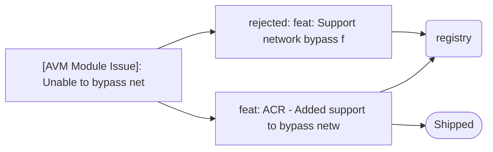

*slow to land (108 days) · 1 reviewers · 5 contributors · 1 review rounds · reopened 1×*

Outcome **shipped**; PRs: [#7158](https://github.com/Azure/bicep-registry-modules/pull/7158) (rejected), [#7280](https://github.com/Azure/bicep-registry-modules/pull/7280) (merged); issues: [#6990](https://github.com/Azure/bicep-registry-modules/issues/6990); code areas: 1 (`avm/res/container-registry/registry`)

Issue 6990 asked for the container-registry module to expose the networkRuleBypassForTasks setting for ACR tasks. The original contributor PR 7158 was closed unmerged, and a rebase of it, PR 7280, was merged. — [1](https://github.com/Azure/bicep-registry-modules/pull/7280)

- **Proposed:** The issue says the avm/res/container-registry/registry module lacked a way to set networkRuleBypassForTasks. It says that without it, tasks such as image scanning cannot bypass network rules on firewalled or vnet-restricted registries. — [1](https://github.com/Azure/bicep-registry-modules/issues/6990)
- **Changed:** PR 7158 added support to bypass network rules for ACR tasks and was closed without review activity. PR 7280 was opened as a rebase of 7158 'to allow validation', keeping the original author's history. The change adds a bool parameter networkRuleBypassAllowedForTasks, default false, in main.bicep. PR 7280 shows one reopen and a dismissed review followed by an approval. — [1](https://github.com/Azure/bicep-registry-modules/pull/7280)
- **Rejected:** PR 7158 was closed without being merged; the slice shows no reviews or comments on it and gives no reason. — [1](https://github.com/Azure/bicep-registry-modules/pull/7158)
- **Shipped:** PR 7280 merged as commit f706d97. It adds the networkRuleBypassAllowedForTasks bool parameter (default false) to avm/res/container-registry/registry, with CHANGELOG and README updates. — [1](https://github.com/Azure/bicep-registry-modules/commit/f706d972931aa9ca27895a9b33256ab14b0fa550)

### Deep train `train-issue-6695` — [AVM Module Issue]: Add suppport for existing vnet linking to ipam pool

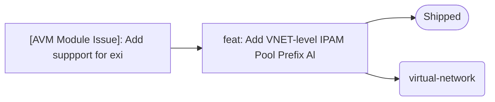

*slow to land (163 days) · 1 reviewers · 7 contributors · 1 review rounds*

Outcome **shipped**; PRs: [#7271](https://github.com/Azure/bicep-registry-modules/pull/7271) (merged); issues: [#6695](https://github.com/Azure/bicep-registry-modules/issues/6695); code areas: 1 (`avm/res/network/virtual-network`)

Issue 6695 asked for the avm/res/network/virtual-network module to support linking an existing virtual network to an IPAM pool. It shipped through PR 7271, which added virtual-network-level IPAM pool prefix allocations. — [1](https://github.com/Azure/bicep-registry-modules/pull/7271)

- **Proposed:** The requester said the module could not link an existing vnet to an IPAM pool, which the native Bicep resource allows through addressSpace.ipamPoolPrefixAllocations. In the discussion, a commenter noted that explicit CIDR ranges and an IPAM pool configuration cannot be combined on the Bicep vnet resource. — [1](https://github.com/Azure/bicep-registry-modules/issues/6695)
- **Changed:** In main.bicep, addressPrefixes became optional (string[]?), a new ipamPoolPrefixAllocations parameter was added, and a variable addressPrefixIsIpamPoolResourceId was introduced. The parameter descriptions state that ipamPoolPrefixAllocations cannot be combined with addressPrefixes, and that a pool resource ID as the first addressPrefixes entry uses the legacy single-pool syntax. A new e2e ipam test deploys a vnet with a classical prefix and then links it to the pool. In review, a comment asked for address spaces to be hardcoded in dependencies.bicep, and the author replied 'Updated'. — [1](https://github.com/Azure/bicep-registry-modules/pull/7271)
- **Shipped:** PR 7271 merged as commit 93d9827, with a CHANGELOG entry for 0.10.2 and README updates under avm/res/network/virtual-network. It adds the ipamPoolPrefixAllocations parameter and the ipam e2e test. — [1](https://github.com/Azure/bicep-registry-modules/commit/93d98270eae305be5845e13a42e7cb2d316e10f0), [2](https://github.com/Azure/bicep-registry-modules/pull/7271)

### Deep train `train-pr-7235` — feat(`avm/res/cognitive-services/account`): extract deployments child module

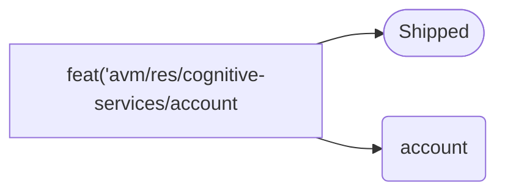

*landed in 12 days · 2 reviewers · 3 contributors · 1 review rounds*

Outcome **shipped**; PRs: [#7235](https://github.com/Azure/bicep-registry-modules/pull/7235) (merged); code areas: 1 (`avm/res/cognitive-services/account`)

PR 7235 extracted the Microsoft.CognitiveServices/accounts/deployments resource of the cognitive-services/account module into a dedicated child module. It was approved and merged. — [1](https://github.com/Azure/bicep-registry-modules/pull/7235)

- **Proposed:** The PR body says this implements a follow-up requested during review of #7199 and tracked in #7206. The aim was to move the inline deployments resource out of account/main.bicep while keeping the public deployments parameter unchanged. — [1](https://github.com/Azure/bicep-registry-modules/pull/7235)
- **Changed:** A new deployment/main.bicep holds the deployments resource, and the parent's inline resource loop became a module loop calling it. The PR body says deploymentType is exported from the child and imported into the parent, and that @batchSize(1) is kept so deployments run serially. Reviewers asked for a manual test on a subscription with the required quota. A reply says the Anthropic test and update are kept separate to be troubleshot next. — [1](https://github.com/Azure/bicep-registry-modules/pull/7235)
- **Shipped:** Commit f107022 merged the new deployment child module (main.bicep and README) and replaced the cognitiveService_deployments resource with a module in the parent. The CHANGELOG entry for 0.18.0 also records a deployments API version bump from 2025-06-01 to 2026-05-01 and lists no breaking changes. — [1](https://github.com/Azure/bicep-registry-modules/commit/f1070229a704c42897f07bdc19913cba26895bae)

### Deep train `train-pr-7250` — fix: Prevent child module deployment name conflicts across multiple modules

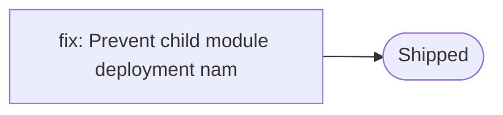

*landed in 1 days · 1 reviewers · 2 contributors · 1 review rounds*

Outcome **shipped**; PRs: [#7250](https://github.com/Azure/bicep-registry-modules/pull/7250) (merged); code areas: 7 (`avm/res/automation/automation-account`, `avm/res/network/azure-firewall`, `avm/res/network/dns-resolver`, `avm/res/network/firewall-policy`, `avm/res/network/virtual-hub`, `avm/res/network/virtual-network` …)

PR 7250 fixed child module deployment name collisions when several instances of the same resource type are deployed into one resource group at once. It was merged across seven modules. — [1](https://github.com/Azure/bicep-registry-modules/pull/7250)

- **Proposed:** The PR body says the uniqueString(subscription().id, resourceGroup().id, location) names introduced in #6316 are not unique enough for simultaneous deployments of the same type. It applies the fix already merged for operational-insights/workspace in #7249. — [1](https://github.com/Azure/bicep-registry-modules/pull/7250)
- **Changed:** The parent resource name was added to the uniqueString() inputs of child deployment names. This was done in automation-account, azure-firewall, dns-resolver, firewall-policy, virtual-hub and virtual-network, plus resource-group. For resource-group, name was added to the lock and role-assignment deployment names. The PR also bumped cross-module references (private-endpoint 0.12.1, public-ip-address 0.13.0, operations-management/solution 0.3.1) and moved the telemetry Microsoft.Resources/deployments API from 2024-03-01 to 2025-04-01 in several modules. — [1](https://github.com/Azure/bicep-registry-modules/pull/7250)
- **Shipped:** Commit 512156e merged the change. CHANGELOG entries are automation-account 0.19.2, azure-firewall 0.11.1, dns-resolver 0.5.8, firewall-policy 0.3.6, virtual-hub 0.5.1, virtual-network 0.10.1 and resource-group 0.4.4, each listing no breaking changes. — [1](https://github.com/Azure/bicep-registry-modules/commit/512156ec1495ce967fd0d9b054426016bca22425)

### Deep train `train-pr-7252` — feat: Feature/Add Dynamic Data Masking Capability

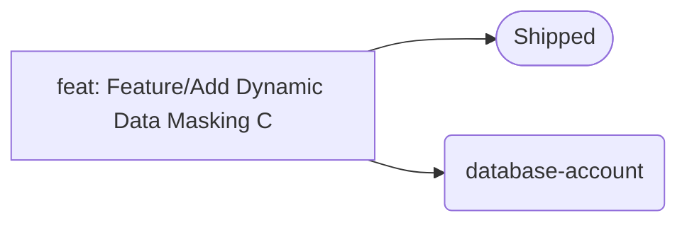

*landed in 5 days · 1 reviewers · 2 contributors · 1 review rounds*

Outcome **shipped**; PRs: [#7252](https://github.com/Azure/bicep-registry-modules/pull/7252) (merged); code areas: 1 (`avm/res/document-db/database-account`)

PR 7252 added Dynamic Data Masking capability to the document-db/database-account module. It was approved and merged with a major-style breaking change on serverless configuration. — [1](https://github.com/Azure/bicep-registry-modules/pull/7252)

- **Proposed:** The PR body states the goal as adding the ability to deploy Cosmos DB with Dynamic Data Masking. — [1](https://github.com/Azure/bicep-registry-modules/pull/7252)
- **Changed:** Per the CHANGELOG diff, the Microsoft.DocumentDB/* references were updated to 2026-04-01-preview, across the parent and its child modules (for example cassandra-keyspace and gremlin-database). Serverless moved from capabilitiesToAdd to a new capacityMode property because EnableServerless is not allowed in API versions beyond 2024-05-15-preview. Review comments from the author say test locations were switched after zonal-redundant capacity errors in West US 3 and East US 2. — [1](https://github.com/Azure/bicep-registry-modules/pull/7252)
- **Shipped:** PR 7252 merged document-db/database-account 0.21.0, with Dynamic Data Masking, the 2026-04-01-preview API update and the capacityMode breaking change. Child modules received 0.1.1 CHANGELOG entries for the API reference update. — [1](https://github.com/Azure/bicep-registry-modules/pull/7252)

### Deep train `train-pr-7257` — feat: CosmosDB - "Rebased Add SecuredByPerimeter support for Cosmos DB publicNetworkAccess- #6710"

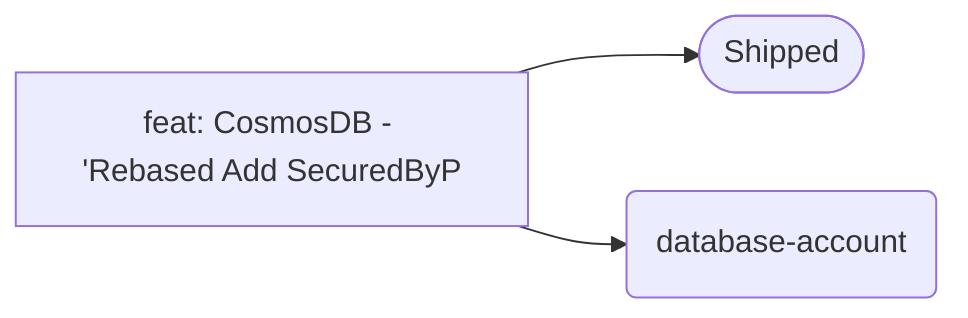

*landed in 0 days · 1 reviewers · 2 contributors · 1 review rounds*

Outcome **shipped**; PRs: [#7257](https://github.com/Azure/bicep-registry-modules/pull/7257) (merged); code areas: 1 (`avm/res/document-db/database-account`)

PR 7257 is a rebase of PR 6710 that adds SecuredByPerimeter as a publicNetworkAccess option for the document-db/database-account module. It was approved and merged. — [1](https://github.com/Azure/bicep-registry-modules/pull/7257)

- **Proposed:** The PR body says the original change lets networkRestrictions.publicNetworkAccess be set to SecuredByPerimeter, so Cosmos DB accounts can be secured with a Network Security Perimeter. It describes this as more granular than traditional public network access settings. — [1](https://github.com/Azure/bicep-registry-modules/pull/7257)
- **Changed:** The PR is a rebase that preserves the original author, poornachandugade. The slice shows a new e2e test, tests/e2e/perimeter/main.test.bicep, which pins the location to eastasia with a comment that a single-zone region is used for NSP tests. The README and CHANGELOG were updated, the latter with a 0.20.1 entry. — [1](https://github.com/Azure/bicep-registry-modules/pull/7257)
- **Shipped:** Commit 9f9ea1a merged the SecuredByPerimeter support, the 0.20.1 CHANGELOG entry, the README changes and the perimeter e2e test under avm/res/document-db/database-account. — [1](https://github.com/Azure/bicep-registry-modules/commit/9f9ea1a18204e262be9a4a64e3e3cc7fbe5e509d)

### Deep train `train-pr-7260` — feat: CI - Expanded diff check to include also non-committed changes

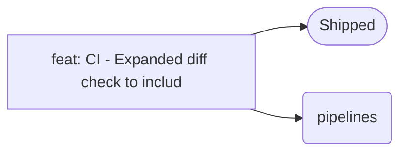

*landed in 5 days · 1 reviewers · 2 contributors · 1 review rounds*

Outcome **shipped**; PRs: [#7260](https://github.com/Azure/bicep-registry-modules/pull/7260) (merged); code areas: 1 (`utilities/pipelines`)

PR 7260 expanded the CI diff check so it also considers non-committed changes. It was approved and merged. — [1](https://github.com/Azure/bicep-registry-modules/pull/7260)

- **Proposed:** The PR body says the diff check should include non-committed changes, noting this changes the default behavior because there should be no scenario in which only committed changes are considered. — [1](https://github.com/Azure/bicep-registry-modules/pull/7260)
- **Changed:** The PR is under utilities/pipelines. The review comments concern the wording of the help text for an OnlyCommitted parameter and a description of modified-file paths, which suggests an OnlyCommitted switch. The slice has no diff for the change. — [1](https://github.com/Azure/bicep-registry-modules/pull/7260)
- **Shipped:** Commit 2fdd267 merged the change under utilities/pipelines. The PR body links a pipeline run with no module changes that should pass, and one with module changes that should fail because the changelog was not updated. — [1](https://github.com/Azure/bicep-registry-modules/commit/2fdd267afbd0ff3466ba34623ec9ce0810b4bd08)

### Deep train `train-pr-7301` — feat: AVM Module upgrade for Content Processing

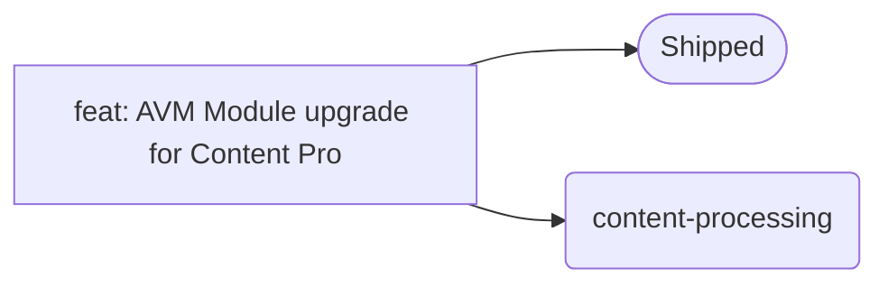

*landed in 3 days · 1 reviewers · 2 contributors · 1 review rounds*

Outcome **shipped**; PRs: [#7301](https://github.com/Azure/bicep-registry-modules/pull/7301) (merged); code areas: 1 (`avm/ptn/sa/content-processing`)

PR 7301 upgraded the avm/ptn/sa/content-processing pattern module, adding a workflow container app and a gpt-5.1 default. It also added a CI workflow for container-migration. It was approved and merged. — [1](https://github.com/Azure/bicep-registry-modules/pull/7301)

- **Proposed:** The PR body describes a new GitHub Actions workflow for the container-migration module, a change to the PR labeling workflow to skip forks, and documentation of the content-processing 0.3.0 release including breaking changes. — [1](https://github.com/Azure/bicep-registry-modules/pull/7301)
- **Changed:** The pattern's main.bicep bumped module references such as container-app 0.19.0 to 0.23.0 and bastion-host to 0.8.2. It added Workflow container app modules and removed the separate avmAiServices_cu account. The CHANGELOG says Content Understanding moved onto the shared aif- AIServices account to fix PDF extraction DNS failures. The container image parameters were dropped and the GPT model description now names only gpt-5.1. — [1](https://github.com/Azure/bicep-registry-modules/pull/7301)
- **Shipped:** Commit d60585a merged the upgrade as content-processing 0.3.0. The PR body says it restricts allowed model names and versions as a breaking change, consolidates AI services, adds a workflow container app, and adds Cosmos DB redundancy. — [1](https://github.com/Azure/bicep-registry-modules/commit/d60585a9c4277c8c118a6a66373a85ec46cdc166)

**Mention trains** — one line each:

- `train-issue-2422` — [[Bug Report]: virtual_machine enableAcceleratedNetworking setting conlict?](https://github.com/Azure/bicep-registry-modules/issues/2422) — shipped (2 PR(s))
- `train-issue-6736` — [Remove the `TODO` section from t he SUPPORT.md file](https://github.com/Azure/bicep-registry-modules/issues/6736) — shipped (1 PR(s))
- `train-issue-6927` — [[AVM Module Issue]: network/natGateways resource name is documented as 'Bastion'](https://github.com/Azure/bicep-registry-modules/issues/6927) — shipped (1 PR(s))
- `train-issue-7194` — [[AVM Module Issue]: identical deployment name for multiple log analytics data export rules](https://github.com/Azure/bicep-registry-modules/issues/7194) — shipped (1 PR(s))
- `train-issue-7197` — [[AVM Module Issue]: [avm/res/cognitive-services/account] Support modelProviderData for GA partner models (Anthropic Claude)](https://github.com/Azure/bicep-registry-modules/issues/7197) — shipped (1 PR(s))
- `train-pr-7246` — [fix: bump github/codeql-action/upload-sarif from 4.37.3 to 4.37.4](https://github.com/Azure/bicep-registry-modules/pull/7246) — shipped (1 PR(s))
- `train-pr-7258` — [fix: bump github/codeql-action/upload-sarif from 4.37.4 to 4.37.6](https://github.com/Azure/bicep-registry-modules/pull/7258) — shipped (1 PR(s))
- `train-pr-7262` — [fix: Correct DDM policy condition when determining if the Data Masking capability is enabled](https://github.com/Azure/bicep-registry-modules/pull/7262) — shipped (1 PR(s))
- `train-pr-7282` — [fix: bump github/codeql-action/upload-sarif from 4.37.6 to 4.37.7](https://github.com/Azure/bicep-registry-modules/pull/7282) — shipped (1 PR(s))
- `train-pr-7294` — [fix: bump github/codeql-action/upload-sarif from 4.37.7 to 4.37.8](https://github.com/Azure/bicep-registry-modules/pull/7294) — shipped (1 PR(s))
- `train-pr-7302` — [feat: Updated AVM content gen v2 modules](https://github.com/Azure/bicep-registry-modules/pull/7302) — shipped (1 PR(s))
- `train-pr-7303` — [feat: AVM Module Upgrade for Multi Agent](https://github.com/Azure/bicep-registry-modules/pull/7303) — shipped (1 PR(s))
- `train-pr-7305` — [feat: DKM avm modules updated](https://github.com/Azure/bicep-registry-modules/pull/7305) — shipped (1 PR(s))
- `train-pr-7307` — [feat: AVM conversation knowledge mining update](https://github.com/Azure/bicep-registry-modules/pull/7307) — shipped (1 PR(s))
- `train-pr-7308` — [fix: bump github/codeql-action/upload-sarif from 4.37.8 to 4.37.9](https://github.com/Azure/bicep-registry-modules/pull/7308) — shipped (1 PR(s))
- `train-issue-2865` — [[AVM CI Environment Issue]: Error when checking deployment status](https://github.com/Azure/bicep-registry-modules/issues/2865) — in_flight (1 PR(s))
- `train-issue-3860` — [[AVM Module Issue]: 0.5.1~0.8.3 incompatible with BYO vnet PodSubnetID `container-service/managed-cluster`](https://github.com/Azure/bicep-registry-modules/issues/3860) — in_flight (1 PR(s))
- `train-issue-5561` — [[AVM Module Issue]: Missing properties securityProfile sections (or securityEncryptionType) in Compute module](https://github.com/Azure/bicep-registry-modules/issues/5561) — in_flight (1 PR(s))
- `train-issue-6167` — [[AVM Module Issue]: Disable weak cipher suites in API Management service module?](https://github.com/Azure/bicep-registry-modules/issues/6167) — in_flight (1 PR(s))
- `train-issue-6483` — [[AVM Module Issue]: subResourceWrapper.bicep lacks the use of serviceEndpoints](https://github.com/Azure/bicep-registry-modules/issues/6483) — in_flight (1 PR(s))
- `train-issue-6518` — [[AVM Module Issue]: Fine control for notification thresholds in budget](https://github.com/Azure/bicep-registry-modules/issues/6518) — in_flight (1 PR(s))
- `train-issue-6891` — [[AVM Module Issue]: Netapp account module missing site property for activeDirectory configuration](https://github.com/Azure/bicep-registry-modules/issues/6891) — in_flight (1 PR(s))
- `train-issue-6900` — [[AVM Module Issue]: subscriptions never placed unless disableSubscriptionPlacement: true](https://github.com/Azure/bicep-registry-modules/issues/6900) — in_flight (1 PR(s))
- `train-issue-6955` — [[AVM Module Issue]: Add Aspire Dashboard component support to avm/res/app/managed-environment](https://github.com/Azure/bicep-registry-modules/issues/6955) — in_flight (1 PR(s))
- `train-issue-6968` — [[AVM Module Issue]: AVM Bastion Host Module — Session Recording Storage Configuration Gap](https://github.com/Azure/bicep-registry-modules/issues/6968) — in_flight (1 PR(s))
- `train-issue-7289` — [[AVM Module Issue]: Recovery-Services/vault softDeleteSettings vs backupConfig](https://github.com/Azure/bicep-registry-modules/issues/7289) — in_flight (1 PR(s))
- `train-pr-3810` — [ci: Introduce PSRule suppression for individual rules/resources](https://github.com/Azure/bicep-registry-modules/pull/3810) — in_flight (1 PR(s))
- `train-pr-4863` — [feat: add gh issue label logic](https://github.com/Azure/bicep-registry-modules/pull/4863) — in_flight (1 PR(s))
- `train-pr-5315` — [ci: [Test 01] Enforce test folder validation for pattern modules for both defaults and waf-aligned](https://github.com/Azure/bicep-registry-modules/pull/5315) — in_flight (1 PR(s))
- `train-pr-5316` — [ci: [Test 02] Enforce test folder validation for pattern modules for both waf-aligned only](https://github.com/Azure/bicep-registry-modules/pull/5316) — in_flight (1 PR(s))
- `train-pr-5317` — [ci: [Test 03] Enforce test folder validation for pattern modules for defaults only](https://github.com/Azure/bicep-registry-modules/pull/5317) — in_flight (1 PR(s))
- `train-pr-5642` — [build(deps-dev): bump form-data from 4.0.0 to 4.0.4 in the npm_and_yarn group across 1 directory](https://github.com/Azure/bicep-registry-modules/pull/5642) — in_flight (1 PR(s))
- `train-pr-6168` — [feat: Re-added logic to set module version in readme](https://github.com/Azure/bicep-registry-modules/pull/6168) — in_flight (1 PR(s))
- `train-pr-6218` — [feat: Synapase - Added support for HSM](https://github.com/Azure/bicep-registry-modules/pull/6218) — in_flight (1 PR(s))
- `train-pr-6549` — [feat(ptn): Update FinOps Hub v12 pattern module](https://github.com/Azure/bicep-registry-modules/pull/6549) — in_flight (1 PR(s))
- `train-pr-6580` — [feat: new module `avm/res/app/agent` (Microsoft.App/agents)](https://github.com/Azure/bicep-registry-modules/pull/6580) — in_flight (1 PR(s))
- `train-pr-6584` — [fix(app-service-lza): correct web app kind parameter to respect OS configuration](https://github.com/Azure/bicep-registry-modules/pull/6584) — in_flight (1 PR(s))
- `train-pr-6694` — [feat: check for module existence in MAR](https://github.com/Azure/bicep-registry-modules/pull/6694) — in_flight (1 PR(s))
- `train-pr-6708` — [Fix: Updated default app Version and Adjusted wording in semantic kernel system prompt](https://github.com/Azure/bicep-registry-modules/pull/6708) — in_flight (1 PR(s))
- `train-pr-6732` — [ci: DO NOT MERGE - Test to showcase feasibility of validation on PR](https://github.com/Azure/bicep-registry-modules/pull/6732) — in_flight (1 PR(s))
- `train-pr-6753` — [feat: module maintenance skill](https://github.com/Azure/bicep-registry-modules/pull/6753) — in_flight (1 PR(s))
- `train-pr-6761` — [test(avm/res/azure-stack-hci/marketplace-gallery-image): update test harness for 24H2 cluster](https://github.com/Azure/bicep-registry-modules/pull/6761) — in_flight (1 PR(s))
- `train-pr-6813` — [feat: add bootstrap skill](https://github.com/Azure/bicep-registry-modules/pull/6813) — in_flight (1 PR(s))
- `train-pr-6929` — [feat: Subscription Vending PTN - UMI Role Assignments absolute scopes](https://github.com/Azure/bicep-registry-modules/pull/6929) — in_flight (1 PR(s))
- `train-pr-6970` — [feat: introduce content processing v2 changes](https://github.com/Azure/bicep-registry-modules/pull/6970) — in_flight (1 PR(s))
- `train-pr-7021` — [fix: ReadMe Gen - Fixed incorrect section reference if non-parent module](https://github.com/Azure/bicep-registry-modules/pull/7021) — in_flight (1 PR(s))
- `train-pr-7074` — [fix: remove enableAnalyticalStorage o…](https://github.com/Azure/bicep-registry-modules/pull/7074) — in_flight (1 PR(s))
- `train-pr-7075` — [feat: introduce container migration module](https://github.com/Azure/bicep-registry-modules/pull/7075) — in_flight (1 PR(s))
- `train-pr-7089` — [feat: Publish child module `avm/res/web/hosting-environment/configuration`](https://github.com/Azure/bicep-registry-modules/pull/7089) — in_flight (1 PR(s))
- `train-pr-7094` — [feat: Publish child modules of `avm/res/cache/redis-enterprise`](https://github.com/Azure/bicep-registry-modules/pull/7094) — in_flight (1 PR(s))
- `train-pr-7095` — [fix: enable private networking in DI](https://github.com/Azure/bicep-registry-modules/pull/7095) — in_flight (1 PR(s))
- `train-pr-7144` — [feat: Add contribution guidelines and module overview to documentation](https://github.com/Azure/bicep-registry-modules/pull/7144) — in_flight (1 PR(s))
- `train-pr-7165` — [fix: bump actions/checkout from 4 to 7](https://github.com/Azure/bicep-registry-modules/pull/7165) — in_flight (1 PR(s))
- `train-pr-7182` — [feat: dependency updates on `avm/ptn/app/container-job-toolkit`](https://github.com/Azure/bicep-registry-modules/pull/7182) — in_flight (1 PR(s))
- `train-pr-7245` — [Fix: CWYD AVM upgrade v2](https://github.com/Azure/bicep-registry-modules/pull/7245) — in_flight (1 PR(s))
- `train-pr-7259` — [feat: static test for using multiple versions in one module](https://github.com/Azure/bicep-registry-modules/pull/7259) — in_flight (1 PR(s))
- `train-pr-7263` — [Upgrade FinOps hub to Toolkit v14](https://github.com/Azure/bicep-registry-modules/pull/7263) — in_flight (1 PR(s))
- `train-pr-7279` — [feat: Add CMK user-assigned identity to managed identities across modules - batch 1](https://github.com/Azure/bicep-registry-modules/pull/7279) — in_flight (1 PR(s))
- `train-pr-7281` — [feat: Add CMK user-assigned identity to managed identities across modules - batch 2](https://github.com/Azure/bicep-registry-modules/pull/7281) — in_flight (1 PR(s))
- `train-pr-7286` — [adding fips flag to additionalfeatures](https://github.com/Azure/bicep-registry-modules/pull/7286) — in_flight (1 PR(s))
- `train-pr-7288` — [docs: Remove stale model pin and dead `/AVM-Boostrap` reference from pre-flight check](https://github.com/Azure/bicep-registry-modules/pull/7288) — in_flight (1 PR(s))
- `train-pr-7290` — [fix: bump actions/upload-artifact from 5.0.0 to 7.0.1](https://github.com/Azure/bicep-registry-modules/pull/7290) — in_flight (1 PR(s))
- `train-pr-7293` — [feat: ManagedEnvironment update and test fixes](https://github.com/Azure/bicep-registry-modules/pull/7293) — in_flight (1 PR(s))
- `train-pr-7297` — [feat: AVM Module Upgrade for BYOCC](https://github.com/Azure/bicep-registry-modules/pull/7297) — in_flight (1 PR(s))
- `train-pr-7299` — [feat: Create AVM Pattern Module for Function Apps](https://github.com/Azure/bicep-registry-modules/pull/7299) — in_flight (1 PR(s))
- `train-pr-7306` — [chore: Pin GitHub Actions to full-length commit SHAs](https://github.com/Azure/bicep-registry-modules/pull/7306) — in_flight (1 PR(s))
- `train-pr-7309` — [Avm ptn aks secure baseline](https://github.com/Azure/bicep-registry-modules/pull/7309) — in_flight (1 PR(s))
- `train-issue-4965` — [[AVM Module Issue]: `avm/ptn/lz/sub-vending` Custom RBAC Configuration](https://github.com/Azure/bicep-registry-modules/issues/4965) — rejected (1 PR(s))
- `train-issue-6504` — [[AVM Module Issue]: Web-Site - Account Key exposure](https://github.com/Azure/bicep-registry-modules/issues/6504) — rejected (1 PR(s))
- `train-issue-6505` — [[AVM CI Environment Issue]: Update diagnostic.dependencies.bicep to support Azure tags](https://github.com/Azure/bicep-registry-modules/issues/6505) — rejected (1 PR(s))
- `train-pr-5975` — [feat: Added Support for Network Security Perimeter, added TLS1.3 for Storage](https://github.com/Azure/bicep-registry-modules/pull/5975) — rejected (1 PR(s))
- `train-pr-6457` — [feat: New Pattern Module avm/ptn/sa/customer-chatbot](https://github.com/Azure/bicep-registry-modules/pull/6457) — rejected (1 PR(s))
- `train-pr-6611` — [fix: bump actions/upload-artifact from 5.0.0 to 7.0.0](https://github.com/Azure/bicep-registry-modules/pull/6611) — rejected (1 PR(s))
- `train-pr-6710` — [feat: Add `SecuredByPerimeter` support for Cosmos DB `publicNetworkAccess`](https://github.com/Azure/bicep-registry-modules/pull/6710) — rejected (1 PR(s))
- `train-pr-6759` — [fix: bump azure/powershell from 2 to 3](https://github.com/Azure/bicep-registry-modules/pull/6759) — rejected (1 PR(s))
- `train-pr-7248` — [fix: content generation avm upgradation](https://github.com/Azure/bicep-registry-modules/pull/7248) — rejected (1 PR(s))
- `train-pr-7251` — [fix: AVM-RES: Update GPT model and VM size defaults](https://github.com/Azure/bicep-registry-modules/pull/7251) — rejected (1 PR(s))
- `train-pr-7256` — [fix: bump github/codeql-action/upload-sarif from 4.37.4 to 4.37.5](https://github.com/Azure/bicep-registry-modules/pull/7256) — rejected (1 PR(s))
- `train-pr-7272` — [fix: AVM Content generation updates](https://github.com/Azure/bicep-registry-modules/pull/7272) — rejected (1 PR(s))
- `train-pr-7273` — [refactor: customer chatbot ACR compatible](https://github.com/Azure/bicep-registry-modules/pull/7273) — rejected (1 PR(s))
- `train-pr-7274` — [fix: AVM Content Processing updates](https://github.com/Azure/bicep-registry-modules/pull/7274) — rejected (1 PR(s))
- `train-pr-7275` — [fix: AVM Document knowledge mininig updates](https://github.com/Azure/bicep-registry-modules/pull/7275) — rejected (1 PR(s))
- `train-pr-7276` — [fix: AVM conversation knowledge mining update](https://github.com/Azure/bicep-registry-modules/pull/7276) — rejected (1 PR(s))
- `train-pr-7277` — [fix: AMV Multi agent issue fix](https://github.com/Azure/bicep-registry-modules/pull/7277) — rejected (1 PR(s))
- `train-issue-6981` — [AVM Core CI: three e2e validation tooling defects (deploy retry, cleanup throw, mgmt-group removal)](https://github.com/Azure/bicep-registry-modules/issues/6981) — abandoned (0 PR(s))
- `train-issue-7216` — [avm/res/network/virtual-hub: hubRoutingPreference and preferredRoutingGateway emitted unconditionally, blocking hub creation when unset](https://github.com/Azure/bicep-registry-modules/issues/7216) — abandoned (0 PR(s))

## Activity at a glance

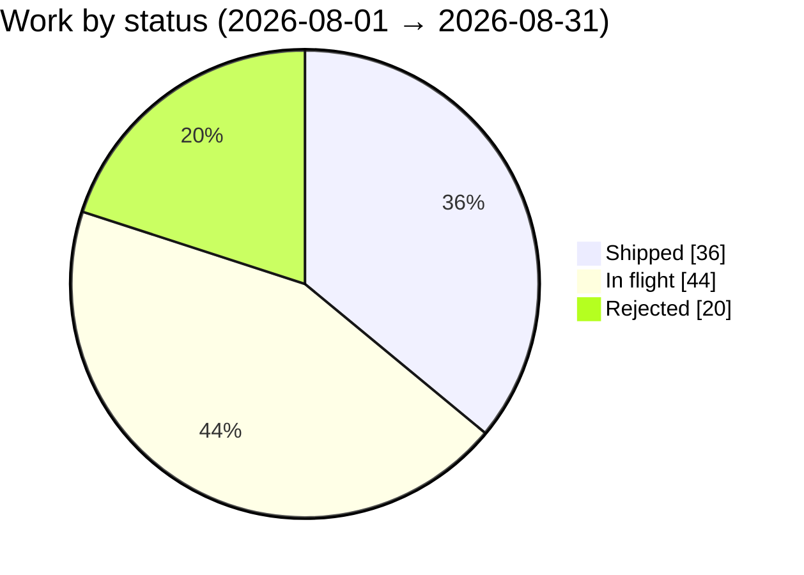

```mermaid
gantt
    title Timeline (2026-08-01 → 2026-08-31)
    dateFormat YYYY-MM-DD
    axisFormat %m-%d
    section Pull requests
    #3810 ci - Introduce PSRule suppression for individual rules :active, 2024-11-19, 2026-08-31
    #4205 feat - Deployment monitoring function :active, 2025-01-17, 2026-08-31
    #4863 feat - add gh issue label logic :active, 2025-03-25, 2026-08-31
    #4967 feat - 'avm/ptn/lz/sub-vending' Fixes & Feature for Cu :crit, 2025-04-01, 2026-08-11
    #5163 feat - Updates of the VM module :crit, 2025-05-07, 2026-08-07
    #5315 ci - [Test 01] Enforce test folder validation for patt :active, 2025-05-27, 2026-08-31
    #5316 ci - [Test 02] Enforce test folder validation for patt :active, 2025-05-27, 2026-08-31
    #5317 ci - [Test 03] Enforce test folder validation for patt :active, 2025-05-27, 2026-08-31
    #5642 build(deps-dev) - bump form-data from 4.0.0 to 4.0.4 i :active, 2025-07-21, 2026-08-31
    #5975 feat - Added Support for Network Security Perimeter, a :crit, 2025-09-17, 2026-08-07
    #6168 feat - Re-added logic to set module version in readme :active, 2025-11-02, 2026-08-31
    #6218 feat - Synapase - Added support for HSM :active, 2025-11-13, 2026-08-31
    #6457 feat - New Pattern Module avm/ptn/sa/customer-chatbot :crit, 2025-12-29, 2026-08-07
    #6484 Fix - Adds service endpoint support to subnets :active, 2026-01-08, 2026-08-31
    #6514 Security - Default storageAccountUseIdentityAuthentica :crit, 2026-01-20, 2026-08-07
    #6535 feat - CI - Enable the injection of custom tags on tes :crit, 2026-02-03, 2026-08-20
    #6549 feat(ptn) - Update FinOps Hub v12 pattern module :active, 2026-02-04, 2026-08-31
    #6580 feat - new module 'avm/res/app/agent' (Microsoft.App/a :active, 2026-02-19, 2026-08-31
    #6584 fix(app-service-lza) - correct web app kind parameter  :active, 2026-02-21, 2026-08-31
    #6611 fix - bump actions/upload-artifact from 5.0.0 to 7.0.0 :crit, 2026-02-27, 2026-08-20
    #6694 feat - check for module existence in MAR :active, 2026-03-10, 2026-08-31
    #6708 Fix - Updated default app Version and Adjusted wording :active, 2026-03-13, 2026-08-31
    #6710 feat - Add 'SecuredByPerimeter' support for Cosmos DB  :crit, 2026-03-13, 2026-08-07
    #6732 ci - DO NOT MERGE - Test to showcase feasibility of va :active, 2026-03-18, 2026-08-31
    #6753 feat - module maintenance skill :active, 2026-03-24, 2026-08-31
    #6759 fix - bump azure/powershell from 2 to 3 :crit, 2026-03-26, 2026-08-07
    #6761 test(avm/res/azure-stack-hci/marketplace-gallery-image :active, 2026-03-26, 2026-08-31
    #6813 feat - add bootstrap skill :active, 2026-04-09, 2026-08-31
    #6883 fix - avm/compute/virtual-machine & avm/compute/virtua :active, 2026-04-15, 2026-08-31
    #6929 feat - Subscription Vending PTN - UMI Role Assignments :active, 2026-04-20, 2026-08-31
    #6970 feat - introduce content processing v2 changes :active, 2026-04-29, 2026-08-31
    #6980 fix - avm/ptn/mgmt-groups/subscription-placement - cor :active, 2026-04-30, 2026-08-31
    #7021 fix - ReadMe Gen - Fixed incorrect section reference i :active, 2026-05-09, 2026-08-31
    #7030 fix - DevOps CI/CD agents pattern module DNS fix :active, 2026-05-11, 2026-08-31
    #7032 fix - Add Active Directory site support to NetApp acco :active, 2026-05-12, 2026-08-31
    #7074 fix - remove enableAnalyticalStorage o… :active, 2026-05-19, 2026-08-31
    #7075 feat - introduce container migration module :active, 2026-05-19, 2026-08-31
    #7089 feat - Publish child module 'avm/res/web/hosting-envir :active, 2026-05-21, 2026-08-31
    #7094 feat - Publish child modules of 'avm/res/cache/redis-e :active, 2026-05-21, 2026-08-31
    #7095 fix - enable private networking in DI :active, 2026-05-21, 2026-08-31
    #7132 feat - Add per-notification operator/thresholdType con :active, 2026-06-05, 2026-08-31
    #7144 feat - Add contribution guidelines and module overview :active, 2026-06-10, 2026-08-31
    #7146 fix - Update security ciphers for API Management :active, 2026-06-10, 2026-08-31
    #7158 feat - Support network bypass for tasks :crit, 2026-06-17, 2026-08-14
    #7165 fix - bump actions/checkout from 4 to 7 :active, 2026-06-19, 2026-08-31
    #7182 feat - dependency updates on 'avm/ptn/app/container-jo :active, 2026-06-26, 2026-08-31
    #7188 feat - Added managed identity and session recording co :active, 2026-07-01, 2026-08-31
    #7210 feat - adding new dotnet component :active, 2026-07-12, 2026-08-31
    #7235 feat('avm/res/cognitive-services/account') - extract d :done, 2026-07-24, 2026-08-05
    #7245 Fix - CWYD AVM upgrade v2 :active, 2026-07-30, 2026-08-31
    #7246 fix - bump github/codeql-action/upload-sarif from 4.37 :done, 2026-07-30, 2026-08-03
    #7248 fix - content generation avm upgradation :crit, 2026-07-31, 2026-08-12
    #7249 fix - Deployment name creation for child modules of 'a :done, 2026-08-03, 2026-08-03
    #7250 fix - Prevent child module deployment name conflicts a :done, 2026-08-03, 2026-08-04
    #7251 fix - AVM-RES - Update GPT model and VM size defaults :crit, 2026-08-04, 2026-08-11
    #7252 feat - Feature/Add Dynamic Data Masking Capability :done, 2026-08-04, 2026-08-09
    #7254 feat - avm/res/cognitive-services/account support 'mod :done, 2026-08-05, 2026-08-13
    #7256 fix - bump github/codeql-action/upload-sarif from 4.37 :crit, 2026-08-06, 2026-08-07
    #7257 feat - CosmosDB - 'Rebased Add SecuredByPerimeter supp :done, 2026-08-07, 2026-08-07
    #7258 fix - bump github/codeql-action/upload-sarif from 4.37 :done, 2026-08-07, 2026-08-17
    #7259 feat - static test for using multiple versions in one  :active, 2026-08-07, 2026-08-31
    #7260 feat - CI - Expanded diff check to include also non-co :done, 2026-08-07, 2026-08-13
    #7261 feat(aks) - add Gateway API and agent pool update supp :active, 2026-08-10, 2026-08-31
    #7262 fix - Correct DDM policy condition when determining if :done, 2026-08-10, 2026-08-11
    #7263 Upgrade FinOps hub to Toolkit v14 :active, 2026-08-11, 2026-08-31
    #7264 fix - VM - Refreshing files :done, 2026-08-11, 2026-08-11
    #7271 feat - Add VNET-level IPAM Pool Prefix Allocations sup :done, 2026-08-12, 2026-08-20
    #7272 fix - AVM Content generation updates :crit, 2026-08-13, 2026-08-28
    #7273 refactor - customer chatbot ACR compatible :crit, 2026-08-13, 2026-08-31
    #7274 fix - AVM Content Processing updates :crit, 2026-08-13, 2026-08-31
    #7275 fix - AVM Document knowledge mininig updates :crit, 2026-08-13, 2026-08-28
    #7276 fix - AVM conversation knowledge mining update :crit, 2026-08-13, 2026-08-31
    #7277 fix - AMV Multi agent issue fix :crit, 2026-08-13, 2026-08-28
    #7279 feat - Add CMK user-assigned identity to managed ident :active, 2026-08-14, 2026-08-31
    #7280 feat - ACR - Added support to bypass network rules for :done, 2026-08-14, 2026-08-18
    #7281 feat - Add CMK user-assigned identity to managed ident :active, 2026-08-15, 2026-08-31
    #7282 fix - bump github/codeql-action/upload-sarif from 4.37 :done, 2026-08-17, 2026-08-19
    #7283 fix - NAT Gateway - Correct 'name' parameter descripti :done, 2026-08-17, 2026-08-18
    #7286 adding fips flag to additionalfeatures :active, 2026-08-18, 2026-08-31
    #7287 docs - replace unedited SUPPORT.md template with AVM s :done, 2026-08-18, 2026-08-20
    #7288 docs - Remove stale model pin and dead '/AVM-Boostrap' :active, 2026-08-19, 2026-08-31
    #7290 fix - bump actions/upload-artifact from 5.0.0 to 7.0.1 :active, 2026-08-20, 2026-08-31
    #7291 feat('avm/res/sql/server') - Add support for time-base :active, 2026-08-20, 2026-08-31
    #7292 fix - Recovery Services Vault - Omit soft delete prope :active, 2026-08-20, 2026-08-31
    #7293 feat - ManagedEnvironment update and test fixes :active, 2026-08-21, 2026-08-31
    #7294 fix - bump github/codeql-action/upload-sarif from 4.37 :done, 2026-08-24, 2026-08-25
    #7297 feat - AVM Module Upgrade for BYOCC :active, 2026-08-26, 2026-08-31
    #7299 feat - Create AVM Pattern Module for Function Apps :active, 2026-08-26, 2026-08-31
    #7301 feat - AVM Module upgrade for Content Processing :done, 2026-08-28, 2026-08-31
    #7302 feat - Updated AVM content gen v2 modules :done, 2026-08-28, 2026-08-31
    #7303 feat - AVM Module Upgrade for Multi Agent :done, 2026-08-28, 2026-08-31
    #7305 feat - DKM avm modules updated :done, 2026-08-28, 2026-08-31
    #7306 chore - Pin GitHub Actions to full-length commit SHAs :active, 2026-08-29, 2026-08-31
    #7307 feat - AVM conversation knowledge mining update :done, 2026-08-31, 2026-08-31
    #7308 fix - bump github/codeql-action/upload-sarif from 4.37 :done, 2026-08-31, 2026-08-31
    #7309 Avm ptn aks secure baseline :active, 2026-08-31, 2026-08-31
```

## CI/CD health

All workflows: 1134/1456 succeeded (312 failed, 10 cancelled).

- **.Platform - Rerun failed workflows** — 477/484 succeeded (5 failed, 2 cancelled).
- **.Platform - Semantic PR Check** — 132/268 succeeded (136 failed, 0 cancelled).
- **.Platform - Check Labels** — 129/249 succeeded (120 failed, 0 cancelled).
- **.Platform - Clean up deployment history** — 31/31 succeeded (0 failed, 0 cancelled).
- **.Platform - Manage workflow issue** — 31/31 succeeded (0 failed, 0 cancelled).
- **.Platform - Sync AVM module list** — 31/31 succeeded (0 failed, 0 cancelled).
- **.Platform - Sync repo labels from CSV** — 31/31 succeeded (0 failed, 0 cancelled).
- **.Platform - OSSF Scorecard supply-chain security** — 27/28 succeeded (1 failed, 0 cancelled).
- **Push on main** — 23/23 succeeded (0 failed, 0 cancelled).
- **.Platform - Set GitHub issue owner config** — 22/22 succeeded (0 failed, 0 cancelled).
- **avm.res.cognitive-services.account** — 9/16 succeeded (6 failed, 1 cancelled).
- **avm.res.network.virtual-network** — 6/10 succeeded (3 failed, 1 cancelled).
- **PR #7260** — 8/8 succeeded (0 failed, 0 cancelled).
- **avm.res.automation.automation-account** — 6/8 succeeded (1 failed, 1 cancelled).
- **PR #7235** — 7/7 succeeded (0 failed, 0 cancelled).
- **PR #7254** — 7/7 succeeded (0 failed, 0 cancelled).
- **PR #7271** — 7/7 succeeded (0 failed, 0 cancelled).
- **PR #7279** — 7/7 succeeded (0 failed, 0 cancelled).
- **avm.res.container-registry.registry** — 6/7 succeeded (1 failed, 0 cancelled).
- **.Platform - Run CI tests** — 6/6 succeeded (0 failed, 0 cancelled).
- **PR #7280** — 6/6 succeeded (0 failed, 0 cancelled).
- **.Platform - Check PSRule** — 0/5 succeeded (5 failed, 0 cancelled).
- **avm.res.app-configuration.configuration-store** — 4/5 succeeded (1 failed, 0 cancelled).
- **avm.res.cache.redis-enterprise** — 3/5 succeeded (2 failed, 0 cancelled).
- **avm.res.container-instance.container-group** — 4/5 succeeded (1 failed, 0 cancelled).
- **avm.res.data-factory.factory** — 4/5 succeeded (1 failed, 0 cancelled).
- **avm.res.data-protection.backup-vault** — 4/5 succeeded (1 failed, 0 cancelled).
- **avm.res.db-for-my-sql.flexible-server** — 4/5 succeeded (1 failed, 0 cancelled).
- **avm.res.document-db.database-account** — 5/5 succeeded (0 failed, 0 cancelled).
- **avm.res.elastic-san.elastic-san** — 0/5 succeeded (5 failed, 0 cancelled).
- **avm.res.event-hub.namespace** — 4/5 succeeded (1 failed, 0 cancelled).
- **avm.res.kusto.cluster** — 2/5 succeeded (3 failed, 0 cancelled).
- **avm.res.load-test-service.load-test** — 4/5 succeeded (1 failed, 0 cancelled).
- **avm.res.machine-learning-services.workspace** — 4/5 succeeded (1 failed, 0 cancelled).
- **avm.res.maps.account** — 4/5 succeeded (1 failed, 0 cancelled).
- **avm.res.net-app.net-app-account** — 4/5 succeeded (1 failed, 0 cancelled).
- **avm.res.recovery-services.vault** — 4/5 succeeded (1 failed, 0 cancelled).
- **avm.res.service-bus.namespace** — 4/5 succeeded (1 failed, 0 cancelled).
- **avm.res.storage.storage-account** — 4/5 succeeded (1 failed, 0 cancelled).
- **Scheduled** — 4/4 succeeded (0 failed, 0 cancelled).
- **avm.res.network.dns-resolver** — 3/4 succeeded (0 failed, 1 cancelled).
- **avm.res.network.firewall-policy** — 3/4 succeeded (0 failed, 1 cancelled).
- **avm.res.network.virtual-hub** — 3/4 succeeded (0 failed, 1 cancelled).
- **avm.res.resources.resource-group** — 3/4 succeeded (0 failed, 1 cancelled).
- **PR #7250** — 3/3 succeeded (0 failed, 0 cancelled).
- **PR #7257** — 3/3 succeeded (0 failed, 0 cancelled).
- **avm.res.analysis-services.server** — 2/3 succeeded (1 failed, 0 cancelled).
- **avm.res.compute.virtual-machine** — 2/3 succeeded (1 failed, 0 cancelled).
- **avm.res.network.azure-firewall** — 2/3 succeeded (1 failed, 0 cancelled).
- **PR #7264** — 2/2 succeeded (0 failed, 0 cancelled).
- **avm.res.network.bastion-host** — 0/2 succeeded (1 failed, 1 cancelled).
- **avm.res.network.nat-gateway** — 2/2 succeeded (0 failed, 0 cancelled).
- **.Platform - Check Module existence in MAR on Pull Request** — 1/1 succeeded (0 failed, 0 cancelled).
- **Copilot Setup Steps** — 1/1 succeeded (0 failed, 0 cancelled).
- **PR #7281** — 1/1 succeeded (0 failed, 0 cancelled).
- **PR #7283** — 1/1 succeeded (0 failed, 0 cancelled).
- **PR #7287** — 1/1 succeeded (0 failed, 0 cancelled).
- **PR #7288** — 1/1 succeeded (0 failed, 0 cancelled).
- **avm.ptn.dev-ops.cicd-agents-and-runners** — 0/1 succeeded (1 failed, 0 cancelled).
- **avm.ptn.sa.content-generation** — 0/1 succeeded (1 failed, 0 cancelled).
- **avm.ptn.sa.content-processing** — 0/1 succeeded (1 failed, 0 cancelled).
- **avm.ptn.sa.conversation-knowledge-mining** — 0/1 succeeded (1 failed, 0 cancelled).
- **avm.ptn.sa.document-knowledge-mining** — 0/1 succeeded (1 failed, 0 cancelled).
- **avm.ptn.sa.multi-agent-custom-automation-engine** — 0/1 succeeded (1 failed, 0 cancelled).
- **avm.ptn.virtual-machine-images.azure-image-builder** — 0/1 succeeded (1 failed, 0 cancelled).
- **avm.res.operational-insights.workspace** — 1/1 succeeded (0 failed, 0 cancelled).
- **github_actions in /. - Update #1502502502** — 1/1 succeeded (0 failed, 0 cancelled).
- **github_actions in /. - Update #1505763156** — 1/1 succeeded (0 failed, 0 cancelled).
- **github_actions in /. - Update #1508555079** — 1/1 succeeded (0 failed, 0 cancelled).
- **github_actions in /. - Update #1510598790** — 1/1 succeeded (0 failed, 0 cancelled).
- **github_actions in /. - Update #1512376292** — 1/1 succeeded (0 failed, 0 cancelled).
- **github_actions in /. - Update #1517546770** — 1/1 succeeded (0 failed, 0 cancelled).
- **github_actions in /. - Update #1519882121** — 1/1 succeeded (0 failed, 0 cancelled).
- **github_actions in /. - Update #1522346483** — 1/1 succeeded (0 failed, 0 cancelled).
- **github_actions in /. - Update #1523958661** — 1/1 succeeded (0 failed, 0 cancelled).
- **github_actions in /. - Update #1525505750** — 1/1 succeeded (0 failed, 0 cancelled).
- **github_actions in /. - Update #1529024695** — 1/1 succeeded (0 failed, 0 cancelled).
- **github_actions in /. - Update #1530922396** — 1/1 succeeded (0 failed, 0 cancelled).
- **github_actions in /. - Update #1532582690** — 1/1 succeeded (0 failed, 0 cancelled).
- **github_actions in /. - Update #1534011518** — 1/1 succeeded (0 failed, 0 cancelled).
- **github_actions in /. - Update #1535341627** — 1/1 succeeded (0 failed, 0 cancelled).
- **github_actions in /. - Update #1538581324** — 1/1 succeeded (0 failed, 0 cancelled).
- **github_actions in /. - Update #1540360349** — 1/1 succeeded (0 failed, 0 cancelled).
- **github_actions in /. - Update #1541701343** — 1/1 succeeded (0 failed, 0 cancelled).
- **github_actions in /. - Update #1542956361** — 1/1 succeeded (0 failed, 0 cancelled).
- **github_actions in /. - Update #1544256248** — 1/1 succeeded (0 failed, 0 cancelled).
- **github_actions in /. - Update #1547304435** — 1/1 succeeded (0 failed, 0 cancelled).
- **npm_and_yarn in /. for axios, axios, axios, axios, axios, axios, axios, axios, axios, axios, axios, axios, axios, axios, axios, axios, axios, axios, axios, axios, brace-expansion, flatted, follow-redirects, form-data, form-data, js-yaml, js-yaml, js-yaml, js-yaml, minimatch, uuid - Update #1515467412** — 1/1 succeeded (0 failed, 0 cancelled).
- **npm_and_yarn in /. for axios, axios, axios, axios, axios, axios, axios, axios, axios, axios, axios, axios, axios, axios, axios, axios, axios, axios, axios, axios, brace-expansion, flatted, follow-redirects, form-data, form-data, js-yaml, js-yaml, js-yaml, js-yaml, minimatch, uuid - Update #1518818578** — 1/1 succeeded (0 failed, 0 cancelled).
- **npm_and_yarn in /. for axios, axios, axios, axios, axios, axios, axios, axios, axios, axios, axios, axios, axios, axios, axios, axios, axios, axios, axios, axios, brace-expansion, flatted, follow-redirects, form-data, form-data, js-yaml, js-yaml, js-yaml, js-yaml, minimatch, uuid - Update #1518910057** — 1/1 succeeded (0 failed, 0 cancelled).

## In flight

*Showing 40 of 44 in-flight items; the full list is in the bundle view.*
- [Fix: Adds service endpoint support to subnets](https://github.com/Azure/bicep-registry-modules/pull/6484) (pr #6484) — train `train-issue-6483`
- [feat: check for module existence in MAR](https://github.com/Azure/bicep-registry-modules/pull/6694) (pr #6694) — train `train-pr-6694`
- [Fix: Updated default app Version and Adjusted wording in semantic kernel system prompt](https://github.com/Azure/bicep-registry-modules/pull/6708) (pr #6708) — train `train-pr-6708`
- [fix: enable private networking in DI](https://github.com/Azure/bicep-registry-modules/pull/7095) (pr #7095) — train `train-pr-7095`
- [feat: Added managed identity and session recording config support for `avm/res/network/bastion-host`](https://github.com/Azure/bicep-registry-modules/pull/7188) (pr #7188) — train `train-issue-6968`
- [feat: adding new dotnet component ](https://github.com/Azure/bicep-registry-modules/pull/7210) (pr #7210) — train `train-issue-6955`
- [Fix: CWYD AVM upgrade v2](https://github.com/Azure/bicep-registry-modules/pull/7245) (pr #7245) — train `train-pr-7245`
- [feat: static test for using multiple versions in one module](https://github.com/Azure/bicep-registry-modules/pull/7259) (pr #7259) — train `train-pr-7259`
- [feat(aks): add Gateway API and agent pool update support](https://github.com/Azure/bicep-registry-modules/pull/7261) (pr #7261) — train `train-issue-3860`
- [Upgrade FinOps hub to Toolkit v14](https://github.com/Azure/bicep-registry-modules/pull/7263) (pr #7263) — train `train-pr-7263`
- [feat: Add CMK user-assigned identity to managed identities across modules - batch 1](https://github.com/Azure/bicep-registry-modules/pull/7279) (pr #7279) — train `train-pr-7279`
- [feat: Add CMK user-assigned identity to managed identities across modules - batch 2](https://github.com/Azure/bicep-registry-modules/pull/7281) (pr #7281) — train `train-pr-7281`
- [adding fips flag to additionalfeatures](https://github.com/Azure/bicep-registry-modules/pull/7286) (pr #7286) — train `train-pr-7286`
- [docs: Remove stale model pin and dead `/AVM-Boostrap` reference from pre-flight check](https://github.com/Azure/bicep-registry-modules/pull/7288) (pr #7288) — train `train-pr-7288`
- [fix: bump actions/upload-artifact from 5.0.0 to 7.0.1](https://github.com/Azure/bicep-registry-modules/pull/7290) (pr #7290) — train `train-pr-7290`
- [feat(`avm/res/sql/server`): Add support for time-based immutability settings at long term backup policy module](https://github.com/Azure/bicep-registry-modules/pull/7291) (pr #7291)
- [fix: Recovery Services Vault - Omit soft delete properties from `backupConfig` when `softDeleteSettings` is used](https://github.com/Azure/bicep-registry-modules/pull/7292) (pr #7292) — train `train-issue-7289`
- [feat: ManagedEnvironment update and test fixes](https://github.com/Azure/bicep-registry-modules/pull/7293) (pr #7293) — train `train-pr-7293`
- [feat: AVM Module Upgrade for BYOCC](https://github.com/Azure/bicep-registry-modules/pull/7297) (pr #7297) — train `train-pr-7297`
- [feat: Create AVM Pattern Module for Function Apps](https://github.com/Azure/bicep-registry-modules/pull/7299) (pr #7299) — train `train-pr-7299`
- [chore: Pin GitHub Actions to full-length commit SHAs](https://github.com/Azure/bicep-registry-modules/pull/7306) (pr #7306) — train `train-pr-7306`
- [Avm ptn aks secure baseline](https://github.com/Azure/bicep-registry-modules/pull/7309) (pr #7309) — train `train-pr-7309`
- [[Failed pipeline] avm.ptn.app.container-job-toolkit.yml](https://github.com/Azure/bicep-registry-modules/issues/7077) (issue #7077) — _Needs: Triage_
- [[AVM Module Issue]: CosmosDB - Add `enableAllVersionsAndDeletesChangeFeed` parameter/property](https://github.com/Azure/bicep-registry-modules/issues/7156) (issue #7156) — _Needs: Triage_
- [[AVM Module Issue]: avm/ptn/lz/sub-vending:8.0.0 module uses avm/res/network/route-table:0.5.0 and does not allow disableBgpRoutePropagation to be turned off (set to false by default)](https://github.com/Azure/bicep-registry-modules/issues/7164) (issue #7164) — _Needs: Triage_
- [[AVM Module Issue]: event hub child modules exhaust resource group deployment history](https://github.com/Azure/bicep-registry-modules/issues/7184) (issue #7184) — _Needs: Triage_
- [[Failed pipeline] avm.res.api-management.service](https://github.com/Azure/bicep-registry-modules/issues/7230) (issue #7230) — _Needs: Triage_
- [[AVM Module Issue]: Deployment Blocker: AVM Module API Version Compatibility Issue](https://github.com/Azure/bicep-registry-modules/issues/7242) (issue #7242)
- [[AVM Module Issue]: Automation Account - Hybrid Worker Group deployment name](https://github.com/Azure/bicep-registry-modules/issues/7253) (issue #7253) — _Done_
- [[AVM Module Issue]: Add policyFragments sub-resource on api management avm module.](https://github.com/Azure/bicep-registry-modules/issues/7255) (issue #7255) — _Needs: Triage_
- [[AVM Module Issue]: Add memorySizeInGB for SQL MI](https://github.com/Azure/bicep-registry-modules/issues/7265) (issue #7265) — _Needs: Triage_
- [[Failed pipeline] avm.ptn.dev-ops.cicd-agents-and-runners](https://github.com/Azure/bicep-registry-modules/issues/7266) (issue #7266) — _Needs: Triage_
- [[Failed pipeline] avm.ptn.virtual-machine-images.azure-image-builder](https://github.com/Azure/bicep-registry-modules/issues/7267) (issue #7267) — _Done_
- [[AVM Module Issue]: Netapp volumeType type is missing securityStyle property even though referenced in file](https://github.com/Azure/bicep-registry-modules/issues/7269) (issue #7269) — _Needs: Triage_
- [[AVM Module Issue]: Static PostgreSQL configurations are not persisted by flexible-server 0.16.0](https://github.com/Azure/bicep-registry-modules/issues/7270) (issue #7270) — _Done_
- [[AVM Module Issue]: API management `skuCapacity` default of `3` fails deployment when `sku` is `Basic` (max capacity 2)](https://github.com/Azure/bicep-registry-modules/issues/7278) (issue #7278) — _In Development_
- [[AVM Module Issue]: timeBasedImmutability parameters missing for database backup-long-term-retention-policy](https://github.com/Azure/bicep-registry-modules/issues/7284) (issue #7284) — _Done_
- [[AVM Module Issue]: Redeployment raises error CannotChangePrivateLinkConnectionOnPrivateEndpoint](https://github.com/Azure/bicep-registry-modules/issues/7285) (issue #7285) — _Needs: Triage_
- [[AVM Module Issue]: Recovery-Services/vault softDeleteSettings vs backupConfig](https://github.com/Azure/bicep-registry-modules/issues/7289) (issue #7289) — train `train-issue-7289` — _Done_
- [[AVM Module Issue]: Key Vault module should be updated to API version 2026-02-01 or later](https://github.com/Azure/bicep-registry-modules/issues/7295) (issue #7295) — _Done_

**Board status:** no status 23, Needs: Triage 13, Done 7, In Development 1

## Rejected / abandoned

- [feat: `avm/ptn/lz/sub-vending` Fixes & Feature for Custom Role Assignment](https://github.com/Azure/bicep-registry-modules/pull/4967) (pr #4967)
- [feat: Updates of the VM module](https://github.com/Azure/bicep-registry-modules/pull/5163) (pr #5163)
- [feat: Added Support for Network Security Perimeter, added TLS1.3 for Storage](https://github.com/Azure/bicep-registry-modules/pull/5975) (pr #5975)
- [feat: New Pattern Module avm/ptn/sa/customer-chatbot](https://github.com/Azure/bicep-registry-modules/pull/6457) (pr #6457)
- [Security: Default storageAccountUseIdentityAuthentication to true](https://github.com/Azure/bicep-registry-modules/pull/6514) (pr #6514)
- [feat: CI - Enable the injection of custom tags on test resources](https://github.com/Azure/bicep-registry-modules/pull/6535) (pr #6535)
- [fix: bump actions/upload-artifact from 5.0.0 to 7.0.0](https://github.com/Azure/bicep-registry-modules/pull/6611) (pr #6611)
- [feat: Add `SecuredByPerimeter` support for Cosmos DB `publicNetworkAccess`](https://github.com/Azure/bicep-registry-modules/pull/6710) (pr #6710)
- [fix: bump azure/powershell from 2 to 3](https://github.com/Azure/bicep-registry-modules/pull/6759) (pr #6759)
- [feat: Support network bypass for tasks](https://github.com/Azure/bicep-registry-modules/pull/7158) (pr #7158)
- [fix: content generation avm upgradation](https://github.com/Azure/bicep-registry-modules/pull/7248) (pr #7248)
- [fix: AVM-RES: Update GPT model and VM size defaults](https://github.com/Azure/bicep-registry-modules/pull/7251) (pr #7251)
- [fix: bump github/codeql-action/upload-sarif from 4.37.4 to 4.37.5](https://github.com/Azure/bicep-registry-modules/pull/7256) (pr #7256)
- [fix: AVM Content generation updates](https://github.com/Azure/bicep-registry-modules/pull/7272) (pr #7272)
- [refactor: customer chatbot ACR compatible](https://github.com/Azure/bicep-registry-modules/pull/7273) (pr #7273)
- [fix: AVM Content Processing updates](https://github.com/Azure/bicep-registry-modules/pull/7274) (pr #7274)
- [fix: AVM Document knowledge mininig updates](https://github.com/Azure/bicep-registry-modules/pull/7275) (pr #7275)
- [fix: AVM conversation knowledge mining update](https://github.com/Azure/bicep-registry-modules/pull/7276) (pr #7276)
- [fix: AMV Multi agent issue fix](https://github.com/Azure/bicep-registry-modules/pull/7277) (pr #7277)
- [avm/res/network/virtual-hub: hubRoutingPreference and preferredRoutingGateway emitted unconditionally, blocking hub creation when unset](https://github.com/Azure/bicep-registry-modules/issues/7216) (issue #7216)

## Stalled, blocked & pile-ups

Flow signals at the reference date, not blame.

**Flow pathologies** — 150 open issues: traction_then_abandoned 109, hung 41.

*traction_then_abandoned* (109):
*Showing 40 of 109 traction_then_abandoned issues; the full list is in the bundle view.*
- [[AVM Module Issue]: Set default values to a secure value - SQL Managed Instances](https://github.com/Azure/bicep-registry-modules/issues/2438) (#2438) — *traction_then_abandoned* — stale 105d · 7 comments · open 1726d
- [[AVM Question/Feedback]: Inventory modules that need CMK addition](https://github.com/Azure/bicep-registry-modules/issues/2516) (#2516) — *traction_then_abandoned* — stale 358d · 10 comments · open 1483d
- [[AVM CI Environment Issue]: Improve VM removal](https://github.com/Azure/bicep-registry-modules/issues/2448) (#2448) — *traction_then_abandoned* — stale 358d · 13 comments · open 1325d
- [[AVM Question/Feedback]: Align diagnostic settings implementation for cross referenced and nested resources](https://github.com/Azure/bicep-registry-modules/issues/2513) (#2513) — *traction_then_abandoned* — stale 358d · 10 comments · open 1272d
- [[AVM CI Environment Issue]: Implement consistent behavior for tags ](https://github.com/Azure/bicep-registry-modules/issues/2515) (#2515) — *traction_then_abandoned* — stale 337d · 13 comments · open 1120d
- [[AVM Question/Feedback]: Introduce hidden tags to store module name and version](https://github.com/Azure/bicep-registry-modules/issues/2503) (#2503) — *traction_then_abandoned* — 2 reactions · stale 358d · 10 comments · open 1071d
- [[AVM Question/Feedback]: Release tag creation failing sporadically during module publishing](https://github.com/Azure/bicep-registry-modules/issues/1580) (#1580) — *traction_then_abandoned* — stale 480d · 8 comments · open 877d
- [[AVM Module Issue]: AVM Host Pool Schedules](https://github.com/Azure/bicep-registry-modules/issues/2308) (#2308) — *traction_then_abandoned* — stale 362d · 10 comments · open 812d
- [[AVM Module Issue]: `avm/res/web/site` Assign roles to underlying storage account when `storageAccountUseIdentityAuthentication: true`](https://github.com/Azure/bicep-registry-modules/issues/2739) (#2739) — *traction_then_abandoned* — 2 reactions · stale 168d · 14 comments · open 774d
- [[AVM Module Issue]: Unable to create Managed Resource Group shows. ](https://github.com/Azure/bicep-registry-modules/issues/3224) (#3224) — *traction_then_abandoned* — stale 114d · 6 comments · open 723d
- [[AVM Module Issue]: Batch Pool](https://github.com/Azure/bicep-registry-modules/issues/3236) (#3236) — *traction_then_abandoned* — stale 368d · 8 comments · open 720d
- [[AVM Module Issue]: Add support for creating Virtual WAN Hub Connections](https://github.com/Azure/bicep-registry-modules/issues/3243) (#3243) — *traction_then_abandoned* — 1 reactions · stale 362d · 9 comments · open 720d
- [[AVM Module Issue]: Module creates a predefined custom rule](https://github.com/Azure/bicep-registry-modules/issues/3331) (#3331) — *traction_then_abandoned* — stale 367d · 13 comments · open 712d
- [[AVM Module Issue]: management-group has no option for diagnostic logs](https://github.com/Azure/bicep-registry-modules/issues/3362) (#3362) — *traction_then_abandoned* — stale 366d · 13 comments · open 705d
- [[AVM Module Issue]: avm/res/sql/server should allow setting Microsoft.Insights/diagnosticSettings for master database](https://github.com/Azure/bicep-registry-modules/issues/3377) (#3377) — *traction_then_abandoned* — stale 362d · 12 comments · open 701d
- [[AVM Module Issue]: avm/res/container-instance/container-group autoGeneratedDomainNameLabelScope paramter usage](https://github.com/Azure/bicep-registry-modules/issues/3501) (#3501) — *traction_then_abandoned* — stale 367d · 10 comments · open 690d
- [[AVM Question/Feedback]: [Multiple modules] Parameters are missing intellisense and validation which should be provided via decorators and types](https://github.com/Azure/bicep-registry-modules/issues/3641) (#3641) — *traction_then_abandoned* — 4 reactions · stale 358d · 8 comments · open 675d
- [[AVM Module Issue]: Quality of Life for DBforMySQL/flexibleServers](https://github.com/Azure/bicep-registry-modules/issues/3719) (#3719) — *traction_then_abandoned* — stale 114d · 9 comments · open 666d
- [[AVM Module Issue]: Authentication (Easy auth) secret on the app settings](https://github.com/Azure/bicep-registry-modules/issues/3720) (#3720) — *traction_then_abandoned* — stale 164d · 7 comments · open 666d
- [[AVM Module Issue]: Add support for GitHub Hosted runners to authenticate via GitHub apps](https://github.com/Azure/bicep-registry-modules/issues/3723) (#3723) — *traction_then_abandoned* — stale 348d · 6 comments · open 665d
- [[AVM Module Issue]: unable to create a `container-registry/registry` with actually using `credentialSets` and `cacheRules`](https://github.com/Azure/bicep-registry-modules/issues/3837) (#3837) — *traction_then_abandoned* — 1 reactions · stale 171d · 10 comments · open 645d
- [[AVM Module Issue]: PremiumSSDv2 change breaks existing deployments](https://github.com/Azure/bicep-registry-modules/issues/3874) (#3874) — *traction_then_abandoned* — stale 347d · 5 comments · open 636d
- [[AVM Module Issue]: Container Registry does not allow auto rotation (using unversioned key uri) on customer managed keys](https://github.com/Azure/bicep-registry-modules/issues/4036) (#4036) — *traction_then_abandoned* — stale 600d · 6 comments · open 619d
- [[AVM CI Environment Issue]: Deployment step is failing when template size exceeds the maximum size of 4 MB](https://github.com/Azure/bicep-registry-modules/issues/4095) (#4095) — *traction_then_abandoned* — stale 340d · 18 comments · open 611d
- [[AVM Module Issue]: Enhance documentation and input validation of Intune-enrollment property](https://github.com/Azure/bicep-registry-modules/issues/4126) (#4126) — *traction_then_abandoned* — stale 347d · 5 comments · open 602d
- [[AVM Module Issue]: avm/res/web/site support for linux function app flex consumption plan](https://github.com/Azure/bicep-registry-modules/issues/4156) (#4156) — *traction_then_abandoned* — stale 317d · 12 comments · open 594d
- [[AVM Module Issue]: Add advancedThreatProtectionSettings to Storage Account](https://github.com/Azure/bicep-registry-modules/issues/4273) (#4273) — *traction_then_abandoned* — stale 318d · 7 comments · open 585d
- [[AVM Module Issue]: Issue with Redis Cache Creation](https://github.com/Azure/bicep-registry-modules/issues/4291) (#4291) — *traction_then_abandoned* — stale 174d · 9 comments · open 583d
- [[AVM Module Issue]: Add support to configure DiskControllerTypes for avm/res/compute/gallery](https://github.com/Azure/bicep-registry-modules/issues/4349) (#4349) — *traction_then_abandoned* — stale 368d · 7 comments · open 578d
- [[AVM Question/Feedback]: Db-for-my-sql/flexible-server -  Unable to add admin](https://github.com/Azure/bicep-registry-modules/issues/4403) (#4403) — *traction_then_abandoned* — stale 114d · 28 comments · open 570d
- [[AVM Module Issue]: Update Purview to use latest API to make use of new Purview features](https://github.com/Azure/bicep-registry-modules/issues/4422) (#4422) — *traction_then_abandoned* — stale 114d · 5 comments · open 567d
- [[AVM Module Issue]: AKS deployment Prometheus not fully ena](https://github.com/Azure/bicep-registry-modules/issues/4466) (#4466) — *traction_then_abandoned* — 1 reactions · stale 157d · 15 comments · open 560d
- [[AVM CI Environment Issue] AVM Module Issue template is not in sync with published resource modules and pattern modules list](https://github.com/Azure/bicep-registry-modules/issues/4496) (#4496) — *traction_then_abandoned* — stale 358d · 18 comments · open 555d
- [[AVM Module Issue]: Various features in `avm/ptn/dev-ops/cicd-agents-and-runners` module](https://github.com/Azure/bicep-registry-modules/issues/4502) (#4502) — *traction_then_abandoned* — stale 174d · 13 comments · open 553d
- [[AVM Module Issue]: avm/res/app/managed-environment \| Key Vault Certificates](https://github.com/Azure/bicep-registry-modules/issues/4672) (#4672) — *traction_then_abandoned* — stale 114d · 7 comments · open 546d
- [[AVM Module Issue]: var identity is constructed incorrectly on several templates](https://github.com/Azure/bicep-registry-modules/issues/4701) (#4701) — *traction_then_abandoned* — stale 368d · 9 comments · open 539d
- [[AVM Module Issue]: Private Link Private Dns Zone missing support for AzureUSGovernment and AzureChinaCloud clouds](https://github.com/Azure/bicep-registry-modules/issues/4737) (#4737) — *traction_then_abandoned* — stale 367d · 8 comments · open 535d
- [[AVM Module Issue]: User Assigned Identities Role assignments are not processed by module avm/ptn/authorization/policy-assignment:0.3.1](https://github.com/Azure/bicep-registry-modules/issues/4758) (#4758) — *traction_then_abandoned* — stale 163d · 6 comments · open 531d
- [[AVM Module Issue]: Add support to configure diskControllerType for avm/res/compute/virtual-machine-scale-set](https://github.com/Azure/bicep-registry-modules/issues/4766) (#4766) — *traction_then_abandoned* — stale 361d · 7 comments · open 531d
- [[AVM Module Issue]: Unable to create a cognitive services account with multiple deployments](https://github.com/Azure/bicep-registry-modules/issues/4794) (#4794) — *traction_then_abandoned* — 1 reactions · stale 489d · 6 comments · open 527d

*hung* (41):
*Showing 40 of 41 hung issues; the full list is in the bundle view.*
- [[AVM Module Issue]: Virtual Machine: make extensionDSCConfig secure](https://github.com/Azure/bicep-registry-modules/issues/2410) (#2410) — *hung* — stale 347d · 2 comments · open 1162d
- [[Bug Report]: virtual_machine enableAcceleratedNetworking setting conlict?](https://github.com/Azure/bicep-registry-modules/issues/2422) (#2422) — *hung* — stale 403d · 4 comments · open 1014d
- [[Feature Request]: Set default values to a secure value - API #771](https://github.com/Azure/bicep-registry-modules/issues/2451) (#2451) — *hung* — stale 803d · 3 comments · open 807d
- [[AVM CI Environment Issue]: Implement CI-Tests to check parameter validation coverage](https://github.com/Azure/bicep-registry-modules/issues/2507) (#2507) — *hung* — stale 791d · 4 comments · open 802d
- [[AVM CI Environment Issue]: Implement CI-tests to validate that parameters with a spec (e.g., CMK) are validated in at least one e2e test case](https://github.com/Azure/bicep-registry-modules/issues/2508) (#2508) — *hung* — stale 791d · 4 comments · open 802d
- [[AVM Module Issue]: Can avm.res.web.connection help with setting the correct parameter values?](https://github.com/Azure/bicep-registry-modules/issues/2585) (#2585) — *hung* — 1 reactions · stale 56d · 4 comments · open 791d
- [[AVM Module Issue]: Introduce UDT for VM & VMSS extensions to secure protected settings](https://github.com/Azure/bicep-registry-modules/issues/2759) (#2759) — *hung* — stale 347d · 2 comments · open 770d
- [[AVM Question/Feedback]: Git Hooks for contributing QoL](https://github.com/Azure/bicep-registry-modules/issues/2873) (#2873) — *hung* — 1 reactions · stale 315d · 3 comments · open 762d
- [[AVM Question/Feedback]: Remove '(Preview)' label from all 'Role Based Access Control Administrator' roles in `builtInRoleNames` var](https://github.com/Azure/bicep-registry-modules/issues/3112) (#3112) — *hung* — stale 495d · 2 comments · open 732d
- [[AVM CI Environment Issue]: Mandate and update all custom types with external relevance to use the `@export()` annotation](https://github.com/Azure/bicep-registry-modules/issues/3263) (#3263) — *hung* — 3 reactions · stale 699d · 1 comments · open 717d
- [[avm.res.kusto.cluster]: Missing databases creation and script resource.](https://github.com/Azure/bicep-registry-modules/issues/3314) (#3314) — *hung* — stale 713d · 1 comments · open 713d
- [[AVM Module Issue]: Update the default of the `zones` param in Bastion Host](https://github.com/Azure/bicep-registry-modules/issues/3628) (#3628) — *hung* — stale 368d · 4 comments · open 676d
- [[AVM Module Issue]: VMSSET with orchestrationmode = uniform is failing with one issue after the other](https://github.com/Azure/bicep-registry-modules/issues/3634) (#3634) — *hung* — 1 reactions · stale 361d · 4 comments · open 675d
- [[Documentation Update]:  AVM VMSS Module UserData clarity](https://github.com/Azure/bicep-registry-modules/issues/6117) (#6117) — *hung* — stale 313d · 4 comments · open 670d
- [[AVM Module Issue]: Unable to redeploy Linux VM with extensions enabled](https://github.com/Azure/bicep-registry-modules/issues/4262) (#4262) — *hung* — stale 347d · 3 comments · open 587d
- [[AVM Module Issue]: Missing tags for database created in the failover group](https://github.com/Azure/bicep-registry-modules/issues/4655) (#4655) — *hung* — stale 548d · 3 comments · open 549d
- [[AVM Module Issue]: Ability to have "Enable dynamic quota" at openai deployment](https://github.com/Azure/bicep-registry-modules/issues/4752) (#4752) — *hung* — stale 116d · 4 comments · open 532d
- [[AVM CI Environment Issue]: Pester test: types MUST have `@description` decorator](https://github.com/Azure/bicep-registry-modules/issues/4767) (#4767) — *hung* — 1 reactions · stale 525d · 2 comments · open 531d
- [[AVM Module Issue]: Automation account missing source control code](https://github.com/Azure/bicep-registry-modules/issues/5264) (#5264) — *hung* — 1 reactions · stale 468d · 4 comments · open 473d
- [[AVM Question/Feedback]: Suggestion: User Defined Types as general parameter structure for AVM modules](https://github.com/Azure/bicep-registry-modules/issues/5466) (#5466) — *hung* — stale 415d · 4 comments · open 433d
- [[AVM Core]: Rollout 'Notes' feature for locks](https://github.com/Azure/bicep-registry-modules/issues/5549) (#5549) — *hung* — stale 421d · 1 comments · open 421d
- [[AVM CI Environment Issue]: Child Modules BR reference should be shown in parent module README's for ease of finding them for consumption](https://github.com/Azure/bicep-registry-modules/issues/5588) (#5588) — *hung* — stale 416d · 1 comments · open 416d
- [[AVM CI Environment Issue]: Child Modules should show accurate examples in their own README's](https://github.com/Azure/bicep-registry-modules/issues/5589) (#5589) — *hung* — stale 406d · 2 comments · open 416d
- [[AVM CI Environment Issue]: Publishing validation not checking for child-module](https://github.com/Azure/bicep-registry-modules/issues/5636) (#5636) — *hung* — stale 347d · 1 comments · open 406d
- [[AVM CI Environment Issue]: Implement tests that validate each module workflow against the AVM template](https://github.com/Azure/bicep-registry-modules/issues/5675) (#5675) — *hung* — stale 405d · 1 comments · open 405d
- [[AVM Module Issue]: Unable to set 'secureBootEnabled' and 'vTpmEnabled' parameters to 'true' for Azure Virtual Machines with 'securityType' of 'ConfidentialVM'](https://github.com/Azure/bicep-registry-modules/issues/5688) (#5688) — *hung* — stale 347d · 2 comments · open 404d
- [[AVM core] AVM Module Issue template is not in sync with published resource modules and pattern modules list](https://github.com/Azure/bicep-registry-modules/issues/5942) (#5942) — *hung* — stale 328d · 3 comments · open 357d
- [[AVM Module Issue]: Storage account fails while adding private endpoint with below error](https://github.com/Azure/bicep-registry-modules/issues/6001) (#6001) — *hung* — stale 277d · 4 comments · open 341d
- [[AVM Question/Feedback]: AVM Implement New GA Feature @onlyIfNotExists](https://github.com/Azure/bicep-registry-modules/issues/6160) (#6160) — *hung* — stale 305d · 2 comments · open 305d
- [discussion: Support per-plan Defender for Cloud configuration in sub-vending module](https://github.com/Azure/bicep-registry-modules/issues/6219) (#6219) — *hung* — stale 291d · 1 comments · open 291d
- [[AVM Module Issue]: Backup instance failed for managedClusters because the dataSourceSetInfo property is missing.](https://github.com/Azure/bicep-registry-modules/issues/6228) (#6228) — *hung* — stale 114d · 2 comments · open 287d
- [[AVM Module Issue]: ptn/ai-ml/AiFoundry make private dns zone group creation conditional](https://github.com/Azure/bicep-registry-modules/issues/6326) (#6326) — *hung* — 1 reactions · stale 256d · 4 comments · open 266d
- [[AVM CI Environment Issue]: Update the ReadME Generation so that comments are carried from the test files into the readme](https://github.com/Azure/bicep-registry-modules/issues/6338) (#6338) — *hung* — stale 235d · 3 comments · open 263d
- [[AVM Module Issue]: Storage settings: allowSharedKeyAccess and defaultToOAuthAuthentication doesn't apply to existing storage accounts](https://github.com/Azure/bicep-registry-modules/issues/6451) (#6451) — *hung* — stale 238d · 3 comments · open 250d
- [[AVM Module Issue]: AVM web/site emits deployment slot template for Flex Consumption Function Apps even though slots are unsupported](https://github.com/Azure/bicep-registry-modules/issues/6730) (#6730) — *hung* — stale 141d · 4 comments · open 166d
- [[AVM Module Issue]: Missing identity property on action-group module](https://github.com/Azure/bicep-registry-modules/issues/6783) (#6783) — *hung* — stale 147d · 4 comments · open 153d
- [[AVM CI Environment Issue]: Add version bump to API update prompt](https://github.com/Azure/bicep-registry-modules/issues/6816) (#6816) — *hung* — stale 117d · 3 comments · open 143d
- [Azure Stack HCI edge modules consistently breach 6-hour GitHub Actions timeout during E2E validation](https://github.com/Azure/bicep-registry-modules/issues/6961) (#6961) — *hung* — stale 116d · 4 comments · open 126d
- [[AVM Module Issue]: avm/res/web/serverfarm default value for zone redundancy for Premium SKUs](https://github.com/Azure/bicep-registry-modules/issues/7058) (#7058) — *hung* — stale 101d · 4 comments · open 108d
- [[AVM Module Issue]: ALZ/ama - Logs missing](https://github.com/Azure/bicep-registry-modules/issues/7148) (#7148) — *hung* — stale 70d · 4 comments · open 80d

**Stalled trains** — 33 open trains with no activity for more than 21 days at 2026-08-31:

- `train-pr-4863` — feat: add gh issue label logic — no activity for 512d (last 2025-04-06T17:03:35Z) — [source](https://github.com/Azure/bicep-registry-modules/pull/4863)
- `train-pr-5317` — ci: [Test 03] Enforce test folder validation for pattern modules for defaults only — no activity for 461d (last 2025-05-27T17:38:33Z) — [source](https://github.com/Azure/bicep-registry-modules/pull/5317)
- `train-pr-3810` — ci: Introduce PSRule suppression for individual rules/resources — no activity for 448d (last 2025-06-09T03:41:40Z) — [source](https://github.com/Azure/bicep-registry-modules/pull/3810)
- `train-pr-5315` — ci: [Test 01] Enforce test folder validation for pattern modules for both defaults and waf-aligned — no activity for 411d (last 2025-07-16T08:54:20Z) — [source](https://github.com/Azure/bicep-registry-modules/pull/5315)
- `train-pr-5316` — ci: [Test 02] Enforce test folder validation for pattern modules for both waf-aligned only — no activity for 411d (last 2025-07-16T08:54:13Z) — [source](https://github.com/Azure/bicep-registry-modules/pull/5316)
- `train-pr-5642` — build(deps-dev): bump form-data from 4.0.0 to 4.0.4 in the npm_and_yarn group across 1 directory — no activity for 406d (last 2025-07-21T23:27:40Z) — [source](https://github.com/Azure/bicep-registry-modules/pull/5642)
- `train-pr-6168` — feat: Re-added logic to set module version in readme — no activity for 302d (last 2025-11-02T23:35:12Z) — [source](https://github.com/Azure/bicep-registry-modules/pull/6168)
- `train-issue-2865` — [AVM CI Environment Issue]: Error when checking deployment status — no activity for 292d (last 2025-11-12T08:56:50Z) — [source](https://github.com/Azure/bicep-registry-modules/issues/2865)
- `train-pr-6218` — feat: Synapase - Added support for HSM — no activity for 265d (last 2025-12-09T08:04:24Z) — [source](https://github.com/Azure/bicep-registry-modules/pull/6218)
- `train-pr-6584` — fix(app-service-lza): correct web app kind parameter to respect OS configuration — no activity for 186d (last 2026-02-26T08:45:44Z) — [source](https://github.com/Azure/bicep-registry-modules/pull/6584)
- `train-pr-6549` — feat(ptn): Update FinOps Hub v12 pattern module — no activity for 179d (last 2026-03-05T13:47:28Z) — [source](https://github.com/Azure/bicep-registry-modules/pull/6549)
- `train-pr-6732` — ci: DO NOT MERGE - Test to showcase feasibility of validation on PR — no activity for 166d (last 2026-03-18T16:42:50Z) — [source](https://github.com/Azure/bicep-registry-modules/pull/6732)
- `train-pr-6813` — feat: add bootstrap skill — no activity for 140d (last 2026-04-13T11:19:28Z) — [source](https://github.com/Azure/bicep-registry-modules/pull/6813)
- `train-pr-6753` — feat: module maintenance skill — no activity for 137d (last 2026-04-16T13:59:29Z) — [source](https://github.com/Azure/bicep-registry-modules/pull/6753)
- `train-pr-6580` — feat: new module `avm/res/app/agent` (Microsoft.App/agents) — no activity for 123d (last 2026-04-30T09:08:07Z) — [source](https://github.com/Azure/bicep-registry-modules/pull/6580)
- `train-pr-7021` — fix: ReadMe Gen - Fixed incorrect section reference if non-parent module — no activity for 114d (last 2026-05-09T18:21:55Z) — [source](https://github.com/Azure/bicep-registry-modules/pull/7021)
- `train-pr-7074` — fix: remove enableAnalyticalStorage o… — no activity for 104d (last 2026-05-19T17:32:28Z) — [source](https://github.com/Azure/bicep-registry-modules/pull/7074)
- `train-pr-7089` — feat: Publish child module `avm/res/web/hosting-environment/configuration` — no activity for 102d (last 2026-05-21T14:24:29Z) — [source](https://github.com/Azure/bicep-registry-modules/pull/7089)
- `train-issue-6891` — [AVM Module Issue]: Netapp account module missing site property for activeDirectory configuration — no activity for 101d (last 2026-05-22T15:10:09Z) — [source](https://github.com/Azure/bicep-registry-modules/issues/6891)
- `train-pr-7075` — feat: introduce container migration module — no activity for 101d (last 2026-05-22T01:42:44Z) — [source](https://github.com/Azure/bicep-registry-modules/pull/7075)
- `train-pr-6970` — feat: introduce content processing v2 changes — no activity for 98d (last 2026-05-25T13:50:25Z) — [source](https://github.com/Azure/bicep-registry-modules/pull/6970)
- `train-pr-7144` — feat: Add contribution guidelines and module overview to documentation — no activity for 75d (last 2026-06-17T07:34:27Z) — [source](https://github.com/Azure/bicep-registry-modules/pull/7144)
- `train-pr-7165` — fix: bump actions/checkout from 4 to 7 — no activity for 70d (last 2026-06-22T21:47:16Z) — [source](https://github.com/Azure/bicep-registry-modules/pull/7165)
- `train-pr-7182` — feat: dependency updates on `avm/ptn/app/container-job-toolkit` — no activity for 66d (last 2026-06-26T15:13:52Z) — [source](https://github.com/Azure/bicep-registry-modules/pull/7182)
- `train-pr-7094` — feat: Publish child modules of `avm/res/cache/redis-enterprise` — no activity for 63d (last 2026-06-29T20:39:06Z) — [source](https://github.com/Azure/bicep-registry-modules/pull/7094)
- `train-issue-5561` — [AVM Module Issue]: Missing properties securityProfile sections (or securityEncryptionType) in Compute module — no activity for 62d (last 2026-06-30T12:59:55Z) — [source](https://github.com/Azure/bicep-registry-modules/issues/5561)
- `train-issue-6518` — [AVM Module Issue]: Fine control for notification thresholds in budget — no activity for 56d (last 2026-07-06T07:00:15Z) — [source](https://github.com/Azure/bicep-registry-modules/issues/6518)
- `train-pr-6761` — test(avm/res/azure-stack-hci/marketplace-gallery-image): update test harness for 24H2 cluster — no activity for 56d (last 2026-07-06T14:22:49Z) — [source](https://github.com/Azure/bicep-registry-modules/pull/6761)
- `train-pr-6929` — feat: Subscription Vending PTN - UMI Role Assignments absolute scopes — no activity for 52d (last 2026-07-10T10:14:56Z) — [source](https://github.com/Azure/bicep-registry-modules/pull/6929)
- `train-issue-6900` — [AVM Module Issue]: subscriptions never placed unless disableSubscriptionPlacement: true — no activity for 42d (last 2026-07-20T14:01:00Z) — [source](https://github.com/Azure/bicep-registry-modules/issues/6900)
- `train-issue-6167` — [AVM Module Issue]: Disable weak cipher suites in API Management service module? — no activity for 41d (last 2026-07-21T05:56:20Z) — [source](https://github.com/Azure/bicep-registry-modules/issues/6167)
- `train-issue-6968` — [AVM Module Issue]: AVM Bastion Host Module — Session Recording Storage Configuration Gap — no activity for 29d (last 2026-08-02T22:24:08Z) — [source](https://github.com/Azure/bicep-registry-modules/issues/6968)
- `train-pr-6708` — Fix: Updated default app Version and Adjusted wording in semantic kernel system prompt — no activity for 24d (last 2026-08-07T07:30:23Z) — [source](https://github.com/Azure/bicep-registry-modules/pull/6708)

## Next-release forecast

**Next milestone:** none identified

The forecast has no candidates: `buckets.next_candidates` is empty (0).

## Feature changes (add / drop / change)

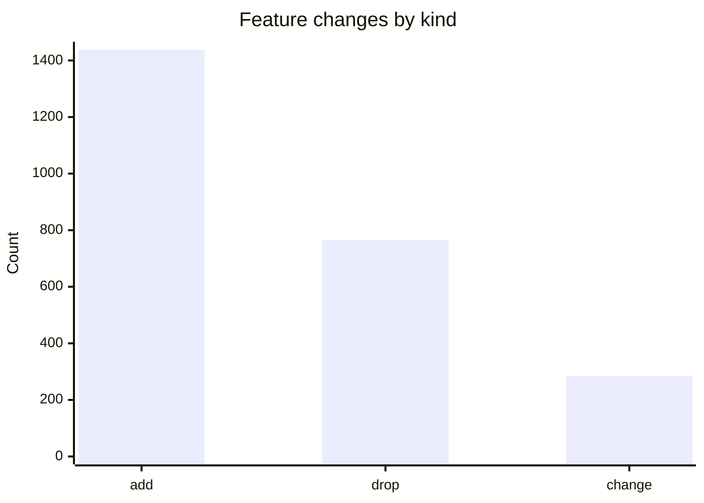

2489 deltas: add/comment 829, add/readme 1, add/symbol 608, change/comment 9, change/doc 39, change/readme 30, change/symbol 207, drop/comment 445, drop/symbol 321.

| Kind | Subject | Name | Area | Author | PR | Commit |
|---|---|---|---|---|---|---|
*Showing 40 of 836 readme/doc/drop deltas (symbol and comment changes counted above); the full list is in the bundle view.*
| add | readme | README.md | `avm/res/cognitive-services/account` | eriqua | #7235 | [f107022](https://github.com/Azure/bicep-registry-modules/commit/f1070229a704c42897f07bdc19913cba26895bae) |
| change | doc | SUPPORT.md | `SUPPORT.md` | myaschmitz | #7287 | [0b934cc](https://github.com/Azure/bicep-registry-modules/commit/0b934cc69d0a9dfd33c505e66883e3ea122f6ace) |
| change | doc | CHANGELOG.md | `avm/ptn/sa/content-generation` | PadhiAjit-Microsoft | #7302 | [6f7b573](https://github.com/Azure/bicep-registry-modules/commit/6f7b5730cb637cdcc1c43bd0a26a0e5dc524a965) |
| change | doc | CHANGELOG.md | `avm/ptn/sa/content-processing` | Abdul-Microsoft | #7301 | [d60585a](https://github.com/Azure/bicep-registry-modules/commit/d60585a9c4277c8c118a6a66373a85ec46cdc166) |
| change | doc | CHANGELOG.md | `avm/ptn/sa/conversation-knowledge-mining` | PadhiAjit-Microsoft | #7307 | [dccb895](https://github.com/Azure/bicep-registry-modules/commit/dccb895035d208e70598a2e4f106272127186d5a) |
| change | doc | CHANGELOG.md | `avm/ptn/sa/document-knowledge-mining` | PadhiAjit-Microsoft | #7305 | [d2fbbb8](https://github.com/Azure/bicep-registry-modules/commit/d2fbbb84a45a21fbd537bd9c3104b76d35ce4e7a) |
| change | doc | CHANGELOG.md | `avm/ptn/sa/multi-agent-custom-automation-engine` | Abdul-Microsoft | #7303 | [568c99e](https://github.com/Azure/bicep-registry-modules/commit/568c99ea3b38471245ef3dfa75745dc5ad7cb142) |
| change | doc | CHANGELOG.md | `avm/res/automation/automation-account` | krbar | #7250 | [512156e](https://github.com/Azure/bicep-registry-modules/commit/512156ec1495ce967fd0d9b054426016bca22425) |
| change | doc | CHANGELOG.md | `avm/res/cognitive-services/account` | eriqua | #7235 | [f107022](https://github.com/Azure/bicep-registry-modules/commit/f1070229a704c42897f07bdc19913cba26895bae) |
| change | doc | CHANGELOG.md | `avm/res/cognitive-services/account` | eriqua | #7254 | [55c62d4](https://github.com/Azure/bicep-registry-modules/commit/55c62d45eaf6675c09bf663616c3e7fdd8c4560f) |
| change | doc | CHANGELOG.md | `avm/res/compute/virtual-machine` | AlexanderSehr | #7264 | [2af429a](https://github.com/Azure/bicep-registry-modules/commit/2af429a8933beea9b7d0754535d33e47eff0d007) |
| change | doc | CHANGELOG.md | `avm/res/container-registry/registry` | AlexanderSehr | #7280 | [f706d97](https://github.com/Azure/bicep-registry-modules/commit/f706d972931aa9ca27895a9b33256ab14b0fa550) |
| change | doc | CHANGELOG.md | `avm/res/document-db/database-account` | AlexanderSehr | #7257 | [9f9ea1a](https://github.com/Azure/bicep-registry-modules/commit/9f9ea1a18204e262be9a4a64e3e3cc7fbe5e509d) |
| change | doc | CHANGELOG.md | `avm/res/document-db/database-account` | nsftwr | #7252 | [6648c83](https://github.com/Azure/bicep-registry-modules/commit/6648c830c1b44d8759bd7be4a04d34f8c3212836) |
| change | doc | CHANGELOG.md | `avm/res/document-db/database-account` | nsftwr | #7252 | [6648c83](https://github.com/Azure/bicep-registry-modules/commit/6648c830c1b44d8759bd7be4a04d34f8c3212836) |
| change | doc | CHANGELOG.md | `avm/res/document-db/database-account` | nsftwr | #7252 | [6648c83](https://github.com/Azure/bicep-registry-modules/commit/6648c830c1b44d8759bd7be4a04d34f8c3212836) |
| change | doc | CHANGELOG.md | `avm/res/document-db/database-account` | nsftwr | #7252 | [6648c83](https://github.com/Azure/bicep-registry-modules/commit/6648c830c1b44d8759bd7be4a04d34f8c3212836) |
| change | doc | CHANGELOG.md | `avm/res/document-db/database-account` | nsftwr | #7252 | [6648c83](https://github.com/Azure/bicep-registry-modules/commit/6648c830c1b44d8759bd7be4a04d34f8c3212836) |
| change | doc | CHANGELOG.md | `avm/res/document-db/database-account` | nsftwr | #7252 | [6648c83](https://github.com/Azure/bicep-registry-modules/commit/6648c830c1b44d8759bd7be4a04d34f8c3212836) |
| change | doc | CHANGELOG.md | `avm/res/document-db/database-account` | nsftwr | #7252 | [6648c83](https://github.com/Azure/bicep-registry-modules/commit/6648c830c1b44d8759bd7be4a04d34f8c3212836) |
| change | doc | CHANGELOG.md | `avm/res/document-db/database-account` | nsftwr | #7252 | [6648c83](https://github.com/Azure/bicep-registry-modules/commit/6648c830c1b44d8759bd7be4a04d34f8c3212836) |
| change | doc | CHANGELOG.md | `avm/res/document-db/database-account` | nsftwr | #7252 | [6648c83](https://github.com/Azure/bicep-registry-modules/commit/6648c830c1b44d8759bd7be4a04d34f8c3212836) |
| change | doc | CHANGELOG.md | `avm/res/document-db/database-account` | nsftwr | #7252 | [6648c83](https://github.com/Azure/bicep-registry-modules/commit/6648c830c1b44d8759bd7be4a04d34f8c3212836) |
| change | doc | CHANGELOG.md | `avm/res/document-db/database-account` | nsftwr | #7252 | [6648c83](https://github.com/Azure/bicep-registry-modules/commit/6648c830c1b44d8759bd7be4a04d34f8c3212836) |
| change | doc | CHANGELOG.md | `avm/res/document-db/database-account` | nsftwr | #7252 | [6648c83](https://github.com/Azure/bicep-registry-modules/commit/6648c830c1b44d8759bd7be4a04d34f8c3212836) |
| change | doc | CHANGELOG.md | `avm/res/document-db/database-account` | nsftwr | #7252 | [6648c83](https://github.com/Azure/bicep-registry-modules/commit/6648c830c1b44d8759bd7be4a04d34f8c3212836) |
| change | doc | CHANGELOG.md | `avm/res/document-db/database-account` | nsftwr | #7252 | [6648c83](https://github.com/Azure/bicep-registry-modules/commit/6648c830c1b44d8759bd7be4a04d34f8c3212836) |
| change | doc | CHANGELOG.md | `avm/res/document-db/database-account` | nsftwr | #7252 | [6648c83](https://github.com/Azure/bicep-registry-modules/commit/6648c830c1b44d8759bd7be4a04d34f8c3212836) |
| change | doc | CHANGELOG.md | `avm/res/document-db/database-account` | nsftwr | #7262 | [4ba2946](https://github.com/Azure/bicep-registry-modules/commit/4ba294668f1628ceaa5de91d3bce0db3f1f57120) |
| change | doc | CHANGELOG.md | `avm/res/document-db/database-account` | nsftwr | #7262 | [4ba2946](https://github.com/Azure/bicep-registry-modules/commit/4ba294668f1628ceaa5de91d3bce0db3f1f57120) |
| change | doc | CHANGELOG.md | `avm/res/document-db/database-account` | nsftwr | #7262 | [4ba2946](https://github.com/Azure/bicep-registry-modules/commit/4ba294668f1628ceaa5de91d3bce0db3f1f57120) |
| change | doc | CHANGELOG.md | `avm/res/network/azure-firewall` | krbar | #7250 | [512156e](https://github.com/Azure/bicep-registry-modules/commit/512156ec1495ce967fd0d9b054426016bca22425) |
| change | doc | CHANGELOG.md | `avm/res/network/dns-resolver` | krbar | #7250 | [512156e](https://github.com/Azure/bicep-registry-modules/commit/512156ec1495ce967fd0d9b054426016bca22425) |
| change | doc | CHANGELOG.md | `avm/res/network/firewall-policy` | krbar | #7250 | [512156e](https://github.com/Azure/bicep-registry-modules/commit/512156ec1495ce967fd0d9b054426016bca22425) |
| change | doc | CHANGELOG.md | `avm/res/network/nat-gateway` | myaschmitz | #7283 | [b87f36a](https://github.com/Azure/bicep-registry-modules/commit/b87f36a311fceb59bf95cf4f270334ed3a36998c) |
| change | doc | CHANGELOG.md | `avm/res/network/virtual-hub` | krbar | #7250 | [512156e](https://github.com/Azure/bicep-registry-modules/commit/512156ec1495ce967fd0d9b054426016bca22425) |
| change | doc | CHANGELOG.md | `avm/res/network/virtual-network` | krbar | #7250 | [512156e](https://github.com/Azure/bicep-registry-modules/commit/512156ec1495ce967fd0d9b054426016bca22425) |
| change | doc | CHANGELOG.md | `avm/res/network/virtual-network` | krbar | #7271 | [93d9827](https://github.com/Azure/bicep-registry-modules/commit/93d98270eae305be5845e13a42e7cb2d316e10f0) |
| change | doc | CHANGELOG.md | `avm/res/operational-insights/workspace` | krbar | #7249 | [7deafda](https://github.com/Azure/bicep-registry-modules/commit/7deafda562c62a95b5f49bf535e0dcdae23a88ff) |
| change | doc | CHANGELOG.md | `avm/res/resources/resource-group` | krbar | #7250 | [512156e](https://github.com/Azure/bicep-registry-modules/commit/512156ec1495ce967fd0d9b054426016bca22425) |

**Moves** (20; `medium` confidence = likely, not certain):
- `searchServiceUpdate` avm/ptn/sa/conversation-knowledge-mining/main.bicep → avm/ptn/sa/conversation-knowledge-mining/modules/ai/ai-search.bicep (confidence medium)
- `searchService` avm/ptn/sa/conversation-knowledge-mining/main.bicep → avm/ptn/sa/conversation-knowledge-mining/modules/ai/ai-search.bicep (confidence medium)
- `networkAcls` avm/ptn/sa/conversation-knowledge-mining/modules/ai-services.bicep → avm/ptn/sa/conversation-knowledge-mining/modules/data/storage-account.bicep (confidence medium)
- `aiSearchResourceId` avm/ptn/sa/conversation-knowledge-mining/modules/deploy_aifp_aisearch_connection.bicep → avm/ptn/sa/conversation-knowledge-mining/modules/identity/role-assignments.bicep (confidence medium)
- `principalId` avm/ptn/sa/conversation-knowledge-mining/modules/role-assignment.bicep → avm/ptn/sa/conversation-knowledge-mining/modules/identity/cross-scope-role-assignment.bicep (confidence medium)
- `roleDefinitionId` avm/ptn/sa/conversation-knowledge-mining/modules/role-assignment.bicep → avm/ptn/sa/conversation-knowledge-mining/modules/identity/cross-scope-role-assignment.bicep (confidence medium)
- `nsgs` avm/ptn/sa/conversation-knowledge-mining/modules/virtualNetwork.bicep → avm/ptn/sa/conversation-knowledge-mining/modules/networking/virtual-network.bicep (confidence medium)
- `virtualNetwork` avm/ptn/sa/conversation-knowledge-mining/modules/virtualNetwork.bicep → avm/ptn/sa/conversation-knowledge-mining/modules/networking/virtual-network.bicep (confidence medium)
- `bastionSubnetResourceId` avm/ptn/sa/conversation-knowledge-mining/modules/virtualNetwork.bicep → avm/ptn/sa/conversation-knowledge-mining/modules/networking/virtual-network.bicep (confidence medium)
- `subnets` avm/ptn/sa/conversation-knowledge-mining/modules/virtualNetwork.bicep → avm/ptn/sa/conversation-knowledge-mining/modules/networking/virtual-network.bicep (confidence medium)
- `logAnalyticsWorkspaceId` avm/ptn/sa/conversation-knowledge-mining/modules/virtualNetwork.bicep → avm/ptn/sa/conversation-knowledge-mining/modules/networking/virtual-network.bicep (confidence medium)
- `resourceSuffix` avm/ptn/sa/conversation-knowledge-mining/modules/virtualNetwork.bicep → avm/ptn/sa/conversation-knowledge-mining/modules/networking/virtual-network.bicep (confidence medium)
- `subnets` avm/ptn/sa/conversation-knowledge-mining/modules/virtualNetwork.bicep → avm/ptn/sa/conversation-knowledge-mining/modules/networking/virtual-network.bicep (confidence medium)
- `defaultHostname` avm/ptn/sa/conversation-knowledge-mining/modules/web-sites.bicep → avm/ptn/sa/conversation-knowledge-mining/modules/compute/app-service.bicep (confidence medium)
- `serverFarmResourceId` avm/ptn/sa/conversation-knowledge-mining/modules/web-sites.bicep → avm/ptn/sa/conversation-knowledge-mining/modules/compute/app-service.bicep (confidence medium)
- `virtualNetworkSubnetId` avm/ptn/sa/conversation-knowledge-mining/modules/web-sites.bicep → avm/ptn/sa/conversation-knowledge-mining/modules/compute/app-service.bicep (confidence medium)
- `vnetRouteAllEnabled` avm/ptn/sa/conversation-knowledge-mining/modules/web-sites.bicep → avm/ptn/sa/conversation-knowledge-mining/modules/compute/app-service.bicep (confidence medium)
- `applicationInsightResourceId` avm/ptn/sa/conversation-knowledge-mining/modules/web-sites.config.bicep → avm/ptn/sa/conversation-knowledge-mining/modules/compute/app-service.bicep (confidence medium)
- `storageAccountResourceId` avm/ptn/sa/conversation-knowledge-mining/modules/web-sites.config.bicep → avm/ptn/sa/conversation-knowledge-mining/modules/identity/role-assignments.bicep (confidence medium)
- `storageAccount` avm/ptn/sa/conversation-knowledge-mining/modules/web-sites.config.bicep → avm/ptn/sa/conversation-knowledge-mining/modules/identity/role-assignments.bicep (confidence medium)

### Symbol-level changes

2419 symbol/comment deltas; 0 TODO comments, 454 comment drops/changes (listed first).

| Detail | Kind | Before | After | PR | Commit |
|---|---|---|---|---|---|
*Showing 40 of 2419 symbol/comment deltas; the full list is in the bundle view.*
| `bicep comment @description('Conditional. The version of Cognitive Services accou…` | drop | `@description('Conditional. The version of Cognitive Services account deployment …` | — | #7235 | [f107022](https://github.com/Azure/bicep-registry-modules/commit/f1070229a704c42897f07bdc19913cba26895bae) |
| `bicep comment @description('Optional. Specify the name of cognitive service acco…` | drop | `@description('Optional. Specify the name of cognitive service account deployment…` | — | #7235 | [f107022](https://github.com/Azure/bicep-registry-modules/commit/f1070229a704c42897f07bdc19913cba26895bae) |
| `bicep comment @description('Optional. The capacity of the resource model definit…` | drop | `@description('Optional. The capacity of the resource model definition representi…` | — | #7235 | [f107022](https://github.com/Azure/bicep-registry-modules/commit/f1070229a704c42897f07bdc19913cba26895bae) |
| `bicep comment @description('Optional. The family of the resource model definitio…` | drop | `@description('Optional. The family of the resource model definition representing…` | — | #7235 | [f107022](https://github.com/Azure/bicep-registry-modules/commit/f1070229a704c42897f07bdc19913cba26895bae) |
| `bicep comment @description('Optional. The name of RAI policy.')` | drop | `@description('Optional. The name of RAI policy.')` | — | #7235 | [f107022](https://github.com/Azure/bicep-registry-modules/commit/f1070229a704c42897f07bdc19913cba26895bae) |
| `bicep comment @description('Optional. The resource model definition representing…` | drop | `@description('Optional. The resource model definition representing SKU.')` | — | #7235 | [f107022](https://github.com/Azure/bicep-registry-modules/commit/f1070229a704c42897f07bdc19913cba26895bae) |
| `bicep comment @description('Optional. The size of the resource model definition …` | drop | `@description('Optional. The size of the resource model definition representing S…` | — | #7235 | [f107022](https://github.com/Azure/bicep-registry-modules/commit/f1070229a704c42897f07bdc19913cba26895bae) |
| `bicep comment @description('Optional. The tier of the resource model definition …` | drop | `@description('Optional. The tier of the resource model definition representing S…` | — | #7235 | [f107022](https://github.com/Azure/bicep-registry-modules/commit/f1070229a704c42897f07bdc19913cba26895bae) |
| `bicep comment @description('Optional. The version upgrade option.')` | change | `@description('Optional. The version upgrade option.')` | `@description('Optional. The version upgrade option.')` | #7235 | [f107022](https://github.com/Azure/bicep-registry-modules/commit/f1070229a704c42897f07bdc19913cba26895bae) |
| `bicep comment @description('Required. Properties of Cognitive Services account d…` | drop | `@description('Required. Properties of Cognitive Services account deployment mode…` | — | #7235 | [f107022](https://github.com/Azure/bicep-registry-modules/commit/f1070229a704c42897f07bdc19913cba26895bae) |
| `bicep comment @description('Required. The format of Cognitive Services account d…` | drop | `@description('Required. The format of Cognitive Services account deployment mode…` | — | #7235 | [f107022](https://github.com/Azure/bicep-registry-modules/commit/f1070229a704c42897f07bdc19913cba26895bae) |
| `bicep comment @description('Required. The name of Cognitive Services account dep…` | drop | `@description('Required. The name of Cognitive Services account deployment model.…` | — | #7235 | [f107022](https://github.com/Azure/bicep-registry-modules/commit/f1070229a704c42897f07bdc19913cba26895bae) |
| `bicep comment @description('Required. The name of the resource model definition …` | drop | `@description('Required. The name of the resource model definition representing S…` | — | #7235 | [f107022](https://github.com/Azure/bicep-registry-modules/commit/f1070229a704c42897f07bdc19913cba26895bae) |
| `bicep comment @description('The type for a cognitive services account deployment…` | drop | `@description('The type for a cognitive services account deployment.')` | — | #7235 | [f107022](https://github.com/Azure/bicep-registry-modules/commit/f1070229a704c42897f07bdc19913cba26895bae) |
| `bicep comment // As of API version 2025-05-01-preview, valid data action strings…` | drop | `// As of API version 2025-05-01-preview, valid data action strings for         /…` | — | #7252 | [6648c83](https://github.com/Azure/bicep-registry-modules/commit/6648c830c1b44d8759bd7be4a04d34f8c3212836) |
| `bicep comment @description('Optional. An array of data actions that are allowed.…` | change | `@description('Optional. An array of data actions that are allowed. Note: Valid d…` | `@description('Optional. An array of data actions that are allowed. Note: Valid d…` | #7252 | [6648c83](https://github.com/Azure/bicep-registry-modules/commit/6648c830c1b44d8759bd7be4a04d34f8c3212836) |
| `bicep comment @description('Optional. An array of data actions that are denied. …` | change | `@description('Optional. An array of data actions that are denied. Note: Unlike S…` | `@description('Optional. An array of data actions that are denied. Note: Unlike S…` | #7252 | [6648c83](https://github.com/Azure/bicep-registry-modules/commit/6648c830c1b44d8759bd7be4a04d34f8c3212836) |
| `bicep comment @description('Optional. An array of data actions that are allowed.…` | change | `@description('Optional. An array of data actions that are allowed. Note: Valid d…` | `@description('Optional. An array of data actions that are allowed. Note: Valid d…` | #7252 | [6648c83](https://github.com/Azure/bicep-registry-modules/commit/6648c830c1b44d8759bd7be4a04d34f8c3212836) |
| `bicep comment @description('Optional. An array of data actions that are denied. …` | change | `@description('Optional. An array of data actions that are denied. Note: Unlike S…` | `@description('Optional. An array of data actions that are denied. Note: Unlike S…` | #7252 | [6648c83](https://github.com/Azure/bicep-registry-modules/commit/6648c830c1b44d8759bd7be4a04d34f8c3212836) |
| `bicep comment @description('Required. Name of the Azure Bastion resource.')` | drop | `@description('Required. Name of the Azure Bastion resource.')` | — | #7283 | [b87f36a](https://github.com/Azure/bicep-registry-modules/commit/b87f36a311fceb59bf95cf4f270334ed3a36998c) |
| `bicep comment @description('Required. An Array of 1 or more IP Address Prefixes …` | drop | `@description('Required. An Array of 1 or more IP Address Prefixes OR the resourc…` | — | #7271 | [93d9827](https://github.com/Azure/bicep-registry-modules/commit/93d98270eae305be5845e13a42e7cb2d316e10f0) |
| `bicep comment @description('Required. List of IP address prefixes to be used for…` | drop | `@description('Required. List of IP address prefixes to be used for the IPAM pool…` | — | #7271 | [93d9827](https://github.com/Azure/bicep-registry-modules/commit/93d98270eae305be5845e13a42e7cb2d316e10f0) |
| `bicep comment // - Deploys all zones if no existing Foundry project is used` | drop | `// - Deploys all zones if no existing Foundry project is used` | — | #7307 | [dccb895](https://github.com/Azure/bicep-registry-modules/commit/dccb895035d208e70598a2e4f106272127186d5a) |
| `bicep comment // - Excludes AI-related zones when using with an existing Foundry…` | drop | `// - Excludes AI-related zones when using with an existing Foundry project` | — | #7307 | [dccb895](https://github.com/Azure/bicep-registry-modules/commit/dccb895035d208e70598a2e4f106272127186d5a) |
| `bicep comment // ========== AI Foundry: AI Search ========== //` | drop | `// ========== AI Foundry: AI Search ========== //` | — | #7307 | [dccb895](https://github.com/Azure/bicep-registry-modules/commit/dccb895035d208e70598a2e4f106272127186d5a) |
| `bicep comment // ========== AI Foundry: AI Services ========== //` | drop | `// ========== AI Foundry: AI Services ========== //` | — | #7307 | [dccb895](https://github.com/Azure/bicep-registry-modules/commit/dccb895035d208e70598a2e4f106272127186d5a) |
| `bicep comment // ========== AVM WAF ========== //` | drop | `// ========== AVM WAF ========== //` | — | #7307 | [dccb895](https://github.com/Azure/bicep-registry-modules/commit/dccb895035d208e70598a2e4f106272127186d5a) |
| `bicep comment // ========== AVM WAF server farm ========== //` | drop | `// ========== AVM WAF server farm ========== //` | — | #7307 | [dccb895](https://github.com/Azure/bicep-registry-modules/commit/dccb895035d208e70598a2e4f106272127186d5a) |
| `bicep comment // ========== Application Insights ========== //` | drop | `// ========== Application Insights ========== //` | — | #7307 | [dccb895](https://github.com/Azure/bicep-registry-modules/commit/dccb895035d208e70598a2e4f106272127186d5a) |
| `bicep comment // ========== Data Collection Rule (Windows VM monitoring) =======…` | drop | `// ========== Data Collection Rule (Windows VM monitoring) ========== //` | — | #7307 | [dccb895](https://github.com/Azure/bicep-registry-modules/commit/dccb895035d208e70598a2e4f106272127186d5a) |
| `bicep comment // ========== Log Analytics Workspace ========== //` | drop | `// ========== Log Analytics Workspace ========== //` | — | #7307 | [dccb895](https://github.com/Azure/bicep-registry-modules/commit/dccb895035d208e70598a2e4f106272127186d5a) |
| `bicep comment // ========== Maintenance Configuration ========== //` | drop | `// ========== Maintenance Configuration ========== //` | — | #7307 | [dccb895](https://github.com/Azure/bicep-registry-modules/commit/dccb895035d208e70598a2e4f106272127186d5a) |
| `bicep comment // ========== Maintenance Configuration Mapping ========== //` | drop | `// ========== Maintenance Configuration Mapping ========== //` | — | #7307 | [dccb895](https://github.com/Azure/bicep-registry-modules/commit/dccb895035d208e70598a2e4f106272127186d5a) |
| `bicep comment // ========== Outputs ========== //` | drop | `// ========== Outputs ========== //` | — | #7307 | [dccb895](https://github.com/Azure/bicep-registry-modules/commit/dccb895035d208e70598a2e4f106272127186d5a) |
| `bicep comment // ========== Parameters ========== //` | drop | `// ========== Parameters ========== //` | — | #7307 | [dccb895](https://github.com/Azure/bicep-registry-modules/commit/dccb895035d208e70598a2e4f106272127186d5a) |
| `bicep comment // ========== Private DNS Zones ========== //` | drop | `// ========== Private DNS Zones ========== //` | — | #7307 | [dccb895](https://github.com/Azure/bicep-registry-modules/commit/dccb895035d208e70598a2e4f106272127186d5a) |
| `bicep comment // ========== Resource Group Tag ========== //` | drop | `// ========== Resource Group Tag ========== //` | — | #7307 | [dccb895](https://github.com/Azure/bicep-registry-modules/commit/dccb895035d208e70598a2e4f106272127186d5a) |
| `bicep comment // ========== SQL Operations User Assigned Identity ========== //` | drop | `// ========== SQL Operations User Assigned Identity ========== //` | — | #7307 | [dccb895](https://github.com/Azure/bicep-registry-modules/commit/dccb895035d208e70598a2e4f106272127186d5a) |
| `bicep comment // ========== SQL Server Private Endpoint (separated) ========== /…` | drop | `// ========== SQL Server Private Endpoint (separated) ========== //` | — | #7307 | [dccb895](https://github.com/Azure/bicep-registry-modules/commit/dccb895035d208e70598a2e4f106272127186d5a) |
| `bicep comment // ========== Search Service to AI Services Role Assignment ======…` | drop | `// ========== Search Service to AI Services Role Assignment ========== //` | — | #7307 | [dccb895](https://github.com/Azure/bicep-registry-modules/commit/dccb895035d208e70598a2e4f106272127186d5a) |

## Content lifecycle (built / changed / dropped)

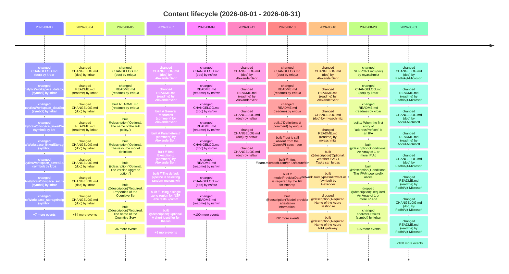
*Showing 77 of 2489 events.*

2478 artifacts: live 1712, removed 746, replaced 20.

*Showing 40 of 794 removed/replaced artifacts plus examples and READMEs; the full list is in the bundle view.*
- **// Frontend container - same for both modes** (comment, `avm/ptn/sa/content-generation/main.bicep`) — removed. Lifecycle: remove by PadhiAjit-Microsoft on 2026-08-31 ([6f7b573](https://github.com/Azure/bicep-registry-modules/commit/6f7b5730cb637cdcc1c43bd0a26a0e5dc524a965))
- **// acrName is required - points to existing ACR with pre-built images** (comment, `avm/ptn/sa/content-generation/main.bicep`) — removed. Lifecycle: remove by PadhiAjit-Microsoft on 2026-08-31 ([6f7b573](https://github.com/Azure/bicep-registry-modules/commit/6f7b5730cb637cdcc1c43bd0a26a0e5dc524a965))
- **@description('Optional. Image Tag.')** (comment, `avm/ptn/sa/content-generation/main.bicep`) — removed. Lifecycle: remove by PadhiAjit-Microsoft on 2026-08-31 ([6f7b573](https://github.com/Azure/bicep-registry-modules/commit/6f7b5730cb637cdcc1c43bd0a26a0e5dc524a965))
- **@description('Optional. The existing Container Registry name (without .azurecr.io). Must contain pre-built images: content-gen-app and conte** (comment, `avm/ptn/sa/content-generation/main.bicep`) — removed. Lifecycle: remove by PadhiAjit-Microsoft on 2026-08-31 ([6f7b573](https://github.com/Azure/bicep-registry-modules/commit/6f7b5730cb637cdcc1c43bd0a26a0e5dc524a965))
- **acrName** (symbol, `avm/ptn/sa/content-generation/main.bicep`) — removed. Lifecycle: remove by PadhiAjit-Microsoft on 2026-08-31 ([6f7b573](https://github.com/Azure/bicep-registry-modules/commit/6f7b5730cb637cdcc1c43bd0a26a0e5dc524a965))
- **imageTag** (symbol, `avm/ptn/sa/content-generation/main.bicep`) — removed. Lifecycle: remove by PadhiAjit-Microsoft on 2026-08-31 ([6f7b573](https://github.com/Azure/bicep-registry-modules/commit/6f7b5730cb637cdcc1c43bd0a26a0e5dc524a965))
- **acrResourceName** (symbol, `avm/ptn/sa/content-generation/main.bicep`) — removed. Lifecycle: remove by PadhiAjit-Microsoft on 2026-08-31 ([6f7b573](https://github.com/Azure/bicep-registry-modules/commit/6f7b5730cb637cdcc1c43bd0a26a0e5dc524a965))
- **// If you need managed identity auth, add AcrPull role to the managed identity on the ACR** (comment, `avm/ptn/sa/content-generation/modules/container-instance.bicep`) — removed. Lifecycle: remove by PadhiAjit-Microsoft on 2026-08-31 ([6f7b573](https://github.com/Azure/bicep-registry-modules/commit/6f7b5730cb637cdcc1c43bd0a26a0e5dc524a965))
- **// Removed imageRegistryCredentials - ACR is public with anonymous pull enabled** (comment, `avm/ptn/sa/content-generation/modules/container-instance.bicep`) — removed. Lifecycle: remove by PadhiAjit-Microsoft on 2026-08-31 ([6f7b573](https://github.com/Azure/bicep-registry-modules/commit/6f7b5730cb637cdcc1c43bd0a26a0e5dc524a965))
- **@description('Optional. User-assigned managed identity resource ID for ACR pull.')** (comment, `avm/ptn/sa/content-generation/modules/container-instance.bicep`) — removed. Lifecycle: remove by PadhiAjit-Microsoft on 2026-08-31 ([6f7b573](https://github.com/Azure/bicep-registry-modules/commit/6f7b5730cb637cdcc1c43bd0a26a0e5dc524a965))
- **@description('Optional. Location for the Azure AI Content Understanding service deployment.')** (comment, `avm/ptn/sa/content-processing/main.bicep`) — removed. Lifecycle: remove by Abdul-Microsoft on 2026-08-31 ([d60585a](https://github.com/Azure/bicep-registry-modules/commit/d60585a9c4277c8c118a6a66373a85ec46cdc166))
- **@description('Optional. Name of the GPT model to deploy: gpt-4o-mini | gpt-4o | gpt-4.')** (comment, `avm/ptn/sa/content-processing/main.bicep`) — removed. Lifecycle: remove by Abdul-Microsoft on 2026-08-31 ([d60585a](https://github.com/Azure/bicep-registry-modules/commit/d60585a9c4277c8c118a6a66373a85ec46cdc166))
- **@description('Optional. The Container Image Name to deploy on the API Container App.')** (comment, `avm/ptn/sa/content-processing/main.bicep`) — removed. Lifecycle: remove by Abdul-Microsoft on 2026-08-31 ([d60585a](https://github.com/Azure/bicep-registry-modules/commit/d60585a9c4277c8c118a6a66373a85ec46cdc166))
- **@description('Optional. The Container Image Name to deploy on the App Container App.')** (comment, `avm/ptn/sa/content-processing/main.bicep`) — removed. Lifecycle: remove by Abdul-Microsoft on 2026-08-31 ([d60585a](https://github.com/Azure/bicep-registry-modules/commit/d60585a9c4277c8c118a6a66373a85ec46cdc166))
- **@description('Optional. The Container Image Name to deploy on the Web Container App.')** (comment, `avm/ptn/sa/content-processing/main.bicep`) — removed. Lifecycle: remove by Abdul-Microsoft on 2026-08-31 ([d60585a](https://github.com/Azure/bicep-registry-modules/commit/d60585a9c4277c8c118a6a66373a85ec46cdc166))
- **@description('Optional. The container image tag to use for all container apps.')** (comment, `avm/ptn/sa/content-processing/main.bicep`) — removed. Lifecycle: remove by Abdul-Microsoft on 2026-08-31 ([d60585a](https://github.com/Azure/bicep-registry-modules/commit/d60585a9c4277c8c118a6a66373a85ec46cdc166))
- **@description('Optional. The public container image endpoint.')** (comment, `avm/ptn/sa/content-processing/main.bicep`) — removed. Lifecycle: remove by Abdul-Microsoft on 2026-08-31 ([d60585a](https://github.com/Azure/bicep-registry-modules/commit/d60585a9c4277c8c118a6a66373a85ec46cdc166))
- **@description('Required. Location for the Azure AI Services deployment.')** (comment, `avm/ptn/sa/content-processing/main.bicep`) — removed. Lifecycle: remove by Abdul-Microsoft on 2026-08-31 ([d60585a](https://github.com/Azure/bicep-registry-modules/commit/d60585a9c4277c8c118a6a66373a85ec46cdc166))
- **@description('The resource ID of the Container App API.')** (comment, `avm/ptn/sa/content-processing/main.bicep`) — removed. Lifecycle: remove by Abdul-Microsoft on 2026-08-31 ([d60585a](https://github.com/Azure/bicep-registry-modules/commit/d60585a9c4277c8c118a6a66373a85ec46cdc166))
- **@description('The resource ID of the Container App Environment.')** (comment, `avm/ptn/sa/content-processing/main.bicep`) — removed. Lifecycle: remove by Abdul-Microsoft on 2026-08-31 ([d60585a](https://github.com/Azure/bicep-registry-modules/commit/d60585a9c4277c8c118a6a66373a85ec46cdc166))
- **avmAiServices_cu** (symbol, `avm/ptn/sa/content-processing/main.bicep`) — removed. Lifecycle: remove by Abdul-Microsoft on 2026-08-31 ([d60585a](https://github.com/Azure/bicep-registry-modules/commit/d60585a9c4277c8c118a6a66373a85ec46cdc166))
- **apiContainerImageName** (symbol, `avm/ptn/sa/content-processing/main.bicep`) — removed. Lifecycle: remove by Abdul-Microsoft on 2026-08-31 ([d60585a](https://github.com/Azure/bicep-registry-modules/commit/d60585a9c4277c8c118a6a66373a85ec46cdc166))
- **appContainerImageName** (symbol, `avm/ptn/sa/content-processing/main.bicep`) — removed. Lifecycle: remove by Abdul-Microsoft on 2026-08-31 ([d60585a](https://github.com/Azure/bicep-registry-modules/commit/d60585a9c4277c8c118a6a66373a85ec46cdc166))
- **containerImageTag** (symbol, `avm/ptn/sa/content-processing/main.bicep`) — removed. Lifecycle: remove by Abdul-Microsoft on 2026-08-31 ([d60585a](https://github.com/Azure/bicep-registry-modules/commit/d60585a9c4277c8c118a6a66373a85ec46cdc166))
- **contentUnderstandingLocation** (symbol, `avm/ptn/sa/content-processing/main.bicep`) — removed. Lifecycle: remove by Abdul-Microsoft on 2026-08-31 ([d60585a](https://github.com/Azure/bicep-registry-modules/commit/d60585a9c4277c8c118a6a66373a85ec46cdc166))
- **publicContainerImageEndpoint** (symbol, `avm/ptn/sa/content-processing/main.bicep`) — removed. Lifecycle: remove by Abdul-Microsoft on 2026-08-31 ([d60585a](https://github.com/Azure/bicep-registry-modules/commit/d60585a9c4277c8c118a6a66373a85ec46cdc166))
- **webContainerImageName** (symbol, `avm/ptn/sa/content-processing/main.bicep`) — removed. Lifecycle: remove by Abdul-Microsoft on 2026-08-31 ([d60585a](https://github.com/Azure/bicep-registry-modules/commit/d60585a9c4277c8c118a6a66373a85ec46cdc166))
- **// - Deploys all zones if no existing Foundry project is used** (comment, `avm/ptn/sa/conversation-knowledge-mining/main.bicep`) — removed. Lifecycle: remove by PadhiAjit-Microsoft on 2026-08-31 ([dccb895](https://github.com/Azure/bicep-registry-modules/commit/dccb895035d208e70598a2e4f106272127186d5a))
- **// - Excludes AI-related zones when using with an existing Foundry project** (comment, `avm/ptn/sa/conversation-knowledge-mining/main.bicep`) — removed. Lifecycle: remove by PadhiAjit-Microsoft on 2026-08-31 ([dccb895](https://github.com/Azure/bicep-registry-modules/commit/dccb895035d208e70598a2e4f106272127186d5a))
- **// ========== AI Foundry: AI Search ========== //** (comment, `avm/ptn/sa/conversation-knowledge-mining/main.bicep`) — removed. Lifecycle: remove by PadhiAjit-Microsoft on 2026-08-31 ([dccb895](https://github.com/Azure/bicep-registry-modules/commit/dccb895035d208e70598a2e4f106272127186d5a))
- **// ========== AI Foundry: AI Services ========== //** (comment, `avm/ptn/sa/conversation-knowledge-mining/main.bicep`) — removed. Lifecycle: remove by PadhiAjit-Microsoft on 2026-08-31 ([dccb895](https://github.com/Azure/bicep-registry-modules/commit/dccb895035d208e70598a2e4f106272127186d5a))
- **// ========== AVM WAF ========== //** (comment, `avm/ptn/sa/conversation-knowledge-mining/main.bicep`) — removed. Lifecycle: remove by PadhiAjit-Microsoft on 2026-08-31 ([dccb895](https://github.com/Azure/bicep-registry-modules/commit/dccb895035d208e70598a2e4f106272127186d5a))
- **// ========== AVM WAF server farm ========== //** (comment, `avm/ptn/sa/conversation-knowledge-mining/main.bicep`) — removed. Lifecycle: remove by PadhiAjit-Microsoft on 2026-08-31 ([dccb895](https://github.com/Azure/bicep-registry-modules/commit/dccb895035d208e70598a2e4f106272127186d5a))
- **// ========== Application Insights ========== //** (comment, `avm/ptn/sa/conversation-knowledge-mining/main.bicep`) — removed. Lifecycle: remove by PadhiAjit-Microsoft on 2026-08-31 ([dccb895](https://github.com/Azure/bicep-registry-modules/commit/dccb895035d208e70598a2e4f106272127186d5a))
- **// ========== Data Collection Rule (Windows VM monitoring) ========== //** (comment, `avm/ptn/sa/conversation-knowledge-mining/main.bicep`) — removed. Lifecycle: remove by PadhiAjit-Microsoft on 2026-08-31 ([dccb895](https://github.com/Azure/bicep-registry-modules/commit/dccb895035d208e70598a2e4f106272127186d5a))
- **// ========== Log Analytics Workspace ========== //** (comment, `avm/ptn/sa/conversation-knowledge-mining/main.bicep`) — removed. Lifecycle: remove by PadhiAjit-Microsoft on 2026-08-31 ([dccb895](https://github.com/Azure/bicep-registry-modules/commit/dccb895035d208e70598a2e4f106272127186d5a))
- **// ========== Maintenance Configuration ========== //** (comment, `avm/ptn/sa/conversation-knowledge-mining/main.bicep`) — removed. Lifecycle: remove by PadhiAjit-Microsoft on 2026-08-31 ([dccb895](https://github.com/Azure/bicep-registry-modules/commit/dccb895035d208e70598a2e4f106272127186d5a))
- **// ========== Maintenance Configuration Mapping ========== //** (comment, `avm/ptn/sa/conversation-knowledge-mining/main.bicep`) — removed. Lifecycle: remove by PadhiAjit-Microsoft on 2026-08-31 ([dccb895](https://github.com/Azure/bicep-registry-modules/commit/dccb895035d208e70598a2e4f106272127186d5a))
- **// ========== Outputs ========== //** (comment, `avm/ptn/sa/conversation-knowledge-mining/main.bicep`) — removed. Lifecycle: remove by PadhiAjit-Microsoft on 2026-08-31 ([dccb895](https://github.com/Azure/bicep-registry-modules/commit/dccb895035d208e70598a2e4f106272127186d5a))
- **// ========== Parameters ========== //** (comment, `avm/ptn/sa/conversation-knowledge-mining/main.bicep`) — removed. Lifecycle: remove by PadhiAjit-Microsoft on 2026-08-31 ([dccb895](https://github.com/Azure/bicep-registry-modules/commit/dccb895035d208e70598a2e4f106272127186d5a))

## Shipped by code area

*Formatter rule: a train touching more than 10 code areas is listed once under "Cross-cutting" with its area count, instead of under every area.*

### workflows (`.github/workflows`)
- [fix: bump github/codeql-action/upload-sarif from 4.37.3 to 4.37.4](https://github.com/Azure/bicep-registry-modules/pull/7246) (pr #7246) — train `train-pr-7246`
- [fix: bump github/codeql-action/upload-sarif from 4.37.4 to 4.37.6](https://github.com/Azure/bicep-registry-modules/pull/7258) (pr #7258) — train `train-pr-7258`
- [fix: bump github/codeql-action/upload-sarif from 4.37.6 to 4.37.7](https://github.com/Azure/bicep-registry-modules/pull/7282) (pr #7282) — train `train-pr-7282`
- [fix: bump github/codeql-action/upload-sarif from 4.37.7 to 4.37.8](https://github.com/Azure/bicep-registry-modules/pull/7294) (pr #7294) — train `train-pr-7294`
- [fix: bump github/codeql-action/upload-sarif from 4.37.8 to 4.37.9](https://github.com/Azure/bicep-registry-modules/pull/7308) (pr #7308) — train `train-pr-7308`

### account (`avm/res/cognitive-services/account`)
- [feat(`avm/res/cognitive-services/account`): extract deployments child module](https://github.com/Azure/bicep-registry-modules/pull/7235) (pr #7235) — train `train-pr-7235`
- [feat: avm/res/cognitive-services/account support `modelProviderData`](https://github.com/Azure/bicep-registry-modules/pull/7254) (pr #7254) — train `train-issue-7197`
- [[AVM Module Issue]: [avm/res/cognitive-services/account] Support modelProviderData for GA partner models (Anthropic Claude)](https://github.com/Azure/bicep-registry-modules/issues/7197) (issue #7197) — train `train-issue-7197`

### database-account (`avm/res/document-db/database-account`)
- [feat: Feature/Add Dynamic Data Masking Capability](https://github.com/Azure/bicep-registry-modules/pull/7252) (pr #7252) — train `train-pr-7252`
- [feat: CosmosDB - "Rebased Add SecuredByPerimeter support for Cosmos DB publicNetworkAccess- #6710"](https://github.com/Azure/bicep-registry-modules/pull/7257) (pr #7257) — train `train-pr-7257`
- [fix: Correct DDM policy condition when determining if the Data Masking capability is enabled](https://github.com/Azure/bicep-registry-modules/pull/7262) (pr #7262) — train `train-pr-7262`

### virtual-network (`avm/res/network/virtual-network`)
- [fix: Prevent child module deployment name conflicts across multiple modules](https://github.com/Azure/bicep-registry-modules/pull/7250) (pr #7250) — train `train-pr-7250`
- [feat: Add VNET-level IPAM Pool Prefix Allocations support to `avm/res/network/virtual-network`](https://github.com/Azure/bicep-registry-modules/pull/7271) (pr #7271) — train `train-issue-6695`
- [[AVM Module Issue]: Add suppport for existing vnet linking to ipam pool](https://github.com/Azure/bicep-registry-modules/issues/6695) (issue #6695) — train `train-issue-6695`

### SUPPORT.md (`SUPPORT.md`)
- [docs: replace unedited SUPPORT.md template with AVM support content](https://github.com/Azure/bicep-registry-modules/pull/7287) (pr #7287) — train `train-issue-6736`
- [Remove the `TODO` section from t he SUPPORT.md file](https://github.com/Azure/bicep-registry-modules/issues/6736) (issue #6736) — train `train-issue-6736`

### virtual-machine (`avm/res/compute/virtual-machine`)
- [fix: VM - Refreshing files](https://github.com/Azure/bicep-registry-modules/pull/7264) (pr #7264) — train `train-issue-2422`
- [[AVM Module Issue]: Add support to configure diskControllerType for avm/res/compute/virtual-machine](https://github.com/Azure/bicep-registry-modules/issues/3813) (issue #3813) — train `train-issue-2422`

### registry (`avm/res/container-registry/registry`)
- [feat: ACR - Added support to bypass network rules for ACR tasks.](https://github.com/Azure/bicep-registry-modules/pull/7280) (pr #7280) — train `train-issue-6990`
- [[AVM Module Issue]: Unable to bypass network rules for ACR Tasks](https://github.com/Azure/bicep-registry-modules/issues/6990) (issue #6990) — train `train-issue-6990`

### nat-gateway (`avm/res/network/nat-gateway`)
- [fix: NAT Gateway - Correct `name` parameter description](https://github.com/Azure/bicep-registry-modules/pull/7283) (pr #7283) — train `train-issue-6927`
- [[AVM Module Issue]: network/natGateways resource name is documented as 'Bastion'](https://github.com/Azure/bicep-registry-modules/issues/6927) (issue #6927) — train `train-issue-6927`

### workspace (`avm/res/operational-insights/workspace`)
- [fix: Deployment name creation for child modules of `avm/res/operational-insights/workspace`](https://github.com/Azure/bicep-registry-modules/pull/7249) (pr #7249) — train `train-issue-7194`
- [[AVM Module Issue]: identical deployment name for multiple log analytics data export rules](https://github.com/Azure/bicep-registry-modules/issues/7194) (issue #7194) — train `train-issue-7194`

### content-generation (`avm/ptn/sa/content-generation`)
- [feat: Updated AVM content gen v2 modules](https://github.com/Azure/bicep-registry-modules/pull/7302) (pr #7302) — train `train-pr-7302`

### content-processing (`avm/ptn/sa/content-processing`)
- [feat: AVM Module upgrade for Content Processing](https://github.com/Azure/bicep-registry-modules/pull/7301) (pr #7301) — train `train-pr-7301`

### conversation-knowledge-mining (`avm/ptn/sa/conversation-knowledge-mining`)
- [feat: AVM conversation knowledge mining update](https://github.com/Azure/bicep-registry-modules/pull/7307) (pr #7307) — train `train-pr-7307`

### document-knowledge-mining (`avm/ptn/sa/document-knowledge-mining`)
- [feat: DKM avm modules updated](https://github.com/Azure/bicep-registry-modules/pull/7305) (pr #7305) — train `train-pr-7305`

### multi-agent-custom-automation-engine (`avm/ptn/sa/multi-agent-custom-automation-engine`)
- [feat: AVM Module Upgrade for Multi Agent](https://github.com/Azure/bicep-registry-modules/pull/7303) (pr #7303) — train `train-pr-7303`

### automation-account (`avm/res/automation/automation-account`)
- [fix: Prevent child module deployment name conflicts across multiple modules](https://github.com/Azure/bicep-registry-modules/pull/7250) (pr #7250) — train `train-pr-7250`

### azure-firewall (`avm/res/network/azure-firewall`)
- [fix: Prevent child module deployment name conflicts across multiple modules](https://github.com/Azure/bicep-registry-modules/pull/7250) (pr #7250) — train `train-pr-7250`

### dns-resolver (`avm/res/network/dns-resolver`)
- [fix: Prevent child module deployment name conflicts across multiple modules](https://github.com/Azure/bicep-registry-modules/pull/7250) (pr #7250) — train `train-pr-7250`

### firewall-policy (`avm/res/network/firewall-policy`)
- [fix: Prevent child module deployment name conflicts across multiple modules](https://github.com/Azure/bicep-registry-modules/pull/7250) (pr #7250) — train `train-pr-7250`

### virtual-hub (`avm/res/network/virtual-hub`)
- [fix: Prevent child module deployment name conflicts across multiple modules](https://github.com/Azure/bicep-registry-modules/pull/7250) (pr #7250) — train `train-pr-7250`

### resource-group (`avm/res/resources/resource-group`)
- [fix: Prevent child module deployment name conflicts across multiple modules](https://github.com/Azure/bicep-registry-modules/pull/7250) (pr #7250) — train `train-pr-7250`

### pipelines (`utilities/pipelines`)
- [feat: CI - Expanded diff check to include also non-committed changes](https://github.com/Azure/bicep-registry-modules/pull/7260) (pr #7260) — train `train-pr-7260`

### Unattributed
- [[AVM Module Issue]: `avm/ptn/lz/sub-vending` Custom RBAC Configuration](https://github.com/Azure/bicep-registry-modules/issues/4965) (issue #4965) — train `train-issue-4965`
- [[AVM Module Issue]: Feature request - Budgets as part of subscription vending](https://github.com/Azure/bicep-registry-modules/issues/6802) (issue #6802) — train `None`
- [[AVM Module Issue]: dns-zone: dnssecConfig is not allowed on object of type "params"](https://github.com/Azure/bicep-registry-modules/issues/7029) (issue #7029) — train `None`
- [[Failed pipeline] avm.res.compute.virtual-machine](https://github.com/Azure/bicep-registry-modules/issues/7203) (issue #7203) — train `None`
- [[AVM Module Issue]: Implement `Microsoft.CognitiveServices/accounts/deployments` as a child resource via a `deployment` child module](https://github.com/Azure/bicep-registry-modules/issues/7206) (issue #7206) — train `None`
- [[Failed pipeline] .Platform - Rerun failed workflows](https://github.com/Azure/bicep-registry-modules/issues/7268) (issue #7268) — train `None`

## Module dependency graph / blast radius

```mermaid
flowchart LR
    m_avm_ptn_aca_lza_hosting__4ab939fd("hosting-environment")
    m_avm_ptn_ai_ml_ai_foundry_daf72234("ai-foundry")
    m_avm_ptn_ai_platform_base_07084010("baseline")
    m_avm_ptn_app_container_jo_01ce6e97("container-job-toolkit")
    m_avm_ptn_app_iaas_vm_cosm_17ed9f52("iaas-vm-cosmosdb-tier4")
    m_avm_ptn_app_paas_ase_cos_e63d5137("paas-ase-cosmosdb-tier4")
    m_avm_ptn_app_service_lza__84659e8b("hosting-environment")
    m_avm_ptn_azd_ml_hub_depen_7db1e403("ml-hub-dependencies")
    m_avm_ptn_data_private_ana_84eb8a13("private-analytical-workspace")
    m_avm_ptn_dev_ops_cicd_age_4f24c142("cicd-agents-and-runners")
    m_avm_ptn_finops_toolkit_f_cd9a94bc("finops-hub")
    m_avm_ptn_lz_sub_vending_f17bb317("sub-vending")
    m_avm_ptn_network_hub_netw_7d32773d("hub-networking")
    m_avm_ptn_sa_build_your_ow_2764e7a2("build-your-own-copilot")
    m_avm_ptn_sa_chat_with_you_4a9b94ec("chat-with-your-data")
    m_avm_ptn_sa_content_gener_8f6c7eaa("content-generation")
    m_avm_ptn_sa_content_proce_06399f11("content-processing")
    m_avm_ptn_sa_conversation__ddcfeed9("conversation-knowledge-mining")
    m_avm_ptn_sa_customer_chat_13fdab41("customer-chatbot")
    m_avm_ptn_sa_document_know_b9b67c8f("document-knowledge-mining")
    m_avm_ptn_sa_modernize_you_bad1b0cb("modernize-your-code")
    m_avm_ptn_sa_multi_agent_c_81c8a268("multi-agent-custom-automation-engine")
    m_avm_ptn_virtual_machine__7a92f31d("azure-image-builder")
    m_avm_res_api_management_s_2b0058e5("service")
    m_avm_res_app_configuratio_3539dbc7("configuration-store")
    m_avm_res_app_managed_envi_98cc9200("managed-environment")
    m_avm_res_automation_autom_b279e791("automation-account")
    m_avm_res_batch_batch_acco_f2485b83("batch-account")
    m_avm_res_cache_redis_8a515c1d("redis")
    m_avm_res_cache_redis_ente_5b66bafe("redis-enterprise")
    m_avm_res_cognitive_servic_d1b76e3a("account")
    m_avm_res_container_regist_52956c8c("registry")
    m_avm_res_data_factory_fac_9837c087("factory")
    m_avm_res_databricks_works_0017da29("workspace")
    m_avm_res_db_for_my_sql_fl_cfc83c9b("flexible-server")
    m_avm_res_db_for_postgre_s_a07df15a("flexible-server")
    m_avm_res_desktop_virtuali_1490ef16("host-pool")
    m_avm_res_desktop_virtuali_7e94ef14("workspace")
    m_avm_res_devices_iot_hub_db2d832f("iot-hub")
    m_avm_res_digital_twins_di_ecb57856("digital-twins-instance")
    m_avm_res_document_db_data_0a2d9e37("database-account")
    m_avm_res_document_db_mong_87da1ee4("mongo-cluster")
    m_avm_res_elastic_san_elas_45aab801("elastic-san")
    m_avm_res_event_grid_domai_0bcb0751("domain")
    m_avm_res_event_grid_names_062d9b1e("namespace")
    m_avm_res_event_grid_topic_63b71d3f("topic")
    m_avm_res_event_hub_namesp_2bdc75e8("namespace")
    m_avm_res_insights_private_a2be6952("private-link-scope")
    m_avm_res_key_vault_vault_c70f9a76("vault")
    m_avm_res_kusto_cluster_f35c24f0("cluster")
    m_avm_res_machine_learning_0d90c9cd("workspace")
    m_avm_res_machine_learning_3b8de16f("registry")
    m_avm_res_network_applicat_7ebff000("application-gateway")
    m_avm_res_network_network__01c714d7("network-security-group")
    m_avm_res_network_private__4589062a("private-endpoint")
    m_avm_res_network_private__de8401c0("private-dns-zone")
    m_avm_res_network_virtual__186ab112("virtual-network")
    m_avm_res_purview_account_92f12cd5("account")
    m_avm_res_recovery_service_fe1eea23("vault")
    m_avm_res_relay_namespace_a4658b35("namespace")
    m_avm_res_search_search_se_b0571790("search-service")
    m_avm_res_service_bus_name_25980373("namespace")
    m_avm_res_signal_r_service_5f12d1a6("signal-r")
    m_avm_res_signal_r_service_94092b83("web-pub-sub")
    m_avm_res_sql_server_37ee6d9e("server")
    m_avm_res_storage_storage__2efc02f3("storage-account")
    m_avm_res_synapse_private__084e0bfb("private-link-hub")
    m_avm_res_synapse_workspac_8bec616b("workspace")
    m_avm_res_web_site_b3ffc95b("site")
    m_avm_res_web_static_site_e1900666("static-site")
    m_avm_ptn_aca_lza_hosting__4ab939fd -->|"0.5.0"| m_avm_res_network_network__01c714d7
    m_avm_ptn_aca_lza_hosting__4ab939fd -->|"0.7.0"| m_avm_res_network_private__de8401c0
    m_avm_ptn_aca_lza_hosting__4ab939fd -->|"0.8.0"| m_avm_res_network_private__de8401c0
    m_avm_ptn_aca_lza_hosting__4ab939fd -->|"0.5.2"| m_avm_res_network_virtual__186ab112
    m_avm_ptn_aca_lza_hosting__4ab939fd -->|"0.15.0"| m_avm_res_storage_storage__2efc02f3
    m_avm_ptn_ai_ml_ai_foundry_daf72234 -->|"0.32.0"| m_avm_res_storage_storage__2efc02f3
    m_avm_ptn_ai_platform_base_07084010 -->|"0.3.1"| m_avm_res_network_network__01c714d7
    m_avm_ptn_ai_platform_base_07084010 -->|"0.3.1"| m_avm_res_network_private__de8401c0
    m_avm_ptn_ai_platform_base_07084010 -->|"0.4.0"| m_avm_res_network_virtual__186ab112
    m_avm_ptn_ai_platform_base_07084010 -->|"0.11.0"| m_avm_res_storage_storage__2efc02f3
    m_avm_ptn_app_container_jo_01ce6e97 -->|"0.5.1"| m_avm_res_network_network__01c714d7
    m_avm_ptn_app_container_jo_01ce6e97 -->|"0.11.0"| m_avm_res_network_private__4589062a
    m_avm_ptn_app_container_jo_01ce6e97 -->|"0.7.1"| m_avm_res_network_private__de8401c0
    m_avm_ptn_app_container_jo_01ce6e97 -->|"0.7.0"| m_avm_res_network_virtual__186ab112
    m_avm_ptn_app_container_jo_01ce6e97 -->|"0.25.1"| m_avm_res_storage_storage__2efc02f3
    m_avm_ptn_app_iaas_vm_cosm_17ed9f52 -->|"0.5.1"| m_avm_res_network_network__01c714d7
    m_avm_ptn_app_iaas_vm_cosm_17ed9f52 -->|"0.11.0"| m_avm_res_network_private__4589062a
    m_avm_ptn_app_iaas_vm_cosm_17ed9f52 -->|"0.7.1"| m_avm_res_network_private__de8401c0
    m_avm_ptn_app_iaas_vm_cosm_17ed9f52 -->|"0.7.0"| m_avm_res_network_virtual__186ab112
    m_avm_ptn_app_iaas_vm_cosm_17ed9f52 -->|"0.25.0"| m_avm_res_storage_storage__2efc02f3
    m_avm_ptn_app_paas_ase_cos_e63d5137 -->|"0.5.2"| m_avm_res_network_network__01c714d7
    m_avm_ptn_app_paas_ase_cos_e63d5137 -->|"0.11.1"| m_avm_res_network_private__4589062a
    m_avm_ptn_app_paas_ase_cos_e63d5137 -->|"0.8.0"| m_avm_res_network_private__de8401c0
    m_avm_ptn_app_paas_ase_cos_e63d5137 -->|"0.7.1"| m_avm_res_network_virtual__186ab112
    m_avm_ptn_app_service_lza__84659e8b -->|"0.5.2"| m_avm_res_network_network__01c714d7
    m_avm_ptn_app_service_lza__84659e8b -->|"0.12.0"| m_avm_res_network_private__4589062a
    m_avm_ptn_app_service_lza__84659e8b -->|"0.8.1"| m_avm_res_network_private__de8401c0
    m_avm_ptn_app_service_lza__84659e8b -->|"0.7.2"| m_avm_res_network_virtual__186ab112
    m_avm_ptn_azd_ml_hub_depen_7db1e403 -->|"0.19.0"| m_avm_res_storage_storage__2efc02f3
    m_avm_ptn_data_private_ana_84eb8a13 -->|"0.5.0"| m_avm_res_network_network__01c714d7
    m_avm_ptn_data_private_ana_84eb8a13 -->|"0.5.0"| m_avm_res_network_private__de8401c0
    m_avm_ptn_data_private_ana_84eb8a13 -->|"0.6.0"| m_avm_res_network_private__de8401c0
    m_avm_ptn_data_private_ana_84eb8a13 -->|"0.5.0"| m_avm_res_network_virtual__186ab112
    m_avm_ptn_dev_ops_cicd_age_4f24c142 -->|"0.8.0"| m_avm_res_network_private__de8401c0
    m_avm_ptn_dev_ops_cicd_age_4f24c142 -->|"0.7.0"| m_avm_res_network_virtual__186ab112
    m_avm_ptn_dev_ops_cicd_age_4f24c142 -->|"0.26.2"| m_avm_res_storage_storage__2efc02f3
    m_avm_ptn_finops_toolkit_f_cd9a94bc -->|"0.8.3"| m_avm_res_storage_storage__2efc02f3
    m_avm_ptn_lz_sub_vending_f17bb317 -->|"0.5.2"| m_avm_res_network_network__01c714d7
    m_avm_ptn_lz_sub_vending_f17bb317 -->|"0.8.0"| m_avm_res_network_private__de8401c0
    m_avm_ptn_lz_sub_vending_f17bb317 -->|"0.7.2"| m_avm_res_network_virtual__186ab112
    m_avm_ptn_lz_sub_vending_f17bb317 -->|"0.26.2"| m_avm_res_storage_storage__2efc02f3
    m_avm_ptn_network_hub_netw_7d32773d -->|"0.7.0"| m_avm_res_network_virtual__186ab112
    m_avm_ptn_sa_build_your_ow_2764e7a2 -->|"0.5.2"| m_avm_res_network_network__01c714d7
    m_avm_ptn_sa_build_your_ow_2764e7a2 -->|"0.11.1"| m_avm_res_network_private__4589062a
    m_avm_ptn_sa_build_your_ow_2764e7a2 -->|"0.8.0"| m_avm_res_network_private__de8401c0
    m_avm_ptn_sa_build_your_ow_2764e7a2 -->|"0.7.1"| m_avm_res_network_virtual__186ab112
    m_avm_ptn_sa_build_your_ow_2764e7a2 -->|"0.29.0"| m_avm_res_storage_storage__2efc02f3
    m_avm_ptn_sa_chat_with_you_4a9b94ec -->|"0.5.3"| m_avm_res_network_network__01c714d7
    m_avm_ptn_sa_chat_with_you_4a9b94ec -->|"0.12.0"| m_avm_res_network_private__4589062a
    m_avm_ptn_sa_chat_with_you_4a9b94ec -->|"0.12.1"| m_avm_res_network_private__4589062a
    m_avm_ptn_sa_chat_with_you_4a9b94ec -->|"0.8.1"| m_avm_res_network_virtual__186ab112
    m_avm_ptn_sa_content_gener_8f6c7eaa -->|"0.5.3"| m_avm_res_network_network__01c714d7
    m_avm_ptn_sa_content_gener_8f6c7eaa -->|"0.12.0"| m_avm_res_network_private__4589062a
    m_avm_ptn_sa_content_gener_8f6c7eaa -->|"0.8.1"| m_avm_res_network_private__de8401c0
    m_avm_ptn_sa_content_gener_8f6c7eaa -->|"0.8.1"| m_avm_res_network_virtual__186ab112
    m_avm_ptn_sa_content_gener_8f6c7eaa -->|"0.32.0"| m_avm_res_storage_storage__2efc02f3
    m_avm_ptn_sa_content_proce_06399f11 -->|"0.5.2"| m_avm_res_network_network__01c714d7
    m_avm_ptn_sa_content_proce_06399f11 -->|"0.11.1"| m_avm_res_network_private__4589062a
    m_avm_ptn_sa_content_proce_06399f11 -->|"0.8.1"| m_avm_res_network_private__de8401c0
    m_avm_ptn_sa_content_proce_06399f11 -->|"0.7.1"| m_avm_res_network_virtual__186ab112
    m_avm_ptn_sa_content_proce_06399f11 -->|"0.33.0"| m_avm_res_storage_storage__2efc02f3
    m_avm_ptn_sa_conversation__ddcfeed9 -->|"0.12.0"| m_avm_res_network_private__4589062a
    m_avm_ptn_sa_conversation__ddcfeed9 -->|"0.8.1"| m_avm_res_network_private__de8401c0
    m_avm_ptn_sa_conversation__ddcfeed9 -->|"0.8.0"| m_avm_res_network_virtual__186ab112
    m_avm_ptn_sa_customer_chat_13fdab41 -->|"0.12.0"| m_avm_res_network_private__4589062a
    m_avm_ptn_sa_customer_chat_13fdab41 -->|"0.8.1"| m_avm_res_network_private__de8401c0
    m_avm_ptn_sa_customer_chat_13fdab41 -->|"0.8.0"| m_avm_res_network_virtual__186ab112
    m_avm_ptn_sa_document_know_b9b67c8f -->|"0.8.1"| m_avm_res_network_private__de8401c0
    m_avm_ptn_sa_document_know_b9b67c8f -->|"0.10.1"| m_avm_res_network_virtual__186ab112
    m_avm_ptn_sa_modernize_you_bad1b0cb -->|"0.12.0"| m_avm_res_network_private__4589062a
    m_avm_ptn_sa_modernize_you_bad1b0cb -->|"0.8.1"| m_avm_res_network_private__de8401c0
    m_avm_ptn_sa_modernize_you_bad1b0cb -->|"0.8.1"| m_avm_res_network_virtual__186ab112
    m_avm_ptn_sa_multi_agent_c_81c8a268 -->|"0.12.0"| m_avm_res_network_private__4589062a
    m_avm_ptn_sa_multi_agent_c_81c8a268 -->|"0.8.1"| m_avm_res_network_private__de8401c0
    m_avm_ptn_sa_multi_agent_c_81c8a268 -->|"0.8.1"| m_avm_res_network_virtual__186ab112
    m_avm_ptn_virtual_machine__7a92f31d -->|"0.7.0"| m_avm_res_network_virtual__186ab112
    m_avm_res_api_management_s_2b0058e5 -->|"0.12.1"| m_avm_res_network_private__4589062a
    m_avm_res_app_configuratio_3539dbc7 -->|"0.11.0"| m_avm_res_network_private__4589062a
    m_avm_res_app_managed_envi_98cc9200 -->|"0.12.1"| m_avm_res_network_private__4589062a
    m_avm_res_automation_autom_b279e791 -->|"0.12.1"| m_avm_res_network_private__4589062a
    m_avm_res_batch_batch_acco_f2485b83 -->|"0.11.0"| m_avm_res_network_private__4589062a
    m_avm_res_cache_redis_8a515c1d -->|"0.12.0"| m_avm_res_network_private__4589062a
    m_avm_res_cache_redis_ente_5b66bafe -->|"0.12.0"| m_avm_res_network_private__4589062a
    m_avm_res_cognitive_servic_d1b76e3a -->|"0.11.1"| m_avm_res_network_private__4589062a
    m_avm_res_container_regist_52956c8c -->|"0.12.0"| m_avm_res_network_private__4589062a
    m_avm_res_data_factory_fac_9837c087 -->|"0.12.0"| m_avm_res_network_private__4589062a
    m_avm_res_databricks_works_0017da29 -->|"0.11.1"| m_avm_res_network_private__4589062a
    m_avm_res_db_for_my_sql_fl_cfc83c9b -->|"0.12.0"| m_avm_res_network_private__4589062a
    m_avm_res_db_for_postgre_s_a07df15a -->|"0.12.0"| m_avm_res_network_private__4589062a
    m_avm_res_desktop_virtuali_1490ef16 -->|"0.11.0"| m_avm_res_network_private__4589062a
    m_avm_res_desktop_virtuali_7e94ef14 -->|"0.12.1"| m_avm_res_network_private__4589062a
    m_avm_res_devices_iot_hub_db2d832f -->|"0.12.1"| m_avm_res_network_private__4589062a
    m_avm_res_digital_twins_di_ecb57856 -->|"0.11.0"| m_avm_res_network_private__4589062a
    m_avm_res_document_db_data_0a2d9e37 -->|"0.11.1"| m_avm_res_network_private__4589062a
    m_avm_res_document_db_mong_87da1ee4 -->|"0.12.0"| m_avm_res_network_private__4589062a
    m_avm_res_elastic_san_elas_45aab801 -->|"0.11.1"| m_avm_res_network_private__4589062a
    m_avm_res_event_grid_domai_0bcb0751 -->|"0.10.1"| m_avm_res_network_private__4589062a
    m_avm_res_event_grid_names_062d9b1e -->|"0.10.1"| m_avm_res_network_private__4589062a
    m_avm_res_event_grid_topic_63b71d3f -->|"0.11.1"| m_avm_res_network_private__4589062a
    m_avm_res_event_hub_namesp_2bdc75e8 -->|"0.11.1"| m_avm_res_network_private__4589062a
    m_avm_res_insights_private_a2be6952 -->|"0.10.1"| m_avm_res_network_private__4589062a
    m_avm_res_key_vault_vault_c70f9a76 -->|"0.11.0"| m_avm_res_network_private__4589062a
    m_avm_res_kusto_cluster_f35c24f0 -->|"0.12.0"| m_avm_res_network_private__4589062a
    m_avm_res_machine_learning_0d90c9cd -->|"0.10.1"| m_avm_res_network_private__4589062a
    m_avm_res_machine_learning_3b8de16f -->|"0.11.0"| m_avm_res_network_private__4589062a
    m_avm_res_network_applicat_7ebff000 -->|"0.12.0"| m_avm_res_network_private__4589062a
    m_avm_res_purview_account_92f12cd5 -->|"0.10.1"| m_avm_res_network_private__4589062a
    m_avm_res_recovery_service_fe1eea23 -->|"0.12.1"| m_avm_res_network_private__4589062a
    m_avm_res_relay_namespace_a4658b35 -->|"0.10.1"| m_avm_res_network_private__4589062a
    m_avm_res_search_search_se_b0571790 -->|"0.12.0"| m_avm_res_network_private__4589062a
    m_avm_res_service_bus_name_25980373 -->|"0.11.1"| m_avm_res_network_private__4589062a
    m_avm_res_signal_r_service_5f12d1a6 -->|"0.11.0"| m_avm_res_network_private__4589062a
    m_avm_res_signal_r_service_94092b83 -->|"0.11.0"| m_avm_res_network_private__4589062a
    m_avm_res_sql_server_37ee6d9e -->|"0.12.1"| m_avm_res_network_private__4589062a
    m_avm_res_storage_storage__2efc02f3 -->|"0.11.1"| m_avm_res_network_private__4589062a
    m_avm_res_synapse_private__084e0bfb -->|"0.12.0"| m_avm_res_network_private__4589062a
    m_avm_res_synapse_workspac_8bec616b -->|"0.11.0"| m_avm_res_network_private__4589062a
    m_avm_res_web_site_b3ffc95b -->|"0.12.0"| m_avm_res_network_private__4589062a
    m_avm_res_web_static_site_e1900666 -->|"0.11.1"| m_avm_res_network_private__4589062a
    m_avm_res_web_static_site_e1900666 -->|"0.8.0"| m_avm_res_network_private__de8401c0
    more["+709 more edges not shown"]
```
*Showing 120 of 829 edges.*

929 edges over 225 areas; edge extraction {'failed': 0, 'resolved': 18, 'skipped': 3, 'timeout': 0}.

## Module ownership

| Module | Owners (CODEOWNERS) | Top contributors | Commits | PRs | Files |
|---|---|---|---|---|---|
| `.github/workflows` | Azure/avm-core-team-technical-bicep | ReneHezser | 5 | 5 | 1 |
| `avm/res/document-db/database-account` | Azure/avm-res-documentdb-databaseaccount-module-owners-bicep, Azure/avm-module-reviewers-bicep | AlexanderSehr, jtracey93, nsftwr | 3 | 3 | 67 |
| `avm/res/cognitive-services/account` | Azure/avm-res-cognitiveservices-account-module-owners-bicep, Azure/avm-module-reviewers-bicep | AlexanderSehr, dmytroslotvinskyy, eriqua, jtracey93 | 2 | 2 | 10 |
| `avm/res/network/virtual-network` | Azure/avm-res-network-virtualnetwork-module-owners-bicep, Azure/avm-module-reviewers-bicep | AlexanderSehr, krbar | 2 | 2 | 6 |
| `SUPPORT.md` | Azure/avm-core-team-technical-bicep | jaredfholgate, jtracey93, myaschmitz | 1 | 1 | 1 |
| `avm/ptn/sa/content-generation` | Azure/avm-ptn-sa-contentgeneration-module-owners-bicep, Azure/avm-module-reviewers-bicep | PadhiAjit-Microsoft, aniaroramsft | 1 | 1 | 7 |
| `avm/ptn/sa/content-processing` | Azure/avm-ptn-sa-contentprocessing-module-owners-bicep, Azure/avm-module-reviewers-bicep | Abdul-Microsoft, aniaroramsft | 1 | 1 | 6 |
| `avm/ptn/sa/conversation-knowledge-mining` | Azure/avm-ptn-sa-conversationknowledgemining-module-owners-bicep, Azure/avm-module-reviewers-bicep | PadhiAjit-Microsoft, aniaroramsft | 1 | 1 | 37 |
| `avm/ptn/sa/document-knowledge-mining` | Azure/avm-ptn-sa-documentknowledgemining-module-owners-bicep, Azure/avm-module-reviewers-bicep | PadhiAjit-Microsoft, aniaroramsft | 1 | 1 | 8 |
| `avm/ptn/sa/multi-agent-custom-automation-engine` | Azure/avm-ptn-sa-multiagentcustomautomationengine-module-owners-bicep, Azure/avm-module-reviewers-bicep | Abdul-Microsoft, aniaroramsft | 1 | 1 | 5 |
| `avm/res/automation/automation-account` | Azure/avm-res-automation-automationaccount-module-owners-bicep, Azure/avm-module-reviewers-bicep | AlexanderSehr, krbar | 1 | 1 | 4 |
| `avm/res/compute/virtual-machine` | Azure/avm-res-compute-virtualmachine-module-owners-bicep, Azure/avm-module-reviewers-bicep | AlexanderSehr, jtracey93 | 1 | 1 | 9 |
| `avm/res/container-registry/registry` | Azure/avm-res-containerregistry-registry-module-owners-bicep, Azure/avm-module-reviewers-bicep | AlexanderSehr, JPEasier | 1 | 1 | 5 |
| `avm/res/network/azure-firewall` | Azure/avm-res-network-azurefirewall-module-owners-bicep, Azure/avm-module-reviewers-bicep | AlexanderSehr, krbar | 1 | 1 | 4 |
| `avm/res/network/dns-resolver` | Azure/avm-res-network-dnsresolver-module-owners-bicep, Azure/avm-module-reviewers-bicep | AlexanderSehr, krbar | 1 | 1 | 3 |
| `avm/res/network/firewall-policy` | Azure/avm-res-network-firewallpolicy-module-owners-bicep, Azure/avm-module-reviewers-bicep | AlexanderSehr, krbar | 1 | 1 | 3 |
| `avm/res/network/nat-gateway` | Azure/avm-res-network-natgateway-module-owners-bicep, Azure/avm-module-reviewers-bicep | AlexanderSehr, myaschmitz | 1 | 1 | 4 |
| `avm/res/network/virtual-hub` | Azure/avm-res-network-virtualhub-module-owners-bicep, Azure/avm-module-reviewers-bicep | AlexanderSehr, krbar | 1 | 1 | 3 |
| `avm/res/operational-insights/workspace` | Azure/avm-res-operationalinsights-workspace-module-owners-bicep, Azure/avm-module-reviewers-bicep | AlexanderSehr, krbar | 1 | 1 | 6 |
| `avm/res/resources/resource-group` | Azure/avm-res-resources-resourcegroup-module-owners-bicep, Azure/avm-module-reviewers-bicep | AlexanderSehr, krbar | 1 | 1 | 3 |
| `utilities/pipelines` | Azure/avm-core-team-technical-bicep | AlexanderSehr, eriqua | 1 | 1 | 1 |

*Owners resolved by this formatter with a simplified CODEOWNERS matcher (last match wins).*

```mermaid
flowchart LR
    p_Abdul_Microsoft_90b16be8["Abdul-Microsoft"]
    p_AlexanderSehr["AlexanderSehr"]
    p_JPEasier["JPEasier"]
    p_PadhiAjit_Microsoft_57ba92df["PadhiAjit-Microsoft"]
    p_ReneHezser["ReneHezser"]
    p_aniaroramsft["aniaroramsft"]
    p_dependabot_bot__79170e47["dependabot[bot]"]
    p_dmytroslotvinskyy["dmytroslotvinskyy"]
    p_eriqua["eriqua"]
    p_jaredfholgate["jaredfholgate"]
    p_jtracey93["jtracey93"]
    p_krbar["krbar"]
    p_myaschmitz["myaschmitz"]
    p_nsftwr["nsftwr"]
    a_SUPPORT_md_1333b7d2("SUPPORT.md")
    a__github_workflows_93d7c4b8("workflows")
    a_avm_ptn_sa_content_gener_8f6c7eaa("content-generation")
    a_avm_ptn_sa_content_proce_06399f11("content-processing")
    a_avm_ptn_sa_conversation__ddcfeed9("conversation-knowledge-mining")
    a_avm_ptn_sa_document_know_b9b67c8f("document-knowledge-mining")
    a_avm_ptn_sa_multi_agent_c_81c8a268("multi-agent-custom-automation-engine")
    a_avm_res_automation_autom_b279e791("automation-account")
    a_avm_res_cognitive_servic_d1b76e3a("account")
    a_avm_res_compute_virtual__f343f870("virtual-machine")
    a_avm_res_container_regist_52956c8c("registry")
    a_avm_res_document_db_data_0a2d9e37("database-account")
    a_avm_res_network_azure_fi_cd92ec1c("azure-firewall")
    a_avm_res_network_dns_reso_d935bf95("dns-resolver")
    a_avm_res_network_firewall_50938f38("firewall-policy")
    a_avm_res_network_nat_gate_a5474c3f("nat-gateway")
    a_avm_res_network_virtual__0fe180f2("virtual-hub")
    a_avm_res_network_virtual__186ab112("virtual-network")
    a_avm_res_operational_insi_9a92a11e("workspace")
    a_avm_res_resources_resour_b6d148d5("resource-group")
    a_utilities_pipelines_41a540c7("pipelines")
    p_Abdul_Microsoft_90b16be8 --> a_avm_ptn_sa_content_proce_06399f11
    p_Abdul_Microsoft_90b16be8 --> a_avm_ptn_sa_multi_agent_c_81c8a268
    p_AlexanderSehr --> a_avm_res_automation_autom_b279e791
    p_AlexanderSehr --> a_avm_res_cognitive_servic_d1b76e3a
    p_AlexanderSehr --> a_avm_res_compute_virtual__f343f870
    p_AlexanderSehr --> a_avm_res_container_regist_52956c8c
    p_AlexanderSehr --> a_avm_res_document_db_data_0a2d9e37
    p_AlexanderSehr --> a_avm_res_network_azure_fi_cd92ec1c
    p_AlexanderSehr --> a_avm_res_network_dns_reso_d935bf95
    p_AlexanderSehr --> a_avm_res_network_firewall_50938f38
    p_AlexanderSehr --> a_avm_res_network_nat_gate_a5474c3f
    p_AlexanderSehr --> a_avm_res_network_virtual__0fe180f2
    p_AlexanderSehr --> a_avm_res_network_virtual__186ab112
    p_AlexanderSehr --> a_avm_res_operational_insi_9a92a11e
    p_AlexanderSehr --> a_avm_res_resources_resour_b6d148d5
    p_AlexanderSehr --> a_utilities_pipelines_41a540c7
    p_JPEasier --> a_avm_res_container_regist_52956c8c
    p_PadhiAjit_Microsoft_57ba92df --> a_avm_ptn_sa_content_gener_8f6c7eaa
    p_PadhiAjit_Microsoft_57ba92df --> a_avm_ptn_sa_conversation__ddcfeed9
    p_PadhiAjit_Microsoft_57ba92df --> a_avm_ptn_sa_document_know_b9b67c8f
    p_ReneHezser --> a__github_workflows_93d7c4b8
    p_aniaroramsft --> a_avm_ptn_sa_content_gener_8f6c7eaa
    p_aniaroramsft --> a_avm_ptn_sa_content_proce_06399f11
    p_aniaroramsft --> a_avm_ptn_sa_conversation__ddcfeed9
    p_aniaroramsft --> a_avm_ptn_sa_document_know_b9b67c8f
    p_aniaroramsft --> a_avm_ptn_sa_multi_agent_c_81c8a268
    p_dependabot_bot__79170e47 --> a__github_workflows_93d7c4b8
    p_dmytroslotvinskyy --> a_avm_res_cognitive_servic_d1b76e3a
    p_eriqua --> a_avm_res_cognitive_servic_d1b76e3a
    p_eriqua --> a_utilities_pipelines_41a540c7
    p_jaredfholgate --> a_SUPPORT_md_1333b7d2
    p_jtracey93 --> a_SUPPORT_md_1333b7d2
    p_jtracey93 --> a_avm_res_cognitive_servic_d1b76e3a
    p_jtracey93 --> a_avm_res_compute_virtual__f343f870
    p_jtracey93 --> a_avm_res_document_db_data_0a2d9e37
    p_krbar --> a_avm_res_automation_autom_b279e791
    p_krbar --> a_avm_res_network_azure_fi_cd92ec1c
    p_krbar --> a_avm_res_network_dns_reso_d935bf95
    p_krbar --> a_avm_res_network_firewall_50938f38
    p_krbar --> a_avm_res_network_virtual__0fe180f2
    p_krbar --> a_avm_res_network_virtual__186ab112
    p_krbar --> a_avm_res_operational_insi_9a92a11e
    p_krbar --> a_avm_res_resources_resour_b6d148d5
    p_myaschmitz --> a_SUPPORT_md_1333b7d2
    p_myaschmitz --> a_avm_res_network_nat_gate_a5474c3f
    p_nsftwr --> a_avm_res_document_db_data_0a2d9e37
```

## Issue kinds

bug 73, feature 73, other 47, question 15, docs 2 (of 210 issues in the view).

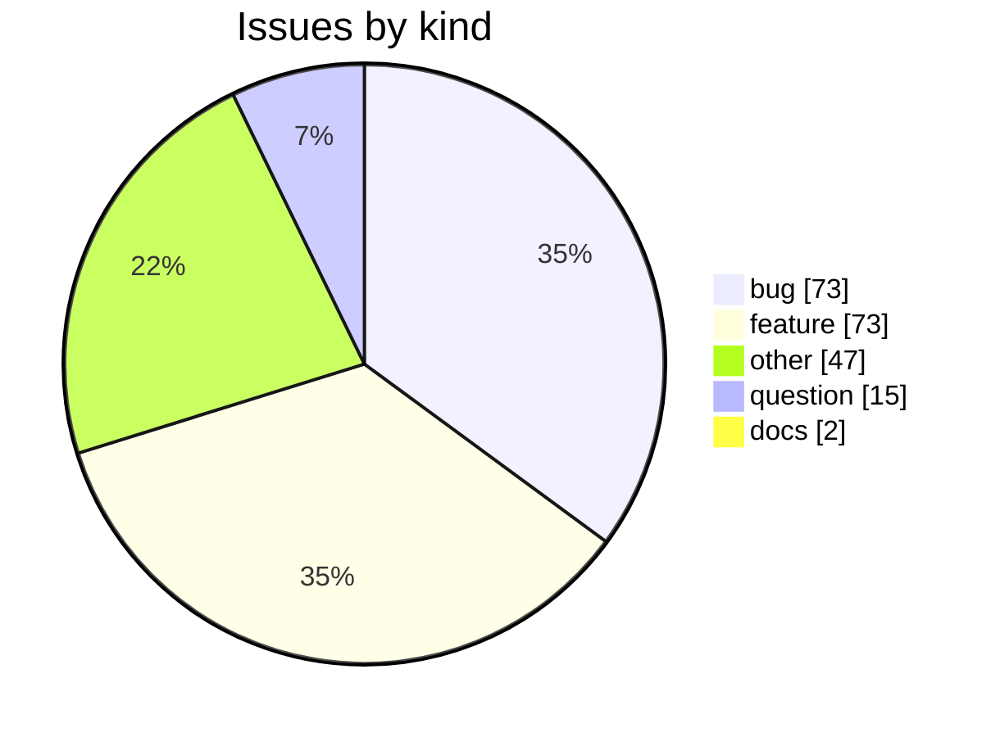

## Contributors & community

Ranked by `halls.fame` (score = `prs_merged*2 + prs_reviewed + commits_authored`, bots excluded).

| Contributor | Score | Authored | Merged | Reviewed | Commits | Areas | Evidence |
|---|---|---|---|---|---|---|---|
| `AlexanderSehr` | 35 | 10 | 4 | 23 | 4 | 14 | [#7257](https://github.com/Azure/bicep-registry-modules/pull/7257), [#7260](https://github.com/Azure/bicep-registry-modules/pull/7260) |
| `eriqua` | 16 | 7 | 2 | 10 | 2 | 2 | [#7235](https://github.com/Azure/bicep-registry-modules/pull/7235), [#7254](https://github.com/Azure/bicep-registry-modules/pull/7254) |
| `PadhiAjit-Microsoft` | 9 | 10 | 3 | 0 | 3 | 3 | [#7302](https://github.com/Azure/bicep-registry-modules/pull/7302), [#7305](https://github.com/Azure/bicep-registry-modules/pull/7305) |
| `krbar` | 9 | 9 | 3 | 0 | 3 | 8 | [#7249](https://github.com/Azure/bicep-registry-modules/pull/7249), [#7250](https://github.com/Azure/bicep-registry-modules/pull/7250) |
| `Abdul-Microsoft` | 6 | 3 | 2 | 0 | 2 | 2 | [#7301](https://github.com/Azure/bicep-registry-modules/pull/7301), [#7303](https://github.com/Azure/bicep-registry-modules/pull/7303) |
| `aniaroramsft` | 6 | 0 | 0 | 6 | 0 | 5 | [#7297](https://github.com/Azure/bicep-registry-modules/pull/7297), [#7301](https://github.com/Azure/bicep-registry-modules/pull/7301) |
| `myaschmitz` | 6 | 3 | 2 | 0 | 2 | 2 | [#7283](https://github.com/Azure/bicep-registry-modules/pull/7283), [#7287](https://github.com/Azure/bicep-registry-modules/pull/7287) |
| `nsftwr` | 6 | 3 | 2 | 0 | 2 | 1 | [#7252](https://github.com/Azure/bicep-registry-modules/pull/7252), [#7262](https://github.com/Azure/bicep-registry-modules/pull/7262) |
| `ReneHezser` | 5 | 4 | 0 | 5 | 0 | 1 | [#7246](https://github.com/Azure/bicep-registry-modules/pull/7246), [#7258](https://github.com/Azure/bicep-registry-modules/pull/7258) |
| `jtracey93` | 4 | 0 | 0 | 4 | 0 | 4 | [#7254](https://github.com/Azure/bicep-registry-modules/pull/7254), [#7257](https://github.com/Azure/bicep-registry-modules/pull/7257) |

**Automation:** `azure-verified-modules[bot]`, `copilot-pull-request-reviewer[bot]`, `dependabot[bot]`, `microsoft-github-policy-service[bot]`

