# Azure/bicep-registry-modules — Activity Digest (2026-09-01 → 2026-09-30)

> **Gathered late (validation note, not a template line):** this closed month was gathered on 2026-11-26T15:42:50Z. Open/closed/merged state, comments and reviews are projected to 2026-09-30T23:59:59Z (42 PR and 40 issue records projected, `meta.records_as_of`); titles, labels, milestones, assignees and board status are as of 2026-11-26T15:42:50Z (USAGE §5.3). The view carries no `meta.state_as_of`, so the template's own caveat line does not fire.
> "Shipped" = merged into `main`. Structure (code graph, owners) read at `5c123604fa1d` (`structure_as_of: window_end`). Reference date 2026-09-30.
> Diagrams were rendered with `render.py --skip-validate`: mmdc is installed but its headless Chrome is not, so they are **unvalidated**.

## Executive summary

- 69 merged PRs and 14 completed issues shipped; 68 decision trains landed (140 trains in the window: 60 in flight, 11 rejected, 1 abandoned).
- **Theme — metadata-driven module platform.** One contributor ran a repo-wide migration to per-module `metadata.json`: backfill and release guard ([#7349](https://github.com/Azure/bicep-registry-modules/pull/7349), 226 areas), display-name and description drift fixes ([#7371](https://github.com/Azure/bicep-registry-modules/pull/7371), [#7373](https://github.com/Azure/bicep-registry-modules/pull/7373)), metadata required for every module ([#7379](https://github.com/Azure/bicep-registry-modules/pull/7379)), telemetry prefixes sourced from metadata ([#7399](https://github.com/Azure/bicep-registry-modules/pull/7399), [#7403](https://github.com/Azure/bicep-registry-modules/pull/7403)), ownership routed from metadata instead of generated CODEOWNERS ([#7343](https://github.com/Azure/bicep-registry-modules/pull/7343), [#7378](https://github.com/Azure/bicep-registry-modules/pull/7378), [#7383](https://github.com/Azure/bicep-registry-modules/pull/7383)), scaffolding for new modules ([#7366](https://github.com/Azure/bicep-registry-modules/pull/7366), [#7368](https://github.com/Azure/bicep-registry-modules/pull/7368)), and the legacy `modules/` directory deprecated ([#7406](https://github.com/Azure/bicep-registry-modules/pull/7406)).
- **Theme — CI and supply chain.** A generic module workflow ([#7322](https://github.com/Azure/bicep-registry-modules/pull/7322)), tests spread across subscriptions ([#7336](https://github.com/Azure/bicep-registry-modules/pull/7336), [#7339](https://github.com/Azure/bicep-registry-modules/pull/7339)), and Actions pinned to full SHAs ([#7306](https://github.com/Azure/bicep-registry-modules/pull/7306), [#7320](https://github.com/Azure/bicep-registry-modules/pull/7320), [#7321](https://github.com/Azure/bicep-registry-modules/pull/7321)).
- **New modules:** the Function Apps pattern module `avm/ptn/app/function-app` ([#7299](https://github.com/Azure/bicep-registry-modules/pull/7299)) and `avm/res/code-signing/code-signing-account` ([#7363](https://github.com/Azure/bicep-registry-modules/pull/7363)); 17 modules gained a CMK user-assigned identity in one batch ([#7279](https://github.com/Azure/bicep-registry-modules/pull/7279)).
- **Theme — Azure Stack HCI / hybrid compute API refresh:** [#7384](https://github.com/Azure/bicep-registry-modules/pull/7384), [#7421](https://github.com/Azure/bicep-registry-modules/pull/7421), [#7423](https://github.com/Azure/bicep-registry-modules/pull/7423), [#7424](https://github.com/Azure/bicep-registry-modules/pull/7424), [#7426](https://github.com/Azure/bicep-registry-modules/pull/7426), [#7427](https://github.com/Azure/bicep-registry-modules/pull/7427), [#7429](https://github.com/Azure/bicep-registry-modules/pull/7429).
- **CI health:** 1,844 of 2,221 runs succeeded (313 failed). **Risk:** 149 open issues flagged by flow and 33 stalled open trains at 2026-09-30.

## Since last installment

Compared with the installment for 2026-08-01 → 2026-08-31 (captured `in_order`).

**New this installment:** 135 items (in_flight 62, shipped 73).

*Showing 40 of 135 new items; the full list is in the bundle view.*
- [[AVM Module Issue]: AVM Host Pool Schedules](https://github.com/Azure/bicep-registry-modules/issues/2308) (issue #2308) — in_flight
- [[AVM Module Issue]: avm/res/sql/server should allow setting Microsoft.Insights/diagnosticSettings for master database](https://github.com/Azure/bicep-registry-modules/issues/3377) (issue #3377) — in_flight
- [[AVM Module Issue]: Missing tags for database created in the failover group](https://github.com/Azure/bicep-registry-modules/issues/4655) (issue #4655) — in_flight
- [[AVM Module Issue]: Unable to create a cognitive services account with multiple deployments](https://github.com/Azure/bicep-registry-modules/issues/4794) (issue #4794) — in_flight
- [[AVM Module Issue]: Clarification on `vmTemplate` parameter usage and session host deployment for Host Pool module](https://github.com/Azure/bicep-registry-modules/issues/4995) (issue #4995) — in_flight
- [[AVM Module Issue]:  Missing the option to add publicIPAddressObject in Bastion configuration](https://github.com/Azure/bicep-registry-modules/issues/5555) (issue #5555) — in_flight
- [[AVM core] AVM Module Issue template is not in sync with published resource modules and pattern modules list](https://github.com/Azure/bicep-registry-modules/issues/5942) (issue #5942) — in_flight
- [[AVM Module Issue]: Private end point creation fails some times in SQL Database module](https://github.com/Azure/bicep-registry-modules/issues/5994) (issue #5994) — in_flight
- [[AVM Module Issue]: AiMl/AiFoundry should have parameter to specify replica count](https://github.com/Azure/bicep-registry-modules/issues/6247) (issue #6247) — in_flight
- [[AVM Module Issue]: API Management Service Products creates subscriptions automatically](https://github.com/Azure/bicep-registry-modules/issues/6516) (issue #6516) — shipped
- [[AVM Module Issue]: avm/res/api-management/service logger description not set in api-management deployed instance of AVM module](https://github.com/Azure/bicep-registry-modules/issues/7122) (issue #7122) — in_flight
- [[AVM Module Issue]: subscriptionsLimit on product cant be set to unlimited](https://github.com/Azure/bicep-registry-modules/issues/7226) (issue #7226) — in_flight
- [[AVM Module Issue]: Add Support for Async Scaling of Azure App Service Plans](https://github.com/Azure/bicep-registry-modules/issues/7227) (issue #7227) — in_flight
- [[Failed pipeline] avm.ptn.sa.content-generation](https://github.com/Azure/bicep-registry-modules/issues/7311) (issue #7311) — in_flight
- [[Failed pipeline] avm.ptn.sa.content-processing](https://github.com/Azure/bicep-registry-modules/issues/7312) (issue #7312) — in_flight
- [[Failed pipeline] avm.ptn.sa.conversation-knowledge-mining](https://github.com/Azure/bicep-registry-modules/issues/7313) (issue #7313) — in_flight
- [[Failed pipeline] avm.ptn.sa.document-knowledge-mining](https://github.com/Azure/bicep-registry-modules/issues/7314) (issue #7314) — in_flight
- [[Failed pipeline] avm.ptn.sa.multi-agent-custom-automation-engine](https://github.com/Azure/bicep-registry-modules/issues/7315) (issue #7315) — in_flight
- [[Failed pipeline] avm.res.app.managed-environment](https://github.com/Azure/bicep-registry-modules/issues/7326) (issue #7326) — in_flight
- [[AVM Module Issue]: web.static-sites fails when deploying private endpoint with custom private dns zone](https://github.com/Azure/bicep-registry-modules/issues/7328) (issue #7328) — shipped
- [[AVM CI Environment Issue]: `$GITHUB_STEP_SUMMARY` upload aborted — job summary exceeds 1024k size limit (got 1059k)](https://github.com/Azure/bicep-registry-modules/issues/7331) (issue #7331) — in_flight
- [[AVM Module Issue]: AVM NetApp Account Snapshot Policy Does Not Support Multiple Days in weeklySchedule.day](https://github.com/Azure/bicep-registry-modules/issues/7335) (issue #7335) — in_flight
- [[AVM Module Issue]:](https://github.com/Azure/bicep-registry-modules/issues/7342) (issue #7342) — in_flight
- [[AVM Module Issue]: avm.res.insights.scheduled-query-rule missing kind SimpleLogAlert](https://github.com/Azure/bicep-registry-modules/issues/7345) (issue #7345) — in_flight
- [[Failed pipeline] .Platform - Run CI tests](https://github.com/Azure/bicep-registry-modules/issues/7350) (issue #7350) — shipped
- [[Failed pipeline] .Module - Check and Publish](https://github.com/Azure/bicep-registry-modules/issues/7352) (issue #7352) — shipped
- [[Failed pipeline] avm.res.db-for-postgre-sql.flexible-server](https://github.com/Azure/bicep-registry-modules/issues/7353) (issue #7353) — shipped
- [[AVM Module Issue]: maintenance-configuration module always sends installPatches, breaking InGuestPatchMode: 'Platform' (hotpatch)](https://github.com/Azure/bicep-registry-modules/issues/7354) (issue #7354) — in_flight
- [[Failed pipeline] avm.res.cache.redis-enterprise](https://github.com/Azure/bicep-registry-modules/issues/7358) (issue #7358) — shipped
- [[Failed pipeline] avm.res.machine-learning-services.workspace](https://github.com/Azure/bicep-registry-modules/issues/7359) (issue #7359) — shipped
- [[AVM Module Issue]: avm/res/storage/storage-account always writes properties the service returns differently, so what-if never reports NoChange](https://github.com/Azure/bicep-registry-modules/issues/7364) (issue #7364) — in_flight
- [[Failed pipeline] avm.res.cache.redis-enterprise](https://github.com/Azure/bicep-registry-modules/issues/7365) (issue #7365) — in_flight
- [[AVM Module Issue]:  Test for Automation](https://github.com/Azure/bicep-registry-modules/issues/7369) (issue #7369) — shipped
- [[Failed pipeline] avm.res.consumption.budget](https://github.com/Azure/bicep-registry-modules/issues/7377) (issue #7377) — in_flight
- [[Failed pipeline] avm.res.virtual-machine-images.image-template](https://github.com/Azure/bicep-registry-modules/issues/7385) (issue #7385) — in_flight
- [[Failed pipeline] github_actions in / - Update #1587834189](https://github.com/Azure/bicep-registry-modules/issues/7386) (issue #7386) — in_flight
- [[Failed pipeline] avm.res.dev-center.project](https://github.com/Azure/bicep-registry-modules/issues/7387) (issue #7387) — in_flight
- [[AVM Module Issue]: VM module ignores explicit dataDisk caching when attaching an existing managed disk](https://github.com/Azure/bicep-registry-modules/issues/7390) (issue #7390) — in_flight
- [[Failed pipeline] avm.res.sql.server](https://github.com/Azure/bicep-registry-modules/issues/7391) (issue #7391) — in_flight
- [[Failed pipeline] avm.res.azure-stack-hci.cluster](https://github.com/Azure/bicep-registry-modules/issues/7392) (issue #7392) — in_flight

**Carried over:** 22 items in flight last installment (now in_flight 8, now rejected 4, now shipped 10).

- [[Failed pipeline] avm.ptn.app.container-job-toolkit.yml](https://github.com/Azure/bicep-registry-modules/issues/7077) (issue #7077) — *was Needs: Triage, now in_flight*
- [[Failed pipeline] avm.res.api-management.service](https://github.com/Azure/bicep-registry-modules/issues/7230) (issue #7230) — *was Needs: Triage, now in_flight*
- [[Failed pipeline] avm.ptn.dev-ops.cicd-agents-and-runners](https://github.com/Azure/bicep-registry-modules/issues/7266) (issue #7266) — *was Needs: Triage, now in_flight*
- [[Failed pipeline] avm.ptn.virtual-machine-images.azure-image-builder](https://github.com/Azure/bicep-registry-modules/issues/7267) (issue #7267) — *was Done, now shipped*
- [[AVM Module Issue]: Netapp volumeType type is missing securityStyle property even though referenced in file](https://github.com/Azure/bicep-registry-modules/issues/7269) (issue #7269) — *was Needs: Triage, now in_flight*
- [[AVM Module Issue]: Static PostgreSQL configurations are not persisted by flexible-server 0.16.0](https://github.com/Azure/bicep-registry-modules/issues/7270) (issue #7270) — *was Done, now shipped*
- [[AVM Module Issue]: API management `skuCapacity` default of `3` fails deployment when `sku` is `Basic` (max capacity 2)](https://github.com/Azure/bicep-registry-modules/issues/7278) (issue #7278) — *was In Development, now in_flight*
- [[AVM Module Issue]: timeBasedImmutability parameters missing for database backup-long-term-retention-policy](https://github.com/Azure/bicep-registry-modules/issues/7284) (issue #7284) — *was Done, now shipped*
- [[AVM Module Issue]: Recovery-Services/vault softDeleteSettings vs backupConfig](https://github.com/Azure/bicep-registry-modules/issues/7289) (issue #7289) — *was Done, now shipped*
- [[AVM Module Issue]: Key Vault module should be updated to API version 2026-02-01 or later](https://github.com/Azure/bicep-registry-modules/issues/7295) (issue #7295) — *was Done, now shipped*
- [Fix: Updated default app Version and Adjusted wording in semantic kernel system prompt](https://github.com/Azure/bicep-registry-modules/pull/6708) (pr #6708) — *was in_flight, now rejected*
- [fix: enable private networking in DI](https://github.com/Azure/bicep-registry-modules/pull/7095) (pr #7095) — *was in_flight, now rejected*
- [feat: adding new dotnet component ](https://github.com/Azure/bicep-registry-modules/pull/7210) (pr #7210) — *was in_flight, now in_flight*
- [feat(aks): add Gateway API and agent pool update support](https://github.com/Azure/bicep-registry-modules/pull/7261) (pr #7261) — *was in_flight, now in_flight*
- [feat: Add CMK user-assigned identity to managed identities across modules - batch 1](https://github.com/Azure/bicep-registry-modules/pull/7279) (pr #7279) — *was in_flight, now shipped*
- [feat: Add CMK user-assigned identity to managed identities across modules - batch 2](https://github.com/Azure/bicep-registry-modules/pull/7281) (pr #7281) — *was in_flight, now in_flight*
- [fix: Recovery Services Vault - Omit soft delete properties from `backupConfig` when `softDeleteSettings` is used](https://github.com/Azure/bicep-registry-modules/pull/7292) (pr #7292) — *was in_flight, now shipped*
- [feat: ManagedEnvironment update and test fixes](https://github.com/Azure/bicep-registry-modules/pull/7293) (pr #7293) — *was in_flight, now shipped*
- [feat: AVM Module Upgrade for BYOCC](https://github.com/Azure/bicep-registry-modules/pull/7297) (pr #7297) — *was in_flight, now rejected*
- [feat: Create AVM Pattern Module for Function Apps](https://github.com/Azure/bicep-registry-modules/pull/7299) (pr #7299) — *was in_flight, now shipped*
- [chore: Pin GitHub Actions to full-length commit SHAs](https://github.com/Azure/bicep-registry-modules/pull/7306) (pr #7306) — *was in_flight, now shipped*
- [Avm ptn aks secure baseline](https://github.com/Azure/bicep-registry-modules/pull/7309) (pr #7309) — *was in_flight, now rejected*

**Forecast loop:** landed 0; not_yet 0; dropped 0 — the previous installment's forecast held no candidates, so there is nothing to compare.

## Shipped this period

| Title | Ref | Train |
|---|---|---|
| [feat: Add CMK user-assigned identity to managed identities across modules - batch 1](https://github.com/Azure/bicep-registry-modules/pull/7279) | pr #7279 | `train-pr-7279` |
| [fix: Recovery Services Vault - Omit soft delete properties from `backupConfig` when `softDeleteSettings` is used](https://github.com/Azure/bicep-registry-modules/pull/7292) | pr #7292 | `train-issue-7289` |
| [feat: ManagedEnvironment update and test fixes](https://github.com/Azure/bicep-registry-modules/pull/7293) | pr #7293 | `train-pr-7293` |
| [feat: Create AVM Pattern Module for Function Apps](https://github.com/Azure/bicep-registry-modules/pull/7299) | pr #7299 | `train-pr-7299` |
| [chore: Pin GitHub Actions to full-length commit SHAs](https://github.com/Azure/bicep-registry-modules/pull/7306) | pr #7306 | `train-pr-7306` |
| [feat: expose disableLocalAuth and publicNetworkAccess on communication-service module](https://github.com/Azure/bicep-registry-modules/pull/7318) | pr #7318 | `train-pr-7318` |
| [chore: remove legacy teams from codeowners](https://github.com/Azure/bicep-registry-modules/pull/7319) | pr #7319 | `train-pr-7319` |
| [fix: pin composite action dependencies](https://github.com/Azure/bicep-registry-modules/pull/7320) | pr #7320 | `train-pr-7320` |
| [fix: correct PSRule action SHA](https://github.com/Azure/bicep-registry-modules/pull/7321) | pr #7321 | `train-pr-7321` |
| [feat: add generic module workflow](https://github.com/Azure/bicep-registry-modules/pull/7322) | pr #7322 | `train-pr-7322` |
| [feat: managed environment parameter doc](https://github.com/Azure/bicep-registry-modules/pull/7323) | pr #7323 | `train-pr-7323` |
| [fix: optional deployment privateDnsZone failure](https://github.com/Azure/bicep-registry-modules/pull/7327) | pr #7327 | `train-issue-7328` |
| [fix: Update key-vault/vault API version](https://github.com/Azure/bicep-registry-modules/pull/7334) | pr #7334 | `train-issue-7295` |
| [ci: distribute Bicep tests across configured subscriptions](https://github.com/Azure/bicep-registry-modules/pull/7336) | pr #7336 | `train-pr-7336` |
| [fix: migrate Bicep module ownership routing](https://github.com/Azure/bicep-registry-modules/pull/7337) | pr #7337 | `train-pr-7337` |
| [feat: support GitHub secrets and variables for CI test parameters](https://github.com/Azure/bicep-registry-modules/pull/7339) | pr #7339 | `train-pr-7339` |
| [fix: select first GitHub CLI executable for CI migration](https://github.com/Azure/bicep-registry-modules/pull/7340) | pr #7340 | `train-pr-7340` |
| [feat: Sql-Server - Add support for time-based immutability settings at long term backup policy module](https://github.com/Azure/bicep-registry-modules/pull/7341) | pr #7341 | `train-issue-7284` |
| [chore: generate per-module CODEOWNERS from module owners](https://github.com/Azure/bicep-registry-modules/pull/7343) | pr #7343 | `train-pr-7343` |
| [feat: Key-Vault - Updated child-module api versions](https://github.com/Azure/bicep-registry-modules/pull/7347) | pr #7347 | `train-issue-7295` |
| [fix: avm/res/db for postgre sql/flexible server ](https://github.com/Azure/bicep-registry-modules/pull/7348) | pr #7348 | `train-issue-7270` |
| [feat(metadata): backfill Bicep metadata and guard releases](https://github.com/Azure/bicep-registry-modules/pull/7349) | pr #7349 | `train-pr-7349` |
| [ci: temporarily select BAMI test variables by module path](https://github.com/Azure/bicep-registry-modules/pull/7351) | pr #7351 | `train-pr-7351` |
| [fix: PostgreSQL - Fixing failing test](https://github.com/Azure/bicep-registry-modules/pull/7355) | pr #7355 | `train-pr-7355` |
| [fix: bump github/codeql-action/upload-sarif from 4.37.9 to 4.38.0](https://github.com/Azure/bicep-registry-modules/pull/7356) | pr #7356 | `train-pr-7356` |
| [chore: mark consolidated module workflow as experimental](https://github.com/Azure/bicep-registry-modules/pull/7362) | pr #7362 | `train-pr-7362` |
| [feat: initial version code-signing-account module](https://github.com/Azure/bicep-registry-modules/pull/7363) | pr #7363 | `train-pr-7363` |
| [feat: scaffold AVM module folders](https://github.com/Azure/bicep-registry-modules/pull/7366) | pr #7366 | `train-pr-7366` |
| [fix(avm): backfill owners and shorten telemetry prefixes on scaffolded metadata](https://github.com/Azure/bicep-registry-modules/pull/7367) | pr #7367 | `train-pr-7367` |
| [feat(scaffold): bootstrap valid metadata.json for new AVM modules](https://github.com/Azure/bicep-registry-modules/pull/7368) | pr #7368 | `train-pr-7368` |
| [fix(metadata): correct moduleDisplayName drift across 576 modules](https://github.com/Azure/bicep-registry-modules/pull/7371) | pr #7371 | `train-pr-7371` |
| [fix(avm/res/azure-stack-hci/cluster): add phase-derived forceUpdateTag to deployment script](https://github.com/Azure/bicep-registry-modules/pull/7372) | pr #7372 | `train-pr-7372` |
| [fix(metadata): reconcile catalog description drift across 606 modules](https://github.com/Azure/bicep-registry-modules/pull/7373) | pr #7373 | `train-pr-7373` |
| [fix(metadata): restore abbreviated telemetryIdPrefix on scaffolded modules](https://github.com/Azure/bicep-registry-modules/pull/7375) | pr #7375 | `train-pr-7375` |
| [fix(consumption/budget): resolve duplicate telemetry ID between rg-scope and sub-scope](https://github.com/Azure/bicep-registry-modules/pull/7376) | pr #7376 | `train-pr-7376` |
| [feat: Replace generated CODEOWNERS with metadata-driven reviewer routing](https://github.com/Azure/bicep-registry-modules/pull/7378) | pr #7378 | `train-pr-7378` |
| [feat(metadata): require valid metadata.json for all AVM Bicep modules](https://github.com/Azure/bicep-registry-modules/pull/7379) | pr #7379 | `train-pr-7379` |
| [feat: index updates 22092026](https://github.com/Azure/bicep-registry-modules/pull/7380) | pr #7380 | `train-pr-7380` |
| [fix: isolate metadata validation from Bicep compilation](https://github.com/Azure/bicep-registry-modules/pull/7382) | pr #7382 | `train-pr-7382` |
| [fix: retire ORPHANED.md markers in favor of metadata ownership](https://github.com/Azure/bicep-registry-modules/pull/7383) | pr #7383 | `train-pr-7383` |
| [feat(avm/res/azure-stack-hci/cluster): update API versions to latest …](https://github.com/Azure/bicep-registry-modules/pull/7384) | pr #7384 | `train-pr-7384` |
| [chore(module-list): sync AVM module dropdown [skip ci]](https://github.com/Azure/bicep-registry-modules/pull/7388) | pr #7388 | `train-pr-7388` |
| [chore: remove remaining CSV module index references](https://github.com/Azure/bicep-registry-modules/pull/7389) | pr #7389 | `train-pr-7389` |
| [chore(avm/res/azure-stack-hci/cluster): Add abhisheksharma-ops as module owner](https://github.com/Azure/bicep-registry-modules/pull/7396) | pr #7396 | `train-pr-7396` |
| [chore: remove redundant module-dropdown compliance check](https://github.com/Azure/bicep-registry-modules/pull/7398) | pr #7398 | `train-pr-7398` |
| [refactor(avm): source telemetry prefixes from module metadata](https://github.com/Azure/bicep-registry-modules/pull/7399) | pr #7399 | `train-pr-7399` |
| [chore(module-list): sync AVM module dropdown [skip ci]](https://github.com/Azure/bicep-registry-modules/pull/7400) | pr #7400 | `train-pr-7400` |
| [fix(ci): skip metadata-only experimental module workflow runs](https://github.com/Azure/bicep-registry-modules/pull/7401) | pr #7401 | `train-pr-7401` |
| [feat(ci): add opt-in consolidated checks for pull requests](https://github.com/Azure/bicep-registry-modules/pull/7402) | pr #7402 | `train-pr-7402` |
| [fix(telemetry): backfill unique Bicep module prefixes](https://github.com/Azure/bicep-registry-modules/pull/7403) | pr #7403 | `train-pr-7403` |
| [chore: deprecate legacy modules directory](https://github.com/Azure/bicep-registry-modules/pull/7406) | pr #7406 | `train-pr-7406` |
| [fix: compile container job toolkit secure workspace output](https://github.com/Azure/bicep-registry-modules/pull/7407) | pr #7407 | `train-pr-7407` |
| [chore: avd owner updates](https://github.com/Azure/bicep-registry-modules/pull/7409) | pr #7409 | `train-pr-7409` |
| [docs(avm): reconcile module README content with sources](https://github.com/Azure/bicep-registry-modules/pull/7410) | pr #7410 | `train-pr-7410` |
| [fix: retry regional template validation in eligible regions](https://github.com/Azure/bicep-registry-modules/pull/7411) | pr #7411 | `train-pr-7411` |
| [fix: isolate Lab fixture names and track rejected deployment attempts](https://github.com/Azure/bicep-registry-modules/pull/7413) | pr #7413 | `train-pr-7413` |
| [fix: align conversation knowledge mining test parameters](https://github.com/Azure/bicep-registry-modules/pull/7415) | pr #7415 | `train-pr-7415` |
| [docs(avm): pin registry README template and preserve authored Notes](https://github.com/Azure/bicep-registry-modules/pull/7416) | pr #7416 | `train-pr-7416` |
| [fix: SQL-MI - Upgraded `storageSizeInGB` limit to 32768](https://github.com/Azure/bicep-registry-modules/pull/7418) | pr #7418 | `train-issue-7344` |
| [chore(module-list): sync AVM module dropdown [skip ci]](https://github.com/Azure/bicep-registry-modules/pull/7419) | pr #7419 | `train-pr-7419` |
| [chore(module-list): sync AVM module dropdown [skip ci]](https://github.com/Azure/bicep-registry-modules/pull/7420) | pr #7420 | `train-pr-7420` |
| [feat(avm/res/azure-stack-hci/cluster): update Azure Stack HCI API versions to GA 2026-10-01](https://github.com/Azure/bicep-registry-modules/pull/7421) | pr #7421 | `train-pr-7421` |
| [fix(avm/res/azure-stack-hci/logical-network): update telemetry deployment API version to 2025-04-01](https://github.com/Azure/bicep-registry-modules/pull/7423) | pr #7423 | `train-pr-7423` |
| [fix(avm/res/azure-stack-hci/virtual-hard-disk): update telemetry deployment API version to 2025-04-01](https://github.com/Azure/bicep-registry-modules/pull/7424) | pr #7424 | `train-pr-7424` |
| [fix: preserve deployment cleanup after HTTP timeouts](https://github.com/Azure/bicep-registry-modules/pull/7425) | pr #7425 | `train-pr-7425` |
| [fix(avm/res/azure-stack-hci/network-interface): update telemetry deployment API version to 2025-04-01](https://github.com/Azure/bicep-registry-modules/pull/7426) | pr #7426 | `train-pr-7426` |
| [feat(avm/res/hybrid-compute/machine): update HybridCompute API versions to 2026-07-15](https://github.com/Azure/bicep-registry-modules/pull/7427) | pr #7427 | `train-pr-7427` |
| [ci: remove per-repo AVM label synchronization workflow](https://github.com/Azure/bicep-registry-modules/pull/7428) | pr #7428 | `train-pr-7428` |
| [feat(avm/res/azure-stack-hci/virtual-machine-instance): update Arc machine API version to 2026-07-15](https://github.com/Azure/bicep-registry-modules/pull/7429) | pr #7429 | `train-pr-7429` |
| [[AVM Module Issue]: API Management Service Products creates subscriptions automatically](https://github.com/Azure/bicep-registry-modules/issues/6516) | issue #6516 | `—` |
| [[Failed pipeline] avm.ptn.virtual-machine-images.azure-image-builder](https://github.com/Azure/bicep-registry-modules/issues/7267) | issue #7267 | `—` |
| [[AVM Module Issue]: Static PostgreSQL configurations are not persisted by flexible-server 0.16.0](https://github.com/Azure/bicep-registry-modules/issues/7270) | issue #7270 | `train-issue-7270` |
| [[AVM Module Issue]: timeBasedImmutability parameters missing for database backup-long-term-retention-policy](https://github.com/Azure/bicep-registry-modules/issues/7284) | issue #7284 | `train-issue-7284` |
| [[AVM Module Issue]: Recovery-Services/vault softDeleteSettings vs backupConfig](https://github.com/Azure/bicep-registry-modules/issues/7289) | issue #7289 | `train-issue-7289` |
| [[AVM Module Issue]: Key Vault module should be updated to API version 2026-02-01 or later](https://github.com/Azure/bicep-registry-modules/issues/7295) | issue #7295 | `train-issue-7295` |
| [[AVM Module Issue]: web.static-sites fails when deploying private endpoint with custom private dns zone](https://github.com/Azure/bicep-registry-modules/issues/7328) | issue #7328 | `train-issue-7328` |
| [[Failed pipeline] .Platform - Run CI tests](https://github.com/Azure/bicep-registry-modules/issues/7350) | issue #7350 | `—` |
| [[Failed pipeline] .Module - Check and Publish](https://github.com/Azure/bicep-registry-modules/issues/7352) | issue #7352 | `—` |
| [[Failed pipeline] avm.res.db-for-postgre-sql.flexible-server](https://github.com/Azure/bicep-registry-modules/issues/7353) | issue #7353 | `—` |
| [[Failed pipeline] avm.res.cache.redis-enterprise](https://github.com/Azure/bicep-registry-modules/issues/7358) | issue #7358 | `—` |
| [[Failed pipeline] avm.res.machine-learning-services.workspace](https://github.com/Azure/bicep-registry-modules/issues/7359) | issue #7359 | `—` |
| [[AVM Module Issue]:  Test for Automation](https://github.com/Azure/bicep-registry-modules/issues/7369) | issue #7369 | `—` |
| [[Failed pipeline] .Module - Check and Publish [EXPERIMENTAL]](https://github.com/Azure/bicep-registry-modules/issues/7393) | issue #7393 | `—` |

## Decision trains

### Deep train `train-pr-7279` — feat: Add CMK user-assigned identity to managed identities across modules - batch 1

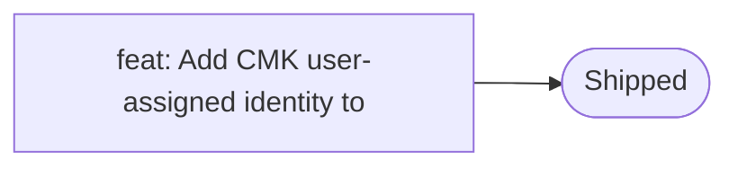

*slow to land (32 days) · 1 reviewers · 2 contributors · 1 review rounds*

Outcome **shipped**; PRs: [#7279](https://github.com/Azure/bicep-registry-modules/pull/7279) (merged); code areas: 17 (`avm/res/app-configuration/configuration-store`, `avm/res/automation/automation-account`, `avm/res/cache/redis-enterprise`, `avm/res/cognitive-services/account`, `avm/res/container-instance/container-group`, `avm/res/container-registry/registry` …)

PR 7279 (batch 1) added the customer-managed-key user-assigned identity to managed identities across 17 AVM resource modules. It was opened as ready for review in August and merged on 2026-09-16 after about five commented review rounds and an approval. — [1](https://github.com/Azure/bicep-registry-modules/pull/7279)

- **Proposed:** Make CMK handling simpler and backwards compatible by adding the CMK's user-assigned identity to each resource's managed identities and updating the Key Vault API version used for CMK references. — [1](https://github.com/Azure/bicep-registry-modules/pull/7279)
- **Changed:** In modules such as app-configuration/configuration-store the identity variable changed from !empty(managedIdentities) to also consider formattedUserAssignedIdentities, with updates to cMKKey, cMKKeyVault and cMKUserAssignedIdentity. In review, AlexanderSehr suggested updating the encr tests to drop their managedIdentities blocks and questioned removing the !isHSMManagedCMK condition because HSM tests are disabled. The author said managedIdentities was removed from only one of two CMK tests per module and added to max where otherwise untested. — [1](https://github.com/Azure/bicep-registry-modules/pull/7279)
- **Shipped:** CMK identity handling, README and CHANGELOG changes merged for 17 modules including storage-account, services such as service-bus/namespace and event-hub/namespace, and recovery-services/vault. — [1](https://github.com/Azure/bicep-registry-modules/pull/7279), [2](https://github.com/Azure/bicep-registry-modules/commit/f1f4ba28698437d9a683d68bf181341ad3547e48)

### Deep train `train-pr-7299` — feat: Create AVM Pattern Module for Function Apps

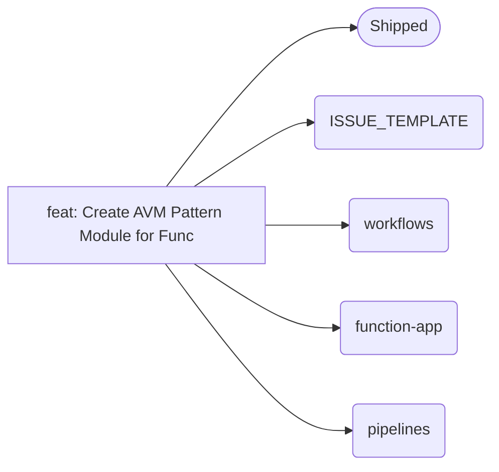

*slow to land (33 days) · 1 reviewers · 2 contributors · 1 review rounds*

Outcome **shipped**; PRs: [#7299](https://github.com/Azure/bicep-registry-modules/pull/7299) (merged); code areas: 4 (`.github/ISSUE_TEMPLATE`, `.github/workflows`, `avm/ptn/app/function-app`, `utilities/pipelines`)

PR 7299 created a new AVM pattern module for Function Apps at avm/ptn/app/function-app. It merged after a long review by AlexanderSehr with about twelve commented rounds. — [1](https://github.com/Azure/bicep-registry-modules/pull/7299)

- **Proposed:** The PR body says it fixes Azure-Verified-Modules issue 2721 and adds a pattern module for Function Apps, flagged as a backwards-compatible feature with a MINOR version bump. — [1](https://github.com/Azure/bicep-registry-modules/pull/7299)
- **Changed:** Reviewers asked for simplified tests (the defaults test should cover defaults, and non-consumer-relevant items removed) and questioned having both logAnalyticsWorkspaceName and logAnalyticsWorkspaceResourceId, recommending the resource ID and a simplified existing user-assigned identity block. The author simplified the changelog because much of it described mid-session changes rather than versions that exist. — [1](https://github.com/Azure/bicep-registry-modules/pull/7299)
- **Shipped:** The new avm/ptn/app/function-app module (README, CHANGELOG, Bicep source and e2e tests) merged in one commit; symbol moves show test dependency parameters carried over from avm/res/app/managed-environment. — [1](https://github.com/Azure/bicep-registry-modules/pull/7299), [2](https://github.com/Azure/bicep-registry-modules/commit/e598d45191e282374fa271597318b733f23c7c0e)

### Deep train `train-pr-7322` — feat: add generic module workflow

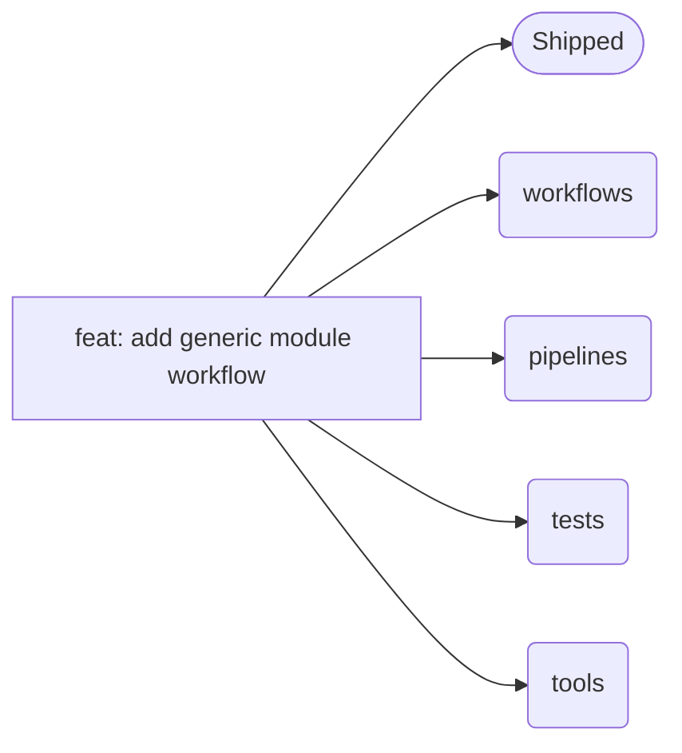

*landed in 0 days · 3 reviewers · 4 contributors · 1 review rounds*

Outcome **shipped**; PRs: [#7322](https://github.com/Azure/bicep-registry-modules/pull/7322) (merged); code areas: 4 (`.github/workflows`, `utilities/pipelines`, `utilities/tests`, `utilities/tools`)

PR 7322 added a generic module workflow, '.Module - Check and Publish', to run alongside the 217 legacy module-specific workflows during a canary period. It merged after Copilot and CodeQL review comments. — [1](https://github.com/Azure/bicep-registry-modules/pull/7322)

- **Proposed:** Provide one generic workflow that handles one or several module paths with validation, release-tag preview and gated publishing, without changing the legacy workflows. — [1](https://github.com/Azure/bicep-registry-modules/pull/7322)
- **Changed:** The workflow discovers all affected modules across a push range, uses a stable 'gci' prefix and namespaced 'queue: max' concurrency, previews release tags read-only with WhatIf, and gates real publishing behind createReleaseTag and the publish-approval environment. Review comments flagged overlap with legacy push workflows, concurrency that could drop pushed changes, a multi-commit range mismatch in release preview, and an unneeded id-token: write on publish-only. The author replied that the overlap is intentional for the canary period and that legacy workflows have zero final diff. — [1](https://github.com/Azure/bicep-registry-modules/pull/7322)
- **Shipped:** The generic workflow, its separate validated-publish and publish-only workflows, tag logic and AVM toggle/rerun/issue tooling merged under .github/workflows, utilities/pipelines, utilities/tests and utilities/tools, with a new .github/workflows/README.md. — [1](https://github.com/Azure/bicep-registry-modules/pull/7322), [2](https://github.com/Azure/bicep-registry-modules/commit/96a1dcb69b9bbb9c56638c4f5c457914d3e8bd21)

### Deep train `train-pr-7339` — feat: support GitHub secrets and variables for CI test parameters

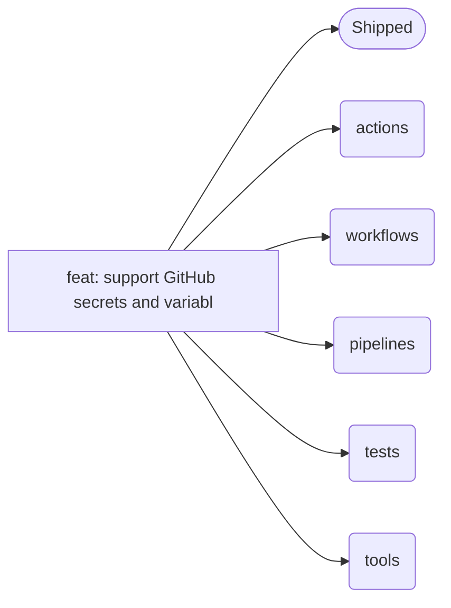

*landed in 0 days · 2 reviewers · 3 contributors · 1 review rounds*

Outcome **shipped**; PRs: [#7339](https://github.com/Azure/bicep-registry-modules/pull/7339) (merged); code areas: 5 (`.github/actions`, `.github/workflows`, `utilities/pipelines`, `utilities/tests`, `utilities/tools`)

PR 7339 added GitHub Actions secrets and variables as the preferred source of extra Bicep end-to-end test parameters, keeping the CI Key Vault as a fallback. It merged after approval from jtracey93. — [1](https://github.com/Azure/bicep-registry-modules/pull/7339)

- **Proposed:** Let CI supply extra e2e test parameters from GitHub secrets and variables rather than only from the CI Key Vault. — [1](https://github.com/Azure/bicep-registry-modules/pull/7339)
- **Changed:** Names with a CI_ or CI__ prefix are matched case-insensitively to declared Bicep parameters, with precedence CI_ secret > CI__ secret > CI_ variable > CI__ variable > legacy Key Vault secret. Multiple aliases within the same winning prefix are rejected as ambiguous, and CI_KEY_VAULT_NAME is reserved for legacy vault config. The github-advanced-security bot raised CodeQL 'Excessive Secrets Exposure' alerts on toJSON(secrets) before approval. — [1](https://github.com/Azure/bicep-registry-modules/pull/7339)
- **Shipped:** The change merged touching .github/actions, .github/workflows, utilities/pipelines, utilities/tests and utilities/tools. — [1](https://github.com/Azure/bicep-registry-modules/pull/7339), [2](https://github.com/Azure/bicep-registry-modules/commit/ff91fabe4014cd2dd5b67b5ae15f8db968d92ef9)

### Deep train `train-pr-7349` — feat(metadata): backfill Bicep metadata and guard releases

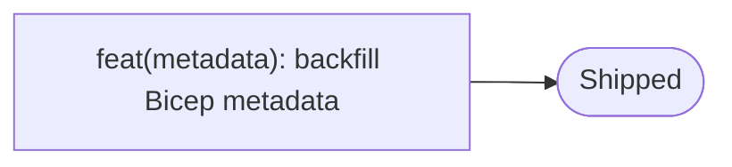

*landed in 1 days · 1 reviewers · 2 contributors · 1 review rounds*

Outcome **shipped**; PRs: [#7349](https://github.com/Azure/bicep-registry-modules/pull/7349) (merged); code areas: 226 (`.github`, `.github/workflows`, `avm/ptn/aca-lza/hosting-environment`, `avm/ptn/ai-ml/ai-foundry`, `avm/ptn/ai-platform/baseline`, `avm/ptn/alz/ama` …)

PR 7349 backfilled module-owned metadata.json files across the repository and guarded publishing workflows against metadata-only changes. It merged after one approval from jtracey93. — [1](https://github.com/Azure/bicep-registry-modules/pull/7349)

- **Proposed:** Add initial module-owned metadata directly to this repository, allow metadata review by either engineering or module owners, and keep metadata-only changes out of automatic publishing. — [1](https://github.com/Azure/bicep-registry-modules/pull/7349)
- **Changed:** The PR adds 572 metadata.json files (222 roots, 350 children) with a flat owners array and no schemaVersion or tier authored. It ends .github/CODEOWNERS with a metadata.json rule naming the engineering-owners and module-owners teams, either of which can approve, and appends !avm/**/metadata.json to all 217 per-module publishing workflows. The unpublished internal avm/ptn/ai-ml/ai-foundry/modules/project helper was excluded. — [1](https://github.com/Azure/bicep-registry-modules/pull/7349)
- **Shipped:** The metadata files, the CODEOWNERS rule and the workflow path exclusions merged in one commit. — [1](https://github.com/Azure/bicep-registry-modules/pull/7349), [2](https://github.com/Azure/bicep-registry-modules/commit/d654b23520d7ed224201c9b74b0322df269dfefc)

### Deep train `train-pr-7366` — feat: scaffold AVM module folders

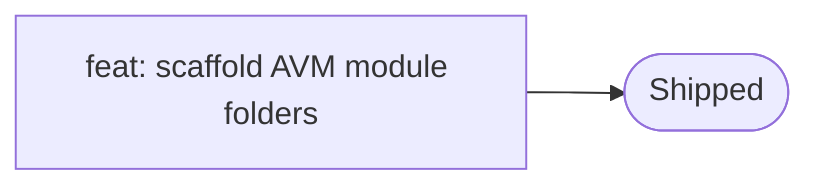

*landed in 0 days · 1 reviewers · 2 contributors · 1 review rounds*

Outcome **shipped**; PRs: [#7366](https://github.com/Azure/bicep-registry-modules/pull/7366) (merged); code areas: 49 (`avm/ptn/ai-ml/landing-zone`, `avm/ptn/app/cosmos-db-account-container-app`, `avm/ptn/app/function-app`, `avm/ptn/app/mongodb-cluster-container-app`, `avm/ptn/avd-lza/insights`, `avm/ptn/avd-lza/management-plane` …)

PR 7366 scaffolded metadata-only folders for 49 modules listed in module-list.md and merged after one approval. — [1](https://github.com/Azure/bicep-registry-modules/pull/7366)

- **Proposed:** Create folders for the 49 new modules so each has a repository-compatible metadata.json. — [1](https://github.com/Azure/bicep-registry-modules/pull/7366)
- **Changed:** Each folder contains a metadata.json with module display name, description, telemetry prefix and canonical type. The slice shows a single approved review and no revisions. — [1](https://github.com/Azure/bicep-registry-modules/pull/7366)
- **Shipped:** The scaffold folders for the 49 modules (avm/ptn, avm/res and avm/utl paths) merged in one commit. — [1](https://github.com/Azure/bicep-registry-modules/pull/7366), [2](https://github.com/Azure/bicep-registry-modules/commit/0baa81fcac8ed2840b41770e754be0aefc6daf6b)

### Deep train `train-pr-7367` — fix(avm): backfill owners and shorten telemetry prefixes on scaffolded metadata

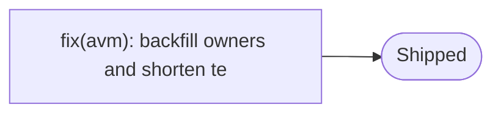

*landed in 0 days · 1 reviewers · 2 contributors · 1 review rounds*

Outcome **shipped**; PRs: [#7367](https://github.com/Azure/bicep-registry-modules/pull/7367) (merged); code areas: 47 (`avm/ptn/ai-ml/landing-zone`, `avm/ptn/app/cosmos-db-account-container-app`, `avm/ptn/app/function-app`, `avm/ptn/app/mongodb-cluster-container-app`, `avm/ptn/avd-lza/insights`, `avm/ptn/avd-lza/management-plane` …)

PR 7367 fixed scaffolded metadata by backfilling owners on 45 root modules and shortening telemetry prefixes. It merged after one approval. — [1](https://github.com/Azure/bicep-registry-modules/pull/7367)

- **Proposed:** The metadata-only folders omitted the owners field, which avm-module-metadata.schema.json requires on root modules, so the metadata catalog failed validation on the first affected module and could not complete a run. — [1](https://github.com/Azure/bicep-registry-modules/pull/7367)
- **Changed:** Owners were taken from the Primary and Secondary Module Owner columns of the Bicep module CSVs in Azure/Azure-Verified-Modules, storing only individual GitHub handles, primary first, as the existing 222 metadata files do. The PR body states every handle was verified to resolve on GitHub. — [1](https://github.com/Azure/bicep-registry-modules/pull/7367)
- **Rejected:** No team handles were added, because the PR body says no metadata file in the repo stores one. — [1](https://github.com/Azure/bicep-registry-modules/pull/7367)
- **Shipped:** Owners backfill and telemetry-prefix changes on the scaffolded metadata files merged in one commit. — [1](https://github.com/Azure/bicep-registry-modules/pull/7367), [2](https://github.com/Azure/bicep-registry-modules/commit/141f70db13b5bb86cc193d0e18bb5cb866e07da2)

### Deep train `train-pr-7371` — fix(metadata): correct moduleDisplayName drift across 576 modules

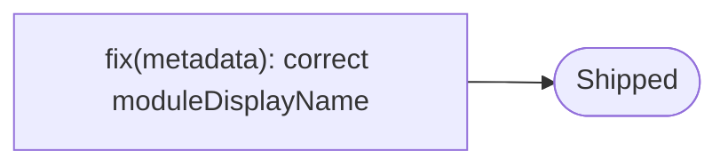

*landed in 0 days · 0 reviewers · 1 contributors*

Outcome **shipped**; PRs: [#7371](https://github.com/Azure/bicep-registry-modules/pull/7371) (merged); code areas: 242 (`avm/ptn/aca-lza/hosting-environment`, `avm/ptn/ai-ml/ai-foundry`, `avm/ptn/ai-ml/landing-zone`, `avm/ptn/ai-platform/baseline`, `avm/ptn/alz/ama`, `avm/ptn/alz/empty` …)

PR 7371 reset moduleDisplayName in metadata.json for 576 AVM modules to their canonical values. It merged without recorded reviews. — [1](https://github.com/Azure/bicep-registry-modules/pull/7371)

- **Proposed:** The display names had drifted from the canonical names in BicepResourceModules.csv and BicepPatternModules.csv. — [1](https://github.com/Azure/bicep-registry-modules/pull/7371)
- **Changed:** Each of 576 files had exactly one line changed to the canonical value from an inventory of 579 drifted rows; three modules already had the canonical value and were left alone. The PR body reports all files parse as JSON and each new value was checked against the inventory. — [1](https://github.com/Azure/bicep-registry-modules/pull/7371)
- **Shipped:** The moduleDisplayName corrections merged in one commit; only that field was touched. — [1](https://github.com/Azure/bicep-registry-modules/pull/7371), [2](https://github.com/Azure/bicep-registry-modules/commit/0fde2cff4f9d07898b5e2ba6569d08d9bbf120d7)

### Deep train `train-pr-7373` — fix(metadata): reconcile catalog description drift across 606 modules


*landed in 0 days · 0 reviewers · 1 contributors*

Outcome **shipped**; PRs: [#7373](https://github.com/Azure/bicep-registry-modules/pull/7373) (merged); code areas: 267 (`avm/ptn/aca-lza/hosting-environment`, `avm/ptn/ai-ml/ai-foundry`, `avm/ptn/ai-ml/landing-zone`, `avm/ptn/ai-platform/baseline`, `avm/ptn/alz/ama`, `avm/ptn/alz/empty` …)

PR 7373 reconciled moduleDescription in metadata.json across 606 modules to match the AVM catalog CSV descriptions. It merged without recorded reviews. — [1](https://github.com/Azure/bicep-registry-modules/pull/7373)

- **Proposed:** Generated catalog-description drift needed removing so the tools workflow report surfaces only genuine CSV errors. — [1](https://github.com/Azure/bicep-registry-modules/pull/7373)
- **Changed:** Before-values came from the tools workflow artifact CSVs (resource, pattern and utility), matched by ModuleName. The PR body says every changed file was diffed to confirm only moduleDescription differs, and no CSV files were modified. — [1](https://github.com/Azure/bicep-registry-modules/pull/7373)
- **Shipped:** Description updates for 537 resource, 67 pattern and 2 utility modules (606 files) merged in one commit. — [1](https://github.com/Azure/bicep-registry-modules/pull/7373), [2](https://github.com/Azure/bicep-registry-modules/commit/2f7a0d23e0b2ec91df9d54c097fa1bc9ee2db2ab)

### Deep train `train-pr-7375` — fix(metadata): restore abbreviated telemetryIdPrefix on scaffolded modules

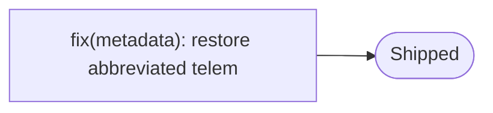

*landed in 0 days · 0 reviewers · 1 contributors*

Outcome **shipped**; PRs: [#7375](https://github.com/Azure/bicep-registry-modules/pull/7375) (merged); code areas: 40 (`avm/ptn/ai-ml/landing-zone`, `avm/ptn/app/cosmos-db-account-container-app`, `avm/ptn/app/function-app`, `avm/ptn/app/mongodb-cluster-container-app`, `avm/ptn/avd-lza/insights`, `avm/ptn/avd-lza/management-plane` …)

PR 7375 restored abbreviated telemetryIdPrefix values on 40 scaffolded metadata-only modules. It merged without recorded reviews. — [1](https://github.com/Azure/bicep-registry-modules/pull/7375)

- **Proposed:** The scaffolding in #7366 had derived fully hyphenated prefixes from module paths instead of the existing abbreviated convention, which would cause a telemetryIdPrefix diff in the next Module Metadata Catalog Sync run in the tools repo. — [1](https://github.com/Azure/bicep-registry-modules/pull/7375)
- **Changed:** Prefixes were reset to the historic abbreviated values from the AVM catalog CSVs, for example 46d3xbcp.ptn.ai-ml-landing-zone became 46d3xbcp.ptn.aiml-lz. The PR body says none of the modules has published Bicep code, so shipped telemetry is unchanged. — [1](https://github.com/Azure/bicep-registry-modules/pull/7375)
- **Shipped:** Updated telemetryIdPrefix values in the metadata of the 40 scaffold modules merged in one commit. — [1](https://github.com/Azure/bicep-registry-modules/pull/7375), [2](https://github.com/Azure/bicep-registry-modules/commit/0195cf769ed5b97e112037a6cf95bbd0df0cc02b)

### Deep train `train-pr-7378` — feat: Replace generated CODEOWNERS with metadata-driven reviewer routing

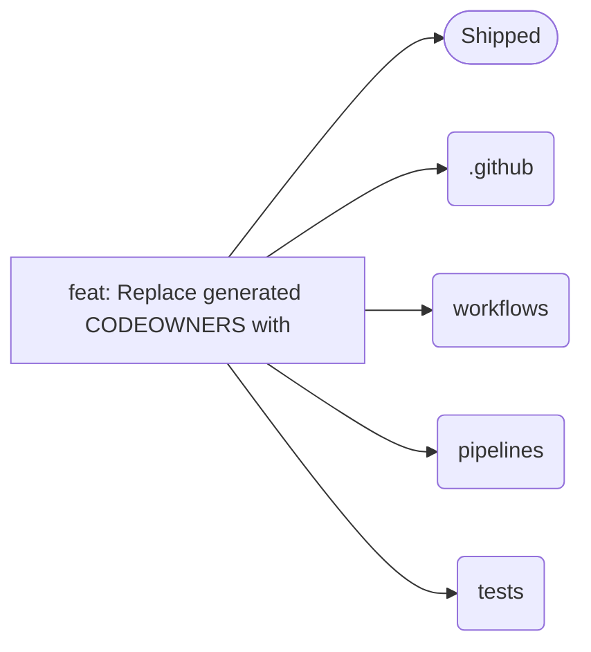

*landed in 1 days · 0 reviewers · 1 contributors*

Outcome **shipped**; PRs: [#7378](https://github.com/Azure/bicep-registry-modules/pull/7378) (merged); code areas: 4 (`.github`, `.github/workflows`, `utilities/pipelines`, `utilities/tests`)

PR 7378 replaced the generated per-module CODEOWNERS model with metadata-driven reviewer routing, with the routing automation re-homed in Azure/azure-verified-modules-tools. It merged on 2026-09-23 as a pure removal. — [1](https://github.com/Azure/bicep-registry-modules/pull/7378)

- **Proposed:** Approval rights should come from repository permissions alone, with only the people and teams listed in each module's metadata.json notified through a review request. The PR body says the original routing workflow ran in this repository and needed AVM GitHub App credentials. — [1](https://github.com/Azure/bicep-registry-modules/pull/7378)
- **Changed:** The PR body says the routing workflow was first triggered by pull_request_target, then reworked to a scheduled sweep, and finally moved to the tools repo so no AVM GitHub App credentials remain here. All four workflows that needed AVM_APP_CLIENT_ID / AVM_APP_PRIVATE_KEY were removed. The slice shows no review rounds. — [1](https://github.com/Azure/bicep-registry-modules/pull/7378)
- **Shipped:** A single commit merged the removal (+61 / -2,782 per the PR body) touching .github, .github/workflows, utilities/pipelines and utilities/tests; the routing implementation lives in the tools repo. — [1](https://github.com/Azure/bicep-registry-modules/pull/7378), [2](https://github.com/Azure/bicep-registry-modules/commit/072801be50977affd8debc25c6dd40b7ca2a2211)

### Deep train `train-pr-7380` — feat: index updates 22092026

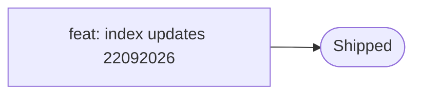

*landed in 0 days · 1 reviewers · 2 contributors · 1 review rounds*

Outcome **shipped**; PRs: [#7380](https://github.com/Azure/bicep-registry-modules/pull/7380) (merged); code areas: 28 (`.github/ISSUE_TEMPLATE`, `.github/workflows`, `avm/ptn/ai-ml/ai-foundry`, `avm/ptn/sa/chat-with-your-data`, `avm/ptn/sa/content-processing`, `avm/ptn/sa/conversation-knowledge-mining` …)

PR 7380 was an index update dated 22 September 2026 that merged after approval from jaredfholgate ('LGTM'). — [1](https://github.com/Azure/bicep-registry-modules/pull/7380)

- **Proposed:** The PR title and body say only 'index updates 22092026'; the slice states no further problem statement. — [1](https://github.com/Azure/bicep-registry-modules/pull/7380)
- **Changed:** The feature deltas show DEPRECATED.md and CHANGELOG.md/README.md changes added to six avm/ptn/sa modules and ORPHANED.md files added with README changes to modules such as avm/res/compute/availability-set, proximity-placement-group, dev-center/network-connection and dev-center/project. The commit also touched .github/ISSUE_TEMPLATE and .github/workflows. — [1](https://github.com/Azure/bicep-registry-modules/pull/7380)
- **Shipped:** Deprecation and orphan markers plus README and CHANGELOG updates for the listed modules merged in one commit. — [1](https://github.com/Azure/bicep-registry-modules/pull/7380), [2](https://github.com/Azure/bicep-registry-modules/commit/a2e20b1981c31420c957834fafb97c81806c63f3)

### Deep train `train-pr-7383` — fix: retire ORPHANED.md markers in favor of metadata ownership

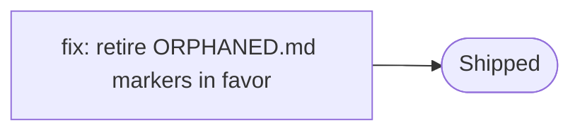

*landed in 1 days · 1 reviewers · 2 contributors · 1 review rounds*

Outcome **shipped**; PRs: [#7383](https://github.com/Azure/bicep-registry-modules/pull/7383) (merged); code areas: 27 (`avm/ptn/network/hub-networking`, `avm/res/analysis-services/server`, `avm/res/compute/availability-set`, `avm/res/compute/proximity-placement-group`, `avm/res/desktop-virtualization/application-group`, `avm/res/desktop-virtualization/host-pool` …)

PR 7383 retired ORPHANED.md markers so orphaning and adoption only require changing the owners array in a family's root metadata.json. It merged after approval from jtracey93. — [1](https://github.com/Azure/bicep-registry-modules/pull/7383)

- **Proposed:** The old compliance assertion compared marker files with owner handles from the public module index, which can lag an approved metadata change, as a network-connection validation failure showed. — [1](https://github.com/Azure/bicep-registry-modules/pull/7383)
- **Changed:** Get-ModuleList.ps1 now resolves ownership from validated root metadata, including inherited child ownership and team handles. The PR was rebased on 2026-09-23 after #7389 removed the obsolete assertion, and the retired assertion is not reintroduced since the metadata gate enforces ownership validity. A reviewer asked whether to later add badges that look up status from the index, and the author said it could go on the backlog. — [1](https://github.com/Azure/bicep-registry-modules/pull/7383)
- **Rejected:** The old marker-versus-index compliance assertion was removed and explicitly not reintroduced or duplicated. — [1](https://github.com/Azure/bicep-registry-modules/pull/7383)
- **Shipped:** ORPHANED.md files were dropped and README files updated across about two dozen modules, with changes in utilities/pipelines and utilities/tests. — [1](https://github.com/Azure/bicep-registry-modules/pull/7383), [2](https://github.com/Azure/bicep-registry-modules/commit/0a2689ec06ca1d908bc722f2d9080d8ec07cfb3e)

### Deep train `train-pr-7399` — refactor(avm): source telemetry prefixes from module metadata

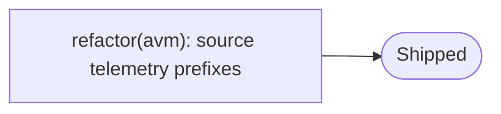

*landed in 0 days · 0 reviewers · 1 contributors*

Outcome **shipped**; PRs: [#7399](https://github.com/Azure/bicep-registry-modules/pull/7399) (merged); code areas: 223 (`avm/ptn/aca-lza/hosting-environment`, `avm/ptn/ai-ml/ai-foundry`, `avm/ptn/ai-platform/baseline`, `avm/ptn/alz/ama`, `avm/ptn/alz/empty`, `avm/ptn/app-service-lza/hosting-environment` …)

PR 7399 refactored AVM modules to source telemetry prefixes from their adjacent metadata.json. It merged without recorded reviews. — [1](https://github.com/Azure/bicep-registry-modules/pull/7399)

- **Proposed:** Telemetry prefixes should come from module metadata rather than being hard-coded in each main.bicep. — [1](https://github.com/Azure/bicep-registry-modules/pull/7399)
- **Changed:** 542 telemetry-implementing modules now use var telemetryIdPrefix = loadJsonContent('metadata.json', 'telemetryIdPrefix') and name their avmTelemetry deployment from it, with 546 main.json files regenerated. The scaffold and compliance checks were updated, and four source/metadata discrepancies (document-knowledge-mining, devcenter, network-connection, project) were reconciled to the published index identifiers, changing those four deployment names. — [1](https://github.com/Azure/bicep-registry-modules/pull/7399)
- **Rejected:** Module versions and per-module changelogs were deliberately left unchanged for this mechanical backfill. — [1](https://github.com/Azure/bicep-registry-modules/pull/7399)
- **Shipped:** The metadata-driven telemetry prefix change merged in one commit, with 543 changed avmTelemetry resources and 543 added telemetryIdPrefix variables in the deltas. — [1](https://github.com/Azure/bicep-registry-modules/pull/7399), [2](https://github.com/Azure/bicep-registry-modules/commit/65c433240fa4b6cd25f2d03286884139436dfea8)

### Deep train `train-pr-7403` — fix(telemetry): backfill unique Bicep module prefixes

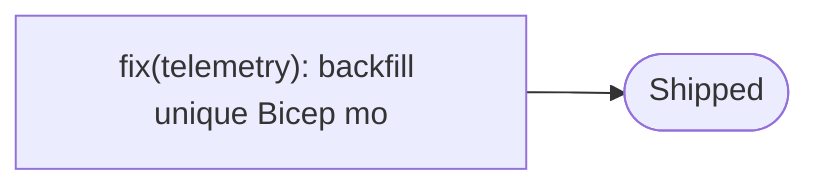

*landed in 0 days · 1 reviewers · 2 contributors · 1 review rounds*

Outcome **shipped**; PRs: [#7403](https://github.com/Azure/bicep-registry-modules/pull/7403) (merged); code areas: 269 (`avm/ptn/aca-lza/hosting-environment`, `avm/ptn/ai-ml/ai-foundry`, `avm/ptn/ai-ml/landing-zone`, `avm/ptn/ai-platform/baseline`, `avm/ptn/alz/ama`, `avm/ptn/alz/empty` …)

PR 7403 backfilled unique Bicep module telemetry prefixes by rotating all 608 existing current IDs with the merged authoring generator. It merged after approval from jtracey93. — [1](https://github.com/Azure/bicep-registry-modules/pull/7403)

- **Proposed:** Telemetry prefixes needed to be unique per module and generated in the form 46d3xbcp.<res|ptn|utl>.<seven lowercase hex>. — [1](https://github.com/Azure/bicep-registry-modules/pull/7403)
- **Changed:** The scaffolding requests prefixes from Avm.Authoring New-AvmTelemetryIdPrefix and fails with install guidance when it is unavailable, and each previous ID is preserved under alternativeTelemetryIdPrefixes. 543 telemetry-bearing main.json templates were regenerated, and take(..., 64) wrappers were removed from 32 telemetry deployment names because their maximum length is now 34 characters. — [1](https://github.com/Azure/bicep-registry-modules/pull/7403)
- **Shipped:** The new prefixes, regenerated templates and the 32 deployment-name simplifications merged in one commit across 269 code areas. — [1](https://github.com/Azure/bicep-registry-modules/pull/7403), [2](https://github.com/Azure/bicep-registry-modules/commit/063eb890ad676ffb7202490b39b2500d0e12645e)

### Deep train `train-pr-7406` — chore: deprecate legacy modules directory

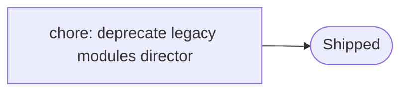

*landed in 0 days · 1 reviewers · 2 contributors · 1 review rounds*

Outcome **shipped**; PRs: [#7406](https://github.com/Azure/bicep-registry-modules/pull/7406) (merged); code areas: 15 (`modules/ai`, `modules/app`, `modules/authorization`, `modules/azure-gaming`, `modules/compute`, `modules/cost` …)

PR 7406 deprecated the legacy modules directory by removing its retirement and archival notice files. It merged after approval from jtracey93. — [1](https://github.com/Azure/bicep-registry-modules/pull/7406)

- **Proposed:** The PR body says the goal is to clean up documentation by removing status banners and references to past releases or replacement modules. — [1](https://github.com/Azure/bicep-registry-modules/pull/7406)
- **Changed:** The feature deltas show 129 drops under modules/, including 43 ARCHIVED.md, 43 README.md, 22 REPLACED.md and 21 RETIRED.md files. The body names ai/bing-resource, ai/cognitiveservices and app/app-configuration. — [1](https://github.com/Azure/bicep-registry-modules/pull/7406)
- **Shipped:** The notice and README files under the legacy modules directory were removed in one commit. — [1](https://github.com/Azure/bicep-registry-modules/pull/7406), [2](https://github.com/Azure/bicep-registry-modules/commit/c83bfa2063a7fe892188010b1b6aa21407f94d34)

### Deep train `train-pr-7410` — docs(avm): reconcile module README content with sources

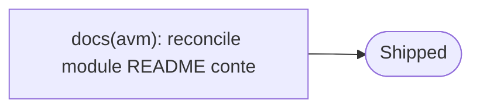

*landed in 1 days · 1 reviewers · 2 contributors · 1 review rounds*

Outcome **shipped**; PRs: [#7410](https://github.com/Azure/bicep-registry-modules/pull/7410) (merged); code areas: 13 (`avm/ptn/app/iaas-vm-cosmosdb-tier4`, `avm/ptn/dev-ops/cicd-agents-and-runners`, `avm/ptn/network/virtual-wan`, `avm/res/compute/virtual-machine`, `avm/res/container-registry/registry`, `avm/res/db-for-my-sql/flexible-server` …)

PR 7410 reconciled checked-in AVM README content with the source modules and examples. It merged after approval from jtracey93. — [1](https://github.com/Azure/bicep-registry-modules/pull/7410)

- **Proposed:** Some READMEs had wrong H1 resource types, placeholder example values and stale tables compared with the module sources. — [1](https://github.com/Azure/bicep-registry-modules/pull/7410)
- **Changed:** Four child-module H1 types were corrected to the canonicalType, placeholders such as VM imageReference.sku and Container Registry trustPolicyStatus were replaced with source literals, and the Virtual WAN README now lists all ten actual avm-common-types references. The PR body says no Bicep, templates, metadata, tests, generator or CI changed. — [1](https://github.com/Azure/bicep-registry-modules/pull/7410)
- **Shipped:** README.md changes across 12 module areas, such as virtual-wan, compute/virtual-machine, container-registry/registry and operational-insights/workspace, merged in one commit. — [1](https://github.com/Azure/bicep-registry-modules/pull/7410), [2](https://github.com/Azure/bicep-registry-modules/commit/01b1d3a9a2e38c2447a6d13554e06b95279dd84b)

### Deep train `train-pr-7416` — docs(avm): pin registry README template and preserve authored Notes

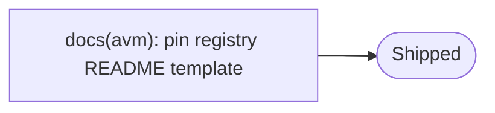

*landed in 0 days · 1 reviewers · 2 contributors · 1 review rounds*

Outcome **shipped**; PRs: [#7416](https://github.com/Azure/bicep-registry-modules/pull/7416) (merged); code areas: 38 (`avm/ptn/alz/empty`, `avm/ptn/app/container-job-toolkit`, `avm/ptn/app/iaas-vm-cosmosdb-tier4`, `avm/ptn/data/private-analytical-workspace`, `avm/ptn/deployment-script/import-image-to-acr`, `avm/ptn/lz/sub-vending` …)

PR 7416 pinned the registry README template and added preserved Notes sidecars without regenerating any READMEs. It merged after approval from jtracey93. — [1](https://github.com/Azure/bicep-registry-modules/pull/7416)

- **Proposed:** Registry-owned README assets needed preparing for review without switching the existing generator, regenerating module READMEs, changing CI or deploying resources. — [1](https://github.com/Azure/bicep-registry-modules/pull/7416)
- **Changed:** The root bicepconfig.json selects docs/templates/avm-readme-v1.scriban, copied byte-for-byte from tools commit 4962cd61 with a recorded SHA-256. 53 README.notes.md sidecars were added from the comparator's Notes export, each hash-checked, and one focused render with -CheckDrift wrote no module README. — [1](https://github.com/Azure/bicep-registry-modules/pull/7416)
- **Shipped:** The avm-readme-v1.scriban template and 53 README.notes.md files merged in one commit (54 added files). — [1](https://github.com/Azure/bicep-registry-modules/pull/7416), [2](https://github.com/Azure/bicep-registry-modules/commit/5da64c520c600e3347b649e6ffda311373c25a68)

**Mention trains** — one line each:

- `train-issue-7270` — [[AVM Module Issue]: Static PostgreSQL configurations are not persisted by flexible-server 0.16.0](https://github.com/Azure/bicep-registry-modules/issues/7270) — shipped (1 PR(s))
- `train-issue-7284` — [[AVM Module Issue]: timeBasedImmutability parameters missing for database backup-long-term-retention-policy](https://github.com/Azure/bicep-registry-modules/issues/7284) — shipped (1 PR(s))
- `train-issue-7289` — [[AVM Module Issue]: Recovery-Services/vault softDeleteSettings vs backupConfig](https://github.com/Azure/bicep-registry-modules/issues/7289) — shipped (1 PR(s))
- `train-issue-7295` — [[AVM Module Issue]: Key Vault module should be updated to API version 2026-02-01 or later](https://github.com/Azure/bicep-registry-modules/issues/7295) — shipped (2 PR(s))
- `train-issue-7328` — [[AVM Module Issue]: web.static-sites fails when deploying private endpoint with custom private dns zone](https://github.com/Azure/bicep-registry-modules/issues/7328) — shipped (1 PR(s))
- `train-issue-7344` — [[AVM Module Issue]: Managed Instance AVM incorrectly restricts storageSizeInGB maximum value to 8192](https://github.com/Azure/bicep-registry-modules/issues/7344) — shipped (1 PR(s))
- `train-pr-7293` — [feat: ManagedEnvironment update and test fixes](https://github.com/Azure/bicep-registry-modules/pull/7293) — shipped (1 PR(s))
- `train-pr-7306` — [chore: Pin GitHub Actions to full-length commit SHAs](https://github.com/Azure/bicep-registry-modules/pull/7306) — shipped (1 PR(s))
- `train-pr-7318` — [feat: expose disableLocalAuth and publicNetworkAccess on communication-service module](https://github.com/Azure/bicep-registry-modules/pull/7318) — shipped (1 PR(s))
- `train-pr-7319` — [chore: remove legacy teams from codeowners](https://github.com/Azure/bicep-registry-modules/pull/7319) — shipped (1 PR(s))
- `train-pr-7320` — [fix: pin composite action dependencies](https://github.com/Azure/bicep-registry-modules/pull/7320) — shipped (1 PR(s))
- `train-pr-7321` — [fix: correct PSRule action SHA](https://github.com/Azure/bicep-registry-modules/pull/7321) — shipped (1 PR(s))
- `train-pr-7323` — [feat: managed environment parameter doc](https://github.com/Azure/bicep-registry-modules/pull/7323) — shipped (1 PR(s))
- `train-pr-7336` — [ci: distribute Bicep tests across configured subscriptions](https://github.com/Azure/bicep-registry-modules/pull/7336) — shipped (1 PR(s))
- `train-pr-7337` — [fix: migrate Bicep module ownership routing](https://github.com/Azure/bicep-registry-modules/pull/7337) — shipped (1 PR(s))
- `train-pr-7340` — [fix: select first GitHub CLI executable for CI migration](https://github.com/Azure/bicep-registry-modules/pull/7340) — shipped (1 PR(s))
- `train-pr-7343` — [chore: generate per-module CODEOWNERS from module owners](https://github.com/Azure/bicep-registry-modules/pull/7343) — shipped (1 PR(s))
- `train-pr-7351` — [ci: temporarily select BAMI test variables by module path](https://github.com/Azure/bicep-registry-modules/pull/7351) — shipped (1 PR(s))
- `train-pr-7355` — [fix: PostgreSQL - Fixing failing test](https://github.com/Azure/bicep-registry-modules/pull/7355) — shipped (1 PR(s))
- `train-pr-7356` — [fix: bump github/codeql-action/upload-sarif from 4.37.9 to 4.38.0](https://github.com/Azure/bicep-registry-modules/pull/7356) — shipped (1 PR(s))
- `train-pr-7362` — [chore: mark consolidated module workflow as experimental](https://github.com/Azure/bicep-registry-modules/pull/7362) — shipped (1 PR(s))
- `train-pr-7363` — [feat: initial version code-signing-account module](https://github.com/Azure/bicep-registry-modules/pull/7363) — shipped (1 PR(s))
- `train-pr-7368` — [feat(scaffold): bootstrap valid metadata.json for new AVM modules](https://github.com/Azure/bicep-registry-modules/pull/7368) — shipped (1 PR(s))
- `train-pr-7372` — [fix(avm/res/azure-stack-hci/cluster): add phase-derived forceUpdateTag to deployment script](https://github.com/Azure/bicep-registry-modules/pull/7372) — shipped (1 PR(s))
- `train-pr-7376` — [fix(consumption/budget): resolve duplicate telemetry ID between rg-scope and sub-scope](https://github.com/Azure/bicep-registry-modules/pull/7376) — shipped (1 PR(s))
- `train-pr-7379` — [feat(metadata): require valid metadata.json for all AVM Bicep modules](https://github.com/Azure/bicep-registry-modules/pull/7379) — shipped (1 PR(s))
- `train-pr-7382` — [fix: isolate metadata validation from Bicep compilation](https://github.com/Azure/bicep-registry-modules/pull/7382) — shipped (1 PR(s))
- `train-pr-7384` — [feat(avm/res/azure-stack-hci/cluster): update API versions to latest …](https://github.com/Azure/bicep-registry-modules/pull/7384) — shipped (1 PR(s))
- `train-pr-7388` — [chore(module-list): sync AVM module dropdown [skip ci]](https://github.com/Azure/bicep-registry-modules/pull/7388) — shipped (1 PR(s))
- `train-pr-7389` — [chore: remove remaining CSV module index references](https://github.com/Azure/bicep-registry-modules/pull/7389) — shipped (1 PR(s))
- `train-pr-7396` — [chore(avm/res/azure-stack-hci/cluster): Add abhisheksharma-ops as module owner](https://github.com/Azure/bicep-registry-modules/pull/7396) — shipped (1 PR(s))
- `train-pr-7398` — [chore: remove redundant module-dropdown compliance check](https://github.com/Azure/bicep-registry-modules/pull/7398) — shipped (1 PR(s))
- `train-pr-7400` — [chore(module-list): sync AVM module dropdown [skip ci]](https://github.com/Azure/bicep-registry-modules/pull/7400) — shipped (1 PR(s))
- `train-pr-7401` — [fix(ci): skip metadata-only experimental module workflow runs](https://github.com/Azure/bicep-registry-modules/pull/7401) — shipped (1 PR(s))
- `train-pr-7402` — [feat(ci): add opt-in consolidated checks for pull requests](https://github.com/Azure/bicep-registry-modules/pull/7402) — shipped (1 PR(s))
- `train-pr-7407` — [fix: compile container job toolkit secure workspace output](https://github.com/Azure/bicep-registry-modules/pull/7407) — shipped (1 PR(s))
- `train-pr-7409` — [chore: avd owner updates](https://github.com/Azure/bicep-registry-modules/pull/7409) — shipped (1 PR(s))
- `train-pr-7411` — [fix: retry regional template validation in eligible regions](https://github.com/Azure/bicep-registry-modules/pull/7411) — shipped (1 PR(s))
- `train-pr-7413` — [fix: isolate Lab fixture names and track rejected deployment attempts](https://github.com/Azure/bicep-registry-modules/pull/7413) — shipped (1 PR(s))
- `train-pr-7415` — [fix: align conversation knowledge mining test parameters](https://github.com/Azure/bicep-registry-modules/pull/7415) — shipped (1 PR(s))
- `train-pr-7419` — [chore(module-list): sync AVM module dropdown [skip ci]](https://github.com/Azure/bicep-registry-modules/pull/7419) — shipped (1 PR(s))
- `train-pr-7420` — [chore(module-list): sync AVM module dropdown [skip ci]](https://github.com/Azure/bicep-registry-modules/pull/7420) — shipped (1 PR(s))
- `train-pr-7421` — [feat(avm/res/azure-stack-hci/cluster): update Azure Stack HCI API versions to GA 2026-10-01](https://github.com/Azure/bicep-registry-modules/pull/7421) — shipped (1 PR(s))
- `train-pr-7423` — [fix(avm/res/azure-stack-hci/logical-network): update telemetry deployment API version to 2025-04-01](https://github.com/Azure/bicep-registry-modules/pull/7423) — shipped (1 PR(s))
- `train-pr-7424` — [fix(avm/res/azure-stack-hci/virtual-hard-disk): update telemetry deployment API version to 2025-04-01](https://github.com/Azure/bicep-registry-modules/pull/7424) — shipped (1 PR(s))
- `train-pr-7425` — [fix: preserve deployment cleanup after HTTP timeouts](https://github.com/Azure/bicep-registry-modules/pull/7425) — shipped (1 PR(s))
- `train-pr-7426` — [fix(avm/res/azure-stack-hci/network-interface): update telemetry deployment API version to 2025-04-01](https://github.com/Azure/bicep-registry-modules/pull/7426) — shipped (1 PR(s))
- `train-pr-7427` — [feat(avm/res/hybrid-compute/machine): update HybridCompute API versions to 2026-07-15](https://github.com/Azure/bicep-registry-modules/pull/7427) — shipped (1 PR(s))
- `train-pr-7428` — [ci: remove per-repo AVM label synchronization workflow](https://github.com/Azure/bicep-registry-modules/pull/7428) — shipped (1 PR(s))
- `train-pr-7429` — [feat(avm/res/azure-stack-hci/virtual-machine-instance): update Arc machine API version to 2026-07-15](https://github.com/Azure/bicep-registry-modules/pull/7429) — shipped (1 PR(s))
- `train-issue-2865` — [[AVM CI Environment Issue]: Error when checking deployment status](https://github.com/Azure/bicep-registry-modules/issues/2865) — in_flight (1 PR(s))
- `train-issue-3860` — [[AVM Module Issue]: 0.5.1~0.8.3 incompatible with BYO vnet PodSubnetID `container-service/managed-cluster`](https://github.com/Azure/bicep-registry-modules/issues/3860) — in_flight (1 PR(s))
- `train-issue-4794` — [[AVM Module Issue]: Unable to create a cognitive services account with multiple deployments](https://github.com/Azure/bicep-registry-modules/issues/4794) — in_flight (1 PR(s))
- `train-issue-5561` — [[AVM Module Issue]: Missing properties securityProfile sections (or securityEncryptionType) in Compute module](https://github.com/Azure/bicep-registry-modules/issues/5561) — in_flight (1 PR(s))
- `train-issue-6001` — [[AVM Module Issue]: Storage account fails while adding private endpoint with below error](https://github.com/Azure/bicep-registry-modules/issues/6001) — in_flight (1 PR(s))
- `train-issue-6167` — [[AVM Module Issue]: Disable weak cipher suites in API Management service module?](https://github.com/Azure/bicep-registry-modules/issues/6167) — in_flight (1 PR(s))
- `train-issue-6483` — [[AVM Module Issue]: subResourceWrapper.bicep lacks the use of serviceEndpoints](https://github.com/Azure/bicep-registry-modules/issues/6483) — in_flight (1 PR(s))
- `train-issue-6518` — [[AVM Module Issue]: Fine control for notification thresholds in budget](https://github.com/Azure/bicep-registry-modules/issues/6518) — in_flight (1 PR(s))
- `train-issue-6891` — [[AVM Module Issue]: Netapp account module missing site property for activeDirectory configuration](https://github.com/Azure/bicep-registry-modules/issues/6891) — in_flight (1 PR(s))
- `train-issue-6900` — [[AVM Module Issue]: subscriptions never placed unless disableSubscriptionPlacement: true](https://github.com/Azure/bicep-registry-modules/issues/6900) — in_flight (1 PR(s))
- `train-issue-6955` — [[AVM Module Issue]: Add Aspire Dashboard component support to avm/res/app/managed-environment](https://github.com/Azure/bicep-registry-modules/issues/6955) — in_flight (1 PR(s))
- `train-issue-6968` — [[AVM Module Issue]: AVM Bastion Host Module — Session Recording Storage Configuration Gap](https://github.com/Azure/bicep-registry-modules/issues/6968) — in_flight (1 PR(s))
- `train-issue-7122` — [[AVM Module Issue]: avm/res/api-management/service logger description not set in api-management deployed instance of AVM module](https://github.com/Azure/bicep-registry-modules/issues/7122) — in_flight (1 PR(s))
- `train-issue-7226` — [[AVM Module Issue]: subscriptionsLimit on product cant be set to unlimited](https://github.com/Azure/bicep-registry-modules/issues/7226) — in_flight (1 PR(s))
- `train-issue-7278` — [[AVM Module Issue]: API management `skuCapacity` default of `3` fails deployment when `sku` is `Basic` (max capacity 2)](https://github.com/Azure/bicep-registry-modules/issues/7278) — in_flight (1 PR(s))
- `train-issue-7342` — [[AVM Module Issue]:](https://github.com/Azure/bicep-registry-modules/issues/7342) — in_flight (1 PR(s))
- `train-issue-7345` — [[AVM Module Issue]: avm.res.insights.scheduled-query-rule missing kind SimpleLogAlert](https://github.com/Azure/bicep-registry-modules/issues/7345) — in_flight (1 PR(s))
- `train-issue-7394` — [fix(avm/res/azure-stack-hci/cluster): Validate deploymentSettings deleted before Deploy wipes validationStatus (portal 'Validate input = Unknown')](https://github.com/Azure/bicep-registry-modules/issues/7394) — in_flight (1 PR(s))
- `train-pr-3810` — [ci: Introduce PSRule suppression for individual rules/resources](https://github.com/Azure/bicep-registry-modules/pull/3810) — in_flight (1 PR(s))
- `train-pr-4863` — [feat: add gh issue label logic](https://github.com/Azure/bicep-registry-modules/pull/4863) — in_flight (1 PR(s))
- `train-pr-5315` — [ci: [Test 01] Enforce test folder validation for pattern modules for both defaults and waf-aligned](https://github.com/Azure/bicep-registry-modules/pull/5315) — in_flight (1 PR(s))
- `train-pr-5316` — [ci: [Test 02] Enforce test folder validation for pattern modules for both waf-aligned only](https://github.com/Azure/bicep-registry-modules/pull/5316) — in_flight (1 PR(s))
- `train-pr-5317` — [ci: [Test 03] Enforce test folder validation for pattern modules for defaults only](https://github.com/Azure/bicep-registry-modules/pull/5317) — in_flight (1 PR(s))
- `train-pr-6168` — [feat: Re-added logic to set module version in readme](https://github.com/Azure/bicep-registry-modules/pull/6168) — in_flight (1 PR(s))
- `train-pr-6218` — [feat: Synapase - Added support for HSM](https://github.com/Azure/bicep-registry-modules/pull/6218) — in_flight (1 PR(s))
- `train-pr-6549` — [feat(ptn): Update FinOps Hub v12 pattern module](https://github.com/Azure/bicep-registry-modules/pull/6549) — in_flight (1 PR(s))
- `train-pr-6580` — [feat: new module `avm/res/app/agent` (Microsoft.App/agents)](https://github.com/Azure/bicep-registry-modules/pull/6580) — in_flight (1 PR(s))
- `train-pr-6584` — [fix(app-service-lza): correct web app kind parameter to respect OS configuration](https://github.com/Azure/bicep-registry-modules/pull/6584) — in_flight (1 PR(s))
- `train-pr-6694` — [feat: check for module existence in MAR](https://github.com/Azure/bicep-registry-modules/pull/6694) — in_flight (1 PR(s))
- `train-pr-6732` — [ci: DO NOT MERGE - Test to showcase feasibility of validation on PR](https://github.com/Azure/bicep-registry-modules/pull/6732) — in_flight (1 PR(s))
- `train-pr-6753` — [feat: module maintenance skill](https://github.com/Azure/bicep-registry-modules/pull/6753) — in_flight (1 PR(s))
- `train-pr-6761` — [test(avm/res/azure-stack-hci/marketplace-gallery-image): update test harness for 24H2 cluster](https://github.com/Azure/bicep-registry-modules/pull/6761) — in_flight (1 PR(s))
- `train-pr-6813` — [feat: add bootstrap skill](https://github.com/Azure/bicep-registry-modules/pull/6813) — in_flight (1 PR(s))
- `train-pr-6929` — [feat: Subscription Vending PTN - UMI Role Assignments absolute scopes](https://github.com/Azure/bicep-registry-modules/pull/6929) — in_flight (1 PR(s))
- `train-pr-7021` — [fix: ReadMe Gen - Fixed incorrect section reference if non-parent module](https://github.com/Azure/bicep-registry-modules/pull/7021) — in_flight (1 PR(s))
- `train-pr-7074` — [fix: remove enableAnalyticalStorage o…](https://github.com/Azure/bicep-registry-modules/pull/7074) — in_flight (1 PR(s))
- `train-pr-7075` — [feat: introduce container migration module](https://github.com/Azure/bicep-registry-modules/pull/7075) — in_flight (1 PR(s))
- `train-pr-7089` — [feat: Publish child module `avm/res/web/hosting-environment/configuration`](https://github.com/Azure/bicep-registry-modules/pull/7089) — in_flight (1 PR(s))
- `train-pr-7094` — [feat: Publish child modules of `avm/res/cache/redis-enterprise`](https://github.com/Azure/bicep-registry-modules/pull/7094) — in_flight (1 PR(s))
- `train-pr-7144` — [feat: Add contribution guidelines and module overview to documentation](https://github.com/Azure/bicep-registry-modules/pull/7144) — in_flight (1 PR(s))
- `train-pr-7165` — [fix: bump actions/checkout from 4 to 7](https://github.com/Azure/bicep-registry-modules/pull/7165) — in_flight (1 PR(s))
- `train-pr-7182` — [feat: dependency updates on `avm/ptn/app/container-job-toolkit`](https://github.com/Azure/bicep-registry-modules/pull/7182) — in_flight (1 PR(s))
- `train-pr-7245` — [Fix: CWYD AVM upgrade v2](https://github.com/Azure/bicep-registry-modules/pull/7245) — in_flight (1 PR(s))
- `train-pr-7259` — [feat: static test for using multiple versions in one module](https://github.com/Azure/bicep-registry-modules/pull/7259) — in_flight (1 PR(s))
- `train-pr-7263` — [Upgrade FinOps hub to Toolkit v14](https://github.com/Azure/bicep-registry-modules/pull/7263) — in_flight (1 PR(s))
- `train-pr-7281` — [feat: Add CMK user-assigned identity to managed identities across modules - batch 2](https://github.com/Azure/bicep-registry-modules/pull/7281) — in_flight (1 PR(s))
- `train-pr-7286` — [adding fips flag to additionalfeatures](https://github.com/Azure/bicep-registry-modules/pull/7286) — in_flight (1 PR(s))
- `train-pr-7288` — [docs: Remove stale model pin and dead `/AVM-Boostrap` reference from pre-flight check](https://github.com/Azure/bicep-registry-modules/pull/7288) — in_flight (1 PR(s))
- `train-pr-7290` — [fix: bump actions/upload-artifact from 5.0.0 to 7.0.1](https://github.com/Azure/bicep-registry-modules/pull/7290) — in_flight (1 PR(s))
- `train-pr-7310` — [feat: AVM Module Upgrade for BYOCC](https://github.com/Azure/bicep-registry-modules/pull/7310) — in_flight (1 PR(s))
- `train-pr-7316` — [fix: bump actions/checkout from 4.4.0 to 7.0.1](https://github.com/Azure/bicep-registry-modules/pull/7316) — in_flight (1 PR(s))
- `train-pr-7317` — [fix: bump azure/powershell from 2.0.0 to 3.0.0](https://github.com/Azure/bicep-registry-modules/pull/7317) — in_flight (1 PR(s))
- `train-pr-7333` — [AVM module updated for CWYD v2](https://github.com/Azure/bicep-registry-modules/pull/7333) — in_flight (1 PR(s))
- `train-pr-7338` — [fix: bump the npm_and_yarn group across 1 directory with 8 updates](https://github.com/Azure/bicep-registry-modules/pull/7338) — in_flight (1 PR(s))
- `train-pr-7361` — [fix: bump azure/login from 2.3.1 to 3.1.0](https://github.com/Azure/bicep-registry-modules/pull/7361) — in_flight (1 PR(s))
- `train-pr-7381` — [feat: Databricks Workspace - Updated API version to 2026-01-01 and added computeMode](https://github.com/Azure/bicep-registry-modules/pull/7381) — in_flight (1 PR(s))
- `train-pr-7397` — [feat: Databricks Workspace - Added DBFS root customer-managed key and the storage account identity output](https://github.com/Azure/bicep-registry-modules/pull/7397) — in_flight (1 PR(s))
- `train-pr-7405` — [test(dev-test-lab/lab): verify default deployment results](https://github.com/Azure/bicep-registry-modules/pull/7405) — in_flight (1 PR(s))
- `train-pr-7422` — [Fix private endpoint setup for static web site](https://github.com/Azure/bicep-registry-modules/pull/7422) — in_flight (1 PR(s))
- `train-pr-7430` — [fix(avm/res/azure-stack-hci/virtual-machine-instance): regenerate README cross-references for machine 0.6.0](https://github.com/Azure/bicep-registry-modules/pull/7430) — in_flight (1 PR(s))
- `train-pr-5642` — [build(deps-dev): bump form-data from 4.0.0 to 4.0.4 in the npm_and_yarn group across 1 directory](https://github.com/Azure/bicep-registry-modules/pull/5642) — rejected (1 PR(s))
- `train-pr-6708` — [Fix: Updated default app Version and Adjusted wording in semantic kernel system prompt](https://github.com/Azure/bicep-registry-modules/pull/6708) — rejected (1 PR(s))
- `train-pr-6970` — [feat: introduce content processing v2 changes](https://github.com/Azure/bicep-registry-modules/pull/6970) — rejected (1 PR(s))
- `train-pr-7095` — [fix: enable private networking in DI](https://github.com/Azure/bicep-registry-modules/pull/7095) — rejected (1 PR(s))
- `train-pr-7297` — [feat: AVM Module Upgrade for BYOCC](https://github.com/Azure/bicep-registry-modules/pull/7297) — rejected (1 PR(s))
- `train-pr-7309` — [Avm ptn aks secure baseline](https://github.com/Azure/bicep-registry-modules/pull/7309) — rejected (1 PR(s))
- `train-pr-7324` — [feat: add publishing test module](https://github.com/Azure/bicep-registry-modules/pull/7324) — rejected (1 PR(s))
- `train-pr-7325` — [fix: create release tags through GitHub API](https://github.com/Azure/bicep-registry-modules/pull/7325) — rejected (1 PR(s))
- `train-pr-7357` — [chore: sync Bicep module CODEOWNERS](https://github.com/Azure/bicep-registry-modules/pull/7357) — rejected (1 PR(s))
- `train-pr-7408` — [test(docs): add independent AVM README byte-parity gate](https://github.com/Azure/bicep-registry-modules/pull/7408) — rejected (1 PR(s))
- `train-pr-7417` — [ci(docs): prepare opt-in Bicep README drift validation](https://github.com/Azure/bicep-registry-modules/pull/7417) — rejected (1 PR(s))
- `train-issue-6981` — [AVM Core CI: three e2e validation tooling defects (deploy retry, cleanup throw, mgmt-group removal)](https://github.com/Azure/bicep-registry-modules/issues/6981) — abandoned (0 PR(s))

## Activity at a glance

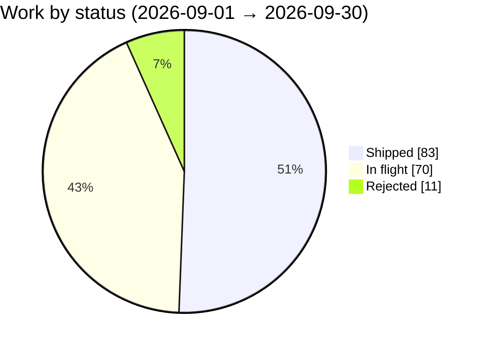

```mermaid
gantt
    title Timeline (2026-09-01 → 2026-09-30)
    dateFormat YYYY-MM-DD
    axisFormat %m-%d
    section Pull requests
    #3810 ci - Introduce PSRule suppression for individual rules :active, 2024-11-19, 2026-09-30
    #4205 feat - Deployment monitoring function :active, 2025-01-17, 2026-09-30
    #4863 feat - add gh issue label logic :active, 2025-03-25, 2026-09-30
    #5315 ci - [Test 01] Enforce test folder validation for patt :active, 2025-05-27, 2026-09-30
    #5316 ci - [Test 02] Enforce test folder validation for patt :active, 2025-05-27, 2026-09-30
    #5317 ci - [Test 03] Enforce test folder validation for patt :active, 2025-05-27, 2026-09-30
    #5642 build(deps-dev) - bump form-data from 4.0.0 to 4.0.4 i :crit, 2025-07-21, 2026-09-09
    #6168 feat - Re-added logic to set module version in readme :active, 2025-11-02, 2026-09-30
    #6218 feat - Synapase - Added support for HSM :active, 2025-11-13, 2026-09-30
    #6484 Fix - Adds service endpoint support to subnets :active, 2026-01-08, 2026-09-30
    #6549 feat(ptn) - Update FinOps Hub v12 pattern module :active, 2026-02-04, 2026-09-30
    #6580 feat - new module 'avm/res/app/agent' (Microsoft.App/a :active, 2026-02-19, 2026-09-30
    #6584 fix(app-service-lza) - correct web app kind parameter  :active, 2026-02-21, 2026-09-30
    #6694 feat - check for module existence in MAR :active, 2026-03-10, 2026-09-30
    #6708 Fix - Updated default app Version and Adjusted wording :crit, 2026-03-13, 2026-09-24
    #6732 ci - DO NOT MERGE - Test to showcase feasibility of va :active, 2026-03-18, 2026-09-30
    #6753 feat - module maintenance skill :active, 2026-03-24, 2026-09-30
    #6761 test(avm/res/azure-stack-hci/marketplace-gallery-image :active, 2026-03-26, 2026-09-30
    #6813 feat - add bootstrap skill :active, 2026-04-09, 2026-09-30
    #6883 fix - avm/compute/virtual-machine & avm/compute/virtua :active, 2026-04-15, 2026-09-30
    #6929 feat - Subscription Vending PTN - UMI Role Assignments :active, 2026-04-20, 2026-09-30
    #6970 feat - introduce content processing v2 changes :crit, 2026-04-29, 2026-09-24
    #6980 fix - avm/ptn/mgmt-groups/subscription-placement - cor :active, 2026-04-30, 2026-09-30
    #7021 fix - ReadMe Gen - Fixed incorrect section reference i :active, 2026-05-09, 2026-09-30
    #7030 fix - DevOps CI/CD agents pattern module DNS fix :active, 2026-05-11, 2026-09-30
    #7032 fix - Add Active Directory site support to NetApp acco :active, 2026-05-12, 2026-09-30
    #7074 fix - remove enableAnalyticalStorage o… :active, 2026-05-19, 2026-09-30
    #7075 feat - introduce container migration module :active, 2026-05-19, 2026-09-30
    #7089 feat - Publish child module 'avm/res/web/hosting-envir :active, 2026-05-21, 2026-09-30
    #7094 feat - Publish child modules of 'avm/res/cache/redis-e :active, 2026-05-21, 2026-09-30
    #7095 fix - enable private networking in DI :crit, 2026-05-21, 2026-09-25
    #7132 feat - Add per-notification operator/thresholdType con :active, 2026-06-05, 2026-09-30
    #7144 feat - Add contribution guidelines and module overview :active, 2026-06-10, 2026-09-30
    #7146 fix - Update security ciphers for API Management :active, 2026-06-10, 2026-09-30
    #7165 fix - bump actions/checkout from 4 to 7 :active, 2026-06-19, 2026-09-30
    #7182 feat - dependency updates on 'avm/ptn/app/container-jo :active, 2026-06-26, 2026-09-30
    #7188 feat - Added managed identity and session recording co :active, 2026-07-01, 2026-09-30
    #7210 feat - adding new dotnet component :active, 2026-07-12, 2026-09-30
    #7245 Fix - CWYD AVM upgrade v2 :active, 2026-07-30, 2026-09-30
    #7259 feat - static test for using multiple versions in one  :active, 2026-08-07, 2026-09-30
    #7261 feat(aks) - add Gateway API and agent pool update supp :active, 2026-08-10, 2026-09-30
    #7263 Upgrade FinOps hub to Toolkit v14 :active, 2026-08-11, 2026-09-30
    #7279 feat - Add CMK user-assigned identity to managed ident :done, 2026-08-14, 2026-09-16
    #7281 feat - Add CMK user-assigned identity to managed ident :active, 2026-08-15, 2026-09-30
    #7286 adding fips flag to additionalfeatures :active, 2026-08-18, 2026-09-30
    #7288 docs - Remove stale model pin and dead '/AVM-Boostrap' :active, 2026-08-19, 2026-09-30
    #7290 fix - bump actions/upload-artifact from 5.0.0 to 7.0.1 :active, 2026-08-20, 2026-09-30
    #7291 feat('avm/res/sql/server') - Add support for time-base :done, 2026-08-20, 2026-09-11
    #7292 fix - Recovery Services Vault - Omit soft delete prope :done, 2026-08-20, 2026-09-09
    #7293 feat - ManagedEnvironment update and test fixes :done, 2026-08-21, 2026-09-02
    #7297 feat - AVM Module Upgrade for BYOCC :crit, 2026-08-26, 2026-09-01
    #7299 feat - Create AVM Pattern Module for Function Apps :done, 2026-08-26, 2026-09-29
    #7306 chore - Pin GitHub Actions to full-length commit SHAs :done, 2026-08-29, 2026-09-01
    #7309 Avm ptn aks secure baseline :crit, 2026-08-31, 2026-09-01
    #7310 feat - AVM Module Upgrade for BYOCC :active, 2026-09-01, 2026-09-30
    #7316 fix - bump actions/checkout from 4.4.0 to 7.0.1 :active, 2026-09-01, 2026-09-30
    #7317 fix - bump azure/powershell from 2.0.0 to 3.0.0 :active, 2026-09-01, 2026-09-30
    #7318 feat - expose disableLocalAuth and publicNetworkAccess :done, 2026-09-01, 2026-09-16
    #7319 chore - remove legacy teams from codeowners :done, 2026-09-01, 2026-09-01
    #7320 fix - pin composite action dependencies :done, 2026-09-02, 2026-09-02
    #7321 fix - correct PSRule action SHA :done, 2026-09-02, 2026-09-02
    #7322 feat - add generic module workflow :done, 2026-09-02, 2026-09-03
    #7323 feat - managed environment parameter doc :done, 2026-09-03, 2026-09-03
    #7324 feat - add publishing test module :crit, 2026-09-03, 2026-09-24
    #7325 fix - create release tags through GitHub API :crit, 2026-09-03, 2026-09-24
    #7327 fix - optional deployment privateDnsZone failure :done, 2026-09-05, 2026-09-14
    #7329 fix - update logger description parameter :active, 2026-09-05, 2026-09-30
    #7330 fix - update skuCapacity parameter description :active, 2026-09-05, 2026-09-30
    #7332 fix - Update product subscription limit descriptions :active, 2026-09-05, 2026-09-30
    #7333 AVM module updated for CWYD v2 :active, 2026-09-07, 2026-09-30
    #7334 fix - Update key-vault/vault API version :done, 2026-09-07, 2026-09-14
    #7336 ci - distribute Bicep tests across configured subscrip :done, 2026-09-09, 2026-09-09
    #7337 fix - migrate Bicep module ownership routing :done, 2026-09-09, 2026-09-10
    #7338 fix - bump the npm_and_yarn group across 1 directory w :active, 2026-09-09, 2026-09-30
    #7339 feat - support GitHub secrets and variables for CI tes :done, 2026-09-10, 2026-09-10
    #7340 fix - select first GitHub CLI executable for CI migrat :done, 2026-09-10, 2026-09-25
    #7341 feat - Sql-Server - Add support for time-based immutab :done, 2026-09-11, 2026-09-11
    #7343 chore - generate per-module CODEOWNERS from module own :done, 2026-09-14, 2026-09-14
    #7346 fix - add kind simplelogalert :active, 2026-09-14, 2026-09-30
    #7347 feat - Key-Vault - Updated child-module api versions :done, 2026-09-14, 2026-09-14
    #7348 fix - avm/res/db for postgre sql/flexible server :done, 2026-09-14, 2026-09-15
    #7349 feat(metadata) - backfill Bicep metadata and guard rel :done, 2026-09-14, 2026-09-16
    #7351 ci - temporarily select BAMI test variables by module  :done, 2026-09-15, 2026-09-15
    #7355 fix - PostgreSQL - Fixing failing test :done, 2026-09-16, 2026-09-16
    #7356 fix - bump github/codeql-action/upload-sarif from 4.37 :done, 2026-09-16, 2026-09-17
    #7357 chore - sync Bicep module CODEOWNERS :crit, 2026-09-16, 2026-09-22
    #7360 fix - avm/res/data-factory/factory - fixing Git reposi :active, 2026-09-17, 2026-09-30
    #7361 fix - bump azure/login from 2.3.1 to 3.1.0 :active, 2026-09-17, 2026-09-30
    #7362 chore - mark consolidated module workflow as experimen :done, 2026-09-17, 2026-09-18
    #7363 feat - initial version code-signing-account module :done, 2026-09-17, 2026-09-25
    #7366 feat - scaffold AVM module folders :done, 2026-09-18, 2026-09-18
    #7367 fix(avm) - backfill owners and shorten telemetry prefi :done, 2026-09-18, 2026-09-18
    #7368 feat(scaffold) - bootstrap valid metadata.json for new :done, 2026-09-18, 2026-09-19
    #7370 fix(avm/res/cognitive-services/account) - Require a un :active, 2026-09-19, 2026-09-30
    #7371 fix(metadata) - correct moduleDisplayName drift across :done, 2026-09-19, 2026-09-19
    #7372 fix(avm/res/azure-stack-hci/cluster) - add phase-deriv :done, 2026-09-20, 2026-09-21
    #7373 fix(metadata) - reconcile catalog description drift ac :done, 2026-09-21, 2026-09-21
    #7374 feat - Diverse - Updated all Key Vault references to a :active, 2026-09-21, 2026-09-30
    #7375 fix(metadata) - restore abbreviated telemetryIdPrefix  :done, 2026-09-21, 2026-09-21
    #7376 fix(consumption/budget) - resolve duplicate telemetry  :done, 2026-09-21, 2026-09-21
    #7378 feat - Replace generated CODEOWNERS with metadata-driv :done, 2026-09-22, 2026-09-23
    #7379 feat(metadata) - require valid metadata.json for all A :done, 2026-09-22, 2026-09-22
    #7380 feat - index updates 22092026 :done, 2026-09-22, 2026-09-22
    #7381 feat - Databricks Workspace - Updated API version to 2 :active, 2026-09-22, 2026-09-30
    #7382 fix - isolate metadata validation from Bicep compilati :done, 2026-09-22, 2026-09-22
    #7383 fix - retire ORPHANED.md markers in favor of metadata  :done, 2026-09-22, 2026-09-24
    #7384 feat(avm/res/azure-stack-hci/cluster) - update API ver :done, 2026-09-23, 2026-09-24
    #7388 chore(module-list) - sync AVM module dropdown [skip ci :done, 2026-09-23, 2026-09-23
    #7389 chore - remove remaining CSV module index references :done, 2026-09-23, 2026-09-23
    #7395 fix(avm/res/azure-stack-hci/cluster) - preserve valida :active, 2026-09-24, 2026-09-30
    #7396 chore(avm/res/azure-stack-hci/cluster) - Add abhisheks :done, 2026-09-24, 2026-09-25
    #7397 feat - Databricks Workspace - Added DBFS root customer :active, 2026-09-24, 2026-09-30
    #7398 chore - remove redundant module-dropdown compliance ch :done, 2026-09-24, 2026-09-24
    #7399 refactor(avm) - source telemetry prefixes from module  :done, 2026-09-24, 2026-09-24
    #7400 chore(module-list) - sync AVM module dropdown [skip ci :done, 2026-09-24, 2026-09-24
    #7401 fix(ci) - skip metadata-only experimental module workf :done, 2026-09-25, 2026-09-25
    #7402 feat(ci) - add opt-in consolidated checks for pull req :done, 2026-09-25, 2026-09-25
    #7403 fix(telemetry) - backfill unique Bicep module prefixes :done, 2026-09-25, 2026-09-25
    #7405 test(dev-test-lab/lab) - verify default deployment res :active, 2026-09-28, 2026-09-30
    #7406 chore - deprecate legacy modules directory :done, 2026-09-28, 2026-09-28
    #7407 fix - compile container job toolkit secure workspace o :done, 2026-09-28, 2026-09-29
    #7408 test(docs) - add independent AVM README byte-parity ga :crit, 2026-09-28, 2026-09-30
    #7409 chore - avd owner updates :done, 2026-09-28, 2026-09-28
    #7410 docs(avm) - reconcile module README content with sourc :done, 2026-09-28, 2026-09-30
    #7411 fix - retry regional template validation in eligible r :done, 2026-09-28, 2026-09-28
    #7413 fix - isolate Lab fixture names and track rejected dep :done, 2026-09-29, 2026-09-29
    #7415 fix - align conversation knowledge mining test paramet :done, 2026-09-29, 2026-09-30
    #7416 docs(avm) - pin registry README template and preserve  :done, 2026-09-29, 2026-09-30
    #7417 ci(docs) - prepare opt-in Bicep README drift validatio :crit, 2026-09-29, 2026-09-30
    #7418 fix - SQL-MI - Upgraded 'storageSizeInGB' limit to 327 :done, 2026-09-29, 2026-09-30
    #7419 chore(module-list) - sync AVM module dropdown [skip ci :done, 2026-09-29, 2026-09-29
    #7420 chore(module-list) - sync AVM module dropdown [skip ci :done, 2026-09-29, 2026-09-29
    #7421 feat(avm/res/azure-stack-hci/cluster) - update Azure S :done, 2026-09-30, 2026-09-30
    #7422 Fix private endpoint setup for static web site :active, 2026-09-30, 2026-09-30
    #7423 fix(avm/res/azure-stack-hci/logical-network) - update  :done, 2026-09-30, 2026-09-30
    #7424 fix(avm/res/azure-stack-hci/virtual-hard-disk) - updat :done, 2026-09-30, 2026-09-30
    #7425 fix - preserve deployment cleanup after HTTP timeouts :done, 2026-09-30, 2026-09-30
    #7426 fix(avm/res/azure-stack-hci/network-interface) - updat :done, 2026-09-30, 2026-09-30
    #7427 feat(avm/res/hybrid-compute/machine) - update HybridCo :done, 2026-09-30, 2026-09-30
    #7428 ci - remove per-repo AVM label synchronization workflo :done, 2026-09-30, 2026-09-30
    #7429 feat(avm/res/azure-stack-hci/virtual-machine-instance) :done, 2026-09-30, 2026-09-30
    #7430 fix(avm/res/azure-stack-hci/virtual-machine-instance)  :active, 2026-09-30, 2026-09-30
```

## CI/CD health

All workflows: 1844/2221 succeeded (313 failed, 26 cancelled).

- **.Platform - Rerun failed workflows** — 467/470 succeeded (3 failed, 0 cancelled).
- **.Platform - Semantic PR Check** — 297/377 succeeded (80 failed, 0 cancelled).
- **.Platform - Check Labels** — 295/349 succeeded (54 failed, 0 cancelled).
- **.Platform - Check Module Metadata** — 50/91 succeeded (16 failed, 25 cancelled).
- **.Module - Check and Publish [EXPERIMENTAL]** — 13/62 succeeded (11 failed, 0 cancelled).
- **.Platform - OSSF Scorecard supply-chain security** — 57/57 succeeded (0 failed, 0 cancelled).
- **Push on main** — 57/57 succeeded (0 failed, 0 cancelled).
- **PR #7374** — 39/39 succeeded (0 failed, 0 cancelled).
- **.Platform - Clean up deployment history** — 30/30 succeeded (0 failed, 0 cancelled).
- **.Platform - Sync repo labels from CSV** — 30/30 succeeded (0 failed, 0 cancelled).
- **.Platform - Set GitHub issue owner config** — 28/28 succeeded (0 failed, 0 cancelled).
- **.Platform - Manage workflow issue** — 24/24 succeeded (0 failed, 0 cancelled).
- **.Platform - Run CI tests** — 19/24 succeeded (5 failed, 0 cancelled).
- **.Platform - Sync AVM module list** — 23/23 succeeded (0 failed, 0 cancelled).
- **Copilot Setup Steps** — 18/18 succeeded (0 failed, 0 cancelled).
- **PR #7380** — 12/12 succeeded (0 failed, 0 cancelled).
- **.Module - Check and Publish** — 7/10 succeeded (3 failed, 0 cancelled).
- **avm.res.sql.server** — 2/9 succeeded (7 failed, 0 cancelled).
- **avm.res.app.managed-environment** — 2/8 succeeded (6 failed, 0 cancelled).
- **avm.res.key-vault.vault** — 4/8 succeeded (4 failed, 0 cancelled).
- **PR #7357** — 7/7 succeeded (0 failed, 0 cancelled).
- **PR #7378** — 7/7 succeeded (0 failed, 0 cancelled).
- **avm.res.db-for-postgre-sql.flexible-server** — 3/7 succeeded (4 failed, 0 cancelled).
- **PR #7341** — 6/6 succeeded (0 failed, 0 cancelled).
- **PR #7322** — 5/5 succeeded (0 failed, 0 cancelled).
- **PR #7339** — 5/5 succeeded (0 failed, 0 cancelled).
- **PR #7343** — 5/5 succeeded (0 failed, 0 cancelled).
- **PR #7366** — 5/5 succeeded (0 failed, 0 cancelled).
- **PR #7410** — 5/5 succeeded (0 failed, 0 cancelled).
- **Scheduled** — 5/5 succeeded (0 failed, 0 cancelled).
- **avm.res.azure-stack-hci.cluster** — 3/5 succeeded (2 failed, 0 cancelled).
- **avm.res.elastic-san.elastic-san** — 1/5 succeeded (4 failed, 0 cancelled).
- **avm.res.recovery-services.vault** — 4/5 succeeded (1 failed, 0 cancelled).
- **.Platform - Check PSRule** — 0/4 succeeded (4 failed, 0 cancelled).
- **PR #7349** — 4/4 succeeded (0 failed, 0 cancelled).
- **Running Copilot Code Review** — 4/4 succeeded (0 failed, 0 cancelled).
- **avm.ptn.data.private-analytical-workspace** — 0/4 succeeded (4 failed, 0 cancelled).
- **avm.res.hybrid-container-service.provisioned-cluster-instance** — 0/4 succeeded (4 failed, 0 cancelled).
- **avm.res.kusto.cluster** — 0/4 succeeded (4 failed, 0 cancelled).
- **avm.res.network.ip-group** — 3/4 succeeded (1 failed, 0 cancelled).
- **avm.res.sql.managed-instance** — 2/4 succeeded (2 failed, 0 cancelled).
- **PR #7319** — 3/3 succeeded (0 failed, 0 cancelled).
- **PR #7347** — 3/3 succeeded (0 failed, 0 cancelled).
- **PR #7351** — 3/3 succeeded (0 failed, 0 cancelled).
- **PR #7383** — 3/3 succeeded (0 failed, 0 cancelled).
- **PR #7415** — 3/3 succeeded (0 failed, 0 cancelled).
- **PR #7418** — 3/3 succeeded (0 failed, 0 cancelled).
- **avm.ptn.aca-lza.hosting-environment** — 0/3 succeeded (3 failed, 0 cancelled).
- **avm.ptn.finops-toolkit.finops-hub** — 0/3 succeeded (3 failed, 0 cancelled).
- **avm.ptn.sa.chat-with-your-data** — 0/3 succeeded (3 failed, 0 cancelled).
- **avm.res.azure-stack-hci.virtual-machine-instance** — 2/3 succeeded (1 failed, 0 cancelled).
- **avm.res.batch.batch-account** — 1/3 succeeded (2 failed, 0 cancelled).
- **avm.res.cognitive-services.account** — 2/3 succeeded (1 failed, 0 cancelled).
- **avm.res.compute.disk-encryption-set** — 1/3 succeeded (2 failed, 0 cancelled).
- **avm.res.dev-test-lab.lab** — 2/3 succeeded (1 failed, 0 cancelled).
- **avm.res.document-db.database-account** — 1/3 succeeded (2 failed, 0 cancelled).
- **avm.res.event-hub.namespace** — 2/3 succeeded (1 failed, 0 cancelled).
- **avm.res.network.private-link-service** — 3/3 succeeded (0 failed, 0 cancelled).
- **avm.res.network.service-endpoint-policy** — 3/3 succeeded (0 failed, 0 cancelled).
- **avm.res.operational-insights.cluster** — 1/3 succeeded (2 failed, 0 cancelled).
- **avm.res.storage.storage-account** — 2/3 succeeded (1 failed, 0 cancelled).
- **avm.res.synapse.workspace** — 1/3 succeeded (2 failed, 0 cancelled).
- **Addressing comment on PR #7374** — 1/2 succeeded (0 failed, 1 cancelled).
- **PR #7210** — 2/2 succeeded (0 failed, 0 cancelled).
- **PR #7337** — 2/2 succeeded (0 failed, 0 cancelled).
- **PR #7370** — 2/2 succeeded (0 failed, 0 cancelled).
- **PR #7403** — 2/2 succeeded (0 failed, 0 cancelled).
- **PR #7405** — 2/2 succeeded (0 failed, 0 cancelled).
- **PR #7407** — 2/2 succeeded (0 failed, 0 cancelled).
- **PR #7408** — 2/2 succeeded (0 failed, 0 cancelled).
- **avm.ptn.ai-ml.ai-foundry** — 1/2 succeeded (1 failed, 0 cancelled).
- **avm.ptn.app.container-job-toolkit.yml** — 0/2 succeeded (2 failed, 0 cancelled).
- **avm.ptn.sa.content-processing** — 1/2 succeeded (1 failed, 0 cancelled).
- **avm.ptn.sa.modernize-your-code** — 0/2 succeeded (2 failed, 0 cancelled).
- **avm.ptn.virtual-machine-images.azure-image-builder** — 1/2 succeeded (1 failed, 0 cancelled).
- **avm.res.api-management.service** — 1/2 succeeded (1 failed, 0 cancelled).
- **avm.res.app-configuration.configuration-store** — 2/2 succeeded (0 failed, 0 cancelled).
- **avm.res.automation.automation-account** — 2/2 succeeded (0 failed, 0 cancelled).
- **avm.res.azure-stack-hci.logical-network** — 2/2 succeeded (0 failed, 0 cancelled).
- **avm.res.azure-stack-hci.network-interface** — 1/2 succeeded (1 failed, 0 cancelled).
- **avm.res.azure-stack-hci.virtual-hard-disk** — 1/2 succeeded (1 failed, 0 cancelled).
- **avm.res.cache.redis** — 1/2 succeeded (1 failed, 0 cancelled).
- **avm.res.cache.redis-enterprise** — 0/2 succeeded (2 failed, 0 cancelled).
- **avm.res.communication.communication-service** — 2/2 succeeded (0 failed, 0 cancelled).
- **avm.res.compute.availability-set** — 2/2 succeeded (0 failed, 0 cancelled).
- **avm.res.compute.proximity-placement-group** — 2/2 succeeded (0 failed, 0 cancelled).
- **avm.res.consumption.budget** — 0/2 succeeded (2 failed, 0 cancelled).
- **avm.res.container-instance.container-group** — 2/2 succeeded (0 failed, 0 cancelled).
- **avm.res.container-registry.registry** — 2/2 succeeded (0 failed, 0 cancelled).
- **avm.res.data-factory.factory** — 2/2 succeeded (0 failed, 0 cancelled).
- **avm.res.data-protection.backup-vault** — 1/2 succeeded (1 failed, 0 cancelled).
- **avm.res.databricks.workspace** — 1/2 succeeded (1 failed, 0 cancelled).
- **avm.res.db-for-my-sql.flexible-server** — 2/2 succeeded (0 failed, 0 cancelled).
- **avm.res.dev-center.network-connection** — 2/2 succeeded (0 failed, 0 cancelled).
- **avm.res.dev-center.project** — 0/2 succeeded (2 failed, 0 cancelled).
- **avm.res.hybrid-compute.machine** — 2/2 succeeded (0 failed, 0 cancelled).
- **avm.res.insights.data-collection-endpoint** — 2/2 succeeded (0 failed, 0 cancelled).
- **avm.res.insights.data-collection-rule** — 2/2 succeeded (0 failed, 0 cancelled).
- **avm.res.insights.private-link-scope** — 1/2 succeeded (1 failed, 0 cancelled).
- **avm.res.kubernetes.connected-cluster** — 1/2 succeeded (1 failed, 0 cancelled).
- **avm.res.load-test-service.load-test** — 2/2 succeeded (0 failed, 0 cancelled).
- **avm.res.machine-learning-services.workspace** — 2/2 succeeded (0 failed, 0 cancelled).
- **avm.res.maps.account** — 2/2 succeeded (0 failed, 0 cancelled).
- **avm.res.net-app.net-app-account** — 2/2 succeeded (0 failed, 0 cancelled).
- **avm.res.network.application-gateway-web-application-firewall-policy** — 2/2 succeeded (0 failed, 0 cancelled).
- **avm.res.network.application-security-group** — 2/2 succeeded (0 failed, 0 cancelled).
- **avm.res.network.firewall-policy** — 2/2 succeeded (0 failed, 0 cancelled).
- **avm.res.network.local-network-gateway** — 2/2 succeeded (0 failed, 0 cancelled).
- **avm.res.network.network-manager** — 2/2 succeeded (0 failed, 0 cancelled).
- **avm.res.network.network-security-group** — 2/2 succeeded (0 failed, 0 cancelled).
- **avm.res.network.network-security-perimeter** — 2/2 succeeded (0 failed, 0 cancelled).
- **avm.res.network.route-table** — 2/2 succeeded (0 failed, 0 cancelled).
- **avm.res.search.search-service** — 1/2 succeeded (1 failed, 0 cancelled).
- **avm.res.service-bus.namespace** — 2/2 succeeded (0 failed, 0 cancelled).
- **avm.res.virtual-machine-images.image-template** — 0/2 succeeded (2 failed, 0 cancelled).
- **avm.res.web.static-site** — 2/2 succeeded (0 failed, 0 cancelled).
- **PR #7146** — 1/1 succeeded (0 failed, 0 cancelled).
- **PR #7279** — 1/1 succeeded (0 failed, 0 cancelled).
- **PR #7281** — 1/1 succeeded (0 failed, 0 cancelled).
- **PR #7320** — 1/1 succeeded (0 failed, 0 cancelled).
- **PR #7321** — 1/1 succeeded (0 failed, 0 cancelled).
- **PR #7324** — 1/1 succeeded (0 failed, 0 cancelled).
- **PR #7325** — 1/1 succeeded (0 failed, 0 cancelled).
- **PR #7329** — 1/1 succeeded (0 failed, 0 cancelled).
- **PR #7330** — 1/1 succeeded (0 failed, 0 cancelled).
- **PR #7332** — 1/1 succeeded (0 failed, 0 cancelled).
- **PR #7336** — 1/1 succeeded (0 failed, 0 cancelled).
- **PR #7340** — 1/1 succeeded (0 failed, 0 cancelled).
- **PR #7355** — 1/1 succeeded (0 failed, 0 cancelled).
- **PR #7362** — 1/1 succeeded (0 failed, 0 cancelled).
- **PR #7367** — 1/1 succeeded (0 failed, 0 cancelled).
- **PR #7368** — 1/1 succeeded (0 failed, 0 cancelled).
- **PR #7371** — 1/1 succeeded (0 failed, 0 cancelled).
- **PR #7373** — 1/1 succeeded (0 failed, 0 cancelled).
- **PR #7375** — 1/1 succeeded (0 failed, 0 cancelled).
- **PR #7376** — 1/1 succeeded (0 failed, 0 cancelled).
- **PR #7379** — 1/1 succeeded (0 failed, 0 cancelled).
- **PR #7382** — 1/1 succeeded (0 failed, 0 cancelled).
- **PR #7384** — 1/1 succeeded (0 failed, 0 cancelled).
- **PR #7388** — 1/1 succeeded (0 failed, 0 cancelled).
- **PR #7389** — 1/1 succeeded (0 failed, 0 cancelled).
- **PR #7398** — 1/1 succeeded (0 failed, 0 cancelled).
- **PR #7399** — 1/1 succeeded (0 failed, 0 cancelled).
- **PR #7400** — 1/1 succeeded (0 failed, 0 cancelled).
- **PR #7401** — 1/1 succeeded (0 failed, 0 cancelled).
- **PR #7402** — 1/1 succeeded (0 failed, 0 cancelled).
- **PR #7406** — 1/1 succeeded (0 failed, 0 cancelled).
- **PR #7409** — 1/1 succeeded (0 failed, 0 cancelled).
- **PR #7411** — 1/1 succeeded (0 failed, 0 cancelled).
- **PR #7413** — 1/1 succeeded (0 failed, 0 cancelled).
- **PR #7416** — 1/1 succeeded (0 failed, 0 cancelled).
- **PR #7417** — 1/1 succeeded (0 failed, 0 cancelled).
- **PR #7419** — 1/1 succeeded (0 failed, 0 cancelled).
- **PR #7420** — 1/1 succeeded (0 failed, 0 cancelled).
- **PR #7421** — 1/1 succeeded (0 failed, 0 cancelled).
- **PR #7423** — 1/1 succeeded (0 failed, 0 cancelled).
- **PR #7424** — 1/1 succeeded (0 failed, 0 cancelled).
- **PR #7425** — 1/1 succeeded (0 failed, 0 cancelled).
- **PR #7426** — 1/1 succeeded (0 failed, 0 cancelled).
- **PR #7427** — 1/1 succeeded (0 failed, 0 cancelled).
- **PR #7428** — 1/1 succeeded (0 failed, 0 cancelled).
- **PR #7429** — 1/1 succeeded (0 failed, 0 cancelled).
- **PR #7430** — 1/1 succeeded (0 failed, 0 cancelled).
- **Running Copilot cloud agent** — 1/1 succeeded (0 failed, 0 cancelled).
- **avm.ptn.ai-platform.baseline** — 0/1 succeeded (1 failed, 0 cancelled).
- **avm.ptn.alz.ama** — 1/1 succeeded (0 failed, 0 cancelled).
- **avm.ptn.alz.empty** — 1/1 succeeded (0 failed, 0 cancelled).
- **avm.ptn.app-service-lza.hosting-environment** — 0/1 succeeded (1 failed, 0 cancelled).
- **avm.ptn.app.function-app** — 1/1 succeeded (0 failed, 0 cancelled).
- **avm.ptn.app.iaas-vm-cosmosdb-tier4** — 0/1 succeeded (1 failed, 0 cancelled).
- **avm.ptn.app.paas-ase-cosmosdb-tier4** — 0/1 succeeded (1 failed, 0 cancelled).
- **avm.ptn.authorization.pim-role-assignment** — 0/1 succeeded (1 failed, 0 cancelled).
- **avm.ptn.authorization.policy-assignment** — 1/1 succeeded (0 failed, 0 cancelled).
- **avm.ptn.authorization.policy-exemption** — 1/1 succeeded (0 failed, 0 cancelled).
- **avm.ptn.authorization.resource-role-assignment** — 1/1 succeeded (0 failed, 0 cancelled).
- **avm.ptn.authorization.role-assignment** — 1/1 succeeded (0 failed, 0 cancelled).
- **avm.ptn.authorization.role-definition** — 1/1 succeeded (0 failed, 0 cancelled).
- **avm.ptn.azd.acr-container-app** — 0/1 succeeded (1 failed, 0 cancelled).
- **avm.ptn.azd.aks** — 0/1 succeeded (1 failed, 0 cancelled).
- **avm.ptn.azd.aks-automatic-cluster** — 0/1 succeeded (1 failed, 0 cancelled).
- **avm.ptn.azd.apim-api** — 0/1 succeeded (1 failed, 0 cancelled).
- **avm.ptn.azd.container-app-upsert** — 1/1 succeeded (0 failed, 0 cancelled).
- **avm.ptn.azd.container-apps-stack** — 0/1 succeeded (1 failed, 0 cancelled).
- **avm.ptn.azd.insights-dashboard** — 0/1 succeeded (1 failed, 0 cancelled).
- **avm.ptn.azd.monitoring** — 1/1 succeeded (0 failed, 0 cancelled).
- **avm.ptn.deployment-script.import-image-to-acr** — 0/1 succeeded (1 failed, 0 cancelled).
- **avm.ptn.dev-ops.cicd-agents-and-runners** — 0/1 succeeded (1 failed, 0 cancelled).
- **avm.ptn.lz.sub-vending** — 0/1 succeeded (1 failed, 0 cancelled).
- **avm.ptn.mgmt-groups.subscription-placement** — 1/1 succeeded (0 failed, 0 cancelled).
- **avm.ptn.network.hub-networking** — 0/1 succeeded (1 failed, 0 cancelled).
- **avm.ptn.network.private-link-private-dns-zones** — 0/1 succeeded (1 failed, 0 cancelled).
- **avm.ptn.network.virtual-wan** — 1/1 succeeded (0 failed, 0 cancelled).
- **avm.ptn.policy-insights.remediation** — 0/1 succeeded (1 failed, 0 cancelled).
- **avm.ptn.sa.content-generation** — 0/1 succeeded (1 failed, 0 cancelled).
- **avm.ptn.sa.conversation-knowledge-mining** — 0/1 succeeded (1 failed, 0 cancelled).
- **avm.ptn.sa.customer-chatbot** — 0/1 succeeded (1 failed, 0 cancelled).
- **avm.ptn.sa.document-knowledge-mining** — 0/1 succeeded (1 failed, 0 cancelled).
- **avm.ptn.sa.multi-agent-custom-automation-engine** — 0/1 succeeded (1 failed, 0 cancelled).
- **avm.ptn.security.security-center** — 0/1 succeeded (1 failed, 0 cancelled).
- **avm.ptn.subscription.service-health-alerts** — 1/1 succeeded (0 failed, 0 cancelled).
- **avm.res.aad.domain-service** — 0/1 succeeded (1 failed, 0 cancelled).
- **avm.res.alerts-management.action-rule** — 1/1 succeeded (0 failed, 0 cancelled).
- **avm.res.analysis-services.server** — 1/1 succeeded (0 failed, 0 cancelled).
- **avm.res.api-center.service** — 1/1 succeeded (0 failed, 0 cancelled).
- **avm.res.app.container-app** — 1/1 succeeded (0 failed, 0 cancelled).
- **avm.res.app.job** — 1/1 succeeded (0 failed, 0 cancelled).
- **avm.res.app.session-pool** — 0/1 succeeded (1 failed, 0 cancelled).
- **avm.res.authorization.policy-assignment** — 1/1 succeeded (0 failed, 0 cancelled).
- **avm.res.authorization.role-assignment** — 1/1 succeeded (0 failed, 0 cancelled).
- **avm.res.azure-stack-hci.marketplace-gallery-image** — 1/1 succeeded (0 failed, 0 cancelled).
- **avm.res.cdn.profile** — 1/1 succeeded (0 failed, 0 cancelled).
- **avm.res.code-signing.code-signing-account** — 1/1 succeeded (0 failed, 0 cancelled).
- **avm.res.communication.email-service** — 1/1 succeeded (0 failed, 0 cancelled).
- **avm.res.compute.disk** — 1/1 succeeded (0 failed, 0 cancelled).
- **avm.res.compute.gallery** — 1/1 succeeded (0 failed, 0 cancelled).
- **avm.res.compute.image** — 1/1 succeeded (0 failed, 0 cancelled).
- **avm.res.compute.ssh-public-key** — 1/1 succeeded (0 failed, 0 cancelled).
- **avm.res.compute.virtual-machine** — 1/1 succeeded (0 failed, 0 cancelled).
- **avm.res.compute.virtual-machine-scale-set** — 1/1 succeeded (0 failed, 0 cancelled).
- **avm.res.container-service.managed-cluster** — 1/1 succeeded (0 failed, 0 cancelled).
- **avm.res.databricks.access-connector** — 0/1 succeeded (1 failed, 0 cancelled).
- **avm.res.desktop-virtualization.application-group** — 1/1 succeeded (0 failed, 0 cancelled).
- **avm.res.desktop-virtualization.host-pool** — 1/1 succeeded (0 failed, 0 cancelled).
- **avm.res.desktop-virtualization.scaling-plan** — 1/1 succeeded (0 failed, 0 cancelled).
- **avm.res.desktop-virtualization.workspace** — 1/1 succeeded (0 failed, 0 cancelled).
- **avm.res.dev-center.devcenter** — 0/1 succeeded (1 failed, 0 cancelled).
- **avm.res.dev-ops-infrastructure.pool** — 0/1 succeeded (1 failed, 0 cancelled).
- **avm.res.devices.iot-hub** — 0/1 succeeded (1 failed, 0 cancelled).
- **avm.res.digital-twins.digital-twins-instance** — 1/1 succeeded (0 failed, 0 cancelled).
- **avm.res.document-db.mongo-cluster** — 0/1 succeeded (1 failed, 0 cancelled).
- **avm.res.edge.site** — 1/1 succeeded (0 failed, 0 cancelled).
- **avm.res.event-grid.domain** — 1/1 succeeded (0 failed, 0 cancelled).
- **avm.res.event-grid.namespace** — 1/1 succeeded (0 failed, 0 cancelled).
- **avm.res.event-grid.system-topic** — 1/1 succeeded (0 failed, 0 cancelled).
- **avm.res.event-grid.topic** — 1/1 succeeded (0 failed, 0 cancelled).
- **avm.res.fabric.capacity** — 1/1 succeeded (0 failed, 0 cancelled).
- **avm.res.health-bot.health-bot** — 1/1 succeeded (0 failed, 0 cancelled).
- **avm.res.healthcare-apis.workspace** — 1/1 succeeded (0 failed, 0 cancelled).
- **avm.res.hybrid-compute.gateway** — 1/1 succeeded (0 failed, 0 cancelled).
- **avm.res.hybrid-compute.license** — 1/1 succeeded (0 failed, 0 cancelled).
- **avm.res.insights.action-group** — 1/1 succeeded (0 failed, 0 cancelled).
- **avm.res.insights.activity-log-alert** — 1/1 succeeded (0 failed, 0 cancelled).
- **avm.res.insights.component** — 1/1 succeeded (0 failed, 0 cancelled).
- **avm.res.insights.diagnostic-setting** — 1/1 succeeded (0 failed, 0 cancelled).
- **avm.res.insights.metric-alert** — 1/1 succeeded (0 failed, 0 cancelled).
- **avm.res.insights.scheduled-query-rule** — 1/1 succeeded (0 failed, 0 cancelled).
- **avm.res.insights.webtest** — 1/1 succeeded (0 failed, 0 cancelled).
- **avm.res.kubernetes-configuration.extension** — 0/1 succeeded (1 failed, 0 cancelled).
- **avm.res.kubernetes-configuration.flux-configuration** — 0/1 succeeded (1 failed, 0 cancelled).
- **avm.res.kubernetes-runtime.load-balancer** — 0/1 succeeded (1 failed, 0 cancelled).
- **avm.res.logic.integration-account** — 1/1 succeeded (0 failed, 0 cancelled).
- **avm.res.logic.workflow** — 1/1 succeeded (0 failed, 0 cancelled).
- **avm.res.machine-learning-services.registry** — 1/1 succeeded (0 failed, 0 cancelled).
- **avm.res.maintenance.configuration-assignment** — 1/1 succeeded (0 failed, 0 cancelled).
- **avm.res.maintenance.maintenance-configuration** — 1/1 succeeded (0 failed, 0 cancelled).
- **avm.res.managed-identity.user-assigned-identity** — 1/1 succeeded (0 failed, 0 cancelled).
- **avm.res.managed-services.registration-definition** — 1/1 succeeded (0 failed, 0 cancelled).
- **avm.res.management.management-group** — 1/1 succeeded (0 failed, 0 cancelled).
- **avm.res.management.service-group** — 1/1 succeeded (0 failed, 0 cancelled).
- **avm.res.network.application-gateway** — 1/1 succeeded (0 failed, 0 cancelled).
- **avm.res.network.azure-firewall** — 0/1 succeeded (1 failed, 0 cancelled).
- **avm.res.network.bastion-host** — 1/1 succeeded (0 failed, 0 cancelled).
- **avm.res.network.connection** — 1/1 succeeded (0 failed, 0 cancelled).
- **avm.res.network.ddos-protection-plan** — 1/1 succeeded (0 failed, 0 cancelled).
- **avm.res.network.dns-forwarding-ruleset** — 1/1 succeeded (0 failed, 0 cancelled).
- **avm.res.network.dns-resolver** — 1/1 succeeded (0 failed, 0 cancelled).
- **avm.res.network.dns-zone** — 1/1 succeeded (0 failed, 0 cancelled).
- **avm.res.network.express-route-circuit** — 1/1 succeeded (0 failed, 0 cancelled).
- **avm.res.network.express-route-gateway** — 1/1 succeeded (0 failed, 0 cancelled).
- **avm.res.network.express-route-port** — 1/1 succeeded (0 failed, 0 cancelled).
- **avm.res.network.front-door-web-application-firewall-policy** — 1/1 succeeded (0 failed, 0 cancelled).
- **avm.res.network.load-balancer** — 1/1 succeeded (0 failed, 0 cancelled).
- **avm.res.network.nat-gateway** — 1/1 succeeded (0 failed, 0 cancelled).
- **avm.res.network.network-interface** — 1/1 succeeded (0 failed, 0 cancelled).
- **avm.res.network.network-watcher** — 1/1 succeeded (0 failed, 0 cancelled).
- **avm.res.network.p2s-vpn-gateway** — 1/1 succeeded (0 failed, 0 cancelled).
- **avm.res.network.private-dns-zone** — 1/1 succeeded (0 failed, 0 cancelled).
- **avm.res.network.private-endpoint** — 1/1 succeeded (0 failed, 0 cancelled).
- **avm.res.network.public-ip-address** — 1/1 succeeded (0 failed, 0 cancelled).
- **avm.res.network.public-ip-prefix** — 1/1 succeeded (0 failed, 0 cancelled).
- **avm.res.network.trafficmanagerprofile** — 1/1 succeeded (0 failed, 0 cancelled).
- **avm.res.network.virtual-hub** — 0/1 succeeded (1 failed, 0 cancelled).
- **avm.res.network.virtual-network** — 1/1 succeeded (0 failed, 0 cancelled).
- **avm.res.network.virtual-network-gateway** — 0/1 succeeded (1 failed, 0 cancelled).
- **avm.res.network.virtual-wan** — 1/1 succeeded (0 failed, 0 cancelled).
- **avm.res.network.vpn-gateway** — 1/1 succeeded (0 failed, 0 cancelled).
- **avm.res.network.vpn-server-configuration** — 1/1 succeeded (0 failed, 0 cancelled).
- **avm.res.network.vpn-site** — 1/1 succeeded (0 failed, 0 cancelled).
- **avm.res.operational-insights.workspace** — 1/1 succeeded (0 failed, 0 cancelled).
- **avm.res.operations-management.solution** — 1/1 succeeded (0 failed, 0 cancelled).
- **avm.res.portal.dashboard** — 1/1 succeeded (0 failed, 0 cancelled).
- **avm.res.power-bi-dedicated.capacity** — 1/1 succeeded (0 failed, 0 cancelled).
- **avm.res.purview.account** — 1/1 succeeded (0 failed, 0 cancelled).
- **avm.res.relay.namespace** — 1/1 succeeded (0 failed, 0 cancelled).
- **avm.res.resource-graph.query** — 0/1 succeeded (1 failed, 0 cancelled).
- **avm.res.resources.deployment-script** — 0/1 succeeded (1 failed, 0 cancelled).
- **avm.res.resources.resource-group** — 1/1 succeeded (0 failed, 0 cancelled).
- **avm.res.security-insights.data-connector** — 0/1 succeeded (1 failed, 0 cancelled).
- **avm.res.security-insights.setting** — 1/1 succeeded (0 failed, 0 cancelled).
- **avm.res.service-fabric.cluster** — 1/1 succeeded (0 failed, 0 cancelled).
- **avm.res.service-networking.traffic-controller** — 1/1 succeeded (0 failed, 0 cancelled).
- **avm.res.signal-r-service.signal-r** — 1/1 succeeded (0 failed, 0 cancelled).
- **avm.res.signal-r-service.web-pub-sub** — 1/1 succeeded (0 failed, 0 cancelled).
- **avm.res.sql.instance-pool** — 0/1 succeeded (1 failed, 0 cancelled).
- **avm.res.synapse.private-link-hub** — 1/1 succeeded (0 failed, 0 cancelled).
- **avm.res.web.connection** — 1/1 succeeded (0 failed, 0 cancelled).
- **avm.res.web.hosting-environment** — 0/1 succeeded (1 failed, 0 cancelled).
- **avm.res.web.serverfarm** — 1/1 succeeded (0 failed, 0 cancelled).
- **avm.res.web.site** — 1/1 succeeded (0 failed, 0 cancelled).
- **avm.utl.types.avm-common-types** — 1/1 succeeded (0 failed, 0 cancelled).
- **github_actions in / - Update #1587834189** — 0/1 succeeded (1 failed, 0 cancelled).
- **github_actions in / - Update #1588920088** — 0/1 succeeded (1 failed, 0 cancelled).
- **github_actions in / - Update #1591559015** — 0/1 succeeded (1 failed, 0 cancelled).
- **github_actions in / - Update #1591756347** — 0/1 succeeded (1 failed, 0 cancelled).
- **github_actions in / - Update #1600806704** — 0/1 succeeded (1 failed, 0 cancelled).
- **github_actions in / for actions/upload-artifact - Update #1555030028** — 1/1 succeeded (0 failed, 0 cancelled).
- **github_actions in / for azure/powershell - Update #1555030131** — 1/1 succeeded (0 failed, 0 cancelled).
- **github_actions in / for azure/powershell - Update #1566647028** — 1/1 succeeded (0 failed, 0 cancelled).
- **github_actions in / for azure/powershell - Update #1569194500** — 1/1 succeeded (0 failed, 0 cancelled).
- **github_actions in / for azure/powershell - Update #1600807037** — 1/1 succeeded (0 failed, 0 cancelled).
- **github_actions in /. - Update #1549135344** — 1/1 succeeded (0 failed, 0 cancelled).
- **github_actions in /. - Update #1549564599** — 1/1 succeeded (0 failed, 0 cancelled).
- **github_actions in /. - Update #1552176754** — 1/1 succeeded (0 failed, 0 cancelled).
- **github_actions in /. - Update #1555295465** — 1/1 succeeded (0 failed, 0 cancelled).
- **github_actions in /. - Update #1557503988** — 1/1 succeeded (0 failed, 0 cancelled).
- **github_actions in /. - Update #1561751060** — 1/1 succeeded (0 failed, 0 cancelled).
- **github_actions in /. - Update #1563694475** — 1/1 succeeded (0 failed, 0 cancelled).
- **github_actions in /. - Update #1566144368** — 1/1 succeeded (0 failed, 0 cancelled).
- **github_actions in /. - Update #1568810186** — 1/1 succeeded (0 failed, 0 cancelled).
- **github_actions in /. - Update #1571419872** — 1/1 succeeded (0 failed, 0 cancelled).
- **github_actions in /. - Update #1575563823** — 1/1 succeeded (0 failed, 0 cancelled).
- **github_actions in /. - Update #1577409968** — 1/1 succeeded (0 failed, 0 cancelled).
- **github_actions in /. - Update #1578819030** — 1/1 succeeded (0 failed, 0 cancelled).
- **github_actions in /. - Update #1580250632** — 1/1 succeeded (0 failed, 0 cancelled).
- **npm_and_yarn in /. for axios, axios, axios, axios, axios, axios, axios, axios, axios, axios, axios, axios, axios, axios, axios, axios, axios, axios, axios, axios, brace-expansion, flatted, follow-redirects, form-data, form-data, js-yaml, js-yaml, js-yaml, js-yaml, js-yaml, minimatch, uuid - Update #1566645897** — 1/1 succeeded (0 failed, 0 cancelled).
- **npm_and_yarn in /. for axios, axios, axios, axios, axios, axios, axios, axios, axios, axios, axios, axios, axios, axios, axios, axios, axios, axios, axios, axios, brace-expansion, flatted, follow-redirects, form-data, form-data, js-yaml, js-yaml, js-yaml, js-yaml, js-yaml, minimatch, uuid - Update #1600803808** — 1/1 succeeded (0 failed, 0 cancelled).

## In flight

*Showing 40 of 70 in-flight items; the full list is in the bundle view.*
- [ci: [Test 03] Enforce test folder validation for pattern modules for defaults only](https://github.com/Azure/bicep-registry-modules/pull/5317) (pr #5317) — train `train-pr-5317`
- [feat: add bootstrap skill](https://github.com/Azure/bicep-registry-modules/pull/6813) (pr #6813) — train `train-pr-6813`
- [feat: Publish child module `avm/res/web/hosting-environment/configuration`](https://github.com/Azure/bicep-registry-modules/pull/7089) (pr #7089) — train `train-pr-7089`
- [feat: Add per-notification operator/thresholdType control for Consumption Budget modules](https://github.com/Azure/bicep-registry-modules/pull/7132) (pr #7132) — train `train-issue-6518`
- [feat: Add contribution guidelines and module overview to documentation](https://github.com/Azure/bicep-registry-modules/pull/7144) (pr #7144) — train `train-pr-7144`
- [fix: Update security ciphers for API Management](https://github.com/Azure/bicep-registry-modules/pull/7146) (pr #7146) — train `train-issue-6167`
- [fix: bump actions/checkout from 4 to 7](https://github.com/Azure/bicep-registry-modules/pull/7165) (pr #7165) — train `train-pr-7165`
- [feat: adding new dotnet component ](https://github.com/Azure/bicep-registry-modules/pull/7210) (pr #7210) — train `train-issue-6955`
- [feat(aks): add Gateway API and agent pool update support](https://github.com/Azure/bicep-registry-modules/pull/7261) (pr #7261) — train `train-issue-3860`
- [feat: Add CMK user-assigned identity to managed identities across modules - batch 2](https://github.com/Azure/bicep-registry-modules/pull/7281) (pr #7281) — train `train-pr-7281`
- [feat: AVM Module Upgrade for BYOCC](https://github.com/Azure/bicep-registry-modules/pull/7310) (pr #7310) — train `train-pr-7310`
- [fix: bump actions/checkout from 4.4.0 to 7.0.1](https://github.com/Azure/bicep-registry-modules/pull/7316) (pr #7316) — train `train-pr-7316`
- [fix: bump azure/powershell from 2.0.0 to 3.0.0](https://github.com/Azure/bicep-registry-modules/pull/7317) (pr #7317) — train `train-pr-7317`
- [fix: update logger description parameter](https://github.com/Azure/bicep-registry-modules/pull/7329) (pr #7329) — train `train-issue-7122`
- [fix: update skuCapacity parameter description](https://github.com/Azure/bicep-registry-modules/pull/7330) (pr #7330) — train `train-issue-7278`
- [fix: Update product subscription limit descriptions](https://github.com/Azure/bicep-registry-modules/pull/7332) (pr #7332) — train `train-issue-7226`
- [AVM module updated for CWYD v2](https://github.com/Azure/bicep-registry-modules/pull/7333) (pr #7333) — train `train-pr-7333`
- [fix: bump the npm_and_yarn group across 1 directory with 8 updates](https://github.com/Azure/bicep-registry-modules/pull/7338) (pr #7338) — train `train-pr-7338`
- [fix: add kind simplelogalert](https://github.com/Azure/bicep-registry-modules/pull/7346) (pr #7346) — train `train-issue-7345`
- [fix: avm/res/data-factory/factory - fixing Git repository configuration](https://github.com/Azure/bicep-registry-modules/pull/7360) (pr #7360) — train `train-issue-7342`
- [fix: bump azure/login from 2.3.1 to 3.1.0](https://github.com/Azure/bicep-registry-modules/pull/7361) (pr #7361) — train `train-pr-7361`
- [fix(avm/res/cognitive-services/account): Require a unique name per model deployment](https://github.com/Azure/bicep-registry-modules/pull/7370) (pr #7370) — train `train-issue-4794`
- [feat: Diverse - Updated all Key Vault references to at least 2026 to account for pending API deprecation](https://github.com/Azure/bicep-registry-modules/pull/7374) (pr #7374) — train `train-issue-6001`
- [feat: Databricks Workspace - Updated API version to 2026-01-01 and added computeMode](https://github.com/Azure/bicep-registry-modules/pull/7381) (pr #7381) — train `train-pr-7381`
- [fix(avm/res/azure-stack-hci/cluster): preserve validationStatus on Validate -> Deploy transition](https://github.com/Azure/bicep-registry-modules/pull/7395) (pr #7395) — train `train-issue-7394`
- [feat: Databricks Workspace - Added DBFS root customer-managed key and the storage account identity output](https://github.com/Azure/bicep-registry-modules/pull/7397) (pr #7397) — train `train-pr-7397`
- [test(dev-test-lab/lab): verify default deployment results](https://github.com/Azure/bicep-registry-modules/pull/7405) (pr #7405) — train `train-pr-7405`
- [Fix private endpoint setup for static web site](https://github.com/Azure/bicep-registry-modules/pull/7422) (pr #7422) — train `train-pr-7422`
- [fix(avm/res/azure-stack-hci/virtual-machine-instance): regenerate README cross-references for machine 0.6.0](https://github.com/Azure/bicep-registry-modules/pull/7430) (pr #7430) — train `train-pr-7430`
- [[AVM Module Issue]: AVM Host Pool Schedules](https://github.com/Azure/bicep-registry-modules/issues/2308) (issue #2308) — _Done_
- [[AVM Module Issue]: avm/res/sql/server should allow setting Microsoft.Insights/diagnosticSettings for master database](https://github.com/Azure/bicep-registry-modules/issues/3377) (issue #3377) — _Done_
- [[AVM Module Issue]: Missing tags for database created in the failover group](https://github.com/Azure/bicep-registry-modules/issues/4655) (issue #4655) — _Long Term_
- [[AVM Module Issue]: Unable to create a cognitive services account with multiple deployments](https://github.com/Azure/bicep-registry-modules/issues/4794) (issue #4794) — train `train-issue-4794` — _Needs: Triage_
- [[AVM Module Issue]: Clarification on `vmTemplate` parameter usage and session host deployment for Host Pool module](https://github.com/Azure/bicep-registry-modules/issues/4995) (issue #4995) — _Needs: Triage_
- [[AVM Module Issue]:  Missing the option to add publicIPAddressObject in Bastion configuration](https://github.com/Azure/bicep-registry-modules/issues/5555) (issue #5555) — _Done_
- [[AVM core] AVM Module Issue template is not in sync with published resource modules and pattern modules list](https://github.com/Azure/bicep-registry-modules/issues/5942) (issue #5942) — _Needs: Triage_
- [[AVM Module Issue]: Private end point creation fails some times in SQL Database module](https://github.com/Azure/bicep-registry-modules/issues/5994) (issue #5994) — _Needs: Triage_
- [[AVM Module Issue]: AiMl/AiFoundry should have parameter to specify replica count](https://github.com/Azure/bicep-registry-modules/issues/6247) (issue #6247) — _Needs: Triage_
- [[Failed pipeline] avm.ptn.app.container-job-toolkit.yml](https://github.com/Azure/bicep-registry-modules/issues/7077) (issue #7077) — _Needs: Triage_
- [[AVM Module Issue]: avm/res/api-management/service logger description not set in api-management deployed instance of AVM module](https://github.com/Azure/bicep-registry-modules/issues/7122) (issue #7122) — train `train-issue-7122` — _In Development_

**Board status:** no status 36, Needs: Triage 25, Done 5, In Development 3, Long Term 1

## Rejected / abandoned

- [build(deps-dev): bump form-data from 4.0.0 to 4.0.4 in the npm_and_yarn group across 1 directory](https://github.com/Azure/bicep-registry-modules/pull/5642) (pr #5642)
- [Fix: Updated default app Version and Adjusted wording in semantic kernel system prompt](https://github.com/Azure/bicep-registry-modules/pull/6708) (pr #6708)
- [feat: introduce content processing v2 changes](https://github.com/Azure/bicep-registry-modules/pull/6970) (pr #6970)
- [fix: enable private networking in DI](https://github.com/Azure/bicep-registry-modules/pull/7095) (pr #7095)
- [feat: AVM Module Upgrade for BYOCC](https://github.com/Azure/bicep-registry-modules/pull/7297) (pr #7297)
- [Avm ptn aks secure baseline](https://github.com/Azure/bicep-registry-modules/pull/7309) (pr #7309)
- [feat: add publishing test module](https://github.com/Azure/bicep-registry-modules/pull/7324) (pr #7324)
- [fix: create release tags through GitHub API](https://github.com/Azure/bicep-registry-modules/pull/7325) (pr #7325)
- [chore: sync Bicep module CODEOWNERS](https://github.com/Azure/bicep-registry-modules/pull/7357) (pr #7357)
- [test(docs): add independent AVM README byte-parity gate](https://github.com/Azure/bicep-registry-modules/pull/7408) (pr #7408)
- [ci(docs): prepare opt-in Bicep README drift validation](https://github.com/Azure/bicep-registry-modules/pull/7417) (pr #7417)

## Stalled, blocked & pile-ups

Flow signals at the reference date, not blame.

**Flow pathologies** — 149 open issues: traction_then_abandoned 104, hung 45.

*traction_then_abandoned* (104):
*Showing 40 of 104 traction_then_abandoned issues; the full list is in the bundle view.*
- [[AVM Module Issue]: Set default values to a secure value - SQL Managed Instances](https://github.com/Azure/bicep-registry-modules/issues/2438) (#2438) — *traction_then_abandoned* — stale 135d · 7 comments · open 1756d
- [[AVM Question/Feedback]: Inventory modules that need CMK addition](https://github.com/Azure/bicep-registry-modules/issues/2516) (#2516) — *traction_then_abandoned* — stale 388d · 10 comments · open 1513d
- [[AVM CI Environment Issue]: Improve VM removal](https://github.com/Azure/bicep-registry-modules/issues/2448) (#2448) — *traction_then_abandoned* — stale 388d · 13 comments · open 1355d
- [[AVM Question/Feedback]: Align diagnostic settings implementation for cross referenced and nested resources](https://github.com/Azure/bicep-registry-modules/issues/2513) (#2513) — *traction_then_abandoned* — stale 388d · 10 comments · open 1302d
- [[AVM CI Environment Issue]: Implement consistent behavior for tags ](https://github.com/Azure/bicep-registry-modules/issues/2515) (#2515) — *traction_then_abandoned* — stale 367d · 13 comments · open 1150d
- [[AVM Question/Feedback]: Introduce hidden tags to store module name and version](https://github.com/Azure/bicep-registry-modules/issues/2503) (#2503) — *traction_then_abandoned* — 2 reactions · stale 388d · 10 comments · open 1101d
- [[AVM Question/Feedback]: Release tag creation failing sporadically during module publishing](https://github.com/Azure/bicep-registry-modules/issues/1580) (#1580) — *traction_then_abandoned* — stale 510d · 8 comments · open 907d
- [[AVM Module Issue]: `avm/res/web/site` Assign roles to underlying storage account when `storageAccountUseIdentityAuthentication: true`](https://github.com/Azure/bicep-registry-modules/issues/2739) (#2739) — *traction_then_abandoned* — 2 reactions · stale 198d · 14 comments · open 804d
- [[AVM Module Issue]: Unable to create Managed Resource Group shows. ](https://github.com/Azure/bicep-registry-modules/issues/3224) (#3224) — *traction_then_abandoned* — stale 144d · 6 comments · open 753d
- [[AVM Module Issue]: Batch Pool](https://github.com/Azure/bicep-registry-modules/issues/3236) (#3236) — *traction_then_abandoned* — stale 398d · 8 comments · open 750d
- [[AVM Module Issue]: Add support for creating Virtual WAN Hub Connections](https://github.com/Azure/bicep-registry-modules/issues/3243) (#3243) — *traction_then_abandoned* — 1 reactions · stale 392d · 9 comments · open 750d
- [[AVM Module Issue]: Module creates a predefined custom rule](https://github.com/Azure/bicep-registry-modules/issues/3331) (#3331) — *traction_then_abandoned* — stale 397d · 13 comments · open 742d
- [[AVM Module Issue]: management-group has no option for diagnostic logs](https://github.com/Azure/bicep-registry-modules/issues/3362) (#3362) — *traction_then_abandoned* — stale 396d · 13 comments · open 735d
- [[AVM Module Issue]: avm/res/container-instance/container-group autoGeneratedDomainNameLabelScope paramter usage](https://github.com/Azure/bicep-registry-modules/issues/3501) (#3501) — *traction_then_abandoned* — stale 397d · 10 comments · open 720d
- [[AVM Question/Feedback]: [Multiple modules] Parameters are missing intellisense and validation which should be provided via decorators and types](https://github.com/Azure/bicep-registry-modules/issues/3641) (#3641) — *traction_then_abandoned* — 4 reactions · stale 388d · 8 comments · open 705d
- [[AVM Module Issue]: Quality of Life for DBforMySQL/flexibleServers](https://github.com/Azure/bicep-registry-modules/issues/3719) (#3719) — *traction_then_abandoned* — stale 144d · 9 comments · open 696d
- [[AVM Module Issue]: Authentication (Easy auth) secret on the app settings](https://github.com/Azure/bicep-registry-modules/issues/3720) (#3720) — *traction_then_abandoned* — stale 194d · 7 comments · open 696d
- [[AVM Module Issue]: Add support for GitHub Hosted runners to authenticate via GitHub apps](https://github.com/Azure/bicep-registry-modules/issues/3723) (#3723) — *traction_then_abandoned* — stale 378d · 6 comments · open 695d
- [[AVM Module Issue]: unable to create a `container-registry/registry` with actually using `credentialSets` and `cacheRules`](https://github.com/Azure/bicep-registry-modules/issues/3837) (#3837) — *traction_then_abandoned* — 1 reactions · stale 201d · 10 comments · open 675d
- [[AVM Module Issue]: PremiumSSDv2 change breaks existing deployments](https://github.com/Azure/bicep-registry-modules/issues/3874) (#3874) — *traction_then_abandoned* — stale 377d · 5 comments · open 666d
- [[AVM Module Issue]: Container Registry does not allow auto rotation (using unversioned key uri) on customer managed keys](https://github.com/Azure/bicep-registry-modules/issues/4036) (#4036) — *traction_then_abandoned* — stale 630d · 6 comments · open 649d
- [[AVM CI Environment Issue]: Deployment step is failing when template size exceeds the maximum size of 4 MB](https://github.com/Azure/bicep-registry-modules/issues/4095) (#4095) — *traction_then_abandoned* — stale 370d · 18 comments · open 641d
- [[AVM Module Issue]: Enhance documentation and input validation of Intune-enrollment property](https://github.com/Azure/bicep-registry-modules/issues/4126) (#4126) — *traction_then_abandoned* — stale 377d · 5 comments · open 632d
- [[AVM Module Issue]: avm/res/web/site support for linux function app flex consumption plan](https://github.com/Azure/bicep-registry-modules/issues/4156) (#4156) — *traction_then_abandoned* — stale 347d · 12 comments · open 624d
- [[AVM Module Issue]: Add advancedThreatProtectionSettings to Storage Account](https://github.com/Azure/bicep-registry-modules/issues/4273) (#4273) — *traction_then_abandoned* — stale 348d · 7 comments · open 615d
- [[AVM Module Issue]: Issue with Redis Cache Creation](https://github.com/Azure/bicep-registry-modules/issues/4291) (#4291) — *traction_then_abandoned* — stale 204d · 9 comments · open 613d
- [[AVM Module Issue]: Add support to configure DiskControllerTypes for avm/res/compute/gallery](https://github.com/Azure/bicep-registry-modules/issues/4349) (#4349) — *traction_then_abandoned* — stale 398d · 7 comments · open 608d
- [[AVM Question/Feedback]: Db-for-my-sql/flexible-server -  Unable to add admin](https://github.com/Azure/bicep-registry-modules/issues/4403) (#4403) — *traction_then_abandoned* — stale 144d · 28 comments · open 600d
- [[AVM Module Issue]: Update Purview to use latest API to make use of new Purview features](https://github.com/Azure/bicep-registry-modules/issues/4422) (#4422) — *traction_then_abandoned* — stale 144d · 5 comments · open 597d
- [[AVM Module Issue]: AKS deployment Prometheus not fully ena](https://github.com/Azure/bicep-registry-modules/issues/4466) (#4466) — *traction_then_abandoned* — 1 reactions · stale 187d · 15 comments · open 590d
- [[AVM CI Environment Issue] AVM Module Issue template is not in sync with published resource modules and pattern modules list](https://github.com/Azure/bicep-registry-modules/issues/4496) (#4496) — *traction_then_abandoned* — stale 388d · 18 comments · open 585d
- [[AVM Module Issue]: Various features in `avm/ptn/dev-ops/cicd-agents-and-runners` module](https://github.com/Azure/bicep-registry-modules/issues/4502) (#4502) — *traction_then_abandoned* — stale 204d · 13 comments · open 583d
- [[AVM Module Issue]: avm/res/app/managed-environment \| Key Vault Certificates](https://github.com/Azure/bicep-registry-modules/issues/4672) (#4672) — *traction_then_abandoned* — stale 144d · 7 comments · open 576d
- [[AVM Module Issue]: var identity is constructed incorrectly on several templates](https://github.com/Azure/bicep-registry-modules/issues/4701) (#4701) — *traction_then_abandoned* — stale 398d · 9 comments · open 569d
- [[AVM Module Issue]: Private Link Private Dns Zone missing support for AzureUSGovernment and AzureChinaCloud clouds](https://github.com/Azure/bicep-registry-modules/issues/4737) (#4737) — *traction_then_abandoned* — stale 397d · 8 comments · open 565d
- [[AVM Module Issue]: User Assigned Identities Role assignments are not processed by module avm/ptn/authorization/policy-assignment:0.3.1](https://github.com/Azure/bicep-registry-modules/issues/4758) (#4758) — *traction_then_abandoned* — stale 193d · 6 comments · open 561d
- [[AVM Module Issue]: Add support to configure diskControllerType for avm/res/compute/virtual-machine-scale-set](https://github.com/Azure/bicep-registry-modules/issues/4766) (#4766) — *traction_then_abandoned* — stale 391d · 7 comments · open 561d
- [[AVM Question/Feedback]: Desired State Configuration extension deprecation](https://github.com/Azure/bicep-registry-modules/issues/4949) (#4949) — *traction_then_abandoned* — stale 526d · 10 comments · open 548d
- [[AVM Module Issue]: Hci VHD module validation fails](https://github.com/Azure/bicep-registry-modules/issues/5091) (#5091) — *traction_then_abandoned* — 1 reactions · stale 178d · 6 comments · open 526d
- [[AVM Module Issue]: Fabric Capacity - SKU Change fails when capacity is paused](https://github.com/Azure/bicep-registry-modules/issues/5196) (#5196) — *traction_then_abandoned* — 1 reactions · stale 270d · 14 comments · open 506d

*hung* (45):
*Showing 40 of 45 hung issues; the full list is in the bundle view.*
- [[AVM Module Issue]: Virtual Machine: make extensionDSCConfig secure](https://github.com/Azure/bicep-registry-modules/issues/2410) (#2410) — *hung* — stale 377d · 2 comments · open 1192d
- [[Bug Report]: virtual_machine enableAcceleratedNetworking setting conlict?](https://github.com/Azure/bicep-registry-modules/issues/2422) (#2422) — *hung* — stale 433d · 4 comments · open 1044d
- [[Feature Request]: Set default values to a secure value - API #771](https://github.com/Azure/bicep-registry-modules/issues/2451) (#2451) — *hung* — stale 833d · 3 comments · open 837d
- [[AVM CI Environment Issue]: Implement CI-Tests to check parameter validation coverage](https://github.com/Azure/bicep-registry-modules/issues/2507) (#2507) — *hung* — stale 821d · 4 comments · open 832d
- [[AVM CI Environment Issue]: Implement CI-tests to validate that parameters with a spec (e.g., CMK) are validated in at least one e2e test case](https://github.com/Azure/bicep-registry-modules/issues/2508) (#2508) — *hung* — stale 821d · 4 comments · open 832d
- [[AVM Module Issue]: Can avm.res.web.connection help with setting the correct parameter values?](https://github.com/Azure/bicep-registry-modules/issues/2585) (#2585) — *hung* — 1 reactions · stale 86d · 4 comments · open 821d
- [[AVM Module Issue]: Introduce UDT for VM & VMSS extensions to secure protected settings](https://github.com/Azure/bicep-registry-modules/issues/2759) (#2759) — *hung* — stale 377d · 2 comments · open 800d
- [[AVM Question/Feedback]: Git Hooks for contributing QoL](https://github.com/Azure/bicep-registry-modules/issues/2873) (#2873) — *hung* — 1 reactions · stale 345d · 3 comments · open 792d
- [[AVM Question/Feedback]: Remove '(Preview)' label from all 'Role Based Access Control Administrator' roles in `builtInRoleNames` var](https://github.com/Azure/bicep-registry-modules/issues/3112) (#3112) — *hung* — stale 525d · 2 comments · open 762d
- [[AVM CI Environment Issue]: Mandate and update all custom types with external relevance to use the `@export()` annotation](https://github.com/Azure/bicep-registry-modules/issues/3263) (#3263) — *hung* — 3 reactions · stale 729d · 1 comments · open 747d
- [[avm.res.kusto.cluster]: Missing databases creation and script resource.](https://github.com/Azure/bicep-registry-modules/issues/3314) (#3314) — *hung* — stale 743d · 1 comments · open 743d
- [[AVM Module Issue]: Update the default of the `zones` param in Bastion Host](https://github.com/Azure/bicep-registry-modules/issues/3628) (#3628) — *hung* — stale 398d · 4 comments · open 706d
- [[AVM Module Issue]: VMSSET with orchestrationmode = uniform is failing with one issue after the other](https://github.com/Azure/bicep-registry-modules/issues/3634) (#3634) — *hung* — 1 reactions · stale 391d · 4 comments · open 705d
- [[Documentation Update]:  AVM VMSS Module UserData clarity](https://github.com/Azure/bicep-registry-modules/issues/6117) (#6117) — *hung* — stale 343d · 4 comments · open 700d
- [[AVM Module Issue]: Unable to redeploy Linux VM with extensions enabled](https://github.com/Azure/bicep-registry-modules/issues/4262) (#4262) — *hung* — stale 377d · 3 comments · open 617d
- [[AVM Module Issue]: Ability to have "Enable dynamic quota" at openai deployment](https://github.com/Azure/bicep-registry-modules/issues/4752) (#4752) — *hung* — stale 146d · 4 comments · open 562d
- [[AVM CI Environment Issue]: Pester test: types MUST have `@description` decorator](https://github.com/Azure/bicep-registry-modules/issues/4767) (#4767) — *hung* — 1 reactions · stale 555d · 2 comments · open 561d
- [[AVM Module Issue]: Automation account missing source control code](https://github.com/Azure/bicep-registry-modules/issues/5264) (#5264) — *hung* — 1 reactions · stale 498d · 4 comments · open 503d
- [[AVM Question/Feedback]: Suggestion: User Defined Types as general parameter structure for AVM modules](https://github.com/Azure/bicep-registry-modules/issues/5466) (#5466) — *hung* — stale 445d · 4 comments · open 463d
- [[AVM Core]: Rollout 'Notes' feature for locks](https://github.com/Azure/bicep-registry-modules/issues/5549) (#5549) — *hung* — stale 451d · 1 comments · open 451d
- [[AVM CI Environment Issue]: Child Modules BR reference should be shown in parent module README's for ease of finding them for consumption](https://github.com/Azure/bicep-registry-modules/issues/5588) (#5588) — *hung* — stale 446d · 1 comments · open 446d
- [[AVM CI Environment Issue]: Child Modules should show accurate examples in their own README's](https://github.com/Azure/bicep-registry-modules/issues/5589) (#5589) — *hung* — stale 436d · 2 comments · open 446d
- [[AVM CI Environment Issue]: Publishing validation not checking for child-module](https://github.com/Azure/bicep-registry-modules/issues/5636) (#5636) — *hung* — stale 377d · 1 comments · open 436d
- [[AVM CI Environment Issue]: Implement tests that validate each module workflow against the AVM template](https://github.com/Azure/bicep-registry-modules/issues/5675) (#5675) — *hung* — stale 435d · 1 comments · open 435d
- [[AVM Module Issue]: Unable to set 'secureBootEnabled' and 'vTpmEnabled' parameters to 'true' for Azure Virtual Machines with 'securityType' of 'ConfidentialVM'](https://github.com/Azure/bicep-registry-modules/issues/5688) (#5688) — *hung* — stale 377d · 2 comments · open 434d
- [[AVM Question/Feedback]: AVM Implement New GA Feature @onlyIfNotExists](https://github.com/Azure/bicep-registry-modules/issues/6160) (#6160) — *hung* — stale 335d · 2 comments · open 335d
- [discussion: Support per-plan Defender for Cloud configuration in sub-vending module](https://github.com/Azure/bicep-registry-modules/issues/6219) (#6219) — *hung* — stale 321d · 1 comments · open 321d
- [[AVM Module Issue]: Backup instance failed for managedClusters because the dataSourceSetInfo property is missing.](https://github.com/Azure/bicep-registry-modules/issues/6228) (#6228) — *hung* — stale 144d · 2 comments · open 317d
- [[AVM Module Issue]: ptn/ai-ml/AiFoundry make private dns zone group creation conditional](https://github.com/Azure/bicep-registry-modules/issues/6326) (#6326) — *hung* — 1 reactions · stale 286d · 4 comments · open 296d
- [[AVM CI Environment Issue]: Update the ReadME Generation so that comments are carried from the test files into the readme](https://github.com/Azure/bicep-registry-modules/issues/6338) (#6338) — *hung* — stale 265d · 3 comments · open 293d
- [[AVM Module Issue]: Storage settings: allowSharedKeyAccess and defaultToOAuthAuthentication doesn't apply to existing storage accounts](https://github.com/Azure/bicep-registry-modules/issues/6451) (#6451) — *hung* — stale 268d · 3 comments · open 280d
- [[AVM Module Issue]: AVM web/site emits deployment slot template for Flex Consumption Function Apps even though slots are unsupported](https://github.com/Azure/bicep-registry-modules/issues/6730) (#6730) — *hung* — stale 171d · 4 comments · open 196d
- [[AVM Module Issue]: Missing identity property on action-group module](https://github.com/Azure/bicep-registry-modules/issues/6783) (#6783) — *hung* — stale 177d · 4 comments · open 183d
- [[AVM CI Environment Issue]: Add version bump to API update prompt](https://github.com/Azure/bicep-registry-modules/issues/6816) (#6816) — *hung* — stale 147d · 3 comments · open 173d
- [Azure Stack HCI edge modules consistently breach 6-hour GitHub Actions timeout during E2E validation](https://github.com/Azure/bicep-registry-modules/issues/6961) (#6961) — *hung* — stale 146d · 4 comments · open 156d
- [[AVM Module Issue]: avm/res/web/serverfarm default value for zone redundancy for Premium SKUs](https://github.com/Azure/bicep-registry-modules/issues/7058) (#7058) — *hung* — stale 131d · 4 comments · open 138d
- [[AVM Module Issue]: ALZ/ama - Logs missing](https://github.com/Azure/bicep-registry-modules/issues/7148) (#7148) — *hung* — stale 100d · 4 comments · open 110d
- [[AVM CI Environment Issue]: UDT/RDT test shows incorrect warning for discrimnated types](https://github.com/Azure/bicep-registry-modules/issues/7168) (#7168) — *hung* — stale 101d · 1 comments · open 101d
- [[AVM Module Issue]: Support for Flex consumption update strategy](https://github.com/Azure/bicep-registry-modules/issues/7200) (#7200) — *hung* — stale 64d · 4 comments · open 85d
- [[AVM Module Issue]: container-registry/registry webhook customHeaders should be @secure() (triggers use-secure-value-for-secure-inputs)](https://github.com/Azure/bicep-registry-modules/issues/7212) (#7212) — *hung* — stale 79d · open 79d

**Stalled trains** — 33 open trains with no activity for more than 21 days at 2026-09-30:

- `train-pr-4863` — feat: add gh issue label logic — no activity for 542d (last 2025-04-06T17:03:35Z) — [source](https://github.com/Azure/bicep-registry-modules/pull/4863)
- `train-pr-3810` — ci: Introduce PSRule suppression for individual rules/resources — no activity for 478d (last 2025-06-09T03:41:40Z) — [source](https://github.com/Azure/bicep-registry-modules/pull/3810)
- `train-pr-5315` — ci: [Test 01] Enforce test folder validation for pattern modules for both defaults and waf-aligned — no activity for 441d (last 2025-07-16T08:54:20Z) — [source](https://github.com/Azure/bicep-registry-modules/pull/5315)
- `train-pr-5316` — ci: [Test 02] Enforce test folder validation for pattern modules for both waf-aligned only — no activity for 441d (last 2025-07-16T08:54:13Z) — [source](https://github.com/Azure/bicep-registry-modules/pull/5316)
- `train-pr-6168` — feat: Re-added logic to set module version in readme — no activity for 332d (last 2025-11-02T23:35:12Z) — [source](https://github.com/Azure/bicep-registry-modules/pull/6168)
- `train-issue-2865` — [AVM CI Environment Issue]: Error when checking deployment status — no activity for 322d (last 2025-11-12T08:56:50Z) — [source](https://github.com/Azure/bicep-registry-modules/issues/2865)
- `train-pr-6218` — feat: Synapase - Added support for HSM — no activity for 295d (last 2025-12-09T08:04:24Z) — [source](https://github.com/Azure/bicep-registry-modules/pull/6218)
- `train-pr-6584` — fix(app-service-lza): correct web app kind parameter to respect OS configuration — no activity for 216d (last 2026-02-26T08:45:44Z) — [source](https://github.com/Azure/bicep-registry-modules/pull/6584)
- `train-pr-6549` — feat(ptn): Update FinOps Hub v12 pattern module — no activity for 209d (last 2026-03-05T13:47:28Z) — [source](https://github.com/Azure/bicep-registry-modules/pull/6549)
- `train-pr-6732` — ci: DO NOT MERGE - Test to showcase feasibility of validation on PR — no activity for 196d (last 2026-03-18T16:42:50Z) — [source](https://github.com/Azure/bicep-registry-modules/pull/6732)
- `train-pr-6753` — feat: module maintenance skill — no activity for 167d (last 2026-04-16T13:59:29Z) — [source](https://github.com/Azure/bicep-registry-modules/pull/6753)
- `train-pr-6580` — feat: new module `avm/res/app/agent` (Microsoft.App/agents) — no activity for 153d (last 2026-04-30T09:08:07Z) — [source](https://github.com/Azure/bicep-registry-modules/pull/6580)
- `train-pr-7021` — fix: ReadMe Gen - Fixed incorrect section reference if non-parent module — no activity for 144d (last 2026-05-09T18:21:55Z) — [source](https://github.com/Azure/bicep-registry-modules/pull/7021)
- `train-pr-7074` — fix: remove enableAnalyticalStorage o… — no activity for 134d (last 2026-05-19T17:32:28Z) — [source](https://github.com/Azure/bicep-registry-modules/pull/7074)
- `train-issue-6891` — [AVM Module Issue]: Netapp account module missing site property for activeDirectory configuration — no activity for 131d (last 2026-05-22T15:10:09Z) — [source](https://github.com/Azure/bicep-registry-modules/issues/6891)
- `train-pr-7075` — feat: introduce container migration module — no activity for 131d (last 2026-05-22T01:42:44Z) — [source](https://github.com/Azure/bicep-registry-modules/pull/7075)
- `train-pr-7182` — feat: dependency updates on `avm/ptn/app/container-job-toolkit` — no activity for 96d (last 2026-06-26T15:13:52Z) — [source](https://github.com/Azure/bicep-registry-modules/pull/7182)
- `train-pr-7094` — feat: Publish child modules of `avm/res/cache/redis-enterprise` — no activity for 93d (last 2026-06-29T20:39:06Z) — [source](https://github.com/Azure/bicep-registry-modules/pull/7094)
- `train-issue-5561` — [AVM Module Issue]: Missing properties securityProfile sections (or securityEncryptionType) in Compute module — no activity for 92d (last 2026-06-30T12:59:55Z) — [source](https://github.com/Azure/bicep-registry-modules/issues/5561)
- `train-pr-6761` — test(avm/res/azure-stack-hci/marketplace-gallery-image): update test harness for 24H2 cluster — no activity for 86d (last 2026-07-06T14:22:49Z) — [source](https://github.com/Azure/bicep-registry-modules/pull/6761)
- `train-pr-6929` — feat: Subscription Vending PTN - UMI Role Assignments absolute scopes — no activity for 82d (last 2026-07-10T10:14:56Z) — [source](https://github.com/Azure/bicep-registry-modules/pull/6929)
- `train-issue-6900` — [AVM Module Issue]: subscriptions never placed unless disableSubscriptionPlacement: true — no activity for 72d (last 2026-07-20T14:01:00Z) — [source](https://github.com/Azure/bicep-registry-modules/issues/6900)
- `train-issue-6968` — [AVM Module Issue]: AVM Bastion Host Module — Session Recording Storage Configuration Gap — no activity for 59d (last 2026-08-02T22:24:08Z) — [source](https://github.com/Azure/bicep-registry-modules/issues/6968)
- `train-pr-7263` — Upgrade FinOps hub to Toolkit v14 — no activity for 50d (last 2026-08-11T08:49:14Z) — [source](https://github.com/Azure/bicep-registry-modules/pull/7263)
- `train-pr-7245` — Fix: CWYD AVM upgrade v2 — no activity for 47d (last 2026-08-14T07:55:46Z) — [source](https://github.com/Azure/bicep-registry-modules/pull/7245)
- `train-pr-7286` — adding fips flag to additionalfeatures — no activity for 43d (last 2026-08-18T21:02:39Z) — [source](https://github.com/Azure/bicep-registry-modules/pull/7286)
- `train-pr-7288` — docs: Remove stale model pin and dead `/AVM-Boostrap` reference from pre-flight check — no activity for 42d (last 2026-08-19T16:54:38Z) — [source](https://github.com/Azure/bicep-registry-modules/pull/7288)
- `train-issue-6483` — [AVM Module Issue]: subResourceWrapper.bicep lacks the use of serviceEndpoints — no activity for 41d (last 2026-08-20T05:32:21Z) — [source](https://github.com/Azure/bicep-registry-modules/issues/6483)
- `train-pr-6694` — feat: check for module existence in MAR — no activity for 41d (last 2026-08-20T05:33:06Z) — [source](https://github.com/Azure/bicep-registry-modules/pull/6694)
- `train-pr-7259` — feat: static test for using multiple versions in one module — no activity for 41d (last 2026-08-20T04:54:49Z) — [source](https://github.com/Azure/bicep-registry-modules/pull/7259)
- `train-pr-7290` — fix: bump actions/upload-artifact from 5.0.0 to 7.0.1 — no activity for 41d (last 2026-08-20T13:06:33Z) — [source](https://github.com/Azure/bicep-registry-modules/pull/7290)
- `train-pr-7316` — fix: bump actions/checkout from 4.4.0 to 7.0.1 — no activity for 29d (last 2026-09-01T08:29:16Z) — [source](https://github.com/Azure/bicep-registry-modules/pull/7316)
- `train-pr-7317` — fix: bump azure/powershell from 2.0.0 to 3.0.0 — no activity for 29d (last 2026-09-01T08:30:58Z) — [source](https://github.com/Azure/bicep-registry-modules/pull/7317)

## Next-release forecast

**Next milestone:** none identified

The forecast has no candidates: `buckets.next_candidates` is empty (0).

## Feature changes (add / drop / change)

```mermaid
xychart-beta
    title "Feature changes by kind"
    x-axis [add, drop, change]
    y-axis "Count" 0 --> 985
    bar [985, 171, 907]
```

2063 deltas: add/comment 205, add/doc 24, add/readme 56, add/symbol 700, change/comment 4, change/doc 56, change/readme 104, change/symbol 743, drop/comment 8, drop/doc 111, drop/readme 43, drop/symbol 9.

**Module READMEs added** (3):
- `.github/workflows` — jaredfholgate — PR #7322 — [96a1dcb](https://github.com/Azure/bicep-registry-modules/commit/96a1dcb69b9bbb9c56638c4f5c457914d3e8bd21)
- `avm/res/code-signing/code-signing-account` — balliere — PR #7363 — [57f2547](https://github.com/Azure/bicep-registry-modules/commit/57f2547eb254822d36897c53417bcff745fa0780)
- `avm/ptn/app/function-app` — bwateratmsft — PR #7299 — [e598d45](https://github.com/Azure/bicep-registry-modules/commit/e598d45191e282374fa271597318b733f23c7c0e)

| Kind | Subject | Name | Area | Author | PR | Commit |
|---|---|---|---|---|---|---|
*Showing 40 of 411 readme/doc/drop deltas (symbol and comment changes counted above); the full list is in the bundle view.*
| add | doc | CHANGELOG.md | `avm/ptn/app/function-app` | bwateratmsft | #7299 | [e598d45](https://github.com/Azure/bicep-registry-modules/commit/e598d45191e282374fa271597318b733f23c7c0e) |
| add | doc | DEPRECATED.md | `avm/ptn/sa/chat-with-your-data` | jtracey93 | #7380 | [a2e20b1](https://github.com/Azure/bicep-registry-modules/commit/a2e20b1981c31420c957834fafb97c81806c63f3) |
| add | doc | DEPRECATED.md | `avm/ptn/sa/content-processing` | jtracey93 | #7380 | [a2e20b1](https://github.com/Azure/bicep-registry-modules/commit/a2e20b1981c31420c957834fafb97c81806c63f3) |
| add | doc | DEPRECATED.md | `avm/ptn/sa/conversation-knowledge-mining` | jtracey93 | #7380 | [a2e20b1](https://github.com/Azure/bicep-registry-modules/commit/a2e20b1981c31420c957834fafb97c81806c63f3) |
| add | doc | DEPRECATED.md | `avm/ptn/sa/document-knowledge-mining` | jtracey93 | #7380 | [a2e20b1](https://github.com/Azure/bicep-registry-modules/commit/a2e20b1981c31420c957834fafb97c81806c63f3) |
| add | doc | DEPRECATED.md | `avm/ptn/sa/modernize-your-code` | jtracey93 | #7380 | [a2e20b1](https://github.com/Azure/bicep-registry-modules/commit/a2e20b1981c31420c957834fafb97c81806c63f3) |
| add | doc | DEPRECATED.md | `avm/ptn/sa/multi-agent-custom-automation-engine` | jtracey93 | #7380 | [a2e20b1](https://github.com/Azure/bicep-registry-modules/commit/a2e20b1981c31420c957834fafb97c81806c63f3) |
| add | doc | CHANGELOG.md | `avm/res/code-signing/code-signing-account` | balliere | #7363 | [57f2547](https://github.com/Azure/bicep-registry-modules/commit/57f2547eb254822d36897c53417bcff745fa0780) |
| add | doc | ORPHANED.md | `avm/res/code-signing/code-signing-account` | balliere | #7363 | [57f2547](https://github.com/Azure/bicep-registry-modules/commit/57f2547eb254822d36897c53417bcff745fa0780) |
| add | doc | ORPHANED.md | `avm/res/compute/availability-set` | jtracey93 | #7380 | [a2e20b1](https://github.com/Azure/bicep-registry-modules/commit/a2e20b1981c31420c957834fafb97c81806c63f3) |
| add | doc | ORPHANED.md | `avm/res/compute/proximity-placement-group` | jtracey93 | #7380 | [a2e20b1](https://github.com/Azure/bicep-registry-modules/commit/a2e20b1981c31420c957834fafb97c81806c63f3) |
| add | doc | ORPHANED.md | `avm/res/dev-center/network-connection` | jtracey93 | #7380 | [a2e20b1](https://github.com/Azure/bicep-registry-modules/commit/a2e20b1981c31420c957834fafb97c81806c63f3) |
| add | doc | ORPHANED.md | `avm/res/dev-center/project` | jtracey93 | #7380 | [a2e20b1](https://github.com/Azure/bicep-registry-modules/commit/a2e20b1981c31420c957834fafb97c81806c63f3) |
| add | doc | ORPHANED.md | `avm/res/dev-test-lab/lab` | jtracey93 | #7380 | [a2e20b1](https://github.com/Azure/bicep-registry-modules/commit/a2e20b1981c31420c957834fafb97c81806c63f3) |
| add | doc | ORPHANED.md | `avm/res/insights/private-link-scope` | jtracey93 | #7380 | [a2e20b1](https://github.com/Azure/bicep-registry-modules/commit/a2e20b1981c31420c957834fafb97c81806c63f3) |
| add | doc | ORPHANED.md | `avm/res/network/ip-group` | jtracey93 | #7380 | [a2e20b1](https://github.com/Azure/bicep-registry-modules/commit/a2e20b1981c31420c957834fafb97c81806c63f3) |
| add | doc | ORPHANED.md | `avm/res/network/network-manager` | jtracey93 | #7380 | [a2e20b1](https://github.com/Azure/bicep-registry-modules/commit/a2e20b1981c31420c957834fafb97c81806c63f3) |
| add | doc | ORPHANED.md | `avm/res/network/network-security-group` | jtracey93 | #7380 | [a2e20b1](https://github.com/Azure/bicep-registry-modules/commit/a2e20b1981c31420c957834fafb97c81806c63f3) |
| add | doc | ORPHANED.md | `avm/res/network/network-security-perimeter` | jtracey93 | #7380 | [a2e20b1](https://github.com/Azure/bicep-registry-modules/commit/a2e20b1981c31420c957834fafb97c81806c63f3) |
| add | doc | ORPHANED.md | `avm/res/network/private-link-service` | jtracey93 | #7380 | [a2e20b1](https://github.com/Azure/bicep-registry-modules/commit/a2e20b1981c31420c957834fafb97c81806c63f3) |
| add | doc | ORPHANED.md | `avm/res/network/service-endpoint-policy` | jtracey93 | #7380 | [a2e20b1](https://github.com/Azure/bicep-registry-modules/commit/a2e20b1981c31420c957834fafb97c81806c63f3) |
| add | doc | ORPHANED.md | `avm/res/sql/server` | jtracey93 | #7380 | [a2e20b1](https://github.com/Azure/bicep-registry-modules/commit/a2e20b1981c31420c957834fafb97c81806c63f3) |
| add | doc | ORPHANED.md | `avm/res/virtual-machine-images/image-template` | jtracey93 | #7380 | [a2e20b1](https://github.com/Azure/bicep-registry-modules/commit/a2e20b1981c31420c957834fafb97c81806c63f3) |
| add | doc | avm-readme-v1.scriban | `docs/templates` | jaredfholgate | #7416 | [5da64c5](https://github.com/Azure/bicep-registry-modules/commit/5da64c520c600e3347b649e6ffda311373c25a68) |
| add | readme | README.md | `.github/workflows` | jaredfholgate | #7322 | [96a1dcb](https://github.com/Azure/bicep-registry-modules/commit/96a1dcb69b9bbb9c56638c4f5c457914d3e8bd21) |
| add | readme | README.notes.md | `avm/ptn/alz/empty` | jaredfholgate | #7416 | [5da64c5](https://github.com/Azure/bicep-registry-modules/commit/5da64c520c600e3347b649e6ffda311373c25a68) |
| add | readme | README.notes.md | `avm/ptn/app/container-job-toolkit` | jaredfholgate | #7416 | [5da64c5](https://github.com/Azure/bicep-registry-modules/commit/5da64c520c600e3347b649e6ffda311373c25a68) |
| add | readme | README.md | `avm/ptn/app/function-app` | bwateratmsft | #7299 | [e598d45](https://github.com/Azure/bicep-registry-modules/commit/e598d45191e282374fa271597318b733f23c7c0e) |
| add | readme | README.notes.md | `avm/ptn/app/iaas-vm-cosmosdb-tier4` | jaredfholgate | #7416 | [5da64c5](https://github.com/Azure/bicep-registry-modules/commit/5da64c520c600e3347b649e6ffda311373c25a68) |
| add | readme | README.notes.md | `avm/ptn/data/private-analytical-workspace` | jaredfholgate | #7416 | [5da64c5](https://github.com/Azure/bicep-registry-modules/commit/5da64c520c600e3347b649e6ffda311373c25a68) |
| add | readme | README.notes.md | `avm/ptn/deployment-script/import-image-to-acr` | jaredfholgate | #7416 | [5da64c5](https://github.com/Azure/bicep-registry-modules/commit/5da64c520c600e3347b649e6ffda311373c25a68) |
| add | readme | README.notes.md | `avm/ptn/lz/sub-vending` | jaredfholgate | #7416 | [5da64c5](https://github.com/Azure/bicep-registry-modules/commit/5da64c520c600e3347b649e6ffda311373c25a68) |
| add | readme | README.notes.md | `avm/ptn/virtual-machine-images/azure-image-builder` | jaredfholgate | #7416 | [5da64c5](https://github.com/Azure/bicep-registry-modules/commit/5da64c520c600e3347b649e6ffda311373c25a68) |
| add | readme | README.notes.md | `avm/res/aad/domain-service` | jaredfholgate | #7416 | [5da64c5](https://github.com/Azure/bicep-registry-modules/commit/5da64c520c600e3347b649e6ffda311373c25a68) |
| add | readme | README.notes.md | `avm/res/api-management/service` | jaredfholgate | #7416 | [5da64c5](https://github.com/Azure/bicep-registry-modules/commit/5da64c520c600e3347b649e6ffda311373c25a68) |
| add | readme | README.notes.md | `avm/res/api-management/service` | jaredfholgate | #7416 | [5da64c5](https://github.com/Azure/bicep-registry-modules/commit/5da64c520c600e3347b649e6ffda311373c25a68) |
| add | readme | README.notes.md | `avm/res/api-management/service` | jaredfholgate | #7416 | [5da64c5](https://github.com/Azure/bicep-registry-modules/commit/5da64c520c600e3347b649e6ffda311373c25a68) |
| add | readme | README.notes.md | `avm/res/azure-stack-hci/cluster` | jaredfholgate | #7416 | [5da64c5](https://github.com/Azure/bicep-registry-modules/commit/5da64c520c600e3347b649e6ffda311373c25a68) |
| add | readme | README.notes.md | `avm/res/cache/redis` | jaredfholgate | #7416 | [5da64c5](https://github.com/Azure/bicep-registry-modules/commit/5da64c520c600e3347b649e6ffda311373c25a68) |
| add | readme | README.md | `avm/res/code-signing/code-signing-account` | balliere | #7363 | [57f2547](https://github.com/Azure/bicep-registry-modules/commit/57f2547eb254822d36897c53417bcff745fa0780) |

**Moves** (2; `medium` confidence = likely, not certain):
- `logAnalyticsWorkspaceName` avm/res/app/managed-environment/tests/e2e/max/dependencies.bicep → avm/ptn/app/function-app/tests/e2e/max/dependencies.bicep (confidence medium)
- `logAnalyticsWorkspace` avm/res/app/managed-environment/tests/e2e/max/dependencies.bicep → avm/ptn/app/function-app/tests/e2e/max/dependencies.bicep (confidence medium)

### Symbol-level changes

1669 symbol/comment deltas; 0 TODO comments, 12 comment drops/changes (listed first).

| Detail | Kind | Before | After | PR | Commit |
|---|---|---|---|---|---|
*Showing 40 of 1669 symbol/comment deltas; the full list is in the bundle view.*
| `bicep comment @description('Optional. The type of the certificate.')` | drop | `@description('Optional. The type of the certificate.')` | — | #7293 | [7829bc9](https://github.com/Azure/bicep-registry-modules/commit/7829bc997d6163a244384390efe9e845b34c195d) |
| `bicep comment @description('Optional. Application Insights connection string.')` | drop | `@description('Optional. Application Insights connection string.')` | — | #7293 | [7829bc9](https://github.com/Azure/bicep-registry-modules/commit/7829bc997d6163a244384390efe9e845b34c195d) |
| `bicep comment @description('Optional. Open Telemetry configuration.')` | drop | `@description('Optional. Open Telemetry configuration.')` | — | #7293 | [7829bc9](https://github.com/Azure/bicep-registry-modules/commit/7829bc997d6163a244384390efe9e845b34c195d) |
| `bicep comment @description('Optional. The type of the certificate.')` | drop | `@description('Optional. The type of the certificate.')` | — | #7293 | [7829bc9](https://github.com/Azure/bicep-registry-modules/commit/7829bc997d6163a244384390efe9e845b34c195d) |
| `bicep comment // Reusing diagnostic dependency` | drop | `// Reusing diagnostic dependency` | — | #7293 | [7829bc9](https://github.com/Azure/bicep-registry-modules/commit/7829bc997d6163a244384390efe9e845b34c195d) |
| `bicep comment @description('Required. The name of the Application Insights Compo…` | drop | `@description('Required. The name of the Application Insights Component to create…` | — | #7293 | [7829bc9](https://github.com/Azure/bicep-registry-modules/commit/7829bc997d6163a244384390efe9e845b34c195d) |
| `bicep comment @description('Required. The name of the Log Analytics Workspace to…` | drop | `@description('Required. The name of the Log Analytics Workspace to create.')` | — | #7293 | [7829bc9](https://github.com/Azure/bicep-registry-modules/commit/7829bc997d6163a244384390efe9e845b34c195d) |
| `bicep comment @description('The Connection String of the created Application Ins…` | drop | `@description('The Connection String of the created Application Insights Componen…` | — | #7293 | [7829bc9](https://github.com/Azure/bicep-registry-modules/commit/7829bc997d6163a244384390efe9e845b34c195d) |
| `bicep comment @description('Conditional. An IP address from the IP range defined…` | change | `@description('Conditional. An IP address from the IP range defined by "platformR…` | `@description('Conditional. An IP address from the IP range defined by "platformR…` | #7323 | [251a611](https://github.com/Azure/bicep-registry-modules/commit/251a611b3860ff96b4e7467f252032cf8c4ed429) |
| `bicep comment @description('Conditional. CIDR notation IP range assigned to the …` | change | `@description('Conditional. CIDR notation IP range assigned to the Docker bridge,…` | `@description('Conditional. CIDR notation IP range assigned to the Docker bridge,…` | #7323 | [251a611](https://github.com/Azure/bicep-registry-modules/commit/251a611b3860ff96b4e7467f252032cf8c4ed429) |
| `bicep comment @description('Conditional. IP range in CIDR notation that can be r…` | change | `@description('Conditional. IP range in CIDR notation that can be reserved for en…` | `@description('Conditional. IP range in CIDR notation that can be reserved for en…` | #7323 | [251a611](https://github.com/Azure/bicep-registry-modules/commit/251a611b3860ff96b4e7467f252032cf8c4ed429) |
| `bicep comment @description('Optional. Tags of the resource.')` | change | `@description('Optional. Tags of the resource.')` | `@description('Optional. Tags of the resource.')` | #7341 | [8492cbe](https://github.com/Azure/bicep-registry-modules/commit/8492cbefbe8c956d68dca3b9bf5213fa0163722d) |
| `bicep param certificateKeyVaultProperties` | change | `@allowed(['ServerSSLCertificate', 'ImagePullTrustedCA'])` | — | #7293 | [7829bc9](https://github.com/Azure/bicep-registry-modules/commit/7829bc997d6163a244384390efe9e845b34c195d) |
| `bicep param certificateType` | drop | `param certificateType string?` | `@secure()` | #7293 | [7829bc9](https://github.com/Azure/bicep-registry-modules/commit/7829bc997d6163a244384390efe9e845b34c195d) |
| `bicep param tags` | change | `param tags resourceInput<'Microsoft.App/managedEnvironments/certificates@2025-10…` | `param tags resourceInput<'Microsoft.App/managedEnvironments/certificates@2026-01…` | #7293 | [7829bc9](https://github.com/Azure/bicep-registry-modules/commit/7829bc997d6163a244384390efe9e845b34c195d) |
| `bicep resource managedEnvironment` | change | `resource managedEnvironment 'Microsoft.App/managedEnvironments@2025-10-02-previe…` | `resource managedEnvironment 'Microsoft.App/managedEnvironments@2026-01-01' exist…` | #7293 | [7829bc9](https://github.com/Azure/bicep-registry-modules/commit/7829bc997d6163a244384390efe9e845b34c195d) |
| `bicep resource managedEnvironmentCertificate` | change | `resource managedEnvironmentCertificate 'Microsoft.App/managedEnvironments/certif…` | `resource managedEnvironmentCertificate 'Microsoft.App/managedEnvironments/certif…` | #7293 | [7829bc9](https://github.com/Azure/bicep-registry-modules/commit/7829bc997d6163a244384390efe9e845b34c195d) |
| `bicep param appInsightsConnectionString` | drop | `param appInsightsConnectionString string = ''` | — | #7293 | [7829bc9](https://github.com/Azure/bicep-registry-modules/commit/7829bc997d6163a244384390efe9e845b34c195d) |
| `bicep param daprConfiguration` | change | `param daprConfiguration resourceInput<'Microsoft.App/managedEnvironments@2025-10…` | `param daprConfiguration resourceInput<'Microsoft.App/managedEnvironments@2026-01…` | #7293 | [7829bc9](https://github.com/Azure/bicep-registry-modules/commit/7829bc997d6163a244384390efe9e845b34c195d) |
| `bicep param enableTelemetry` | change | `@secure()` | — | #7293 | [7829bc9](https://github.com/Azure/bicep-registry-modules/commit/7829bc997d6163a244384390efe9e845b34c195d) |
| `bicep param ingressConfiguration` | change | `param ingressConfiguration resourceInput<'Microsoft.App/managedEnvironments@2025…` | `param ingressConfiguration resourceInput<'Microsoft.App/managedEnvironments@2026…` | #7293 | [7829bc9](https://github.com/Azure/bicep-registry-modules/commit/7829bc997d6163a244384390efe9e845b34c195d) |
| `bicep param kedaConfiguration` | change | `param kedaConfiguration resourceInput<'Microsoft.App/managedEnvironments@2025-10…` | `param kedaConfiguration resourceInput<'Microsoft.App/managedEnvironments@2026-01…` | #7293 | [7829bc9](https://github.com/Azure/bicep-registry-modules/commit/7829bc997d6163a244384390efe9e845b34c195d) |
| `bicep param openTelemetryConfiguration` | drop | `param openTelemetryConfiguration resourceInput<'Microsoft.App/managedEnvironment…` | — | #7293 | [7829bc9](https://github.com/Azure/bicep-registry-modules/commit/7829bc997d6163a244384390efe9e845b34c195d) |
| `bicep param peerAuthentication` | change | `param peerAuthentication resourceInput<'Microsoft.App/managedEnvironments@2025-1…` | `param peerAuthentication resourceInput<'Microsoft.App/managedEnvironments@2026-0…` | #7293 | [7829bc9](https://github.com/Azure/bicep-registry-modules/commit/7829bc997d6163a244384390efe9e845b34c195d) |
| `bicep param tags` | change | `param tags resourceInput<'Microsoft.App/managedEnvironments@2025-10-02-preview'>…` | `param tags resourceInput<'Microsoft.App/managedEnvironments@2026-01-01'>.tags?` | #7293 | [7829bc9](https://github.com/Azure/bicep-registry-modules/commit/7829bc997d6163a244384390efe9e845b34c195d) |
| `bicep param workloadProfiles` | change | `param workloadProfiles resourceInput<'Microsoft.App/managedEnvironments@2025-10-…` | `param workloadProfiles resourceInput<'Microsoft.App/managedEnvironments@2026-01-…` | #7293 | [7829bc9](https://github.com/Azure/bicep-registry-modules/commit/7829bc997d6163a244384390efe9e845b34c195d) |
| `bicep resource managedEnvironment` | change | `resource managedEnvironment 'Microsoft.App/managedEnvironments@2025-10-02-previe…` | `resource managedEnvironment 'Microsoft.App/managedEnvironments@2026-01-01' = {` | #7293 | [7829bc9](https://github.com/Azure/bicep-registry-modules/commit/7829bc997d6163a244384390efe9e845b34c195d) |
| `bicep resource managedEnvironment` | change | `resource managedEnvironment 'Microsoft.App/managedEnvironments@2025-10-02-previe…` | `resource managedEnvironment 'Microsoft.App/managedEnvironments@2026-01-01' exist…` | #7293 | [7829bc9](https://github.com/Azure/bicep-registry-modules/commit/7829bc997d6163a244384390efe9e845b34c195d) |
| `bicep resource storage` | change | `resource storage 'Microsoft.App/managedEnvironments/storages@2025-10-02-preview'…` | `resource storage 'Microsoft.App/managedEnvironments/storages@2026-01-01' = {` | #7293 | [7829bc9](https://github.com/Azure/bicep-registry-modules/commit/7829bc997d6163a244384390efe9e845b34c195d) |
| `bicep output appInsightsConnectionString` | drop | `output appInsightsConnectionString string = appInsightsComponent.properties.Conn…` | — | #7293 | [7829bc9](https://github.com/Azure/bicep-registry-modules/commit/7829bc997d6163a244384390efe9e845b34c195d) |
| `bicep param appInsightsComponentName` | drop | `param appInsightsComponentName string` | — | #7293 | [7829bc9](https://github.com/Azure/bicep-registry-modules/commit/7829bc997d6163a244384390efe9e845b34c195d) |
| `bicep param logAnalyticsWorkspaceName` | drop | `param logAnalyticsWorkspaceName string` | — | #7293 | [7829bc9](https://github.com/Azure/bicep-registry-modules/commit/7829bc997d6163a244384390efe9e845b34c195d) |
| `bicep resource appInsightsComponent` | drop | `resource appInsightsComponent 'Microsoft.Insights/components@2020-02-02' = {` | — | #7293 | [7829bc9](https://github.com/Azure/bicep-registry-modules/commit/7829bc997d6163a244384390efe9e845b34c195d) |
| `bicep resource logAnalyticsWorkspace` | drop | `resource logAnalyticsWorkspace 'Microsoft.OperationalInsights/workspaces@2025-07…` | — | #7293 | [7829bc9](https://github.com/Azure/bicep-registry-modules/commit/7829bc997d6163a244384390efe9e845b34c195d) |
| `bicep resource virtualNetwork` | change | `resource virtualNetwork 'Microsoft.Network/virtualNetworks@2025-05-01' = {` | `resource virtualNetwork 'Microsoft.Network/virtualNetworks@2025-07-01' = {` | #7293 | [7829bc9](https://github.com/Azure/bicep-registry-modules/commit/7829bc997d6163a244384390efe9e845b34c195d) |
| `bicep comment // The soft delete related properties are only sent to the API if …` | add | — | `// The soft delete related properties are only sent to the API if they are provi…` | #7292 | [2862ff2](https://github.com/Azure/bicep-registry-modules/commit/2862ff2f268c7c527226087461742147de9854b4) |
| `bicep comment // 'softDeleteSettings' were used, the backupconfig API rejects an…` | add | — | `// 'softDeleteSettings' were used, the backupconfig API rejects any write to the…` | #7292 | [2862ff2](https://github.com/Azure/bicep-registry-modules/commit/2862ff2f268c7c527226087461742147de9854b4) |
| `bicep comment // must be omitted from the request payload entirely instead of be…` | add | — | `// must be omitted from the request payload entirely instead of being sent as 'n…` | #7292 | [2862ff2](https://github.com/Azure/bicep-registry-modules/commit/2862ff2f268c7c527226087461742147de9854b4) |
| `bicep param isSoftDeleteFeatureStateEditable` | change | `param isSoftDeleteFeatureStateEditable bool = true` | `param isSoftDeleteFeatureStateEditable bool?` | #7292 | [2862ff2](https://github.com/Azure/bicep-registry-modules/commit/2862ff2f268c7c527226087461742147de9854b4) |
| `bicep comment // Once 'softDeleteSettings' is set on the vault itself, the backu…` | add | — | `// Once 'softDeleteSettings' is set on the vault itself, the backupconfig API no…` | #7292 | [2862ff2](https://github.com/Azure/bicep-registry-modules/commit/2862ff2f268c7c527226087461742147de9854b4) |

## Content lifecycle (built / changed / dropped)

```mermaid
timeline
    title Content lifecycle (2026-09-01 - 2026-09-30)
    2026-09-02 : changed CHANGELOG.md (doc) by ReneHezser : changed README.md (readme) by ReneHezser : changed CHANGELOG.md (doc) by ReneHezser : changed README.md (readme) by ReneHezser : changed CHANGELOG.md (doc) by ReneHezser : changed README.md (readme) by ReneHezser : dropped @description('Optional. The type of the certificate. : changed certificateKeyVaultProperties (symbol) by ReneHezser : +29 more events
    2026-09-03 : built README.md (readme) by jaredfholgate : changed CHANGELOG.md (doc) by ReneHezser : changed README.md (readme) by ReneHezser : changed @description('Conditional. An IP address from the IP : changed @description('Conditional. CIDR notation IP range as : changed @description('Conditional. IP range in CIDR notation
    2026-09-09 : changed CHANGELOG.md (doc) by alexanderojala : changed README.md (readme) by alexanderojala : changed CHANGELOG.md (doc) by alexanderojala : changed README.md (readme) by alexanderojala : built // The soft delete related properties are only sent to : built // 'softDeleteSettings' were used, the backupconfig AP : built // must be omitted from the request payload entirely i : changed isSoftDeleteFeatureStateEditable (symbol) by alexand : +2 more events
    2026-09-11 : changed CHANGELOG.md (doc) by AlexanderSehr : changed README.md (readme) by AlexanderSehr : changed CHANGELOG.md (doc) by AlexanderSehr : changed README.md (readme) by AlexanderSehr : changed CHANGELOG.md (doc) by AlexanderSehr : changed README.md (readme) by AlexanderSehr : built @description('Optional. The setting for time-based imm : built @description('Optional. The setting for whether to ena : +6 more events
    2026-09-14 : changed CHANGELOG.md (doc) by balliere : changed CHANGELOG.md (doc) by AlexanderSehr : changed README.md (readme) by balliere : changed README.md (readme) by AlexanderSehr : changed CHANGELOG.md (doc) by AlexanderSehr : changed README.md (readme) by AlexanderSehr : changed CHANGELOG.md (doc) by AlexanderSehr : changed README.md (readme) by AlexanderSehr : +23 more events
    2026-09-15 : changed CHANGELOG.md (doc) by arnoldna : changed README.md (readme) by arnoldna : changed CHANGELOG.md (doc) by arnoldna : changed README.md (readme) by arnoldna : changed configuration (symbol) by arnoldna : changed flexibleServer (symbol) by arnoldna : built // Dependencies // (comment) by arnoldna : built // Parameters // (comment) by arnoldna : +19 more events
    2026-09-16 : changed CHANGELOG.md (doc) by krbar : changed README.md (readme) by krbar : changed CHANGELOG.md (doc) by krbar : changed README.md (readme) by krbar : changed CHANGELOG.md (doc) by krbar : changed README.md (readme) by krbar : changed CHANGELOG.md (doc) by krbar : changed README.md (readme) by krbar : +123 more events
    2026-09-18 : changed README.md (readme) by jaredfholgate
    2026-09-21 : changed CHANGELOG.md (doc) by chirag1603 : changed CHANGELOG.md (doc) by jaredfholgate : changed CHANGELOG.md (doc) by jaredfholgate : built // Derive the force-update tag from the requested phas : changed avmTelemetry (symbol) by jaredfholgate : changed avmTelemetry (symbol) by jaredfholgate
    2026-09-22 : changed CHANGELOG.md (doc) by jtracey93 : built DEPRECATED.md (doc) by jtracey93 : changed README.md (readme) by jtracey93 : changed CHANGELOG.md (doc) by jtracey93 : built DEPRECATED.md (doc) by jtracey93 : changed README.md (readme) by jtracey93 : changed CHANGELOG.md (doc) by jtracey93 : built DEPRECATED.md (doc) by jtracey93 : +38 more events
    2026-09-23 : changed copilot-instructions.md (doc) by jaredfholgate
    2026-09-24 : dropped ORPHANED.md (doc) by jaredfholgate : changed README.md (readme) by jaredfholgate : dropped ORPHANED.md (doc) by jaredfholgate : changed README.md (readme) by jaredfholgate : changed CHANGELOG.md (doc) by abhisheksharma-ops : changed README.md (readme) by abhisheksharma-ops : changed README.md (readme) by abhisheksharma-ops : dropped ORPHANED.md (doc) by jaredfholgate : +1152 more events
    2026-09-25 : built CHANGELOG.md (doc) by balliere : built ORPHANED.md (doc) by balliere : built README.md (readme) by balliere : changed avmTelemetry (symbol) by jaredfholgate : changed avmTelemetry (symbol) by jaredfholgate : changed avmTelemetry (symbol) by jaredfholgate : changed avmTelemetry (symbol) by jaredfholgate : changed avmTelemetry (symbol) by jaredfholgate : +121 more events
    2026-09-28 : dropped ARCHIVED.md (doc) by jaredfholgate : dropped README.md (readme) by jaredfholgate : dropped RETIRED.md (doc) by jaredfholgate : dropped ARCHIVED.md (doc) by jaredfholgate : dropped README.md (readme) by jaredfholgate : dropped REPLACED.md (doc) by jaredfholgate : dropped ARCHIVED.md (doc) by jaredfholgate : dropped README.md (readme) by jaredfholgate : +121 more events
    2026-09-29 : changed CHANGELOG.md (doc) by jaredfholgate : changed README.md (readme) by jaredfholgate : built CHANGELOG.md (doc) by bwateratmsft : built README.md (readme) by bwateratmsft : built * - string (comment) by bwateratmsft : built // (Y1 Consumption and EP Elastic Premium), since 'WEB : built // (rather than allowed to override) because they woul : built // App settings reserved by this module. User-supplied : +226 more events
    2026-09-30 : built README.notes.md (readme) by jaredfholgate : built README.notes.md (readme) by jaredfholgate : changed README.md (readme) by jaredfholgate : built README.notes.md (readme) by jaredfholgate : built README.notes.md (readme) by jaredfholgate : built README.notes.md (readme) by jaredfholgate : changed README.md (readme) by jaredfholgate : built README.notes.md (readme) by jaredfholgate : +93 more events
```
*Showing 110 of 2063 events.*

1968 artifacts: live 1797, removed 169, replaced 2.

*Showing 40 of 306 removed/replaced artifacts plus examples and READMEs; the full list is in the bundle view.*
- **ORPHANED.md** (doc, `avm/ptn/network/hub-networking/ORPHANED.md`) — removed. Lifecycle: remove by jaredfholgate on 2026-09-24 ([0a2689e](https://github.com/Azure/bicep-registry-modules/commit/0a2689ec06ca1d908bc722f2d9080d8ec07cfb3e))
- **ORPHANED.md** (doc, `avm/res/analysis-services/server/ORPHANED.md`) — removed. Lifecycle: remove by jaredfholgate on 2026-09-24 ([0a2689e](https://github.com/Azure/bicep-registry-modules/commit/0a2689ec06ca1d908bc722f2d9080d8ec07cfb3e))
- **ORPHANED.md** (doc, `avm/res/compute/availability-set/ORPHANED.md`) — removed. Lifecycle: add by jtracey93 on 2026-09-22 ([a2e20b1](https://github.com/Azure/bicep-registry-modules/commit/a2e20b1981c31420c957834fafb97c81806c63f3)), remove by jaredfholgate on 2026-09-24 ([0a2689e](https://github.com/Azure/bicep-registry-modules/commit/0a2689ec06ca1d908bc722f2d9080d8ec07cfb3e))
- **ORPHANED.md** (doc, `avm/res/compute/proximity-placement-group/ORPHANED.md`) — removed. Lifecycle: add by jtracey93 on 2026-09-22 ([a2e20b1](https://github.com/Azure/bicep-registry-modules/commit/a2e20b1981c31420c957834fafb97c81806c63f3)), remove by jaredfholgate on 2026-09-24 ([0a2689e](https://github.com/Azure/bicep-registry-modules/commit/0a2689ec06ca1d908bc722f2d9080d8ec07cfb3e))
- **ORPHANED.md** (doc, `avm/res/desktop-virtualization/application-group/ORPHANED.md`) — removed. Lifecycle: remove by jaredfholgate on 2026-09-24 ([0a2689e](https://github.com/Azure/bicep-registry-modules/commit/0a2689ec06ca1d908bc722f2d9080d8ec07cfb3e))
- **ORPHANED.md** (doc, `avm/res/desktop-virtualization/host-pool/ORPHANED.md`) — removed. Lifecycle: remove by jaredfholgate on 2026-09-24 ([0a2689e](https://github.com/Azure/bicep-registry-modules/commit/0a2689ec06ca1d908bc722f2d9080d8ec07cfb3e))
- **ORPHANED.md** (doc, `avm/res/desktop-virtualization/scaling-plan/ORPHANED.md`) — removed. Lifecycle: remove by jaredfholgate on 2026-09-24 ([0a2689e](https://github.com/Azure/bicep-registry-modules/commit/0a2689ec06ca1d908bc722f2d9080d8ec07cfb3e))
- **ORPHANED.md** (doc, `avm/res/dev-center/network-connection/ORPHANED.md`) — removed. Lifecycle: add by jtracey93 on 2026-09-22 ([a2e20b1](https://github.com/Azure/bicep-registry-modules/commit/a2e20b1981c31420c957834fafb97c81806c63f3)), remove by jaredfholgate on 2026-09-24 ([0a2689e](https://github.com/Azure/bicep-registry-modules/commit/0a2689ec06ca1d908bc722f2d9080d8ec07cfb3e))
- **ORPHANED.md** (doc, `avm/res/dev-center/project/ORPHANED.md`) — removed. Lifecycle: add by jtracey93 on 2026-09-22 ([a2e20b1](https://github.com/Azure/bicep-registry-modules/commit/a2e20b1981c31420c957834fafb97c81806c63f3)), remove by jaredfholgate on 2026-09-24 ([0a2689e](https://github.com/Azure/bicep-registry-modules/commit/0a2689ec06ca1d908bc722f2d9080d8ec07cfb3e))
- **ORPHANED.md** (doc, `avm/res/dev-test-lab/lab/ORPHANED.md`) — removed. Lifecycle: add by jtracey93 on 2026-09-22 ([a2e20b1](https://github.com/Azure/bicep-registry-modules/commit/a2e20b1981c31420c957834fafb97c81806c63f3)), remove by jaredfholgate on 2026-09-24 ([0a2689e](https://github.com/Azure/bicep-registry-modules/commit/0a2689ec06ca1d908bc722f2d9080d8ec07cfb3e))
- **ORPHANED.md** (doc, `avm/res/healthcare-apis/workspace/ORPHANED.md`) — removed. Lifecycle: remove by jaredfholgate on 2026-09-24 ([0a2689e](https://github.com/Azure/bicep-registry-modules/commit/0a2689ec06ca1d908bc722f2d9080d8ec07cfb3e))
- **ORPHANED.md** (doc, `avm/res/insights/private-link-scope/ORPHANED.md`) — removed. Lifecycle: add by jtracey93 on 2026-09-22 ([a2e20b1](https://github.com/Azure/bicep-registry-modules/commit/a2e20b1981c31420c957834fafb97c81806c63f3)), remove by jaredfholgate on 2026-09-24 ([0a2689e](https://github.com/Azure/bicep-registry-modules/commit/0a2689ec06ca1d908bc722f2d9080d8ec07cfb3e))
- **ORPHANED.md** (doc, `avm/res/managed-services/registration-definition/ORPHANED.md`) — removed. Lifecycle: remove by jaredfholgate on 2026-09-24 ([0a2689e](https://github.com/Azure/bicep-registry-modules/commit/0a2689ec06ca1d908bc722f2d9080d8ec07cfb3e))
- **ORPHANED.md** (doc, `avm/res/network/ip-group/ORPHANED.md`) — removed. Lifecycle: add by jtracey93 on 2026-09-22 ([a2e20b1](https://github.com/Azure/bicep-registry-modules/commit/a2e20b1981c31420c957834fafb97c81806c63f3)), remove by jaredfholgate on 2026-09-24 ([0a2689e](https://github.com/Azure/bicep-registry-modules/commit/0a2689ec06ca1d908bc722f2d9080d8ec07cfb3e))
- **ORPHANED.md** (doc, `avm/res/network/network-manager/ORPHANED.md`) — removed. Lifecycle: add by jtracey93 on 2026-09-22 ([a2e20b1](https://github.com/Azure/bicep-registry-modules/commit/a2e20b1981c31420c957834fafb97c81806c63f3)), remove by jaredfholgate on 2026-09-24 ([0a2689e](https://github.com/Azure/bicep-registry-modules/commit/0a2689ec06ca1d908bc722f2d9080d8ec07cfb3e))
- **ORPHANED.md** (doc, `avm/res/network/network-security-group/ORPHANED.md`) — removed. Lifecycle: add by jtracey93 on 2026-09-22 ([a2e20b1](https://github.com/Azure/bicep-registry-modules/commit/a2e20b1981c31420c957834fafb97c81806c63f3)), remove by jaredfholgate on 2026-09-24 ([0a2689e](https://github.com/Azure/bicep-registry-modules/commit/0a2689ec06ca1d908bc722f2d9080d8ec07cfb3e))
- **ORPHANED.md** (doc, `avm/res/network/network-security-perimeter/ORPHANED.md`) — removed. Lifecycle: add by jtracey93 on 2026-09-22 ([a2e20b1](https://github.com/Azure/bicep-registry-modules/commit/a2e20b1981c31420c957834fafb97c81806c63f3)), remove by jaredfholgate on 2026-09-24 ([0a2689e](https://github.com/Azure/bicep-registry-modules/commit/0a2689ec06ca1d908bc722f2d9080d8ec07cfb3e))
- **ORPHANED.md** (doc, `avm/res/network/private-link-service/ORPHANED.md`) — removed. Lifecycle: add by jtracey93 on 2026-09-22 ([a2e20b1](https://github.com/Azure/bicep-registry-modules/commit/a2e20b1981c31420c957834fafb97c81806c63f3)), remove by jaredfholgate on 2026-09-24 ([0a2689e](https://github.com/Azure/bicep-registry-modules/commit/0a2689ec06ca1d908bc722f2d9080d8ec07cfb3e))
- **ORPHANED.md** (doc, `avm/res/network/service-endpoint-policy/ORPHANED.md`) — removed. Lifecycle: add by jtracey93 on 2026-09-22 ([a2e20b1](https://github.com/Azure/bicep-registry-modules/commit/a2e20b1981c31420c957834fafb97c81806c63f3)), remove by jaredfholgate on 2026-09-24 ([0a2689e](https://github.com/Azure/bicep-registry-modules/commit/0a2689ec06ca1d908bc722f2d9080d8ec07cfb3e))
- **ORPHANED.md** (doc, `avm/res/relay/namespace/ORPHANED.md`) — removed. Lifecycle: remove by jaredfholgate on 2026-09-24 ([0a2689e](https://github.com/Azure/bicep-registry-modules/commit/0a2689ec06ca1d908bc722f2d9080d8ec07cfb3e))
- **ORPHANED.md** (doc, `avm/res/security-insights/data-connector/ORPHANED.md`) — removed. Lifecycle: remove by jaredfholgate on 2026-09-24 ([0a2689e](https://github.com/Azure/bicep-registry-modules/commit/0a2689ec06ca1d908bc722f2d9080d8ec07cfb3e))
- **ORPHANED.md** (doc, `avm/res/signal-r-service/signal-r/ORPHANED.md`) — removed. Lifecycle: remove by jaredfholgate on 2026-09-24 ([0a2689e](https://github.com/Azure/bicep-registry-modules/commit/0a2689ec06ca1d908bc722f2d9080d8ec07cfb3e))
- **ORPHANED.md** (doc, `avm/res/signal-r-service/web-pub-sub/ORPHANED.md`) — removed. Lifecycle: remove by jaredfholgate on 2026-09-24 ([0a2689e](https://github.com/Azure/bicep-registry-modules/commit/0a2689ec06ca1d908bc722f2d9080d8ec07cfb3e))
- **ORPHANED.md** (doc, `avm/res/sql/server/ORPHANED.md`) — removed. Lifecycle: add by jtracey93 on 2026-09-22 ([a2e20b1](https://github.com/Azure/bicep-registry-modules/commit/a2e20b1981c31420c957834fafb97c81806c63f3)), remove by jaredfholgate on 2026-09-24 ([0a2689e](https://github.com/Azure/bicep-registry-modules/commit/0a2689ec06ca1d908bc722f2d9080d8ec07cfb3e))
- **ORPHANED.md** (doc, `avm/res/virtual-machine-images/image-template/ORPHANED.md`) — removed. Lifecycle: add by jtracey93 on 2026-09-22 ([a2e20b1](https://github.com/Azure/bicep-registry-modules/commit/a2e20b1981c31420c957834fafb97c81806c63f3)), remove by jaredfholgate on 2026-09-24 ([0a2689e](https://github.com/Azure/bicep-registry-modules/commit/0a2689ec06ca1d908bc722f2d9080d8ec07cfb3e))
- **ARCHIVED.md** (doc, `modules/ai/bing-resource/ARCHIVED.md`) — removed. Lifecycle: remove by jaredfholgate on 2026-09-28 ([c83bfa2](https://github.com/Azure/bicep-registry-modules/commit/c83bfa2063a7fe892188010b1b6aa21407f94d34))
- **README.md** (readme, `modules/ai/bing-resource/README.md`) — removed. Lifecycle: remove by jaredfholgate on 2026-09-28 ([c83bfa2](https://github.com/Azure/bicep-registry-modules/commit/c83bfa2063a7fe892188010b1b6aa21407f94d34))
- **RETIRED.md** (doc, `modules/ai/bing-resource/RETIRED.md`) — removed. Lifecycle: remove by jaredfholgate on 2026-09-28 ([c83bfa2](https://github.com/Azure/bicep-registry-modules/commit/c83bfa2063a7fe892188010b1b6aa21407f94d34))
- **ARCHIVED.md** (doc, `modules/ai/cognitiveservices/ARCHIVED.md`) — removed. Lifecycle: remove by jaredfholgate on 2026-09-28 ([c83bfa2](https://github.com/Azure/bicep-registry-modules/commit/c83bfa2063a7fe892188010b1b6aa21407f94d34))
- **README.md** (readme, `modules/ai/cognitiveservices/README.md`) — removed. Lifecycle: remove by jaredfholgate on 2026-09-28 ([c83bfa2](https://github.com/Azure/bicep-registry-modules/commit/c83bfa2063a7fe892188010b1b6aa21407f94d34))
- **REPLACED.md** (doc, `modules/ai/cognitiveservices/REPLACED.md`) — removed. Lifecycle: remove by jaredfholgate on 2026-09-28 ([c83bfa2](https://github.com/Azure/bicep-registry-modules/commit/c83bfa2063a7fe892188010b1b6aa21407f94d34))
- **ARCHIVED.md** (doc, `modules/app/app-configuration/ARCHIVED.md`) — removed. Lifecycle: remove by jaredfholgate on 2026-09-28 ([c83bfa2](https://github.com/Azure/bicep-registry-modules/commit/c83bfa2063a7fe892188010b1b6aa21407f94d34))
- **README.md** (readme, `modules/app/app-configuration/README.md`) — removed. Lifecycle: remove by jaredfholgate on 2026-09-28 ([c83bfa2](https://github.com/Azure/bicep-registry-modules/commit/c83bfa2063a7fe892188010b1b6aa21407f94d34))
- **REPLACED.md** (doc, `modules/app/app-configuration/REPLACED.md`) — removed. Lifecycle: remove by jaredfholgate on 2026-09-28 ([c83bfa2](https://github.com/Azure/bicep-registry-modules/commit/c83bfa2063a7fe892188010b1b6aa21407f94d34))
- **ARCHIVED.md** (doc, `modules/app/dapr-containerapp/ARCHIVED.md`) — removed. Lifecycle: remove by jaredfholgate on 2026-09-28 ([c83bfa2](https://github.com/Azure/bicep-registry-modules/commit/c83bfa2063a7fe892188010b1b6aa21407f94d34))
- **README.md** (readme, `modules/app/dapr-containerapp/README.md`) — removed. Lifecycle: remove by jaredfholgate on 2026-09-28 ([c83bfa2](https://github.com/Azure/bicep-registry-modules/commit/c83bfa2063a7fe892188010b1b6aa21407f94d34))
- **RETIRED.md** (doc, `modules/app/dapr-containerapp/RETIRED.md`) — removed. Lifecycle: remove by jaredfholgate on 2026-09-28 ([c83bfa2](https://github.com/Azure/bicep-registry-modules/commit/c83bfa2063a7fe892188010b1b6aa21407f94d34))
- **ARCHIVED.md** (doc, `modules/app/dapr-containerapps-environment/ARCHIVED.md`) — removed. Lifecycle: remove by jaredfholgate on 2026-09-28 ([c83bfa2](https://github.com/Azure/bicep-registry-modules/commit/c83bfa2063a7fe892188010b1b6aa21407f94d34))
- **README.md** (readme, `modules/app/dapr-containerapps-environment/README.md`) — removed. Lifecycle: remove by jaredfholgate on 2026-09-28 ([c83bfa2](https://github.com/Azure/bicep-registry-modules/commit/c83bfa2063a7fe892188010b1b6aa21407f94d34))
- **RETIRED.md** (doc, `modules/app/dapr-containerapps-environment/RETIRED.md`) — removed. Lifecycle: remove by jaredfholgate on 2026-09-28 ([c83bfa2](https://github.com/Azure/bicep-registry-modules/commit/c83bfa2063a7fe892188010b1b6aa21407f94d34))

## Shipped by code area

*Formatter rule: a train touching more than 10 code areas is listed once under "Cross-cutting" with its area count, instead of under every area.*

### Cross-cutting (more than 10 areas each)
- [feat: Add CMK user-assigned identity to managed identities across modules - batch 1](https://github.com/Azure/bicep-registry-modules/pull/7279) (pr #7279) — train `train-pr-7279` — 17 areas
- [feat(metadata): backfill Bicep metadata and guard releases](https://github.com/Azure/bicep-registry-modules/pull/7349) (pr #7349) — train `train-pr-7349` — 226 areas
- [feat: scaffold AVM module folders](https://github.com/Azure/bicep-registry-modules/pull/7366) (pr #7366) — train `train-pr-7366` — 49 areas
- [fix(avm): backfill owners and shorten telemetry prefixes on scaffolded metadata](https://github.com/Azure/bicep-registry-modules/pull/7367) (pr #7367) — train `train-pr-7367` — 47 areas
- [fix(metadata): correct moduleDisplayName drift across 576 modules](https://github.com/Azure/bicep-registry-modules/pull/7371) (pr #7371) — train `train-pr-7371` — 242 areas
- [fix(metadata): reconcile catalog description drift across 606 modules](https://github.com/Azure/bicep-registry-modules/pull/7373) (pr #7373) — train `train-pr-7373` — 267 areas
- [fix(metadata): restore abbreviated telemetryIdPrefix on scaffolded modules](https://github.com/Azure/bicep-registry-modules/pull/7375) (pr #7375) — train `train-pr-7375` — 40 areas
- [feat: index updates 22092026](https://github.com/Azure/bicep-registry-modules/pull/7380) (pr #7380) — train `train-pr-7380` — 28 areas
- [fix: retire ORPHANED.md markers in favor of metadata ownership](https://github.com/Azure/bicep-registry-modules/pull/7383) (pr #7383) — train `train-pr-7383` — 27 areas
- [refactor(avm): source telemetry prefixes from module metadata](https://github.com/Azure/bicep-registry-modules/pull/7399) (pr #7399) — train `train-pr-7399` — 223 areas
- [fix(telemetry): backfill unique Bicep module prefixes](https://github.com/Azure/bicep-registry-modules/pull/7403) (pr #7403) — train `train-pr-7403` — 269 areas
- [chore: deprecate legacy modules directory](https://github.com/Azure/bicep-registry-modules/pull/7406) (pr #7406) — train `train-pr-7406` — 15 areas
- [docs(avm): reconcile module README content with sources](https://github.com/Azure/bicep-registry-modules/pull/7410) (pr #7410) — train `train-pr-7410` — 13 areas
- [docs(avm): pin registry README template and preserve authored Notes](https://github.com/Azure/bicep-registry-modules/pull/7416) (pr #7416) — train `train-pr-7416` — 38 areas

### pipelines (`utilities/pipelines`)
- [feat: Create AVM Pattern Module for Function Apps](https://github.com/Azure/bicep-registry-modules/pull/7299) (pr #7299) — train `train-pr-7299`
- [chore: remove legacy teams from codeowners](https://github.com/Azure/bicep-registry-modules/pull/7319) (pr #7319) — train `train-pr-7319`
- [feat: add generic module workflow](https://github.com/Azure/bicep-registry-modules/pull/7322) (pr #7322) — train `train-pr-7322`
- [ci: distribute Bicep tests across configured subscriptions](https://github.com/Azure/bicep-registry-modules/pull/7336) (pr #7336) — train `train-pr-7336`
- [fix: migrate Bicep module ownership routing](https://github.com/Azure/bicep-registry-modules/pull/7337) (pr #7337) — train `train-pr-7337`
- [feat: support GitHub secrets and variables for CI test parameters](https://github.com/Azure/bicep-registry-modules/pull/7339) (pr #7339) — train `train-pr-7339`
- [chore: generate per-module CODEOWNERS from module owners](https://github.com/Azure/bicep-registry-modules/pull/7343) (pr #7343) — train `train-pr-7343`
- [chore: mark consolidated module workflow as experimental](https://github.com/Azure/bicep-registry-modules/pull/7362) (pr #7362) — train `train-pr-7362`
- [feat: Replace generated CODEOWNERS with metadata-driven reviewer routing](https://github.com/Azure/bicep-registry-modules/pull/7378) (pr #7378) — train `train-pr-7378`
- [feat(metadata): require valid metadata.json for all AVM Bicep modules](https://github.com/Azure/bicep-registry-modules/pull/7379) (pr #7379) — train `train-pr-7379`
- [fix: isolate metadata validation from Bicep compilation](https://github.com/Azure/bicep-registry-modules/pull/7382) (pr #7382) — train `train-pr-7382`
- [chore: remove remaining CSV module index references](https://github.com/Azure/bicep-registry-modules/pull/7389) (pr #7389) — train `train-pr-7389`
- [chore: remove redundant module-dropdown compliance check](https://github.com/Azure/bicep-registry-modules/pull/7398) (pr #7398) — train `train-pr-7398`
- [fix(ci): skip metadata-only experimental module workflow runs](https://github.com/Azure/bicep-registry-modules/pull/7401) (pr #7401) — train `train-pr-7401`
- [fix: retry regional template validation in eligible regions](https://github.com/Azure/bicep-registry-modules/pull/7411) (pr #7411) — train `train-pr-7411`
- [fix: isolate Lab fixture names and track rejected deployment attempts](https://github.com/Azure/bicep-registry-modules/pull/7413) (pr #7413) — train `train-pr-7413`
- [fix: preserve deployment cleanup after HTTP timeouts](https://github.com/Azure/bicep-registry-modules/pull/7425) (pr #7425) — train `train-pr-7425`

### tests (`utilities/tests`)
- [feat: add generic module workflow](https://github.com/Azure/bicep-registry-modules/pull/7322) (pr #7322) — train `train-pr-7322`
- [ci: distribute Bicep tests across configured subscriptions](https://github.com/Azure/bicep-registry-modules/pull/7336) (pr #7336) — train `train-pr-7336`
- [fix: migrate Bicep module ownership routing](https://github.com/Azure/bicep-registry-modules/pull/7337) (pr #7337) — train `train-pr-7337`
- [feat: support GitHub secrets and variables for CI test parameters](https://github.com/Azure/bicep-registry-modules/pull/7339) (pr #7339) — train `train-pr-7339`
- [fix: select first GitHub CLI executable for CI migration](https://github.com/Azure/bicep-registry-modules/pull/7340) (pr #7340) — train `train-pr-7340`
- [chore: generate per-module CODEOWNERS from module owners](https://github.com/Azure/bicep-registry-modules/pull/7343) (pr #7343) — train `train-pr-7343`
- [ci: temporarily select BAMI test variables by module path](https://github.com/Azure/bicep-registry-modules/pull/7351) (pr #7351) — train `train-pr-7351`
- [chore: mark consolidated module workflow as experimental](https://github.com/Azure/bicep-registry-modules/pull/7362) (pr #7362) — train `train-pr-7362`
- [feat(scaffold): bootstrap valid metadata.json for new AVM modules](https://github.com/Azure/bicep-registry-modules/pull/7368) (pr #7368) — train `train-pr-7368`
- [feat: Replace generated CODEOWNERS with metadata-driven reviewer routing](https://github.com/Azure/bicep-registry-modules/pull/7378) (pr #7378) — train `train-pr-7378`
- [fix: isolate metadata validation from Bicep compilation](https://github.com/Azure/bicep-registry-modules/pull/7382) (pr #7382) — train `train-pr-7382`
- [fix(ci): skip metadata-only experimental module workflow runs](https://github.com/Azure/bicep-registry-modules/pull/7401) (pr #7401) — train `train-pr-7401`
- [feat(ci): add opt-in consolidated checks for pull requests](https://github.com/Azure/bicep-registry-modules/pull/7402) (pr #7402) — train `train-pr-7402`
- [fix: retry regional template validation in eligible regions](https://github.com/Azure/bicep-registry-modules/pull/7411) (pr #7411) — train `train-pr-7411`
- [fix: isolate Lab fixture names and track rejected deployment attempts](https://github.com/Azure/bicep-registry-modules/pull/7413) (pr #7413) — train `train-pr-7413`
- [fix: preserve deployment cleanup after HTTP timeouts](https://github.com/Azure/bicep-registry-modules/pull/7425) (pr #7425) — train `train-pr-7425`

### workflows (`.github/workflows`)
- [feat: Create AVM Pattern Module for Function Apps](https://github.com/Azure/bicep-registry-modules/pull/7299) (pr #7299) — train `train-pr-7299`
- [chore: Pin GitHub Actions to full-length commit SHAs](https://github.com/Azure/bicep-registry-modules/pull/7306) (pr #7306) — train `train-pr-7306`
- [feat: add generic module workflow](https://github.com/Azure/bicep-registry-modules/pull/7322) (pr #7322) — train `train-pr-7322`
- [ci: distribute Bicep tests across configured subscriptions](https://github.com/Azure/bicep-registry-modules/pull/7336) (pr #7336) — train `train-pr-7336`
- [feat: support GitHub secrets and variables for CI test parameters](https://github.com/Azure/bicep-registry-modules/pull/7339) (pr #7339) — train `train-pr-7339`
- [ci: temporarily select BAMI test variables by module path](https://github.com/Azure/bicep-registry-modules/pull/7351) (pr #7351) — train `train-pr-7351`
- [fix: bump github/codeql-action/upload-sarif from 4.37.9 to 4.38.0](https://github.com/Azure/bicep-registry-modules/pull/7356) (pr #7356) — train `train-pr-7356`
- [chore: mark consolidated module workflow as experimental](https://github.com/Azure/bicep-registry-modules/pull/7362) (pr #7362) — train `train-pr-7362`
- [feat: initial version code-signing-account module](https://github.com/Azure/bicep-registry-modules/pull/7363) (pr #7363) — train `train-pr-7363`
- [feat: Replace generated CODEOWNERS with metadata-driven reviewer routing](https://github.com/Azure/bicep-registry-modules/pull/7378) (pr #7378) — train `train-pr-7378`
- [feat(metadata): require valid metadata.json for all AVM Bicep modules](https://github.com/Azure/bicep-registry-modules/pull/7379) (pr #7379) — train `train-pr-7379`
- [fix: isolate metadata validation from Bicep compilation](https://github.com/Azure/bicep-registry-modules/pull/7382) (pr #7382) — train `train-pr-7382`
- [fix(ci): skip metadata-only experimental module workflow runs](https://github.com/Azure/bicep-registry-modules/pull/7401) (pr #7401) — train `train-pr-7401`
- [feat(ci): add opt-in consolidated checks for pull requests](https://github.com/Azure/bicep-registry-modules/pull/7402) (pr #7402) — train `train-pr-7402`
- [ci: remove per-repo AVM label synchronization workflow](https://github.com/Azure/bicep-registry-modules/pull/7428) (pr #7428) — train `train-pr-7428`

### actions (`.github/actions`)
- [fix: pin composite action dependencies](https://github.com/Azure/bicep-registry-modules/pull/7320) (pr #7320) — train `train-pr-7320`
- [fix: correct PSRule action SHA](https://github.com/Azure/bicep-registry-modules/pull/7321) (pr #7321) — train `train-pr-7321`
- [ci: distribute Bicep tests across configured subscriptions](https://github.com/Azure/bicep-registry-modules/pull/7336) (pr #7336) — train `train-pr-7336`
- [feat: support GitHub secrets and variables for CI test parameters](https://github.com/Azure/bicep-registry-modules/pull/7339) (pr #7339) — train `train-pr-7339`
- [ci: temporarily select BAMI test variables by module path](https://github.com/Azure/bicep-registry-modules/pull/7351) (pr #7351) — train `train-pr-7351`
- [feat(metadata): require valid metadata.json for all AVM Bicep modules](https://github.com/Azure/bicep-registry-modules/pull/7379) (pr #7379) — train `train-pr-7379`
- [fix: retry regional template validation in eligible regions](https://github.com/Azure/bicep-registry-modules/pull/7411) (pr #7411) — train `train-pr-7411`
- [fix: isolate Lab fixture names and track rejected deployment attempts](https://github.com/Azure/bicep-registry-modules/pull/7413) (pr #7413) — train `train-pr-7413`
- [fix: preserve deployment cleanup after HTTP timeouts](https://github.com/Azure/bicep-registry-modules/pull/7425) (pr #7425) — train `train-pr-7425`

### .github (`.github`)
- [chore: Pin GitHub Actions to full-length commit SHAs](https://github.com/Azure/bicep-registry-modules/pull/7306) (pr #7306) — train `train-pr-7306`
- [chore: remove legacy teams from codeowners](https://github.com/Azure/bicep-registry-modules/pull/7319) (pr #7319) — train `train-pr-7319`
- [fix: migrate Bicep module ownership routing](https://github.com/Azure/bicep-registry-modules/pull/7337) (pr #7337) — train `train-pr-7337`
- [chore: generate per-module CODEOWNERS from module owners](https://github.com/Azure/bicep-registry-modules/pull/7343) (pr #7343) — train `train-pr-7343`
- [feat: Replace generated CODEOWNERS with metadata-driven reviewer routing](https://github.com/Azure/bicep-registry-modules/pull/7378) (pr #7378) — train `train-pr-7378`
- [chore: remove remaining CSV module index references](https://github.com/Azure/bicep-registry-modules/pull/7389) (pr #7389) — train `train-pr-7389`

### tools (`utilities/tools`)
- [feat: add generic module workflow](https://github.com/Azure/bicep-registry-modules/pull/7322) (pr #7322) — train `train-pr-7322`
- [feat: support GitHub secrets and variables for CI test parameters](https://github.com/Azure/bicep-registry-modules/pull/7339) (pr #7339) — train `train-pr-7339`
- [fix: select first GitHub CLI executable for CI migration](https://github.com/Azure/bicep-registry-modules/pull/7340) (pr #7340) — train `train-pr-7340`
- [chore: mark consolidated module workflow as experimental](https://github.com/Azure/bicep-registry-modules/pull/7362) (pr #7362) — train `train-pr-7362`
- [feat(scaffold): bootstrap valid metadata.json for new AVM modules](https://github.com/Azure/bicep-registry-modules/pull/7368) (pr #7368) — train `train-pr-7368`

### cluster (`avm/res/azure-stack-hci/cluster`)
- [fix(avm/res/azure-stack-hci/cluster): add phase-derived forceUpdateTag to deployment script](https://github.com/Azure/bicep-registry-modules/pull/7372) (pr #7372) — train `train-pr-7372`
- [feat(avm/res/azure-stack-hci/cluster): update API versions to latest …](https://github.com/Azure/bicep-registry-modules/pull/7384) (pr #7384) — train `train-pr-7384`
- [chore(avm/res/azure-stack-hci/cluster): Add abhisheksharma-ops as module owner](https://github.com/Azure/bicep-registry-modules/pull/7396) (pr #7396) — train `train-pr-7396`
- [feat(avm/res/azure-stack-hci/cluster): update Azure Stack HCI API versions to GA 2026-10-01](https://github.com/Azure/bicep-registry-modules/pull/7421) (pr #7421) — train `train-pr-7421`

### flexible-server (`avm/res/db-for-postgre-sql/flexible-server`)
- [fix: avm/res/db for postgre sql/flexible server ](https://github.com/Azure/bicep-registry-modules/pull/7348) (pr #7348) — train `train-issue-7270`
- [fix: PostgreSQL - Fixing failing test](https://github.com/Azure/bicep-registry-modules/pull/7355) (pr #7355) — train `train-pr-7355`
- [[AVM Module Issue]: Static PostgreSQL configurations are not persisted by flexible-server 0.16.0](https://github.com/Azure/bicep-registry-modules/issues/7270) (issue #7270) — train `train-issue-7270`

### vault (`avm/res/key-vault/vault`)
- [fix: Update key-vault/vault API version](https://github.com/Azure/bicep-registry-modules/pull/7334) (pr #7334) — train `train-issue-7295`
- [feat: Key-Vault - Updated child-module api versions](https://github.com/Azure/bicep-registry-modules/pull/7347) (pr #7347) — train `train-issue-7295`
- [[AVM Module Issue]: Key Vault module should be updated to API version 2026-02-01 or later](https://github.com/Azure/bicep-registry-modules/issues/7295) (issue #7295) — train `train-issue-7295`

### ISSUE_TEMPLATE (`.github/ISSUE_TEMPLATE`)
- [feat: Create AVM Pattern Module for Function Apps](https://github.com/Azure/bicep-registry-modules/pull/7299) (pr #7299) — train `train-pr-7299`
- [feat: initial version code-signing-account module](https://github.com/Azure/bicep-registry-modules/pull/7363) (pr #7363) — train `train-pr-7363`

### managed-environment (`avm/res/app/managed-environment`)
- [feat: ManagedEnvironment update and test fixes](https://github.com/Azure/bicep-registry-modules/pull/7293) (pr #7293) — train `train-pr-7293`
- [feat: managed environment parameter doc](https://github.com/Azure/bicep-registry-modules/pull/7323) (pr #7323) — train `train-pr-7323`

### vault (`avm/res/recovery-services/vault`)
- [fix: Recovery Services Vault - Omit soft delete properties from `backupConfig` when `softDeleteSettings` is used](https://github.com/Azure/bicep-registry-modules/pull/7292) (pr #7292) — train `train-issue-7289`
- [[AVM Module Issue]: Recovery-Services/vault softDeleteSettings vs backupConfig](https://github.com/Azure/bicep-registry-modules/issues/7289) (issue #7289) — train `train-issue-7289`

### server (`avm/res/sql/server`)
- [feat: Sql-Server - Add support for time-based immutability settings at long term backup policy module](https://github.com/Azure/bicep-registry-modules/pull/7341) (pr #7341) — train `train-issue-7284`
- [[AVM Module Issue]: timeBasedImmutability parameters missing for database backup-long-term-retention-policy](https://github.com/Azure/bicep-registry-modules/issues/7284) (issue #7284) — train `train-issue-7284`

### static-site (`avm/res/web/static-site`)
- [fix: optional deployment privateDnsZone failure](https://github.com/Azure/bicep-registry-modules/pull/7327) (pr #7327) — train `train-issue-7328`
- [[AVM Module Issue]: web.static-sites fails when deploying private endpoint with custom private dns zone](https://github.com/Azure/bicep-registry-modules/issues/7328) (issue #7328) — train `train-issue-7328`

### policies (`.github/policies`)
- [chore: remove legacy teams from codeowners](https://github.com/Azure/bicep-registry-modules/pull/7319) (pr #7319) — train `train-pr-7319`

### container-job-toolkit (`avm/ptn/app/container-job-toolkit`)
- [fix: compile container job toolkit secure workspace output](https://github.com/Azure/bicep-registry-modules/pull/7407) (pr #7407) — train `train-pr-7407`

### function-app (`avm/ptn/app/function-app`)
- [feat: Create AVM Pattern Module for Function Apps](https://github.com/Azure/bicep-registry-modules/pull/7299) (pr #7299) — train `train-pr-7299`

### conversation-knowledge-mining (`avm/ptn/sa/conversation-knowledge-mining`)
- [fix: align conversation knowledge mining test parameters](https://github.com/Azure/bicep-registry-modules/pull/7415) (pr #7415) — train `train-pr-7415`

### logical-network (`avm/res/azure-stack-hci/logical-network`)
- [fix(avm/res/azure-stack-hci/logical-network): update telemetry deployment API version to 2025-04-01](https://github.com/Azure/bicep-registry-modules/pull/7423) (pr #7423) — train `train-pr-7423`

### network-interface (`avm/res/azure-stack-hci/network-interface`)
- [fix(avm/res/azure-stack-hci/network-interface): update telemetry deployment API version to 2025-04-01](https://github.com/Azure/bicep-registry-modules/pull/7426) (pr #7426) — train `train-pr-7426`

### virtual-hard-disk (`avm/res/azure-stack-hci/virtual-hard-disk`)
- [fix(avm/res/azure-stack-hci/virtual-hard-disk): update telemetry deployment API version to 2025-04-01](https://github.com/Azure/bicep-registry-modules/pull/7424) (pr #7424) — train `train-pr-7424`

### virtual-machine-instance (`avm/res/azure-stack-hci/virtual-machine-instance`)
- [feat(avm/res/azure-stack-hci/virtual-machine-instance): update Arc machine API version to 2026-07-15](https://github.com/Azure/bicep-registry-modules/pull/7429) (pr #7429) — train `train-pr-7429`

### code-signing-account (`avm/res/code-signing/code-signing-account`)
- [feat: initial version code-signing-account module](https://github.com/Azure/bicep-registry-modules/pull/7363) (pr #7363) — train `train-pr-7363`

### communication-service (`avm/res/communication/communication-service`)
- [feat: expose disableLocalAuth and publicNetworkAccess on communication-service module](https://github.com/Azure/bicep-registry-modules/pull/7318) (pr #7318) — train `train-pr-7318`

### budget (`avm/res/consumption/budget`)
- [fix(consumption/budget): resolve duplicate telemetry ID between rg-scope and sub-scope](https://github.com/Azure/bicep-registry-modules/pull/7376) (pr #7376) — train `train-pr-7376`

### application-group (`avm/res/desktop-virtualization/application-group`)
- [chore: avd owner updates](https://github.com/Azure/bicep-registry-modules/pull/7409) (pr #7409) — train `train-pr-7409`

### host-pool (`avm/res/desktop-virtualization/host-pool`)
- [chore: avd owner updates](https://github.com/Azure/bicep-registry-modules/pull/7409) (pr #7409) — train `train-pr-7409`

### scaling-plan (`avm/res/desktop-virtualization/scaling-plan`)
- [chore: avd owner updates](https://github.com/Azure/bicep-registry-modules/pull/7409) (pr #7409) — train `train-pr-7409`

### workspace (`avm/res/desktop-virtualization/workspace`)
- [chore: avd owner updates](https://github.com/Azure/bicep-registry-modules/pull/7409) (pr #7409) — train `train-pr-7409`

### lab (`avm/res/dev-test-lab/lab`)
- [fix: isolate Lab fixture names and track rejected deployment attempts](https://github.com/Azure/bicep-registry-modules/pull/7413) (pr #7413) — train `train-pr-7413`

### machine (`avm/res/hybrid-compute/machine`)
- [feat(avm/res/hybrid-compute/machine): update HybridCompute API versions to 2026-07-15](https://github.com/Azure/bicep-registry-modules/pull/7427) (pr #7427) — train `train-pr-7427`

### managed-instance (`avm/res/sql/managed-instance`)
- [fix: SQL-MI - Upgraded `storageSizeInGB` limit to 32768](https://github.com/Azure/bicep-registry-modules/pull/7418) (pr #7418) — train `train-issue-7344`

### Unattributed
- [chore(module-list): sync AVM module dropdown [skip ci]](https://github.com/Azure/bicep-registry-modules/pull/7388) (pr #7388) — train `train-pr-7388`
- [chore(module-list): sync AVM module dropdown [skip ci]](https://github.com/Azure/bicep-registry-modules/pull/7400) (pr #7400) — train `train-pr-7400`
- [chore(module-list): sync AVM module dropdown [skip ci]](https://github.com/Azure/bicep-registry-modules/pull/7419) (pr #7419) — train `train-pr-7419`
- [chore(module-list): sync AVM module dropdown [skip ci]](https://github.com/Azure/bicep-registry-modules/pull/7420) (pr #7420) — train `train-pr-7420`
- [[AVM Module Issue]: API Management Service Products creates subscriptions automatically](https://github.com/Azure/bicep-registry-modules/issues/6516) (issue #6516) — train `None`
- [[Failed pipeline] avm.ptn.virtual-machine-images.azure-image-builder](https://github.com/Azure/bicep-registry-modules/issues/7267) (issue #7267) — train `None`
- [[Failed pipeline] .Platform - Run CI tests](https://github.com/Azure/bicep-registry-modules/issues/7350) (issue #7350) — train `None`
- [[Failed pipeline] .Module - Check and Publish](https://github.com/Azure/bicep-registry-modules/issues/7352) (issue #7352) — train `None`
- [[Failed pipeline] avm.res.db-for-postgre-sql.flexible-server](https://github.com/Azure/bicep-registry-modules/issues/7353) (issue #7353) — train `None`
- [[Failed pipeline] avm.res.cache.redis-enterprise](https://github.com/Azure/bicep-registry-modules/issues/7358) (issue #7358) — train `None`
- [[Failed pipeline] avm.res.machine-learning-services.workspace](https://github.com/Azure/bicep-registry-modules/issues/7359) (issue #7359) — train `None`
- [[AVM Module Issue]:  Test for Automation](https://github.com/Azure/bicep-registry-modules/issues/7369) (issue #7369) — train `None`
- [[Failed pipeline] .Module - Check and Publish [EXPERIMENTAL]](https://github.com/Azure/bicep-registry-modules/issues/7393) (issue #7393) — train `None`

## Module dependency graph / blast radius

```mermaid
flowchart LR
    m_avm_ptn_aca_lza_hosting__4ab939fd("hosting-environment")
    m_avm_ptn_ai_ml_ai_foundry_daf72234("ai-foundry")
    m_avm_ptn_ai_platform_base_07084010("baseline")
    m_avm_ptn_app_container_jo_01ce6e97("container-job-toolkit")
    m_avm_ptn_app_function_app_f7b82b6e("function-app")
    m_avm_ptn_app_iaas_vm_cosm_17ed9f52("iaas-vm-cosmosdb-tier4")
    m_avm_ptn_app_paas_ase_cos_e63d5137("paas-ase-cosmosdb-tier4")
    m_avm_ptn_app_service_lza__84659e8b("hosting-environment")
    m_avm_ptn_azd_ml_hub_depen_7db1e403("ml-hub-dependencies")
    m_avm_ptn_data_private_ana_84eb8a13("private-analytical-workspace")
    m_avm_ptn_dev_ops_cicd_age_4f24c142("cicd-agents-and-runners")
    m_avm_ptn_finops_toolkit_f_cd9a94bc("finops-hub")
    m_avm_ptn_lz_sub_vending_f17bb317("sub-vending")
    m_avm_ptn_network_hub_netw_7d32773d("hub-networking")
    m_avm_ptn_sa_build_your_ow_2764e7a2("build-your-own-copilot")
    m_avm_ptn_sa_chat_with_you_4a9b94ec("chat-with-your-data")
    m_avm_ptn_sa_content_gener_8f6c7eaa("content-generation")
    m_avm_ptn_sa_content_proce_06399f11("content-processing")
    m_avm_ptn_sa_conversation__ddcfeed9("conversation-knowledge-mining")
    m_avm_ptn_sa_customer_chat_13fdab41("customer-chatbot")
    m_avm_ptn_sa_document_know_b9b67c8f("document-knowledge-mining")
    m_avm_ptn_sa_modernize_you_bad1b0cb("modernize-your-code")
    m_avm_ptn_sa_multi_agent_c_81c8a268("multi-agent-custom-automation-engine")
    m_avm_ptn_virtual_machine__7a92f31d("azure-image-builder")
    m_avm_res_api_management_s_2b0058e5("service")
    m_avm_res_app_configuratio_3539dbc7("configuration-store")
    m_avm_res_app_managed_envi_98cc9200("managed-environment")
    m_avm_res_automation_autom_b279e791("automation-account")
    m_avm_res_batch_batch_acco_f2485b83("batch-account")
    m_avm_res_cache_redis_8a515c1d("redis")
    m_avm_res_cache_redis_ente_5b66bafe("redis-enterprise")
    m_avm_res_cognitive_servic_d1b76e3a("account")
    m_avm_res_container_regist_52956c8c("registry")
    m_avm_res_data_factory_fac_9837c087("factory")
    m_avm_res_databricks_works_0017da29("workspace")
    m_avm_res_db_for_my_sql_fl_cfc83c9b("flexible-server")
    m_avm_res_db_for_postgre_s_a07df15a("flexible-server")
    m_avm_res_desktop_virtuali_1490ef16("host-pool")
    m_avm_res_desktop_virtuali_7e94ef14("workspace")
    m_avm_res_devices_iot_hub_db2d832f("iot-hub")
    m_avm_res_digital_twins_di_ecb57856("digital-twins-instance")
    m_avm_res_document_db_data_0a2d9e37("database-account")
    m_avm_res_document_db_mong_87da1ee4("mongo-cluster")
    m_avm_res_elastic_san_elas_45aab801("elastic-san")
    m_avm_res_event_grid_domai_0bcb0751("domain")
    m_avm_res_event_grid_names_062d9b1e("namespace")
    m_avm_res_event_grid_topic_63b71d3f("topic")
    m_avm_res_event_hub_namesp_2bdc75e8("namespace")
    m_avm_res_insights_private_a2be6952("private-link-scope")
    m_avm_res_key_vault_vault_c70f9a76("vault")
    m_avm_res_kusto_cluster_f35c24f0("cluster")
    m_avm_res_machine_learning_0d90c9cd("workspace")
    m_avm_res_machine_learning_3b8de16f("registry")
    m_avm_res_network_applicat_7ebff000("application-gateway")
    m_avm_res_network_network__01c714d7("network-security-group")
    m_avm_res_network_private__4589062a("private-endpoint")
    m_avm_res_network_private__de8401c0("private-dns-zone")
    m_avm_res_network_virtual__186ab112("virtual-network")
    m_avm_res_purview_account_92f12cd5("account")
    m_avm_res_recovery_service_fe1eea23("vault")
    m_avm_res_relay_namespace_a4658b35("namespace")
    m_avm_res_search_search_se_b0571790("search-service")
    m_avm_res_service_bus_name_25980373("namespace")
    m_avm_res_signal_r_service_5f12d1a6("signal-r")
    m_avm_res_signal_r_service_94092b83("web-pub-sub")
    m_avm_res_sql_server_37ee6d9e("server")
    m_avm_res_storage_storage__2efc02f3("storage-account")
    m_avm_res_synapse_private__084e0bfb("private-link-hub")
    m_avm_res_synapse_workspac_8bec616b("workspace")
    m_avm_res_web_site_b3ffc95b("site")
    m_avm_res_web_static_site_e1900666("static-site")
    m_avm_ptn_aca_lza_hosting__4ab939fd -->|"0.5.0"| m_avm_res_network_network__01c714d7
    m_avm_ptn_aca_lza_hosting__4ab939fd -->|"0.7.0"| m_avm_res_network_private__de8401c0
    m_avm_ptn_aca_lza_hosting__4ab939fd -->|"0.8.0"| m_avm_res_network_private__de8401c0
    m_avm_ptn_aca_lza_hosting__4ab939fd -->|"0.5.2"| m_avm_res_network_virtual__186ab112
    m_avm_ptn_aca_lza_hosting__4ab939fd -->|"0.15.0"| m_avm_res_storage_storage__2efc02f3
    m_avm_ptn_ai_ml_ai_foundry_daf72234 -->|"0.32.0"| m_avm_res_storage_storage__2efc02f3
    m_avm_ptn_ai_platform_base_07084010 -->|"0.3.1"| m_avm_res_network_network__01c714d7
    m_avm_ptn_ai_platform_base_07084010 -->|"0.3.1"| m_avm_res_network_private__de8401c0
    m_avm_ptn_ai_platform_base_07084010 -->|"0.4.0"| m_avm_res_network_virtual__186ab112
    m_avm_ptn_ai_platform_base_07084010 -->|"0.11.0"| m_avm_res_storage_storage__2efc02f3
    m_avm_ptn_app_container_jo_01ce6e97 -->|"0.5.1"| m_avm_res_network_network__01c714d7
    m_avm_ptn_app_container_jo_01ce6e97 -->|"0.11.0"| m_avm_res_network_private__4589062a
    m_avm_ptn_app_container_jo_01ce6e97 -->|"0.7.1"| m_avm_res_network_private__de8401c0
    m_avm_ptn_app_container_jo_01ce6e97 -->|"0.7.0"| m_avm_res_network_virtual__186ab112
    m_avm_ptn_app_container_jo_01ce6e97 -->|"0.25.1"| m_avm_res_storage_storage__2efc02f3
    m_avm_ptn_app_function_app_f7b82b6e -->|"0.33.1"| m_avm_res_storage_storage__2efc02f3
    m_avm_ptn_app_iaas_vm_cosm_17ed9f52 -->|"0.5.1"| m_avm_res_network_network__01c714d7
    m_avm_ptn_app_iaas_vm_cosm_17ed9f52 -->|"0.11.0"| m_avm_res_network_private__4589062a
    m_avm_ptn_app_iaas_vm_cosm_17ed9f52 -->|"0.7.1"| m_avm_res_network_private__de8401c0
    m_avm_ptn_app_iaas_vm_cosm_17ed9f52 -->|"0.7.0"| m_avm_res_network_virtual__186ab112
    m_avm_ptn_app_iaas_vm_cosm_17ed9f52 -->|"0.25.0"| m_avm_res_storage_storage__2efc02f3
    m_avm_ptn_app_paas_ase_cos_e63d5137 -->|"0.5.2"| m_avm_res_network_network__01c714d7
    m_avm_ptn_app_paas_ase_cos_e63d5137 -->|"0.11.1"| m_avm_res_network_private__4589062a
    m_avm_ptn_app_paas_ase_cos_e63d5137 -->|"0.8.0"| m_avm_res_network_private__de8401c0
    m_avm_ptn_app_paas_ase_cos_e63d5137 -->|"0.7.1"| m_avm_res_network_virtual__186ab112
    m_avm_ptn_app_service_lza__84659e8b -->|"0.5.2"| m_avm_res_network_network__01c714d7
    m_avm_ptn_app_service_lza__84659e8b -->|"0.12.0"| m_avm_res_network_private__4589062a
    m_avm_ptn_app_service_lza__84659e8b -->|"0.8.1"| m_avm_res_network_private__de8401c0
    m_avm_ptn_app_service_lza__84659e8b -->|"0.7.2"| m_avm_res_network_virtual__186ab112
    m_avm_ptn_azd_ml_hub_depen_7db1e403 -->|"0.19.0"| m_avm_res_storage_storage__2efc02f3
    m_avm_ptn_data_private_ana_84eb8a13 -->|"0.5.0"| m_avm_res_network_private__de8401c0
    m_avm_ptn_data_private_ana_84eb8a13 -->|"0.6.0"| m_avm_res_network_private__de8401c0
    m_avm_ptn_data_private_ana_84eb8a13 -->|"0.5.0"| m_avm_res_network_virtual__186ab112
    m_avm_ptn_dev_ops_cicd_age_4f24c142 -->|"0.8.0"| m_avm_res_network_private__de8401c0
    m_avm_ptn_dev_ops_cicd_age_4f24c142 -->|"0.7.0"| m_avm_res_network_virtual__186ab112
    m_avm_ptn_dev_ops_cicd_age_4f24c142 -->|"0.26.2"| m_avm_res_storage_storage__2efc02f3
    m_avm_ptn_finops_toolkit_f_cd9a94bc -->|"0.8.3"| m_avm_res_storage_storage__2efc02f3
    m_avm_ptn_lz_sub_vending_f17bb317 -->|"0.8.0"| m_avm_res_network_private__de8401c0
    m_avm_ptn_lz_sub_vending_f17bb317 -->|"0.7.2"| m_avm_res_network_virtual__186ab112
    m_avm_ptn_lz_sub_vending_f17bb317 -->|"0.26.2"| m_avm_res_storage_storage__2efc02f3
    m_avm_ptn_network_hub_netw_7d32773d -->|"0.7.0"| m_avm_res_network_virtual__186ab112
    m_avm_ptn_sa_build_your_ow_2764e7a2 -->|"0.11.1"| m_avm_res_network_private__4589062a
    m_avm_ptn_sa_build_your_ow_2764e7a2 -->|"0.8.0"| m_avm_res_network_private__de8401c0
    m_avm_ptn_sa_build_your_ow_2764e7a2 -->|"0.7.1"| m_avm_res_network_virtual__186ab112
    m_avm_ptn_sa_build_your_ow_2764e7a2 -->|"0.29.0"| m_avm_res_storage_storage__2efc02f3
    m_avm_ptn_sa_chat_with_you_4a9b94ec -->|"0.12.0"| m_avm_res_network_private__4589062a
    m_avm_ptn_sa_chat_with_you_4a9b94ec -->|"0.12.1"| m_avm_res_network_private__4589062a
    m_avm_ptn_sa_chat_with_you_4a9b94ec -->|"0.8.1"| m_avm_res_network_virtual__186ab112
    m_avm_ptn_sa_content_gener_8f6c7eaa -->|"0.12.0"| m_avm_res_network_private__4589062a
    m_avm_ptn_sa_content_gener_8f6c7eaa -->|"0.8.1"| m_avm_res_network_private__de8401c0
    m_avm_ptn_sa_content_gener_8f6c7eaa -->|"0.8.1"| m_avm_res_network_virtual__186ab112
    m_avm_ptn_sa_content_gener_8f6c7eaa -->|"0.32.0"| m_avm_res_storage_storage__2efc02f3
    m_avm_ptn_sa_content_proce_06399f11 -->|"0.11.1"| m_avm_res_network_private__4589062a
    m_avm_ptn_sa_content_proce_06399f11 -->|"0.8.1"| m_avm_res_network_private__de8401c0
    m_avm_ptn_sa_content_proce_06399f11 -->|"0.7.1"| m_avm_res_network_virtual__186ab112
    m_avm_ptn_sa_content_proce_06399f11 -->|"0.33.0"| m_avm_res_storage_storage__2efc02f3
    m_avm_ptn_sa_conversation__ddcfeed9 -->|"0.12.0"| m_avm_res_network_private__4589062a
    m_avm_ptn_sa_conversation__ddcfeed9 -->|"0.8.1"| m_avm_res_network_private__de8401c0
    m_avm_ptn_sa_conversation__ddcfeed9 -->|"0.8.0"| m_avm_res_network_virtual__186ab112
    m_avm_ptn_sa_conversation__ddcfeed9 -->|"0.32.0"| m_avm_res_storage_storage__2efc02f3
    m_avm_ptn_sa_customer_chat_13fdab41 -->|"0.12.0"| m_avm_res_network_private__4589062a
    m_avm_ptn_sa_customer_chat_13fdab41 -->|"0.8.1"| m_avm_res_network_private__de8401c0
    m_avm_ptn_sa_customer_chat_13fdab41 -->|"0.8.0"| m_avm_res_network_virtual__186ab112
    m_avm_ptn_sa_document_know_b9b67c8f -->|"0.8.1"| m_avm_res_network_private__de8401c0
    m_avm_ptn_sa_document_know_b9b67c8f -->|"0.10.1"| m_avm_res_network_virtual__186ab112
    m_avm_ptn_sa_document_know_b9b67c8f -->|"0.33.0"| m_avm_res_storage_storage__2efc02f3
    m_avm_ptn_sa_modernize_you_bad1b0cb -->|"0.12.0"| m_avm_res_network_private__4589062a
    m_avm_ptn_sa_modernize_you_bad1b0cb -->|"0.8.1"| m_avm_res_network_private__de8401c0
    m_avm_ptn_sa_modernize_you_bad1b0cb -->|"0.8.1"| m_avm_res_network_virtual__186ab112
    m_avm_ptn_sa_modernize_you_bad1b0cb -->|"0.32.0"| m_avm_res_storage_storage__2efc02f3
    m_avm_ptn_sa_multi_agent_c_81c8a268 -->|"0.12.0"| m_avm_res_network_private__4589062a
    m_avm_ptn_sa_multi_agent_c_81c8a268 -->|"0.8.1"| m_avm_res_network_private__de8401c0
    m_avm_ptn_sa_multi_agent_c_81c8a268 -->|"0.8.1"| m_avm_res_network_virtual__186ab112
    m_avm_ptn_sa_multi_agent_c_81c8a268 -->|"0.32.0"| m_avm_res_storage_storage__2efc02f3
    m_avm_ptn_virtual_machine__7a92f31d -->|"0.7.0"| m_avm_res_network_virtual__186ab112
    m_avm_ptn_virtual_machine__7a92f31d -->|"0.25.1"| m_avm_res_storage_storage__2efc02f3
    m_avm_res_api_management_s_2b0058e5 -->|"0.12.1"| m_avm_res_network_private__4589062a
    m_avm_res_app_configuratio_3539dbc7 -->|"0.12.0"| m_avm_res_network_private__4589062a
    m_avm_res_app_managed_envi_98cc9200 -->|"0.12.1"| m_avm_res_network_private__4589062a
    m_avm_res_automation_autom_b279e791 -->|"0.12.1"| m_avm_res_network_private__4589062a
    m_avm_res_batch_batch_acco_f2485b83 -->|"0.11.0"| m_avm_res_network_private__4589062a
    m_avm_res_cache_redis_8a515c1d -->|"0.12.0"| m_avm_res_network_private__4589062a
    m_avm_res_cache_redis_ente_5b66bafe -->|"0.12.0"| m_avm_res_network_private__4589062a
    m_avm_res_cognitive_servic_d1b76e3a -->|"0.11.1"| m_avm_res_network_private__4589062a
    m_avm_res_container_regist_52956c8c -->|"0.12.0"| m_avm_res_network_private__4589062a
    m_avm_res_data_factory_fac_9837c087 -->|"0.12.0"| m_avm_res_network_private__4589062a
    m_avm_res_databricks_works_0017da29 -->|"0.11.1"| m_avm_res_network_private__4589062a
    m_avm_res_db_for_my_sql_fl_cfc83c9b -->|"0.12.0"| m_avm_res_network_private__4589062a
    m_avm_res_db_for_postgre_s_a07df15a -->|"0.12.1"| m_avm_res_network_private__4589062a
    m_avm_res_desktop_virtuali_1490ef16 -->|"0.11.0"| m_avm_res_network_private__4589062a
    m_avm_res_desktop_virtuali_7e94ef14 -->|"0.12.1"| m_avm_res_network_private__4589062a
    m_avm_res_devices_iot_hub_db2d832f -->|"0.12.1"| m_avm_res_network_private__4589062a
    m_avm_res_digital_twins_di_ecb57856 -->|"0.11.0"| m_avm_res_network_private__4589062a
    m_avm_res_document_db_data_0a2d9e37 -->|"0.11.1"| m_avm_res_network_private__4589062a
    m_avm_res_document_db_mong_87da1ee4 -->|"0.12.0"| m_avm_res_network_private__4589062a
    m_avm_res_elastic_san_elas_45aab801 -->|"0.11.1"| m_avm_res_network_private__4589062a
    m_avm_res_event_grid_domai_0bcb0751 -->|"0.10.1"| m_avm_res_network_private__4589062a
    m_avm_res_event_grid_names_062d9b1e -->|"0.10.1"| m_avm_res_network_private__4589062a
    m_avm_res_event_grid_topic_63b71d3f -->|"0.11.1"| m_avm_res_network_private__4589062a
    m_avm_res_event_hub_namesp_2bdc75e8 -->|"0.11.1"| m_avm_res_network_private__4589062a
    m_avm_res_insights_private_a2be6952 -->|"0.10.1"| m_avm_res_network_private__4589062a
    m_avm_res_key_vault_vault_c70f9a76 -->|"0.12.1"| m_avm_res_network_private__4589062a
    m_avm_res_kusto_cluster_f35c24f0 -->|"0.12.0"| m_avm_res_network_private__4589062a
    m_avm_res_machine_learning_0d90c9cd -->|"0.10.1"| m_avm_res_network_private__4589062a
    m_avm_res_machine_learning_3b8de16f -->|"0.11.0"| m_avm_res_network_private__4589062a
    m_avm_res_network_applicat_7ebff000 -->|"0.12.0"| m_avm_res_network_private__4589062a
    m_avm_res_purview_account_92f12cd5 -->|"0.10.1"| m_avm_res_network_private__4589062a
    m_avm_res_recovery_service_fe1eea23 -->|"0.12.1"| m_avm_res_network_private__4589062a
    m_avm_res_relay_namespace_a4658b35 -->|"0.10.1"| m_avm_res_network_private__4589062a
    m_avm_res_search_search_se_b0571790 -->|"0.12.0"| m_avm_res_network_private__4589062a
    m_avm_res_service_bus_name_25980373 -->|"0.11.1"| m_avm_res_network_private__4589062a
    m_avm_res_signal_r_service_5f12d1a6 -->|"0.11.0"| m_avm_res_network_private__4589062a
    m_avm_res_signal_r_service_94092b83 -->|"0.11.0"| m_avm_res_network_private__4589062a
    m_avm_res_sql_server_37ee6d9e -->|"0.12.1"| m_avm_res_network_private__4589062a
    m_avm_res_storage_storage__2efc02f3 -->|"0.11.1"| m_avm_res_network_private__4589062a
    m_avm_res_synapse_private__084e0bfb -->|"0.12.0"| m_avm_res_network_private__4589062a
    m_avm_res_synapse_workspac_8bec616b -->|"0.11.0"| m_avm_res_network_private__4589062a
    m_avm_res_web_site_b3ffc95b -->|"0.12.0"| m_avm_res_network_private__4589062a
    m_avm_res_web_static_site_e1900666 -->|"0.12.1"| m_avm_res_network_private__4589062a
    m_avm_res_web_static_site_e1900666 -->|"0.8.1"| m_avm_res_network_private__de8401c0
    more["+715 more edges not shown"]
```
*Showing 120 of 835 edges.*

935 edges over 292 areas; edge extraction {'failed': 0, 'resolved': 224, 'skipped': 68, 'timeout': 0}.

## Module ownership

| Module | Owners (CODEOWNERS) | Top contributors | Commits | PRs | Files |
|---|---|---|---|---|---|
*Showing 40 of 292 modules; the full list is in the bundle view.*
| `utilities/pipelines` | Azure/azure-verified-modules-tooling-contributors | AlexanderSehr, bwateratmsft, jaredfholgate, jtracey93 | 20 | 20 | 35 |
| `utilities/tests` | Azure/azure-verified-modules-tooling-contributors | AlexanderSehr, jaredfholgate, jtracey93, myaschmitz | 20 | 20 | 20 |
| `.github/workflows` | Azure/azure-verified-modules-tooling-contributors | AlexanderSehr, ReneHezser, balliere, bwateratmsft … | 17 | 17 | 241 |
| `avm/res/azure-stack-hci/cluster` | — | PrithwiTech, abhisheksharma-ops, chirag1603, jaredfholgate … | 13 | 13 | 13 |
| `.github/actions` | Azure/azure-verified-modules-tooling-contributors | jaredfholgate, jtracey93 | 9 | 9 | 4 |
| `avm/res/api-management/service` | — | jaredfholgate, jtracey93 | 9 | 9 | 118 |
| `avm/res/cognitive-services/account` | — | AlexanderSehr, jaredfholgate, jtracey93, krbar | 9 | 9 | 8 |
| `avm/res/dev-test-lab/lab` | — | jaredfholgate, jtracey93 | 9 | 9 | 28 |
| `avm/res/sql/server` | — | AlexanderSehr, jaredfholgate, jtracey93 | 9 | 9 | 48 |
| `avm/res/app/managed-environment` | — | ReneHezser, andyleejordan, jaredfholgate, jtracey93 | 8 | 8 | 23 |
| `avm/res/dev-center/project` | — | jaredfholgate, jtracey93 | 8 | 8 | 17 |
| `avm/res/network/network-manager` | — | jaredfholgate, jtracey93 | 8 | 8 | 36 |
| `avm/res/virtual-machine-images/image-template` | — | jaredfholgate, jtracey93 | 8 | 8 | 6 |
| `.github` | Azure/azure-verified-modules-tooling-contributors | AlexanderSehr, danfiedler-msft, jaredfholgate, jtracey93 … | 7 | 7 | 3 |
| `.github/ISSUE_TEMPLATE` | Azure/azure-verified-modules-tooling-contributors | AlexanderSehr, balliere, bwateratmsft, jaredfholgate … | 7 | 3 | 1 |
| `avm/ptn/app/iaas-vm-cosmosdb-tier4` | — | jaredfholgate, jtracey93 | 7 | 7 | 5 |
| `avm/res/code-signing/code-signing-account` | — | AlexanderSehr, balliere, jaredfholgate, jtracey93 | 7 | 7 | 10 |
| `avm/res/compute/availability-set` | — | jaredfholgate, jtracey93 | 7 | 7 | 5 |
| `avm/res/compute/proximity-placement-group` | — | jaredfholgate, jtracey93 | 7 | 7 | 5 |
| `avm/res/compute/virtual-machine` | — | jaredfholgate, jtracey93 | 7 | 7 | 8 |
| `avm/res/container-registry/registry` | — | AlexanderSehr, jaredfholgate, jtracey93, krbar | 7 | 7 | 27 |
| `avm/res/data-factory/factory` | — | AlexanderSehr, jaredfholgate, jtracey93, krbar | 7 | 7 | 21 |
| `avm/res/data-protection/backup-vault` | — | AlexanderSehr, jaredfholgate, jtracey93, krbar | 7 | 7 | 15 |
| `avm/res/db-for-my-sql/flexible-server` | — | AlexanderSehr, jaredfholgate, jtracey93, krbar | 7 | 7 | 22 |
| `avm/res/db-for-postgre-sql/flexible-server` | — | AlexanderSehr, arnoldna, jaredfholgate, jtracey93 | 7 | 7 | 25 |
| `avm/res/desktop-virtualization/application-group` | — | jaredfholgate, jtracey93 | 7 | 7 | 8 |
| `avm/res/desktop-virtualization/host-pool` | — | jaredfholgate, jtracey93 | 7 | 7 | 5 |
| `avm/res/desktop-virtualization/scaling-plan` | — | jaredfholgate, jtracey93 | 7 | 7 | 5 |
| `avm/res/healthcare-apis/workspace` | — | jaredfholgate, jtracey93 | 7 | 7 | 21 |
| `avm/res/insights/private-link-scope` | — | jaredfholgate, jtracey93 | 7 | 7 | 8 |
| `avm/res/key-vault/vault` | — | AlexanderSehr, balliere, jaredfholgate, jtracey93 | 7 | 7 | 22 |
| `avm/res/machine-learning-services/workspace` | — | AlexanderSehr, jaredfholgate, jtracey93, krbar | 7 | 7 | 16 |
| `avm/res/network/ip-group` | — | jaredfholgate, jtracey93 | 7 | 7 | 5 |
| `avm/res/network/network-security-group` | — | jaredfholgate, jtracey93 | 7 | 7 | 5 |
| `avm/res/network/network-security-perimeter` | — | jaredfholgate, jtracey93 | 7 | 7 | 11 |
| `avm/res/network/private-link-service` | — | jaredfholgate, jtracey93 | 7 | 7 | 5 |
| `avm/res/network/service-endpoint-policy` | — | jaredfholgate, jtracey93 | 7 | 7 | 5 |
| `avm/res/recovery-services/vault` | — | AlexanderSehr, alexanderojala, jaredfholgate, jtracey93 … | 7 | 7 | 33 |
| `avm/res/sql/managed-instance` | — | AlexanderSehr, jaredfholgate, jtracey93 | 7 | 7 | 26 |
| `avm/res/storage/storage-account` | — | AlexanderSehr, jaredfholgate, jtracey93, krbar | 7 | 7 | 46 |

*Owners resolved by this formatter with a simplified CODEOWNERS matcher (last match wins).*

```mermaid
flowchart LR
    p_AlexanderSehr["AlexanderSehr"]
    p_PrithwiTech["PrithwiTech"]
    p_ReneHezser["ReneHezser"]
    p_abhisheksharma_ops_2d89c564["abhisheksharma-ops"]
    p_alexanderojala["alexanderojala"]
    p_andyleejordan["andyleejordan"]
    p_arnoldna["arnoldna"]
    p_azure_verified_modules_b_deaa9f02["azure-verified-modules[bot]"]
    p_balliere["balliere"]
    p_bwateratmsft["bwateratmsft"]
    p_chirag1603["chirag1603"]
    p_copilot_pull_request_rev_dd561176["copilot-pull-request-reviewer[bot]"]
    p_danfiedler_msft_984ddaaf["danfiedler-msft"]
    p_dependabot_bot__79170e47["dependabot[bot]"]
    p_donk_msft_0b09e572["donk-msft"]
    p_github_advanced_security_465057a6["github-advanced-security[bot]"]
    p_jaredfholgate["jaredfholgate"]
    p_jtracey93["jtracey93"]
    p_krbar["krbar"]
    p_majastrz["majastrz"]
    p_myaschmitz["myaschmitz"]
    p_premparekh["premparekh"]
    a__github_4c40eab0(".github")
    a__github_ISSUE_TEMPLATE_2b354191("ISSUE_TEMPLATE")
    a__github_actions_8ff16826("actions")
    a__github_policies_4ad683b4("policies")
    a__github_workflows_93d7c4b8("workflows")
    a_avm_ptn_aca_lza_hosting__4ab939fd("hosting-environment")
    a_avm_ptn_ai_ml_ai_foundry_daf72234("ai-foundry")
    a_avm_ptn_ai_ml_landing_zo_0f55b19d("landing-zone")
    a_avm_ptn_ai_platform_base_07084010("baseline")
    a_avm_ptn_alz_ama_dd4f799b("ama")
    a_avm_ptn_alz_empty_02e76a07("empty")
    a_avm_ptn_app_container_jo_01ce6e97("container-job-toolkit")
    a_avm_ptn_app_cosmos_db_ac_a0a9bcaf("cosmos-db-account-container-app")
    a_avm_ptn_app_function_app_f7b82b6e("function-app")
    a_avm_ptn_app_iaas_vm_cosm_17ed9f52("iaas-vm-cosmosdb-tier4")
    a_avm_ptn_app_mongodb_clus_d320f10f("mongodb-cluster-container-app")
    a_avm_ptn_app_paas_ase_cos_e63d5137("paas-ase-cosmosdb-tier4")
    a_avm_ptn_app_service_lza__84659e8b("hosting-environment")
    a_avm_res_app_configuratio_3539dbc7("configuration-store")
    a_avm_res_app_managed_envi_98cc9200("managed-environment")
    a_avm_res_automation_autom_b279e791("automation-account")
    a_avm_res_azure_stack_hci__1ec612bf("virtual-hard-disk")
    a_avm_res_azure_stack_hci__1f395d6e("logical-network")
    a_avm_res_azure_stack_hci__95cc526d("network-interface")
    a_avm_res_azure_stack_hci__d3662fbd("cluster")
    a_avm_res_azure_stack_hci__d951ec65("virtual-machine-instance")
    a_avm_res_cache_redis_ente_5b66bafe("redis-enterprise")
    a_avm_res_code_signing_cod_24479f3a("code-signing-account")
    a_avm_res_cognitive_servic_d1b76e3a("account")
    a_avm_res_communication_co_e12903f6("communication-service")
    a_avm_res_container_instan_bd6dcf0e("container-group")
    a_avm_res_container_regist_52956c8c("registry")
    a_avm_res_data_factory_fac_9837c087("factory")
    a_avm_res_data_protection__b9685218("backup-vault")
    a_avm_res_db_for_my_sql_fl_cfc83c9b("flexible-server")
    a_avm_res_db_for_postgre_s_a07df15a("flexible-server")
    a_avm_res_event_hub_namesp_2bdc75e8("namespace")
    a_avm_res_hybrid_compute_m_b9cce626("machine")
    a_avm_res_key_vault_vault_c70f9a76("vault")
    a_avm_res_load_test_servic_cd3bb8e0("load-test")
    a_avm_res_machine_learning_0d90c9cd("workspace")
    a_avm_res_maps_account_61066a88("account")
    a_avm_res_net_app_net_app__90967c51("net-app-account")
    a_avm_res_recovery_service_fe1eea23("vault")
    a_avm_res_service_bus_name_25980373("namespace")
    a_avm_res_storage_storage__2efc02f3("storage-account")
    a_avm_res_web_static_site_e1900666("static-site")
    a_utilities_pipelines_41a540c7("pipelines")
    a_utilities_tests_666b7a91("tests")
    a_utilities_tools_75c39053("tools")
    p_AlexanderSehr --> a__github_4c40eab0
    p_AlexanderSehr --> a__github_ISSUE_TEMPLATE_2b354191
    p_AlexanderSehr --> a__github_workflows_93d7c4b8
    p_AlexanderSehr --> a_avm_ptn_app_function_app_f7b82b6e
    p_AlexanderSehr --> a_avm_res_app_configuratio_3539dbc7
    p_AlexanderSehr --> a_avm_res_automation_autom_b279e791
    p_AlexanderSehr --> a_avm_res_cache_redis_ente_5b66bafe
    p_AlexanderSehr --> a_avm_res_code_signing_cod_24479f3a
    p_AlexanderSehr --> a_avm_res_cognitive_servic_d1b76e3a
    p_AlexanderSehr --> a_avm_res_communication_co_e12903f6
    p_AlexanderSehr --> a_avm_res_container_instan_bd6dcf0e
    p_AlexanderSehr --> a_avm_res_container_regist_52956c8c
    p_AlexanderSehr --> a_avm_res_data_factory_fac_9837c087
    p_AlexanderSehr --> a_avm_res_data_protection__b9685218
    p_AlexanderSehr --> a_avm_res_db_for_my_sql_fl_cfc83c9b
    p_AlexanderSehr --> a_avm_res_db_for_postgre_s_a07df15a
    p_AlexanderSehr --> a_avm_res_event_hub_namesp_2bdc75e8
    p_AlexanderSehr --> a_avm_res_key_vault_vault_c70f9a76
    p_PrithwiTech --> a_avm_res_azure_stack_hci__d3662fbd
    p_ReneHezser --> a__github_workflows_93d7c4b8
    p_ReneHezser --> a_avm_res_app_managed_envi_98cc9200
    p_abhisheksharma_ops_2d89c564 --> a_avm_res_azure_stack_hci__1ec612bf
    p_abhisheksharma_ops_2d89c564 --> a_avm_res_azure_stack_hci__1f395d6e
    p_abhisheksharma_ops_2d89c564 --> a_avm_res_azure_stack_hci__95cc526d
    p_abhisheksharma_ops_2d89c564 --> a_avm_res_azure_stack_hci__d3662fbd
    p_abhisheksharma_ops_2d89c564 --> a_avm_res_azure_stack_hci__d951ec65
    p_abhisheksharma_ops_2d89c564 --> a_avm_res_hybrid_compute_m_b9cce626
    p_alexanderojala --> a_avm_res_recovery_service_fe1eea23
    p_andyleejordan --> a_avm_res_app_managed_envi_98cc9200
    p_arnoldna --> a_avm_res_db_for_postgre_s_a07df15a
    p_azure_verified_modules_b_deaa9f02 --> a__github_ISSUE_TEMPLATE_2b354191
    p_balliere --> a__github_ISSUE_TEMPLATE_2b354191
    p_balliere --> a__github_workflows_93d7c4b8
    p_balliere --> a_avm_res_code_signing_cod_24479f3a
    p_balliere --> a_avm_res_key_vault_vault_c70f9a76
    p_balliere --> a_avm_res_web_static_site_e1900666
    p_bwateratmsft --> a__github_ISSUE_TEMPLATE_2b354191
    p_bwateratmsft --> a__github_workflows_93d7c4b8
    p_bwateratmsft --> a_avm_ptn_app_function_app_f7b82b6e
    p_bwateratmsft --> a_utilities_pipelines_41a540c7
    p_chirag1603 --> a_avm_res_azure_stack_hci__1ec612bf
    p_chirag1603 --> a_avm_res_azure_stack_hci__1f395d6e
    p_chirag1603 --> a_avm_res_azure_stack_hci__95cc526d
    p_chirag1603 --> a_avm_res_azure_stack_hci__d3662fbd
    p_chirag1603 --> a_avm_res_azure_stack_hci__d951ec65
    p_chirag1603 --> a_avm_res_hybrid_compute_m_b9cce626
    p_copilot_pull_request_rev_dd561176 --> a__github_actions_8ff16826
    p_copilot_pull_request_rev_dd561176 --> a__github_workflows_93d7c4b8
    p_copilot_pull_request_rev_dd561176 --> a_avm_res_communication_co_e12903f6
    p_copilot_pull_request_rev_dd561176 --> a_utilities_pipelines_41a540c7
    p_copilot_pull_request_rev_dd561176 --> a_utilities_tests_666b7a91
    p_copilot_pull_request_rev_dd561176 --> a_utilities_tools_75c39053
    p_danfiedler_msft_984ddaaf --> a__github_4c40eab0
    p_danfiedler_msft_984ddaaf --> a__github_workflows_93d7c4b8
    p_dependabot_bot__79170e47 --> a__github_workflows_93d7c4b8
    p_donk_msft_0b09e572 --> a_avm_res_communication_co_e12903f6
    p_github_advanced_security_465057a6 --> a__github_actions_8ff16826
    p_github_advanced_security_465057a6 --> a__github_workflows_93d7c4b8
    p_github_advanced_security_465057a6 --> a_utilities_pipelines_41a540c7
    p_github_advanced_security_465057a6 --> a_utilities_tests_666b7a91
    p_github_advanced_security_465057a6 --> a_utilities_tools_75c39053
    p_jaredfholgate --> a__github_4c40eab0
    p_jaredfholgate --> a__github_ISSUE_TEMPLATE_2b354191
    p_jaredfholgate --> a__github_actions_8ff16826
    p_jaredfholgate --> a__github_policies_4ad683b4
    p_jaredfholgate --> a__github_workflows_93d7c4b8
    p_jaredfholgate --> a_avm_ptn_aca_lza_hosting__4ab939fd
    p_jaredfholgate --> a_avm_ptn_ai_ml_ai_foundry_daf72234
    p_jaredfholgate --> a_avm_ptn_ai_ml_landing_zo_0f55b19d
    p_jaredfholgate --> a_avm_ptn_ai_platform_base_07084010
    p_jaredfholgate --> a_avm_ptn_alz_ama_dd4f799b
    p_jaredfholgate --> a_avm_ptn_alz_empty_02e76a07
    p_jaredfholgate --> a_avm_ptn_app_container_jo_01ce6e97
    p_jaredfholgate --> a_avm_ptn_app_cosmos_db_ac_a0a9bcaf
    p_jaredfholgate --> a_avm_ptn_app_function_app_f7b82b6e
    p_jaredfholgate --> a_avm_ptn_app_iaas_vm_cosm_17ed9f52
    p_jaredfholgate --> a_avm_ptn_app_mongodb_clus_d320f10f
    p_jaredfholgate --> a_avm_ptn_app_paas_ase_cos_e63d5137
    p_jaredfholgate --> a_avm_ptn_app_service_lza__84659e8b
    p_jtracey93 --> a__github_4c40eab0
    p_jtracey93 --> a__github_ISSUE_TEMPLATE_2b354191
    p_jtracey93 --> a__github_actions_8ff16826
    p_jtracey93 --> a__github_policies_4ad683b4
    p_jtracey93 --> a__github_workflows_93d7c4b8
    p_jtracey93 --> a_avm_ptn_aca_lza_hosting__4ab939fd
    p_jtracey93 --> a_avm_ptn_ai_ml_ai_foundry_daf72234
    p_jtracey93 --> a_avm_ptn_ai_ml_landing_zo_0f55b19d
    p_jtracey93 --> a_avm_ptn_ai_platform_base_07084010
    p_jtracey93 --> a_avm_ptn_alz_ama_dd4f799b
    p_jtracey93 --> a_avm_ptn_alz_empty_02e76a07
    p_jtracey93 --> a_avm_ptn_app_container_jo_01ce6e97
    p_jtracey93 --> a_avm_ptn_app_cosmos_db_ac_a0a9bcaf
    p_jtracey93 --> a_avm_ptn_app_function_app_f7b82b6e
    p_jtracey93 --> a_avm_ptn_app_iaas_vm_cosm_17ed9f52
    p_jtracey93 --> a_avm_ptn_app_mongodb_clus_d320f10f
    p_jtracey93 --> a_avm_ptn_app_paas_ase_cos_e63d5137
    p_jtracey93 --> a_avm_ptn_app_service_lza__84659e8b
    p_krbar --> a_avm_res_app_configuratio_3539dbc7
    p_krbar --> a_avm_res_automation_autom_b279e791
    p_krbar --> a_avm_res_cache_redis_ente_5b66bafe
    p_krbar --> a_avm_res_cognitive_servic_d1b76e3a
    p_krbar --> a_avm_res_communication_co_e12903f6
    p_krbar --> a_avm_res_container_instan_bd6dcf0e
    p_krbar --> a_avm_res_container_regist_52956c8c
    p_krbar --> a_avm_res_data_factory_fac_9837c087
    p_krbar --> a_avm_res_data_protection__b9685218
    p_krbar --> a_avm_res_db_for_my_sql_fl_cfc83c9b
    p_krbar --> a_avm_res_event_hub_namesp_2bdc75e8
    p_krbar --> a_avm_res_load_test_servic_cd3bb8e0
    p_krbar --> a_avm_res_machine_learning_0d90c9cd
    p_krbar --> a_avm_res_maps_account_61066a88
    p_krbar --> a_avm_res_net_app_net_app__90967c51
    p_krbar --> a_avm_res_recovery_service_fe1eea23
    p_krbar --> a_avm_res_service_bus_name_25980373
    p_krbar --> a_avm_res_storage_storage__2efc02f3
    p_majastrz --> a__github_4c40eab0
    p_majastrz --> a__github_workflows_93d7c4b8
    p_myaschmitz --> a_utilities_tests_666b7a91
    p_myaschmitz --> a_utilities_tools_75c39053
    p_premparekh --> a_avm_res_azure_stack_hci__d3662fbd
    more["+560 more edges not shown"]
```
*Showing 120 of 680 edges.*

## Issue kinds

bug 87, feature 67, other 58, question 15, docs 2 (of 229 issues in the view).

```mermaid
pie showData
    title Issues by kind
    "bug" : 87
    "feature" : 67
    "other" : 58
    "question" : 15
    "docs" : 2
```

## Contributors & community

Ranked by `halls.fame` (score = `prs_merged*2 + prs_reviewed + commits_authored`, bots excluded).

| Contributor | Score | Authored | Merged | Reviewed | Commits | Areas | Evidence |
|---|---|---|---|---|---|---|---|
| `jaredfholgate` | 120 | 43 | 38 | 6 | 38 | 292 | [#7319](https://github.com/Azure/bicep-registry-modules/pull/7319), [#7320](https://github.com/Azure/bicep-registry-modules/pull/7320) |
| `jtracey93` | 41 | 2 | 2 | 35 | 2 | 292 | [#7380](https://github.com/Azure/bicep-registry-modules/pull/7380), [#7409](https://github.com/Azure/bicep-registry-modules/pull/7409) |
| `AlexanderSehr` | 34 | 10 | 4 | 22 | 4 | 30 | [#7341](https://github.com/Azure/bicep-registry-modules/pull/7341), [#7347](https://github.com/Azure/bicep-registry-modules/pull/7347) |
| `abhisheksharma-ops` | 21 | 8 | 7 | 0 | 7 | 6 | [#7384](https://github.com/Azure/bicep-registry-modules/pull/7384), [#7421](https://github.com/Azure/bicep-registry-modules/pull/7421) |
| `chirag1603` | 13 | 4 | 2 | 7 | 2 | 6 | [#7372](https://github.com/Azure/bicep-registry-modules/pull/7372), [#7396](https://github.com/Azure/bicep-registry-modules/pull/7396) |
| `balliere` | 9 | 4 | 3 | 0 | 3 | 5 | [#7327](https://github.com/Azure/bicep-registry-modules/pull/7327), [#7334](https://github.com/Azure/bicep-registry-modules/pull/7334) |
| `eriqua` | 9 | 5 | 0 | 9 | 0 | 0 | [#4863](https://github.com/Azure/bicep-registry-modules/pull/4863), [#6694](https://github.com/Azure/bicep-registry-modules/pull/6694) |
| `ReneHezser` | 7 | 5 | 2 | 1 | 2 | 2 | [#7293](https://github.com/Azure/bicep-registry-modules/pull/7293), [#7323](https://github.com/Azure/bicep-registry-modules/pull/7323) |
| `arnoldna` | 4 | 1 | 1 | 1 | 1 | 1 | [#7348](https://github.com/Azure/bicep-registry-modules/pull/7348) |
| `krbar` | 4 | 5 | 1 | 1 | 1 | 18 | [#7279](https://github.com/Azure/bicep-registry-modules/pull/7279) |

**Automation:** `azure-verified-modules[bot]`, `copilot-pull-request-reviewer[bot]`, `dependabot[bot]`, `github-advanced-security[bot]`, `microsoft-github-policy-service[bot]`

