# Azure/bicep-registry-modules — Activity Digest (2026-10-01 → 2026-10-31)

> **Gathered late (validation note, not a template line):** this closed month was gathered on 2026-11-26T16:00:43Z. Open/closed/merged state, comments and reviews are projected to 2026-10-31T23:59:59Z (51 PR and 41 issue records projected, `meta.records_as_of`); titles, labels, milestones, assignees and board status are as of 2026-11-26T16:00:43Z (USAGE §5.3). The view carries no `meta.state_as_of`, so the template's own caveat line does not fire.
> "Shipped" = merged into `main`. Structure (code graph, owners) read at `82950838e7ce` (`structure_as_of: window_end`). Reference date 2026-10-31.
> Diagrams were rendered with `render.py --skip-validate`: mmdc is installed but its headless Chrome is not, so they are **unvalidated**.

## Executive summary

- 65 merged PRs and 27 completed issues shipped; 63 decision trains landed (157 trains in the window: 75 in flight, 15 rejected, 4 abandoned).
- **Theme — CI/test reliability campaign.** The largest group of shipped PRs hardens the Bicep test pipeline: retries and cleanup ([#7455](https://github.com/Azure/bicep-registry-modules/pull/7455), [#7464](https://github.com/Azure/bicep-registry-modules/pull/7464), [#7486](https://github.com/Azure/bicep-registry-modules/pull/7486), [#7517](https://github.com/Azure/bicep-registry-modules/pull/7517)), resource-provider and feature registration before tests ([#7456](https://github.com/Azure/bicep-registry-modules/pull/7456), [#7518](https://github.com/Azure/bicep-registry-modules/pull/7518)), Azure Local (HCI) test fixtures and image building ([#7491](https://github.com/Azure/bicep-registry-modules/pull/7491), [#7525](https://github.com/Azure/bicep-registry-modules/pull/7525), [#7544](https://github.com/Azure/bicep-registry-modules/pull/7544)), and experimental Bicep registry workflows split and pinned to a verified tools release ([#7559](https://github.com/Azure/bicep-registry-modules/pull/7559), [#7563](https://github.com/Azure/bicep-registry-modules/pull/7563), [#7569](https://github.com/Azure/bicep-registry-modules/pull/7569)).
- **Theme — README generation.** Two fixes to the README generator ([#7442](https://github.com/Azure/bicep-registry-modules/pull/7442), [#7454](https://github.com/Azure/bicep-registry-modules/pull/7454)). #7454 also moved or retired child modules: iot-hub `consumergroup` → `event-hub-endpoint/consumergroup`, mysql `advanced-threat-protection` → `advanced-threat-protection-setting`, and dev-test-lab `lab/secret` deprecated with the lab's `secrets` parameter dropped ([commit 574f7d7](https://github.com/Azure/bicep-registry-modules/commit/574f7d7184a2541e5eb6e7ea3c3e5b80ab19488a)).
- **Theme — module fixes:** SQL Managed Instance patch release ([#7444](https://github.com/Azure/bicep-registry-modules/pull/7444), [#7451](https://github.com/Azure/bicep-registry-modules/pull/7451)), Data Factory Git configuration ([#7360](https://github.com/Azure/bicep-registry-modules/pull/7360)), IoT Hub private endpoint ([#7469](https://github.com/Azure/bicep-registry-modules/pull/7469)), Event Hub capture ([#7499](https://github.com/Azure/bicep-registry-modules/pull/7499)), AVD host-pool `MultiplePersistent` ([#7502](https://github.com/Azure/bicep-registry-modules/pull/7502)), Redis private DNS zone ([#7558](https://github.com/Azure/bicep-registry-modules/pull/7558)); hybrid / Arc API updates ([#7431](https://github.com/Azure/bicep-registry-modules/pull/7431), [#7434](https://github.com/Azure/bicep-registry-modules/pull/7434), [#7435](https://github.com/Azure/bicep-registry-modules/pull/7435), [#7463](https://github.com/Azure/bicep-registry-modules/pull/7463)).
- **CI health:** 2,237 of 2,822 runs succeeded (370 failed); `.Module - Check and Publish [EXPERIMENTAL]` failed 108 of 363 and `.Platform - Run CI tests` failed 44 of 57.
- **Risk:** 160 open issues flagged by flow and 55 stalled open trains at 2026-10-31 (up from 33); 18 PRs closed without merging.

## Since last installment

Compared with the installment for 2026-09-01 → 2026-09-30 (captured `in_order`).

**New this installment:** 132 items (in_flight 47, shipped 85).

*Showing 40 of 132 new items; the full list is in the bundle view.*
- [[AVM Module Issue]: Automation account missing source control code](https://github.com/Azure/bicep-registry-modules/issues/5264) (issue #5264) — shipped
- [[AVM Module Issue]: `managed-identity/user-assigned-identity` missing `claimsMatchingExpression`](https://github.com/Azure/bicep-registry-modules/issues/5424) (issue #5424) — shipped
- [[AVM Module Issue]: Netapp account module missing site property for activeDirectory configuration](https://github.com/Azure/bicep-registry-modules/issues/6891) (issue #6891) — in_flight
- [[AVM Module Issue]: ALZ/ama - Logs missing](https://github.com/Azure/bicep-registry-modules/issues/7148) (issue #7148) — in_flight
- [[AVM Module Issue]: CosmosDB - Add `enableAllVersionsAndDeletesChangeFeed` parameter/property](https://github.com/Azure/bicep-registry-modules/issues/7156) (issue #7156) — in_flight
- [[AVM Module Issue]: Deployment Blocker: AVM Module API Version Compatibility Issue](https://github.com/Azure/bicep-registry-modules/issues/7242) (issue #7242) — shipped
- [[AVM Module Issue]: Automation Account - Hybrid Worker Group deployment name](https://github.com/Azure/bicep-registry-modules/issues/7253) (issue #7253) — shipped
- [[AVM Module Issue]: Automation Account should support creating user-generated runtime environments](https://github.com/Azure/bicep-registry-modules/issues/7300) (issue #7300) — shipped
- [[AVM Module Issue]: Managed Instance AVM incorrectly restricts storageSizeInGB maximum value to 8192](https://github.com/Azure/bicep-registry-modules/issues/7344) (issue #7344) — shipped
- [[Failed pipeline] avm.res.dev-test-lab.lab](https://github.com/Azure/bicep-registry-modules/issues/7432) (issue #7432) — in_flight
- [[Failed pipeline] avm.res.sql.managed-instance](https://github.com/Azure/bicep-registry-modules/issues/7433) (issue #7433) — shipped
- [[Failed pipeline] avm.res.hybrid-container-service.provisioned-cluster-instance](https://github.com/Azure/bicep-registry-modules/issues/7440) (issue #7440) — in_flight
- [[Failed pipeline] .Module - Check and Publish [EXPERIMENTAL]](https://github.com/Azure/bicep-registry-modules/issues/7441) (issue #7441) — shipped
- [[Failed pipeline] avm.res.operational-insights.workspace](https://github.com/Azure/bicep-registry-modules/issues/7450) (issue #7450) — in_flight
- [[Failed pipeline] avm.res.devices.iot-hub](https://github.com/Azure/bicep-registry-modules/issues/7459) (issue #7459) — shipped
- [[Failed pipeline] .Module - Check and Publish [EXPERIMENTAL]](https://github.com/Azure/bicep-registry-modules/issues/7460) (issue #7460) — shipped
- [[AVM Module Issue]: avm/ptn/authorization/role-assignment only works at management group scope](https://github.com/Azure/bicep-registry-modules/issues/7462) (issue #7462) — shipped
- [[Failed pipeline] avm.res.data-factory.factory](https://github.com/Azure/bicep-registry-modules/issues/7474) (issue #7474) — shipped
- [[Failed pipeline] avm.ptn.finops-toolkit.finops-hub](https://github.com/Azure/bicep-registry-modules/issues/7475) (issue #7475) — in_flight
- [[Failed pipeline] avm.res.kubernetes-runtime.load-balancer](https://github.com/Azure/bicep-registry-modules/issues/7476) (issue #7476) — in_flight
- [[Failed pipeline] .Module - Check and Publish [EXPERIMENTAL]](https://github.com/Azure/bicep-registry-modules/issues/7477) (issue #7477) — shipped
- [[AVM Module Issue]: Add MultiplePersistent to allowed values for the loadBalancerType parameter](https://github.com/Azure/bicep-registry-modules/issues/7489) (issue #7489) — shipped
- [[AVM Module Issue]: Bump kubernetes-configuration/extension to 0.4.0 in managed-cluster and load-balancer](https://github.com/Azure/bicep-registry-modules/issues/7497) (issue #7497) — in_flight
- [[AVM Module Issue]: Fix "configuraitons" typo in `fluxConfigurations` description](https://github.com/Azure/bicep-registry-modules/issues/7503) (issue #7503) — in_flight
- [[AVM Module Issue]: avm/ptn/authorization/pim-role-assignment - requests need unique names per deployment, not deterministic idempotent names](https://github.com/Azure/bicep-registry-modules/issues/7515) (issue #7515) — shipped
- [[AVM Module Issue]: Sub-vending PIM role assignment updates fail due to duplicate request names (depends on #7515)](https://github.com/Azure/bicep-registry-modules/issues/7516) (issue #7516) — shipped
- [[Failed pipeline] avm.res.dev-ops-infrastructure.pool](https://github.com/Azure/bicep-registry-modules/issues/7519) (issue #7519) — in_flight
- [[Failed pipeline] .Module - Check and Publish [EXPERIMENTAL]](https://github.com/Azure/bicep-registry-modules/issues/7520) (issue #7520) — shipped
- [[AVM Module Issue]: avm/res/app/job - support identitySettings (identity lifecycle)](https://github.com/Azure/bicep-registry-modules/issues/7523) (issue #7523) — in_flight
- [[AVM CI Environment Issue]: Remove old-tenant and AKS assumptions from e2e fixtures](https://github.com/Azure/bicep-registry-modules/issues/7526) (issue #7526) — in_flight
- [[Failed pipeline] avm.res.azure-stack-hci.cluster](https://github.com/Azure/bicep-registry-modules/issues/7533) (issue #7533) — shipped
- [[Failed pipeline] avm.res.azure-stack-hci.logical-network](https://github.com/Azure/bicep-registry-modules/issues/7534) (issue #7534) — shipped
- [[Failed pipeline] avm.res.azure-stack-hci.marketplace-gallery-image](https://github.com/Azure/bicep-registry-modules/issues/7535) (issue #7535) — shipped
- [[Failed pipeline] avm.res.azure-stack-hci.network-interface](https://github.com/Azure/bicep-registry-modules/issues/7536) (issue #7536) — shipped
- [[Failed pipeline] avm.res.azure-stack-hci.virtual-hard-disk](https://github.com/Azure/bicep-registry-modules/issues/7537) (issue #7537) — shipped
- [[Failed pipeline] avm.res.azure-stack-hci.virtual-machine-instance](https://github.com/Azure/bicep-registry-modules/issues/7538) (issue #7538) — shipped
- [[AVM Module Issue]: CosmosDB Fabric Mirroring](https://github.com/Azure/bicep-registry-modules/issues/7540) (issue #7540) — in_flight
- [[Failed pipeline] avm.res.data-factory.factory](https://github.com/Azure/bicep-registry-modules/issues/7546) (issue #7546) — in_flight
- [[AVM Module Issue]: avm/res/app/managed-environment:0.16.0 - Incorrectly removed parameters](https://github.com/Azure/bicep-registry-modules/issues/7551) (issue #7551) — in_flight
- [[AVM Module Issue]: Support for high performance disk configurations](https://github.com/Azure/bicep-registry-modules/issues/7554) (issue #7554) — in_flight

**Carried over:** 25 items in flight last installment (now in_flight 17, now rejected 1, now shipped 7).

- [[AVM Module Issue]:  Missing the option to add publicIPAddressObject in Bastion configuration](https://github.com/Azure/bicep-registry-modules/issues/5555) (issue #5555) — *was Done, now shipped*
- [[AVM Module Issue]: Private end point creation fails some times in SQL Database module](https://github.com/Azure/bicep-registry-modules/issues/5994) (issue #5994) — *was Needs: Triage, now in_flight*
- [[Failed pipeline] avm.ptn.app.container-job-toolkit.yml](https://github.com/Azure/bicep-registry-modules/issues/7077) (issue #7077) — *was Needs: Triage, now in_flight*
- [[Failed pipeline] avm.res.api-management.service](https://github.com/Azure/bicep-registry-modules/issues/7230) (issue #7230) — *was Needs: Triage, now in_flight*
- [[Failed pipeline] avm.ptn.dev-ops.cicd-agents-and-runners](https://github.com/Azure/bicep-registry-modules/issues/7266) (issue #7266) — *was Needs: Triage, now in_flight*
- [[Failed pipeline] avm.ptn.sa.content-generation](https://github.com/Azure/bicep-registry-modules/issues/7311) (issue #7311) — *was Needs: Triage, now in_flight*
- [[Failed pipeline] avm.res.app.managed-environment](https://github.com/Azure/bicep-registry-modules/issues/7326) (issue #7326) — *was Needs: Triage, now in_flight*
- [[AVM Module Issue]: AVM NetApp Account Snapshot Policy Does Not Support Multiple Days in weeklySchedule.day](https://github.com/Azure/bicep-registry-modules/issues/7335) (issue #7335) — *was Needs: Triage, now in_flight*
- [[AVM Module Issue]:](https://github.com/Azure/bicep-registry-modules/issues/7342) (issue #7342) — *was Done, now shipped*
- [[AVM Module Issue]: avm.res.insights.scheduled-query-rule missing kind SimpleLogAlert](https://github.com/Azure/bicep-registry-modules/issues/7345) (issue #7345) — *was Done, now shipped*
- [[Failed pipeline] avm.res.cache.redis-enterprise](https://github.com/Azure/bicep-registry-modules/issues/7365) (issue #7365) — *was Needs: Triage, now in_flight*
- [[Failed pipeline] avm.res.consumption.budget](https://github.com/Azure/bicep-registry-modules/issues/7377) (issue #7377) — *was Needs: Triage, now in_flight*
- [[Failed pipeline] avm.res.virtual-machine-images.image-template](https://github.com/Azure/bicep-registry-modules/issues/7385) (issue #7385) — *was Needs: Triage, now in_flight*
- [[Failed pipeline] avm.res.dev-center.project](https://github.com/Azure/bicep-registry-modules/issues/7387) (issue #7387) — *was Needs: Triage, now in_flight*
- [[AVM Module Issue]: VM module ignores explicit dataDisk caching when attaching an existing managed disk](https://github.com/Azure/bicep-registry-modules/issues/7390) (issue #7390) — *was in_flight, now in_flight*
- [[Failed pipeline] avm.res.sql.server](https://github.com/Azure/bicep-registry-modules/issues/7391) (issue #7391) — *was in_flight, now in_flight*
- [[Failed pipeline] avm.res.azure-stack-hci.cluster](https://github.com/Azure/bicep-registry-modules/issues/7392) (issue #7392) — *was in_flight, now shipped*
- [fix: bump actions/checkout from 4.4.0 to 7.0.1](https://github.com/Azure/bicep-registry-modules/pull/7316) (pr #7316) — *was in_flight, now in_flight*
- [fix: bump azure/powershell from 2.0.0 to 3.0.0](https://github.com/Azure/bicep-registry-modules/pull/7317) (pr #7317) — *was in_flight, now in_flight*
- [fix: add kind simplelogalert](https://github.com/Azure/bicep-registry-modules/pull/7346) (pr #7346) — *was in_flight, now shipped*
- [fix: avm/res/data-factory/factory - fixing Git repository configuration](https://github.com/Azure/bicep-registry-modules/pull/7360) (pr #7360) — *was in_flight, now shipped*
- [fix: bump azure/login from 2.3.1 to 3.1.0](https://github.com/Azure/bicep-registry-modules/pull/7361) (pr #7361) — *was in_flight, now in_flight*
- [test(dev-test-lab/lab): verify default deployment results](https://github.com/Azure/bicep-registry-modules/pull/7405) (pr #7405) — *was in_flight, now rejected*
- [Fix private endpoint setup for static web site](https://github.com/Azure/bicep-registry-modules/pull/7422) (pr #7422) — *was in_flight, now in_flight*
- [fix(avm/res/azure-stack-hci/virtual-machine-instance): regenerate README cross-references for machine 0.6.0](https://github.com/Azure/bicep-registry-modules/pull/7430) (pr #7430) — *was in_flight, now shipped*

**Forecast loop:** landed 0; not_yet 0; dropped 0 — the previous installment's forecast held no candidates, so there is nothing to compare.

## Shipped this period

| Title | Ref | Train |
|---|---|---|
| [docs: Remove stale model pin and dead `/AVM-Boostrap` reference from pre-flight check](https://github.com/Azure/bicep-registry-modules/pull/7288) | pr #7288 | `train-pr-7288` |
| [fix: add kind simplelogalert](https://github.com/Azure/bicep-registry-modules/pull/7346) | pr #7346 | `train-issue-7345` |
| [fix: avm/res/data-factory/factory - fixing Git repository configuration](https://github.com/Azure/bicep-registry-modules/pull/7360) | pr #7360 | `train-issue-7342` |
| [fix(avm/res/azure-stack-hci/virtual-machine-instance): regenerate README cross-references for machine 0.6.0](https://github.com/Azure/bicep-registry-modules/pull/7430) | pr #7430 | `train-pr-7430` |
| [feat(avm/res/kubernetes/connected-cluster): update connectedClusters API version to GA 2026-05-01](https://github.com/Azure/bicep-registry-modules/pull/7431) | pr #7431 | `train-pr-7431` |
| [feat(avm/res/hybrid-compute/gateway): update gateways API version to 2026-07-15](https://github.com/Azure/bicep-registry-modules/pull/7434) | pr #7434 | `train-pr-7434` |
| [feat(avm/res/hybrid-compute/license): update licenses API version to 2026-07-15](https://github.com/Azure/bicep-registry-modules/pull/7435) | pr #7435 | `train-pr-7435` |
| [fix(test): isolate diagnostic dependency names by resource group](https://github.com/Azure/bicep-registry-modules/pull/7436) | pr #7436 | `train-pr-7436` |
| [ci(bicep): use generic validation settings](https://github.com/Azure/bicep-registry-modules/pull/7438) | pr #7438 | `train-pr-7438` |
| [feat(avm/res/hybrid-container-service/provisioned-cluster-instance): update referenced module and API versions](https://github.com/Azure/bicep-registry-modules/pull/7439) | pr #7439 | `train-pr-7439` |
| [fix: CI - Fixed issue of ReadME gen script when module has 'Keys' property](https://github.com/Azure/bicep-registry-modules/pull/7442) | pr #7442 | `train-issue-7344` |
| [fix: CI - Restore Azure validation error details](https://github.com/Azure/bicep-registry-modules/pull/7443) | pr #7443 | `train-pr-7443` |
| [fix: SQL MI - Prepare patch release and improve deployment validation](https://github.com/Azure/bicep-registry-modules/pull/7444) | pr #7444 | `train-issue-7344` |
| [fix: exclude generic module workflow from failed-run retries](https://github.com/Azure/bicep-registry-modules/pull/7445) | pr #7445 | `train-pr-7445` |
| [fix: handle expression-valued deployment templates](https://github.com/Azure/bicep-registry-modules/pull/7446) | pr #7446 | `train-pr-7446` |
| [fix(ci): require a second label for experimental e2e tests](https://github.com/Azure/bicep-registry-modules/pull/7447) | pr #7447 | `train-pr-7447` |
| [fix: SQL MI - Prevent test storage name collisions](https://github.com/Azure/bicep-registry-modules/pull/7451) | pr #7451 | `train-pr-7451` |
| [fix(ci): short-circuit ignored deployment jobs](https://github.com/Azure/bicep-registry-modules/pull/7453) | pr #7453 | `train-pr-7453` |
| [fix: CI - Readme generation updates to help parallization & regex issues](https://github.com/Azure/bicep-registry-modules/pull/7454) | pr #7454 | `train-pr-7454` |
| [fix: retry regional deployments after cleanup](https://github.com/Azure/bicep-registry-modules/pull/7455) | pr #7455 | `train-pr-7455` |
| [feat(ci): register required subscription features before Bicep deployment tests](https://github.com/Azure/bicep-registry-modules/pull/7456) | pr #7456 | `train-pr-7456` |
| [fix(ci): read structured ARM deployment operation errors](https://github.com/Azure/bicep-registry-modules/pull/7457) | pr #7457 | `train-pr-7457` |
| [fix(ci): look up built-in provider principals in test fixtures](https://github.com/Azure/bicep-registry-modules/pull/7458) | pr #7458 | `train-pr-7458` |
| [feat(avm/res/azure-stack-hci/virtual-machine-instance): release unpublished 0.2.0 changes as 0.3.0](https://github.com/Azure/bicep-registry-modules/pull/7463) | pr #7463 | `train-pr-7463` |
| [fix(ci): consolidate retry, cleanup and shared tooling fixes](https://github.com/Azure/bicep-registry-modules/pull/7464) | pr #7464 | `train-pr-7464` |
| [feat(avm/res/kubernetes-runtime/load-balancer): update connectedClusters reference and telemetry API versions](https://github.com/Azure/bicep-registry-modules/pull/7466) | pr #7466 | `train-pr-7466` |
| [fix: avm/res/devices/iot-hub - fixing Private Endpoint deployment issue](https://github.com/Azure/bicep-registry-modules/pull/7469) | pr #7469 | `train-issue-7459` |
| [fix(ci): retry region metadata request timeouts](https://github.com/Azure/bicep-registry-modules/pull/7470) | pr #7470 | `train-pr-7470` |
| [chore: Added "arjenhuitema" as the owner for the Network Security Group and …](https://github.com/Azure/bicep-registry-modules/pull/7471) | pr #7471 | `train-pr-7471` |
| [chore(module-list): sync AVM module dropdown [skip ci]](https://github.com/Azure/bicep-registry-modules/pull/7473) | pr #7473 | `train-pr-7473` |
| [fix: reconcile successful management-group deployments after HTTP 403](https://github.com/Azure/bicep-registry-modules/pull/7478) | pr #7478 | `train-pr-7478` |
| [fix: remove temporary OIDC exception flow](https://github.com/Azure/bicep-registry-modules/pull/7482) | pr #7482 | `train-pr-7482` |
| [fix(ci): initialize Pester from Avm.Authoring configuration](https://github.com/Azure/bicep-registry-modules/pull/7484) | pr #7484 | `train-pr-7484` |
| [fix(ci): consolidate regional retry, cleanup and test setup repairs](https://github.com/Azure/bicep-registry-modules/pull/7486) | pr #7486 | `train-pr-7486` |
| [fix(ci): classify bounded service retries and reuse installed modules](https://github.com/Azure/bicep-registry-modules/pull/7487) | pr #7487 | `train-pr-7487` |
| [fix(ci): restore HCI host image fallback](https://github.com/Azure/bicep-registry-modules/pull/7488) | pr #7488 | `train-pr-7488` |
| [feat(ci): add reusable HCI image builder](https://github.com/Azure/bicep-registry-modules/pull/7491) | pr #7491 | `train-pr-7491` |
| [fix(ci): consolidate deployment read, dependency and Bicep recovery](https://github.com/Azure/bicep-registry-modules/pull/7492) | pr #7492 | `train-pr-7492` |
| [fix: correct named-value canonicalType typo](https://github.com/Azure/bicep-registry-modules/pull/7493) | pr #7493 | `train-pr-7493` |
| [fix: Update Network Security Group module](https://github.com/Azure/bicep-registry-modules/pull/7496) | pr #7496 | `train-pr-7496` |
| [fix: avm/res/event-hub/namespace - preserve disabled capture configuration](https://github.com/Azure/bicep-registry-modules/pull/7499) | pr #7499 | `train-pr-7499` |
| [fix(ci): handle module initializer metadata and authorization denials](https://github.com/Azure/bicep-registry-modules/pull/7500) | pr #7500 | `train-pr-7500` |
| [fix: avm/res/data-factory/factory - fixing test resources](https://github.com/Azure/bicep-registry-modules/pull/7501) | pr #7501 | `train-issue-7342` |
| [feat(avm/res/desktop-virtualization/host-pool): add MultiplePersisten…](https://github.com/Azure/bicep-registry-modules/pull/7502) | pr #7502 | `train-issue-7489` |
| [feat(ci): support separate HCI build and replication regions](https://github.com/Azure/bicep-registry-modules/pull/7505) | pr #7505 | `train-pr-7505` |
| [fix(ci): tolerate missing HCI replica diagnostics](https://github.com/Azure/bicep-registry-modules/pull/7506) | pr #7506 | `train-pr-7506` |
| [fix(ci): isolate module selection to the tested PR merge](https://github.com/Azure/bicep-registry-modules/pull/7507) | pr #7507 | `train-pr-7507` |
| [chore(ci): prepare Bicep workflow migration and module identities](https://github.com/Azure/bicep-registry-modules/pull/7512) | pr #7512 | `train-pr-7512` |
| [fix(ci): consolidate deployment and package recovery](https://github.com/Azure/bicep-registry-modules/pull/7517) | pr #7517 | `train-pr-7517` |
| [feat(ci): register required resource providers before e2e tests](https://github.com/Azure/bicep-registry-modules/pull/7518) | pr #7518 | `train-pr-7518` |
| [feat(ci): reserve Azure Local test subscriptions and prepare shared fixtures](https://github.com/Azure/bicep-registry-modules/pull/7525) | pr #7525 | `train-pr-7525` |
| [fix(ci): accept registered HCI provider resource-type rows](https://github.com/Azure/bicep-registry-modules/pull/7531) | pr #7531 | `train-pr-7531` |
| [fix(ci): handle native HCI image response headers](https://github.com/Azure/bicep-registry-modules/pull/7532) | pr #7532 | `train-pr-7532` |
| [fix(ci): pin and verify Azure Local 2601 payload](https://github.com/Azure/bicep-registry-modules/pull/7544) | pr #7544 | `train-pr-7544` |
| [fix: isolate HCI deployment from generic module workflows](https://github.com/Azure/bicep-registry-modules/pull/7545) | pr #7545 | `train-pr-7545` |
| [fix: persist HCI image operation receipts privately](https://github.com/Azure/bicep-registry-modules/pull/7547) | pr #7547 | `train-pr-7547` |
| [fix: preserve HCI receipt JSON on PowerShell 7.4](https://github.com/Azure/bicep-registry-modules/pull/7548) | pr #7548 | `train-pr-7548` |
| [fix(tools): extract shared Key Vault tooling](https://github.com/Azure/bicep-registry-modules/pull/7553) | pr #7553 | `train-pr-7553` |
| [feat: add privatelink.redis.azure.net](https://github.com/Azure/bicep-registry-modules/pull/7558) | pr #7558 | `train-pr-7558` |
| [feat: split experimental Bicep registry workflows](https://github.com/Azure/bicep-registry-modules/pull/7559) | pr #7559 | `train-pr-7559` |
| [test: update subscription vending validation wiring](https://github.com/Azure/bicep-registry-modules/pull/7561) | pr #7561 | `train-pr-7561` |
| [ci: pin experimental Bicep workflows to verified tools release](https://github.com/Azure/bicep-registry-modules/pull/7563) | pr #7563 | `train-pr-7563` |
| [ci: update experimental Bicep workflow pins](https://github.com/Azure/bicep-registry-modules/pull/7564) | pr #7564 | `train-pr-7564` |
| [ci: adopt verified Bicep lint and bootstrap fixes](https://github.com/Azure/bicep-registry-modules/pull/7568) | pr #7568 | `train-pr-7568` |
| [ci: pin Bicep registry callers to verified tools commit](https://github.com/Azure/bicep-registry-modules/pull/7569) | pr #7569 | `train-pr-7569` |
| [[AVM Module Issue]: Automation account missing source control code](https://github.com/Azure/bicep-registry-modules/issues/5264) | issue #5264 | `—` |
| [[AVM Module Issue]: `managed-identity/user-assigned-identity` missing `claimsMatchingExpression`](https://github.com/Azure/bicep-registry-modules/issues/5424) | issue #5424 | `—` |
| [[AVM Module Issue]:  Missing the option to add publicIPAddressObject in Bastion configuration](https://github.com/Azure/bicep-registry-modules/issues/5555) | issue #5555 | `—` |
| [[AVM Module Issue]: Deployment Blocker: AVM Module API Version Compatibility Issue](https://github.com/Azure/bicep-registry-modules/issues/7242) | issue #7242 | `—` |
| [[AVM Module Issue]: Automation Account - Hybrid Worker Group deployment name](https://github.com/Azure/bicep-registry-modules/issues/7253) | issue #7253 | `—` |
| [[AVM Module Issue]: Automation Account should support creating user-generated runtime environments](https://github.com/Azure/bicep-registry-modules/issues/7300) | issue #7300 | `—` |
| [[AVM Module Issue]:](https://github.com/Azure/bicep-registry-modules/issues/7342) | issue #7342 | `train-issue-7342` |
| [[AVM Module Issue]: Managed Instance AVM incorrectly restricts storageSizeInGB maximum value to 8192](https://github.com/Azure/bicep-registry-modules/issues/7344) | issue #7344 | `train-issue-7344` |
| [[AVM Module Issue]: avm.res.insights.scheduled-query-rule missing kind SimpleLogAlert](https://github.com/Azure/bicep-registry-modules/issues/7345) | issue #7345 | `train-issue-7345` |
| [[Failed pipeline] avm.res.azure-stack-hci.cluster](https://github.com/Azure/bicep-registry-modules/issues/7392) | issue #7392 | `—` |
| [[Failed pipeline] avm.res.sql.managed-instance](https://github.com/Azure/bicep-registry-modules/issues/7433) | issue #7433 | `—` |
| [[Failed pipeline] .Module - Check and Publish [EXPERIMENTAL]](https://github.com/Azure/bicep-registry-modules/issues/7441) | issue #7441 | `—` |
| [[Failed pipeline] avm.res.devices.iot-hub](https://github.com/Azure/bicep-registry-modules/issues/7459) | issue #7459 | `train-issue-7459` |
| [[Failed pipeline] .Module - Check and Publish [EXPERIMENTAL]](https://github.com/Azure/bicep-registry-modules/issues/7460) | issue #7460 | `—` |
| [[AVM Module Issue]: avm/ptn/authorization/role-assignment only works at management group scope](https://github.com/Azure/bicep-registry-modules/issues/7462) | issue #7462 | `—` |
| [[Failed pipeline] avm.res.data-factory.factory](https://github.com/Azure/bicep-registry-modules/issues/7474) | issue #7474 | `train-issue-7342` |
| [[Failed pipeline] .Module - Check and Publish [EXPERIMENTAL]](https://github.com/Azure/bicep-registry-modules/issues/7477) | issue #7477 | `—` |
| [[AVM Module Issue]: Add MultiplePersistent to allowed values for the loadBalancerType parameter](https://github.com/Azure/bicep-registry-modules/issues/7489) | issue #7489 | `train-issue-7489` |
| [[AVM Module Issue]: avm/ptn/authorization/pim-role-assignment - requests need unique names per deployment, not deterministic idempotent names](https://github.com/Azure/bicep-registry-modules/issues/7515) | issue #7515 | `—` |
| [[AVM Module Issue]: Sub-vending PIM role assignment updates fail due to duplicate request names (depends on #7515)](https://github.com/Azure/bicep-registry-modules/issues/7516) | issue #7516 | `—` |
| [[Failed pipeline] .Module - Check and Publish [EXPERIMENTAL]](https://github.com/Azure/bicep-registry-modules/issues/7520) | issue #7520 | `—` |
| [[Failed pipeline] avm.res.azure-stack-hci.cluster](https://github.com/Azure/bicep-registry-modules/issues/7533) | issue #7533 | `—` |
| [[Failed pipeline] avm.res.azure-stack-hci.logical-network](https://github.com/Azure/bicep-registry-modules/issues/7534) | issue #7534 | `—` |
| [[Failed pipeline] avm.res.azure-stack-hci.marketplace-gallery-image](https://github.com/Azure/bicep-registry-modules/issues/7535) | issue #7535 | `—` |
| [[Failed pipeline] avm.res.azure-stack-hci.network-interface](https://github.com/Azure/bicep-registry-modules/issues/7536) | issue #7536 | `—` |
| [[Failed pipeline] avm.res.azure-stack-hci.virtual-hard-disk](https://github.com/Azure/bicep-registry-modules/issues/7537) | issue #7537 | `—` |
| [[Failed pipeline] avm.res.azure-stack-hci.virtual-machine-instance](https://github.com/Azure/bicep-registry-modules/issues/7538) | issue #7538 | `—` |

## Decision trains

### Deep train `train-issue-7344` — [AVM Module Issue]: Managed Instance AVM incorrectly restricts storageSizeInGB maximum value to 8192

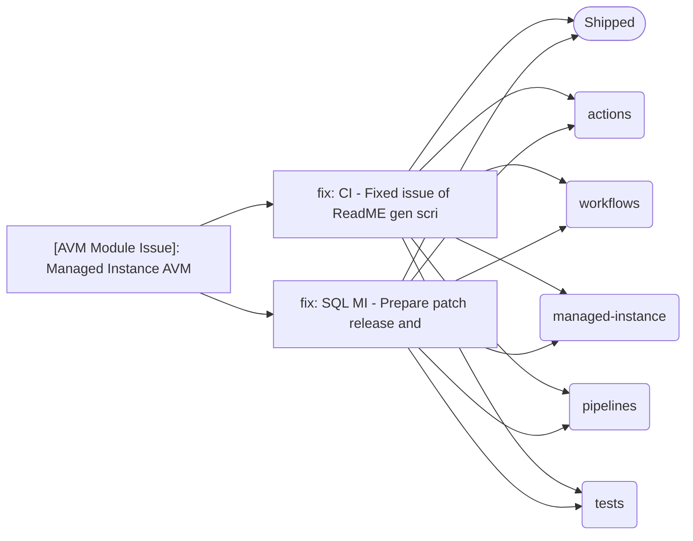

*landed in 18 days · 4 reviewers · 6 contributors · 2 review rounds · reopened 2×*

Outcome **shipped**; PRs: [#7442](https://github.com/Azure/bicep-registry-modules/pull/7442) (merged), [#7444](https://github.com/Azure/bicep-registry-modules/pull/7444) (merged); issues: [#7344](https://github.com/Azure/bicep-registry-modules/issues/7344); code areas: 5 (`.github/actions`, `.github/workflows`, `avm/res/sql/managed-instance`, `utilities/pipelines`, `utilities/tests`)

Issue 7344 reported that the SQL Managed Instance module capped storageSizeInGB too low. The train shipped two PRs on 2026-10-02: a README-generation fix and a SQL MI patch-release preparation with clarified storage bounds. — [1](https://github.com/Azure/bicep-registry-modules/pull/7442)

- **Proposed:** The issue said the module's schema allowed a maximum storageSizeInGB of 8192 GB, so larger values failed validation even though the issue states Azure SQL Managed Instance supports up to 16384 GB. PR 7442 separately fixed Set-ModuleReadme, which referenced the wrong property when a module's tests used a 'keys' property. — [1](https://github.com/Azure/bicep-registry-modules/issues/7344), [2](https://github.com/Azure/bicep-registry-modules/pull/7444)
- **Changed:** PR 7442 corrected the README generation script and added a SQL MI change to re-trigger publishing; its feature deltas show common-types imports moving from 0.6.1 to 0.7.0 and test dependency API versions being bumped. PR 7444 clarified the storageSizeInGB description to 'from 32 to 32768 in increments of 32 GB', regenerated main.json and README, left version.json at 0.5, moved the max test's enforcedLocation from eastus to eastasia, and made the instance name in the four e2e scenarios use uniqueString(resourceGroup.id). In review, a reviewer questioned changelog entries that were duplicated or of no value to consumers, and one review comment contained a suggestion removing lines. — [1](https://github.com/Azure/bicep-registry-modules/pull/7442), [2](https://github.com/Azure/bicep-registry-modules/pull/7444)
- **Shipped:** Both PRs merged on 2026-10-02 (7442 and 7444, commits 0636922 and 4113a2a). The shipped SQL MI change is a non-behavioural source and description change plus test updates; the PR body states it does not itself publish a release. — [1](https://github.com/Azure/bicep-registry-modules/commit/063692211eca4c12b932178c16fb306c4cdd7ab7), [2](https://github.com/Azure/bicep-registry-modules/commit/4113a2a528ce0bb3dd86732ca271333bf18e087f)

### Deep train `train-pr-7454` — fix: CI - Readme generation updates to help parallization & regex issues

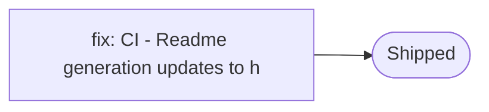

*landed in 0 days · 1 reviewers · 2 contributors · 1 review rounds*

Outcome **shipped**; PRs: [#7454](https://github.com/Azure/bicep-registry-modules/pull/7454) (merged); code areas: 10 (`avm/ptn/app/iaas-vm-cosmosdb-tier4`, `avm/ptn/dev-ops/cicd-agents-and-runners`, `avm/res/db-for-my-sql/flexible-server`, `avm/res/dev-test-lab/lab`, `avm/res/devices/iot-hub`, `avm/res/key-vault/vault` …)

PR 7454 fixed several CI README-generation problems and applied related module fixes. It merged on 2026-10-03 after one approval. — [1](https://github.com/Azure/bicep-registry-modules/pull/7454)

- **Proposed:** The PR body lists a regex bug where `a: 'a.b'` was detected as an object reference (affecting operational-insights/workspace and its quota parameter), an issue with RPC batches, missing handling of renamed files in the Git-Diff function, and cross-reference logic that broke when ptn modules shared a name with res modules. — [1](https://github.com/Azure/bicep-registry-modules/pull/7454)
- **Changed:** The body describes fixing the regex, RPC-batch handling and cross-reference logic, adding support for `R` (moved/renamed) files in the Git-Diff function, correcting diverse folder paths, and deprecating dev-test-labs/lab/secret because the API no longer supports it. The author ran Set-AVMModule recursively over all modules with no further suggested changes. — [1](https://github.com/Azure/bicep-registry-modules/pull/7454)
- **Shipped:** Merged 2026-10-03 as commit 574f7d7. Feature deltas show README and CHANGELOG changes in modules including db-for-my-sql/flexible-server (advanced-threat-protection renamed to advanced-threat-protection-setting), dev-test-lab/lab, devices/iot-hub, and two ptn modules. — [1](https://github.com/Azure/bicep-registry-modules/commit/574f7d7184a2541e5eb6e7ea3c3e5b80ab19488a)

### Deep train `train-pr-7458` — fix(ci): look up built-in provider principals in test fixtures

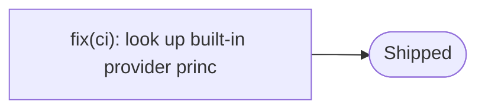

*landed in 8 days · 0 reviewers · 1 contributors*

Outcome **shipped**; PRs: [#7458](https://github.com/Azure/bicep-registry-modules/pull/7458) (merged); code areas: 9 (`avm/res/azure-stack-hci/cluster`, `avm/res/azure-stack-hci/logical-network`, `avm/res/azure-stack-hci/marketplace-gallery-image`, `avm/res/azure-stack-hci/network-interface`, `avm/res/azure-stack-hci/virtual-hard-disk`, `avm/res/azure-stack-hci/virtual-machine-instance` …)

PR 7458 replaced tenant-specific service-principal object IDs in CI test fixtures with Microsoft Graph lookups. It merged on 2026-10-11 with no recorded review. — [1](https://github.com/Azure/bicep-registry-modules/pull/7458)

- **Proposed:** The PR body says nine modules outside the live diff of PR 7374 relied on three tenant-specific built-in service-principal object-ID CI inputs, and asks to look them up by stable application ID instead. — [1](https://github.com/Azure/bicep-registry-modules/pull/7458)
- **Changed:** Per the body, 20 test entrypoints now use Graph `existing` lookups via the root microsoftGraphV1 extension and pass the resolved `.id` to the unchanged dependency or module parameter. Feature deltas show, for example in azure-stack-hci/cluster, a new optional builtInServicePrincipalObjectId parameter and an `existing` hciResourceProvider Microsoft.Graph/servicePrincipals resource replacing the required hciResourceProviderObjectId parameter. — [1](https://github.com/Azure/bicep-registry-modules/pull/7458)
- **Shipped:** Merged 2026-10-11 as commit 063ef55, touching test fixtures for dev-ops-infrastructure/pool, the azure-stack-hci modules, hybrid-container-service/provisioned-cluster-instance and kubernetes-runtime/load-balancer. The body states public module interfaces, versions, roles and locations are unchanged. — [1](https://github.com/Azure/bicep-registry-modules/commit/063ef550c5b61b46eab222f05b30693dacaf8bc9)

### Deep train `train-pr-7464` — fix(ci): consolidate retry, cleanup and shared tooling fixes

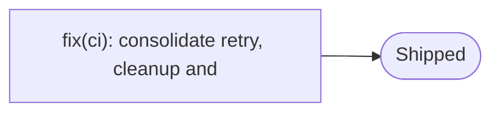

*landed in 1 days · 1 reviewers · 2 contributors · 1 review rounds*

Outcome **shipped**; PRs: [#7464](https://github.com/Azure/bicep-registry-modules/pull/7464) (merged); code areas: 6 (`.github/actions`, `.github/workflows`, `.required-features.json`, `utilities/e2e-template-assets`, `utilities/pipelines`, `utilities/tests`)

PR 7464 consolidated shared CI retry, cleanup and tooling fixes into one reviewed change. It merged on 2026-10-06 after one approval. — [1](https://github.com/Azure/bicep-registry-modules/pull/7464)

- **Proposed:** The body says it repairs shared cleanup and retry failures seen in a specific CI run, and is a consolidated tooling review combining the Cosmos classifier (PR 7465), the AKS classifier (PR 7467) and the twelve-file non-avm slice of PR 7374. — [1](https://github.com/Azure/bicep-registry-modules/pull/7464)
- **Changed:** The body describes a missing-preflight-child rule that omits cleanup only for a failed parent's unique failed Create with matching preflight evidence and an exact 404 DeploymentNotFound, and an existing-Graph-lookup rule for ID-less successful Creates. It states the twelve transferred blobs match source commit 3eb4712 and that there are no avm/ differences from main. Feature deltas show the azureStackHCIClusterPreqs template's Key Vault resources moving from API 2023-07-01 to 2026-02-01. — [1](https://github.com/Azure/bicep-registry-modules/pull/7464)
- **Shipped:** Merged 2026-10-06 as commit a7edc52, changing .github actions and workflows, .required-features.json, utilities/pipelines, utilities/tests and e2e template assets. — [1](https://github.com/Azure/bicep-registry-modules/commit/a7edc5227f21bcb9869736150e73f393d08e3a2e)

### Deep train `train-pr-7484` — fix(ci): initialize Pester from Avm.Authoring configuration

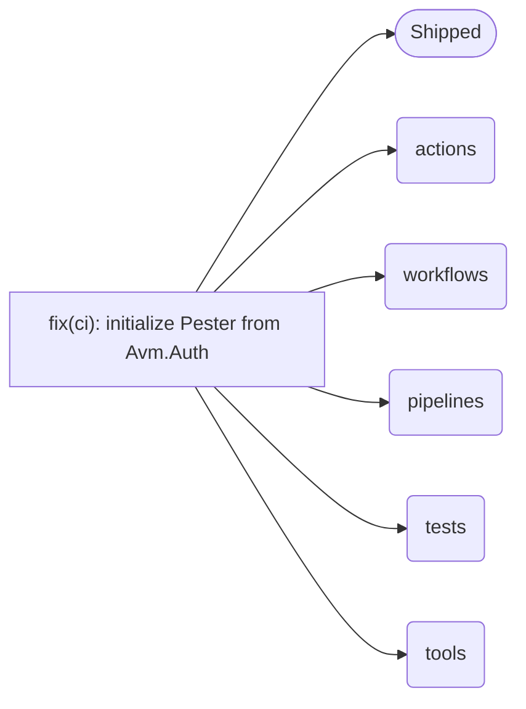

*landed in 0 days · 1 reviewers · 2 contributors · 1 review rounds*

Outcome **shipped**; PRs: [#7484](https://github.com/Azure/bicep-registry-modules/pull/7484) (merged); code areas: 5 (`.github/actions`, `.github/workflows`, `utilities/pipelines`, `utilities/tests`, `utilities/tools`)

PR 7484 made CI initialize Pester from the Avm.Authoring configuration before Pester can autoload another version. It merged on 2026-10-07 after one approval. — [1](https://github.com/Azure/bicep-registry-modules/pull/7484)

- **Proposed:** The body says VMSS, Log Analytics workspace and App Configuration static-validation jobs in one automatic run loaded Pester 5.9.0, then failed nested metadata validation because released Avm.Authoring 0.21.0 selected 5.7.1. — [1](https://github.com/Azure/bicep-registry-modules/pull/7484)
- **Changed:** The body adds one shared initializer called from module static validation, the standalone metadata workflow, Test-ModuleLocally (PesterTest and PesterTestRecurse) and Test-CI. It requires Avm.Authoring 0.21.0 or later, resolves the manifest with Get-AvmTool, and runs Install-AvmTool -Name Pester only when the prerequisite is missing. — [1](https://github.com/Azure/bicep-registry-modules/pull/7484)
- **Shipped:** Merged 2026-10-07 as commit d4731c8, changing .github actions and workflows, utilities/pipelines, utilities/tests and utilities/tools. The slice records no module file deltas. — [1](https://github.com/Azure/bicep-registry-modules/commit/d4731c8c685649167a72165a924dcdc395267a97)

### Deep train `train-pr-7517` — fix(ci): consolidate deployment and package recovery

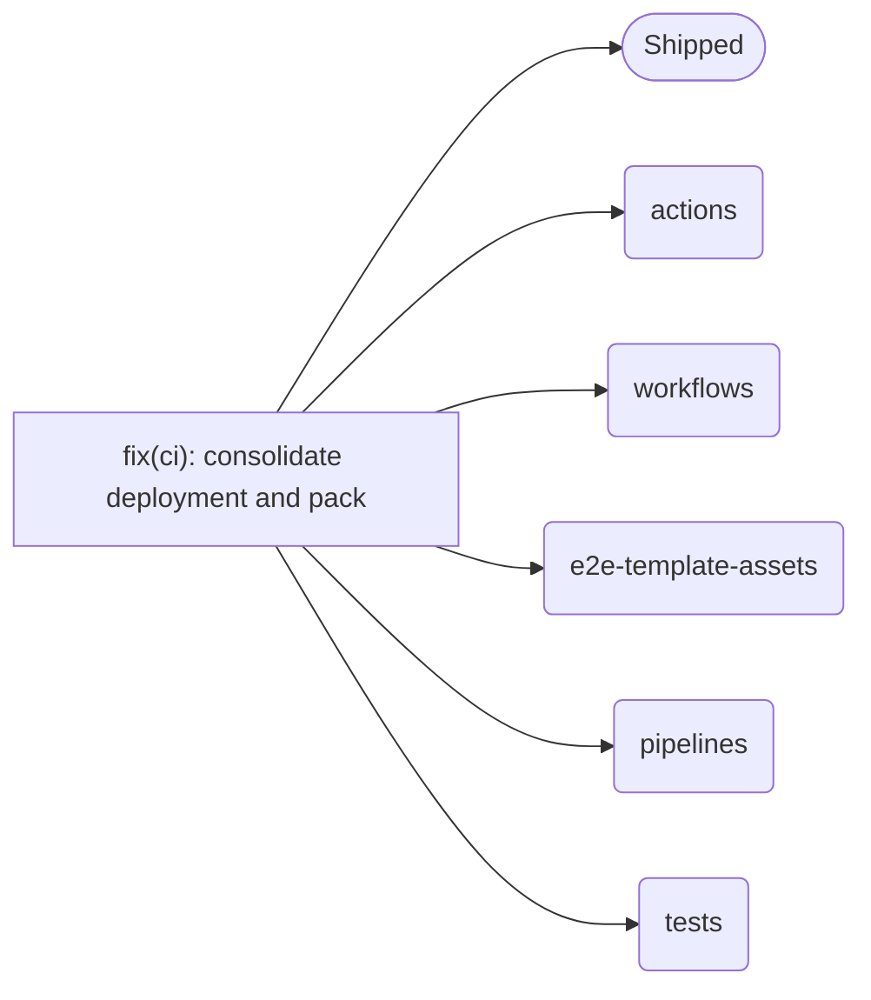

*landed in 0 days · 0 reviewers · 1 contributors*

Outcome **shipped**; PRs: [#7517](https://github.com/Azure/bicep-registry-modules/pull/7517) (merged); code areas: 5 (`.github/actions`, `.github/workflows`, `utilities/e2e-template-assets`, `utilities/pipelines`, `utilities/tests`)

PR 7517 consolidated approved deployment and package-recovery CI reliability fixes into one change. It merged on 2026-10-11 with no recorded review. — [1](https://github.com/Azure/bicep-registry-modules/pull/7517)

- **Proposed:** The body says the approved workflow and shared CI fixes are consolidated, with the frozen source implementations and regression tests preserved, no avm/ module or fixture changes, and no issue closure requested. It was opened as a draft with a separate HCI consumer check pending. — [1](https://github.com/Azure/bicep-registry-modules/pull/7517)
- **Changed:** The body lists PSRule package archive preparation with one narrow corruption recovery, recognition of the Search regional capacity error, a shared four-hour status-recovery deadline across deployment attempts, an Azure login refresh before failure cleanup, and Pester initialization before post-deployment discovery. Role-assignment cleanup deletes only the supplied validated ID through ARM. A later comment reports the HCI consumer-integration check passed with 47 checks and no failures. — [1](https://github.com/Azure/bicep-registry-modules/pull/7517)
- **Shipped:** Merged 2026-10-11 as commit cef29e4. The recorded feature delta is a new description on the unique-resource-name function in utilities/e2e-template-assets. — [1](https://github.com/Azure/bicep-registry-modules/commit/cef29e463bc25e163d07ed66944e3b99b660c557)

### Deep train `train-pr-7518` — feat(ci): register required resource providers before e2e tests

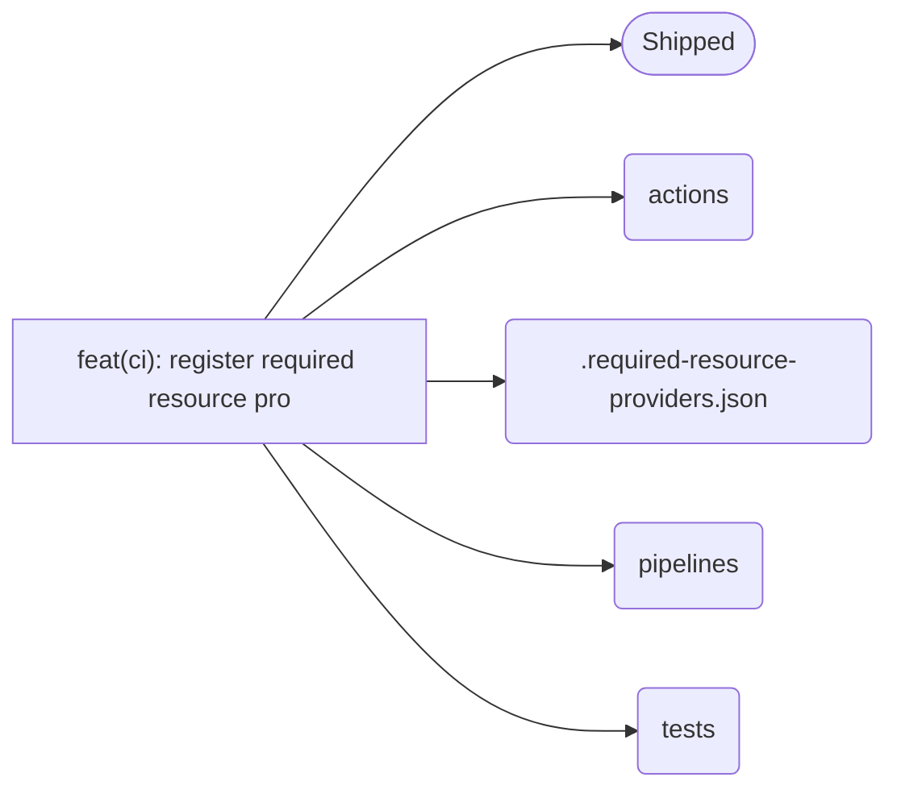

*landed in 0 days · 0 reviewers · 1 contributors*

Outcome **shipped**; PRs: [#7518](https://github.com/Azure/bicep-registry-modules/pull/7518) (merged); code areas: 4 (`.github/actions`, `.required-resource-providers.json`, `utilities/pipelines`, `utilities/tests`)

PR 7518 added a CI mechanism to register required Azure resource providers before e2e tests. It merged on 2026-10-11 with no recorded review. — [1](https://github.com/Azure/bicep-registry-modules/pull/7518)

- **Proposed:** The body proposes an optional repository-root .required-resource-providers.json, in the same format as .required-features.json, listing provider namespaces per module path, with avm/res/hybrid-container-service/provisioned-cluster-instance as the first consumer. — [1](https://github.com/Azure/bicep-registry-modules/pull/7518)
- **Changed:** The deployment action registers providers right after feature registration and before token replacement, validation or deployment. It skips registered providers, waits on existing Registering operations, registers NotRegistered/Unregistered ones once, and fails explicitly on invalid declarations, identity mismatches, approval-required or unknown states, errors and timeouts. Missing or unrelated declarations and WhatIf are no-ops without Azure calls. — [1](https://github.com/Azure/bicep-registry-modules/pull/7518)
- **Shipped:** Merged 2026-10-11 as commit f006e66, touching .github/actions, .required-resource-providers.json, utilities/pipelines and utilities/tests. The initial consumer is avm/res/hybrid-container-service/provisioned-cluster-instance with 13 prerequisites. — [1](https://github.com/Azure/bicep-registry-modules/commit/f006e66bf04bbbec7b618e0eba22742558266946)

### Deep train `train-pr-7525` — feat(ci): reserve Azure Local test subscriptions and prepare shared fixtures

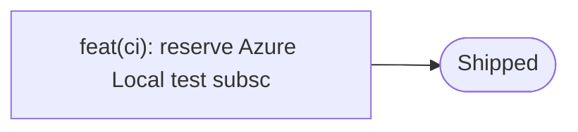

*landed in 0 days · 1 reviewers · 2 contributors · 1 review rounds*

Outcome **shipped**; PRs: [#7525](https://github.com/Azure/bicep-registry-modules/pull/7525) (merged); code areas: 13 (`.github/actions`, `.github/workflows`, `.reserved-test-subscriptions.json`, `avm/res/azure-stack-hci/cluster`, `avm/res/azure-stack-hci/logical-network`, `avm/res/azure-stack-hci/marketplace-gallery-image` …)

PR 7525 added source support for a reserved Azure Local test environment with shared fixtures, without activating it. It merged on 2026-10-13 after repeated ready-for-review cycles and CodeQL comments. — [1](https://github.com/Azure/bicep-registry-modules/pull/7525)

- **Proposed:** The body asks for reserved test subscriptions for Azure Local modules and shared fixture infrastructure so tests need not rebuild all dependencies cold. — [1](https://github.com/Azure/bicep-registry-modules/pull/7525)
- **Changed:** The body describes partitioning the subscription pool by an optional tag and seven module-root mappings in .reserved-test-subscriptions.json, failing before allocation on malformed or missing reserved pools. It adds a manual preparation workflow, serializes preparation, tests and cleanup on the shared environment, and reuses shared dependencies in fourteen non-cluster fixtures while keeping cold paths. Feature deltas show new optional test parameters described as validated persistent dependencies from reserved Azure Local CI, and a new test-key-vault.bicep template. Review activity was three bot reviews; the shown comments are CodeQL 'Excessive Secrets Exposure' warnings about toJSON(secrets). — [1](https://github.com/Azure/bicep-registry-modules/pull/7525)
- **Shipped:** Merged 2026-10-13 as commit 806ee4c, changing workflows and actions, .reserved-test-subscriptions.json, the azure-stack-hci and hybrid-container-service test fixtures, and utilities/e2e-template-assets. The slice shows no human review before merge. — [1](https://github.com/Azure/bicep-registry-modules/commit/806ee4cc0261d25acc351c1f5b9f7e30e310b8e2)

**Mention trains** — one line each:

- `train-issue-7342` — [[AVM Module Issue]:](https://github.com/Azure/bicep-registry-modules/issues/7342) — shipped (2 PR(s))
- `train-issue-7345` — [[AVM Module Issue]: avm.res.insights.scheduled-query-rule missing kind SimpleLogAlert](https://github.com/Azure/bicep-registry-modules/issues/7345) — shipped (1 PR(s))
- `train-issue-7459` — [[Failed pipeline] avm.res.devices.iot-hub](https://github.com/Azure/bicep-registry-modules/issues/7459) — shipped (1 PR(s))
- `train-issue-7489` — [[AVM Module Issue]: Add MultiplePersistent to allowed values for the loadBalancerType parameter](https://github.com/Azure/bicep-registry-modules/issues/7489) — shipped (1 PR(s))
- `train-pr-7288` — [docs: Remove stale model pin and dead `/AVM-Boostrap` reference from pre-flight check](https://github.com/Azure/bicep-registry-modules/pull/7288) — shipped (1 PR(s))
- `train-pr-7430` — [fix(avm/res/azure-stack-hci/virtual-machine-instance): regenerate README cross-references for machine 0.6.0](https://github.com/Azure/bicep-registry-modules/pull/7430) — shipped (1 PR(s))
- `train-pr-7431` — [feat(avm/res/kubernetes/connected-cluster): update connectedClusters API version to GA 2026-05-01](https://github.com/Azure/bicep-registry-modules/pull/7431) — shipped (1 PR(s))
- `train-pr-7434` — [feat(avm/res/hybrid-compute/gateway): update gateways API version to 2026-07-15](https://github.com/Azure/bicep-registry-modules/pull/7434) — shipped (1 PR(s))
- `train-pr-7435` — [feat(avm/res/hybrid-compute/license): update licenses API version to 2026-07-15](https://github.com/Azure/bicep-registry-modules/pull/7435) — shipped (1 PR(s))
- `train-pr-7436` — [fix(test): isolate diagnostic dependency names by resource group](https://github.com/Azure/bicep-registry-modules/pull/7436) — shipped (1 PR(s))
- `train-pr-7438` — [ci(bicep): use generic validation settings](https://github.com/Azure/bicep-registry-modules/pull/7438) — shipped (1 PR(s))
- `train-pr-7439` — [feat(avm/res/hybrid-container-service/provisioned-cluster-instance): update referenced module and API versions](https://github.com/Azure/bicep-registry-modules/pull/7439) — shipped (1 PR(s))
- `train-pr-7443` — [fix: CI - Restore Azure validation error details](https://github.com/Azure/bicep-registry-modules/pull/7443) — shipped (1 PR(s))
- `train-pr-7445` — [fix: exclude generic module workflow from failed-run retries](https://github.com/Azure/bicep-registry-modules/pull/7445) — shipped (1 PR(s))
- `train-pr-7446` — [fix: handle expression-valued deployment templates](https://github.com/Azure/bicep-registry-modules/pull/7446) — shipped (1 PR(s))
- `train-pr-7447` — [fix(ci): require a second label for experimental e2e tests](https://github.com/Azure/bicep-registry-modules/pull/7447) — shipped (1 PR(s))
- `train-pr-7451` — [fix: SQL MI - Prevent test storage name collisions](https://github.com/Azure/bicep-registry-modules/pull/7451) — shipped (1 PR(s))
- `train-pr-7453` — [fix(ci): short-circuit ignored deployment jobs](https://github.com/Azure/bicep-registry-modules/pull/7453) — shipped (1 PR(s))
- `train-pr-7455` — [fix: retry regional deployments after cleanup](https://github.com/Azure/bicep-registry-modules/pull/7455) — shipped (1 PR(s))
- `train-pr-7456` — [feat(ci): register required subscription features before Bicep deployment tests](https://github.com/Azure/bicep-registry-modules/pull/7456) — shipped (1 PR(s))
- `train-pr-7457` — [fix(ci): read structured ARM deployment operation errors](https://github.com/Azure/bicep-registry-modules/pull/7457) — shipped (1 PR(s))
- `train-pr-7463` — [feat(avm/res/azure-stack-hci/virtual-machine-instance): release unpublished 0.2.0 changes as 0.3.0](https://github.com/Azure/bicep-registry-modules/pull/7463) — shipped (1 PR(s))
- `train-pr-7466` — [feat(avm/res/kubernetes-runtime/load-balancer): update connectedClusters reference and telemetry API versions](https://github.com/Azure/bicep-registry-modules/pull/7466) — shipped (1 PR(s))
- `train-pr-7470` — [fix(ci): retry region metadata request timeouts](https://github.com/Azure/bicep-registry-modules/pull/7470) — shipped (1 PR(s))
- `train-pr-7471` — [chore: Added "arjenhuitema" as the owner for the Network Security Group and …](https://github.com/Azure/bicep-registry-modules/pull/7471) — shipped (1 PR(s))
- `train-pr-7473` — [chore(module-list): sync AVM module dropdown [skip ci]](https://github.com/Azure/bicep-registry-modules/pull/7473) — shipped (1 PR(s))
- `train-pr-7478` — [fix: reconcile successful management-group deployments after HTTP 403](https://github.com/Azure/bicep-registry-modules/pull/7478) — shipped (1 PR(s))
- `train-pr-7482` — [fix: remove temporary OIDC exception flow](https://github.com/Azure/bicep-registry-modules/pull/7482) — shipped (1 PR(s))
- `train-pr-7486` — [fix(ci): consolidate regional retry, cleanup and test setup repairs](https://github.com/Azure/bicep-registry-modules/pull/7486) — shipped (1 PR(s))
- `train-pr-7487` — [fix(ci): classify bounded service retries and reuse installed modules](https://github.com/Azure/bicep-registry-modules/pull/7487) — shipped (1 PR(s))
- `train-pr-7488` — [fix(ci): restore HCI host image fallback](https://github.com/Azure/bicep-registry-modules/pull/7488) — shipped (1 PR(s))
- `train-pr-7491` — [feat(ci): add reusable HCI image builder](https://github.com/Azure/bicep-registry-modules/pull/7491) — shipped (1 PR(s))
- `train-pr-7492` — [fix(ci): consolidate deployment read, dependency and Bicep recovery](https://github.com/Azure/bicep-registry-modules/pull/7492) — shipped (1 PR(s))
- `train-pr-7493` — [fix: correct named-value canonicalType typo](https://github.com/Azure/bicep-registry-modules/pull/7493) — shipped (1 PR(s))
- `train-pr-7496` — [fix: Update Network Security Group module](https://github.com/Azure/bicep-registry-modules/pull/7496) — shipped (1 PR(s))
- `train-pr-7499` — [fix: avm/res/event-hub/namespace - preserve disabled capture configuration](https://github.com/Azure/bicep-registry-modules/pull/7499) — shipped (1 PR(s))
- `train-pr-7500` — [fix(ci): handle module initializer metadata and authorization denials](https://github.com/Azure/bicep-registry-modules/pull/7500) — shipped (1 PR(s))
- `train-pr-7505` — [feat(ci): support separate HCI build and replication regions](https://github.com/Azure/bicep-registry-modules/pull/7505) — shipped (1 PR(s))
- `train-pr-7506` — [fix(ci): tolerate missing HCI replica diagnostics](https://github.com/Azure/bicep-registry-modules/pull/7506) — shipped (1 PR(s))
- `train-pr-7507` — [fix(ci): isolate module selection to the tested PR merge](https://github.com/Azure/bicep-registry-modules/pull/7507) — shipped (1 PR(s))
- `train-pr-7512` — [chore(ci): prepare Bicep workflow migration and module identities](https://github.com/Azure/bicep-registry-modules/pull/7512) — shipped (1 PR(s))
- `train-pr-7531` — [fix(ci): accept registered HCI provider resource-type rows](https://github.com/Azure/bicep-registry-modules/pull/7531) — shipped (1 PR(s))
- `train-pr-7532` — [fix(ci): handle native HCI image response headers](https://github.com/Azure/bicep-registry-modules/pull/7532) — shipped (1 PR(s))
- `train-pr-7544` — [fix(ci): pin and verify Azure Local 2601 payload](https://github.com/Azure/bicep-registry-modules/pull/7544) — shipped (1 PR(s))
- `train-pr-7545` — [fix: isolate HCI deployment from generic module workflows](https://github.com/Azure/bicep-registry-modules/pull/7545) — shipped (1 PR(s))
- `train-pr-7547` — [fix: persist HCI image operation receipts privately](https://github.com/Azure/bicep-registry-modules/pull/7547) — shipped (1 PR(s))
- `train-pr-7548` — [fix: preserve HCI receipt JSON on PowerShell 7.4](https://github.com/Azure/bicep-registry-modules/pull/7548) — shipped (1 PR(s))
- `train-pr-7553` — [fix(tools): extract shared Key Vault tooling](https://github.com/Azure/bicep-registry-modules/pull/7553) — shipped (1 PR(s))
- `train-pr-7558` — [feat: add privatelink.redis.azure.net](https://github.com/Azure/bicep-registry-modules/pull/7558) — shipped (1 PR(s))
- `train-pr-7559` — [feat: split experimental Bicep registry workflows](https://github.com/Azure/bicep-registry-modules/pull/7559) — shipped (1 PR(s))
- `train-pr-7561` — [test: update subscription vending validation wiring](https://github.com/Azure/bicep-registry-modules/pull/7561) — shipped (1 PR(s))
- `train-pr-7563` — [ci: pin experimental Bicep workflows to verified tools release](https://github.com/Azure/bicep-registry-modules/pull/7563) — shipped (1 PR(s))
- `train-pr-7564` — [ci: update experimental Bicep workflow pins](https://github.com/Azure/bicep-registry-modules/pull/7564) — shipped (1 PR(s))
- `train-pr-7568` — [ci: adopt verified Bicep lint and bootstrap fixes](https://github.com/Azure/bicep-registry-modules/pull/7568) — shipped (1 PR(s))
- `train-pr-7569` — [ci: pin Bicep registry callers to verified tools commit](https://github.com/Azure/bicep-registry-modules/pull/7569) — shipped (1 PR(s))
- `train-issue-2865` — [[AVM CI Environment Issue]: Error when checking deployment status](https://github.com/Azure/bicep-registry-modules/issues/2865) — in_flight (1 PR(s))
- `train-issue-3377` — [[AVM Module Issue]: avm/res/sql/server should allow setting Microsoft.Insights/diagnosticSettings for master database](https://github.com/Azure/bicep-registry-modules/issues/3377) — in_flight (1 PR(s))
- `train-issue-3860` — [[AVM Module Issue]: 0.5.1~0.8.3 incompatible with BYO vnet PodSubnetID `container-service/managed-cluster`](https://github.com/Azure/bicep-registry-modules/issues/3860) — in_flight (1 PR(s))
- `train-issue-4794` — [[AVM Module Issue]: Unable to create a cognitive services account with multiple deployments](https://github.com/Azure/bicep-registry-modules/issues/4794) — in_flight (1 PR(s))
- `train-issue-5561` — [[AVM Module Issue]: Missing properties securityProfile sections (or securityEncryptionType) in Compute module](https://github.com/Azure/bicep-registry-modules/issues/5561) — in_flight (1 PR(s))
- `train-issue-6001` — [[AVM Module Issue]: Storage account fails while adding private endpoint with below error](https://github.com/Azure/bicep-registry-modules/issues/6001) — in_flight (1 PR(s))
- `train-issue-6167` — [[AVM Module Issue]: Disable weak cipher suites in API Management service module?](https://github.com/Azure/bicep-registry-modules/issues/6167) — in_flight (1 PR(s))
- `train-issue-6483` — [[AVM Module Issue]: subResourceWrapper.bicep lacks the use of serviceEndpoints](https://github.com/Azure/bicep-registry-modules/issues/6483) — in_flight (1 PR(s))
- `train-issue-6518` — [[AVM Module Issue]: Fine control for notification thresholds in budget](https://github.com/Azure/bicep-registry-modules/issues/6518) — in_flight (1 PR(s))
- `train-issue-6891` — [[AVM Module Issue]: Netapp account module missing site property for activeDirectory configuration](https://github.com/Azure/bicep-registry-modules/issues/6891) — in_flight (1 PR(s))
- `train-issue-6900` — [[AVM Module Issue]: subscriptions never placed unless disableSubscriptionPlacement: true](https://github.com/Azure/bicep-registry-modules/issues/6900) — in_flight (1 PR(s))
- `train-issue-6955` — [[AVM Module Issue]: Add Aspire Dashboard component support to avm/res/app/managed-environment](https://github.com/Azure/bicep-registry-modules/issues/6955) — in_flight (1 PR(s))
- `train-issue-6968` — [[AVM Module Issue]: AVM Bastion Host Module — Session Recording Storage Configuration Gap](https://github.com/Azure/bicep-registry-modules/issues/6968) — in_flight (1 PR(s))
- `train-issue-7122` — [[AVM Module Issue]: avm/res/api-management/service logger description not set in api-management deployed instance of AVM module](https://github.com/Azure/bicep-registry-modules/issues/7122) — in_flight (1 PR(s))
- `train-issue-7156` — [[AVM Module Issue]: CosmosDB - Add `enableAllVersionsAndDeletesChangeFeed` parameter/property](https://github.com/Azure/bicep-registry-modules/issues/7156) — in_flight (1 PR(s))
- `train-issue-7226` — [[AVM Module Issue]: subscriptionsLimit on product cant be set to unlimited](https://github.com/Azure/bicep-registry-modules/issues/7226) — in_flight (1 PR(s))
- `train-issue-7269` — [[AVM Module Issue]: Netapp volumeType type is missing securityStyle property even though referenced in file](https://github.com/Azure/bicep-registry-modules/issues/7269) — in_flight (1 PR(s))
- `train-issue-7278` — [[AVM Module Issue]: API management `skuCapacity` default of `3` fails deployment when `sku` is `Basic` (max capacity 2)](https://github.com/Azure/bicep-registry-modules/issues/7278) — in_flight (1 PR(s))
- `train-issue-7335` — [[AVM Module Issue]: AVM NetApp Account Snapshot Policy Does Not Support Multiple Days in weeklySchedule.day](https://github.com/Azure/bicep-registry-modules/issues/7335) — in_flight (1 PR(s))
- `train-issue-7394` — [fix(avm/res/azure-stack-hci/cluster): Validate deploymentSettings deleted before Deploy wipes validationStatus (portal 'Validate input = Unknown')](https://github.com/Azure/bicep-registry-modules/issues/7394) — in_flight (1 PR(s))
- `train-issue-7503` — [[AVM Module Issue]: Fix "configuraitons" typo in `fluxConfigurations` description](https://github.com/Azure/bicep-registry-modules/issues/7503) — in_flight (2 PR(s))
- `train-issue-7523` — [[AVM Module Issue]: avm/res/app/job - support identitySettings (identity lifecycle)](https://github.com/Azure/bicep-registry-modules/issues/7523) — in_flight (1 PR(s))
- `train-issue-7554` — [[AVM Module Issue]: Support for high performance disk configurations](https://github.com/Azure/bicep-registry-modules/issues/7554) — in_flight (1 PR(s))
- `train-pr-3810` — [ci: Introduce PSRule suppression for individual rules/resources](https://github.com/Azure/bicep-registry-modules/pull/3810) — in_flight (1 PR(s))
- `train-pr-4863` — [feat: add gh issue label logic](https://github.com/Azure/bicep-registry-modules/pull/4863) — in_flight (1 PR(s))
- `train-pr-5315` — [ci: [Test 01] Enforce test folder validation for pattern modules for both defaults and waf-aligned](https://github.com/Azure/bicep-registry-modules/pull/5315) — in_flight (1 PR(s))
- `train-pr-5316` — [ci: [Test 02] Enforce test folder validation for pattern modules for both waf-aligned only](https://github.com/Azure/bicep-registry-modules/pull/5316) — in_flight (1 PR(s))
- `train-pr-5317` — [ci: [Test 03] Enforce test folder validation for pattern modules for defaults only](https://github.com/Azure/bicep-registry-modules/pull/5317) — in_flight (1 PR(s))
- `train-pr-6168` — [feat: Re-added logic to set module version in readme](https://github.com/Azure/bicep-registry-modules/pull/6168) — in_flight (1 PR(s))
- `train-pr-6218` — [feat: Synapase - Added support for HSM](https://github.com/Azure/bicep-registry-modules/pull/6218) — in_flight (1 PR(s))
- `train-pr-6549` — [feat(ptn): Update FinOps Hub v12 pattern module](https://github.com/Azure/bicep-registry-modules/pull/6549) — in_flight (1 PR(s))
- `train-pr-6580` — [feat: new module `avm/res/app/agent` (Microsoft.App/agents)](https://github.com/Azure/bicep-registry-modules/pull/6580) — in_flight (1 PR(s))
- `train-pr-6584` — [fix(app-service-lza): correct web app kind parameter to respect OS configuration](https://github.com/Azure/bicep-registry-modules/pull/6584) — in_flight (1 PR(s))
- `train-pr-6694` — [feat: check for module existence in MAR](https://github.com/Azure/bicep-registry-modules/pull/6694) — in_flight (1 PR(s))
- `train-pr-6732` — [ci: DO NOT MERGE - Test to showcase feasibility of validation on PR](https://github.com/Azure/bicep-registry-modules/pull/6732) — in_flight (1 PR(s))
- `train-pr-6753` — [feat: module maintenance skill](https://github.com/Azure/bicep-registry-modules/pull/6753) — in_flight (1 PR(s))
- `train-pr-6761` — [test(avm/res/azure-stack-hci/marketplace-gallery-image): update test harness for 24H2 cluster](https://github.com/Azure/bicep-registry-modules/pull/6761) — in_flight (1 PR(s))
- `train-pr-6813` — [feat: add bootstrap skill](https://github.com/Azure/bicep-registry-modules/pull/6813) — in_flight (1 PR(s))
- `train-pr-6929` — [feat: Subscription Vending PTN - UMI Role Assignments absolute scopes](https://github.com/Azure/bicep-registry-modules/pull/6929) — in_flight (1 PR(s))
- `train-pr-7021` — [fix: ReadMe Gen - Fixed incorrect section reference if non-parent module](https://github.com/Azure/bicep-registry-modules/pull/7021) — in_flight (1 PR(s))
- `train-pr-7074` — [fix: remove enableAnalyticalStorage o…](https://github.com/Azure/bicep-registry-modules/pull/7074) — in_flight (1 PR(s))
- `train-pr-7075` — [feat: introduce container migration module](https://github.com/Azure/bicep-registry-modules/pull/7075) — in_flight (1 PR(s))
- `train-pr-7089` — [feat: Publish child module `avm/res/web/hosting-environment/configuration`](https://github.com/Azure/bicep-registry-modules/pull/7089) — in_flight (1 PR(s))
- `train-pr-7094` — [feat: Publish child modules of `avm/res/cache/redis-enterprise`](https://github.com/Azure/bicep-registry-modules/pull/7094) — in_flight (1 PR(s))
- `train-pr-7144` — [feat: Add contribution guidelines and module overview to documentation](https://github.com/Azure/bicep-registry-modules/pull/7144) — in_flight (1 PR(s))
- `train-pr-7165` — [fix: bump actions/checkout from 4 to 7](https://github.com/Azure/bicep-registry-modules/pull/7165) — in_flight (1 PR(s))
- `train-pr-7182` — [feat: dependency updates on `avm/ptn/app/container-job-toolkit`](https://github.com/Azure/bicep-registry-modules/pull/7182) — in_flight (1 PR(s))
- `train-pr-7245` — [Fix: CWYD AVM upgrade v2](https://github.com/Azure/bicep-registry-modules/pull/7245) — in_flight (1 PR(s))
- `train-pr-7259` — [feat: static test for using multiple versions in one module](https://github.com/Azure/bicep-registry-modules/pull/7259) — in_flight (1 PR(s))
- `train-pr-7263` — [Upgrade FinOps hub to Toolkit v14](https://github.com/Azure/bicep-registry-modules/pull/7263) — in_flight (1 PR(s))
- `train-pr-7281` — [feat: Add CMK user-assigned identity to managed identities across modules - batch 2](https://github.com/Azure/bicep-registry-modules/pull/7281) — in_flight (1 PR(s))
- `train-pr-7286` — [adding fips flag to additionalfeatures](https://github.com/Azure/bicep-registry-modules/pull/7286) — in_flight (1 PR(s))
- `train-pr-7310` — [feat: AVM Module Upgrade for BYOCC](https://github.com/Azure/bicep-registry-modules/pull/7310) — in_flight (1 PR(s))
- `train-pr-7316` — [fix: bump actions/checkout from 4.4.0 to 7.0.1](https://github.com/Azure/bicep-registry-modules/pull/7316) — in_flight (1 PR(s))
- `train-pr-7317` — [fix: bump azure/powershell from 2.0.0 to 3.0.0](https://github.com/Azure/bicep-registry-modules/pull/7317) — in_flight (1 PR(s))
- `train-pr-7333` — [AVM module updated for CWYD v2](https://github.com/Azure/bicep-registry-modules/pull/7333) — in_flight (1 PR(s))
- `train-pr-7338` — [fix: bump the npm_and_yarn group across 1 directory with 8 updates](https://github.com/Azure/bicep-registry-modules/pull/7338) — in_flight (1 PR(s))
- `train-pr-7361` — [fix: bump azure/login from 2.3.1 to 3.1.0](https://github.com/Azure/bicep-registry-modules/pull/7361) — in_flight (1 PR(s))
- `train-pr-7381` — [feat: Databricks Workspace - Updated API version to 2026-01-01 and added computeMode](https://github.com/Azure/bicep-registry-modules/pull/7381) — in_flight (1 PR(s))
- `train-pr-7397` — [feat: Databricks Workspace - Added DBFS root customer-managed key and the storage account identity output](https://github.com/Azure/bicep-registry-modules/pull/7397) — in_flight (1 PR(s))
- `train-pr-7422` — [Fix private endpoint setup for static web site](https://github.com/Azure/bicep-registry-modules/pull/7422) — in_flight (1 PR(s))
- `train-pr-7449` — [fix: avoid global name collisions in module e2e tests](https://github.com/Azure/bicep-registry-modules/pull/7449) — in_flight (1 PR(s))
- `train-pr-7483` — [fix: hybrid container service provisioned cluster instance e2e fix](https://github.com/Azure/bicep-registry-modules/pull/7483) — in_flight (1 PR(s))
- `train-pr-7485` — [feat: Initial sql-virtual-machine module](https://github.com/Azure/bicep-registry-modules/pull/7485) — in_flight (1 PR(s))
- `train-pr-7504` — [feat: add Terraform-aligned Bicep naming utility](https://github.com/Azure/bicep-registry-modules/pull/7504) — in_flight (1 PR(s))
- `train-pr-7521` — [ci: propose bounded HCI status recovery by actual job age](https://github.com/Azure/bicep-registry-modules/pull/7521) — in_flight (1 PR(s))
- `train-pr-7522` — [fix(ci): classify application gateway zonal capacity failures](https://github.com/Azure/bicep-registry-modules/pull/7522) — in_flight (1 PR(s))
- `train-pr-7528` — [fix: sql server review findings](https://github.com/Azure/bicep-registry-modules/pull/7528) — in_flight (1 PR(s))
- `train-pr-7529` — [test: CI - Add isolated workspace max validation caller](https://github.com/Azure/bicep-registry-modules/pull/7529) — in_flight (1 PR(s))
- `train-pr-7530` — [feat: adds support for creating user-defined runtime environments in AA](https://github.com/Azure/bicep-registry-modules/pull/7530) — in_flight (1 PR(s))
- `train-pr-7539` — [feat: New module `avm/res/azure-stack-hci/storage-container`](https://github.com/Azure/bicep-registry-modules/pull/7539) — in_flight (1 PR(s))
- `train-pr-7552` — [feat: add galleryApplications support to VMSS module](https://github.com/Azure/bicep-registry-modules/pull/7552) — in_flight (1 PR(s))
- `train-pr-7557` — [fix: bump actions/upload-artifact from 5.0.0 to 7.0.2](https://github.com/Azure/bicep-registry-modules/pull/7557) — in_flight (1 PR(s))
- `train-pr-7560` — [feat: New module `avm/res/azure-stack-hci/gallery-image`](https://github.com/Azure/bicep-registry-modules/pull/7560) — in_flight (1 PR(s))
- `train-pr-7572` — [ci: prepare read-only cleanup diagnostic probe (DO NOT MERGE)](https://github.com/Azure/bicep-registry-modules/pull/7572) — in_flight (1 PR(s))
- `train-pr-7290` — [fix: bump actions/upload-artifact from 5.0.0 to 7.0.1](https://github.com/Azure/bicep-registry-modules/pull/7290) — rejected (1 PR(s))
- `train-pr-7405` — [test(dev-test-lab/lab): verify default deployment results](https://github.com/Azure/bicep-registry-modules/pull/7405) — rejected (1 PR(s))
- `train-pr-7437` — [fix(ci): repair cross-platform CI test setup](https://github.com/Azure/bicep-registry-modules/pull/7437) — rejected (1 PR(s))
- `train-pr-7452` — [fix: avm/res/compute/virtual-machine-scale-set unpin Windows uniform test region](https://github.com/Azure/bicep-registry-modules/pull/7452) — rejected (1 PR(s))
- `train-pr-7465` — [fix(ci): classify ML Cosmos regional capacity failures](https://github.com/Azure/bicep-registry-modules/pull/7465) — rejected (1 PR(s))
- `train-pr-7479` — [fix(ci): reconcile deletion progress and retain Graph operation metadata](https://github.com/Azure/bicep-registry-modules/pull/7479) — rejected (1 PR(s))
- `train-pr-7490` — [feat(ci): add reusable HCI image builder](https://github.com/Azure/bicep-registry-modules/pull/7490) — rejected (1 PR(s))
- `train-pr-7495` — [fix(ci): recover bounded dependency bootstrap failures](https://github.com/Azure/bicep-registry-modules/pull/7495) — rejected (1 PR(s))
- `train-pr-7498` — [fix(ci): validate Bicep download before replacement](https://github.com/Azure/bicep-registry-modules/pull/7498) — rejected (1 PR(s))
- `train-pr-7508` — [fix(ci): recover corrupt PSRule package downloads](https://github.com/Azure/bicep-registry-modules/pull/7508) — rejected (1 PR(s))
- `train-pr-7509` — [fix(ci): retry Search regional capacity exhaustion](https://github.com/Azure/bicep-registry-modules/pull/7509) — rejected (1 PR(s))
- `train-pr-7510` — [fix(ci): refresh Azure login before eligible failure cleanup](https://github.com/Azure/bicep-registry-modules/pull/7510) — rejected (1 PR(s))
- `train-pr-7511` — [fix(ci): share a four-hour deployment recovery deadline](https://github.com/Azure/bicep-registry-modules/pull/7511) — rejected (1 PR(s))
- `train-pr-7514` — [fix(ci): recover Image Builder status connection resets](https://github.com/Azure/bicep-registry-modules/pull/7514) — rejected (1 PR(s))
- `train-pr-7570` — [fix: target BAMI subscription vending cleanup](https://github.com/Azure/bicep-registry-modules/pull/7570) — rejected (1 PR(s))
- `train-issue-6981` — [AVM Core CI: three e2e validation tooling defects (deploy retry, cleanup throw, mgmt-group removal)](https://github.com/Azure/bicep-registry-modules/issues/6981) — abandoned (0 PR(s))
- `train-issue-7541` — [[AVM Module Issue]: storage-account outputs call listKeys() even when allowSharedKeyAccess is false](https://github.com/Azure/bicep-registry-modules/issues/7541) — abandoned (0 PR(s))
- `train-issue-7542` — [[AVM Module Issue]: database-account outputs call listKeys() even when local auth is disabled](https://github.com/Azure/bicep-registry-modules/issues/7542) — abandoned (0 PR(s))
- `train-issue-7543` — [[AVM Module Issue]: operational-insights/workspace outputs call listKeys() even when local auth is disabled](https://github.com/Azure/bicep-registry-modules/issues/7543) — abandoned (0 PR(s))

## Activity at a glance

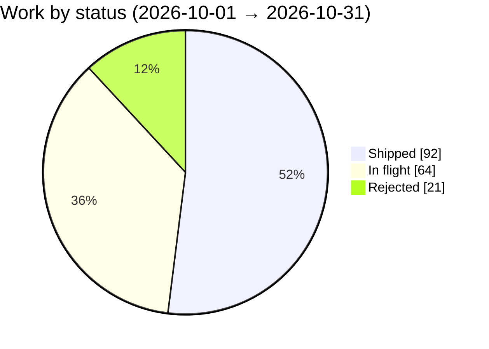

```mermaid
gantt
    title Timeline (2026-10-01 → 2026-10-31)
    dateFormat YYYY-MM-DD
    axisFormat %m-%d
    section Pull requests
    #3810 ci - Introduce PSRule suppression for individual rules :active, 2024-11-19, 2026-10-31
    #4205 feat - Deployment monitoring function :active, 2025-01-17, 2026-10-31
    #4863 feat - add gh issue label logic :active, 2025-03-25, 2026-10-31
    #5315 ci - [Test 01] Enforce test folder validation for patt :active, 2025-05-27, 2026-10-31
    #5316 ci - [Test 02] Enforce test folder validation for patt :active, 2025-05-27, 2026-10-31
    #5317 ci - [Test 03] Enforce test folder validation for patt :active, 2025-05-27, 2026-10-31
    #6168 feat - Re-added logic to set module version in readme :active, 2025-11-02, 2026-10-31
    #6218 feat - Synapase - Added support for HSM :active, 2025-11-13, 2026-10-31
    #6484 Fix - Adds service endpoint support to subnets :active, 2026-01-08, 2026-10-31
    #6549 feat(ptn) - Update FinOps Hub v12 pattern module :active, 2026-02-04, 2026-10-31
    #6580 feat - new module 'avm/res/app/agent' (Microsoft.App/a :active, 2026-02-19, 2026-10-31
    #6584 fix(app-service-lza) - correct web app kind parameter  :active, 2026-02-21, 2026-10-31
    #6694 feat - check for module existence in MAR :active, 2026-03-10, 2026-10-31
    #6732 ci - DO NOT MERGE - Test to showcase feasibility of va :active, 2026-03-18, 2026-10-31
    #6753 feat - module maintenance skill :active, 2026-03-24, 2026-10-31
    #6761 test(avm/res/azure-stack-hci/marketplace-gallery-image :active, 2026-03-26, 2026-10-31
    #6813 feat - add bootstrap skill :active, 2026-04-09, 2026-10-31
    #6883 fix - avm/compute/virtual-machine & avm/compute/virtua :active, 2026-04-15, 2026-10-31
    #6929 feat - Subscription Vending PTN - UMI Role Assignments :active, 2026-04-20, 2026-10-31
    #6980 fix - avm/ptn/mgmt-groups/subscription-placement - cor :active, 2026-04-30, 2026-10-31
    #7021 fix - ReadMe Gen - Fixed incorrect section reference i :active, 2026-05-09, 2026-10-31
    #7030 fix - DevOps CI/CD agents pattern module DNS fix :active, 2026-05-11, 2026-10-31
    #7032 fix - Add Active Directory site support to NetApp acco :active, 2026-05-12, 2026-10-31
    #7074 fix - remove enableAnalyticalStorage o… :active, 2026-05-19, 2026-10-31
    #7075 feat - introduce container migration module :active, 2026-05-19, 2026-10-31
    #7089 feat - Publish child module 'avm/res/web/hosting-envir :active, 2026-05-21, 2026-10-31
    #7094 feat - Publish child modules of 'avm/res/cache/redis-e :active, 2026-05-21, 2026-10-31
    #7132 feat - Add per-notification operator/thresholdType con :active, 2026-06-05, 2026-10-31
    #7144 feat - Add contribution guidelines and module overview :active, 2026-06-10, 2026-10-31
    #7146 fix - Update security ciphers for API Management :active, 2026-06-10, 2026-10-31
    #7165 fix - bump actions/checkout from 4 to 7 :active, 2026-06-19, 2026-10-31
    #7182 feat - dependency updates on 'avm/ptn/app/container-jo :active, 2026-06-26, 2026-10-31
    #7188 feat - Added managed identity and session recording co :active, 2026-07-01, 2026-10-31
    #7210 feat - adding new dotnet component :active, 2026-07-12, 2026-10-31
    #7245 Fix - CWYD AVM upgrade v2 :active, 2026-07-30, 2026-10-31
    #7259 feat - static test for using multiple versions in one  :active, 2026-08-07, 2026-10-31
    #7261 feat(aks) - add Gateway API and agent pool update supp :active, 2026-08-10, 2026-10-31
    #7263 Upgrade FinOps hub to Toolkit v14 :active, 2026-08-11, 2026-10-31
    #7281 feat - Add CMK user-assigned identity to managed ident :active, 2026-08-15, 2026-10-31
    #7286 adding fips flag to additionalfeatures :active, 2026-08-18, 2026-10-31
    #7288 docs - Remove stale model pin and dead '/AVM-Boostrap' :done, 2026-08-19, 2026-10-21
    #7290 fix - bump actions/upload-artifact from 5.0.0 to 7.0.1 :crit, 2026-08-20, 2026-10-22
    #7310 feat - AVM Module Upgrade for BYOCC :active, 2026-09-01, 2026-10-31
    #7316 fix - bump actions/checkout from 4.4.0 to 7.0.1 :active, 2026-09-01, 2026-10-31
    #7317 fix - bump azure/powershell from 2.0.0 to 3.0.0 :active, 2026-09-01, 2026-10-31
    #7329 fix - update logger description parameter :active, 2026-09-05, 2026-10-31
    #7330 fix - update skuCapacity parameter description :active, 2026-09-05, 2026-10-31
    #7332 fix - Update product subscription limit descriptions :active, 2026-09-05, 2026-10-31
    #7333 AVM module updated for CWYD v2 :active, 2026-09-07, 2026-10-31
    #7338 fix - bump the npm_and_yarn group across 1 directory w :active, 2026-09-09, 2026-10-31
    #7346 fix - add kind simplelogalert :done, 2026-09-14, 2026-10-21
    #7360 fix - avm/res/data-factory/factory - fixing Git reposi :done, 2026-09-17, 2026-10-06
    #7361 fix - bump azure/login from 2.3.1 to 3.1.0 :active, 2026-09-17, 2026-10-31
    #7370 fix(avm/res/cognitive-services/account) - Require a un :active, 2026-09-19, 2026-10-31
    #7374 feat - Diverse - Updated all Key Vault references to a :active, 2026-09-21, 2026-10-31
    #7381 feat - Databricks Workspace - Updated API version to 2 :active, 2026-09-22, 2026-10-31
    #7395 fix(avm/res/azure-stack-hci/cluster) - preserve valida :active, 2026-09-24, 2026-10-31
    #7397 feat - Databricks Workspace - Added DBFS root customer :active, 2026-09-24, 2026-10-31
    #7405 test(dev-test-lab/lab) - verify default deployment res :crit, 2026-09-28, 2026-10-01
    #7422 Fix private endpoint setup for static web site :active, 2026-09-30, 2026-10-31
    #7430 fix(avm/res/azure-stack-hci/virtual-machine-instance)  :done, 2026-09-30, 2026-10-01
    #7431 feat(avm/res/kubernetes/connected-cluster) - update co :done, 2026-10-01, 2026-10-01
    #7434 feat(avm/res/hybrid-compute/gateway) - update gateways :done, 2026-10-01, 2026-10-01
    #7435 feat(avm/res/hybrid-compute/license) - update licenses :done, 2026-10-01, 2026-10-01
    #7436 fix(test) - isolate diagnostic dependency names by res :done, 2026-10-01, 2026-10-01
    #7437 fix(ci) - repair cross-platform CI test setup :crit, 2026-10-01, 2026-10-07
    #7438 ci(bicep) - use generic validation settings :done, 2026-10-01, 2026-10-01
    #7439 feat(avm/res/hybrid-container-service/provisioned-clus :done, 2026-10-01, 2026-10-01
    #7442 fix - CI - Fixed issue of ReadME gen script when modul :done, 2026-10-02, 2026-10-02
    #7443 fix - CI - Restore Azure validation error details :done, 2026-10-02, 2026-10-02
    #7444 fix - SQL MI - Prepare patch release and improve deplo :done, 2026-10-02, 2026-10-02
    #7445 fix - exclude generic module workflow from failed-run  :done, 2026-10-02, 2026-10-02
    #7446 fix - handle expression-valued deployment templates :done, 2026-10-02, 2026-10-02
    #7447 fix(ci) - require a second label for experimental e2e  :done, 2026-10-02, 2026-10-02
    #7448 feat(avm/res/sql/server) - Add 'masterDatabaseDiagnost :active, 2026-10-02, 2026-10-31
    #7449 fix - avoid global name collisions in module e2e tests :active, 2026-10-02, 2026-10-31
    #7451 fix - SQL MI - Prevent test storage name collisions :done, 2026-10-03, 2026-10-03
    #7452 fix - avm/res/compute/virtual-machine-scale-set unpin  :crit, 2026-10-03, 2026-10-03
    #7453 fix(ci) - short-circuit ignored deployment jobs :done, 2026-10-03, 2026-10-03
    #7454 fix - CI - Readme generation updates to help paralliza :done, 2026-10-03, 2026-10-03
    #7455 fix - retry regional deployments after cleanup :done, 2026-10-03, 2026-10-03
    #7456 feat(ci) - register required subscription features bef :done, 2026-10-03, 2026-10-03
    #7457 fix(ci) - read structured ARM deployment operation err :done, 2026-10-03, 2026-10-03
    #7458 fix(ci) - look up built-in provider principals in test :done, 2026-10-03, 2026-10-11
    #7463 feat(avm/res/azure-stack-hci/virtual-machine-instance) :done, 2026-10-05, 2026-10-05
    #7464 fix(ci) - consolidate retry, cleanup and shared toolin :done, 2026-10-05, 2026-10-06
    #7465 fix(ci) - classify ML Cosmos regional capacity failure :crit, 2026-10-05, 2026-10-06
    #7466 feat(avm/res/kubernetes-runtime/load-balancer) - updat :done, 2026-10-06, 2026-10-06
    #7467 fix(ci) - classify AKS preflight empty-zone capacity f :crit, 2026-10-06, 2026-10-06
    #7469 fix - avm/res/devices/iot-hub - fixing Private Endpoin :done, 2026-10-06, 2026-10-06
    #7470 fix(ci) - retry region metadata request timeouts :done, 2026-10-06, 2026-10-06
    #7471 chore - Added 'arjenhuitema' as the owner for the Netw :done, 2026-10-06, 2026-10-06
    #7472 fix - secure credential inputs and parent UDT properti :active, 2026-10-06, 2026-10-31
    #7473 chore(module-list) - sync AVM module dropdown [skip ci :done, 2026-10-06, 2026-10-06
    #7478 fix - reconcile successful management-group deployment :done, 2026-10-07, 2026-10-07
    #7479 fix(ci) - reconcile deletion progress and retain Graph :crit, 2026-10-07, 2026-10-07
    #7480 fix - restore provisioned cluster instance e2e tests :crit, 2026-10-07, 2026-10-07
    #7482 fix - remove temporary OIDC exception flow :done, 2026-10-07, 2026-10-07
    #7483 fix - hybrid container service provisioned cluster ins :active, 2026-10-07, 2026-10-31
    #7484 fix(ci) - initialize Pester from Avm.Authoring configu :done, 2026-10-07, 2026-10-07
    #7485 feat - Initial sql-virtual-machine module :active, 2026-10-07, 2026-10-31
    #7486 fix(ci) - consolidate regional retry, cleanup and test :done, 2026-10-07, 2026-10-07
    #7487 fix(ci) - classify bounded service retries and reuse i :done, 2026-10-08, 2026-10-08
    #7488 fix(ci) - restore HCI host image fallback :done, 2026-10-08, 2026-10-08
    #7490 feat(ci) - add reusable HCI image builder :crit, 2026-10-08, 2026-10-08
    #7491 feat(ci) - add reusable HCI image builder :done, 2026-10-08, 2026-10-08
    #7492 fix(ci) - consolidate deployment read, dependency and  :done, 2026-10-08, 2026-10-09
    #7493 fix - correct named-value canonicalType typo :done, 2026-10-08, 2026-10-08
    #7494 feat - :active, 2026-10-08, 2026-10-31
    #7495 fix(ci) - recover bounded dependency bootstrap failure :crit, 2026-10-08, 2026-10-09
    #7496 fix - Update Network Security Group module :done, 2026-10-08, 2026-10-14
    #7498 fix(ci) - validate Bicep download before replacement :crit, 2026-10-08, 2026-10-09
    #7499 fix - avm/res/event-hub/namespace - preserve disabled  :done, 2026-10-09, 2026-10-18
    #7500 fix(ci) - handle module initializer metadata and autho :done, 2026-10-09, 2026-10-09
    #7501 fix - avm/res/data-factory/factory - fixing test resou :done, 2026-10-09, 2026-10-14
    #7502 feat(avm/res/desktop-virtualization/host-pool) - add M :done, 2026-10-09, 2026-10-18
    #7504 feat - add Terraform-aligned Bicep naming utility :active, 2026-10-09, 2026-10-31
    #7505 feat(ci) - support separate HCI build and replication  :done, 2026-10-10, 2026-10-10
    #7506 fix(ci) - tolerate missing HCI replica diagnostics :done, 2026-10-10, 2026-10-10
    #7507 fix(ci) - isolate module selection to the tested PR me :done, 2026-10-10, 2026-10-11
    #7508 fix(ci) - recover corrupt PSRule package downloads :crit, 2026-10-10, 2026-10-11
    #7509 fix(ci) - retry Search regional capacity exhaustion :crit, 2026-10-10, 2026-10-11
    #7510 fix(ci) - refresh Azure login before eligible failure  :crit, 2026-10-10, 2026-10-11
    #7511 fix(ci) - share a four-hour deployment recovery deadli :crit, 2026-10-11, 2026-10-11
    #7512 chore(ci) - prepare Bicep workflow migration and modul :done, 2026-10-11, 2026-10-22
    #7514 fix(ci) - recover Image Builder status connection rese :crit, 2026-10-11, 2026-10-11
    #7517 fix(ci) - consolidate deployment and package recovery :done, 2026-10-11, 2026-10-11
    #7518 feat(ci) - register required resource providers before :done, 2026-10-11, 2026-10-11
    #7521 ci - propose bounded HCI status recovery by actual job :active, 2026-10-12, 2026-10-31
    #7522 fix(ci) - classify application gateway zonal capacity  :active, 2026-10-12, 2026-10-31
    #7524 feat - 'avm/res/app/job' - Add 'identitySettings' para :active, 2026-10-12, 2026-10-31
    #7525 feat(ci) - reserve Azure Local test subscriptions and  :done, 2026-10-12, 2026-10-13
    #7527 test - fix AKS and Arc e2e fixtures for kubernetes-con :active, 2026-10-12, 2026-10-31
    #7528 fix - sql server review findings :active, 2026-10-12, 2026-10-31
    #7529 test - CI - Add isolated workspace max validation call :active, 2026-10-13, 2026-10-31
    #7530 feat - adds support for creating user-defined runtime  :active, 2026-10-13, 2026-10-31
    #7531 fix(ci) - accept registered HCI provider resource-type :done, 2026-10-13, 2026-10-13
    #7532 fix(ci) - handle native HCI image response headers :done, 2026-10-13, 2026-10-14
    #7539 feat - New module 'avm/res/azure-stack-hci/storage-con :active, 2026-10-14, 2026-10-31
    #7544 fix(ci) - pin and verify Azure Local 2601 payload :done, 2026-10-14, 2026-10-14
    #7545 fix - isolate HCI deployment from generic module workf :done, 2026-10-14, 2026-10-14
    #7547 fix - persist HCI image operation receipts privately :done, 2026-10-15, 2026-10-15
    #7548 fix - preserve HCI receipt JSON on PowerShell 7.4 :done, 2026-10-15, 2026-10-15
    #7549 fix - support NetApp multi-day snapshot schedules and  :active, 2026-10-19, 2026-10-31
    #7550 fix(net-app-account) - expose volume securityStyle inp :active, 2026-10-19, 2026-10-31
    #7552 feat - add galleryApplications support to VMSS module :active, 2026-10-19, 2026-10-31
    #7553 fix(tools) - extract shared Key Vault tooling :done, 2026-10-20, 2026-10-20
    #7555 Feat/virtual machine perfplus and bursting support :active, 2026-10-21, 2026-10-31
    #7556 feat - add opt-in secure parameter forwarding tests :crit, 2026-10-21, 2026-10-29
    #7557 fix - bump actions/upload-artifact from 5.0.0 to 7.0.2 :active, 2026-10-22, 2026-10-31
    #7558 feat - add privatelink.redis.azure.net :done, 2026-10-22, 2026-10-22
    #7559 feat - split experimental Bicep registry workflows :done, 2026-10-23, 2026-10-23
    #7560 feat - New module 'avm/res/azure-stack-hci/gallery-ima :active, 2026-10-23, 2026-10-31
    #7561 test - update subscription vending validation wiring :done, 2026-10-23, 2026-10-29
    #7563 ci - pin experimental Bicep workflows to verified tool :done, 2026-10-26, 2026-10-26
    #7564 ci - update experimental Bicep workflow pins :done, 2026-10-27, 2026-10-27
    #7568 ci - adopt verified Bicep lint and bootstrap fixes :done, 2026-10-27, 2026-10-27
    #7569 ci - pin Bicep registry callers to verified tools comm :done, 2026-10-28, 2026-10-29
    #7570 fix - target BAMI subscription vending cleanup :crit, 2026-10-29, 2026-10-29
    #7572 ci - prepare read-only cleanup diagnostic probe (DO NO :active, 2026-10-30, 2026-10-31
```

## CI/CD health

All workflows: 2237/2822 succeeded (370 failed, 9 cancelled).

- **.Platform - Rerun failed workflows** — 484/494 succeeded (9 failed, 1 cancelled).
- **.Platform - Check Labels** — 452/482 succeeded (30 failed, 0 cancelled).
- **.Platform - Semantic PR Check** — 426/473 succeeded (47 failed, 0 cancelled).
- **.Module - Check and Publish [EXPERIMENTAL]** — 50/363 succeeded (108 failed, 6 cancelled).
- **.Platform - Check Module Metadata** — 227/254 succeeded (25 failed, 2 cancelled).
- **PR #7374** — 104/104 succeeded (0 failed, 0 cancelled).
- **.Platform - OSSF Scorecard supply-chain security** — 68/68 succeeded (0 failed, 0 cancelled).
- **Push on main** — 65/65 succeeded (0 failed, 0 cancelled).
- **.Platform - Run CI tests** — 13/57 succeeded (44 failed, 0 cancelled).
- **.Module - PR Check [EXPERIMENTAL]** — 15/39 succeeded (17 failed, 0 cancelled).
- **.Platform - Clean up deployment history** — 12/31 succeeded (19 failed, 0 cancelled).
- **PR #7472** — 20/20 succeeded (0 failed, 0 cancelled).
- **PR #7512** — 16/16 succeeded (0 failed, 0 cancelled).
- **PR #7483** — 15/15 succeeded (0 failed, 0 cancelled).
- **PR #7454** — 14/14 succeeded (0 failed, 0 cancelled).
- **.github/workflows/avm.module.yml** — 0/8 succeeded (8 failed, 0 cancelled).
- **avm.res.hybrid-container-service.provisioned-cluster-instance** — 2/8 succeeded (6 failed, 0 cancelled).
- **avm.res.sql.server** — 1/8 succeeded (7 failed, 0 cancelled).
- **PR #7444** — 7/7 succeeded (0 failed, 0 cancelled).
- **PR #7525** — 6/6 succeeded (0 failed, 0 cancelled).
- **PR #7528** — 6/6 succeeded (0 failed, 0 cancelled).
- **avm.res.azure-stack-hci.virtual-machine-instance** — 5/6 succeeded (1 failed, 0 cancelled).
- **avm.res.db-for-my-sql.flexible-server** — 3/6 succeeded (3 failed, 0 cancelled).
- **avm.res.kubernetes-runtime.load-balancer** — 1/6 succeeded (5 failed, 0 cancelled).
- **avm.res.sql.managed-instance** — 2/6 succeeded (4 failed, 0 cancelled).
- **PR #7442** — 5/5 succeeded (0 failed, 0 cancelled).
- **PR #7458** — 5/5 succeeded (0 failed, 0 cancelled).
- **avm.res.dev-test-lab.lab** — 2/5 succeeded (3 failed, 0 cancelled).
- **.Platform - Check PSRule** — 0/4 succeeded (4 failed, 0 cancelled).
- **Copilot Setup Steps** — 4/4 succeeded (0 failed, 0 cancelled).
- **PR #7482** — 4/4 succeeded (0 failed, 0 cancelled).
- **PR #7485** — 4/4 succeeded (0 failed, 0 cancelled).
- **Running Copilot Code Review** — 4/4 succeeded (0 failed, 0 cancelled).
- **Scheduled** — 4/4 succeeded (0 failed, 0 cancelled).
- **avm.res.devices.iot-hub** — 3/4 succeeded (1 failed, 0 cancelled).
- **avm.res.key-vault.vault** — 4/4 succeeded (0 failed, 0 cancelled).
- **avm.res.storage.storage-account** — 3/4 succeeded (1 failed, 0 cancelled).
- **.Platform - Check Secure Parameters** — 3/3 succeeded (0 failed, 0 cancelled).
- **.Platform - Prepare reserved Azure Local environment** — 0/3 succeeded (3 failed, 0 cancelled).
- **DO NOT MERGE - Read-only cleanup diagnostic probe** — 1/3 succeeded (2 failed, 0 cancelled).
- **PR #7438** — 3/3 succeeded (0 failed, 0 cancelled).
- **PR #7464** — 3/3 succeeded (0 failed, 0 cancelled).
- **PR #7486** — 3/3 succeeded (0 failed, 0 cancelled).
- **PR #7488** — 3/3 succeeded (0 failed, 0 cancelled).
- **PR #7494** — 3/3 succeeded (0 failed, 0 cancelled).
- **PR #7504** — 3/3 succeeded (0 failed, 0 cancelled).
- **PR #7527** — 3/3 succeeded (0 failed, 0 cancelled).
- **PR #7561** — 3/3 succeeded (0 failed, 0 cancelled).
- **PR #7569** — 3/3 succeeded (0 failed, 0 cancelled).
- **PR #7572** — 3/3 succeeded (0 failed, 0 cancelled).
- **avm.res.azure-stack-hci.cluster** — 2/3 succeeded (1 failed, 0 cancelled).
- **avm.res.azure-stack-hci.logical-network** — 2/3 succeeded (1 failed, 0 cancelled).
- **avm.res.azure-stack-hci.marketplace-gallery-image** — 2/3 succeeded (1 failed, 0 cancelled).
- **avm.res.azure-stack-hci.network-interface** — 2/3 succeeded (1 failed, 0 cancelled).
- **avm.res.azure-stack-hci.virtual-hard-disk** — 2/3 succeeded (1 failed, 0 cancelled).
- **avm.res.data-factory.factory** — 1/3 succeeded (2 failed, 0 cancelled).
- **avm.res.document-db.database-account** — 1/3 succeeded (2 failed, 0 cancelled).
- **avm.res.event-hub.namespace** — 2/3 succeeded (1 failed, 0 cancelled).
- **avm.res.operational-insights.workspace** — 1/3 succeeded (2 failed, 0 cancelled).
- **.Platform - Check E2E Resource Names** — 1/2 succeeded (1 failed, 0 cancelled).
- **PR #7032** — 2/2 succeeded (0 failed, 0 cancelled).
- **PR #7445** — 2/2 succeeded (0 failed, 0 cancelled).
- **PR #7449** — 2/2 succeeded (0 failed, 0 cancelled).
- **PR #7451** — 2/2 succeeded (0 failed, 0 cancelled).
- **PR #7453** — 2/2 succeeded (0 failed, 0 cancelled).
- **PR #7478** — 2/2 succeeded (0 failed, 0 cancelled).
- **PR #7480** — 2/2 succeeded (0 failed, 0 cancelled).
- **PR #7487** — 2/2 succeeded (0 failed, 0 cancelled).
- **PR #7492** — 2/2 succeeded (0 failed, 0 cancelled).
- **PR #7496** — 2/2 succeeded (0 failed, 0 cancelled).
- **PR #7559** — 2/2 succeeded (0 failed, 0 cancelled).
- **PR #7570** — 2/2 succeeded (0 failed, 0 cancelled).
- **avm.res.api-management.service** — 0/2 succeeded (2 failed, 0 cancelled).
- **avm.res.app.managed-environment** — 1/2 succeeded (1 failed, 0 cancelled).
- **avm.res.hybrid-compute.gateway** — 2/2 succeeded (0 failed, 0 cancelled).
- **avm.res.hybrid-compute.license** — 2/2 succeeded (0 failed, 0 cancelled).
- **avm.res.kubernetes.connected-cluster** — 2/2 succeeded (0 failed, 0 cancelled).
- **avm.res.network.network-security-group** — 2/2 succeeded (0 failed, 0 cancelled).
- **PR #7288** — 1/1 succeeded (0 failed, 0 cancelled).
- **PR #7431** — 1/1 succeeded (0 failed, 0 cancelled).
- **PR #7434** — 1/1 succeeded (0 failed, 0 cancelled).
- **PR #7435** — 1/1 succeeded (0 failed, 0 cancelled).
- **PR #7436** — 1/1 succeeded (0 failed, 0 cancelled).
- **PR #7437** — 1/1 succeeded (0 failed, 0 cancelled).
- **PR #7439** — 1/1 succeeded (0 failed, 0 cancelled).
- **PR #7443** — 1/1 succeeded (0 failed, 0 cancelled).
- **PR #7446** — 1/1 succeeded (0 failed, 0 cancelled).
- **PR #7447** — 1/1 succeeded (0 failed, 0 cancelled).
- **PR #7452** — 1/1 succeeded (0 failed, 0 cancelled).
- **PR #7455** — 1/1 succeeded (0 failed, 0 cancelled).
- **PR #7456** — 1/1 succeeded (0 failed, 0 cancelled).
- **PR #7457** — 1/1 succeeded (0 failed, 0 cancelled).
- **PR #7463** — 1/1 succeeded (0 failed, 0 cancelled).
- **PR #7465** — 1/1 succeeded (0 failed, 0 cancelled).
- **PR #7466** — 1/1 succeeded (0 failed, 0 cancelled).
- **PR #7467** — 1/1 succeeded (0 failed, 0 cancelled).
- **PR #7470** — 1/1 succeeded (0 failed, 0 cancelled).
- **PR #7471** — 1/1 succeeded (0 failed, 0 cancelled).
- **PR #7473** — 1/1 succeeded (0 failed, 0 cancelled).
- **PR #7479** — 1/1 succeeded (0 failed, 0 cancelled).
- **PR #7484** — 1/1 succeeded (0 failed, 0 cancelled).
- **PR #7490** — 1/1 succeeded (0 failed, 0 cancelled).
- **PR #7491** — 1/1 succeeded (0 failed, 0 cancelled).
- **PR #7493** — 1/1 succeeded (0 failed, 0 cancelled).
- **PR #7495** — 1/1 succeeded (0 failed, 0 cancelled).
- **PR #7498** — 1/1 succeeded (0 failed, 0 cancelled).
- **PR #7500** — 1/1 succeeded (0 failed, 0 cancelled).
- **PR #7505** — 1/1 succeeded (0 failed, 0 cancelled).
- **PR #7506** — 1/1 succeeded (0 failed, 0 cancelled).
- **PR #7507** — 1/1 succeeded (0 failed, 0 cancelled).
- **PR #7508** — 1/1 succeeded (0 failed, 0 cancelled).
- **PR #7509** — 1/1 succeeded (0 failed, 0 cancelled).
- **PR #7510** — 1/1 succeeded (0 failed, 0 cancelled).
- **PR #7511** — 1/1 succeeded (0 failed, 0 cancelled).
- **PR #7514** — 1/1 succeeded (0 failed, 0 cancelled).
- **PR #7517** — 1/1 succeeded (0 failed, 0 cancelled).
- **PR #7518** — 1/1 succeeded (0 failed, 0 cancelled).
- **PR #7521** — 1/1 succeeded (0 failed, 0 cancelled).
- **PR #7522** — 1/1 succeeded (0 failed, 0 cancelled).
- **PR #7531** — 1/1 succeeded (0 failed, 0 cancelled).
- **PR #7532** — 1/1 succeeded (0 failed, 0 cancelled).
- **PR #7544** — 1/1 succeeded (0 failed, 0 cancelled).
- **PR #7545** — 1/1 succeeded (0 failed, 0 cancelled).
- **PR #7547** — 1/1 succeeded (0 failed, 0 cancelled).
- **PR #7548** — 1/1 succeeded (0 failed, 0 cancelled).
- **PR #7553** — 1/1 succeeded (0 failed, 0 cancelled).
- **PR #7563** — 1/1 succeeded (0 failed, 0 cancelled).
- **PR #7564** — 1/1 succeeded (0 failed, 0 cancelled).
- **PR #7568** — 1/1 succeeded (0 failed, 0 cancelled).
- **avm.ptn.ai-ml.ai-foundry** — 1/1 succeeded (0 failed, 0 cancelled).
- **avm.ptn.app.iaas-vm-cosmosdb-tier4** — 0/1 succeeded (1 failed, 0 cancelled).
- **avm.ptn.authorization.policy-assignment** — 1/1 succeeded (0 failed, 0 cancelled).
- **avm.ptn.azd.container-app-upsert** — 1/1 succeeded (0 failed, 0 cancelled).
- **avm.ptn.dev-ops.cicd-agents-and-runners** — 0/1 succeeded (1 failed, 0 cancelled).
- **avm.ptn.finops-toolkit.finops-hub** — 0/1 succeeded (1 failed, 0 cancelled).
- **avm.ptn.lz.sub-vending** — 0/1 succeeded (1 failed, 0 cancelled).
- **avm.ptn.network.private-link-private-dns-zones** — 1/1 succeeded (0 failed, 0 cancelled).
- **avm.res.app-configuration.configuration-store** — 1/1 succeeded (0 failed, 0 cancelled).
- **avm.res.app.container-app** — 1/1 succeeded (0 failed, 0 cancelled).
- **avm.res.automation.automation-account** — 1/1 succeeded (0 failed, 0 cancelled).
- **avm.res.batch.batch-account** — 1/1 succeeded (0 failed, 0 cancelled).
- **avm.res.cache.redis** — 1/1 succeeded (0 failed, 0 cancelled).
- **avm.res.cognitive-services.account** — 1/1 succeeded (0 failed, 0 cancelled).
- **avm.res.compute.availability-set** — 1/1 succeeded (0 failed, 0 cancelled).
- **avm.res.compute.disk** — 1/1 succeeded (0 failed, 0 cancelled).
- **avm.res.compute.disk-encryption-set** — 1/1 succeeded (0 failed, 0 cancelled).
- **avm.res.compute.gallery** — 1/1 succeeded (0 failed, 0 cancelled).
- **avm.res.compute.image** — 1/1 succeeded (0 failed, 0 cancelled).
- **avm.res.compute.proximity-placement-group** — 1/1 succeeded (0 failed, 0 cancelled).
- **avm.res.compute.virtual-machine** — 0/1 succeeded (1 failed, 0 cancelled).
- **avm.res.compute.virtual-machine-scale-set** — 1/1 succeeded (0 failed, 0 cancelled).
- **avm.res.container-instance.container-group** — 1/1 succeeded (0 failed, 0 cancelled).
- **avm.res.container-registry.registry** — 0/1 succeeded (1 failed, 0 cancelled).
- **avm.res.container-service.managed-cluster** — 1/1 succeeded (0 failed, 0 cancelled).
- **avm.res.databricks.workspace** — 1/1 succeeded (0 failed, 0 cancelled).
- **avm.res.db-for-postgre-sql.flexible-server** — 1/1 succeeded (0 failed, 0 cancelled).
- **avm.res.desktop-virtualization.host-pool** — 1/1 succeeded (0 failed, 0 cancelled).
- **avm.res.dev-ops-infrastructure.pool** — 0/1 succeeded (1 failed, 0 cancelled).
- **avm.res.elastic-san.elastic-san** — 1/1 succeeded (0 failed, 0 cancelled).
- **avm.res.insights.scheduled-query-rule** — 1/1 succeeded (0 failed, 0 cancelled).
- **avm.res.load-test-service.load-test** — 1/1 succeeded (0 failed, 0 cancelled).
- **avm.res.logic.integration-account** — 1/1 succeeded (0 failed, 0 cancelled).
- **avm.res.machine-learning-services.workspace** — 1/1 succeeded (0 failed, 0 cancelled).
- **avm.res.maps.account** — 1/1 succeeded (0 failed, 0 cancelled).
- **avm.res.net-app.net-app-account** — 1/1 succeeded (0 failed, 0 cancelled).
- **avm.res.network.application-gateway** — 1/1 succeeded (0 failed, 0 cancelled).
- **avm.res.network.private-endpoint** — 1/1 succeeded (0 failed, 0 cancelled).
- **avm.res.network.virtual-wan** — 1/1 succeeded (0 failed, 0 cancelled).
- **avm.res.network.vpn-site** — 1/1 succeeded (0 failed, 0 cancelled).
- **avm.res.operational-insights.cluster** — 1/1 succeeded (0 failed, 0 cancelled).
- **avm.res.recovery-services.vault** — 1/1 succeeded (0 failed, 0 cancelled).
- **avm.res.search.search-service** — 1/1 succeeded (0 failed, 0 cancelled).
- **avm.res.service-bus.namespace** — 1/1 succeeded (0 failed, 0 cancelled).
- **avm.res.synapse.workspace** — 1/1 succeeded (0 failed, 0 cancelled).
- **avm.res.web.serverfarm** — 1/1 succeeded (0 failed, 0 cancelled).
- **github_actions in / for azure/login - Update #1621506892** — 1/1 succeeded (0 failed, 0 cancelled).
- **github_actions in / for azure/login - Update #1621583581** — 1/1 succeeded (0 failed, 0 cancelled).
- **github_actions in / for azure/login - Update #1624456839** — 1/1 succeeded (0 failed, 0 cancelled).
- **github_actions in / for azure/login - Update #1627579077** — 1/1 succeeded (0 failed, 0 cancelled).
- **github_actions in /. - Update #1644809173** — 1/1 succeeded (0 failed, 0 cancelled).
- **npm_and_yarn in /. for axios, axios, axios, axios, axios, axios, axios, axios, axios, axios, axios, axios, axios, axios, axios, axios, axios, axios, axios, axios, axios, axios, axios, brace-expansion, brace-expansion, flatted, follow-redirects, form-data, form-data, js-yaml, js-yaml, js-yaml, js-yaml, js-yaml, minimatch, uuid - Update #1603160188** — 1/1 succeeded (0 failed, 0 cancelled).
- **npm_and_yarn in /. for axios, axios, axios, axios, axios, axios, axios, axios, axios, axios, axios, axios, axios, axios, axios, axios, axios, axios, axios, axios, axios, axios, axios, brace-expansion, brace-expansion, flatted, follow-redirects, form-data, form-data, js-yaml, js-yaml, js-yaml, js-yaml, js-yaml, minimatch, uuid - Update #1605212771** — 1/1 succeeded (0 failed, 0 cancelled).
- **npm_and_yarn in /. for axios, axios, axios, axios, axios, axios, axios, axios, axios, axios, axios, axios, axios, axios, axios, axios, axios, axios, axios, axios, axios, axios, axios, brace-expansion, brace-expansion, flatted, follow-redirects, form-data, form-data, js-yaml, js-yaml, js-yaml, js-yaml, js-yaml, minimatch, uuid - Update #1613486293** — 1/1 succeeded (0 failed, 0 cancelled).

## In flight

*Showing 40 of 64 in-flight items; the full list is in the bundle view.*
- [Fix: Adds service endpoint support to subnets](https://github.com/Azure/bicep-registry-modules/pull/6484) (pr #6484) — train `train-issue-6483`
- [fix: Add Active Directory site support to NetApp account module AD configuration](https://github.com/Azure/bicep-registry-modules/pull/7032) (pr #7032) — train `train-issue-6891`
- [adding fips flag to additionalfeatures](https://github.com/Azure/bicep-registry-modules/pull/7286) (pr #7286) — train `train-pr-7286`
- [fix: bump actions/checkout from 4.4.0 to 7.0.1](https://github.com/Azure/bicep-registry-modules/pull/7316) (pr #7316) — train `train-pr-7316`
- [fix: bump azure/powershell from 2.0.0 to 3.0.0](https://github.com/Azure/bicep-registry-modules/pull/7317) (pr #7317) — train `train-pr-7317`
- [fix: bump azure/login from 2.3.1 to 3.1.0](https://github.com/Azure/bicep-registry-modules/pull/7361) (pr #7361) — train `train-pr-7361`
- [Fix private endpoint setup for static web site](https://github.com/Azure/bicep-registry-modules/pull/7422) (pr #7422) — train `train-pr-7422`
- [feat(avm/res/sql/server): Add `masterDatabaseDiagnosticSettings` to e…](https://github.com/Azure/bicep-registry-modules/pull/7448) (pr #7448) — train `train-issue-3377`
- [fix: avoid global name collisions in module e2e tests](https://github.com/Azure/bicep-registry-modules/pull/7449) (pr #7449) — train `train-pr-7449`
- [fix: secure credential inputs and parent UDT properties](https://github.com/Azure/bicep-registry-modules/pull/7472) (pr #7472) — train `train-issue-7503`
- [fix: hybrid container service provisioned cluster instance e2e fix](https://github.com/Azure/bicep-registry-modules/pull/7483) (pr #7483) — train `train-pr-7483`
- [feat: Initial sql-virtual-machine module](https://github.com/Azure/bicep-registry-modules/pull/7485) (pr #7485) — train `train-pr-7485`
- [feat:](https://github.com/Azure/bicep-registry-modules/pull/7494) (pr #7494) — train `train-issue-7156`
- [feat: add Terraform-aligned Bicep naming utility](https://github.com/Azure/bicep-registry-modules/pull/7504) (pr #7504) — train `train-pr-7504`
- [ci: propose bounded HCI status recovery by actual job age](https://github.com/Azure/bicep-registry-modules/pull/7521) (pr #7521) — train `train-pr-7521`
- [fix(ci): classify application gateway zonal capacity failures](https://github.com/Azure/bicep-registry-modules/pull/7522) (pr #7522) — train `train-pr-7522`
- [feat: `avm/res/app/job` - Add `identitySettings` parameter](https://github.com/Azure/bicep-registry-modules/pull/7524) (pr #7524) — train `train-issue-7523`
- [test: fix AKS and Arc e2e fixtures for kubernetes-configuration extension](https://github.com/Azure/bicep-registry-modules/pull/7527) (pr #7527) — train `train-issue-7503`
- [fix: sql server review findings](https://github.com/Azure/bicep-registry-modules/pull/7528) (pr #7528) — train `train-pr-7528`
- [test: CI - Add isolated workspace max validation caller](https://github.com/Azure/bicep-registry-modules/pull/7529) (pr #7529) — train `train-pr-7529`
- [feat: adds support for creating user-defined runtime environments in AA](https://github.com/Azure/bicep-registry-modules/pull/7530) (pr #7530) — train `train-pr-7530`
- [feat: New module `avm/res/azure-stack-hci/storage-container`](https://github.com/Azure/bicep-registry-modules/pull/7539) (pr #7539) — train `train-pr-7539`
- [fix: support NetApp multi-day snapshot schedules and volume LDAP](https://github.com/Azure/bicep-registry-modules/pull/7549) (pr #7549) — train `train-issue-7335`
- [fix(net-app-account): expose volume securityStyle input](https://github.com/Azure/bicep-registry-modules/pull/7550) (pr #7550) — train `train-issue-7269`
- [feat: add galleryApplications support to VMSS module](https://github.com/Azure/bicep-registry-modules/pull/7552) (pr #7552) — train `train-pr-7552`
- [Feat/virtual machine perfplus and bursting support](https://github.com/Azure/bicep-registry-modules/pull/7555) (pr #7555) — train `train-issue-7554`
- [fix: bump actions/upload-artifact from 5.0.0 to 7.0.2](https://github.com/Azure/bicep-registry-modules/pull/7557) (pr #7557) — train `train-pr-7557`
- [feat: New module `avm/res/azure-stack-hci/gallery-image`](https://github.com/Azure/bicep-registry-modules/pull/7560) (pr #7560) — train `train-pr-7560`
- [ci: prepare read-only cleanup diagnostic probe (DO NOT MERGE)](https://github.com/Azure/bicep-registry-modules/pull/7572) (pr #7572) — train `train-pr-7572`
- [[AVM Module Issue]: Private end point creation fails some times in SQL Database module](https://github.com/Azure/bicep-registry-modules/issues/5994) (issue #5994) — _Needs: Triage_
- [[AVM Module Issue]: Netapp account module missing site property for activeDirectory configuration](https://github.com/Azure/bicep-registry-modules/issues/6891) (issue #6891) — train `train-issue-6891` — _In Development_
- [[Failed pipeline] avm.ptn.app.container-job-toolkit.yml](https://github.com/Azure/bicep-registry-modules/issues/7077) (issue #7077) — _Needs: Triage_
- [[AVM Module Issue]: ALZ/ama - Logs missing](https://github.com/Azure/bicep-registry-modules/issues/7148) (issue #7148) — _Needs: Triage_
- [[AVM Module Issue]: CosmosDB - Add `enableAllVersionsAndDeletesChangeFeed` parameter/property](https://github.com/Azure/bicep-registry-modules/issues/7156) (issue #7156) — train `train-issue-7156` — _Needs: Triage_
- [[Failed pipeline] avm.res.api-management.service](https://github.com/Azure/bicep-registry-modules/issues/7230) (issue #7230) — _Needs: Triage_
- [[Failed pipeline] avm.ptn.dev-ops.cicd-agents-and-runners](https://github.com/Azure/bicep-registry-modules/issues/7266) (issue #7266) — _Needs: Triage_
- [[Failed pipeline] avm.ptn.sa.content-generation](https://github.com/Azure/bicep-registry-modules/issues/7311) (issue #7311) — _Needs: Triage_
- [[Failed pipeline] avm.res.app.managed-environment](https://github.com/Azure/bicep-registry-modules/issues/7326) (issue #7326) — _Needs: Triage_
- [[AVM Module Issue]: AVM NetApp Account Snapshot Policy Does Not Support Multiple Days in weeklySchedule.day](https://github.com/Azure/bicep-registry-modules/issues/7335) (issue #7335) — train `train-issue-7335` — _Needs: Triage_
- [[Failed pipeline] avm.res.cache.redis-enterprise](https://github.com/Azure/bicep-registry-modules/issues/7365) (issue #7365) — _Needs: Triage_

**Board status:** no status 49, Needs: Triage 14, In Development 1

## Rejected / abandoned

- [fix: bump actions/upload-artifact from 5.0.0 to 7.0.1](https://github.com/Azure/bicep-registry-modules/pull/7290) (pr #7290)
- [test(dev-test-lab/lab): verify default deployment results](https://github.com/Azure/bicep-registry-modules/pull/7405) (pr #7405)
- [fix(ci): repair cross-platform CI test setup](https://github.com/Azure/bicep-registry-modules/pull/7437) (pr #7437)
- [fix: avm/res/compute/virtual-machine-scale-set unpin Windows uniform test region](https://github.com/Azure/bicep-registry-modules/pull/7452) (pr #7452)
- [fix(ci): classify ML Cosmos regional capacity failures](https://github.com/Azure/bicep-registry-modules/pull/7465) (pr #7465)
- [fix(ci): classify AKS preflight empty-zone capacity failures](https://github.com/Azure/bicep-registry-modules/pull/7467) (pr #7467)
- [fix(ci): reconcile deletion progress and retain Graph operation metadata](https://github.com/Azure/bicep-registry-modules/pull/7479) (pr #7479)
- [fix: restore provisioned cluster instance e2e tests](https://github.com/Azure/bicep-registry-modules/pull/7480) (pr #7480)
- [feat(ci): add reusable HCI image builder](https://github.com/Azure/bicep-registry-modules/pull/7490) (pr #7490)
- [fix(ci): recover bounded dependency bootstrap failures](https://github.com/Azure/bicep-registry-modules/pull/7495) (pr #7495)
- [fix(ci): validate Bicep download before replacement](https://github.com/Azure/bicep-registry-modules/pull/7498) (pr #7498)
- [fix(ci): recover corrupt PSRule package downloads](https://github.com/Azure/bicep-registry-modules/pull/7508) (pr #7508)
- [fix(ci): retry Search regional capacity exhaustion](https://github.com/Azure/bicep-registry-modules/pull/7509) (pr #7509)
- [fix(ci): refresh Azure login before eligible failure cleanup](https://github.com/Azure/bicep-registry-modules/pull/7510) (pr #7510)
- [fix(ci): share a four-hour deployment recovery deadline](https://github.com/Azure/bicep-registry-modules/pull/7511) (pr #7511)
- [fix(ci): recover Image Builder status connection resets](https://github.com/Azure/bicep-registry-modules/pull/7514) (pr #7514)
- [feat: add opt-in secure parameter forwarding tests](https://github.com/Azure/bicep-registry-modules/pull/7556) (pr #7556)
- [fix: target BAMI subscription vending cleanup](https://github.com/Azure/bicep-registry-modules/pull/7570) (pr #7570)
- [[AVM Module Issue]: storage-account outputs call listKeys() even when allowSharedKeyAccess is false](https://github.com/Azure/bicep-registry-modules/issues/7541) (issue #7541)
- [[AVM Module Issue]: database-account outputs call listKeys() even when local auth is disabled](https://github.com/Azure/bicep-registry-modules/issues/7542) (issue #7542)
- [[AVM Module Issue]: operational-insights/workspace outputs call listKeys() even when local auth is disabled](https://github.com/Azure/bicep-registry-modules/issues/7543) (issue #7543)

## Stalled, blocked & pile-ups

Flow signals at the reference date, not blame.

**Flow pathologies** — 160 open issues: traction_then_abandoned 108, hung 52.

*traction_then_abandoned* (108):
*Showing 40 of 108 traction_then_abandoned issues; the full list is in the bundle view.*
- [[AVM Module Issue]: Set default values to a secure value - SQL Managed Instances](https://github.com/Azure/bicep-registry-modules/issues/2438) (#2438) — *traction_then_abandoned* — stale 166d · 7 comments · open 1787d
- [[AVM Question/Feedback]: Inventory modules that need CMK addition](https://github.com/Azure/bicep-registry-modules/issues/2516) (#2516) — *traction_then_abandoned* — stale 419d · 10 comments · open 1544d
- [[AVM CI Environment Issue]: Improve VM removal](https://github.com/Azure/bicep-registry-modules/issues/2448) (#2448) — *traction_then_abandoned* — stale 419d · 13 comments · open 1386d
- [[AVM Question/Feedback]: Align diagnostic settings implementation for cross referenced and nested resources](https://github.com/Azure/bicep-registry-modules/issues/2513) (#2513) — *traction_then_abandoned* — stale 419d · 10 comments · open 1333d
- [[AVM CI Environment Issue]: Implement consistent behavior for tags ](https://github.com/Azure/bicep-registry-modules/issues/2515) (#2515) — *traction_then_abandoned* — stale 398d · 13 comments · open 1181d
- [[AVM Question/Feedback]: Introduce hidden tags to store module name and version](https://github.com/Azure/bicep-registry-modules/issues/2503) (#2503) — *traction_then_abandoned* — 2 reactions · stale 419d · 10 comments · open 1132d
- [[AVM Question/Feedback]: Release tag creation failing sporadically during module publishing](https://github.com/Azure/bicep-registry-modules/issues/1580) (#1580) — *traction_then_abandoned* — stale 541d · 8 comments · open 938d
- [[AVM Module Issue]: AVM Host Pool Schedules](https://github.com/Azure/bicep-registry-modules/issues/2308) (#2308) — *traction_then_abandoned* — stale 32d · 11 comments · open 873d
- [[AVM Module Issue]: `avm/res/web/site` Assign roles to underlying storage account when `storageAccountUseIdentityAuthentication: true`](https://github.com/Azure/bicep-registry-modules/issues/2739) (#2739) — *traction_then_abandoned* — 2 reactions · stale 229d · 14 comments · open 835d
- [[AVM Module Issue]: Unable to create Managed Resource Group shows. ](https://github.com/Azure/bicep-registry-modules/issues/3224) (#3224) — *traction_then_abandoned* — stale 175d · 6 comments · open 784d
- [[AVM Module Issue]: Batch Pool](https://github.com/Azure/bicep-registry-modules/issues/3236) (#3236) — *traction_then_abandoned* — stale 429d · 8 comments · open 781d
- [[AVM Module Issue]: Add support for creating Virtual WAN Hub Connections](https://github.com/Azure/bicep-registry-modules/issues/3243) (#3243) — *traction_then_abandoned* — 1 reactions · stale 423d · 9 comments · open 781d
- [[AVM Module Issue]: Module creates a predefined custom rule](https://github.com/Azure/bicep-registry-modules/issues/3331) (#3331) — *traction_then_abandoned* — stale 428d · 13 comments · open 773d
- [[AVM Module Issue]: management-group has no option for diagnostic logs](https://github.com/Azure/bicep-registry-modules/issues/3362) (#3362) — *traction_then_abandoned* — stale 427d · 13 comments · open 766d
- [[AVM Module Issue]: avm/res/container-instance/container-group autoGeneratedDomainNameLabelScope paramter usage](https://github.com/Azure/bicep-registry-modules/issues/3501) (#3501) — *traction_then_abandoned* — stale 428d · 10 comments · open 751d
- [[AVM Question/Feedback]: [Multiple modules] Parameters are missing intellisense and validation which should be provided via decorators and types](https://github.com/Azure/bicep-registry-modules/issues/3641) (#3641) — *traction_then_abandoned* — 4 reactions · stale 419d · 8 comments · open 736d
- [[AVM Module Issue]: Quality of Life for DBforMySQL/flexibleServers](https://github.com/Azure/bicep-registry-modules/issues/3719) (#3719) — *traction_then_abandoned* — stale 175d · 9 comments · open 727d
- [[AVM Module Issue]: Authentication (Easy auth) secret on the app settings](https://github.com/Azure/bicep-registry-modules/issues/3720) (#3720) — *traction_then_abandoned* — stale 225d · 7 comments · open 727d
- [[AVM Module Issue]: Add support for GitHub Hosted runners to authenticate via GitHub apps](https://github.com/Azure/bicep-registry-modules/issues/3723) (#3723) — *traction_then_abandoned* — stale 409d · 6 comments · open 726d
- [[AVM Module Issue]: unable to create a `container-registry/registry` with actually using `credentialSets` and `cacheRules`](https://github.com/Azure/bicep-registry-modules/issues/3837) (#3837) — *traction_then_abandoned* — 1 reactions · stale 232d · 10 comments · open 706d
- [[AVM Module Issue]: PremiumSSDv2 change breaks existing deployments](https://github.com/Azure/bicep-registry-modules/issues/3874) (#3874) — *traction_then_abandoned* — stale 408d · 5 comments · open 697d
- [[AVM Module Issue]: Container Registry does not allow auto rotation (using unversioned key uri) on customer managed keys](https://github.com/Azure/bicep-registry-modules/issues/4036) (#4036) — *traction_then_abandoned* — stale 661d · 6 comments · open 680d
- [[AVM CI Environment Issue]: Deployment step is failing when template size exceeds the maximum size of 4 MB](https://github.com/Azure/bicep-registry-modules/issues/4095) (#4095) — *traction_then_abandoned* — stale 401d · 18 comments · open 672d
- [[AVM Module Issue]: Enhance documentation and input validation of Intune-enrollment property](https://github.com/Azure/bicep-registry-modules/issues/4126) (#4126) — *traction_then_abandoned* — stale 408d · 5 comments · open 663d
- [[AVM Module Issue]: avm/res/web/site support for linux function app flex consumption plan](https://github.com/Azure/bicep-registry-modules/issues/4156) (#4156) — *traction_then_abandoned* — stale 378d · 12 comments · open 655d
- [[AVM Module Issue]: Add advancedThreatProtectionSettings to Storage Account](https://github.com/Azure/bicep-registry-modules/issues/4273) (#4273) — *traction_then_abandoned* — stale 379d · 7 comments · open 646d
- [[AVM Module Issue]: Issue with Redis Cache Creation](https://github.com/Azure/bicep-registry-modules/issues/4291) (#4291) — *traction_then_abandoned* — stale 235d · 9 comments · open 644d
- [[AVM Module Issue]: Add support to configure DiskControllerTypes for avm/res/compute/gallery](https://github.com/Azure/bicep-registry-modules/issues/4349) (#4349) — *traction_then_abandoned* — stale 429d · 7 comments · open 639d
- [[AVM Question/Feedback]: Db-for-my-sql/flexible-server -  Unable to add admin](https://github.com/Azure/bicep-registry-modules/issues/4403) (#4403) — *traction_then_abandoned* — stale 175d · 28 comments · open 631d
- [[AVM Module Issue]: Update Purview to use latest API to make use of new Purview features](https://github.com/Azure/bicep-registry-modules/issues/4422) (#4422) — *traction_then_abandoned* — stale 175d · 5 comments · open 628d
- [[AVM Module Issue]: AKS deployment Prometheus not fully ena](https://github.com/Azure/bicep-registry-modules/issues/4466) (#4466) — *traction_then_abandoned* — 1 reactions · stale 218d · 15 comments · open 621d
- [[AVM CI Environment Issue] AVM Module Issue template is not in sync with published resource modules and pattern modules list](https://github.com/Azure/bicep-registry-modules/issues/4496) (#4496) — *traction_then_abandoned* — stale 419d · 18 comments · open 616d
- [[AVM Module Issue]: Various features in `avm/ptn/dev-ops/cicd-agents-and-runners` module](https://github.com/Azure/bicep-registry-modules/issues/4502) (#4502) — *traction_then_abandoned* — stale 235d · 13 comments · open 614d
- [[AVM Module Issue]: avm/res/app/managed-environment \| Key Vault Certificates](https://github.com/Azure/bicep-registry-modules/issues/4672) (#4672) — *traction_then_abandoned* — stale 175d · 7 comments · open 607d
- [[AVM Module Issue]: var identity is constructed incorrectly on several templates](https://github.com/Azure/bicep-registry-modules/issues/4701) (#4701) — *traction_then_abandoned* — stale 429d · 9 comments · open 600d
- [[AVM Module Issue]: Private Link Private Dns Zone missing support for AzureUSGovernment and AzureChinaCloud clouds](https://github.com/Azure/bicep-registry-modules/issues/4737) (#4737) — *traction_then_abandoned* — stale 428d · 8 comments · open 596d
- [[AVM Module Issue]: User Assigned Identities Role assignments are not processed by module avm/ptn/authorization/policy-assignment:0.3.1](https://github.com/Azure/bicep-registry-modules/issues/4758) (#4758) — *traction_then_abandoned* — stale 224d · 6 comments · open 592d
- [[AVM Module Issue]: Add support to configure diskControllerType for avm/res/compute/virtual-machine-scale-set](https://github.com/Azure/bicep-registry-modules/issues/4766) (#4766) — *traction_then_abandoned* — stale 422d · 7 comments · open 592d
- [[AVM Question/Feedback]: Desired State Configuration extension deprecation](https://github.com/Azure/bicep-registry-modules/issues/4949) (#4949) — *traction_then_abandoned* — stale 557d · 10 comments · open 579d
- [[AVM Module Issue]: Clarification on `vmTemplate` parameter usage and session host deployment for Host Pool module](https://github.com/Azure/bicep-registry-modules/issues/4995) (#4995) — *traction_then_abandoned* — stale 32d · 11 comments · open 572d

*hung* (52):
*Showing 40 of 52 hung issues; the full list is in the bundle view.*
- [[AVM Module Issue]: Virtual Machine: make extensionDSCConfig secure](https://github.com/Azure/bicep-registry-modules/issues/2410) (#2410) — *hung* — stale 408d · 2 comments · open 1223d
- [[Bug Report]: virtual_machine enableAcceleratedNetworking setting conlict?](https://github.com/Azure/bicep-registry-modules/issues/2422) (#2422) — *hung* — stale 464d · 4 comments · open 1075d
- [[Feature Request]: Set default values to a secure value - API #771](https://github.com/Azure/bicep-registry-modules/issues/2451) (#2451) — *hung* — stale 864d · 3 comments · open 868d
- [[AVM CI Environment Issue]: Implement CI-Tests to check parameter validation coverage](https://github.com/Azure/bicep-registry-modules/issues/2507) (#2507) — *hung* — stale 852d · 4 comments · open 863d
- [[AVM CI Environment Issue]: Implement CI-tests to validate that parameters with a spec (e.g., CMK) are validated in at least one e2e test case](https://github.com/Azure/bicep-registry-modules/issues/2508) (#2508) — *hung* — stale 852d · 4 comments · open 863d
- [[AVM Module Issue]: Can avm.res.web.connection help with setting the correct parameter values?](https://github.com/Azure/bicep-registry-modules/issues/2585) (#2585) — *hung* — 1 reactions · stale 117d · 4 comments · open 852d
- [[AVM Module Issue]: Introduce UDT for VM & VMSS extensions to secure protected settings](https://github.com/Azure/bicep-registry-modules/issues/2759) (#2759) — *hung* — stale 408d · 2 comments · open 831d
- [[AVM Question/Feedback]: Git Hooks for contributing QoL](https://github.com/Azure/bicep-registry-modules/issues/2873) (#2873) — *hung* — 1 reactions · stale 376d · 3 comments · open 823d
- [[AVM Question/Feedback]: Remove '(Preview)' label from all 'Role Based Access Control Administrator' roles in `builtInRoleNames` var](https://github.com/Azure/bicep-registry-modules/issues/3112) (#3112) — *hung* — stale 556d · 2 comments · open 793d
- [[AVM CI Environment Issue]: Mandate and update all custom types with external relevance to use the `@export()` annotation](https://github.com/Azure/bicep-registry-modules/issues/3263) (#3263) — *hung* — 3 reactions · stale 760d · 1 comments · open 778d
- [[avm.res.kusto.cluster]: Missing databases creation and script resource.](https://github.com/Azure/bicep-registry-modules/issues/3314) (#3314) — *hung* — stale 774d · 1 comments · open 774d
- [[AVM Module Issue]: Update the default of the `zones` param in Bastion Host](https://github.com/Azure/bicep-registry-modules/issues/3628) (#3628) — *hung* — stale 429d · 4 comments · open 737d
- [[AVM Module Issue]: VMSSET with orchestrationmode = uniform is failing with one issue after the other](https://github.com/Azure/bicep-registry-modules/issues/3634) (#3634) — *hung* — 1 reactions · stale 422d · 4 comments · open 736d
- [[Documentation Update]:  AVM VMSS Module UserData clarity](https://github.com/Azure/bicep-registry-modules/issues/6117) (#6117) — *hung* — stale 374d · 4 comments · open 731d
- [[AVM Module Issue]: Unable to redeploy Linux VM with extensions enabled](https://github.com/Azure/bicep-registry-modules/issues/4262) (#4262) — *hung* — stale 408d · 3 comments · open 648d
- [[AVM Module Issue]: Missing tags for database created in the failover group](https://github.com/Azure/bicep-registry-modules/issues/4655) (#4655) — *hung* — stale 37d · 4 comments · open 610d
- [[AVM Module Issue]: Ability to have "Enable dynamic quota" at openai deployment](https://github.com/Azure/bicep-registry-modules/issues/4752) (#4752) — *hung* — stale 177d · 4 comments · open 593d
- [[AVM CI Environment Issue]: Pester test: types MUST have `@description` decorator](https://github.com/Azure/bicep-registry-modules/issues/4767) (#4767) — *hung* — 1 reactions · stale 586d · 2 comments · open 592d
- [[AVM Question/Feedback]: Suggestion: User Defined Types as general parameter structure for AVM modules](https://github.com/Azure/bicep-registry-modules/issues/5466) (#5466) — *hung* — stale 476d · 4 comments · open 494d
- [[AVM Core]: Rollout 'Notes' feature for locks](https://github.com/Azure/bicep-registry-modules/issues/5549) (#5549) — *hung* — stale 482d · 1 comments · open 482d
- [[AVM CI Environment Issue]: Child Modules BR reference should be shown in parent module README's for ease of finding them for consumption](https://github.com/Azure/bicep-registry-modules/issues/5588) (#5588) — *hung* — stale 477d · 1 comments · open 477d
- [[AVM CI Environment Issue]: Child Modules should show accurate examples in their own README's](https://github.com/Azure/bicep-registry-modules/issues/5589) (#5589) — *hung* — stale 467d · 2 comments · open 477d
- [[AVM CI Environment Issue]: Publishing validation not checking for child-module](https://github.com/Azure/bicep-registry-modules/issues/5636) (#5636) — *hung* — stale 408d · 1 comments · open 467d
- [[AVM CI Environment Issue]: Implement tests that validate each module workflow against the AVM template](https://github.com/Azure/bicep-registry-modules/issues/5675) (#5675) — *hung* — stale 466d · 1 comments · open 466d
- [[AVM Module Issue]: Unable to set 'secureBootEnabled' and 'vTpmEnabled' parameters to 'true' for Azure Virtual Machines with 'securityType' of 'ConfidentialVM'](https://github.com/Azure/bicep-registry-modules/issues/5688) (#5688) — *hung* — stale 408d · 2 comments · open 465d
- [[AVM core] AVM Module Issue template is not in sync with published resource modules and pattern modules list](https://github.com/Azure/bicep-registry-modules/issues/5942) (#5942) — *hung* — stale 39d · 3 comments · open 418d
- [[AVM Question/Feedback]: AVM Implement New GA Feature @onlyIfNotExists](https://github.com/Azure/bicep-registry-modules/issues/6160) (#6160) — *hung* — stale 366d · 2 comments · open 366d
- [discussion: Support per-plan Defender for Cloud configuration in sub-vending module](https://github.com/Azure/bicep-registry-modules/issues/6219) (#6219) — *hung* — stale 352d · 1 comments · open 352d
- [[AVM Module Issue]: Backup instance failed for managedClusters because the dataSourceSetInfo property is missing.](https://github.com/Azure/bicep-registry-modules/issues/6228) (#6228) — *hung* — stale 175d · 2 comments · open 348d
- [[AVM Module Issue]: ptn/ai-ml/AiFoundry make private dns zone group creation conditional](https://github.com/Azure/bicep-registry-modules/issues/6326) (#6326) — *hung* — 1 reactions · stale 317d · 4 comments · open 327d
- [[AVM CI Environment Issue]: Update the ReadME Generation so that comments are carried from the test files into the readme](https://github.com/Azure/bicep-registry-modules/issues/6338) (#6338) — *hung* — stale 296d · 3 comments · open 324d
- [[AVM Module Issue]: Storage settings: allowSharedKeyAccess and defaultToOAuthAuthentication doesn't apply to existing storage accounts](https://github.com/Azure/bicep-registry-modules/issues/6451) (#6451) — *hung* — stale 299d · 3 comments · open 311d
- [[AVM Module Issue]: AVM web/site emits deployment slot template for Flex Consumption Function Apps even though slots are unsupported](https://github.com/Azure/bicep-registry-modules/issues/6730) (#6730) — *hung* — stale 202d · 4 comments · open 227d
- [[AVM Module Issue]: Missing identity property on action-group module](https://github.com/Azure/bicep-registry-modules/issues/6783) (#6783) — *hung* — stale 208d · 4 comments · open 214d
- [[AVM CI Environment Issue]: Add version bump to API update prompt](https://github.com/Azure/bicep-registry-modules/issues/6816) (#6816) — *hung* — stale 178d · 3 comments · open 204d
- [Azure Stack HCI edge modules consistently breach 6-hour GitHub Actions timeout during E2E validation](https://github.com/Azure/bicep-registry-modules/issues/6961) (#6961) — *hung* — stale 177d · 4 comments · open 187d
- [[AVM Module Issue]: avm/res/web/serverfarm default value for zone redundancy for Premium SKUs](https://github.com/Azure/bicep-registry-modules/issues/7058) (#7058) — *hung* — stale 162d · 4 comments · open 169d
- [[AVM CI Environment Issue]: UDT/RDT test shows incorrect warning for discrimnated types](https://github.com/Azure/bicep-registry-modules/issues/7168) (#7168) — *hung* — stale 132d · 1 comments · open 132d
- [[AVM Module Issue]: Support for Flex consumption update strategy](https://github.com/Azure/bicep-registry-modules/issues/7200) (#7200) — *hung* — stale 95d · 4 comments · open 116d
- [[AVM Module Issue]: container-registry/registry webhook customHeaders should be @secure() (triggers use-secure-value-for-secure-inputs)](https://github.com/Azure/bicep-registry-modules/issues/7212) (#7212) — *hung* — stale 110d · open 110d

**Stalled trains** — 55 open trains with no activity for more than 21 days at 2026-10-31:

*Showing 40 of 55 stalled trains; the full list is in the bundle view.*
- `train-pr-4863` — feat: add gh issue label logic — no activity for 573d (last 2025-04-06T17:03:35Z) — [source](https://github.com/Azure/bicep-registry-modules/pull/4863)
- `train-pr-3810` — ci: Introduce PSRule suppression for individual rules/resources — no activity for 509d (last 2025-06-09T03:41:40Z) — [source](https://github.com/Azure/bicep-registry-modules/pull/3810)
- `train-pr-5315` — ci: [Test 01] Enforce test folder validation for pattern modules for both defaults and waf-aligned — no activity for 472d (last 2025-07-16T08:54:20Z) — [source](https://github.com/Azure/bicep-registry-modules/pull/5315)
- `train-pr-5316` — ci: [Test 02] Enforce test folder validation for pattern modules for both waf-aligned only — no activity for 472d (last 2025-07-16T08:54:13Z) — [source](https://github.com/Azure/bicep-registry-modules/pull/5316)
- `train-pr-6168` — feat: Re-added logic to set module version in readme — no activity for 363d (last 2025-11-02T23:35:12Z) — [source](https://github.com/Azure/bicep-registry-modules/pull/6168)
- `train-issue-2865` — [AVM CI Environment Issue]: Error when checking deployment status — no activity for 353d (last 2025-11-12T08:56:50Z) — [source](https://github.com/Azure/bicep-registry-modules/issues/2865)
- `train-pr-6218` — feat: Synapase - Added support for HSM — no activity for 326d (last 2025-12-09T08:04:24Z) — [source](https://github.com/Azure/bicep-registry-modules/pull/6218)
- `train-pr-6584` — fix(app-service-lza): correct web app kind parameter to respect OS configuration — no activity for 247d (last 2026-02-26T08:45:44Z) — [source](https://github.com/Azure/bicep-registry-modules/pull/6584)
- `train-pr-6549` — feat(ptn): Update FinOps Hub v12 pattern module — no activity for 240d (last 2026-03-05T13:47:28Z) — [source](https://github.com/Azure/bicep-registry-modules/pull/6549)
- `train-pr-6732` — ci: DO NOT MERGE - Test to showcase feasibility of validation on PR — no activity for 227d (last 2026-03-18T16:42:50Z) — [source](https://github.com/Azure/bicep-registry-modules/pull/6732)
- `train-pr-6753` — feat: module maintenance skill — no activity for 198d (last 2026-04-16T13:59:29Z) — [source](https://github.com/Azure/bicep-registry-modules/pull/6753)
- `train-pr-6580` — feat: new module `avm/res/app/agent` (Microsoft.App/agents) — no activity for 184d (last 2026-04-30T09:08:07Z) — [source](https://github.com/Azure/bicep-registry-modules/pull/6580)
- `train-pr-7021` — fix: ReadMe Gen - Fixed incorrect section reference if non-parent module — no activity for 175d (last 2026-05-09T18:21:55Z) — [source](https://github.com/Azure/bicep-registry-modules/pull/7021)
- `train-pr-7074` — fix: remove enableAnalyticalStorage o… — no activity for 165d (last 2026-05-19T17:32:28Z) — [source](https://github.com/Azure/bicep-registry-modules/pull/7074)
- `train-pr-7075` — feat: introduce container migration module — no activity for 162d (last 2026-05-22T01:42:44Z) — [source](https://github.com/Azure/bicep-registry-modules/pull/7075)
- `train-pr-7182` — feat: dependency updates on `avm/ptn/app/container-job-toolkit` — no activity for 127d (last 2026-06-26T15:13:52Z) — [source](https://github.com/Azure/bicep-registry-modules/pull/7182)
- `train-pr-7094` — feat: Publish child modules of `avm/res/cache/redis-enterprise` — no activity for 124d (last 2026-06-29T20:39:06Z) — [source](https://github.com/Azure/bicep-registry-modules/pull/7094)
- `train-issue-5561` — [AVM Module Issue]: Missing properties securityProfile sections (or securityEncryptionType) in Compute module — no activity for 123d (last 2026-06-30T12:59:55Z) — [source](https://github.com/Azure/bicep-registry-modules/issues/5561)
- `train-pr-6761` — test(avm/res/azure-stack-hci/marketplace-gallery-image): update test harness for 24H2 cluster — no activity for 117d (last 2026-07-06T14:22:49Z) — [source](https://github.com/Azure/bicep-registry-modules/pull/6761)
- `train-pr-6929` — feat: Subscription Vending PTN - UMI Role Assignments absolute scopes — no activity for 113d (last 2026-07-10T10:14:56Z) — [source](https://github.com/Azure/bicep-registry-modules/pull/6929)
- `train-issue-6900` — [AVM Module Issue]: subscriptions never placed unless disableSubscriptionPlacement: true — no activity for 103d (last 2026-07-20T14:01:00Z) — [source](https://github.com/Azure/bicep-registry-modules/issues/6900)
- `train-issue-6968` — [AVM Module Issue]: AVM Bastion Host Module — Session Recording Storage Configuration Gap — no activity for 90d (last 2026-08-02T22:24:08Z) — [source](https://github.com/Azure/bicep-registry-modules/issues/6968)
- `train-pr-7263` — Upgrade FinOps hub to Toolkit v14 — no activity for 81d (last 2026-08-11T08:49:14Z) — [source](https://github.com/Azure/bicep-registry-modules/pull/7263)
- `train-pr-7245` — Fix: CWYD AVM upgrade v2 — no activity for 78d (last 2026-08-14T07:55:46Z) — [source](https://github.com/Azure/bicep-registry-modules/pull/7245)
- `train-pr-6694` — feat: check for module existence in MAR — no activity for 72d (last 2026-08-20T05:33:06Z) — [source](https://github.com/Azure/bicep-registry-modules/pull/6694)
- `train-pr-7259` — feat: static test for using multiple versions in one module — no activity for 72d (last 2026-08-20T04:54:49Z) — [source](https://github.com/Azure/bicep-registry-modules/pull/7259)
- `train-pr-5317` — ci: [Test 03] Enforce test folder validation for pattern modules for defaults only — no activity for 51d (last 2026-09-10T16:39:43Z) — [source](https://github.com/Azure/bicep-registry-modules/pull/5317)
- `train-pr-7089` — feat: Publish child module `avm/res/web/hosting-environment/configuration` — no activity for 51d (last 2026-09-10T16:43:07Z) — [source](https://github.com/Azure/bicep-registry-modules/pull/7089)
- `train-issue-6955` — [AVM Module Issue]: Add Aspire Dashboard component support to avm/res/app/managed-environment — no activity for 47d (last 2026-09-14T09:38:16Z) — [source](https://github.com/Azure/bicep-registry-modules/issues/6955)
- `train-pr-7281` — feat: Add CMK user-assigned identity to managed identities across modules - batch 2 — no activity for 44d (last 2026-09-17T08:57:59Z) — [source](https://github.com/Azure/bicep-registry-modules/pull/7281)
- `train-issue-3860` — [AVM Module Issue]: 0.5.1~0.8.3 incompatible with BYO vnet PodSubnetID `container-service/managed-cluster` — no activity for 43d (last 2026-09-18T12:38:59Z) — [source](https://github.com/Azure/bicep-registry-modules/issues/3860)
- `train-issue-6167` — [AVM Module Issue]: Disable weak cipher suites in API Management service module? — no activity for 43d (last 2026-09-18T13:20:10Z) — [source](https://github.com/Azure/bicep-registry-modules/issues/6167)
- `train-pr-7310` — feat: AVM Module Upgrade for BYOCC — no activity for 43d (last 2026-09-18T13:15:00Z) — [source](https://github.com/Azure/bicep-registry-modules/pull/7310)
- `train-pr-7333` — AVM module updated for CWYD v2 — no activity for 43d (last 2026-09-18T13:21:48Z) — [source](https://github.com/Azure/bicep-registry-modules/pull/7333)
- `train-issue-4794` — [AVM Module Issue]: Unable to create a cognitive services account with multiple deployments — no activity for 42d (last 2026-09-19T11:20:10Z) — [source](https://github.com/Azure/bicep-registry-modules/issues/4794)
- `train-issue-6001` — [AVM Module Issue]: Storage account fails while adding private endpoint with below error — no activity for 40d (last 2026-09-21T12:57:16Z) — [source](https://github.com/Azure/bicep-registry-modules/issues/6001)
- `train-issue-6518` — [AVM Module Issue]: Fine control for notification thresholds in budget — no activity for 37d (last 2026-09-24T03:29:01Z) — [source](https://github.com/Azure/bicep-registry-modules/issues/6518)
- `train-issue-7122` — [AVM Module Issue]: avm/res/api-management/service logger description not set in api-management deployed instance of AVM module — no activity for 37d (last 2026-09-24T03:28:22Z) — [source](https://github.com/Azure/bicep-registry-modules/issues/7122)
- `train-issue-7226` — [AVM Module Issue]: subscriptionsLimit on product cant be set to unlimited — no activity for 37d (last 2026-09-24T03:28:17Z) — [source](https://github.com/Azure/bicep-registry-modules/issues/7226)
- `train-issue-7278` — [AVM Module Issue]: API management `skuCapacity` default of `3` fails deployment when `sku` is `Basic` (max capacity 2) — no activity for 37d (last 2026-09-24T03:28:20Z) — [source](https://github.com/Azure/bicep-registry-modules/issues/7278)

## Next-release forecast

**Next milestone:** none identified

The forecast has no candidates: `buckets.next_candidates` is empty (0).

## Feature changes (add / drop / change)

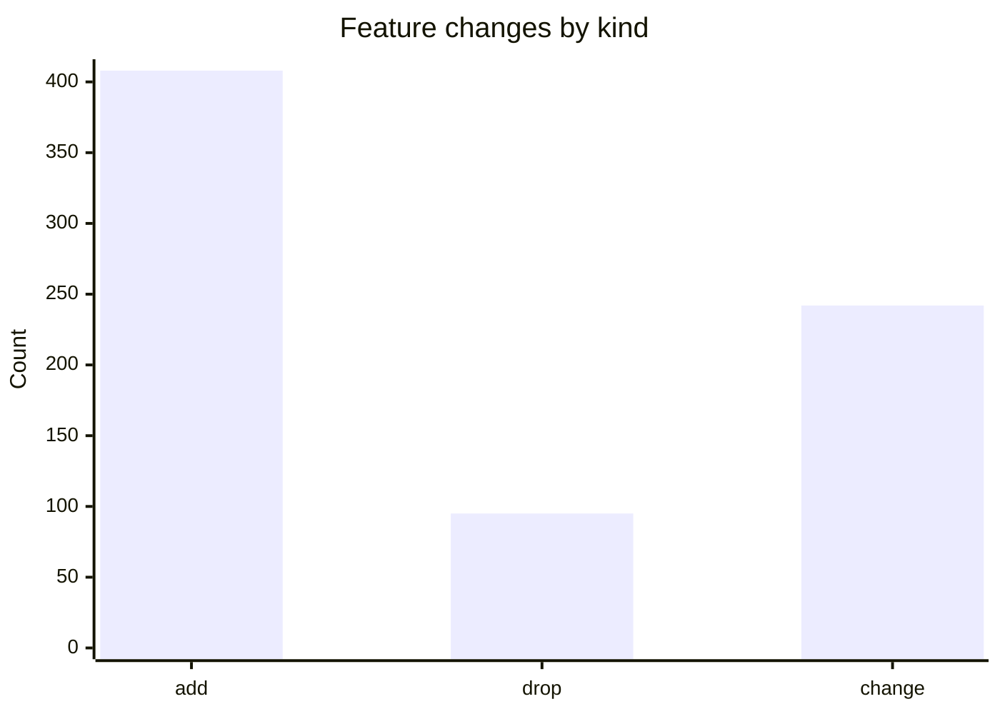

745 deltas: add/comment 177, add/doc 3, add/readme 2, add/symbol 226, change/comment 2, change/doc 22, change/readme 21, change/symbol 197, drop/comment 57, drop/doc 2, drop/readme 2, drop/symbol 34.

| Kind | Subject | Name | Area | Author | PR | Commit |
|---|---|---|---|---|---|---|
*Showing 40 of 143 readme/doc/drop deltas (symbol and comment changes counted above); the full list is in the bundle view.*
| add | doc | CHANGELOG.md | `avm/res/db-for-my-sql/flexible-server` | AlexanderSehr | #7454 | [574f7d7](https://github.com/Azure/bicep-registry-modules/commit/574f7d7184a2541e5eb6e7ea3c3e5b80ab19488a) |
| add | doc | DEPRECATED.md | `avm/res/dev-test-lab/lab` | AlexanderSehr | #7454 | [574f7d7](https://github.com/Azure/bicep-registry-modules/commit/574f7d7184a2541e5eb6e7ea3c3e5b80ab19488a) |
| add | doc | CHANGELOG.md | `avm/res/devices/iot-hub` | AlexanderSehr | #7454 | [574f7d7](https://github.com/Azure/bicep-registry-modules/commit/574f7d7184a2541e5eb6e7ea3c3e5b80ab19488a) |
| add | readme | README.md | `avm/res/db-for-my-sql/flexible-server` | AlexanderSehr | #7454 | [574f7d7](https://github.com/Azure/bicep-registry-modules/commit/574f7d7184a2541e5eb6e7ea3c3e5b80ab19488a) |
| add | readme | README.md | `avm/res/devices/iot-hub` | AlexanderSehr | #7454 | [574f7d7](https://github.com/Azure/bicep-registry-modules/commit/574f7d7184a2541e5eb6e7ea3c3e5b80ab19488a) |
| change | doc | copilot-instructions.md | `.github` | myaschmitz | #7288 | [08dab5b](https://github.com/Azure/bicep-registry-modules/commit/08dab5ba19b6f9b87514954e386226809564445b) |
| change | doc | CHANGELOG.md | `avm/ptn/network/private-link-private-dns-zones` | NPetersenDK | #7558 | [041ff73](https://github.com/Azure/bicep-registry-modules/commit/041ff735153c55b4c481b9e1330c05909615e0c6) |
| change | doc | CHANGELOG.md | `avm/res/azure-stack-hci/virtual-machine-instance` | abhisheksharma-ops | #7463 | [ca00e89](https://github.com/Azure/bicep-registry-modules/commit/ca00e89a931f637f628503a3a625e7d487157496) |
| change | doc | CHANGELOG.md | `avm/res/data-factory/factory` | TomazMlakar | #7360 | [956e47d](https://github.com/Azure/bicep-registry-modules/commit/956e47dc71e85e0c8307edd4fc70418b14c840c8) |
| change | doc | CHANGELOG.md | `avm/res/data-factory/factory` | TomazMlakar | #7360 | [956e47d](https://github.com/Azure/bicep-registry-modules/commit/956e47dc71e85e0c8307edd4fc70418b14c840c8) |
| change | doc | CHANGELOG.md | `avm/res/data-factory/factory` | TomazMlakar | #7360 | [956e47d](https://github.com/Azure/bicep-registry-modules/commit/956e47dc71e85e0c8307edd4fc70418b14c840c8) |
| change | doc | CHANGELOG.md | `avm/res/data-factory/factory` | TomazMlakar | #7360 | [956e47d](https://github.com/Azure/bicep-registry-modules/commit/956e47dc71e85e0c8307edd4fc70418b14c840c8) |
| change | doc | CHANGELOG.md | `avm/res/data-factory/factory` | TomazMlakar | #7360 | [956e47d](https://github.com/Azure/bicep-registry-modules/commit/956e47dc71e85e0c8307edd4fc70418b14c840c8) |
| change | doc | CHANGELOG.md | `avm/res/db-for-my-sql/flexible-server` | AlexanderSehr | #7454 | [574f7d7](https://github.com/Azure/bicep-registry-modules/commit/574f7d7184a2541e5eb6e7ea3c3e5b80ab19488a) |
| change | doc | CHANGELOG.md | `avm/res/desktop-virtualization/host-pool` | reikor0x | #7502 | [180ab31](https://github.com/Azure/bicep-registry-modules/commit/180ab312a85ea363e3c6290ea5560533040e9a67) |
| change | doc | CHANGELOG.md | `avm/res/dev-test-lab/lab` | AlexanderSehr | #7454 | [574f7d7](https://github.com/Azure/bicep-registry-modules/commit/574f7d7184a2541e5eb6e7ea3c3e5b80ab19488a) |
| change | doc | CHANGELOG.md | `avm/res/devices/iot-hub` | TomazMlakar | #7469 | [62b1f05](https://github.com/Azure/bicep-registry-modules/commit/62b1f05b8477b78eb9699eea2e7d36f3d3a51ae3) |
| change | doc | CHANGELOG.md | `avm/res/event-hub/namespace` | Theuno | #7499 | [63dc131](https://github.com/Azure/bicep-registry-modules/commit/63dc13167db69fbb93f9356e28dbf82ea5292df2) |
| change | doc | CHANGELOG.md | `avm/res/event-hub/namespace` | Theuno | #7499 | [63dc131](https://github.com/Azure/bicep-registry-modules/commit/63dc13167db69fbb93f9356e28dbf82ea5292df2) |
| change | doc | CHANGELOG.md | `avm/res/hybrid-compute/gateway` | abhisheksharma-ops | #7434 | [dd8842c](https://github.com/Azure/bicep-registry-modules/commit/dd8842c373ca793bac99037a19f0d68023e9b63d) |
| change | doc | CHANGELOG.md | `avm/res/hybrid-compute/license` | abhisheksharma-ops | #7435 | [8b42e87](https://github.com/Azure/bicep-registry-modules/commit/8b42e87f6619414591d3f675bde7c3c713652327) |
| change | doc | CHANGELOG.md | `avm/res/hybrid-container-service/provisioned-cluster-instance` | abhisheksharma-ops | #7439 | [077f21a](https://github.com/Azure/bicep-registry-modules/commit/077f21a0f6948588c64d4fcecb383db3d2d2ff48) |
| change | doc | CHANGELOG.md | `avm/res/insights/scheduled-query-rule` | balliere | #7346 | [0625375](https://github.com/Azure/bicep-registry-modules/commit/062537582b9392a0dec3388ff8b36bb141a06659) |
| change | doc | CHANGELOG.md | `avm/res/kubernetes-runtime/load-balancer` | abhisheksharma-ops | #7466 | [25fe605](https://github.com/Azure/bicep-registry-modules/commit/25fe605231fb912fdf8921d703a3282209b3ca34) |
| change | doc | CHANGELOG.md | `avm/res/kubernetes/connected-cluster` | abhisheksharma-ops | #7431 | [a360145](https://github.com/Azure/bicep-registry-modules/commit/a3601457bd01a77411bcda068ea1deba4dfb6535) |
| change | doc | CHANGELOG.md | `avm/res/network/network-security-group` | arjenhuitema | #7496 | [99f7bd7](https://github.com/Azure/bicep-registry-modules/commit/99f7bd7e64b6067691330b63744a999269431d2c) |
| change | doc | avm-readme-v1.scriban | `docs/templates` | jaredfholgate | #7512 | [795bfc3](https://github.com/Azure/bicep-registry-modules/commit/795bfc3da023e8bd2d0831856ec684ed4352880b) |
| change | readme | README.md | `avm/ptn/app/iaas-vm-cosmosdb-tier4` | AlexanderSehr | #7454 | [574f7d7](https://github.com/Azure/bicep-registry-modules/commit/574f7d7184a2541e5eb6e7ea3c3e5b80ab19488a) |
| change | readme | README.md | `avm/ptn/dev-ops/cicd-agents-and-runners` | AlexanderSehr | #7454 | [574f7d7](https://github.com/Azure/bicep-registry-modules/commit/574f7d7184a2541e5eb6e7ea3c3e5b80ab19488a) |
| change | readme | README.md | `avm/ptn/network/private-link-private-dns-zones` | NPetersenDK | #7558 | [041ff73](https://github.com/Azure/bicep-registry-modules/commit/041ff735153c55b4c481b9e1330c05909615e0c6) |
| change | readme | README.md | `avm/res/azure-stack-hci/virtual-machine-instance` | abhisheksharma-ops | #7430 | [74a9068](https://github.com/Azure/bicep-registry-modules/commit/74a906828e3e42f6c8fed17f7323e999c78cbf78) |
| change | readme | README.md | `avm/res/data-factory/factory` | TomazMlakar | #7360 | [956e47d](https://github.com/Azure/bicep-registry-modules/commit/956e47dc71e85e0c8307edd4fc70418b14c840c8) |
| change | readme | README.md | `avm/res/desktop-virtualization/host-pool` | reikor0x | #7502 | [180ab31](https://github.com/Azure/bicep-registry-modules/commit/180ab312a85ea363e3c6290ea5560533040e9a67) |
| change | readme | README.md | `avm/res/dev-test-lab/lab` | AlexanderSehr | #7454 | [574f7d7](https://github.com/Azure/bicep-registry-modules/commit/574f7d7184a2541e5eb6e7ea3c3e5b80ab19488a) |
| change | readme | README.md | `avm/res/dev-test-lab/lab` | AlexanderSehr | #7454 | [574f7d7](https://github.com/Azure/bicep-registry-modules/commit/574f7d7184a2541e5eb6e7ea3c3e5b80ab19488a) |
| change | readme | README.md | `avm/res/event-hub/namespace` | Theuno | #7499 | [63dc131](https://github.com/Azure/bicep-registry-modules/commit/63dc13167db69fbb93f9356e28dbf82ea5292df2) |
| change | readme | README.md | `avm/res/hybrid-compute/gateway` | abhisheksharma-ops | #7434 | [dd8842c](https://github.com/Azure/bicep-registry-modules/commit/dd8842c373ca793bac99037a19f0d68023e9b63d) |
| change | readme | README.md | `avm/res/hybrid-compute/license` | abhisheksharma-ops | #7435 | [8b42e87](https://github.com/Azure/bicep-registry-modules/commit/8b42e87f6619414591d3f675bde7c3c713652327) |
| change | readme | README.md | `avm/res/hybrid-container-service/provisioned-cluster-instance` | abhisheksharma-ops | #7439 | [077f21a](https://github.com/Azure/bicep-registry-modules/commit/077f21a0f6948588c64d4fcecb383db3d2d2ff48) |
| change | readme | README.md | `avm/res/hybrid-container-service/provisioned-cluster-instance` | jaredfholgate | #7525 | [806ee4c](https://github.com/Azure/bicep-registry-modules/commit/806ee4cc0261d25acc351c1f5b9f7e30e310b8e2) |

### Symbol-level changes

693 symbol/comment deltas; 0 TODO comments, 59 comment drops/changes (listed first).

| Detail | Kind | Before | After | PR | Commit |
|---|---|---|---|---|---|
*Showing 40 of 693 symbol/comment deltas; the full list is in the bundle view.*
| `bicep comment @description('Required. The name of the event hub namespace to cre…` | drop | `@description('Required. The name of the event hub namespace to create.')` | — | #7436 | [82bab04](https://github.com/Azure/bicep-registry-modules/commit/82bab0404566557b9fb5efdc9780bb5ce438030b) |
| `bicep comment @description('Required. The name of the storage account to create.…` | drop | `@description('Required. The name of the storage account to create.')` | — | #7436 | [82bab04](https://github.com/Azure/bicep-registry-modules/commit/82bab0404566557b9fb5efdc9780bb5ce438030b) |
| `bicep comment @description('Optional. Custom CA trust certificates for the clust…` | drop | `@description('Optional. Custom CA trust certificates for the cluster.')` | — | #7439 | [077f21a](https://github.com/Azure/bicep-registry-modules/commit/077f21a0f6948588c64d4fcecb383db3d2d2ff48) |
| `bicep comment @description('Optional. FIPS image configuration.')` | drop | `@description('Optional. FIPS image configuration.')` | — | #7439 | [077f21a](https://github.com/Azure/bicep-registry-modules/commit/077f21a0f6948588c64d4fcecb383db3d2d2ff48) |
| `bicep comment @description('Optional. Security profile for the provisioned clust…` | drop | `@description('Optional. Security profile for the provisioned cluster instance (F…` | — | #7439 | [077f21a](https://github.com/Azure/bicep-registry-modules/commit/077f21a0f6948588c64d4fcecb383db3d2d2ff48) |
| `bicep comment @description('Optional. The number of GPUs per node in the pool.')` | drop | `@description('Optional. The number of GPUs per node in the pool.')` | — | #7439 | [077f21a](https://github.com/Azure/bicep-registry-modules/commit/077f21a0f6948588c64d4fcecb383db3d2d2ff48) |
| `bicep comment @description('Required. Whether FIPS-compliant images are enabled.…` | drop | `@description('Required. Whether FIPS-compliant images are enabled.')` | — | #7439 | [077f21a](https://github.com/Azure/bicep-registry-modules/commit/077f21a0f6948588c64d4fcecb383db3d2d2ff48) |
| `bicep comment @description('The type for HCI provisioned cluster security profil…` | drop | `@description('The type for HCI provisioned cluster security profile configuratio…` | — | #7439 | [077f21a](https://github.com/Azure/bicep-registry-modules/commit/077f21a0f6948588c64d4fcecb383db3d2d2ff48) |
| `bicep comment @description('Optional. Storage size in GB. Increments of 32 GB al…` | drop | `@description('Optional. Storage size in GB. Increments of 32 GB allowed only.')` | — | #7444 | [4113a2a](https://github.com/Azure/bicep-registry-modules/commit/4113a2a528ce0bb3dd86732ca271333bf18e087f) |
| `bicep comment @description('Required. The name of the Storage Account to create.…` | drop | `@description('Required. The name of the Storage Account to create.')` | — | #7451 | [f51b967](https://github.com/Azure/bicep-registry-modules/commit/f51b967be078f1c1873e65a9b2c710d86fc0f6f0) |
| `bicep comment @description('Optional. Secrets to create for the lab. With Lab Se…` | drop | `@description('Optional. Secrets to create for the lab. With Lab Secrets, you can…` | — | #7454 | [574f7d7](https://github.com/Azure/bicep-registry-modules/commit/574f7d7184a2541e5eb6e7ea3c3e5b80ab19488a) |
| `bicep comment @description('Optional. Add the last commit id from your git repo.…` | drop | `@description('Optional. Add the last commit id from your git repo.')` | — | #7360 | [956e47d](https://github.com/Azure/bicep-registry-modules/commit/956e47dc71e85e0c8307edd4fc70418b14c840c8) |
| `bicep comment @description('Optional. Add the tenantId of your Azure subscriptio…` | drop | `@description('Optional. Add the tenantId of your Azure subscription.')` | — | #7360 | [956e47d](https://github.com/Azure/bicep-registry-modules/commit/956e47dc71e85e0c8307edd4fc70418b14c840c8) |
| `bicep comment @description('Optional. Boolean to define whether or not to config…` | drop | `@description('Optional. Boolean to define whether or not to configure git during…` | — | #7360 | [956e47d](https://github.com/Azure/bicep-registry-modules/commit/956e47dc71e85e0c8307edd4fc70418b14c840c8) |
| `bicep comment @description('Optional. Disable manual publish operation in ADF st…` | drop | `@description('Optional. Disable manual publish operation in ADF studio to favor …` | — | #7360 | [956e47d](https://github.com/Azure/bicep-registry-modules/commit/956e47dc71e85e0c8307edd4fc70418b14c840c8) |
| `bicep comment @description('Optional. Repository type - can be \'FactoryVSTSConf…` | drop | `@description('Optional. Repository type - can be \'FactoryVSTSConfiguration\' or…` | — | #7360 | [956e47d](https://github.com/Azure/bicep-registry-modules/commit/956e47dc71e85e0c8307edd4fc70418b14c840c8) |
| `bicep comment @description('Optional. The GitHub Enterprise Server host (prefixe…` | drop | `@description('Optional. The GitHub Enterprise Server host (prefixed with \'https…` | — | #7360 | [956e47d](https://github.com/Azure/bicep-registry-modules/commit/956e47dc71e85e0c8307edd4fc70418b14c840c8) |
| `bicep comment @description('Optional. The account name.')` | drop | `@description('Optional. The account name.')` | — | #7360 | [956e47d](https://github.com/Azure/bicep-registry-modules/commit/956e47dc71e85e0c8307edd4fc70418b14c840c8) |
| `bicep comment @description('Optional. The collaboration branch name. Default is …` | drop | `@description('Optional. The collaboration branch name. Default is \'main\'.')` | — | #7360 | [956e47d](https://github.com/Azure/bicep-registry-modules/commit/956e47dc71e85e0c8307edd4fc70418b14c840c8) |
| `bicep comment @description('Optional. The project name. Only relevant for \'Fact…` | drop | `@description('Optional. The project name. Only relevant for \'FactoryVSTSConfigu…` | — | #7360 | [956e47d](https://github.com/Azure/bicep-registry-modules/commit/956e47dc71e85e0c8307edd4fc70418b14c840c8) |
| `bicep comment @description('Optional. The repository name.')` | drop | `@description('Optional. The repository name.')` | — | #7360 | [956e47d](https://github.com/Azure/bicep-registry-modules/commit/956e47dc71e85e0c8307edd4fc70418b14c840c8) |
| `bicep comment @description('Optional. The root folder path name. Default is \'/\…` | drop | `@description('Optional. The root folder path name. Default is \'/\'.')` | — | #7360 | [956e47d](https://github.com/Azure/bicep-registry-modules/commit/956e47dc71e85e0c8307edd4fc70418b14c840c8) |
| `bicep comment // WAF Security - Disable git configuration during deployment for …` | drop | `// WAF Security - Disable git configuration during deployment for security` | — | #7360 | [956e47d](https://github.com/Azure/bicep-registry-modules/commit/956e47dc71e85e0c8307edd4fc70418b14c840c8) |
| `bicep comment // REMOVED - runCommand1, runCommand2, wait1 are baked into the ga…` | drop | `// REMOVED - runCommand1, runCommand2, wait1 are baked into the gallery image` | — | #7488 | [2e4be21](https://github.com/Azure/bicep-registry-modules/commit/2e4be21ae0b8ab3b45fdc6c33c90833a6c898ccd) |
| `bicep comment // VHDX download skipped - already pre-baked in gallery image at C…` | drop | `// VHDX download skipped - already pre-baked in gallery image at C:\ISOs\hci_os.…` | — | #7488 | [2e4be21](https://github.com/Azure/bicep-registry-modules/commit/2e4be21ae0b8ab3b45fdc6c33c90833a6c898ccd) |
| `bicep comment // mounts data disks, copies VHDX from gallery image, configures A…` | drop | `// mounts data disks, copies VHDX from gallery image, configures AD, routing, DN…` | — | #7488 | [2e4be21](https://github.com/Azure/bicep-registry-modules/commit/2e4be21ae0b8ab3b45fdc6c33c90833a6c898ccd) |
| `bicep comment @description('Optional. Location for the HCI host image resources.…` | drop | `@description('Optional. Location for the HCI host image resources.')` | — | #7505 | [43d4e58](https://github.com/Azure/bicep-registry-modules/commit/43d4e58497c7b016a62a2d1a3cff5fefbdbcc491) |
| `bicep comment @description('Optional. Name of the Azure VM Image Builder templat…` | drop | `@description('Optional. Name of the Azure VM Image Builder template.')` | — | #7505 | [43d4e58](https://github.com/Azure/bicep-registry-modules/commit/43d4e58497c7b016a62a2d1a3cff5fefbdbcc491) |
| `bicep comment @description('Required. Location for the image template.')` | drop | `@description('Required. Location for the image template.')` | — | #7505 | [43d4e58](https://github.com/Azure/bicep-registry-modules/commit/43d4e58497c7b016a62a2d1a3cff5fefbdbcc491) |
| `bicep comment @description('Required. The service principal object ID of the Azu…` | drop | `@description('Required. The service principal object ID of the Azure Stack HCI R…` | — | #7458 | [063ef55](https://github.com/Azure/bicep-registry-modules/commit/063ef550c5b61b46eab222f05b30693dacaf8bc9) |
| `bicep comment @description('Required. The service principal object ID of the Azu…` | drop | `@description('Required. The service principal object ID of the Azure Stack HCI R…` | — | #7458 | [063ef55](https://github.com/Azure/bicep-registry-modules/commit/063ef550c5b61b46eab222f05b30693dacaf8bc9) |
| `bicep comment @description('Required. The service principal object ID of the Azu…` | drop | `@description('Required. The service principal object ID of the Azure Stack HCI R…` | — | #7458 | [063ef55](https://github.com/Azure/bicep-registry-modules/commit/063ef550c5b61b46eab222f05b30693dacaf8bc9) |
| `bicep comment @description('Required. The service principal object ID of the Azu…` | drop | `@description('Required. The service principal object ID of the Azure Stack HCI R…` | — | #7458 | [063ef55](https://github.com/Azure/bicep-registry-modules/commit/063ef550c5b61b46eab222f05b30693dacaf8bc9) |
| `bicep comment @description('Required. The service principal object ID of the Azu…` | drop | `@description('Required. The service principal object ID of the Azure Stack HCI R…` | — | #7458 | [063ef55](https://github.com/Azure/bicep-registry-modules/commit/063ef550c5b61b46eab222f05b30693dacaf8bc9) |
| `bicep comment @description('Required. The service principal object ID of the Azu…` | drop | `@description('Required. The service principal object ID of the Azure Stack HCI R…` | — | #7458 | [063ef55](https://github.com/Azure/bicep-registry-modules/commit/063ef550c5b61b46eab222f05b30693dacaf8bc9) |
| `bicep comment @description('Required. The service principal object ID of the Azu…` | drop | `@description('Required. The service principal object ID of the Azure Stack HCI R…` | — | #7458 | [063ef55](https://github.com/Azure/bicep-registry-modules/commit/063ef550c5b61b46eab222f05b30693dacaf8bc9) |
| `bicep comment @description('Required. The service principal object ID of the Azu…` | drop | `@description('Required. The service principal object ID of the Azure Stack HCI R…` | — | #7458 | [063ef55](https://github.com/Azure/bicep-registry-modules/commit/063ef550c5b61b46eab222f05b30693dacaf8bc9) |
| `bicep comment @description('Required. The service principal object ID of the Azu…` | drop | `@description('Required. The service principal object ID of the Azure Stack HCI R…` | — | #7458 | [063ef55](https://github.com/Azure/bicep-registry-modules/commit/063ef550c5b61b46eab222f05b30693dacaf8bc9) |
| `bicep comment @description('Required. The service principal object ID of the Azu…` | drop | `@description('Required. The service principal object ID of the Azure Stack HCI R…` | — | #7458 | [063ef55](https://github.com/Azure/bicep-registry-modules/commit/063ef550c5b61b46eab222f05b30693dacaf8bc9) |
| `bicep comment @description('Required. The service principal object ID of the Azu…` | drop | `@description('Required. The service principal object ID of the Azure Stack HCI R…` | — | #7458 | [063ef55](https://github.com/Azure/bicep-registry-modules/commit/063ef550c5b61b46eab222f05b30693dacaf8bc9) |

## Content lifecycle (built / changed / dropped)

```mermaid
timeline
    title Content lifecycle (2026-10-01 - 2026-10-31)
    2026-10-01 : changed README.md (readme) by abhisheksharma-ops : changed CHANGELOG.md (doc) by abhisheksharma-ops : changed README.md (readme) by abhisheksharma-ops : changed CHANGELOG.md (doc) by abhisheksharma-ops : changed README.md (readme) by abhisheksharma-ops : changed CHANGELOG.md (doc) by abhisheksharma-ops : changed README.md (readme) by abhisheksharma-ops : changed CHANGELOG.md (doc) by abhisheksharma-ops : +34 more events
    2026-10-02 : changed README.md (readme) by AlexanderSehr : changed README.md (readme) by jaredfholgate : built @description('Optional. Storage size in GB, from 32 to : dropped @description('Optional. Storage size in GB. Incremen : changed diagnosticSettings (symbol) by AlexanderSehr : changed enableTelemetry (symbol) by AlexanderSehr : changed lock (symbol) by AlexanderSehr : changed sourceManagedInstanceResourceId (symbol) by Alexande : +18 more events
    2026-10-03 : changed README.md (readme) by AlexanderSehr : changed README.md (readme) by AlexanderSehr : changed CHANGELOG.md (doc) by AlexanderSehr : built CHANGELOG.md (doc) by AlexanderSehr : built README.md (readme) by AlexanderSehr : dropped CHANGELOG.md (doc) by AlexanderSehr : dropped README.md (readme) by AlexanderSehr : changed CHANGELOG.md (doc) by AlexanderSehr : +17 more events
    2026-10-05 : changed CHANGELOG.md (doc) by abhisheksharma-ops
    2026-10-06 : changed CHANGELOG.md (doc) by TomazMlakar : changed README.md (readme) by TomazMlakar : changed CHANGELOG.md (doc) by TomazMlakar : changed CHANGELOG.md (doc) by TomazMlakar : changed CHANGELOG.md (doc) by TomazMlakar : changed CHANGELOG.md (doc) by TomazMlakar : changed CHANGELOG.md (doc) by TomazMlakar : changed CHANGELOG.md (doc) by abhisheksharma-ops : +64 more events
    2026-10-08 : dropped // REMOVED - runCommand1, runCommand2, wait1 are bak : dropped // VHDX download skipped - already pre-baked in gall : dropped // mounts data disks, copies VHDX from gallery image : built // mounts data disks, obtains the HCI VHDX, configures : changed runCommand1 (symbol) by jaredfholgate : changed runCommand2 (symbol) by jaredfholgate : changed wait1 (symbol) by jaredfholgate : built @description('Optional. Tags applied to image resource : +107 more events
    2026-10-10 : dropped @description('Optional. Location for the HCI host im : built @description('Optional. Location for the image templat : built @description('Optional. Location for the resource grou : built @description('Optional. Name of the Azure VM Image Bui : dropped @description('Optional. Name of the Azure VM Image B : built @description('Optional. Regions where the image versio : built buildLocation (symbol) by jaredfholgate : built replicationRegions (symbol) by jaredfholgate : +8 more events
    2026-10-11 : built @description('Optional. An existing built-in service p : dropped @description('Required. The service principal object : changed arbDeploymentServicePrincipalSecret (symbol) by jare : built builtInServicePrincipalObjectId (symbol) by jaredfholg : dropped hciResourceProviderObjectId (symbol) by jaredfholgat : built hciResourceProvider (symbol) by jaredfholgate : built @description('Optional. An existing built-in service p : dropped @description('Required. The service principal object : +113 more events
    2026-10-13 : changed README.md (readme) by jaredfholgate : changed README.md (readme) by jaredfholgate : dropped @description('Optional. The location to deploy resou : built @description('Optional. The location to deploy resourc : changed enforcedLocation (symbol) by jaredfholgate : changed hciHostImageReferenceId (symbol) by jaredfholgate : dropped @description('Optional. The location to deploy resou : built @description('Optional. The location to deploy resourc : +174 more events
    2026-10-14 : changed CHANGELOG.md (doc) by arjenhuitema : changed README.md (readme) by arjenhuitema : built // Storage account names are globally unique, so the s : dropped @description('Optional. Array of Security Rules to d : built @description('Optional. Array of Security Rules to dep : dropped @description('Optional. Optional. The destination ad : built @description('Optional. The destination address prefix : built @description('Optional. When enabled, flows created fr : +26 more events
    2026-10-15 : built @description('Required. Client ID of the existing HCI  : built @description('Required. Object ID of the existing HCI  : built @description('The container-scoped assignment for the  : built @description('The exact persistent receipt account res : built @description('The exact private container resource ID. : built @description('The separate HCI_IMAGE_RECEIPT_STORAGE_A : built containerResourceId (symbol) by jaredfholgate : built roleAssignmentResourceId (symbol) by jaredfholgate : +11 more events
    2026-10-18 : changed CHANGELOG.md (doc) by reikor0x : changed README.md (readme) by reikor0x : changed CHANGELOG.md (doc) by Theuno : changed README.md (readme) by Theuno : changed CHANGELOG.md (doc) by Theuno : built @sys.description('Optional. Type of load balancer algo : dropped @sys.description('Optional. Type of load balancer al : changed personalDesktopAssignmentType (symbol) by reikor0x : +13 more events
    2026-10-20 : changed vault (symbol) by jaredfholgate : changed managedHsm (symbol) by jaredfholgate : changed primaryKey (symbol) by jaredfholgate : changed secondaryKey (symbol) by jaredfholgate
    2026-10-21 : changed copilot-instructions.md (doc) by myaschmitz : changed CHANGELOG.md (doc) by balliere : changed README.md (readme) by balliere : dropped @description('Optional. Defines the configuration fo : built @description('Optional. Defines the configuration for  : changed @description('Optional. Severity of the alert. Shoul : changed @description('Optional. The flag that indicates whet : built @description('Optional. The location to deploy to.') ( : +43 more events
    2026-10-22 : changed CHANGELOG.md (doc) by NPetersenDK : changed README.md (readme) by NPetersenDK : changed avm-readme-v1.scriban (doc) by jaredfholgate
    2026-10-29 : built deploymentManagementGroupId (symbol) by jaredfholgate : built deploymentManagementGroupId (symbol) by jaredfholgate : built deploymentManagementGroupId (symbol) by jaredfholgate : built deploymentManagementGroupId (symbol) by jaredfholgate : built deploymentManagementGroupId (symbol) by jaredfholgate : built deploymentManagementGroupId (symbol) by jaredfholgate : built deploymentManagementGroupId (symbol) by jaredfholgate : built deploymentManagementGroupId (symbol) by jaredfholgate : +5 more events
```
*Showing 112 of 745 events.*

714 artifacts: live 619, removed 91, replaced 4.

*Showing 40 of 116 removed/replaced artifacts plus examples and READMEs; the full list is in the bundle view.*
- **CHANGELOG.md** (doc, `avm/res/db-for-my-sql/flexible-server/advanced-threat-protection/CHANGELOG.md`) — replaced. Lifecycle: remove by AlexanderSehr on 2026-10-03 ([574f7d7](https://github.com/Azure/bicep-registry-modules/commit/574f7d7184a2541e5eb6e7ea3c3e5b80ab19488a)); replaced by `art:avm/res/db-for-my-sql/flexible-server/advanced-threat-protection-setting/CHANGELOG.md`
- **README.md** (readme, `avm/res/db-for-my-sql/flexible-server/advanced-threat-protection/README.md`) — replaced. Lifecycle: remove by AlexanderSehr on 2026-10-03 ([574f7d7](https://github.com/Azure/bicep-registry-modules/commit/574f7d7184a2541e5eb6e7ea3c3e5b80ab19488a)); replaced by `art:avm/res/db-for-my-sql/flexible-server/advanced-threat-protection-setting/README.md`
- **CHANGELOG.md** (doc, `avm/res/devices/iot-hub/consumergroup/CHANGELOG.md`) — replaced. Lifecycle: remove by AlexanderSehr on 2026-10-03 ([574f7d7](https://github.com/Azure/bicep-registry-modules/commit/574f7d7184a2541e5eb6e7ea3c3e5b80ab19488a)); replaced by `art:avm/res/devices/iot-hub/event-hub-endpoint/consumergroup/CHANGELOG.md`
- **README.md** (readme, `avm/res/devices/iot-hub/consumergroup/README.md`) — replaced. Lifecycle: remove by AlexanderSehr on 2026-10-03 ([574f7d7](https://github.com/Azure/bicep-registry-modules/commit/574f7d7184a2541e5eb6e7ea3c3e5b80ab19488a)); replaced by `art:avm/res/devices/iot-hub/event-hub-endpoint/consumergroup/README.md`
- **@description('Optional. The location to deploy resources into. Defaults to southeastasia. Can be overridden via the CI customLocation input ** (comment, `avm/res/azure-stack-hci/cluster/tests/e2e/defaults/main.test.bicep`) — removed. Lifecycle: remove by jaredfholgate on 2026-10-13 ([806ee4c](https://github.com/Azure/bicep-registry-modules/commit/806ee4cc0261d25acc351c1f5b9f7e30e310b8e2))
- **@description('Required. The service principal object ID of the Azure Stack HCI Resource Provider in this tenant. Can be fetched via `Get-AzA** (comment, `avm/res/azure-stack-hci/cluster/tests/e2e/defaults/main.test.bicep`) — removed. Lifecycle: remove by jaredfholgate on 2026-10-11 ([063ef55](https://github.com/Azure/bicep-registry-modules/commit/063ef550c5b61b46eab222f05b30693dacaf8bc9))
- **hciResourceProviderObjectId** (symbol, `avm/res/azure-stack-hci/cluster/tests/e2e/defaults/main.test.bicep`) — removed. Lifecycle: remove by jaredfholgate on 2026-10-11 ([063ef55](https://github.com/Azure/bicep-registry-modules/commit/063ef550c5b61b46eab222f05b30693dacaf8bc9))
- **@description('Optional. The location to deploy resources into. Defaults to southeastasia. Can be overridden via the CI customLocation input ** (comment, `avm/res/azure-stack-hci/cluster/tests/e2e/waf-aligned/main.test.bicep`) — removed. Lifecycle: remove by jaredfholgate on 2026-10-13 ([806ee4c](https://github.com/Azure/bicep-registry-modules/commit/806ee4cc0261d25acc351c1f5b9f7e30e310b8e2))
- **@description('Required. The service principal object ID of the Azure Stack HCI Resource Provider in this tenant. Can be fetched via `Get-AzA** (comment, `avm/res/azure-stack-hci/cluster/tests/e2e/waf-aligned/main.test.bicep`) — removed. Lifecycle: remove by jaredfholgate on 2026-10-11 ([063ef55](https://github.com/Azure/bicep-registry-modules/commit/063ef550c5b61b46eab222f05b30693dacaf8bc9))
- **hciResourceProviderObjectId** (symbol, `avm/res/azure-stack-hci/cluster/tests/e2e/waf-aligned/main.test.bicep`) — removed. Lifecycle: remove by jaredfholgate on 2026-10-11 ([063ef55](https://github.com/Azure/bicep-registry-modules/commit/063ef550c5b61b46eab222f05b30693dacaf8bc9))
- **@description('Required. The service principal object ID of the Azure Stack HCI Resource Provider in this tenant. Can be fetched via `Get-AzA** (comment, `avm/res/azure-stack-hci/logical-network/tests/e2e/defaults/main.test.bicep`) — removed. Lifecycle: remove by jaredfholgate on 2026-10-11 ([063ef55](https://github.com/Azure/bicep-registry-modules/commit/063ef550c5b61b46eab222f05b30693dacaf8bc9))
- **hciResourceProviderObjectId** (symbol, `avm/res/azure-stack-hci/logical-network/tests/e2e/defaults/main.test.bicep`) — removed. Lifecycle: remove by jaredfholgate on 2026-10-11 ([063ef55](https://github.com/Azure/bicep-registry-modules/commit/063ef550c5b61b46eab222f05b30693dacaf8bc9))
- **@description('Required. The service principal object ID of the Azure Stack HCI Resource Provider in this tenant. Can be fetched via `Get-AzA** (comment, `avm/res/azure-stack-hci/logical-network/tests/e2e/waf-aligned/main.test.bicep`) — removed. Lifecycle: remove by jaredfholgate on 2026-10-11 ([063ef55](https://github.com/Azure/bicep-registry-modules/commit/063ef550c5b61b46eab222f05b30693dacaf8bc9))
- **hciResourceProviderObjectId** (symbol, `avm/res/azure-stack-hci/logical-network/tests/e2e/waf-aligned/main.test.bicep`) — removed. Lifecycle: remove by jaredfholgate on 2026-10-11 ([063ef55](https://github.com/Azure/bicep-registry-modules/commit/063ef550c5b61b46eab222f05b30693dacaf8bc9))
- **@description('Required. The service principal object ID of the Azure Stack HCI Resource Provider in this tenant. Can be fetched via `Get-AzA** (comment, `avm/res/azure-stack-hci/marketplace-gallery-image/tests/e2e/defaults/main.test.bicep`) — removed. Lifecycle: remove by jaredfholgate on 2026-10-11 ([063ef55](https://github.com/Azure/bicep-registry-modules/commit/063ef550c5b61b46eab222f05b30693dacaf8bc9))
- **hciResourceProviderObjectId** (symbol, `avm/res/azure-stack-hci/marketplace-gallery-image/tests/e2e/defaults/main.test.bicep`) — removed. Lifecycle: remove by jaredfholgate on 2026-10-11 ([063ef55](https://github.com/Azure/bicep-registry-modules/commit/063ef550c5b61b46eab222f05b30693dacaf8bc9))
- **@description('Required. The service principal object ID of the Azure Stack HCI Resource Provider in this tenant. Can be fetched via `Get-AzA** (comment, `avm/res/azure-stack-hci/marketplace-gallery-image/tests/e2e/waf-aligned/main.test.bicep`) — removed. Lifecycle: remove by jaredfholgate on 2026-10-11 ([063ef55](https://github.com/Azure/bicep-registry-modules/commit/063ef550c5b61b46eab222f05b30693dacaf8bc9))
- **hciResourceProviderObjectId** (symbol, `avm/res/azure-stack-hci/marketplace-gallery-image/tests/e2e/waf-aligned/main.test.bicep`) — removed. Lifecycle: remove by jaredfholgate on 2026-10-11 ([063ef55](https://github.com/Azure/bicep-registry-modules/commit/063ef550c5b61b46eab222f05b30693dacaf8bc9))
- **@description('Required. The service principal object ID of the Azure Stack HCI Resource Provider in this tenant. Can be fetched via `Get-AzA** (comment, `avm/res/azure-stack-hci/network-interface/tests/e2e/defaults/main.test.bicep`) — removed. Lifecycle: remove by jaredfholgate on 2026-10-11 ([063ef55](https://github.com/Azure/bicep-registry-modules/commit/063ef550c5b61b46eab222f05b30693dacaf8bc9))
- **hciResourceProviderObjectId** (symbol, `avm/res/azure-stack-hci/network-interface/tests/e2e/defaults/main.test.bicep`) — removed. Lifecycle: remove by jaredfholgate on 2026-10-11 ([063ef55](https://github.com/Azure/bicep-registry-modules/commit/063ef550c5b61b46eab222f05b30693dacaf8bc9))
- **@description('Required. The service principal object ID of the Azure Stack HCI Resource Provider in this tenant. Can be fetched via `Get-AzA** (comment, `avm/res/azure-stack-hci/network-interface/tests/e2e/waf-aligned/main.test.bicep`) — removed. Lifecycle: remove by jaredfholgate on 2026-10-11 ([063ef55](https://github.com/Azure/bicep-registry-modules/commit/063ef550c5b61b46eab222f05b30693dacaf8bc9))
- **hciResourceProviderObjectId** (symbol, `avm/res/azure-stack-hci/network-interface/tests/e2e/waf-aligned/main.test.bicep`) — removed. Lifecycle: remove by jaredfholgate on 2026-10-11 ([063ef55](https://github.com/Azure/bicep-registry-modules/commit/063ef550c5b61b46eab222f05b30693dacaf8bc9))
- **@description('Required. The service principal object ID of the Azure Stack HCI Resource Provider in this tenant. Can be fetched via `Get-AzA** (comment, `avm/res/azure-stack-hci/virtual-hard-disk/tests/e2e/defaults/main.test.bicep`) — removed. Lifecycle: remove by jaredfholgate on 2026-10-11 ([063ef55](https://github.com/Azure/bicep-registry-modules/commit/063ef550c5b61b46eab222f05b30693dacaf8bc9))
- **hciResourceProviderObjectId** (symbol, `avm/res/azure-stack-hci/virtual-hard-disk/tests/e2e/defaults/main.test.bicep`) — removed. Lifecycle: remove by jaredfholgate on 2026-10-11 ([063ef55](https://github.com/Azure/bicep-registry-modules/commit/063ef550c5b61b46eab222f05b30693dacaf8bc9))
- **@description('Required. The service principal object ID of the Azure Stack HCI Resource Provider in this tenant. Can be fetched via `Get-AzA** (comment, `avm/res/azure-stack-hci/virtual-hard-disk/tests/e2e/max/main.test.bicep`) — removed. Lifecycle: remove by jaredfholgate on 2026-10-11 ([063ef55](https://github.com/Azure/bicep-registry-modules/commit/063ef550c5b61b46eab222f05b30693dacaf8bc9))
- **hciResourceProviderObjectId** (symbol, `avm/res/azure-stack-hci/virtual-hard-disk/tests/e2e/max/main.test.bicep`) — removed. Lifecycle: remove by jaredfholgate on 2026-10-11 ([063ef55](https://github.com/Azure/bicep-registry-modules/commit/063ef550c5b61b46eab222f05b30693dacaf8bc9))
- **@description('Required. The service principal object ID of the Azure Stack HCI Resource Provider in this tenant. Can be fetched via `Get-AzA** (comment, `avm/res/azure-stack-hci/virtual-hard-disk/tests/e2e/waf-aligned/main.test.bicep`) — removed. Lifecycle: remove by jaredfholgate on 2026-10-11 ([063ef55](https://github.com/Azure/bicep-registry-modules/commit/063ef550c5b61b46eab222f05b30693dacaf8bc9))
- **hciResourceProviderObjectId** (symbol, `avm/res/azure-stack-hci/virtual-hard-disk/tests/e2e/waf-aligned/main.test.bicep`) — removed. Lifecycle: remove by jaredfholgate on 2026-10-11 ([063ef55](https://github.com/Azure/bicep-registry-modules/commit/063ef550c5b61b46eab222f05b30693dacaf8bc9))
- **@description('Optional. The service principal ID of the Azure Stack HCI Resource Provider. If this is not provided, the module attemps to de** (comment, `avm/res/azure-stack-hci/virtual-machine-instance/tests/e2e/defaults/main.test.bicep`) — removed. Lifecycle: remove by jaredfholgate on 2026-10-11 ([063ef55](https://github.com/Azure/bicep-registry-modules/commit/063ef550c5b61b46eab222f05b30693dacaf8bc9))
- **hciResourceProviderObjectId** (symbol, `avm/res/azure-stack-hci/virtual-machine-instance/tests/e2e/defaults/main.test.bicep`) — removed. Lifecycle: remove by jaredfholgate on 2026-10-11 ([063ef55](https://github.com/Azure/bicep-registry-modules/commit/063ef550c5b61b46eab222f05b30693dacaf8bc9))
- **@description('Required. The service principal object ID of the Azure Stack HCI Resource Provider in this tenant. Can be fetched via `Get-AzA** (comment, `avm/res/azure-stack-hci/virtual-machine-instance/tests/e2e/waf-aligned/main.test.bicep`) — removed. Lifecycle: remove by jaredfholgate on 2026-10-11 ([063ef55](https://github.com/Azure/bicep-registry-modules/commit/063ef550c5b61b46eab222f05b30693dacaf8bc9))
- **hciResourceProviderObjectId** (symbol, `avm/res/azure-stack-hci/virtual-machine-instance/tests/e2e/waf-aligned/main.test.bicep`) — removed. Lifecycle: remove by jaredfholgate on 2026-10-11 ([063ef55](https://github.com/Azure/bicep-registry-modules/commit/063ef550c5b61b46eab222f05b30693dacaf8bc9))
- **@description('Optional. Add the last commit id from your git repo.')** (comment, `avm/res/data-factory/factory/main.bicep`) — removed. Lifecycle: remove by TomazMlakar on 2026-10-06 ([956e47d](https://github.com/Azure/bicep-registry-modules/commit/956e47dc71e85e0c8307edd4fc70418b14c840c8))
- **@description('Optional. Add the tenantId of your Azure subscription.')** (comment, `avm/res/data-factory/factory/main.bicep`) — removed. Lifecycle: remove by TomazMlakar on 2026-10-06 ([956e47d](https://github.com/Azure/bicep-registry-modules/commit/956e47dc71e85e0c8307edd4fc70418b14c840c8))
- **@description('Optional. Boolean to define whether or not to configure git during template deployment.')** (comment, `avm/res/data-factory/factory/main.bicep`) — removed. Lifecycle: remove by TomazMlakar on 2026-10-06 ([956e47d](https://github.com/Azure/bicep-registry-modules/commit/956e47dc71e85e0c8307edd4fc70418b14c840c8))
- **@description('Optional. Disable manual publish operation in ADF studio to favor automated publish.')** (comment, `avm/res/data-factory/factory/main.bicep`) — removed. Lifecycle: remove by TomazMlakar on 2026-10-06 ([956e47d](https://github.com/Azure/bicep-registry-modules/commit/956e47dc71e85e0c8307edd4fc70418b14c840c8))
- **@description('Optional. Repository type - can be \'FactoryVSTSConfiguration\' or \'FactoryGitHubConfiguration\'. Default is \'FactoryVSTSCon** (comment, `avm/res/data-factory/factory/main.bicep`) — removed. Lifecycle: remove by TomazMlakar on 2026-10-06 ([956e47d](https://github.com/Azure/bicep-registry-modules/commit/956e47dc71e85e0c8307edd4fc70418b14c840c8))
- **@description('Optional. The GitHub Enterprise Server host (prefixed with \'https://\'). Only relevant for \'FactoryGitHubConfiguration\'.')** (comment, `avm/res/data-factory/factory/main.bicep`) — removed. Lifecycle: remove by TomazMlakar on 2026-10-06 ([956e47d](https://github.com/Azure/bicep-registry-modules/commit/956e47dc71e85e0c8307edd4fc70418b14c840c8))
- **@description('Optional. The account name.')** (comment, `avm/res/data-factory/factory/main.bicep`) — removed. Lifecycle: remove by TomazMlakar on 2026-10-06 ([956e47d](https://github.com/Azure/bicep-registry-modules/commit/956e47dc71e85e0c8307edd4fc70418b14c840c8))
- **@description('Optional. The collaboration branch name. Default is \'main\'.')** (comment, `avm/res/data-factory/factory/main.bicep`) — removed. Lifecycle: remove by TomazMlakar on 2026-10-06 ([956e47d](https://github.com/Azure/bicep-registry-modules/commit/956e47dc71e85e0c8307edd4fc70418b14c840c8))

## Shipped by code area

*Formatter rule: a train touching more than 10 code areas is listed once under "Cross-cutting" with its area count, instead of under every area.*

### Cross-cutting (more than 10 areas each)
- [feat(ci): reserve Azure Local test subscriptions and prepare shared fixtures](https://github.com/Azure/bicep-registry-modules/pull/7525) (pr #7525) — train `train-pr-7525` — 13 areas

### tests (`utilities/tests`)
- [fix(test): isolate diagnostic dependency names by resource group](https://github.com/Azure/bicep-registry-modules/pull/7436) (pr #7436) — train `train-pr-7436`
- [ci(bicep): use generic validation settings](https://github.com/Azure/bicep-registry-modules/pull/7438) (pr #7438) — train `train-pr-7438`
- [fix: CI - Fixed issue of ReadME gen script when module has 'Keys' property](https://github.com/Azure/bicep-registry-modules/pull/7442) (pr #7442) — train `train-issue-7344`
- [fix: CI - Restore Azure validation error details](https://github.com/Azure/bicep-registry-modules/pull/7443) (pr #7443) — train `train-pr-7443`
- [fix: SQL MI - Prepare patch release and improve deployment validation](https://github.com/Azure/bicep-registry-modules/pull/7444) (pr #7444) — train `train-issue-7344`
- [fix: exclude generic module workflow from failed-run retries](https://github.com/Azure/bicep-registry-modules/pull/7445) (pr #7445) — train `train-pr-7445`
- [fix: handle expression-valued deployment templates](https://github.com/Azure/bicep-registry-modules/pull/7446) (pr #7446) — train `train-pr-7446`
- [fix(ci): require a second label for experimental e2e tests](https://github.com/Azure/bicep-registry-modules/pull/7447) (pr #7447) — train `train-pr-7447`
- [fix(ci): short-circuit ignored deployment jobs](https://github.com/Azure/bicep-registry-modules/pull/7453) (pr #7453) — train `train-pr-7453`
- [fix: CI - Readme generation updates to help parallization & regex issues](https://github.com/Azure/bicep-registry-modules/pull/7454) (pr #7454) — train `train-pr-7454`
- [fix: retry regional deployments after cleanup](https://github.com/Azure/bicep-registry-modules/pull/7455) (pr #7455) — train `train-pr-7455`
- [feat(ci): register required subscription features before Bicep deployment tests](https://github.com/Azure/bicep-registry-modules/pull/7456) (pr #7456) — train `train-pr-7456`
- [fix(ci): read structured ARM deployment operation errors](https://github.com/Azure/bicep-registry-modules/pull/7457) (pr #7457) — train `train-pr-7457`
- [fix(ci): consolidate retry, cleanup and shared tooling fixes](https://github.com/Azure/bicep-registry-modules/pull/7464) (pr #7464) — train `train-pr-7464`
- [fix(ci): retry region metadata request timeouts](https://github.com/Azure/bicep-registry-modules/pull/7470) (pr #7470) — train `train-pr-7470`
- [fix: reconcile successful management-group deployments after HTTP 403](https://github.com/Azure/bicep-registry-modules/pull/7478) (pr #7478) — train `train-pr-7478`
- [fix: remove temporary OIDC exception flow](https://github.com/Azure/bicep-registry-modules/pull/7482) (pr #7482) — train `train-pr-7482`
- [fix(ci): initialize Pester from Avm.Authoring configuration](https://github.com/Azure/bicep-registry-modules/pull/7484) (pr #7484) — train `train-pr-7484`
- [fix(ci): consolidate regional retry, cleanup and test setup repairs](https://github.com/Azure/bicep-registry-modules/pull/7486) (pr #7486) — train `train-pr-7486`
- [fix(ci): classify bounded service retries and reuse installed modules](https://github.com/Azure/bicep-registry-modules/pull/7487) (pr #7487) — train `train-pr-7487`
- [fix(ci): restore HCI host image fallback](https://github.com/Azure/bicep-registry-modules/pull/7488) (pr #7488) — train `train-pr-7488`
- [feat(ci): add reusable HCI image builder](https://github.com/Azure/bicep-registry-modules/pull/7491) (pr #7491) — train `train-pr-7491`
- [fix(ci): consolidate deployment read, dependency and Bicep recovery](https://github.com/Azure/bicep-registry-modules/pull/7492) (pr #7492) — train `train-pr-7492`
- [fix(ci): handle module initializer metadata and authorization denials](https://github.com/Azure/bicep-registry-modules/pull/7500) (pr #7500) — train `train-pr-7500`
- [feat(ci): support separate HCI build and replication regions](https://github.com/Azure/bicep-registry-modules/pull/7505) (pr #7505) — train `train-pr-7505`
- [fix(ci): tolerate missing HCI replica diagnostics](https://github.com/Azure/bicep-registry-modules/pull/7506) (pr #7506) — train `train-pr-7506`
- [fix(ci): isolate module selection to the tested PR merge](https://github.com/Azure/bicep-registry-modules/pull/7507) (pr #7507) — train `train-pr-7507`
- [chore(ci): prepare Bicep workflow migration and module identities](https://github.com/Azure/bicep-registry-modules/pull/7512) (pr #7512) — train `train-pr-7512`
- [fix(ci): consolidate deployment and package recovery](https://github.com/Azure/bicep-registry-modules/pull/7517) (pr #7517) — train `train-pr-7517`
- [feat(ci): register required resource providers before e2e tests](https://github.com/Azure/bicep-registry-modules/pull/7518) (pr #7518) — train `train-pr-7518`
- [fix(ci): accept registered HCI provider resource-type rows](https://github.com/Azure/bicep-registry-modules/pull/7531) (pr #7531) — train `train-pr-7531`
- [fix(ci): handle native HCI image response headers](https://github.com/Azure/bicep-registry-modules/pull/7532) (pr #7532) — train `train-pr-7532`
- [fix(ci): pin and verify Azure Local 2601 payload](https://github.com/Azure/bicep-registry-modules/pull/7544) (pr #7544) — train `train-pr-7544`
- [fix: isolate HCI deployment from generic module workflows](https://github.com/Azure/bicep-registry-modules/pull/7545) (pr #7545) — train `train-pr-7545`
- [fix: persist HCI image operation receipts privately](https://github.com/Azure/bicep-registry-modules/pull/7547) (pr #7547) — train `train-pr-7547`
- [fix: preserve HCI receipt JSON on PowerShell 7.4](https://github.com/Azure/bicep-registry-modules/pull/7548) (pr #7548) — train `train-pr-7548`
- [fix(tools): extract shared Key Vault tooling](https://github.com/Azure/bicep-registry-modules/pull/7553) (pr #7553) — train `train-pr-7553`
- [feat: split experimental Bicep registry workflows](https://github.com/Azure/bicep-registry-modules/pull/7559) (pr #7559) — train `train-pr-7559`
- [test: update subscription vending validation wiring](https://github.com/Azure/bicep-registry-modules/pull/7561) (pr #7561) — train `train-pr-7561`
- [ci: pin Bicep registry callers to verified tools commit](https://github.com/Azure/bicep-registry-modules/pull/7569) (pr #7569) — train `train-pr-7569`
- [[AVM Module Issue]: Managed Instance AVM incorrectly restricts storageSizeInGB maximum value to 8192](https://github.com/Azure/bicep-registry-modules/issues/7344) (issue #7344) — train `train-issue-7344`

### pipelines (`utilities/pipelines`)
- [fix: CI - Fixed issue of ReadME gen script when module has 'Keys' property](https://github.com/Azure/bicep-registry-modules/pull/7442) (pr #7442) — train `train-issue-7344`
- [fix: CI - Restore Azure validation error details](https://github.com/Azure/bicep-registry-modules/pull/7443) (pr #7443) — train `train-pr-7443`
- [fix: SQL MI - Prepare patch release and improve deployment validation](https://github.com/Azure/bicep-registry-modules/pull/7444) (pr #7444) — train `train-issue-7344`
- [fix: handle expression-valued deployment templates](https://github.com/Azure/bicep-registry-modules/pull/7446) (pr #7446) — train `train-pr-7446`
- [fix(ci): short-circuit ignored deployment jobs](https://github.com/Azure/bicep-registry-modules/pull/7453) (pr #7453) — train `train-pr-7453`
- [fix: CI - Readme generation updates to help parallization & regex issues](https://github.com/Azure/bicep-registry-modules/pull/7454) (pr #7454) — train `train-pr-7454`
- [fix: retry regional deployments after cleanup](https://github.com/Azure/bicep-registry-modules/pull/7455) (pr #7455) — train `train-pr-7455`
- [feat(ci): register required subscription features before Bicep deployment tests](https://github.com/Azure/bicep-registry-modules/pull/7456) (pr #7456) — train `train-pr-7456`
- [fix(ci): read structured ARM deployment operation errors](https://github.com/Azure/bicep-registry-modules/pull/7457) (pr #7457) — train `train-pr-7457`
- [fix(ci): consolidate retry, cleanup and shared tooling fixes](https://github.com/Azure/bicep-registry-modules/pull/7464) (pr #7464) — train `train-pr-7464`
- [fix(ci): retry region metadata request timeouts](https://github.com/Azure/bicep-registry-modules/pull/7470) (pr #7470) — train `train-pr-7470`
- [fix: reconcile successful management-group deployments after HTTP 403](https://github.com/Azure/bicep-registry-modules/pull/7478) (pr #7478) — train `train-pr-7478`
- [fix(ci): initialize Pester from Avm.Authoring configuration](https://github.com/Azure/bicep-registry-modules/pull/7484) (pr #7484) — train `train-pr-7484`
- [fix(ci): consolidate regional retry, cleanup and test setup repairs](https://github.com/Azure/bicep-registry-modules/pull/7486) (pr #7486) — train `train-pr-7486`
- [fix(ci): classify bounded service retries and reuse installed modules](https://github.com/Azure/bicep-registry-modules/pull/7487) (pr #7487) — train `train-pr-7487`
- [fix(ci): restore HCI host image fallback](https://github.com/Azure/bicep-registry-modules/pull/7488) (pr #7488) — train `train-pr-7488`
- [fix(ci): consolidate deployment read, dependency and Bicep recovery](https://github.com/Azure/bicep-registry-modules/pull/7492) (pr #7492) — train `train-pr-7492`
- [fix(ci): handle module initializer metadata and authorization denials](https://github.com/Azure/bicep-registry-modules/pull/7500) (pr #7500) — train `train-pr-7500`
- [chore(ci): prepare Bicep workflow migration and module identities](https://github.com/Azure/bicep-registry-modules/pull/7512) (pr #7512) — train `train-pr-7512`
- [fix(ci): consolidate deployment and package recovery](https://github.com/Azure/bicep-registry-modules/pull/7517) (pr #7517) — train `train-pr-7517`
- [feat(ci): register required resource providers before e2e tests](https://github.com/Azure/bicep-registry-modules/pull/7518) (pr #7518) — train `train-pr-7518`
- [fix(ci): accept registered HCI provider resource-type rows](https://github.com/Azure/bicep-registry-modules/pull/7531) (pr #7531) — train `train-pr-7531`
- [fix(ci): pin and verify Azure Local 2601 payload](https://github.com/Azure/bicep-registry-modules/pull/7544) (pr #7544) — train `train-pr-7544`
- [fix: isolate HCI deployment from generic module workflows](https://github.com/Azure/bicep-registry-modules/pull/7545) (pr #7545) — train `train-pr-7545`
- [fix: persist HCI image operation receipts privately](https://github.com/Azure/bicep-registry-modules/pull/7547) (pr #7547) — train `train-pr-7547`
- [fix(tools): extract shared Key Vault tooling](https://github.com/Azure/bicep-registry-modules/pull/7553) (pr #7553) — train `train-pr-7553`
- [test: update subscription vending validation wiring](https://github.com/Azure/bicep-registry-modules/pull/7561) (pr #7561) — train `train-pr-7561`
- [[AVM Module Issue]: Managed Instance AVM incorrectly restricts storageSizeInGB maximum value to 8192](https://github.com/Azure/bicep-registry-modules/issues/7344) (issue #7344) — train `train-issue-7344`

### workflows (`.github/workflows`)
- [ci(bicep): use generic validation settings](https://github.com/Azure/bicep-registry-modules/pull/7438) (pr #7438) — train `train-pr-7438`
- [fix: CI - Fixed issue of ReadME gen script when module has 'Keys' property](https://github.com/Azure/bicep-registry-modules/pull/7442) (pr #7442) — train `train-issue-7344`
- [fix: SQL MI - Prepare patch release and improve deployment validation](https://github.com/Azure/bicep-registry-modules/pull/7444) (pr #7444) — train `train-issue-7344`
- [fix(ci): require a second label for experimental e2e tests](https://github.com/Azure/bicep-registry-modules/pull/7447) (pr #7447) — train `train-pr-7447`
- [fix(ci): short-circuit ignored deployment jobs](https://github.com/Azure/bicep-registry-modules/pull/7453) (pr #7453) — train `train-pr-7453`
- [fix(ci): consolidate retry, cleanup and shared tooling fixes](https://github.com/Azure/bicep-registry-modules/pull/7464) (pr #7464) — train `train-pr-7464`
- [fix: remove temporary OIDC exception flow](https://github.com/Azure/bicep-registry-modules/pull/7482) (pr #7482) — train `train-pr-7482`
- [fix(ci): initialize Pester from Avm.Authoring configuration](https://github.com/Azure/bicep-registry-modules/pull/7484) (pr #7484) — train `train-pr-7484`
- [fix(ci): isolate module selection to the tested PR merge](https://github.com/Azure/bicep-registry-modules/pull/7507) (pr #7507) — train `train-pr-7507`
- [chore(ci): prepare Bicep workflow migration and module identities](https://github.com/Azure/bicep-registry-modules/pull/7512) (pr #7512) — train `train-pr-7512`
- [fix(ci): consolidate deployment and package recovery](https://github.com/Azure/bicep-registry-modules/pull/7517) (pr #7517) — train `train-pr-7517`
- [fix: isolate HCI deployment from generic module workflows](https://github.com/Azure/bicep-registry-modules/pull/7545) (pr #7545) — train `train-pr-7545`
- [fix: persist HCI image operation receipts privately](https://github.com/Azure/bicep-registry-modules/pull/7547) (pr #7547) — train `train-pr-7547`
- [feat: split experimental Bicep registry workflows](https://github.com/Azure/bicep-registry-modules/pull/7559) (pr #7559) — train `train-pr-7559`
- [test: update subscription vending validation wiring](https://github.com/Azure/bicep-registry-modules/pull/7561) (pr #7561) — train `train-pr-7561`
- [ci: pin experimental Bicep workflows to verified tools release](https://github.com/Azure/bicep-registry-modules/pull/7563) (pr #7563) — train `train-pr-7563`
- [ci: update experimental Bicep workflow pins](https://github.com/Azure/bicep-registry-modules/pull/7564) (pr #7564) — train `train-pr-7564`
- [ci: adopt verified Bicep lint and bootstrap fixes](https://github.com/Azure/bicep-registry-modules/pull/7568) (pr #7568) — train `train-pr-7568`
- [ci: pin Bicep registry callers to verified tools commit](https://github.com/Azure/bicep-registry-modules/pull/7569) (pr #7569) — train `train-pr-7569`
- [[AVM Module Issue]: Managed Instance AVM incorrectly restricts storageSizeInGB maximum value to 8192](https://github.com/Azure/bicep-registry-modules/issues/7344) (issue #7344) — train `train-issue-7344`

### e2e-template-assets (`utilities/e2e-template-assets`)
- [fix(test): isolate diagnostic dependency names by resource group](https://github.com/Azure/bicep-registry-modules/pull/7436) (pr #7436) — train `train-pr-7436`
- [fix(ci): consolidate retry, cleanup and shared tooling fixes](https://github.com/Azure/bicep-registry-modules/pull/7464) (pr #7464) — train `train-pr-7464`
- [fix: avm/res/devices/iot-hub - fixing Private Endpoint deployment issue](https://github.com/Azure/bicep-registry-modules/pull/7469) (pr #7469) — train `train-issue-7459`
- [fix: remove temporary OIDC exception flow](https://github.com/Azure/bicep-registry-modules/pull/7482) (pr #7482) — train `train-pr-7482`
- [fix(ci): restore HCI host image fallback](https://github.com/Azure/bicep-registry-modules/pull/7488) (pr #7488) — train `train-pr-7488`
- [feat(ci): add reusable HCI image builder](https://github.com/Azure/bicep-registry-modules/pull/7491) (pr #7491) — train `train-pr-7491`
- [feat(ci): support separate HCI build and replication regions](https://github.com/Azure/bicep-registry-modules/pull/7505) (pr #7505) — train `train-pr-7505`
- [fix(ci): tolerate missing HCI replica diagnostics](https://github.com/Azure/bicep-registry-modules/pull/7506) (pr #7506) — train `train-pr-7506`
- [fix(ci): consolidate deployment and package recovery](https://github.com/Azure/bicep-registry-modules/pull/7517) (pr #7517) — train `train-pr-7517`
- [fix(ci): handle native HCI image response headers](https://github.com/Azure/bicep-registry-modules/pull/7532) (pr #7532) — train `train-pr-7532`
- [fix(ci): pin and verify Azure Local 2601 payload](https://github.com/Azure/bicep-registry-modules/pull/7544) (pr #7544) — train `train-pr-7544`
- [fix: persist HCI image operation receipts privately](https://github.com/Azure/bicep-registry-modules/pull/7547) (pr #7547) — train `train-pr-7547`
- [fix: preserve HCI receipt JSON on PowerShell 7.4](https://github.com/Azure/bicep-registry-modules/pull/7548) (pr #7548) — train `train-pr-7548`
- [fix(tools): extract shared Key Vault tooling](https://github.com/Azure/bicep-registry-modules/pull/7553) (pr #7553) — train `train-pr-7553`
- [[Failed pipeline] avm.res.devices.iot-hub](https://github.com/Azure/bicep-registry-modules/issues/7459) (issue #7459) — train `train-issue-7459`

### actions (`.github/actions`)
- [ci(bicep): use generic validation settings](https://github.com/Azure/bicep-registry-modules/pull/7438) (pr #7438) — train `train-pr-7438`
- [fix: CI - Fixed issue of ReadME gen script when module has 'Keys' property](https://github.com/Azure/bicep-registry-modules/pull/7442) (pr #7442) — train `train-issue-7344`
- [fix: SQL MI - Prepare patch release and improve deployment validation](https://github.com/Azure/bicep-registry-modules/pull/7444) (pr #7444) — train `train-issue-7344`
- [fix: retry regional deployments after cleanup](https://github.com/Azure/bicep-registry-modules/pull/7455) (pr #7455) — train `train-pr-7455`
- [feat(ci): register required subscription features before Bicep deployment tests](https://github.com/Azure/bicep-registry-modules/pull/7456) (pr #7456) — train `train-pr-7456`
- [fix(ci): consolidate retry, cleanup and shared tooling fixes](https://github.com/Azure/bicep-registry-modules/pull/7464) (pr #7464) — train `train-pr-7464`
- [fix: remove temporary OIDC exception flow](https://github.com/Azure/bicep-registry-modules/pull/7482) (pr #7482) — train `train-pr-7482`
- [fix(ci): initialize Pester from Avm.Authoring configuration](https://github.com/Azure/bicep-registry-modules/pull/7484) (pr #7484) — train `train-pr-7484`
- [fix(ci): restore HCI host image fallback](https://github.com/Azure/bicep-registry-modules/pull/7488) (pr #7488) — train `train-pr-7488`
- [fix(ci): consolidate deployment and package recovery](https://github.com/Azure/bicep-registry-modules/pull/7517) (pr #7517) — train `train-pr-7517`
- [feat(ci): register required resource providers before e2e tests](https://github.com/Azure/bicep-registry-modules/pull/7518) (pr #7518) — train `train-pr-7518`
- [fix: isolate HCI deployment from generic module workflows](https://github.com/Azure/bicep-registry-modules/pull/7545) (pr #7545) — train `train-pr-7545`
- [test: update subscription vending validation wiring](https://github.com/Azure/bicep-registry-modules/pull/7561) (pr #7561) — train `train-pr-7561`
- [[AVM Module Issue]: Managed Instance AVM incorrectly restricts storageSizeInGB maximum value to 8192](https://github.com/Azure/bicep-registry-modules/issues/7344) (issue #7344) — train `train-issue-7344`

### factory (`avm/res/data-factory/factory`)
- [fix: avm/res/data-factory/factory - fixing Git repository configuration](https://github.com/Azure/bicep-registry-modules/pull/7360) (pr #7360) — train `train-issue-7342`
- [fix: avm/res/data-factory/factory - fixing test resources](https://github.com/Azure/bicep-registry-modules/pull/7501) (pr #7501) — train `train-issue-7342`
- [[AVM Module Issue]:](https://github.com/Azure/bicep-registry-modules/issues/7342) (issue #7342) — train `train-issue-7342`
- [[Failed pipeline] avm.res.data-factory.factory](https://github.com/Azure/bicep-registry-modules/issues/7474) (issue #7474) — train `train-issue-7342`

### managed-instance (`avm/res/sql/managed-instance`)
- [fix: CI - Fixed issue of ReadME gen script when module has 'Keys' property](https://github.com/Azure/bicep-registry-modules/pull/7442) (pr #7442) — train `train-issue-7344`
- [fix: SQL MI - Prepare patch release and improve deployment validation](https://github.com/Azure/bicep-registry-modules/pull/7444) (pr #7444) — train `train-issue-7344`
- [fix: SQL MI - Prevent test storage name collisions](https://github.com/Azure/bicep-registry-modules/pull/7451) (pr #7451) — train `train-pr-7451`
- [[AVM Module Issue]: Managed Instance AVM incorrectly restricts storageSizeInGB maximum value to 8192](https://github.com/Azure/bicep-registry-modules/issues/7344) (issue #7344) — train `train-issue-7344`

### virtual-machine-instance (`avm/res/azure-stack-hci/virtual-machine-instance`)
- [fix(avm/res/azure-stack-hci/virtual-machine-instance): regenerate README cross-references for machine 0.6.0](https://github.com/Azure/bicep-registry-modules/pull/7430) (pr #7430) — train `train-pr-7430`
- [fix(ci): look up built-in provider principals in test fixtures](https://github.com/Azure/bicep-registry-modules/pull/7458) (pr #7458) — train `train-pr-7458`
- [feat(avm/res/azure-stack-hci/virtual-machine-instance): release unpublished 0.2.0 changes as 0.3.0](https://github.com/Azure/bicep-registry-modules/pull/7463) (pr #7463) — train `train-pr-7463`

### iot-hub (`avm/res/devices/iot-hub`)
- [fix: CI - Readme generation updates to help parallization & regex issues](https://github.com/Azure/bicep-registry-modules/pull/7454) (pr #7454) — train `train-pr-7454`
- [fix: avm/res/devices/iot-hub - fixing Private Endpoint deployment issue](https://github.com/Azure/bicep-registry-modules/pull/7469) (pr #7469) — train `train-issue-7459`
- [[Failed pipeline] avm.res.devices.iot-hub](https://github.com/Azure/bicep-registry-modules/issues/7459) (issue #7459) — train `train-issue-7459`

### tools (`utilities/tools`)
- [fix: exclude generic module workflow from failed-run retries](https://github.com/Azure/bicep-registry-modules/pull/7445) (pr #7445) — train `train-pr-7445`
- [fix: CI - Readme generation updates to help parallization & regex issues](https://github.com/Azure/bicep-registry-modules/pull/7454) (pr #7454) — train `train-pr-7454`
- [fix(ci): initialize Pester from Avm.Authoring configuration](https://github.com/Azure/bicep-registry-modules/pull/7484) (pr #7484) — train `train-pr-7484`

### .github (`.github`)
- [docs: Remove stale model pin and dead `/AVM-Boostrap` reference from pre-flight check](https://github.com/Azure/bicep-registry-modules/pull/7288) (pr #7288) — train `train-pr-7288`
- [chore(ci): prepare Bicep workflow migration and module identities](https://github.com/Azure/bicep-registry-modules/pull/7512) (pr #7512) — train `train-pr-7512`

### .required-resource-providers.json (`.required-resource-providers.json`)
- [feat(ci): register required resource providers before e2e tests](https://github.com/Azure/bicep-registry-modules/pull/7518) (pr #7518) — train `train-pr-7518`
- [fix(tools): extract shared Key Vault tooling](https://github.com/Azure/bicep-registry-modules/pull/7553) (pr #7553) — train `train-pr-7553`

### host-pool (`avm/res/desktop-virtualization/host-pool`)
- [feat(avm/res/desktop-virtualization/host-pool): add MultiplePersisten…](https://github.com/Azure/bicep-registry-modules/pull/7502) (pr #7502) — train `train-issue-7489`
- [[AVM Module Issue]: Add MultiplePersistent to allowed values for the loadBalancerType parameter](https://github.com/Azure/bicep-registry-modules/issues/7489) (issue #7489) — train `train-issue-7489`

### provisioned-cluster-instance (`avm/res/hybrid-container-service/provisioned-cluster-instance`)
- [feat(avm/res/hybrid-container-service/provisioned-cluster-instance): update referenced module and API versions](https://github.com/Azure/bicep-registry-modules/pull/7439) (pr #7439) — train `train-pr-7439`
- [fix(ci): look up built-in provider principals in test fixtures](https://github.com/Azure/bicep-registry-modules/pull/7458) (pr #7458) — train `train-pr-7458`

### scheduled-query-rule (`avm/res/insights/scheduled-query-rule`)
- [fix: add kind simplelogalert](https://github.com/Azure/bicep-registry-modules/pull/7346) (pr #7346) — train `train-issue-7345`
- [[AVM Module Issue]: avm.res.insights.scheduled-query-rule missing kind SimpleLogAlert](https://github.com/Azure/bicep-registry-modules/issues/7345) (issue #7345) — train `train-issue-7345`

### load-balancer (`avm/res/kubernetes-runtime/load-balancer`)
- [fix(ci): look up built-in provider principals in test fixtures](https://github.com/Azure/bicep-registry-modules/pull/7458) (pr #7458) — train `train-pr-7458`
- [feat(avm/res/kubernetes-runtime/load-balancer): update connectedClusters reference and telemetry API versions](https://github.com/Azure/bicep-registry-modules/pull/7466) (pr #7466) — train `train-pr-7466`

### network-security-group (`avm/res/network/network-security-group`)
- [chore: Added "arjenhuitema" as the owner for the Network Security Group and …](https://github.com/Azure/bicep-registry-modules/pull/7471) (pr #7471) — train `train-pr-7471`
- [fix: Update Network Security Group module](https://github.com/Azure/bicep-registry-modules/pull/7496) (pr #7496) — train `train-pr-7496`

### .gitattributes (`.gitattributes`)
- [chore(ci): prepare Bicep workflow migration and module identities](https://github.com/Azure/bicep-registry-modules/pull/7512) (pr #7512) — train `train-pr-7512`

### .required-features.json (`.required-features.json`)
- [fix(ci): consolidate retry, cleanup and shared tooling fixes](https://github.com/Azure/bicep-registry-modules/pull/7464) (pr #7464) — train `train-pr-7464`

### iaas-vm-cosmosdb-tier4 (`avm/ptn/app/iaas-vm-cosmosdb-tier4`)
- [fix: CI - Readme generation updates to help parallization & regex issues](https://github.com/Azure/bicep-registry-modules/pull/7454) (pr #7454) — train `train-pr-7454`

### cicd-agents-and-runners (`avm/ptn/dev-ops/cicd-agents-and-runners`)
- [fix: CI - Readme generation updates to help parallization & regex issues](https://github.com/Azure/bicep-registry-modules/pull/7454) (pr #7454) — train `train-pr-7454`

### sub-vending (`avm/ptn/lz/sub-vending`)
- [test: update subscription vending validation wiring](https://github.com/Azure/bicep-registry-modules/pull/7561) (pr #7561) — train `train-pr-7561`

### private-link-private-dns-zones (`avm/ptn/network/private-link-private-dns-zones`)
- [feat: add privatelink.redis.azure.net](https://github.com/Azure/bicep-registry-modules/pull/7558) (pr #7558) — train `train-pr-7558`

### service (`avm/res/api-management/service`)
- [fix: correct named-value canonicalType typo](https://github.com/Azure/bicep-registry-modules/pull/7493) (pr #7493) — train `train-pr-7493`

### cluster (`avm/res/azure-stack-hci/cluster`)
- [fix(ci): look up built-in provider principals in test fixtures](https://github.com/Azure/bicep-registry-modules/pull/7458) (pr #7458) — train `train-pr-7458`

### logical-network (`avm/res/azure-stack-hci/logical-network`)
- [fix(ci): look up built-in provider principals in test fixtures](https://github.com/Azure/bicep-registry-modules/pull/7458) (pr #7458) — train `train-pr-7458`

### marketplace-gallery-image (`avm/res/azure-stack-hci/marketplace-gallery-image`)
- [fix(ci): look up built-in provider principals in test fixtures](https://github.com/Azure/bicep-registry-modules/pull/7458) (pr #7458) — train `train-pr-7458`

### network-interface (`avm/res/azure-stack-hci/network-interface`)
- [fix(ci): look up built-in provider principals in test fixtures](https://github.com/Azure/bicep-registry-modules/pull/7458) (pr #7458) — train `train-pr-7458`

### virtual-hard-disk (`avm/res/azure-stack-hci/virtual-hard-disk`)
- [fix(ci): look up built-in provider principals in test fixtures](https://github.com/Azure/bicep-registry-modules/pull/7458) (pr #7458) — train `train-pr-7458`

### flexible-server (`avm/res/db-for-my-sql/flexible-server`)
- [fix: CI - Readme generation updates to help parallization & regex issues](https://github.com/Azure/bicep-registry-modules/pull/7454) (pr #7454) — train `train-pr-7454`

### pool (`avm/res/dev-ops-infrastructure/pool`)
- [fix(ci): look up built-in provider principals in test fixtures](https://github.com/Azure/bicep-registry-modules/pull/7458) (pr #7458) — train `train-pr-7458`

### lab (`avm/res/dev-test-lab/lab`)
- [fix: CI - Readme generation updates to help parallization & regex issues](https://github.com/Azure/bicep-registry-modules/pull/7454) (pr #7454) — train `train-pr-7454`

### namespace (`avm/res/event-hub/namespace`)
- [fix: avm/res/event-hub/namespace - preserve disabled capture configuration](https://github.com/Azure/bicep-registry-modules/pull/7499) (pr #7499) — train `train-pr-7499`

### gateway (`avm/res/hybrid-compute/gateway`)
- [feat(avm/res/hybrid-compute/gateway): update gateways API version to 2026-07-15](https://github.com/Azure/bicep-registry-modules/pull/7434) (pr #7434) — train `train-pr-7434`

### license (`avm/res/hybrid-compute/license`)
- [feat(avm/res/hybrid-compute/license): update licenses API version to 2026-07-15](https://github.com/Azure/bicep-registry-modules/pull/7435) (pr #7435) — train `train-pr-7435`

### vault (`avm/res/key-vault/vault`)
- [fix: CI - Readme generation updates to help parallization & regex issues](https://github.com/Azure/bicep-registry-modules/pull/7454) (pr #7454) — train `train-pr-7454`

### connected-cluster (`avm/res/kubernetes/connected-cluster`)
- [feat(avm/res/kubernetes/connected-cluster): update connectedClusters API version to GA 2026-05-01](https://github.com/Azure/bicep-registry-modules/pull/7431) (pr #7431) — train `train-pr-7431`

### server (`avm/res/sql/server`)
- [chore: Added "arjenhuitema" as the owner for the Network Security Group and …](https://github.com/Azure/bicep-registry-modules/pull/7471) (pr #7471) — train `train-pr-7471`

### storage-account (`avm/res/storage/storage-account`)
- [fix: CI - Readme generation updates to help parallization & regex issues](https://github.com/Azure/bicep-registry-modules/pull/7454) (pr #7454) — train `train-pr-7454`

### templates (`docs/templates`)
- [chore(ci): prepare Bicep workflow migration and module identities](https://github.com/Azure/bicep-registry-modules/pull/7512) (pr #7512) — train `train-pr-7512`

### Unattributed
- [chore(module-list): sync AVM module dropdown [skip ci]](https://github.com/Azure/bicep-registry-modules/pull/7473) (pr #7473) — train `train-pr-7473`
- [[AVM Module Issue]: Automation account missing source control code](https://github.com/Azure/bicep-registry-modules/issues/5264) (issue #5264) — train `None`
- [[AVM Module Issue]: `managed-identity/user-assigned-identity` missing `claimsMatchingExpression`](https://github.com/Azure/bicep-registry-modules/issues/5424) (issue #5424) — train `None`
- [[AVM Module Issue]:  Missing the option to add publicIPAddressObject in Bastion configuration](https://github.com/Azure/bicep-registry-modules/issues/5555) (issue #5555) — train `None`
- [[AVM Module Issue]: Deployment Blocker: AVM Module API Version Compatibility Issue](https://github.com/Azure/bicep-registry-modules/issues/7242) (issue #7242) — train `None`
- [[AVM Module Issue]: Automation Account - Hybrid Worker Group deployment name](https://github.com/Azure/bicep-registry-modules/issues/7253) (issue #7253) — train `None`
- [[AVM Module Issue]: Automation Account should support creating user-generated runtime environments](https://github.com/Azure/bicep-registry-modules/issues/7300) (issue #7300) — train `None`
- [[Failed pipeline] avm.res.azure-stack-hci.cluster](https://github.com/Azure/bicep-registry-modules/issues/7392) (issue #7392) — train `None`
- [[Failed pipeline] avm.res.sql.managed-instance](https://github.com/Azure/bicep-registry-modules/issues/7433) (issue #7433) — train `None`
- [[Failed pipeline] .Module - Check and Publish [EXPERIMENTAL]](https://github.com/Azure/bicep-registry-modules/issues/7441) (issue #7441) — train `None`
- [[Failed pipeline] .Module - Check and Publish [EXPERIMENTAL]](https://github.com/Azure/bicep-registry-modules/issues/7460) (issue #7460) — train `None`
- [[AVM Module Issue]: avm/ptn/authorization/role-assignment only works at management group scope](https://github.com/Azure/bicep-registry-modules/issues/7462) (issue #7462) — train `None`
- [[Failed pipeline] .Module - Check and Publish [EXPERIMENTAL]](https://github.com/Azure/bicep-registry-modules/issues/7477) (issue #7477) — train `None`
- [[AVM Module Issue]: avm/ptn/authorization/pim-role-assignment - requests need unique names per deployment, not deterministic idempotent names](https://github.com/Azure/bicep-registry-modules/issues/7515) (issue #7515) — train `None`
- [[AVM Module Issue]: Sub-vending PIM role assignment updates fail due to duplicate request names (depends on #7515)](https://github.com/Azure/bicep-registry-modules/issues/7516) (issue #7516) — train `None`
- [[Failed pipeline] .Module - Check and Publish [EXPERIMENTAL]](https://github.com/Azure/bicep-registry-modules/issues/7520) (issue #7520) — train `None`
- [[Failed pipeline] avm.res.azure-stack-hci.cluster](https://github.com/Azure/bicep-registry-modules/issues/7533) (issue #7533) — train `None`
- [[Failed pipeline] avm.res.azure-stack-hci.logical-network](https://github.com/Azure/bicep-registry-modules/issues/7534) (issue #7534) — train `None`
- [[Failed pipeline] avm.res.azure-stack-hci.marketplace-gallery-image](https://github.com/Azure/bicep-registry-modules/issues/7535) (issue #7535) — train `None`
- [[Failed pipeline] avm.res.azure-stack-hci.network-interface](https://github.com/Azure/bicep-registry-modules/issues/7536) (issue #7536) — train `None`
- [[Failed pipeline] avm.res.azure-stack-hci.virtual-hard-disk](https://github.com/Azure/bicep-registry-modules/issues/7537) (issue #7537) — train `None`
- [[Failed pipeline] avm.res.azure-stack-hci.virtual-machine-instance](https://github.com/Azure/bicep-registry-modules/issues/7538) (issue #7538) — train `None`

## Module dependency graph / blast radius

```mermaid
flowchart LR
    m_avm_ptn_aca_lza_hosting__4ab939fd("hosting-environment")
    m_avm_ptn_ai_ml_ai_foundry_daf72234("ai-foundry")
    m_avm_ptn_ai_platform_base_07084010("baseline")
    m_avm_ptn_app_container_jo_01ce6e97("container-job-toolkit")
    m_avm_ptn_app_function_app_f7b82b6e("function-app")
    m_avm_ptn_app_iaas_vm_cosm_17ed9f52("iaas-vm-cosmosdb-tier4")
    m_avm_ptn_app_paas_ase_cos_e63d5137("paas-ase-cosmosdb-tier4")
    m_avm_ptn_app_service_lza__84659e8b("hosting-environment")
    m_avm_ptn_azd_ml_hub_depen_7db1e403("ml-hub-dependencies")
    m_avm_ptn_data_private_ana_84eb8a13("private-analytical-workspace")
    m_avm_ptn_dev_ops_cicd_age_4f24c142("cicd-agents-and-runners")
    m_avm_ptn_finops_toolkit_f_cd9a94bc("finops-hub")
    m_avm_ptn_lz_sub_vending_f17bb317("sub-vending")
    m_avm_ptn_network_hub_netw_7d32773d("hub-networking")
    m_avm_ptn_sa_build_your_ow_2764e7a2("build-your-own-copilot")
    m_avm_ptn_sa_chat_with_you_4a9b94ec("chat-with-your-data")
    m_avm_ptn_sa_content_gener_8f6c7eaa("content-generation")
    m_avm_ptn_sa_content_proce_06399f11("content-processing")
    m_avm_ptn_sa_conversation__ddcfeed9("conversation-knowledge-mining")
    m_avm_ptn_sa_customer_chat_13fdab41("customer-chatbot")
    m_avm_ptn_sa_document_know_b9b67c8f("document-knowledge-mining")
    m_avm_ptn_sa_modernize_you_bad1b0cb("modernize-your-code")
    m_avm_ptn_sa_multi_agent_c_81c8a268("multi-agent-custom-automation-engine")
    m_avm_ptn_virtual_machine__7a92f31d("azure-image-builder")
    m_avm_res_api_management_s_2b0058e5("service")
    m_avm_res_app_configuratio_3539dbc7("configuration-store")
    m_avm_res_app_managed_envi_98cc9200("managed-environment")
    m_avm_res_automation_autom_b279e791("automation-account")
    m_avm_res_batch_batch_acco_f2485b83("batch-account")
    m_avm_res_cache_redis_8a515c1d("redis")
    m_avm_res_cache_redis_ente_5b66bafe("redis-enterprise")
    m_avm_res_cognitive_servic_d1b76e3a("account")
    m_avm_res_container_regist_52956c8c("registry")
    m_avm_res_data_factory_fac_9837c087("factory")
    m_avm_res_databricks_works_0017da29("workspace")
    m_avm_res_db_for_my_sql_fl_cfc83c9b("flexible-server")
    m_avm_res_db_for_postgre_s_a07df15a("flexible-server")
    m_avm_res_desktop_virtuali_1490ef16("host-pool")
    m_avm_res_desktop_virtuali_7e94ef14("workspace")
    m_avm_res_devices_iot_hub_db2d832f("iot-hub")
    m_avm_res_digital_twins_di_ecb57856("digital-twins-instance")
    m_avm_res_document_db_data_0a2d9e37("database-account")
    m_avm_res_document_db_mong_87da1ee4("mongo-cluster")
    m_avm_res_elastic_san_elas_45aab801("elastic-san")
    m_avm_res_event_grid_domai_0bcb0751("domain")
    m_avm_res_event_grid_names_062d9b1e("namespace")
    m_avm_res_event_grid_topic_63b71d3f("topic")
    m_avm_res_event_hub_namesp_2bdc75e8("namespace")
    m_avm_res_insights_private_a2be6952("private-link-scope")
    m_avm_res_key_vault_vault_c70f9a76("vault")
    m_avm_res_kusto_cluster_f35c24f0("cluster")
    m_avm_res_machine_learning_0d90c9cd("workspace")
    m_avm_res_machine_learning_3b8de16f("registry")
    m_avm_res_network_applicat_7ebff000("application-gateway")
    m_avm_res_network_network__01c714d7("network-security-group")
    m_avm_res_network_private__4589062a("private-endpoint")
    m_avm_res_network_private__de8401c0("private-dns-zone")
    m_avm_res_network_virtual__186ab112("virtual-network")
    m_avm_res_purview_account_92f12cd5("account")
    m_avm_res_recovery_service_fe1eea23("vault")
    m_avm_res_relay_namespace_a4658b35("namespace")
    m_avm_res_search_search_se_b0571790("search-service")
    m_avm_res_service_bus_name_25980373("namespace")
    m_avm_res_signal_r_service_5f12d1a6("signal-r")
    m_avm_res_signal_r_service_94092b83("web-pub-sub")
    m_avm_res_sql_server_37ee6d9e("server")
    m_avm_res_storage_storage__2efc02f3("storage-account")
    m_avm_res_synapse_private__084e0bfb("private-link-hub")
    m_avm_res_synapse_workspac_8bec616b("workspace")
    m_avm_res_web_site_b3ffc95b("site")
    m_avm_res_web_static_site_e1900666("static-site")
    m_avm_ptn_aca_lza_hosting__4ab939fd -->|"0.5.0"| m_avm_res_network_network__01c714d7
    m_avm_ptn_aca_lza_hosting__4ab939fd -->|"0.7.0"| m_avm_res_network_private__de8401c0
    m_avm_ptn_aca_lza_hosting__4ab939fd -->|"0.8.0"| m_avm_res_network_private__de8401c0
    m_avm_ptn_aca_lza_hosting__4ab939fd -->|"0.5.2"| m_avm_res_network_virtual__186ab112
    m_avm_ptn_aca_lza_hosting__4ab939fd -->|"0.15.0"| m_avm_res_storage_storage__2efc02f3
    m_avm_ptn_ai_ml_ai_foundry_daf72234 -->|"0.32.0"| m_avm_res_storage_storage__2efc02f3
    m_avm_ptn_ai_platform_base_07084010 -->|"0.3.1"| m_avm_res_network_network__01c714d7
    m_avm_ptn_ai_platform_base_07084010 -->|"0.3.1"| m_avm_res_network_private__de8401c0
    m_avm_ptn_ai_platform_base_07084010 -->|"0.4.0"| m_avm_res_network_virtual__186ab112
    m_avm_ptn_ai_platform_base_07084010 -->|"0.11.0"| m_avm_res_storage_storage__2efc02f3
    m_avm_ptn_app_container_jo_01ce6e97 -->|"0.5.1"| m_avm_res_network_network__01c714d7
    m_avm_ptn_app_container_jo_01ce6e97 -->|"0.11.0"| m_avm_res_network_private__4589062a
    m_avm_ptn_app_container_jo_01ce6e97 -->|"0.7.1"| m_avm_res_network_private__de8401c0
    m_avm_ptn_app_container_jo_01ce6e97 -->|"0.7.0"| m_avm_res_network_virtual__186ab112
    m_avm_ptn_app_container_jo_01ce6e97 -->|"0.25.1"| m_avm_res_storage_storage__2efc02f3
    m_avm_ptn_app_function_app_f7b82b6e -->|"0.33.1"| m_avm_res_storage_storage__2efc02f3
    m_avm_ptn_app_iaas_vm_cosm_17ed9f52 -->|"0.5.1"| m_avm_res_network_network__01c714d7
    m_avm_ptn_app_iaas_vm_cosm_17ed9f52 -->|"0.11.0"| m_avm_res_network_private__4589062a
    m_avm_ptn_app_iaas_vm_cosm_17ed9f52 -->|"0.7.1"| m_avm_res_network_private__de8401c0
    m_avm_ptn_app_iaas_vm_cosm_17ed9f52 -->|"0.7.0"| m_avm_res_network_virtual__186ab112
    m_avm_ptn_app_iaas_vm_cosm_17ed9f52 -->|"0.25.0"| m_avm_res_storage_storage__2efc02f3
    m_avm_ptn_app_paas_ase_cos_e63d5137 -->|"0.5.2"| m_avm_res_network_network__01c714d7
    m_avm_ptn_app_paas_ase_cos_e63d5137 -->|"0.11.1"| m_avm_res_network_private__4589062a
    m_avm_ptn_app_paas_ase_cos_e63d5137 -->|"0.8.0"| m_avm_res_network_private__de8401c0
    m_avm_ptn_app_paas_ase_cos_e63d5137 -->|"0.7.1"| m_avm_res_network_virtual__186ab112
    m_avm_ptn_app_service_lza__84659e8b -->|"0.5.2"| m_avm_res_network_network__01c714d7
    m_avm_ptn_app_service_lza__84659e8b -->|"0.12.0"| m_avm_res_network_private__4589062a
    m_avm_ptn_app_service_lza__84659e8b -->|"0.8.1"| m_avm_res_network_private__de8401c0
    m_avm_ptn_app_service_lza__84659e8b -->|"0.7.2"| m_avm_res_network_virtual__186ab112
    m_avm_ptn_azd_ml_hub_depen_7db1e403 -->|"0.19.0"| m_avm_res_storage_storage__2efc02f3
    m_avm_ptn_data_private_ana_84eb8a13 -->|"0.5.0"| m_avm_res_network_private__de8401c0
    m_avm_ptn_data_private_ana_84eb8a13 -->|"0.6.0"| m_avm_res_network_private__de8401c0
    m_avm_ptn_data_private_ana_84eb8a13 -->|"0.5.0"| m_avm_res_network_virtual__186ab112
    m_avm_ptn_dev_ops_cicd_age_4f24c142 -->|"0.8.0"| m_avm_res_network_private__de8401c0
    m_avm_ptn_dev_ops_cicd_age_4f24c142 -->|"0.7.0"| m_avm_res_network_virtual__186ab112
    m_avm_ptn_dev_ops_cicd_age_4f24c142 -->|"0.26.2"| m_avm_res_storage_storage__2efc02f3
    m_avm_ptn_finops_toolkit_f_cd9a94bc -->|"0.8.3"| m_avm_res_storage_storage__2efc02f3
    m_avm_ptn_lz_sub_vending_f17bb317 -->|"0.8.0"| m_avm_res_network_private__de8401c0
    m_avm_ptn_lz_sub_vending_f17bb317 -->|"0.7.2"| m_avm_res_network_virtual__186ab112
    m_avm_ptn_lz_sub_vending_f17bb317 -->|"0.26.2"| m_avm_res_storage_storage__2efc02f3
    m_avm_ptn_network_hub_netw_7d32773d -->|"0.7.0"| m_avm_res_network_virtual__186ab112
    m_avm_ptn_sa_build_your_ow_2764e7a2 -->|"0.11.1"| m_avm_res_network_private__4589062a
    m_avm_ptn_sa_build_your_ow_2764e7a2 -->|"0.8.0"| m_avm_res_network_private__de8401c0
    m_avm_ptn_sa_build_your_ow_2764e7a2 -->|"0.7.1"| m_avm_res_network_virtual__186ab112
    m_avm_ptn_sa_build_your_ow_2764e7a2 -->|"0.29.0"| m_avm_res_storage_storage__2efc02f3
    m_avm_ptn_sa_chat_with_you_4a9b94ec -->|"0.12.0"| m_avm_res_network_private__4589062a
    m_avm_ptn_sa_chat_with_you_4a9b94ec -->|"0.12.1"| m_avm_res_network_private__4589062a
    m_avm_ptn_sa_chat_with_you_4a9b94ec -->|"0.8.1"| m_avm_res_network_virtual__186ab112
    m_avm_ptn_sa_content_gener_8f6c7eaa -->|"0.12.0"| m_avm_res_network_private__4589062a
    m_avm_ptn_sa_content_gener_8f6c7eaa -->|"0.8.1"| m_avm_res_network_private__de8401c0
    m_avm_ptn_sa_content_gener_8f6c7eaa -->|"0.8.1"| m_avm_res_network_virtual__186ab112
    m_avm_ptn_sa_content_gener_8f6c7eaa -->|"0.32.0"| m_avm_res_storage_storage__2efc02f3
    m_avm_ptn_sa_content_proce_06399f11 -->|"0.11.1"| m_avm_res_network_private__4589062a
    m_avm_ptn_sa_content_proce_06399f11 -->|"0.8.1"| m_avm_res_network_private__de8401c0
    m_avm_ptn_sa_content_proce_06399f11 -->|"0.7.1"| m_avm_res_network_virtual__186ab112
    m_avm_ptn_sa_content_proce_06399f11 -->|"0.33.0"| m_avm_res_storage_storage__2efc02f3
    m_avm_ptn_sa_conversation__ddcfeed9 -->|"0.12.0"| m_avm_res_network_private__4589062a
    m_avm_ptn_sa_conversation__ddcfeed9 -->|"0.8.1"| m_avm_res_network_private__de8401c0
    m_avm_ptn_sa_conversation__ddcfeed9 -->|"0.8.0"| m_avm_res_network_virtual__186ab112
    m_avm_ptn_sa_conversation__ddcfeed9 -->|"0.32.0"| m_avm_res_storage_storage__2efc02f3
    m_avm_ptn_sa_customer_chat_13fdab41 -->|"0.12.0"| m_avm_res_network_private__4589062a
    m_avm_ptn_sa_customer_chat_13fdab41 -->|"0.8.1"| m_avm_res_network_private__de8401c0
    m_avm_ptn_sa_customer_chat_13fdab41 -->|"0.8.0"| m_avm_res_network_virtual__186ab112
    m_avm_ptn_sa_document_know_b9b67c8f -->|"0.8.1"| m_avm_res_network_private__de8401c0
    m_avm_ptn_sa_document_know_b9b67c8f -->|"0.10.1"| m_avm_res_network_virtual__186ab112
    m_avm_ptn_sa_document_know_b9b67c8f -->|"0.33.0"| m_avm_res_storage_storage__2efc02f3
    m_avm_ptn_sa_modernize_you_bad1b0cb -->|"0.12.0"| m_avm_res_network_private__4589062a
    m_avm_ptn_sa_modernize_you_bad1b0cb -->|"0.8.1"| m_avm_res_network_private__de8401c0
    m_avm_ptn_sa_modernize_you_bad1b0cb -->|"0.8.1"| m_avm_res_network_virtual__186ab112
    m_avm_ptn_sa_modernize_you_bad1b0cb -->|"0.32.0"| m_avm_res_storage_storage__2efc02f3
    m_avm_ptn_sa_multi_agent_c_81c8a268 -->|"0.12.0"| m_avm_res_network_private__4589062a
    m_avm_ptn_sa_multi_agent_c_81c8a268 -->|"0.8.1"| m_avm_res_network_private__de8401c0
    m_avm_ptn_sa_multi_agent_c_81c8a268 -->|"0.8.1"| m_avm_res_network_virtual__186ab112
    m_avm_ptn_sa_multi_agent_c_81c8a268 -->|"0.32.0"| m_avm_res_storage_storage__2efc02f3
    m_avm_ptn_virtual_machine__7a92f31d -->|"0.7.0"| m_avm_res_network_virtual__186ab112
    m_avm_ptn_virtual_machine__7a92f31d -->|"0.25.1"| m_avm_res_storage_storage__2efc02f3
    m_avm_res_api_management_s_2b0058e5 -->|"0.12.1"| m_avm_res_network_private__4589062a
    m_avm_res_app_configuratio_3539dbc7 -->|"0.12.0"| m_avm_res_network_private__4589062a
    m_avm_res_app_managed_envi_98cc9200 -->|"0.12.1"| m_avm_res_network_private__4589062a
    m_avm_res_automation_autom_b279e791 -->|"0.12.1"| m_avm_res_network_private__4589062a
    m_avm_res_batch_batch_acco_f2485b83 -->|"0.11.0"| m_avm_res_network_private__4589062a
    m_avm_res_cache_redis_8a515c1d -->|"0.12.0"| m_avm_res_network_private__4589062a
    m_avm_res_cache_redis_ente_5b66bafe -->|"0.12.0"| m_avm_res_network_private__4589062a
    m_avm_res_cognitive_servic_d1b76e3a -->|"0.11.1"| m_avm_res_network_private__4589062a
    m_avm_res_container_regist_52956c8c -->|"0.12.0"| m_avm_res_network_private__4589062a
    m_avm_res_data_factory_fac_9837c087 -->|"0.12.1"| m_avm_res_network_private__4589062a
    m_avm_res_databricks_works_0017da29 -->|"0.11.1"| m_avm_res_network_private__4589062a
    m_avm_res_db_for_my_sql_fl_cfc83c9b -->|"0.12.0"| m_avm_res_network_private__4589062a
    m_avm_res_db_for_postgre_s_a07df15a -->|"0.12.1"| m_avm_res_network_private__4589062a
    m_avm_res_desktop_virtuali_1490ef16 -->|"0.11.0"| m_avm_res_network_private__4589062a
    m_avm_res_desktop_virtuali_7e94ef14 -->|"0.12.1"| m_avm_res_network_private__4589062a
    m_avm_res_devices_iot_hub_db2d832f -->|"0.12.1"| m_avm_res_network_private__4589062a
    m_avm_res_digital_twins_di_ecb57856 -->|"0.11.0"| m_avm_res_network_private__4589062a
    m_avm_res_document_db_data_0a2d9e37 -->|"0.11.1"| m_avm_res_network_private__4589062a
    m_avm_res_document_db_mong_87da1ee4 -->|"0.12.0"| m_avm_res_network_private__4589062a
    m_avm_res_elastic_san_elas_45aab801 -->|"0.11.1"| m_avm_res_network_private__4589062a
    m_avm_res_event_grid_domai_0bcb0751 -->|"0.10.1"| m_avm_res_network_private__4589062a
    m_avm_res_event_grid_names_062d9b1e -->|"0.10.1"| m_avm_res_network_private__4589062a
    m_avm_res_event_grid_topic_63b71d3f -->|"0.11.1"| m_avm_res_network_private__4589062a
    m_avm_res_event_hub_namesp_2bdc75e8 -->|"0.11.1"| m_avm_res_network_private__4589062a
    m_avm_res_insights_private_a2be6952 -->|"0.10.1"| m_avm_res_network_private__4589062a
    m_avm_res_key_vault_vault_c70f9a76 -->|"0.12.1"| m_avm_res_network_private__4589062a
    m_avm_res_kusto_cluster_f35c24f0 -->|"0.12.0"| m_avm_res_network_private__4589062a
    m_avm_res_machine_learning_0d90c9cd -->|"0.10.1"| m_avm_res_network_private__4589062a
    m_avm_res_machine_learning_3b8de16f -->|"0.11.0"| m_avm_res_network_private__4589062a
    m_avm_res_network_applicat_7ebff000 -->|"0.12.0"| m_avm_res_network_private__4589062a
    m_avm_res_purview_account_92f12cd5 -->|"0.10.1"| m_avm_res_network_private__4589062a
    m_avm_res_recovery_service_fe1eea23 -->|"0.12.1"| m_avm_res_network_private__4589062a
    m_avm_res_relay_namespace_a4658b35 -->|"0.10.1"| m_avm_res_network_private__4589062a
    m_avm_res_search_search_se_b0571790 -->|"0.12.0"| m_avm_res_network_private__4589062a
    m_avm_res_service_bus_name_25980373 -->|"0.11.1"| m_avm_res_network_private__4589062a
    m_avm_res_signal_r_service_5f12d1a6 -->|"0.11.0"| m_avm_res_network_private__4589062a
    m_avm_res_signal_r_service_94092b83 -->|"0.11.0"| m_avm_res_network_private__4589062a
    m_avm_res_sql_server_37ee6d9e -->|"0.12.1"| m_avm_res_network_private__4589062a
    m_avm_res_storage_storage__2efc02f3 -->|"0.11.1"| m_avm_res_network_private__4589062a
    m_avm_res_synapse_private__084e0bfb -->|"0.12.0"| m_avm_res_network_private__4589062a
    m_avm_res_synapse_workspac_8bec616b -->|"0.11.0"| m_avm_res_network_private__4589062a
    m_avm_res_web_site_b3ffc95b -->|"0.12.0"| m_avm_res_network_private__4589062a
    m_avm_res_web_static_site_e1900666 -->|"0.12.1"| m_avm_res_network_private__4589062a
    m_avm_res_web_static_site_e1900666 -->|"0.8.1"| m_avm_res_network_private__de8401c0
    more["+714 more edges not shown"]
```
*Showing 120 of 834 edges.*

934 edges over 237 areas; edge extraction {'failed': 0, 'resolved': 29, 'skipped': 13, 'timeout': 0}.

## Module ownership

| Module | Owners (CODEOWNERS) | Top contributors | Commits | PRs | Files |
|---|---|---|---|---|---|
*Showing 40 of 42 modules; the full list is in the bundle view.*
| `utilities/tests` | Azure/azure-verified-modules-tooling-contributors | AlexanderSehr, jaredfholgate, jtracey93 | 40 | 40 | 53 |
| `utilities/pipelines` | Azure/azure-verified-modules-tooling-contributors | AlexanderSehr, jaredfholgate, jtracey93 | 28 | 28 | 42 |
| `.github/workflows` | Azure/azure-verified-modules-tooling-contributors | AlexanderSehr, jaredfholgate, jtracey93 | 19 | 19 | 23 |
| `utilities/e2e-template-assets` | Azure/azure-verified-modules-tooling-contributors | AlexanderSehr, TomazMlakar, jaredfholgate, jtracey93 | 15 | 15 | 24 |
| `.github/actions` | Azure/azure-verified-modules-tooling-contributors | AlexanderSehr, jaredfholgate, jtracey93 | 13 | 13 | 4 |
| `avm/res/azure-stack-hci/virtual-machine-instance` | — | abhisheksharma-ops, chirag1603, jaredfholgate | 4 | 4 | 5 |
| `avm/res/hybrid-container-service/provisioned-cluster-instance` | — | abhisheksharma-ops, chirag1603, jaredfholgate | 3 | 3 | 12 |
| `avm/res/sql/managed-instance` | — | AlexanderSehr, jaredfholgate, jtracey93 | 3 | 3 | 11 |
| `utilities/tools` | Azure/azure-verified-modules-tooling-contributors | AlexanderSehr, jaredfholgate, jtracey93 | 3 | 3 | 4 |
| `.github` | Azure/azure-verified-modules-tooling-contributors | jaredfholgate, myaschmitz | 2 | 2 | 2 |
| `.required-resource-providers.json` | Azure/azure-verified-modules-tooling-contributors | jaredfholgate | 2 | 2 | 1 |
| `avm/res/azure-stack-hci/cluster` | — | jaredfholgate | 2 | 2 | 2 |
| `avm/res/azure-stack-hci/logical-network` | — | jaredfholgate | 2 | 2 | 2 |
| `avm/res/azure-stack-hci/marketplace-gallery-image` | — | jaredfholgate | 2 | 2 | 2 |
| `avm/res/azure-stack-hci/network-interface` | — | jaredfholgate | 2 | 2 | 2 |
| `avm/res/azure-stack-hci/virtual-hard-disk` | — | jaredfholgate | 2 | 2 | 3 |
| `avm/res/data-factory/factory` | — | AlexanderSehr, TomazMlakar | 2 | 2 | 17 |
| `avm/res/devices/iot-hub` | — | AlexanderSehr, TomazMlakar, jaredfholgate | 2 | 2 | 11 |
| `avm/res/kubernetes-runtime/load-balancer` | — | abhisheksharma-ops, chirag1603, jaredfholgate | 2 | 2 | 6 |
| `avm/res/network/network-security-group` | — | AlexanderSehr, arjenhuitema, jtracey93 | 2 | 2 | 10 |
| `.gitattributes` | Azure/azure-verified-modules-tooling-contributors | jaredfholgate | 1 | 1 | 1 |
| `.github/ISSUE_TEMPLATE` | Azure/azure-verified-modules-tooling-contributors | — | 1 | 0 | 1 |
| `.required-features.json` | Azure/azure-verified-modules-tooling-contributors | jaredfholgate, jtracey93 | 1 | 1 | 1 |
| `.reserved-test-subscriptions.json` | Azure/azure-verified-modules-tooling-contributors | jaredfholgate | 1 | 1 | 1 |
| `avm/ptn/app/iaas-vm-cosmosdb-tier4` | — | AlexanderSehr, jaredfholgate | 1 | 1 | 1 |
| `avm/ptn/dev-ops/cicd-agents-and-runners` | — | AlexanderSehr, jaredfholgate | 1 | 1 | 1 |
| `avm/ptn/lz/sub-vending` | — | jaredfholgate | 1 | 1 | 25 |
| `avm/ptn/network/private-link-private-dns-zones` | — | NPetersenDK, jtracey93 | 1 | 1 | 4 |
| `avm/res/api-management/service` | — | AlexanderSehr, andyleejordan, myaschmitz | 1 | 1 | 1 |
| `avm/res/db-for-my-sql/flexible-server` | — | AlexanderSehr, jaredfholgate | 1 | 1 | 8 |
| `avm/res/desktop-virtualization/host-pool` | — | AlexanderSehr, reikor0x | 1 | 1 | 5 |
| `avm/res/dev-ops-infrastructure/pool` | — | jaredfholgate | 1 | 1 | 2 |
| `avm/res/dev-test-lab/lab` | — | AlexanderSehr, jaredfholgate | 1 | 1 | 8 |
| `avm/res/event-hub/namespace` | — | AlexanderSehr, Theuno | 1 | 1 | 7 |
| `avm/res/hybrid-compute/gateway` | — | abhisheksharma-ops, chirag1603 | 1 | 1 | 5 |
| `avm/res/hybrid-compute/license` | — | abhisheksharma-ops, chirag1603 | 1 | 1 | 5 |
| `avm/res/insights/scheduled-query-rule` | — | abhishekaryams, balliere, jaredfholgate | 1 | 1 | 8 |
| `avm/res/key-vault/vault` | — | AlexanderSehr, jaredfholgate | 1 | 1 | 1 |
| `avm/res/kubernetes/connected-cluster` | — | abhisheksharma-ops, chirag1603 | 1 | 1 | 5 |
| `avm/res/sql/server` | — | arjenhuitema, jtracey93 | 1 | 1 | 1 |

*Owners resolved by this formatter with a simplified CODEOWNERS matcher (last match wins).*

```mermaid
flowchart LR
    p_AlexanderSehr["AlexanderSehr"]
    p_NPetersenDK["NPetersenDK"]
    p_Theuno["Theuno"]
    p_TomazMlakar["TomazMlakar"]
    p_abhishekaryams["abhishekaryams"]
    p_abhisheksharma_ops_2d89c564["abhisheksharma-ops"]
    p_andyleejordan["andyleejordan"]
    p_arjenhuitema["arjenhuitema"]
    p_azure_verified_modules_b_deaa9f02["azure-verified-modules[bot]"]
    p_balliere["balliere"]
    p_chirag1603["chirag1603"]
    p_copilot_pull_request_rev_dd561176["copilot-pull-request-reviewer[bot]"]
    p_github_advanced_security_465057a6["github-advanced-security[bot]"]
    p_jaredfholgate["jaredfholgate"]
    p_jtracey93["jtracey93"]
    p_myaschmitz["myaschmitz"]
    p_reikor0x["reikor0x"]
    a__gitattributes_24139dae(".gitattributes")
    a__github_4c40eab0(".github")
    a__github_ISSUE_TEMPLATE_2b354191("ISSUE_TEMPLATE")
    a__github_actions_8ff16826("actions")
    a__github_workflows_93d7c4b8("workflows")
    a__required_features_json_2b7cee91(".required-features.json")
    a__required_resource_provi_734a0a6b(".required-resource-providers.json")
    a__reserved_test_subscript_6990ca6c(".reserved-test-subscriptions.json")
    a_avm_ptn_app_iaas_vm_cosm_17ed9f52("iaas-vm-cosmosdb-tier4")
    a_avm_ptn_dev_ops_cicd_age_4f24c142("cicd-agents-and-runners")
    a_avm_ptn_lz_sub_vending_f17bb317("sub-vending")
    a_avm_ptn_network_private__ae2d1dd4("private-link-private-dns-zones")
    a_avm_res_api_management_s_2b0058e5("service")
    a_avm_res_azure_stack_hci__1ec612bf("virtual-hard-disk")
    a_avm_res_azure_stack_hci__1f395d6e("logical-network")
    a_avm_res_azure_stack_hci__2488c63b("marketplace-gallery-image")
    a_avm_res_azure_stack_hci__95cc526d("network-interface")
    a_avm_res_azure_stack_hci__d3662fbd("cluster")
    a_avm_res_azure_stack_hci__d951ec65("virtual-machine-instance")
    a_avm_res_data_factory_fac_9837c087("factory")
    a_avm_res_db_for_my_sql_fl_cfc83c9b("flexible-server")
    a_avm_res_desktop_virtuali_1490ef16("host-pool")
    a_avm_res_dev_ops_infrastr_5ded3166("pool")
    a_avm_res_dev_test_lab_lab_8ddbdbfa("lab")
    a_avm_res_devices_iot_hub_db2d832f("iot-hub")
    a_avm_res_event_hub_namesp_2bdc75e8("namespace")
    a_avm_res_hybrid_compute_g_d251ec19("gateway")
    a_avm_res_hybrid_compute_l_09995cf5("license")
    a_avm_res_hybrid_container_8eee4e36("provisioned-cluster-instance")
    a_avm_res_insights_schedul_77bbf26d("scheduled-query-rule")
    a_avm_res_key_vault_vault_c70f9a76("vault")
    a_avm_res_kubernetes_conne_1810d3a8("connected-cluster")
    a_avm_res_kubernetes_runti_ce8d5fd1("load-balancer")
    a_avm_res_network_network__01c714d7("network-security-group")
    a_avm_res_sql_managed_inst_6b81e592("managed-instance")
    a_avm_res_sql_server_37ee6d9e("server")
    a_avm_res_storage_storage__2efc02f3("storage-account")
    a_docs_templates_45d734e6("templates")
    a_utilities_e2e_template_a_f86b0186("e2e-template-assets")
    a_utilities_pipelines_41a540c7("pipelines")
    a_utilities_tests_666b7a91("tests")
    a_utilities_tools_75c39053("tools")
    p_AlexanderSehr --> a__github_actions_8ff16826
    p_AlexanderSehr --> a__github_workflows_93d7c4b8
    p_AlexanderSehr --> a_avm_ptn_app_iaas_vm_cosm_17ed9f52
    p_AlexanderSehr --> a_avm_ptn_dev_ops_cicd_age_4f24c142
    p_AlexanderSehr --> a_avm_res_api_management_s_2b0058e5
    p_AlexanderSehr --> a_avm_res_data_factory_fac_9837c087
    p_AlexanderSehr --> a_avm_res_db_for_my_sql_fl_cfc83c9b
    p_AlexanderSehr --> a_avm_res_desktop_virtuali_1490ef16
    p_AlexanderSehr --> a_avm_res_dev_test_lab_lab_8ddbdbfa
    p_AlexanderSehr --> a_avm_res_devices_iot_hub_db2d832f
    p_AlexanderSehr --> a_avm_res_event_hub_namesp_2bdc75e8
    p_AlexanderSehr --> a_avm_res_key_vault_vault_c70f9a76
    p_AlexanderSehr --> a_avm_res_network_network__01c714d7
    p_AlexanderSehr --> a_avm_res_sql_managed_inst_6b81e592
    p_AlexanderSehr --> a_avm_res_storage_storage__2efc02f3
    p_AlexanderSehr --> a_utilities_e2e_template_a_f86b0186
    p_AlexanderSehr --> a_utilities_pipelines_41a540c7
    p_AlexanderSehr --> a_utilities_tests_666b7a91
    p_AlexanderSehr --> a_utilities_tools_75c39053
    p_NPetersenDK --> a_avm_ptn_network_private__ae2d1dd4
    p_Theuno --> a_avm_res_event_hub_namesp_2bdc75e8
    p_TomazMlakar --> a_avm_res_data_factory_fac_9837c087
    p_TomazMlakar --> a_avm_res_devices_iot_hub_db2d832f
    p_TomazMlakar --> a_utilities_e2e_template_a_f86b0186
    p_abhishekaryams --> a_avm_res_insights_schedul_77bbf26d
    p_abhisheksharma_ops_2d89c564 --> a_avm_res_azure_stack_hci__d951ec65
    p_abhisheksharma_ops_2d89c564 --> a_avm_res_hybrid_compute_g_d251ec19
    p_abhisheksharma_ops_2d89c564 --> a_avm_res_hybrid_compute_l_09995cf5
    p_abhisheksharma_ops_2d89c564 --> a_avm_res_hybrid_container_8eee4e36
    p_abhisheksharma_ops_2d89c564 --> a_avm_res_kubernetes_conne_1810d3a8
    p_abhisheksharma_ops_2d89c564 --> a_avm_res_kubernetes_runti_ce8d5fd1
    p_andyleejordan --> a_avm_res_api_management_s_2b0058e5
    p_arjenhuitema --> a_avm_res_network_network__01c714d7
    p_arjenhuitema --> a_avm_res_sql_server_37ee6d9e
    p_azure_verified_modules_b_deaa9f02 --> a__github_ISSUE_TEMPLATE_2b354191
    p_balliere --> a_avm_res_insights_schedul_77bbf26d
    p_chirag1603 --> a_avm_res_azure_stack_hci__d951ec65
    p_chirag1603 --> a_avm_res_hybrid_compute_g_d251ec19
    p_chirag1603 --> a_avm_res_hybrid_compute_l_09995cf5
    p_chirag1603 --> a_avm_res_hybrid_container_8eee4e36
    p_chirag1603 --> a_avm_res_kubernetes_conne_1810d3a8
    p_chirag1603 --> a_avm_res_kubernetes_runti_ce8d5fd1
    p_copilot_pull_request_rev_dd561176 --> a_avm_res_insights_schedul_77bbf26d
    p_github_advanced_security_465057a6 --> a__github_actions_8ff16826
    p_github_advanced_security_465057a6 --> a__github_workflows_93d7c4b8
    p_github_advanced_security_465057a6 --> a__reserved_test_subscript_6990ca6c
    p_github_advanced_security_465057a6 --> a_avm_res_azure_stack_hci__1ec612bf
    p_github_advanced_security_465057a6 --> a_avm_res_azure_stack_hci__1f395d6e
    p_github_advanced_security_465057a6 --> a_avm_res_azure_stack_hci__2488c63b
    p_github_advanced_security_465057a6 --> a_avm_res_azure_stack_hci__95cc526d
    p_github_advanced_security_465057a6 --> a_avm_res_azure_stack_hci__d3662fbd
    p_github_advanced_security_465057a6 --> a_avm_res_azure_stack_hci__d951ec65
    p_github_advanced_security_465057a6 --> a_avm_res_hybrid_container_8eee4e36
    p_github_advanced_security_465057a6 --> a_avm_res_sql_managed_inst_6b81e592
    p_github_advanced_security_465057a6 --> a_utilities_e2e_template_a_f86b0186
    p_github_advanced_security_465057a6 --> a_utilities_pipelines_41a540c7
    p_github_advanced_security_465057a6 --> a_utilities_tests_666b7a91
    p_jaredfholgate --> a__gitattributes_24139dae
    p_jaredfholgate --> a__github_4c40eab0
    p_jaredfholgate --> a__github_actions_8ff16826
    p_jaredfholgate --> a__github_workflows_93d7c4b8
    p_jaredfholgate --> a__required_features_json_2b7cee91
    p_jaredfholgate --> a__required_resource_provi_734a0a6b
    p_jaredfholgate --> a__reserved_test_subscript_6990ca6c
    p_jaredfholgate --> a_avm_ptn_app_iaas_vm_cosm_17ed9f52
    p_jaredfholgate --> a_avm_ptn_dev_ops_cicd_age_4f24c142
    p_jaredfholgate --> a_avm_ptn_lz_sub_vending_f17bb317
    p_jaredfholgate --> a_avm_res_azure_stack_hci__1ec612bf
    p_jaredfholgate --> a_avm_res_azure_stack_hci__1f395d6e
    p_jaredfholgate --> a_avm_res_azure_stack_hci__2488c63b
    p_jaredfholgate --> a_avm_res_azure_stack_hci__95cc526d
    p_jaredfholgate --> a_avm_res_azure_stack_hci__d3662fbd
    p_jaredfholgate --> a_avm_res_azure_stack_hci__d951ec65
    p_jaredfholgate --> a_avm_res_db_for_my_sql_fl_cfc83c9b
    p_jaredfholgate --> a_avm_res_dev_ops_infrastr_5ded3166
    p_jaredfholgate --> a_avm_res_dev_test_lab_lab_8ddbdbfa
    p_jaredfholgate --> a_avm_res_devices_iot_hub_db2d832f
    p_jaredfholgate --> a_avm_res_hybrid_container_8eee4e36
    p_jaredfholgate --> a_avm_res_insights_schedul_77bbf26d
    p_jaredfholgate --> a_avm_res_key_vault_vault_c70f9a76
    p_jaredfholgate --> a_avm_res_kubernetes_runti_ce8d5fd1
    p_jaredfholgate --> a_avm_res_sql_managed_inst_6b81e592
    p_jaredfholgate --> a_avm_res_storage_storage__2efc02f3
    p_jaredfholgate --> a_docs_templates_45d734e6
    p_jaredfholgate --> a_utilities_e2e_template_a_f86b0186
    p_jaredfholgate --> a_utilities_pipelines_41a540c7
    p_jaredfholgate --> a_utilities_tests_666b7a91
    p_jaredfholgate --> a_utilities_tools_75c39053
    p_jtracey93 --> a__github_actions_8ff16826
    p_jtracey93 --> a__github_workflows_93d7c4b8
    p_jtracey93 --> a__required_features_json_2b7cee91
    p_jtracey93 --> a_avm_ptn_network_private__ae2d1dd4
    p_jtracey93 --> a_avm_res_network_network__01c714d7
    p_jtracey93 --> a_avm_res_sql_managed_inst_6b81e592
    p_jtracey93 --> a_avm_res_sql_server_37ee6d9e
    p_jtracey93 --> a_utilities_e2e_template_a_f86b0186
    p_jtracey93 --> a_utilities_pipelines_41a540c7
    p_jtracey93 --> a_utilities_tests_666b7a91
    p_jtracey93 --> a_utilities_tools_75c39053
    p_myaschmitz --> a__github_4c40eab0
    p_myaschmitz --> a_avm_res_api_management_s_2b0058e5
    p_reikor0x --> a_avm_res_desktop_virtuali_1490ef16
```

## Issue kinds

bug 101, feature 70, other 67, question 15, docs 2 (of 255 issues in the view).

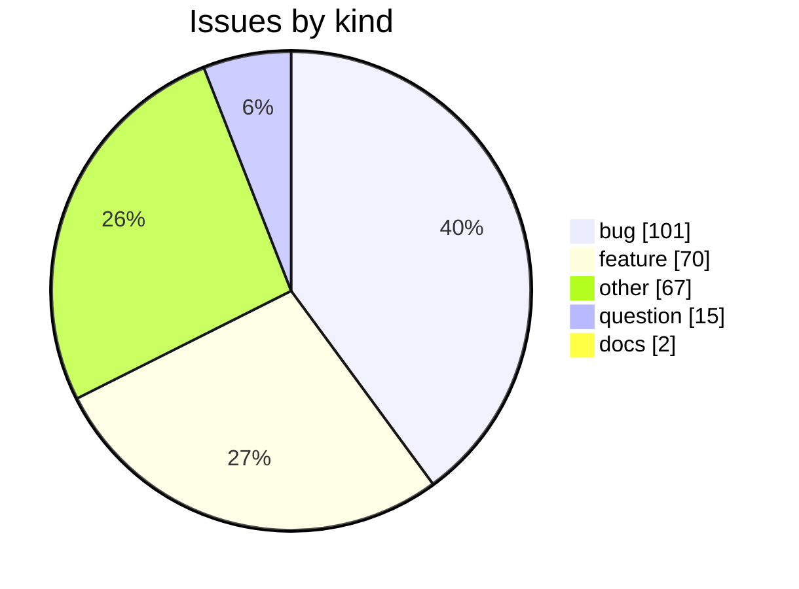

## Contributors & community

Ranked by `halls.fame` (score = `prs_merged*2 + prs_reviewed + commits_authored`, bots excluded).

| Contributor | Score | Authored | Merged | Reviewed | Commits | Areas | Evidence |
|---|---|---|---|---|---|---|---|
| `jaredfholgate` | 135 | 67 | 44 | 3 | 44 | 31 | [#7436](https://github.com/Azure/bicep-registry-modules/pull/7436), [#7438](https://github.com/Azure/bicep-registry-modules/pull/7438) |
| `AlexanderSehr` | 27 | 9 | 2 | 21 | 2 | 19 | [#7442](https://github.com/Azure/bicep-registry-modules/pull/7442), [#7454](https://github.com/Azure/bicep-registry-modules/pull/7454) |
| `abhisheksharma-ops` | 21 | 9 | 7 | 0 | 7 | 6 | [#7430](https://github.com/Azure/bicep-registry-modules/pull/7430), [#7431](https://github.com/Azure/bicep-registry-modules/pull/7431) |
| `jtracey93` | 16 | 0 | 0 | 16 | 0 | 11 | [#6484](https://github.com/Azure/bicep-registry-modules/pull/6484), [#7436](https://github.com/Azure/bicep-registry-modules/pull/7436) |
| `TomazMlakar` | 9 | 3 | 3 | 0 | 3 | 3 | [#7360](https://github.com/Azure/bicep-registry-modules/pull/7360), [#7469](https://github.com/Azure/bicep-registry-modules/pull/7469) |
| `eriqua` | 9 | 5 | 0 | 9 | 0 | 0 | [#4863](https://github.com/Azure/bicep-registry-modules/pull/4863), [#6694](https://github.com/Azure/bicep-registry-modules/pull/6694) |
| `chirag1603` | 7 | 2 | 0 | 7 | 0 | 6 | [#7430](https://github.com/Azure/bicep-registry-modules/pull/7430), [#7431](https://github.com/Azure/bicep-registry-modules/pull/7431) |
| `arjenhuitema` | 6 | 4 | 2 | 0 | 2 | 2 | [#7471](https://github.com/Azure/bicep-registry-modules/pull/7471), [#7496](https://github.com/Azure/bicep-registry-modules/pull/7496) |
| `myaschmitz` | 4 | 1 | 1 | 1 | 1 | 2 | [#7288](https://github.com/Azure/bicep-registry-modules/pull/7288) |
| `NPetersenDK` | 3 | 1 | 1 | 0 | 1 | 1 | [#7558](https://github.com/Azure/bicep-registry-modules/pull/7558) |

**Automation:** `azure-verified-modules[bot]`, `copilot-pull-request-reviewer[bot]`, `dependabot[bot]`, `github-advanced-security[bot]`, `microsoft-github-policy-service[bot]`

